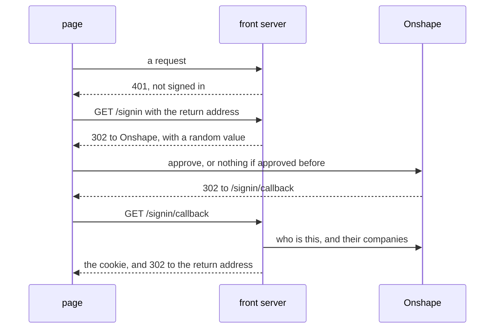

# The wizard and the front server

Every request the wizard's page makes of the front server, and every answer the front server
gives. The wizard and the front server are built separately against this file and meet.

The **wizard** is the code in the browser ([its guide](../wizard/README.md)). The **front
server** is everything behind PenguinSlicer's one address ([its guide](../front/README.md)):
it serves the wizard's page files, signs users in with Onshape, passes parts and plate
configurations to the slice service, keeps sliced files and configurations, and from phase 5
runs the relay of [printer delivery](../delivery/README.md). A **page** is the wizard as
loaded in one browser tab or in Onshape's panel. The page talks to the front server only, at
its own address, and never makes a request to another site.

The phases are those of [the plan](../docs/plans/penguin-slicer-plan.md): **phase 2**, one
machine, the development identity, no Onshape and no printer; **phase 3**, hosted, with
Onshape sign-in; **phase 4**, inside Onshape's panel; **phase 5**, the printer. Each request
below says which phase builds it.

This file refers to the data contracts by file and does not restate them:
[the configuration](configuration.md), [the part set](part-set.md),
[the plate configuration](plate-configuration.md), [the table of settings](settings-table.md),
[the error report](error-report.md), [the progress report](progress-report.md) and
[the sliced file](sliced-file.md).

**Read after:** [the architecture](../docs/architecture.md#terms), whose terms it uses.

## Contents

- [The requests at a glance](#the-requests-at-a-glance)
- [Rules for every request](#rules-for-every-request)
- [The page files and the version](#the-page-files-and-the-version)
- [Signing in and signing out](#signing-in-and-signing-out)
- [Who the user is](#who-the-user-is)
- [The configuration](#the-configuration)
- [The table of settings](#the-table-of-settings)
- [Parts](#parts)
- [Slice jobs](#slice-jobs)
- [The sliced file](#the-sliced-file)
- [The page's reports about itself](#the-pages-reports-about-itself)
- [The printer, from phase 5](#the-printer-from-phase-5)
- [The front server's error reports](#the-front-servers-error-reports)
- [Left open by the guides](#left-open-by-the-guides)

## The requests at a glance

Every path is on the front server's own address: hosted,
`https://penguinslicer.popcornpenguins.com`; on one machine, the local address the front
server is started on. Paths under `/api/` answer JSON; the others answer pages or files.

| Method | Path | For | Phase |
|---|---|---|---|
| `GET` | `/` | The wizard's page, or the start of a sign-in | 2 |
| `GET` | `/assets/<file>` | One file of the wizard's code, styles or fonts | 2 |
| `GET` | `/signin` | Start the trip to Onshape and back | 2 (development identity), 3 |
| `GET` | `/signin/callback` | Onshape's return from the trip | 3 |
| `POST` | `/api/signout` | End the sign-in, outside Onshape | 3 |
| `GET` | `/signed-out` | The plain page after signing out | 3 |
| `GET` | `/api/me` | The signed-in user and their groups | 2 |
| `GET` | `/api/configuration` | The current group's configuration | 2 |
| `PUT` | `/api/configuration` | Write the current group's configuration | 2 |
| `GET` | `/api/settings-table` | The table of settings, with the profile catalog's names | 2 |
| `POST` | `/api/parts` | Upload one part to be checked and kept | 2 |
| `POST` | `/api/slices` | Submit a plate configuration | 2 |
| `GET` | `/api/slices/<slice>` | What became of a slice job; also the fallback for its progress | 2 |
| `GET` | `/api/slices/<slice>/events` | The slice job's progress stream | 2 |
| `GET` | `/api/slices/<slice>/summary` | The sliced file's details: its summary and its expiry | 2 |
| `GET` | `/api/slices/<slice>/file` | The sliced file itself | 2 |
| `POST` | `/api/reports/failure` | A failure that happened only in the browser | 2 |
| `POST` | `/api/reports/drawing` | A summary of one use of a 3D view | 2 |
| `GET` | `/api/printer` | The current group's printer: its state and its last print | 5 |
| `POST` | `/api/printer/pairing` | Pair the printer by its pairing code | 5 |
| `DELETE` | `/api/printer/pairing` | Unpair the printer | 5 |
| `POST` | `/api/printer/deliveries` | Send a sliced file to the printer | 5 |
| `GET` | `/api/printer/deliveries/<delivery>` | A delivery job's latest progress report | 5 |
| `GET` | `/api/printer/deliveries/<delivery>/events` | A delivery job's progress stream | 5 |
| `POST` | `/api/printer/deliveries/<delivery>/cancel` | Cancel a send before the printer starts | 5 |
| `POST` | `/api/printer/deliveries/<delivery>/stop-following` | Give up a print nobody can hear, by its sender | 5 |
| `GET` | `/api/printer/mine` | The signed-in user's live delivery job and last print | 5 |

There is no request to cancel a slice job, and no request to read a user's groups again: the
front server reads them again itself
([Groups and the current group](../front/README.md#groups-and-the-current-group)).

The daemon's own requests to the relay, and the daemon's offer of a pairing code, are printer
delivery's and are not part of this contract
([printer delivery's guide](../delivery/README.md#pairing-in-phase-5)).

## Rules for every request

These hold for every request and every answer below, and are not repeated under each.

### Signed in

Every request needs a signed-in user, except `/`, `/signin`, `/signin/callback`,
`/api/signout` and `/signed-out`, which each say what they do without one. The sign-in is the **cookie**, one
encrypted cookie the front server sets and the page's code never reads
([The cookie](../front/README.md#the-cookie-and-why-there-are-no-sessions)). An `/api/` or
`/assets/` request without a readable cookie in date is answered `401` with the error report
`front.not_signed_in`. That answer is what tells an open page to make the trip to Onshape
([Signing in](../wizard/README.md#signing-in)).

The cookie is named `penguinslicer`, `HttpOnly`, `Path=/`. Hosted it is `Secure;
SameSite=None`, the kind a browser sends to a page embedded in another site, so that the same
cookie serves Onshape's panel from phase 4; on one machine over plain HTTP it is
`SameSite=Lax` without `Secure`. A sign-in lasts thirty days from its last use: an answer to a
signed-in request may carry a new `Set-Cookie` that moves the thirty days on (how often is the
builder's). The page ignores `Set-Cookie`; the browser keeps it.

**The user key** is the signed-in user's Onshape id, taken from the cookie and from nowhere
else. No request names a user. A slice job, sliced file or delivery job of another user is
answered exactly as one that does not exist, and the attempt is logged
([Whose it is](../front/README.md#whose-it-is)).

### The current group

A request that acts for a group carries the **current group** in the header
`X-PenguinSlicer-Group`, its value a group's `id` exactly as [`/api/me`](#who-the-user-is)
gives it. A `GET` may carry it instead in the query parameter `group`, so that a plain link
can download a sliced file; when both are present they must be equal. Each request below says
whether it acts for a group.

The front server accepts the current group only when the cookie lists it among the user's
groups. A request that acts for a group and names none, or names one the cookie does not list,
is answered `403` with `front.group_not_allowed`, and the refusal is logged. On that answer the
page takes the first group of `/api/me` and says so
([A user in several groups](../wizard/README.md#a-user-in-several-groups-outside-onshape)).
Inside Onshape's panel, from phase 4, a group the cookie does not list first makes the front
server read the user's groups again ([Inside Onshape's panel](#inside-onshapes-panel)).

### The wizard's mark and the origin

Every request that changes something (every `POST`, `PUT` and `DELETE` below) carries the
header `X-PenguinSlicer-Wizard: 1`, **the wizard's mark**. A browser lets no other site's page
add a custom header to a request to this address, since the front server allows no
cross-origin request. The front server also checks where the request came from: its `Origin`
header, when present, must be the front server's own address; when absent, `Sec-Fetch-Site`
must be `same-origin`. A changing request that lacks the mark or fails the origin check is
answered `403` with `front.not_from_wizard` and logged
([Requests from other sites](../front/README.md#requests-from-other-sites)).

The page sends the mark from phase 2. The front server checks it, and the origin, from
phase 3. No `GET` changes anything, so no `GET` needs the mark.

No answer carries `Access-Control-Allow-Origin` or any other header that lets another site
read it. Every page answer carries a `Content-Security-Policy` whose `frame-ancestors` names
Onshape's address alone (from phase 3; `'self'` on one machine), so no other site can show the
wizard in a frame; its whole value is under [The wizard's built files](#the-wizards-built-files).

### The version on every answer

Every answer of the front server, whatever its status, carries the header
`X-PenguinSlicer-Version`: the version of the front server and of the wizard's page files it
serves, which go out together. A progress stream also carries it as its first event
([Progress streams](#progress-streams)). A version is written `YYYYMMDDTHHMMSSZ-<commit>`:
the moment the release was built, in UTC, then the first seven characters of its commit.
Versions are ordered by the part before the hyphen.

Every request of the page's carries its own version in the header `X-PenguinSlicer-Page`. The
front server writes it in its log lines and uses it under
[A page loaded before a deploy](#a-page-loaded-before-a-deploy).

A page that sees a version newer than its own reloads itself at the next moment the wizard's
guide allows: when the user moves between steps, or once 120 seconds have passed since the
user last touched the page, and never while a request of its own is pending; an open progress
stream does not count as pending
([The page reloading itself](../wizard/README.md#the-page-reloading-itself-for-a-new-version)).
A page that sees an older version does nothing.

### Not kept by any proxy or browser

Every answer except the page files carries `Cache-Control: no-store`, so that no proxy or
browser keeps one user's sliced file, configuration or anything else. The page files are
marked as [The page files](#the-page-files-and-the-version) says.

### Answers, errors and times

- A successful `/api/` answer is a JSON object (`Content-Type: application/json`), except the
  sliced file and the progress streams. The page ignores any field it does not know.
- Every failure is answered with an [error report](error-report.md) as the whole JSON body.
  The front server writes its own reports (codes `front.*`, listed under
  [The front server's error reports](#the-front-servers-error-reports)) and passes the slice
  service's (`slice.*`) and, from phase 5, printer delivery's (`delivery.*`) unchanged, with
  the status the component gave. The page shows a report's `message` and `remedy` as they are,
  offers the button for its `action`, and never shows `detail`
  ([Who writes the sentences of a failure](../wizard/README.md#who-writes-the-sentences-of-a-failure)).
- The page acts on a report's `code` and `retryable`, never on the status alone. It treats a
  code it does not know as a failure to show, not to retry by itself.
- A time is a string in UTC, RFC 3339, to the second (`2026-11-27T22:14:05Z`). A length of
  time is a number of whole seconds, in a field whose name ends `_s`, except inside a
  [progress report](progress-report.md), whose `elapsed_s` and `expected_s` are the
  component's own and are passed unchanged: the slice service's carry a fraction of a second.
  Where the page must act
  at a moment the front server reckons (a sliced file's expiry), the answer gives the seconds
  from the answer to that moment, so that the page counts them on its own clock from the
  moment the answer arrived and is never misled by a clock that is wrong.
- An id the front server or another component makes (a slice job's, a delivery job's) is an
  opaque string of 1 to 64 letters, digits, `-` and `_`. A group's id is Onshape's id for the
  company or classroom, or the user's own Onshape id for a group of one.

### Retrying, and why every request is safe to repeat

PenguinSlicer is deployed continuously, so a request can fall in the gap of a restart. The
page retries ([When the server is slow](../wizard/README.md#when-the-server-is-slow-or-cannot-be-reached)):
quietly for 20 seconds; from 20 seconds, the panel line says the server is being slow and the
browser is retrying, with a countdown to the next attempt and Retry now; the waits between
attempts double from one second to thirty; after 300 seconds in all, the panel line says the
server could not be reached, with Try again, which starts the 300 seconds afresh. Nothing of
the user's work is dropped.

**What the page retries quietly** (a **quiet retry**):

- an attempt that gets no answer in the time the builder sets, or whose connection fails;
- an answer without the header `X-PenguinSlicer-Version`, which is not the front server's (a
  proxy's error page, for one);
- an error report whose code is one of `front.slice_unreachable`,
  `front.state_bucket_unreachable`, `front.onshape_unreachable` (on an `/api/` request),
  `front.too_many_requests` and `front.unexpected`. An answer with a `Retry-After` header is not
  tried again before that many seconds have passed.

`slice.stopping` is retried by the page too, in its own way
([Submitting a plate configuration](#submitting-a-plate-configuration)). Every other error
report, `retryable` or not, is shown and not retried by the page by itself: `slice.busy`
above all, and printer delivery's refusals of a send, since nothing queues.

So any request may arrive several times over five minutes, and a request sent twice because
its first answer was lost must leave the same result as one sent once. Each request below says
how a repeat is recognised.

**Two exceptions.** The page's [reports about itself](#the-pages-reports-about-itself) are
sent once and dropped if they fail, never retried into a loop. A progress stream is not
retried but reopened, by its own rule ([Progress streams](#progress-streams)).

### A page loaded before a deploy

A page loaded before a deploy must keep working against the front server deployed after it,
at least until it reloads ([Old and new versions together](../front/README.md#old-and-new-versions-together)).
This is the rule most easily broken by accident. A change to this contract is therefore
**allowed** when it only adds: a new request; a new optional field of a request, with a
meaning when it is left out; a new field of an answer; a new error code (the page shows any
code's sentences and does not retry an unknown code by itself). It is **forbidden** to:

- remove or rename a request, or change its method or path, or where a value travels (header,
  query or body);
- remove a field of an answer, or change a field's type or meaning, or the meaning of an error
  code (an error report's code never changes once released);
- make an optional request field required, or require a header or a field the previous page
  does not send. This is why the page sends the wizard's mark and the current group from
  phase 2, before phase 3 enforces them;
- serve a data contract in a format number the requesting page cannot read. A change that
  raises a format number (of the configuration or the table of settings) is served only to a
  page whose `X-PenguinSlicer-Page` names a version that reads it; an older page is answered in
  the format it reads;
- stop reading a cookie the previous front server set.

On its side the page fetches every file of its own code when it loads and nothing later by
name, so a deploy that replaces the page files cannot break a page already loaded.

The tests of the front server run the previous release's page against the new front server.

## The page files and the version

### `GET /` — the wizard's page

**For:** loading the wizard in a tab or, from phase 4, in Onshape's panel.

**Request.** No body. Any query string is kept through a sign-in. Inside Onshape's panel, from
phase 4, the address registered with the Onshape app carries `in=onshape` and Onshape's own
parameters (the document and element).

**Answers.**

| Status | When | Body |
|---|---|---|
| `200` | The browser is Safari, in a tab or in the panel, signed in or not | A plain page saying that PenguinSlicer needs Chrome, with none of the wizard's code (phase 3) |
| `200` | Signed in | The wizard's page: an HTML file naming its code and style files under `/assets/`, with its version in `<meta name="penguinslicer-version" content="…">` |
| `302` | Not signed in, outside Onshape's panel | To `/signin?return=<this path and query>`. In phase 2 the trip signs in the development identity at once |
| `200` | Not signed in, inside Onshape's panel (`in=onshape`, phase 4) | The **Connect page**: a plain page with the header's first line and one button, Connect, and none of the wizard's code ([Inside Onshape's panel](#inside-onshapes-panel)) |

The page answer is `Cache-Control: private, no-cache`: a browser may keep it but asks again on
every load, so a reload always finds the newest version, and no proxy keeps it.

**Signed in:** no, as above. **Group:** none. **Mark:** none (a `GET`). **Repeat:** safe,
changes nothing. **Phase:** 2; the Safari page 3; the Connect page 4.

### `GET /assets/<file>` — one file of the wizard

**For:** the files the wizard's page names: code, style sheets, fonts, pictures.

**Answers.** `200` with the file, its name carrying a hash of its contents, and
`Cache-Control: private, max-age=31536000, immutable`, since a file of that name never changes.
`401` `front.not_signed_in` without a sign-in, so that no browser without a signed-in user
receives the wizard's code. `404` `front.no_such_request` for a name this release does not have.

**Group:** none. **Repeat:** safe. **Phase:** 2.

### The wizard's built files

What the wizard's builder hands the front server's builder, on one machine and in a release
alike. *The wizard's half (the command, the layout, the names and the placeholder) is built;
the front server's half (where it finds the files, the version it fills in, the content
security policy) comes with the front server in phase 2.*

- **The command.** `make -C wizard build` builds the page files from `wizard/src/` into
  `wizard/dist/`, which is not committed. The front server's own build, and its tests that
  serve the page, run it first.
- **The layout.** `wizard/dist/index.html`, the wizard's page, and `wizard/dist/assets/`,
  every other file (code, workers, style sheets, fonts, pictures, the vendored 3D library),
  flat, with no further folders.
- **The names.** The wizard's build gives each asset its name with a hash of its contents,
  `<name>.<first 12 hexadecimal characters of its SHA-256>.<extension>`
  (`panel.3f9a1c2b7e04.css`), and writes those names into `index.html` and into every asset
  that names another (a worker's own imports), as paths `/assets/<file>`. The front server
  serves `wizard/dist/assets/` as it finds it and never renames a file.
- **The version.** `index.html` carries exactly
  `<meta name="penguinslicer-version" content="__PENGUINSLICER_VERSION__">`. The front server
  reads `index.html` once at start, replaces that one placeholder with its version, and serves
  the result as [`GET /`](#get---the-wizards-page). The page reads its version from that tag.
- **Where the front server finds them.** The setting `PENGUIN_WIZARD_DIST`, the folder;
  unset, `wizard/dist/` of the checkout the front server runs from. A folder without
  `index.html` or without the placeholder stops the start with a log line naming the folder.
- **The version from a checkout.** A release build sets the version in the setting
  `PENGUIN_VERSION`, in the form of [The version on every answer](#the-version-on-every-answer).
  Unset, as when run from a checkout, the version is the moment the front server started, in
  UTC, then `-0000000`: `20261127T221405Z-0000000`. So each start on one machine is a newer
  version, and an open page reloads itself as it would after a deploy.
- **The content security policy.** Every page answer (`/`, the Connect page, the failed
  sign-in page, the Safari page and the signed-out page) carries exactly:

  ```
  Content-Security-Policy: default-src 'self'; script-src 'self'; style-src 'self'; img-src 'self' data: blob:; font-src 'self'; connect-src 'self'; worker-src 'self' blob:; object-src 'none'; base-uri 'none'; form-action 'self'; frame-ancestors 'self'
  ```

  with `frame-ancestors https://cad.onshape.com` in place of `'self'` from phase 3. So the
  wizard has no inline script and no `style` attribute or element in its markup (styles set
  from code on an element's style object are allowed), loads nothing from another site, and
  may start workers from its own files or from `blob:` addresses. It uses no WebAssembly in
  phase 2; a drawing method the first trial chooses that needs it adds `'wasm-unsafe-eval'`
  to `script-src` here, in the commit that brings it.

## Signing in and signing out

A sign-in is made by a **trip**: the browser goes to Onshape and comes back
([Onshape is the only sign-in](../front/README.md#onshape-is-the-only-sign-in-and-there-are-no-accounts)).
The page makes the trip by itself, at a quiet moment, when a request is answered
`front.not_signed_in`, and returns to the same step with the plate as it was. Before it leaves
it notes in the browser's storage that it is making a trip; a page that comes back and whose
first request is again answered `front.not_signed_in` takes the trip as failed and does not
leave again by itself, so a browser that withholds the cookie cannot repeat sign-ins without
end ([Signing in](../wizard/README.md#signing-in)).



### `GET /signin` — start the trip

**For:** sending the browser to Onshape to sign in, and back.

**Request.** Query parameters:

| Parameter | Required | Meaning |
|---|---|---|
| `return` | no | The path, with its query, to come back to. It must start with a single `/`; anything else (another site, `//…`) is ignored and `/` used |
| `window` | no | `1` when the trip is made in the small window that the Connect button opens (phase 4) |

**Answers.**

| Status | When | Then |
|---|---|---|
| `302` | Hosted | To Onshape's approval page, with a random value of the front server's own making, which it also keeps in a short-lived cookie of its own for the callback to compare |
| `302` | Phase 2, the development identity on | The cookie of the development identity is set and the browser goes straight to `return`, with no call to Onshape ([The development identity](../front/README.md#the-development-identity)) |

**Signed in:** not needed; a signed-in browser makes the trip as well, which is how a
different person is signed in. **Group:** none. **Mark:** none: it is a navigation of the
whole tab, which changes nothing until Onshape answers. **Repeat:** safe; each trip makes a
fresh random value and the last one wins. **Phase:** 2 for the development identity; 3 for
Onshape.

### `GET /signin/callback` — Onshape's return

**For:** Onshape's return from the trip. Only Onshape sends the browser here.

**Request.** Onshape's own query parameters: the code, the random value, or an error.

**Answers.**

| Status | When | Body |
|---|---|---|
| `302` | The value is the one sent out and Onshape answered both calls (who the user is, and their companies and classrooms) | Sets the cookie; to `return` |
| `200` | The same, in the small window (`window=1`) | A small page that tells its opener, by a message to the front server's own address only, `{"penguinslicer": "signed_in"}` ([examples/wizard-front/signin-window-signed-in.json](examples/wizard-front/signin-window-signed-in.json)), and closes itself |
| `401` | The user refused Onshape's request | The **failed sign-in page**, with `front.sign_in_refused` |
| `401` | The value is not the one sent out, or Onshape refused the code | The failed sign-in page, with `front.sign_in_failed` |
| `503` | Onshape did not answer | The failed sign-in page, with `front.onshape_unreachable` |

The **failed sign-in page** is a plain page served by the front server, since the wizard's
code cannot run without a sign-in: the header's first line, the error report's `message` and
`remedy`, and that the user's parts, layout and settings are kept in this browser, with one
button, **Sign in with Onshape**, a link to `/signin` with the same `return`
([Signing in](../wizard/README.md#signing-in)). In the small window the failed page instead
tells its opener `{"penguinslicer": "sign_in_failed", "report": <error report>}` and closes
itself; the panel shows the report's sentences in place of the step, with the Connect button.

**Repeat:** a callback is used once; a repeat of it finds its random value spent and answers
`front.sign_in_failed`, and Sign in with Onshape makes a new trip. **Phase:** 3; the window 4.

### Inside Onshape's panel

From phase 4 the page in Onshape's panel signs in through the **Connect** button: the first
time in a browser, or when the sign-in has run out, the panel shows Connect, which opens
`/signin?window=1&return=/` in a small window; the window makes the trip and closes itself
when its callback tells the opener the outcome
([The cookie inside Onshape's panel](../front/README.md#the-cookie-inside-onshapes-panel)).
On `signed_in` the Connect page reloads itself, or an open page goes on with the request that
was refused. The opener accepts a message only from the front server's own address.

Every request of a page in the panel carries:

| Header | Meaning |
|---|---|
| `X-PenguinSlicer-In: onshape` | The request comes from the page in Onshape's panel |
| `X-PenguinSlicer-Onshape-Document` | The id of the Onshape document the user has open |
| `X-PenguinSlicer-Onshape-User` | The Onshape user Onshape says is signed in, when Onshape tells the panel |
| `X-PenguinSlicer-Group` | The company of that document, when Onshape tells the panel |

- **A different person.** When `X-PenguinSlicer-Onshape-User` is not the user the cookie names,
  the request is answered `401` `front.not_signed_in`, as one that is not signed in. The page
  makes the trip by Connect; after it, `/api/me` names the new user and the page clears the
  previous user's stored work.
- **The group follows the document.** With `X-PenguinSlicer-In: onshape`, a current group the
  cookie does not list makes the front server read the user's groups again from Onshape with
  the tokens in the cookie, and write the fresh list into the cookie in the same answer; only
  then is the request accepted or answered `front.group_not_allowed`. Without the group
  header, the front server finds the company of `X-PenguinSlicer-Onshape-Document` from
  Onshape. What the browser says is never proof: it can cause a fresh read, and only
  Onshape's answer adds a group. Outside the panel nothing causes a fresh read.

Whether Onshape tells a panel the user and the company is not known until phase 4; the headers
are written so that either answer fits ([Left open by the guides](#left-open-by-the-guides)).

### `POST /api/signout` — sign out

**For:** the Sign out link outside Onshape ([Sign-out](../wizard/README.md#sign-out)).

**Request.** No body.

**Answers.** `200` `{}`, with a `Set-Cookie` that removes the cookie. The page then goes to
`/signed-out`. It costs no call to Onshape, and the front server has nothing else to forget
([Signing out](../front/README.md#signing-out)). See
[examples/wizard-front/signout.json](examples/wizard-front/signout.json).

**Signed in:** not needed; signing out without a cookie answers the same. **Group:** none.
**Mark:** yes. **Repeat:** safe; a second sign-out answers the same. **Phase:** 3.

### `GET /signed-out` — the page after signing out

**For:** what a user sees after Sign out.

**Answers.** `200`: a plain page with the header's first line, "You are signed out of
PenguinSlicer.", and one button, Sign in with Onshape, a link to `/signin`. Nothing on it
leaves for Onshape by itself. It needs no sign-in and holds none of the wizard's code.

**Repeat:** safe. **Phase:** 3.

## Who the user is

### `GET /api/me`

**For:** who the user is and which groups they are in, so that the page ties its stored work
to its user, names the configuration in use and, outside Onshape, offers a user in several
groups the others. The front server answers from the cookie, without calling Onshape
([Groups and the current group](../front/README.md#groups-and-the-current-group)).

**Answers.** `200`:

```json
{
  "user": {"id": "5f0c2a9e1b7d4c3a8e6f1234", "name": "Alex Chen"},
  "groups": [
    {"id": "61a9c0d2e4b7f80012345678", "name": "6238 (Popcorn Penguins)"},
    {"id": "6202bb11c0ffee0098765432", "name": "FRC 1678"}
  ]
}
```

| Field | Meaning |
|---|---|
| `user.id` | The user's Onshape id, which is also the user key. The page keeps it beside its stored work, and clears the stored work when a different id signs in at the browser |
| `user.name` | The user's name as Onshape gives it |
| `groups` | At least one. Each group's `id` (the value of `X-PenguinSlicer-Group`) and `name`, as Onshape gives it, in a fixed order; "the first of the user's groups" is the first of this list. A user in no company or classroom has one group, their own, named by their name |

In phase 2 the answer is the development identity's made-up user and group.

See [examples/wizard-front/me.json](examples/wizard-front/me.json).

**Signed in:** yes. **Group:** none. **Repeat:** safe. **Phase:** 2.

## The configuration

### `GET /api/configuration` — read it

**For:** the current group's configuration, whole and always usable, when a page opens (and so
after every sign-in) and when the user presses the reload glyph
([Reading it and writing it](../front/README.md#reading-it-and-writing-it)).

**Answers.** `200`:

| Field | Meaning |
|---|---|
| `configuration` | The document, as [the configuration's contract](configuration.md) defines it. Never an invalid one |
| `source` | `"group"` when it is the group's own saved document; `"default"` when it is the built-in default, because the group has none or because its saved document is invalid |
| `name` | The name of the configuration in use, which the header shows after "Config: ": the group's name with `source` `"group"`, and `"PenguinSlicer default"` with `"default"` |
| `revision` | The state bucket's marker of the group's saved document as it stands, invalid or not, or `null` when the group has no saved document. A write names it |

A saved document that is invalid is answered as the default and is never an error: the saved
file is left untouched and the front server writes to the log what is wrong
([When a document is invalid](configuration.md#when-a-document-is-invalid)). The wizard has no
screen for it.

**Signed in:** yes. **Group:** yes. **Repeat:** safe. **Phase:** 2.

### `PUT /api/configuration` — write it

**For:** the configuration's edit screens, which are in no phase yet. Built in phase 2, with
nothing in the wizard using it, to prove the conditional write early.

**Request.**

```json
{"based_on": "<revision from the read>", "configuration": { "format": 1, "...": "..." }}
```

`based_on` is the `revision` the edit started from, `null` for a group that had none. See
[examples/wizard-front/configuration-write-request.json](examples/wizard-front/configuration-write-request.json).

**Answers.**

| Status | When | Body |
|---|---|---|
| `200` | Written | `{"revision": "<new>", "source": "group", "name": "<the group's name>"}` |
| `409` | The saved document is no longer `based_on`: someone else changed it | `front.configuration_changed`. Nothing is written and nothing is merged |
| `422` | The document is invalid by [the configuration's rules](configuration.md#when-a-document-is-invalid) | `front.configuration_invalid`, whose sentence names the first rule broken |

The `200` answer: [examples/wizard-front/configuration-written.json](examples/wizard-front/configuration-written.json).

**Signed in:** yes. **Group:** yes. **Mark:** yes. **Repeat:** a write repeated because its
answer was lost finds `based_on` stale, since its own first attempt changed the document. The
front server recognises it: when the condition fails and the saved document is byte for byte
the one this request carries, the answer is `200` with the current `revision`. **Phase:** 2.

## The table of settings

### `GET /api/settings-table`

**For:** advanced mode, the changes box and the plate summary, which are drawn from the table
of settings; and the plate's size and height, from the printer the configuration names. The
page asks for it when the page opens, since the Layout step takes the plate's size and height
from it and the plate summary and the changes box take each profile's values from it; it asks
again only after a reload, or when the configuration it reads again names a printer the table
it holds does not have.

**Answers.** `200`, the [table of settings](settings-table.md) as the slice service that is
running supplies it, unchanged and whole, with the profile catalog's names in it. The front
server keeps no copy from one start to the next
([The list of settings and the profile catalog's names](../front/README.md#the-list-of-settings-and-the-profile-catalogs-names)).
It is a few hundred kilobytes and is sent compressed when the browser accepts it. `503`
`front.slice_unreachable` when the slice service does not answer.

**Signed in:** yes. **Group:** none: the table is the slice service's, the same for every
group. **Repeat:** safe. **Phase:** 2.

## Parts

### `POST /api/parts` — upload one part

**For:** checking and keeping one part at the moment the user adds it, so that a part that
cannot be sliced is refused on the Parts step before anything is laid out
([Check a part when it arrives](../slice/README.md#check-a-part-when-it-arrives)). A part
comes from a [part set](part-set.md); each of its parts is uploaded by itself.

**Request.** The query parameter `units`, `mm` or `in`: the part's units label, which for a
file is the switch beside the upload area and from phase 4 the Onshape document's units; it is
not assumed to equal the configuration's `upload_units`. The body is the part's binary STL,
the part set's `stl_bytes` exactly, with `Content-Type: application/octet-stream` and a
`Content-Length`. Neither the page nor the front server changes a byte.

The page checks the size itself first and sends nothing over 7,500,084 bytes (the plate
configuration's [limit for one part](plate-configuration.md#limits-in-phase-2)). The front
server refuses a larger `Content-Length` before reading the body, with the slice service's own
report for that limit, and passes the rest through to the slice service in pieces with the user
key and the label.

**Answers.**

| Status | When | Body |
|---|---|---|
| `201` | The part passes the checks and is kept in the part store | The part's record, below |
| `413` | Over 7,500,084 bytes, or over 150,000 triangles | `slice.part_too_detailed` |
| `422` | The slice service's checks refuse the part: not readable as a part, a text STL, too small or flat, nothing to print, too large for every printer of the catalog | The slice service's report (`slice.part_unreadable`, `slice.part_not_binary`, `slice.part_too_small`, `slice.part_no_volume`, `slice.part_too_large`). The page shows it as a notification and does not add the part ([A part that cannot be used](../wizard/README.md#a-part-that-cannot-be-used)) |
| `400` | No units label, or one that is neither `mm` nor `in` | `slice.bad_units` |
| `400` | No `Content-Length` | `front.bad_request` |
| `429` | The user is uploading faster than the front server allows (the figure is the builder's) | `front.too_many_requests`, with `Retry-After`; a quiet retry |
| `503` | The slice service does not answer | `front.slice_unreachable`; a quiet retry |

The part's record, the slice service's answer passed unchanged:

```json
{
  "sha256": "9f2c…64 lowercase hexadecimal characters…",
  "units": "in",
  "measurements": {"triangles": 1288, "size_mm": [50.8, 50.8, 4.775], "volume_mm3": 9910.4},
  "warnings": [
    {"code": "slice.part_not_watertight",
     "message": "This part is not watertight: its mesh has 14 open edges in 2 places. …",
     "detail": "…"}
  ]
}
```

See [examples/wizard-front/part-record.json](examples/wizard-front/part-record.json).

| Field | Meaning |
|---|---|
| `sha256` | The SHA-256 hash of the bytes, by which the plate configuration names the part. The page compares it with the hash it made itself, and uploads again once if they differ |
| `units` | The label it was kept under; with `sha256` it names one entry of the part store |
| `measurements` | `triangles`; `size_mm`, the bounding box in millimetres after the scale; `volume_mm3`, or `null` for a surface that is not closed |
| `warnings` | The slice service's warnings about the part, in the shape of the sliced file's `part_warnings` ([the sliced file](sliced-file.md#summary)), possibly empty. The part is added and each warning is shown on its row in amber. The part's name is not sent with an upload, so a warning here carries no `where` and its sentence does not name the part; the row it is shown on does |

**Signed in:** yes. **Group:** yes, for the log and the check. **Mark:** yes. **Repeat:** the
same bytes under the same units answer the same record and count as a use. **Phase:** 2.

## Slice jobs

### Submitting a plate configuration

#### `POST /api/slices`

**For:** slicing a plate: entering the Preview step with a plate not yet sliced as it stands,
Slice again, and the page submitting again by itself
([Slicing](../wizard/README.md#slicing)).

**Request.** The body is a [plate configuration](plate-configuration.md) in its phase 2 form:
parts named by `sha256` and `units` with no files, the plate's `plate_id` and the submission's
`submission_id` ([The plate and the submission](plate-configuration.md#the-plate-and-the-submission)),
the three profile names and the `overrides`, made from the configuration and the user's
changes as that contract's table says. The front server passes it to the slice service with
the user key, and notes the current group beside the slice job for the log and for storing its
sliced file. At most 1 MB; the front server refuses a larger body before reading it, with the
slice service's report for that limit.

**Answers.**

| Status | When | Body | The page |
|---|---|---|---|
| `202` | Accepted, or a repeat of a submission already accepted | The slice job, below | Keeps the slice job's id and the time it submitted in the browser's storage, and opens its progress stream |
| `422` | The plate configuration names parts the part store does not hold | `slice.part_missing`, with `where.missing_parts` ([Parts missing from the part store](plate-configuration.md#parts-missing-from-the-part-store)) | Uploads those parts again and submits again with the same `submission_id`, showing nothing |
| `422` or `400` | The plate is refused by the slice service's checks: its form, its size, its profiles or settings, a part too large for the plate's printer, its placement | The slice service's report (`slice.bad_plate_configuration`, `slice.too_many_instances`, `slice.too_many_parts`, `slice.unknown_printer`, `slice.profiles_not_offered`, `slice.bad_overrides`, `slice.part_too_large`, `slice.placement_off_plate`, `slice.placement_too_tall`, `slice.placement_too_close`) | Shows it ([When a slice fails](../wizard/README.md#when-a-slice-fails)) |
| `503` | **The busy answer:** one slice running and two waiting, no more may wait | `slice.busy`, "The slicer is busy, try again in a minute." | An amber message with Slice again; never retries by itself |
| `503` | **The stopping answer:** the slice service has been asked to stop, as at a deploy, and takes no new slice job | `slice.stopping`, `retryable` true | Shows the slice as waiting, with a stage line that the slicer is restarting, and submits again by itself with the same `submission_id`, for up to 300 seconds; past them, the panel line says the server could not be reached |
| `429` | The user is submitting faster than the front server allows (the figure is the builder's) | `front.too_many_requests`, with `Retry-After` | A quiet retry |
| `503` | The slice service does not answer | `front.slice_unreachable` | A quiet retry |

The stopping answer is not the busy answer, so that a deploy that goes as designed never tells
a user the slicer is busy. The front server holds no submission back for later; it passes the
slice service's answer at once
([What a user sees while the slice service stops](../slice/README.md#what-a-user-sees-while-the-slice-service-stops)).
`slice.stopping` is the slice service's code and is named here; its guide's details follow
this name.

The slice job, in the answer to a submission:

```json
{"slice": {"id": "3f9a1c2b", "plate_id": "…", "submission_id": "…", "progress": { "job": "3f9a1c2b", "state": "queued", "ahead": 2, "...": "..." }}}
```

`progress` is the slice job's latest [progress report](progress-report.md) when the answer is
made: its first, `queued` with `ahead`, or a later one when the slice has already started, as
it does at once when nothing is ahead of it. See
[examples/wizard-front/slice-accepted.json](examples/wizard-front/slice-accepted.json).

**Signed in:** yes. **Group:** yes. **Mark:** yes. **Repeat:** recognised by the slice
service by the user key and `submission_id`: a repeat of a submission it accepted is answered
`202` with the first attempt's slice job and starts nothing, replaces nothing and takes no
place ([A plate configuration submitted twice](../slice/README.md#a-plate-configuration-submitted-twice)).
A submission that was refused started no slice job and may be sent again with the same value.
Within one plate, a new `submission_id` with the same `plate_id` replaces that plate's earlier
unfinished slice job, whose last report is `cancelled` with `cancel_reason` `replaced`; a
slice job is never replaced by another plate's. Nothing limits how many slice jobs one user
has. **Phase:** 2.

### Asking about a slice job

#### `GET /api/slices/<slice>`

**For:** a page that has lost its state and asks what became of the slice job whose id it
kept ([A page that comes back](../front/README.md#a-page-that-comes-back)); and, should
progress streams prove to be held back by the hosts, the request a page makes every second or
two in place of a stream ([Progress streams](#progress-streams)).

**Answers.** The front server asks the slice service, which remembers a slice job for two
hours after it ends, and looks in the state bucket for its sliced file. The answer is always
the slice job's latest progress report as the front server reckons it:

```json
{"progress": { "job": "3f9a1c2b", "state": "done", "sequence": 41, "...": "...", "sliced_file": { "...": "..." }}}
```

See [examples/wizard-front/slice-done.json](examples/wizard-front/slice-done.json).

| Answer | Status | `progress` | When | The page ([Coming back](../wizard/README.md#coming-back-to-running-work)) |
|---|---|---|---|---|
| Waiting or running | `200` | `state` `queued` (with `ahead`) or `running` | The slice service says so; also when the slice has ended but its sliced file is not yet stored | The Preview step, with its progress |
| Finished | `200` | `state` `done`, with the field `sliced_file`, the sliced file's details ([below](#the-sliced-files-details)) | The sliced file is stored and not expired | The Preview step, with the result |
| Ended in an error | `200` | `state` `failed`, with `error` | The slice failed | The Preview step, with the failure |
| Expired | `200` | `state` `failed`, with `error` `front.sliced_file_expired` | The sliced file was stored and has since expired | The plate as it was; the expired message on the Preview and Send steps |
| Replaced | `200` | `state` `cancelled`, `cancel_reason` `replaced` | A later slice job of the same plate replaced it | Nothing: it follows the later one |
| Ended because the slice service was asked to stop | `200` | `state` `cancelled`, `cancel_reason` `shutdown` | It was still waiting when the slice service was asked to stop | Submits the plate again by itself, with a new `submission_id` |
| Unknown | `404` | none: the body is `front.slice_unknown` | Neither the slice service nor the state bucket knows it, or it is another user's | Decides from the time it kept: submitted less than two hours ago, the slice service restarted, so it uploads the parts and submits again; more, the sliced file has expired |

How a page tells the cancel at a stop from a replacement is the progress report's
`cancel_reason` ([A slice job's reports](progress-report.md#a-slice-jobs-reports)); there is
no cancel by hand, so `requested` never reaches a page.

**The reports the front server passes.** The front server passes the slice service's reports
with their own `sequence`, and holds back the `done` report until the sliced file and its
summary are stored, adding to it the field `sliced_file`. Until then a page sees the slice
service's last report before `done`. A `done` report whose sliced file is over 50 MB, which the
front server refuses to store, reaches the page instead as `failed`, with the same `sequence`
and the error `front.sliced_file_too_large`. The front server keeps the `done` report beside
the sliced file, so that it can answer after the slice service has forgotten the slice job;
the expired answer is that report turned `failed`, with `sequence` one more.

**Signed in:** yes. **Group:** yes. **Repeat:** safe. **Phase:** 2.

### Progress streams

A **progress stream** is one connection on which the front server sends a job's progress
reports as they happen, as server-sent events. The page opens it with `fetch`, so that it
sends the same headers as any request and can read an error report when the stream is refused.
The front server feeds every page's stream from the one stream it holds on each unfinished
slice job, so three tabs watching one slice job cost the slice service one connection
([The front server follows every slice job itself](../front/README.md#the-front-server-follows-every-slice-job-itself)).

#### `GET /api/slices/<slice>/events`

**Answers.** `200`, `Content-Type: text/event-stream`, then events:

```
event: version
data: {"version": "20261127T221405Z-ab12cd3"}

event: progress
id: 17
data: {"job": "3f9a1c2b", "state": "running", "stage": "generating_infill", "...": "..."}

: keep-alive

event: progress
id: 41
data: {"job": "3f9a1c2b", "state": "done", "...": "...", "sliced_file": {"...": "..."}}
```

See [examples/wizard-front/slice-events.txt](examples/wizard-front/slice-events.txt).

- The first event is `version`, the front server's version, since a page reading a stream may
  not see its headers.
- The second is the latest progress report at once, so a page that connects late or
  reconnects catches up in one event. Each `progress` event's `id` is the report's `sequence`.
- A comment line (`:`) is sent at least every fifteen seconds while there is nothing to report,
  because Cloudflare closes a request after 125 seconds without data and Railway after five
  minutes ([Progress streams](../docs/architecture.md#progress-streams)).
- The reports are those of [Asking about a slice job](#asking-about-a-slice-job): `done` only
  once the sliced file is stored, and carrying `sliced_file`.
- After a final report (`done`, `failed`, `cancelled`) the front server closes the stream.
  Railway closes any request after fifteen minutes, and every restart of the front server
  closes every stream; the page reopens a stream that closed before a final report, silently.

**Refused before the stream starts,** with an ordinary JSON answer: `401`, `403`, `404`
`front.slice_unknown`, and `429` `front.too_many_streams` when the user already holds four
progress streams, on slice jobs and delivery jobs together. That refusal is not a quiet retry;
what the page then shows is open ([Left open by the guides](#left-open-by-the-guides)).

**A stream that cannot be had.** A stream that has failed to reopen for 20 seconds, or that is
open and has carried nothing, not even a comment line, for 45 seconds, counts as a failed
request: the page shows the panel line and keeps reopening for up to 300 seconds
([When the server is slow](../wizard/README.md#when-the-server-is-slow-or-cannot-be-reached)).
Should Cloudflare or Railway hold a stream's events back, the page asks
[`GET /api/slices/<slice>`](#asking-about-a-slice-job) every second or two instead, which
answers the same latest report
([Whether progress arrives as it is sent](../front/README.md#whether-progress-arrives-as-it-is-sent)).

**Signed in:** yes. **Group:** yes. **Repeat:** safe; reopening starts from the latest
report. **Phase:** 2.

## The sliced file

A sliced file is kept until two hours after its slice ended, or two hours after its last print
ended, whichever is later; before phase 5 nothing is printed, so two hours after the slice
ended is the whole rule. Past that the front server refuses it as expired and deletes it
([How long a sliced file lives](../front/README.md#how-long-a-sliced-file-lives)).

### The sliced file's details

The **sliced file's details** are one JSON object, carried by the `done` report as its field
`sliced_file` and answered by `GET /api/slices/<slice>/summary`:

| Field | Meaning |
|---|---|
| `slice` | The slice job's id |
| `file` | The sliced file's name ([the sliced file](sliced-file.md#name)), the name a download is offered under |
| `size_bytes` | Its size, which the Send step's download notification gives |
| `summary` | The summary the slice service gave beside the file, unchanged ([the sliced file](sliced-file.md#summary)): instances, print time, filament in metres and grams, layers, Orca's warnings and the part warnings |
| `slice_ended_at` | When its slice ended |
| `expires_at` | The moment the front server will refuse it, as the front server reckons it; `null` while a delivery job that uses it has not ended |
| `expires_in_s` | Seconds from this answer to `expires_at`; `null` with it. The page counts these on its own clock from the moment the answer arrived and shows, at that moment, that the plate's slice has expired ([A sliced plate that expires](../wizard/README.md#a-sliced-plate-that-expires)) |

From phase 5 the moment moves when a print of the plate ends; the new moment reaches the page
in the delivery job's final report ([A delivery job's progress](#a-delivery-jobs-progress)) and
in [`GET /api/printer/mine`](#the-users-live-delivery-job-and-last-print)
([Telling the page when a sliced file expires](../front/README.md#telling-the-page-when-a-sliced-file-expires)).

### `GET /api/slices/<slice>/summary`

**For:** the Preview step's print time, filament and warnings, and the moment of expiry, for a
page that has the slice job's id but not its `done` report.

**Answers.** `200` `{"sliced_file": <the sliced file's details>}`
([examples/wizard-front/slice-summary.json](examples/wizard-front/slice-summary.json)). `409`
`front.sliced_file_not_ready` while the slice job has not finished, or its sliced file is not
yet stored. `410` `front.sliced_file_expired` once it has expired, or has gone from the state
bucket by any other means. `404` `front.slice_unknown` for a slice job not known, or another
user's.

**Signed in:** yes. **Group:** yes. **Repeat:** safe. **Phase:** 2.

### `GET /api/slices/<slice>/file`

**For:** the sliced file itself, from the state bucket's copy, for the Preview step to draw
and for Download. The browser never stores a sliced file, and no request takes one from a
browser.

**Answers.** `200`, `Content-Type: application/octet-stream`, `Content-Length`, and
`Content-Disposition: attachment; filename="<file>"`, the name of the sliced file's details. At
most 50 MB. The front server passes it through without holding it whole. The same refusals as
`/summary`: `409` `front.sliced_file_not_ready`, `410` `front.sliced_file_expired` (a preview
or a download of a file that has gone is told it has expired and the plate must be sliced
again), `404` `front.slice_unknown`.

The page fetches it with its headers for the Preview step, and for Download may instead follow
a plain link with the current group in the query (`?group=<id>`), so that the browser saves the
file without the page holding it.

**Signed in:** yes. **Group:** yes, in the header or the query. **Repeat:** safe; a fetch cut
off is fetched again from the start. **Phase:** 2.

## The page's reports about itself

A failure that happens only in the browser reaches no server by itself, and a target for
drawing speed checked only before a release says nothing of users' own machines. So the page
reports both, and the front server writes one log line for each report
([What the wizard reports about itself](../wizard/README.md#what-the-wizard-reports-about-itself),
[What the wizard's guide asks of the front server](../front/README.md#what-the-wizards-guide-asks-of-the-front-server)).

Both kinds share these rules:

- A report never holds a part's bytes or geometry, a part's name in a drawing summary, or the
  contents of the browser's storage. The front server writes only the fields listed below,
  cuts each string to the length given, and drops anything else a report carries, since a
  report comes from a browser like any other request.
- The page sends at most a few reports a minute, and the front server holds each page to the
  same limit itself, counted for the signed-in user and the report's `page`, a random id the
  page makes when it loads (the figure is the builder's). Past it the answer is `429`
  `front.too_many_reports`.
- A report that cannot be sent, or is refused, is dropped: the page does not retry it, so a
  report can never loop.
- **Answers:** `204`, no body; or `429` as above; or the refusals every request can meet.
- **Signed in:** yes; a page that is not signed in drops its reports. **Group:** sent when the
  page has one, and written in the line; never refused for it. **Mark:** yes. **Repeat:** not
  retried; a duplicate costs one log line. **Phase:** 2.

### `POST /api/reports/failure`

```json
{"page": "c1e0…", "what": "part_not_drawable", "step": "parts", "browser": "Chrome", "browser_version": "131.0", "software_3d": true, "part_sha256": "9f2c…", "detail": "RangeError at mesh.js:212"}
```

See [examples/wizard-front/report-failure-request.json](examples/wizard-front/report-failure-request.json).

| Field | Required | Meaning |
|---|---|---|
| `page` | yes | The page's random id |
| `what` | yes | What failed: `part_not_drawable` (a part the slice service accepted and the page cannot draw), `storage_refused`, `storage_cleared`, `drawing_context_lost`, `layout_failed` (the layout code failing on a part), `page_failed` (the page's own code failing) |
| `step` | yes | `parts`, `settings`, `advanced`, `layout`, `preview`, `send`, or `none` |
| `browser`, `browser_version` | yes | As the browser gives them; at most 40 characters each |
| `software_3d` | yes | Whether the browser draws 3D in software |
| `part_sha256` | no | The hash of the part concerned, by which it is found in the slice service's own lines |
| `detail` | no | The error's own message and where in the page's code it arose, at most 1,000 characters; never a part's name, bytes or geometry, or anything from the storage |

The page's version comes from `X-PenguinSlicer-Page`.

### `POST /api/reports/drawing`

One summary for each use of the Layout view and of the Preview step, never frame by frame:

| Field | Required | Meaning |
|---|---|---|
| `page` | yes | The page's random id |
| `view` | yes | `layout` or `preview` |
| `fps_typical`, `fps_worst` | yes | Frames a second, typical and worst |
| `first_layer_ms` | with `preview` | Milliseconds from opening the Preview step to the first layer drawn |
| `longest_hold_ms` | yes | The longest stretch the main thread was held |
| `instances` | yes | The instances drawn |
| `sliced_file_bytes`, `sliced_file_lines` | with `preview` | The sliced file's size and its lines drawn |
| `browser`, `browser_version`, `os` | yes | As the browser gives them; at most 40 characters each |
| `drawing` | yes | `graphics_card` or `software` |
| `graphics_card` | no | The card's name as the browser gives it, at most 120 characters |
| `processors`, `memory_gb` | no | As the browser reports them |
| `panel_width_px`, `pixel_ratio` | yes | The panel's width and the screen's pixel density |
| `in_onshape` | yes | Whether the wizard is inside Onshape's panel |

See [examples/wizard-front/report-drawing-request.json](examples/wizard-front/report-drawing-request.json).

## The printer, from phase 5

Everything here is built in phase 5. The front server passes each request to the relay of
[printer delivery](../delivery/README.md) with the signed-in user and the current group,
already checked against the cookie; the relay never sees the cookie
([Running the relay](../front/README.md#running-the-relay-from-phase-5)). Printer delivery's
refusals reach the page unchanged as error reports with `delivery.*` codes, each with its
sentence of what is in the way. Every request here needs a signed-in user and acts for the
current group.

### `GET /api/printer` — the printer's status

**For:** the printer-status icon on every step, the printer details, the busy card and the
Send step ([The printer-status icon](../wizard/README.md#the-printer-status-icon)). The page
asks again at an interval the builder sets within the user's limit on status requests.

**Answers.** `200` `{"printer": {…}}`:

| Field | Meaning |
|---|---|
| `state` | `no_printer`: the current group has no paired-printer record. `not_heard_from`: paired, and nothing heard since pairing or since the front server started (the grey dot and "…"). `offline`: no sync from the daemon for two minutes. `free`: no print, or its last print ended. `sending`, `starting`, `heating`, `printing`, `waiting_for_person`: a print is under way, whoever started it. `failed`: the last print ended on a fault and nothing has started since; whether a print that is no longer followed counts is open ([Left open by the guides](#left-open-by-the-guides)) ([The stages](../delivery/README.md#the-stages-what-a-user-sees-and-what-can-be-cancelled)) |
| `name` | The printer's name, as the printer reports it and the daemon sent it when paired; `null` with `no_printer` |
| `pairing` | `complete`, or `awaiting_daemon` while the daemon has not yet collected its token after a code was typed; absent with `no_printer` |
| `silent_for_s` | With `offline`: seconds since the daemon's last sync, as the front server reckons it at this answer |
| `silent_at_least` | With `offline`: `true` when the front server has restarted since it last heard the daemon and knows only that it has been silent at least `silent_for_s` ("Not heard from for at least 3 minutes.") ([How long a printer has been silent](../delivery/README.md#how-long-a-printer-has-been-silent)) |
| `current` | The print under way, or `null`. Below |
| `last_print` | The group's last print that PenguinSlicer sent and that has ended, kept a day after it ended, or `null`. Below |
| `daemon` | Optional: `{"version": "…", "outdated": true}` when the relay knows them |

`current`:

| Field | Meaning |
|---|---|
| `from_penguinslicer` | `false` for a print started at the printer's own screen, which has no sender, no description and no delivery job |
| `sender` | `{"name": "Alex Chen", "you": false}`, the sender's name and whether it is the signed-in user; absent when not from PenguinSlicer |
| `description` | The one-line description of the plate ("8 instances of Gusset Plate"); absent when not from PenguinSlicer |
| `delivery` | The delivery job's id, given to its sender only |
| `percent`, `layer`, `total_layers`, `remaining_min` | The printer's own figures, each absent when not reported |
| `stale`, `stale_age_s` | Whether the figures are older than 40 seconds, and their age: the print has gone quiet ([A print that has gone quiet](../wizard/README.md#a-print-that-has-gone-quiet)) |

`last_print`: `sender` as above, `description`, `ended_at`, `ended` (`done`, `failed` or
`cancelled`), `error` (the error report of a failed one, whose `code` tells a print nobody could
hear any more, `delivery.outcome_unknown`, from a fault at the printer), `layer` and
`total_layers` of a failed one, and `delivery` for its sender.

Users of one group see each other's names and descriptions; nobody outside the group sees
either.

**Repeat:** safe. Status requests are limited for each user; past the limit the answer is
`delivery.rate_limited`, which the page meets only if broken.

### `POST /api/printer/pairing` — pair

**For:** the pairing form in the printer details: any signed-in user of the group types the
code the daemon shows ([Pairing a printer](../wizard/README.md#pairing-a-printer)).

**Request.** `{"code": "b6mq dn77"}`. Capitals or small letters, with or without the hyphen;
spaces around it are dropped. The code is never logged and never kept beyond its hash. See
[examples/wizard-front/printer-pairing-request.json](examples/wizard-front/printer-pairing-request.json).

**Answers.**

| Status | When | Body | The page |
|---|---|---|---|
| `201` | A daemon is offering that code: the relay writes the paired-printer record for the current group | `{"printer": <as GET /api/printer>}`, its `state` `not_heard_from` and `pairing` `awaiting_daemon` | The form goes, and the notification names the printer |
| `404` | No daemon is offering that code, whatever was wrong with it (mistyped, run out, already used, or typed in the half minute after a restart) | Printer delivery's one report for every wrong code, telling the user no daemon is showing that code and to try again in a moment | Red under the field |
| `429` | Too many wrong codes from this user | `delivery.rate_limited`, its sentence naming the wait | The field and the button off for the wait |
| `409` or `201` | The group already has a paired-printer record: open in printer delivery's guide | A refusal telling the user to unpair first, or the success above | Shows what it gets |

**Mark:** yes. **Repeat:** a pairing repeated because its answer was lost finds the code spent
and gets the wrong-code answer. The page recognises it: on a wrong-code answer to a request it
had sent before, it asks `GET /api/printer`, and if the group now has a printer paired it shows
the success.

### `DELETE /api/printer/pairing` — unpair

**For:** Unpair this printer in the printer details; any user of the group may.

**Answers.** `200` `{"printer": <as GET /api/printer, state no_printer>}`. Whether the relay
refuses while a delivery job of the group has not ended is open in printer delivery's guide;
if it refuses, the answer is its error report, which the page shows. The wizard withholds the
link meanwhile in any case.

**Mark:** yes. **Repeat:** safe; unpairing a group with no record answers the same `200`.

### `POST /api/printer/deliveries` — send

**For:** Send on the Send step: the sliced file goes to the current group's printer
([When a send is accepted](../delivery/README.md#when-a-send-is-accepted)).

**Request.** `{"slice": "<slice job id>", "description": "8 instances of Gusset Plate"}`.
`description` is optional and is used only if the page writes the one-line description, which
is open; the front server may write it itself from the plate configuration it kept, and then
ignores this field. See
[examples/wizard-front/printer-send-request.json](examples/wizard-front/printer-send-request.json).

The front server checks that the slice job's sliced file is the signed-in user's, by user key,
and not expired; then the relay accepts or refuses. A send stores the sliced file afresh, which
restarts the backstop's three days at Cloudflare R2.

**Answers.**

| Status | When | Body |
|---|---|---|
| `202` | Accepted | `{"delivery": {"id": "…", "slice": "…", "progress": <its first progress report>}}` |
| `410` | The sliced file has expired or gone | `front.sliced_file_expired`: the plate must be sliced again |
| `404` | No such slice job of this user | `front.slice_unknown` |
| `409`, `503` | Printer delivery refuses: no printer paired, the daemon not heard from, the printer unreachable, busy or paused, a state not understood, another delivery job on its way | Printer delivery's report, with its sentence of what is in the way. Shown in place of Send; never retried by the page, since nothing queues |
| `429` | Too many sends from this user | `delivery.rate_limited` |

**Mark:** yes. **Repeat:** a send repeated because its answer was lost, while its delivery job
is live, must start no second print. What it is answered with is open in printer delivery's
guide (recommended: the same delivery job, `202`). The contract fits either: on a refusal that
another delivery job is on its way (`delivery.job_in_flight`), to a send it had sent before, the
page asks [`GET /api/printer/mine`](#the-users-live-delivery-job-and-last-print) and follows the
live delivery job when it uses the same slice job.

### A delivery job's progress

#### `GET /api/printer/deliveries/<delivery>`

**For:** a delivery job's latest progress report, for a page coming back and in place of a
stream that cannot be had.

**Answers.** `200` `{"progress": <printer delivery's progress report>}`, with printer
delivery's own fields beside those of [the progress report](progress-report.md) (the stage,
percent, layer, minutes left, what to do at the printer, and `stale` with `stale_age_s`;
[its details](../delivery/README-details.md#states-and-stages)). A final report (`done`,
`failed`, `cancelled`) carries, added by the front server, `sliced_file`:
`{"slice": "…", "expires_at": "…", "expires_in_s": 7200}`, the sliced file's new moment of
expiry. `404` `front.delivery_unknown` for a delivery job not known or not the user's.

**Repeat:** safe. A delivery job's requests are its sender's only; another user of the group
sees the print through `GET /api/printer`.

#### `GET /api/printer/deliveries/<delivery>/events`

The delivery job's progress stream, exactly as [Progress streams](#progress-streams) describes
for a slice job: `version` first, the latest report at once, a comment line at least every
fifteen seconds, closed after a final report, which carries `sliced_file` as above. It counts
toward the user's four progress streams.

### `POST /api/printer/deliveries/<delivery>/cancel` — cancel a send

**For:** Cancel sending, until printer delivery allows the print to start
([Cancelling](../delivery/README.md#cancelling)).

**Answers.**

| Status | When | Body |
|---|---|---|
| `200` | Cancelled at once (the daemon had not collected it), or already cancelled | `{"progress": <its final report, cancelled>}` |
| `202` | The daemon holds it: the cancel is marked and the stream reports `cancelled` once the work has stopped | `{"progress": <its latest report>}` |
| `409` | The relay has allowed the start | Printer delivery's report: that the start command may already have been sent (`delivery.start_being_sent`), or has been sent (`delivery.cancel_too_late`), so the plate can no longer be cancelled from here. Neither says the print started; the page goes on following |
| `409` | It ended otherwise (done or failed) | `delivery.already_finished` |
| `404` | Not known, or not the user's | `front.delivery_unknown` |

**Mark:** yes. **Repeat:** a cancel of a delivery job already cancelled, or already being
cancelled, answers as the first: the front server answers `200` or `202` with its report rather
than passing on `delivery.already_finished`.

### `POST /api/printer/deliveries/<delivery>/stop-following` — stop following

**For:** Stop following, offered to and accepted from the sender of the print only, for a
delivery job past the start whose report is stale ([Stop following](../delivery/README.md#stop-following)).

**Answers.**

| Status | When | Body |
|---|---|---|
| `200` | Accepted, or the delivery job already ended this way | `{"progress": <its final report: failed, error delivery.outcome_unknown, with sliced_file>}` |
| `409` | The printer still reports the print, or answers and has not shown it yet, or the start was not yet allowed | Printer delivery's report (`delivery.still_reporting`, `delivery.start_not_shown_yet`, `delivery.not_started`) |
| `409` | It ended otherwise | `delivery.already_finished` |
| `404` | Not known, or not the user's | `front.delivery_unknown` |

A delivery job's requests are its sender's only, so another user's request is answered `404`
by the front server; the relay checks the sender its record names as well, as a second
defence.

**Mark:** yes. **Repeat:** a repeat after it was accepted answers `200` with the same final
report.

### The user's live delivery job and last print

#### `GET /api/printer/mine`

**For:** a page that has lost its state: the browser's storage holds no delivery job's id, so
the page asks for the signed-in user's own live delivery job and last print in the current
group, and opens on the Send step when its plate's slice job has one
([Coming back to running work](../wizard/README.md#coming-back-to-running-work)).

**Answers.** `200`:

```json
{"live": {"id": "…", "slice": "…", "progress": { "...": "..." }}, "last_print": {"id": "…", "slice": "…", "progress": { "...": "..." }, "ended_at": "2026-11-27T19:25:00Z"}}
```

`live` is the user's delivery job that has not ended, or `null`. `last_print` is the user's
latest ended one, kept a day after it ended, or `null`; its final report carries `sliced_file`
with the moment of expiry. The page matches either to its plate by `slice`. See
[examples/wizard-front/printer-mine.json](examples/wizard-front/printer-mine.json).

**Repeat:** safe.

## The front server's error reports

Each is an [error report](error-report.md). The sentences are the front server's own; they say
"your CAD program", never "Onshape", since a sentence written on a server cannot know whether
the page is inside Onshape. "Quiet retry" is defined under
[Retrying](#retrying-and-why-every-request-is-safe-to-repeat).

| Code | Status | When | `retryable` | The page |
|---|---|---|---|---|
| `front.not_signed_in` | `401` | No cookie, one neither cookie key reads, one past its thirty days, or (phase 4) a different person signed in to Onshape | false | Makes the trip to Onshape at a quiet moment; inside the panel, Connect |
| `front.sign_in_refused` | `401` | The user refused Onshape's request (the failed sign-in page) | false | Sign in with Onshape |
| `front.sign_in_failed` | `401` | The returned value was not the one sent out, or Onshape refused the code (the failed sign-in page) | false | Sign in with Onshape |
| `front.onshape_unreachable` | `503` | Onshape did not answer, at sign-in (the failed sign-in page) or while reading a user's groups again | true | On an `/api/` request, a quiet retry |
| `front.group_not_allowed` | `403` | A request that acts for a group names none, or one the cookie does not list, even after reading the groups again | false | Takes the first group and says so |
| `front.not_from_wizard` | `403` | A changing request without the wizard's mark, or from another address | false | Nothing, in honest use |
| `front.configuration_changed` | `409` | A write whose `based_on` is no longer the saved document | false | Reload and edit again |
| `front.configuration_invalid` | `422` | A write of a document that breaks the configuration's rules | false | Shown |
| `front.slice_unknown` | `404` | No such slice job for this user, or another user's | false | As [Asking about a slice job](#asking-about-a-slice-job) says |
| `front.sliced_file_not_ready` | `409` | The sliced file of a slice job not yet finished or not yet stored | false | A fault of the page; shown |
| `front.sliced_file_expired` | `410` | The sliced file is past both its two hours, or has gone from the state bucket | false | The expired message, with Slice again |
| `front.sliced_file_too_large` | (in a report) | A sliced file over 50 MB reached the front server, which refuses to store it; it arrives as the `error` of a `failed` progress report | false | The failure, with no Slice again |
| `front.delivery_unknown` | `404` | No such delivery job for this user | false | Asks `GET /api/printer/mine` |
| `front.slice_unreachable` | `503` | The slice service did not answer | true | Quiet retry |
| `front.state_bucket_unreachable` | `503` | Reading or writing the state bucket failed | true | Quiet retry |
| `front.too_many_requests` | `429` | The user uploads parts or submits plate configurations faster than the front server allows | true | Quiet retry, after `Retry-After` |
| `front.too_many_streams` | `429` | The user already holds four progress streams | true | Open |
| `front.too_many_reports` | `429` | The page sends reports about itself faster than allowed | false | Drops the report |
| `front.bad_request` | `400` | A request of the wrong form: no `Content-Length` on a part, a body that is not JSON where JSON is required | false | A fault of the page; shown |
| `front.no_such_request` | `404` | A path or method this front server does not offer | false | A fault of the page; shown |
| `front.unexpected` | `500` | An unexpected failure inside the front server; the trace goes to the log | true | Quiet retry |

One code is the slice service's and is named by this contract: `slice.stopping` (`503`,
`retryable` true), the stopping answer to a submission
([Submitting a plate configuration](#submitting-a-plate-configuration)).

## Left open by the guides

Each item is owned by a guide and not settled here. The requests above are written so that
either answer fits.

- **What Onshape tells a panel** (phase 4): whether it gives the user and the company. The
  page sends `X-PenguinSlicer-Onshape-User` and `X-PenguinSlicer-Group` when it knows them and
  the document always; without the company the front server finds it from the document, at a
  call to Onshape; without the user nothing triggers a new sign-in for a different person.
  Also open there: what a user meets for a document of a company they are not in, answered
  `front.group_not_allowed` as designed
  ([What Onshape tells a panel](../front/README.md#what-onshape-tells-a-panel)).
- **Whether the trip can be made unseen inside the panel, and whether Chrome sends the cookie
  to the embedded page** (phase 4). Connect and its small window are the baseline; an unseen
  trip would use the same `/signin` and callback
  ([What Chrome allows an embedded page](../front/README.md#what-chrome-allows-an-embedded-page)).
- **Two requests renewing Onshape's tokens at once** (phase 4): answers that each rewrite the
  cookie could spoil it
  ([Two requests renewing the tokens at once](../front/README.md#two-requests-renewing-the-tokens-at-once)).
- **A user's fifth progress stream.** It is refused with `front.too_many_streams`; what the page
  shows, or whether it follows by `GET /api/slices/<slice>` every second or two instead, is the
  wizard's to settle
  ([The fifth progress stream](../front/README.md#the-fifth-progress-stream),
  [the wizard's item](../wizard/README.md#open-items-of-the-other-guides-that-would-change-the-panel)).
- **Whether progress arrives as it is sent through Cloudflare and Railway** (phase 3). If not,
  the page asks the latest report every second or two by the requests that give it
  ([Whether progress arrives as it is sent](../front/README.md#whether-progress-arrives-as-it-is-sent)).
- **Railway's limit on one request** (phase 3): the upload of one part is one request of up to
  7.5 MB and a sliced file one answer of up to 50 MB
  ([Railway's limit on one request](../front/README.md#railways-limit-on-one-request)).
- **Who writes the one-line description of a plate:** the send carries an optional
  `description`, which the front server ignores if it writes the description itself
  ([Who writes the one-line description of a plate](../wizard/README.md#who-writes-the-one-line-description-of-a-plate)).
- **After a print is no longer followed:** the ending reaches the page as `failed` with
  `delivery.outcome_unknown`, which the page can tell from a fault at the printer whatever it
  then shows; whether the printer's `state` is then `failed` or what the daemon next reports
  follows the answer chosen there ([After a print is no longer followed](../wizard/README.md#after-a-print-is-no-longer-followed)).
- **A send repeated while its delivery job is live:** answered with the same delivery job, or
  refused and recovered by the page through `GET /api/printer/mine`
  ([A send repeated while its delivery job is live](../delivery/README.md#a-send-repeated-while-its-delivery-job-is-live)).
- **Unpairing while a delivery job has not ended:** a success or printer delivery's refusal
  ([Unpairing while a delivery job has not ended](../delivery/README.md#unpairing-while-a-delivery-job-has-not-ended)).
- **Pairing again:** a second code for a group that has a printer is a success or a refusal;
  a record whose daemon never collects its token shows as `pairing` `awaiting_daemon` until
  the rule chosen there ends it
  ([Pairing again: three cases](../delivery/README.md#pairing-again-three-cases)).
- **Clearing the recorded time of silence:** `silent_for_s` and `silent_at_least` are what the
  front server reckons under whichever rule is chosen
  ([Clearing the recorded time of silence](../delivery/README.md#clearing-the-recorded-time-of-silence)).
- **Daemon versions:** the optional `daemon` field of the printer's status
  ([Daemon versions](../delivery/README.md#daemon-versions)).
- **The rate limits of phase 5:** for status requests, sends, cancels and stop-followings, and
  wrong pairing codes, each refused with `delivery.rate_limited`
  ([The rate limits of phase 5](../delivery/README.md#the-rate-limits-of-phase-5)).
