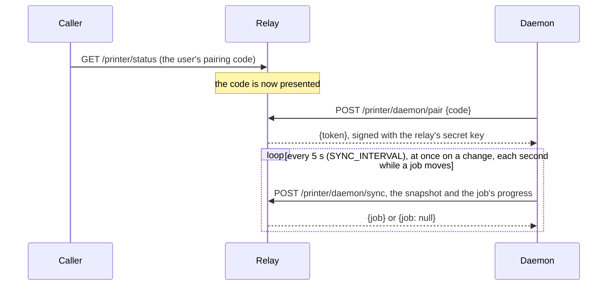
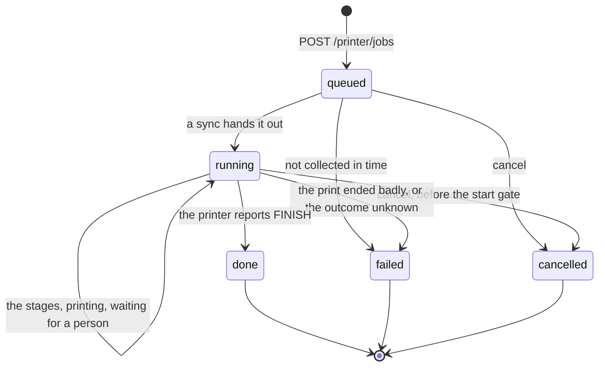

# Printer delivery

This is the builder's document, for someone building or changing printer delivery: it
holds the code-level names (routes, settings, error codes, constants, tests) a builder
needs. The guide beside it, [README.md](README.md), is what the owner reads and decides
from. Where the two differ, the guide is right and this file is to be corrected. Every
name and shape that passes between components is fixed by [the contracts](../contracts/README.md),
above all [the wizard's requests and the front server's answers](../contracts/wizard-front-server.md#the-printer-from-phase-5);
where this file and a contract differ on a name or a shape, the contract is right.
Everything outside the section [To be built](#to-be-built) is true of the code as built;
when an item of "To be built" is built, its text moves into the body and the guide is
updated to match.

Printer delivery takes a sliced file (`.gcode.3mf`) and gets it printed on a Bambu Lab printer, reporting how the print goes. It has two halves:

- **The relay** runs on the server. It holds each pairing code's delivery jobs and the printer's
  last status in memory, pairs with a daemon, and answers the caller.
- **The daemon** runs on **the daemon's computer** (the computer next to the printer, on
  the printer's network, that runs the daemon). It connects outward to the relay, downloads the sliced file, uploads it to the printer and starts
  it. It opens no port. It is a plain Python program for Windows, macOS or Linux; it has
  never yet been run on Windows.

The **caller** is the application that runs the relay and asks it to deliver sliced files
(in PenguinSlicer, the front server, from phase 5 of
[the plan](../docs/plans/penguin-slicer-plan.md)): it signs its users in, knows the pairing code of the printer they may use, and holds the
sliced file. Printer delivery knows nothing of slicing, of how the caller signs anyone in,
or of where the caller keeps the pairing code it presents (as built; phase 5 replaces
this, see [To be built](#to-be-built)).

The two faults the first hardware test found are fixed (see
[The two faults of the first hardware test](#the-two-faults-of-the-first-hardware-test)).

## Where it stands

The phases named here are those of [the plan](../docs/plans/penguin-slicer-plan.md).

**Built and tested** (on `main` after pull request 5): the relay and the daemon, their
pairing, delivery jobs with progress reports through the whole delivery and the print,
cancellation up to the start command, the rules for deciding a start, the hold after a
start command, restarts of either half, the log lines, and `make upgrade-printer-library`
with the upstream check. They are tested by the fast suite, by the property tests' random
sequences of faults on both links, and against the simulated printer over real sockets.

**Not done:**

- **Never run against the real printer by this code.** Every status sequence the
  simulated printer plays is invented from the one status document the first hardware
  test saved, at 0 percent. The timed rule after a start command rests on two limits that
  only the H2S can settle ([Two limits that wait for the real printer](#two-limits-that-wait-for-the-real-printer)),
  and everything in
  [Before trusting it at the H2S](#before-trusting-it-at-the-h2s-what-the-session-at-the-h2s-must-confirm)
  is unconfirmed.
- **Never run on Windows.** Tests fake each platform-dependent choice.
- **Daemon telemetry is not designed.** It is planned: a protocol by which the daemon
  sends messages about its own state to the server, where they are kept. Today both
  halves write structured log lines only.
- Not handled, by design: stopping a print that is already running (it is stopped at the
  printer), checking the printer's certificate (the daemon accepts any), and resuming an
  in-flight delivery job after a relay restart.

**What the phases still need from it.** Phases 1 to 4 need nothing from it. Phase 5 (the
real printer) needs the session at the H2S, daemon telemetry designed and built, a relay
the daemon can reach from another machine (today's local relay binds 127.0.0.1 only, see
[What the session needs beyond `record`](#before-trusting-it-at-the-h2s-what-the-session-at-the-h2s-must-confirm)),
and what the wizard's Send step and printer-status icon need that the relay does not give,
or gives only in part: who sent the print going on, the end time of the last print, and a
way for a page that has lost its state to find its user's delivery job (listed in the
mockup's [DECISIONS.md](../docs/mockups/print-wizard/DECISIONS.md)). Some sentences of its
error reports, the text the daemon's `pair` command prints ("your team's print server",
"a team configuration file"), the log field `team=` and the caller interface's `Team`
still use the old words for users; changing them is a change of its own, with its tests.

## To be built

Everything in this section is design, not code. Each item says what it does, its
figures, the guide's section and the contract's request or shape it implements, what it
replaces in the code as built, the error report it produces where there is one, and the
tests it needs. When an item is built, its text moves into the body of this file and
[README.md](README.md) is updated to match.

**Names.** A name fixed by a contract is written here without a mark and is not the
builder's to change: the front server's requests under `/api/printer`, their fields, and
the error codes the contract names (`delivery.rate_limited`, `delivery.job_in_flight`,
`delivery.start_being_sent`, `delivery.cancel_too_late`, `delivery.already_finished`,
`delivery.still_reporting`, `delivery.start_not_shown_yet`, `delivery.not_started`,
`delivery.outcome_unknown`, `front.delivery_unknown`, `front.sliced_file_expired`,
`front.slice_unknown`). A name marked *proposed* (a daemon route, a setting, a constant,
an error code no contract names, the name of a field inside a record, a test) is this
file's suggestion, which the builder settles while building. The daemon's own requests to
the relay, and the offer of a pairing code, are printer delivery's alone and in no
contract ([the contract](../contracts/wizard-front-server.md#the-requests-at-a-glance)).

**Tests.** The tests listed under each "*Tests:*" are this file's proposal, derived from
the guide; the guide itself requires a test that reaches every refusal, limit and deadline
and one that produces every error report on purpose
([How it is tested](README.md#how-it-is-tested)). Every test follows the standing rule: it
never sleeps and never waits a number of seconds; time passes through a fake clock the
test moves, a test waits on an event and never on a duration, and events over a network
are put in an exact order by fakes. Every failure a caller can see is an
[error report](../contracts/error-report.md) with a test that produces it on purpose.

A line beginning **Open:** names a question the guide leaves undecided or unmeasured, with
a link to the item in the guide; do not build past it before it is settled there.

**Terms used here.** A **group** is the users who share one configuration and one
printer (one Onshape company or classroom, or one user alone); a user's **current
group** is the one whose printer the user is using now. The **front server** is
everything behind PenguinSlicer's address and, from phase 5, runs the relay; it is the
relay's caller ([its guide](../front/README.md)). The **wizard** is the code in the
browser. The **state bucket** is the object store that holds what must outlast a restart
of the front server; on one machine a folder stands in for it. The **user key** is the
signed-in user's Onshape id. A **paired-printer record** is one small document per group
in the state bucket holding the id of the group's daemon, the printer's name as the daemon
sent it, who paired it and when, which of the relay's secret keys the daemon's token was
last issued under, the time of the daemon's last sync written when the daemon goes
offline, and, until the daemon has its token, a hash of the pairing code. A **daemon id**
is a random id a daemon makes for itself when its `pair` command is run, and keeps; it
names the daemon in its token, in the paired-printer record and in the relay's memory.
**The printer's name** is the name the printer itself reports, which the daemon reads and
sends when it offers its pairing code; nobody types it. A **send** is the request by which
a user's page asks for a sliced file to be printed; it creates a delivery job. A **sync**
is the request a daemon posts to the relay with the printer's status and its delivery
job's progress; the answer tells the daemon what to do. The **held wait** is the time, up
to 55 seconds, for which the relay holds back its answer to an idle daemon's sync. A
**progress stream** is the server-sent event connection on which a page follows a
delivery job.

### By phase

**Phase 2** (one machine, no printer) builds nothing of printer delivery. The wizard's Send
step exists from phase 2 with the download of the sliced file as its one button
([the guide](README.md#printer-delivery)); the download is the front server's
[`GET /api/slices/<slice>/file`](../contracts/wizard-front-server.md#get-apislicesslicefile),
not printer delivery's. The front server of phase 2 neither runs nor imports the relay,
and no `/api/printer` request exists before phase 5. Nothing under `delivery/` changes in
phase 2, except that its suites go on passing.

**Phases 3 and 4** build nothing of printer delivery either. One measurement of phase 3
bears on it: whether progress streams pass through Cloudflare and Railway unheld
(**Open:** [Progress streams through Cloudflare and Railway](README.md#progress-streams-through-cloudflare-and-railway)).

**Phase 5** (the real printer) builds everything below, in this order. Each later item is
built on the fakes of the first.

1. The six tests that wait on the real clock, rewritten on fakes:
   [First: the tests on a fake clock](#first-the-tests-on-a-fake-clock)
   ([the guide](README.md#tests-that-wait-on-the-real-clock)).
2. The relay inside the front server, with a store its caller supplies, and the delivery
   job's record in it:
   [The records of delivery jobs](#the-records-of-delivery-jobs)
   ([the guide](README.md#in-phase-5-records-in-a-store-the-front-server-supplies)).
3. The front server's requests, mapped onto the relay:
   [The front server's requests](#the-front-servers-requests)
   ([the contract](../contracts/wizard-front-server.md#the-printer-from-phase-5)).
4. Pairing with a code used once, the daemon id, the printer's name and the
   paired-printer record:
   [Pairing](#pairing) ([the guide](README.md#pairing-in-phase-5);
   [`POST /api/printer/pairing`](../contracts/wizard-front-server.md#post-apiprinterpairing--pair)).
5. Sending, unpairing and the daemon refused after an unpairing:
   [Sending and unpairing](#sending-and-unpairing)
   ([the guide](README.md#when-a-send-is-accepted);
   [`POST /api/printer/deliveries`](../contracts/wizard-front-server.md#post-apiprinterdeliveries--send),
   [`DELETE /api/printer/pairing`](../contracts/wizard-front-server.md#delete-apiprinterpairing--unpair)).
6. A daemon that was off reconnecting with no pairing again:
   [A daemon that was off](#a-daemon-that-was-off)
   ([the guide](README.md#a-daemon-that-was-switched-off)).
7. The held wait and the rhythms; the printer not yet heard from; the random wait after a
   restart: [How often a daemon talks to the relay](#how-often-a-daemon-talks-to-the-relay)
   ([the guide](README.md#the-rhythms-in-phase-5)).
8. The sliced file read from the store:
   [The sliced file](#the-sliced-file) ([the guide](README.md#the-sliced-file)).
9. Stop following from the sender only, and what the printer's status and the user's own
   work carry: [What the wizard needs](#what-the-wizard-needs)
   ([the guide](README.md#stop-following);
   [`GET /api/printer`](../contracts/wizard-front-server.md#get-apiprinter--the-printers-status),
   [`GET /api/printer/mine`](../contracts/wizard-front-server.md#get-apiprintermine)).
10. How long a printer has been silent:
    [How long a printer has been silent](#how-long-a-printer-has-been-silent)
    ([the guide](README.md#how-long-a-printer-has-been-silent)).
11. Two secret keys: [Replacing the relay's secret key](#replacing-the-relays-secret-key)
    ([the guide](README.md#replacing-the-relays-secret-key)).
12. Limits counted for each user and each daemon:
    [Limits on the rate of requests](#limits-on-the-rate-of-requests)
    ([the guide](README.md#limits-on-the-rate-of-requests)).
13. Stopping for a deploy: [Stopping](#stopping)
    ([the guide](README.md#when-the-daemon-the-relay-or-the-printer-goes-away)).
14. The log lines in the whole service's form: [The log](#the-log)
    ([the guide](README.md#the-log-and-daemon-telemetry)).
15. Daemon telemetry, after its own design: [Daemon telemetry](#daemon-telemetry)
    ([the guide](README.md#daemon-telemetry)).
16. The session at the H2S, and recordings in place of invented scenarios:
    [To confirm](#to-confirm)
    ([the guide](README.md#what-only-the-session-at-the-h2s-can-settle)).

### Phase 5: the relay inside the front server

Phase 5 brings the relay into the front server, with pairing, the syncs and the held
wait, the records of delivery jobs in the state bucket, replacing the relay's secret key,
and daemon telemetry ([the plan](../docs/plans/penguin-slicer-plan.md)). The front server
spends one thread on every idle daemon; set to 100 threads, it has room for about fifty
idle daemons beside users' requests and progress streams
([the front server](../front/README.md)). The held wait is plain HTTP and keeps nothing on
the connection, so a small asynchronous server can later take over that one request; that
is decided when the number of daemons calls for it. The daemon's routes and the bodies of
its requests are printer delivery's own and are the builder's to settle (*proposed*: the
daemon routes of the code as built, under `/printer/daemon/`, kept, with fields added and
none removed, so that an installed daemon keeps working). What daemon telemetry holds is
left to its own design ([Daemon telemetry](#daemon-telemetry)).

**Open:** [Capacity](README.md#capacity) (the front server's memory with fifty held syncs
is measured before the figure of fifty daemons is relied on).

#### First: the tests on a fake clock

The first piece of phase 5's work on printer delivery rewrites its tests that wait on the
wall clock to use a fake clock and fakes that put network events in an exact order, and
every item below is built on those fakes: a test never sleeps and never waits a number of
seconds to see whether something has happened, and waits on an event, never on a duration
([the plan's standing requirement "Tests"](../docs/plans/penguin-slicer-plan.md#standing-requirements)).
[The audit](../docs/orchestration/guides/sleep-audit.md) found six tests that wait on the
wall clock today:

- in the fast suite, the two tests of `TestStoppingWithAJobInFlight` in
  `daemon/tests/test_daemon_run_loop.py`, which give the run loop `time.monotonic` and its
  default sleep, so its job thread waits on the real clock until the test calls `stop()`;
- under `make test-sim`, `test_a_reconnect_with_no_new_document_keeps_the_old_age`, which
  waits out the printer library's own one-second reconnect delay, and
  `test_the_simulated_printer_runs_on_its_own_and_plays_a_print`, which plays a print in
  real time, a status document every 0.05 s;
- under `make test-together`, the two tests of the together run, on real threads and a
  clock twenty times faster than real time.

*Replaces in the code as built:* those six tests' waits. The fakes the rest of the suite
uses (`FakeClock` and `SleepBound` in `daemon/tests/daemon_fakes.py`, the shop of faults in
`tests/link_faults.py`) already move the clock by hand; what is new is a fake for the
network that lets a test put messages, drops and reconnects in an exact order, including
those of the printer library's MQTT client, which the suite against the simulated printer
today takes in the order loopback sockets deliver them. *Proposed:* the stop event of the
run loop becomes a wait the fake clock can end, so the two fast-suite tests need no real
clock; the reconnect and the played print are driven by the network fake; the together
run may keep its real threads, but on a fake clock, with every wait on an event and none
on a duration.

The new work of phase 5 is built on those fakes, so that "a send arrives during a held
wait" or "the front server restarts between the gate's yes and the daemon's report" is a
sequence a test writes down, not a race it hopes to win.

*Tests:* the fast suite, the suite against the simulated printer and the together run
each find no wait on the wall clock (*proposed*: a check that fails on `time.sleep`,
`time.monotonic` or `time.time` reached from a test); each rewritten test still fails
when the behaviour it pins is broken by hand.

#### The front server's requests

Implements [The printer, from phase 5](../contracts/wizard-front-server.md#the-printer-from-phase-5)
in the contract. The page never reaches the relay's routes: the front server answers each
`/api/printer` request by calling the relay in its own process, with the signed-in user's
user key and display name and the current group, already checked against the cookie; the
relay never sees the cookie ([the front server](../front/README.md#running-the-relay-from-phase-5)).
Every request needs a signed-in user and acts for the current group; every changing one
carries the wizard's mark. Printer delivery's refusals reach the page unchanged, as error
reports with `delivery.*` codes and the status the relay gives.

| The contract's request | What the relay does | Replaces in the code as built |
|---|---|---|
| `GET /api/printer` | The group's printer: `state`, `name`, `pairing`, `silent_for_s`, `silent_at_least`, `current`, `last_print`, `daemon` ([What the wizard needs](#what-the-wizard-needs)) | `GET /printer/status`, keyed by pairing code |
| `POST /api/printer/pairing` | Matches the code against the offers and writes the paired-printer record ([Pairing](#pairing)) | `note_code` and the code presented by the caller |
| `DELETE /api/printer/pairing` | Removes the record ([Sending and unpairing](#sending-and-unpairing)) | nothing |
| `POST /api/printer/deliveries` `{slice, description}` | Accepts or refuses a send for the current group ([Sending and unpairing](#sending-and-unpairing)) | `POST /printer/jobs` `{token}` |
| `GET /api/printer/deliveries/<delivery>` | The delivery job's latest progress report | `GET /printer/jobs/<id>` |
| `GET /api/printer/deliveries/<delivery>/events` | The progress stream: `version` first, the latest report at once, a comment line at least every 15 s, closed after a final report | `GET /printer/jobs/<id>/events` |
| `POST /api/printer/deliveries/<delivery>/cancel` | Cancel ([Cancellation](#cancellation)) | `POST /printer/jobs/<id>/cancel` |
| `POST /api/printer/deliveries/<delivery>/stop-following` | Stop following, from the sender only | `POST /printer/jobs/<id>/stop-following` |
| `GET /api/printer/mine` | The user's live delivery job and last print in the current group | nothing |

What the front server adds around the relay, from the contract: a delivery job of another
user, or one not known, is `404` `front.delivery_unknown` (the relay's
`delivery.job_unknown` never reaches the page); a final progress report carries
`sliced_file` `{slice, expires_at, expires_in_s}`, the sliced file's new moment of expiry,
which the front server reckons from the end time the relay gives; a progress stream
counts toward the user's four, past which the stream is refused `429`
`front.too_many_streams` before it starts; a cancel of a delivery job already cancelled,
or already being cancelled, answers `200` or `202` with its report rather than
`delivery.already_finished`; a stop-following repeated after it was accepted answers
`200` with the same final report. A delivery job's id is an opaque string of 1 to 64
letters, digits, `-` and `_`, as the code as built already makes it.

*Proposed:* the relay offers the front server one Python interface for these, in place of
`create_app`'s `identify` and `find_sliced_file`, taking the user key, the user's display
name and the current group on every call, and the front server mounts its own routes on
it; the relay's own Flask routes for pages are kept only for the stand-in caller of
[Try it on one machine](#try-it-on-one-machine) and for the tests.

*Tests:* each request of the table, through the front server, against a relay on a fake
store and a fake clock: its answer has the contract's fields and status; a request for
another user's delivery job, and one for a delivery job not known, are each `404`
`front.delivery_unknown` and identical; a final report carries `sliced_file`; a fifth
progress stream of one user is refused `front.too_many_streams`; a repeated cancel and a
repeated stop-following answer as the first; every `delivery.*` refusal reaches the page
unchanged; the previous release's page works against the new front server
([the contract](../contracts/wizard-front-server.md#a-page-loaded-before-a-deploy)).

#### Pairing

Implements [Pairing in phase 5](README.md#pairing-in-phase-5) and
[`POST /api/printer/pairing`](../contracts/wizard-front-server.md#post-apiprinterpairing--pair).
Pairing links a group to the daemon beside its printer, and the pairing code is used
once. Pairing needs the code on the daemon's screen.

1. **The daemon makes the code and its daemon id, and reads the printer's name.** The
   `pair` command finds the printer, asks for its access code, and makes a pairing code
   (eight letters and digits shown as two groups of four, forty random bits, the easily
   misread letters left out: the Crockford base32 code as built) and a daemon id. It reads
   the printer's name from the printer's own report. It shows the code and offers the
   code, its daemon id and the printer's name to the relay every thirty seconds
   (`EXCHANGE_INTERVAL`, as built). The daemon id is random and kept for good; the code is
   good for fifteen minutes (*proposed*: `PAIRING_CODE_SECONDS`), after which a daemon
   still unpaired makes a new one and shows it.
2. **The relay remembers the offers in its memory only**, keyed by daemon id: which
   daemon is offering which code, with the printer's name. Nothing about an offer is
   written to the state bucket.
3. **A signed-in user types the code into PenguinSlicer**, once: any signed-in user of
   the group, from any computer, in the pairing form of the printer details. The page
   sends `POST /api/printer/pairing` `{"code": "b6mq dn77"}`; the front server normalises
   the code as the code as built does (upper case, no hyphen or spaces, O read as 0, I and
   L as 1) and passes it to the relay with the user and the current group. If a daemon is
   offering that code, the relay writes the paired-printer record for the current group
   to the state bucket, naming that daemon and holding the printer's name and a hash of
   the code, and the front server answers `201` `{"printer": …}` with `state`
   `not_heard_from` and `pairing` `awaiting_daemon`. If none is, the answer is `404` with
   the one wrong-code report, at once.
4. **The daemon's next offer is answered with its token**, provided the code it offers
   matches the hash in the record. The hash is then removed from the record, `pairing`
   becomes `complete`, and the code is dead. The hash is in the state bucket only from
   the typing until the daemon collects its token, normally under half a minute; the code
   is kept nowhere else (not in the configuration, not in the daemon's settings, not in
   the log).

The daemon's token names the daemon (its daemon id) and its group, and is signed with the
relay's secret key, so nothing read from the state bucket lets anyone start a print or,
once the daemon has its token, pose as a daemon ([the architecture](../docs/architecture.md)
holds the security case). A wrong pairing code gets the same answer whatever was wrong
with it (no such offer, an expired code, a code already used), and wrong attempts are
limited for each signed-in user. The offer of a pairing code is the one request with
neither a user nor a daemon: it is limited to sixty a minute for the whole relay and also
counted for the address Cloudflare reports it came from, so one stranger cannot use up
everyone's offers (see [Limits on the rate of requests](#limits-on-the-rate-of-requests)).
The pairing code is typed into PenguinSlicer once and is then dead; it is never kept in
the configuration ([the plan](../docs/plans/penguin-slicer-plan.md)).

*Replaces in the code as built:* the code is a lasting secret that the daemon keeps in
`config.toml` (`pairing_code`) and the caller presents from the configuration
(`Team.pairing_code` from `identify`, or `note_code`); `begin_exchange` in `relay.py`
grants a token for any code presented since the relay started while no daemon with that
code has been heard for two minutes (`DAEMON_ONLINE_SECONDS`); `issue_token` signs a
payload of the code and the issue time (`{'code', 'iat'}`), so the token carries the
code; every record of the relay (`_Record`) is keyed by the normalised code; and the
daemon trades its code every 30 s (`EXCHANGE_INTERVAL`) for as long as it has no token.
The relay instead keeps what it knows of each daemon by daemon id, writes the
paired-printer record, and checks an offered code against the hash in it. The daemon
gains its daemon id, reads and offers the printer's name, offers both with its code, and
makes a new code after fifteen minutes; `config.toml` loses `pairing_code`. As built every
refused exchange is `404 {"error": "not paired"}`; keeping that status and body for a
refused offer is *proposed*. A copied settings file is still refused the start of a
second print by the start gate, as built.

*Error report:* a typed code that no daemon is offering, or any other wrong code (never
offered, run out, already used, typed in the half minute after a restart), gets the same
answer: `404` with one report telling the user that no daemon is showing that code and to
try again in a moment, identical whatever was wrong. Its code is *proposed*:
`delivery.pairing_code_unknown`, `retryable` true. Wrong attempts past the user's limit
are `429` `delivery.rate_limited`, whose sentence names the wait.

*Tests:* a typed code a daemon is offering writes the record for the current group, with
the printer's name and the hash, and answers `201` with `not_heard_from` and
`awaiting_daemon`; the next offer gets a token naming the daemon id and the group, the
hash is then gone, `pairing` reads `complete`, and the same code offered again is
refused; a code typed when no daemon offers it is refused at once with the wrong-code
report, and every kind of wrong code gets an answer identical in status and body; a code
typed in any of `b6mq dn77`, `B6MQ-DN77` and ` B6MQDN77 ` matches; a code sixteen minutes
old (fake clock) is refused and the daemon shows a new one; wrong attempts past the user's
limit are refused with `delivery.rate_limited` for that user only; nothing read from the
state bucket (a record with or without its hash) is enough to obtain a token or start a
print; no log line holds the code; a restart of the front server just after a code is
typed loses nothing, because the record is already in the state bucket, and a code typed
in the half minute after a restart, before the daemon offers again, gets the wrong-code
answer; a pairing repeated because its answer was lost gets the wrong-code answer and
`GET /api/printer` then shows the printer paired (the page's recovery, in
[the contract](../contracts/wizard-front-server.md#post-apiprinterpairing--pair)).

**Open:** [Pairing again: three cases](README.md#pairing-again-three-cases) (a second code
typed for a group with a record, answered `409` or `201`; `pair` run on a paired daemon; a
record whose token is never collected, shown as `awaiting_daemon` until the rule chosen
ends it).
**Open:** [Which printers are supported](README.md#which-printers-are-supported) (whether
`pair` warns on a model other than the H2S).
**Open:** [The printer's required mode](README.md#the-printers-required-mode) (the advice
`pair` gives a printer that does not answer rests on it).
**Open:** the limit on wrong pairing codes for each user, under
[The rate limits of phase 5](README.md#the-rate-limits-of-phase-5).

#### Sending and unpairing

Implements [When a send is accepted](README.md#when-a-send-is-accepted), unpairing under
[Pairing in phase 5](README.md#pairing-in-phase-5),
[`POST /api/printer/deliveries`](../contracts/wizard-front-server.md#post-apiprinterdeliveries--send)
and [`DELETE /api/printer/pairing`](../contracts/wizard-front-server.md#delete-apiprinterpairing--unpair).

The page sends `POST /api/printer/deliveries` `{"slice": "<slice job id>", "description":
"…"}`. The front server first checks that the slice job's sliced file is the signed-in
user's, by user key (`404` `front.slice_unknown` otherwise), and that it is not expired or
gone (`410` `front.sliced_file_expired`, the plate must be sliced again); it stores the
sliced file afresh, which restarts the backstop's three days at Cloudflare R2; then it
passes the send to the relay with the user, the current group, the slice job's id and the
plate's one-line description. The relay cannot tell whose a sliced file is; the front
server, not the relay, keeps one user from sending another user's or another group's
sliced file. An accepted send is `202` `{"delivery": {"id", "slice", "progress"}}`, the
progress being its first report.

The relay accepts a send only when it can see that the print could start now; nothing
queues. A send is accepted when the current group has a paired-printer record, and its
delivery job goes to the daemon that record names. A daemon holds one delivery job at a
time. Each refusal is an error report, `409` or `503`, whose sentence says what is in the
way; the page shows it in place of Send and never retries it:

| What is in the way | Code | Send again unchanged? |
|---|---|---|
| The current group has no paired-printer record | *proposed:* `delivery.not_paired`, its meaning changed from "the request's identity has no pairing code" | no |
| Paired, and no sync since pairing or since the front server started, or none for more than two minutes | `delivery.daemon_never_reported` (*proposed* meaning: no daemon heard since pairing or since the front server started), `delivery.daemon_silent` with the minutes, as built | yes |
| The daemon cannot reach the printer | `delivery.printer_unreachable`, as built | yes |
| The printer is printing, or has a paused print (whoever started it) | `delivery.printer_busy`, `delivery.printer_paused`, as built | yes |
| A main state this version does not know | `delivery.printer_state_unrecognised`, as built | yes |
| Another delivery job of the group is on its way | `delivery.job_in_flight`, as built | yes |
| Too many sends from this user | `429` `delivery.rate_limited` | yes |

A printer is free for a send when it reports no print, or reports that its last print
ended, well or badly; the `state` `failed` of
[`GET /api/printer`](../contracts/wizard-front-server.md#get-apiprinter--the-printers-status)
is a free printer for a send.

A send repeated because its answer was lost, while its delivery job is live, starts no
second print, under either answer the guide may choose: the rule of one delivery job at a
time already prevents it. *Proposed*, as the guide recommends: a send from the same user
of the same slice job while its delivery job is live is answered `202` with that delivery
job. **Open:**
[A send repeated while its delivery job is live](README.md#a-send-repeated-while-its-delivery-job-is-live)
(until it is settled, the code as built answers `delivery.job_in_flight`, and the page
recovers through `GET /api/printer/mine`).

Unpairing removes the paired-printer record: the page sends `DELETE /api/printer/pairing`
and the answer is `200` `{"printer": …}` with `state` `no_printer`; unpairing a group with
no record answers the same `200`. It is offered in the printer details only, and any user
of the group may unpair; there are no permissions inside a group. The wizard withholds the
link while a delivery job of the group has not ended. After an unpairing the daemon's next
request is refused, and the daemon says plainly on its own screen that it has been
unpaired, sends nothing more, and waits for `pair` to be run again. **Open:**
[Unpairing while a delivery job has not ended](README.md#unpairing-while-a-delivery-job-has-not-ended)
(whether the relay itself refuses it, recommended, and if so with which report; what
becomes of the delivery job otherwise).

*Replaces in the code as built:* `identify` answers a `Team` whose pairing code is the
only field the relay trusts, and a send is keyed on that code; one job slot per code
already gives one delivery job at a time, and a final report is already kept 24 hours
(`FINAL_TTL_SECONDS`), but in memory. The send instead looks up the group's
paired-printer record, with the user key, the user's display name and the current group
that the front server passes (see [The front server's requests](#the-front-servers-requests)).
The age limit of `SLICE_MAX_AGE_SECONDS` and `delivery.sliced_file_too_old` go: the front
server's check of expiry takes their place. There is no unpairing as built: a token verifies by its signature
alone (`authenticated_code` in `routes.py`), and the only refusal a daemon meets is
`401 {"error": "repair"}` for a token that does not verify, on which the daemon blanks
its token and trades its code again (`TokenRejected` in `run_loop.py`). Under the design a
token that verifies but names a daemon no paired-printer record names is refused, and the
daemon says it has been unpaired and waits. *Proposed:* the refusal is an answer of its
own, distinct from `repair`, and the daemon's message also says how to pair again.

*Error report:* the refusals of the table above, each produced on purpose by a test.
*Proposed:* the unpaired daemon's answer is not an error report to a user but the
daemon's line on its own screen and its log line.

*Tests:* a send with a record goes to the daemon it names and no other, and answers `202`
with the delivery job's id, its slice job and its first report; a send without a record is
refused with the no-printer report; each other refusal of the table is produced on
purpose (a daemon never heard, one silent 121 s on a fake clock, a printer unreachable,
busy, paused, in an unknown state, another delivery job on its way, a user past the limit);
a printer whose last print finished or failed accepts a send; a second send while the
daemon holds a delivery job is refused with `delivery.job_in_flight`, and the sliced file
is never started twice whatever the repeat is answered with; a send naming another user's
or another group's slice job is `404` `front.slice_unknown` and never reaches the relay; a
send of an expired sliced file is `410` `front.sliced_file_expired`; after unpairing, the
answer is `200` with `no_printer`, a second unpairing answers the same, the daemon's next
sync is refused, its screen and its log say it was unpaired and what to run, and it sends
nothing more until `pair` is run; any user of the group can unpair.

#### A daemon that was off

Implements [A daemon that was switched off](README.md#a-daemon-that-was-switched-off). A
daemon whose computer was restarted, or switched off for any length of time, reconnects
and works once started again, with no pairing again.

- Everything the daemon needs to reconnect is in one settings file on its computer: the
  relay's address, its daemon id and token, and the printer's address, serial number and
  access code, readable only by the daemon's own user.
- The daemon's token has no end date: the relay accepts it by its signature and the
  paired-printer record however long the daemon was silent, except after a replacement
  of the relay's secret key while the daemon was off for more than a week (see
  [Replacing the relay's secret key](#replacing-the-relays-secret-key)).
- While the daemon is silent the printer's `state` is `offline` (the printer-status icon
  shows Offline), the printer details say how long it has not been heard from
  (`silent_for_s`, see [How long a printer has been silent](#how-long-a-printer-has-been-silent)),
  and a send is refused; the daemon's first sync puts all three back.
- A print running when the computer went off goes on at the printer; the note of the
  print the daemon started, in a file beside its settings file, lets it follow that print
  when started again and never start it a second time.
- Starting the daemon, at boot or after it stops, is the job of whoever runs that
  computer, not of PenguinSlicer. A daemon that is a single file installing itself to
  start at boot is possible later work that this design does not include or depend on
  ([the plan](../docs/plans/penguin-slicer-plan.md)).

*Replaces in the code as built:* most of this is built. `config.toml` already holds the
relay's address (`backend_url`), the printer's address, serial and access code, and the
token, written with mode 600 (`config.py`); it gains the daemon id and loses the lasting
`pairing_code`. `issue_token` already sets no end date. The relay already reports a
daemon not heard for two minutes as not `online` and refuses a send with
`delivery.daemon_silent` (`STATUS_ONLINE_SECONDS`). The note of the start command is
`start.json` (see [How a start is decided](#how-a-start-is-decided)). The daemon is
already started by hand.

*Tests:* a daemon stopped for a simulated week and started again syncs with its saved
token and takes a send, with no pairing; one stopped in the middle of a print follows the
print to its end and sends no second start command (the restart tests of
[Tests](#tests) cover the note); the settings file is readable by its owner only.

#### How often a daemon talks to the relay

Implements [The rhythms in phase 5](README.md#the-rhythms-in-phase-5). The daemon opens no
port; everything passes through the sync, which carries the printer's
latest status and the progress of the delivery job the daemon holds, and whose answer
carries a delivery job to fetch, a cancel, or nothing. How often the daemon syncs depends
on what the printer is doing:

| The printer is | The daemon syncs | What that gives |
|---|---|---|
| Idle | Once for each held wait, and again at once when it is answered | A send reaches the daemon immediately; the idle printer's information is at most about a minute old; about one request a minute |
| Taking a delivery job (fetching the file, uploading it to the printer, starting it) | Each second | The Send step moves smoothly, and a cancel reaches the daemon within a second |
| Printing, whoever started the print | Every 10 seconds | The percentage and time left are at most 10 seconds old; six requests a minute |
| Changing state (idle, printing, paused, failed, finished, offline) | At once, whatever else is going on | The printer-status icon never waits to show a change |

**The held wait.** While the printer is idle and the daemon has no delivery job, the relay
answers a sync the moment a delivery job arrives for that daemon, and otherwise after 55
seconds, inside the 125 seconds Cloudflare and the five minutes Railway allow a request
without data. The daemon keeps the held sync on a thread of its own and goes on watching
the printer; when the printer's state changes during a held sync it posts a further sync
with the change, without waiting for the held one.

**Nothing is held during a print.** The relay refuses a send to a printer that is
printing, whether PenguinSlicer sent the print or someone started it at the printer's
screen, so it has nothing to tell that daemon that cannot wait ten seconds.

**What the relay concludes from silence.** A daemon is online if its last sync was within
2 minutes; past that the printer-status icon shows Offline and Send is disabled (a
healthy idle daemon is never silent for much more than a minute, so two minutes is two
missed rounds). A
running delivery job's report is fresh if the daemon's last sync was within 40 seconds;
past that it is marked stale, and that is how long a daemon that died during a print goes
unnoticed (four missed syncs at ten seconds); `current.stale` and `current.stale_age_s` of
`GET /api/printer`, and `stale` and `stale_age_s` of the progress report, say so. Silence
never ends a delivery job. A stale delivery job past the start gate may be given up by its
sender ([Stop following](README.md#stop-following)), which lets the relay accept the next
send once the daemon is back and the printer is free.

**A printer not yet heard from.** A paired daemon from which the relay has had no sync
since pairing, or since the front server started, is neither online nor offline: the
printer's `state` is `not_heard_from` (the wizard's grey dot and "…"), and a send is
refused saying that PenguinSlicer is waiting to hear from the printer. Two minutes with no
sync make it `offline`.

**After a restart of the front server** every held sync closes at the same moment, and each daemon
waits a short random time before it syncs again, so they do not all arrive together
(*proposed*: up to 10 s, `RESTART_JITTER_SECONDS`, from the injected random source).

*Replaces in the code as built:* the daemon syncs every 5 s when nothing changes
(`SYNC_INTERVAL`) and at most once a second when a delivery job's progress changes
(`PROGRESS_SYNC_SECONDS`); the relay answers every sync at once; a running delivery job's
report is stale after 20 s (`STALE_AFTER_SECONDS` in `deliveries.py`). The relay gains the
held wait. The daemon gains the thread that holds a sync, the 10-second rhythm during a
print, the sync each second while it takes a delivery job (in place of the built
once-a-second-while-progress-moves rule), and the random wait before it syncs again after
losing the relay; the stale limit becomes 40 seconds. Already built and
kept: a sync at once when the snapshot's `state` changes (`_sync` in `run_loop.py`); the
answer carrying the job, its `cancel` and `start_granted`; online within 2 minutes
(`STATUS_ONLINE_SECONDS`, `DAEMON_ONLINE_SECONDS`); the refusal of a send to a busy or
paused printer (`delivery.printer_busy`, `delivery.printer_paused`); stop-following
(`POST /printer/jobs/<id>/stop-following`), which frees the job slot; and, after a
failure, a wait that doubles from 5 s (`BACKOFF_START`) to 60 s (`BACKOFF_CAP`), shortened
by up to a quarter (`JITTER`).

*Tests (all on fake clocks):* an idle daemon's sync is held and answered at 55 s with no
job, and the daemon syncs again at once; a send during a held sync answers it at once
with the job; a printer state change during a held sync posts a second sync without
waiting; while taking a delivery job the daemon syncs each second, and a cancel reaches
it within one; while printing it syncs every 10 s; no sync is held while the printer is
printing; a daemon silent 40 s during a print leaves the report fresh and one silent 41 s
makes it stale, and one silent 2 minutes reads `offline`; a daemon paired and not yet
heard from reads `not_heard_from` and its send is refused, and after 2 minutes reads
`offline`; many daemons whose held syncs close together (with a fixed random source) do
not all sync again in the same moment; an idle daemon makes about one request a minute
over an hour of fake time.

#### The records of delivery jobs

Implements [In phase 5: records in a store the front server supplies](README.md#in-phase-5-records-in-a-store-the-front-server-supplies)
and the start gate's record under
[How a start is decided](README.md#how-a-start-is-decided-so-that-a-print-is-never-started-twice).
The records of delivery jobs are kept in a store the relay's caller supplies (the state
bucket hosted, a folder on one machine), not in the relay's memory, because a daemon told
that the relay no longer knows its delivery job treats it as finished and drops it. The
relay stays ignorant of buckets and credentials, and is tested with a store that is a
plain folder or a fake. Before a daemon sends the printer the start command it asks the
relay, which allows it once for each delivery job; the yes is written to the delivery
job's record before the gate answers, which keeps a print from starting twice across a
restart of the front server. A record is kept for a day after its delivery job ends.

A delivery job's record holds:

- the group and the daemon it is for, and the sliced file it uses, which is how the front
  server knows when a sliced file's last print ended
  ([the front server](../front/README-details.md#two-hours-deleting-and-the-backstop));
- who sent it: the user's Onshape display name, and the user's user key, by which the
  relay tells the sender's own delivery job from another user's (`sender.you`,
  `GET /api/printer/mine`) and checks Stop following, since display names need not differ;
  and the plate's one-line description (see [What the wizard needs](#what-the-wizard-needs));
- how far it has got in the ways that matter after a restart: waiting, collected, cancel
  asked, start allowed, ended;
- how it ended and when, and for a failed print the layer at which it stopped;
- the number of its format, in the field `format`, an integer from 1, so that a record
  written by the previous version of the front server is read by the next and one of a
  format the relay does not know is refused with a log line
  ([the contracts' rules](../contracts/README.md#rules)).

The record is written only when one of these changes, a handful of writes for each
delivery job. The names of its fields, and of the record's key in the store, are
*proposed* by the builder.

The live figures of a print (percent, layer, minutes left) and the printer's status are
not in the record: they stay in the relay's memory and are back within seconds of a
restart from the daemon's next sync. Nothing read from the state bucket can start a print
or pose as a daemon; writing to it could plant a delivery job's record, so only the front
server's credential and the owner can write to it.

**Open:** [A delivery job's deadlines across a restart](README.md#a-delivery-jobs-deadlines-across-a-restart)
(whether the record also holds when the delivery job was sent and collected, so that the
3-minute and 15-minute limits run on across a restart, as recommended, and whether the
day of staleness starts again).

*Replaces in the code as built:* every delivery job (`Delivery` in `deliveries.py`), the
job slot (`_Record.job`), the printer's last start granted (`_Record.last_grant`) and the
start gate's grant (`start_granted_to`, set by `grant_start` in `relay.py`) live in one
process's memory, so a restarted relay answers `404 delivery.job_unknown` for every
delivery job and refuses a held job at the start gate (`unknown`); see
[Restarts and cleanup](#restarts-and-cleanup) and "One relay process" under
[Delivery jobs](#delivery-jobs). The grant is written to the store before the gate
answers yes. *Proposed:* the relay's `delivery.job_unknown` then means only an id the
relay never had or whose record has gone, and the front server answers the page with
`front.delivery_unknown` in its place; `delivery.daemon_never_reported` ("no daemon heard
since the relay started") means no daemon heard since the printer was paired or since the
front server started.

*Tests:* the front server restarted while a delivery job waits for its daemon: the
daemon's next sync is accepted and receives the job from its record; restarted during a
print: the print goes on and the printer-status icon and Send step come back within ten
seconds, plus the daemon's short random wait, of the front server answering again; restarted between the gate's yes and the
daemon's word: the record still says the start was allowed, and the start is never
allowed again; a store that fails the write of the grant gets no yes from the gate; a
record is read back for a day after its delivery job ends; a record names its sliced
file, its group, its daemon and its sender's name and user key; the live figures are
never written to it; a record written by the previous version is read by the new one,
and one with a `format` the relay does not know is refused with a log line and never
misread; a store that fails a read or a write gives an error report the caller sees
(`front.state_bucket_unreachable` at the page), never a lost delivery job; the relay runs
against a folder store and a fake store alike.

#### The sliced file

Implements [The sliced file](README.md#the-sliced-file) and
[the sliced file's contract](../contracts/sliced-file.md). The state bucket's copy of a
sliced file is the only one ([the front server](../front/README.md#how-long-a-sliced-file-lives)
owns where it is stored and when it is deleted). On a send the relay records in the
delivery job's record which sliced file the delivery job uses (the slice job's id); it
reads the sliced file from the store when the daemon fetches it and passes it on, and
keeps no copy of its own, so a printer only ever receives a file the slice service made.
A sliced file is kept until two hours after its slice ended or two hours after its last
print ended, whichever is later; its last print ended when the latest delivery job that
used it ended ([the front server](../front/README-details.md#two-hours-deleting-and-the-backstop)).
Printer delivery's part of that rule is to tell the front server, for a slice job, whether
a delivery job that uses it has not ended (the front server then gives `expires_at`
`null`) and when the last one ended. A sliced file may therefore be sent while it is kept,
so Send works again for the same sliced plate after a print of any length. A send stores
the sliced file afresh, which restarts the count of the three-day backstop rule at
Cloudflare R2, so the backstop runs from the last send. A send whose sliced file has gone
is answered `410` `front.sliced_file_expired`, that the sliced file has expired and the
plate must be sliced again, with slicing again as the one action. A sliced file is at most
50 MB: the slice service ends a slice whose file would be larger and the front server
refuses to store one (`front.sliced_file_too_large`), so the relay and the daemon never
meet a larger file. The daemon checks the fetched file against the length and SHA-256 sent
with the delivery job and fetches again a sliced file whose fetch was cut off, up to three
attempts, as built. It uploads the file under its own name with the delivery job's id
added; the sliced file's contract guarantees that its name never already ends in such a
suffix ([Name](../contracts/sliced-file.md#name)).

**Open:** [How the daemon's fetch of the sliced file is authorised in phase 5](README.md#how-the-daemons-fetch-of-the-sliced-file-is-authorised-in-phase-5).
**Open:** [Printed files left on the printer](README.md#printed-files-left-on-the-printer)
(whether the daemon removes a printed file, and what a failed upload to a full printer
says).

*Replaces in the code as built:* `find_sliced_file` answers a `SlicedFile` with a `path`
or a `stream`; a stream is copied once into the relay's spool directory
(`SlicedFileStore` in `sliced_files.py`), and the daemon fetches the file from
`GET /printer/download/<token>`, with the token in the path as its whole authority
(30 a minute per address, `DOWNLOAD_LIMIT`). The design does not say how the daemon's
fetch is authorised once the file comes from the store, nor whether it is counted for the
daemon or still for the address; keeping the token in the path and the count per address
is *proposed*. The spool directory and its sweep go. The age
limit is `SLICE_MAX_AGE_SECONDS` in `routes.py`, 40 minutes, which gives way to the
front server's rule for how long a sliced file is kept. A
fetch cut off mid-way already raises in `RelayClient.download` ("the download failed
after N bytes"), leaves no partial file, and is tried again from the start by `_download`
in `run_loop.py`, up to three attempts (`DOWNLOAD_ATTEMPTS`) with backoff.

*Error report:* a send of a sliced file no longer kept, or gone from the state bucket, is
the front server's `410` `front.sliced_file_expired`; `delivery.sliced_file_too_old` and
its forty-minute rule go. A sliced file that the store no longer holds when the daemon
fetches it fails the delivery job, unstarted (*proposed*: `delivery.download_failed`, as
built, with the store's answer in `detail`); a fetch that fails three times is
`delivery.download_failed`, and three that arrive damaged `delivery.download_corrupt`, as
built.

*Tests:* through the front server on a fake clock: a send of a never-printed sliced file
at 1 h 59 min after its slice is accepted and one at 2 h 1 min refused with
`front.sliced_file_expired`; a send of a sliced file one hour after the end of a
five-hour print of it is accepted, and one at 2 h 1 min after that print ended refused;
`expires_at` is `null` while a delivery job that uses the sliced file has not ended; a
send stores the sliced file afresh; the daemon's fetch reads the store and the relay
writes no file of its own; a fetch cut off mid-way through the front server is fetched
again and the delivery job goes on; a sliced file gone from the store at the fetch fails
the delivery job unstarted with its report; a sliced file a running delivery job uses is
still there when the daemon fetches it, past two hours after its slice.

#### Replacing the relay's secret key

Implements [Replacing the relay's secret key](README.md#replacing-the-relays-secret-key)
and [Replacing a secret](../docs/architecture.md#security) in the architecture. The relay
accepts a token signed with either of its two secret keys, the current one and the
previous one, and answers a daemon whose token was signed with the previous key with
a new one, which the daemon saves. Each paired-printer record notes which key its
daemon's token was last issued under. The previous key is removed after one week, or
sooner once every paired-printer record shows the current key; so a daemon switched off
for the whole week after a replacement must be paired again. The front server writes a
log line each time a previous key is used, and a command lists the daemons still to be
given a new token. In an emergency, when a key has leaked, it is replaced and not kept as
the previous key, and every printer is paired again. The steps are written down in the
repository as a procedure, and a test covers the replacement
([the architecture](../docs/architecture.md) holds the procedure for both keys).

*Replaces in the code as built:* `create_app` takes one `secret_key`, and `read_token`
verifies with that key alone; a token that does not verify is answered
`401 {"error": "repair"}`, on which the daemon blanks its token and trades its lasting
pairing code for a new token, which the relay grants only once a caller has presented
that code again.

*Tests:* a token made with the previous key is accepted and renewed, the daemon saves the
new token, and the record then shows the current key; a token made with a removed key is
refused; the log has a line for each use of the previous key; the command lists exactly
the daemons whose records still show the previous key; after an emergency replacement,
with the leaked key not kept, every token is refused and each daemon says on its screen
that it must be paired again (the daemon can no longer trade a lasting code); a token
renewed under the new key verifies across a restart of the front server.

#### Limits on the rate of requests

Implements [Limits on the rate of requests](README.md#limits-on-the-rate-of-requests).
Limits on the rate of requests are counted for the signed-in user on the front server's
`/api/printer` requests and for the daemon (by daemon id) on the daemon's routes. The offer of a pairing code, which has neither,
is limited to sixty a minute for the whole relay and also counted for the address
Cloudflare reports it came from. Wrong pairing codes typed are limited for each signed-in
user.

*Replaces in the code as built:* `STATUS_LIMIT` (120 a minute) and `JOBS_LIMIT` (10 a
minute) are counted for each pairing code (`code_key` in `routes.py`), as are
`SYNC_LIMIT` (120) and `DAEMON_LIMIT` (60) for the code in the daemon's token;
`EXCHANGE_LIMIT` (60) is counted for the whole relay only; `DOWNLOAD_LIMIT` (30) for the
request's address, as `ProxyFix` reports it after the trusted proxies. The design gives
no figure for the limits counted per user and per daemon, nor for wrong pairing codes per
user. The guide recommends carrying over 120 status requests and 10 sends, cancels or
stop-followings a minute for each user, 120 syncs and 60 other requests a minute for each
daemon, and ten wrong pairing codes a minute for each user; the offer of a pairing code
stays at sixty a minute for the whole relay (`EXCHANGE_LIMIT`), with a count per
Cloudflare address beside it (*proposed* figure: the builder's). Build the counts per user
and per daemon with those figures as settings, so that the decision changes a value and
not the code. **Open:**
[The rate limits of phase 5](README.md#the-rate-limits-of-phase-5) (the figures for each
user, each daemon and wrong codes, and the sentence a user over the limit reads).

**Open:** [Progress streams through Cloudflare and Railway](README.md#progress-streams-through-cloudflare-and-railway)
(if pages must ask `GET /api/printer/deliveries/<delivery>` every second or two instead of
following a stream, those requests are counted apart from the status requests, as
recommended).

*Error report:* `429` `delivery.rate_limited` on every request of the page's that the
contract limits (status requests, sends, cancels, stop-followings and wrong pairing
codes), its sentence naming the wait the figure gives ("Too many wrong codes. Wait a
minute, then try again." for wrong codes); a daemon's route answers `429` with
`Retry-After`, as built.

*Tests:* two users of one group each have their own allowance; two daemons each have
theirs; offers from one address past its count are refused while offers from another
address still pass, and the whole relay still stops at sixty a minute; wrong codes past a
user's limit are refused for that user only; each refusal is `delivery.rate_limited`
whose sentence names the wait; each limit is reached on a fake clock and lifts when the
minute has passed.

#### Stopping

Implements "A deploy" under
[When the daemon, the relay or the printer goes away](README.md#when-the-daemon-the-relay-or-the-printer-goes-away)
and [Restarts and deploys](../front/README.md#restarts-and-deploys) in the front server's
guide. Asked to stop, the relay closes its progress streams and answers its held syncs, so pages
and daemons reconnect to the front server that replaces it; the front server also
finishes the uploads and downloads in progress ([the front server](../front/README.md)).
The daemon waits and tries again when the relay does not answer. A held sync answered on
stopping carries nothing, as at the end of the 55 seconds. A deploy is such a stop, and
the project deploys continuously, so a stop must interrupt no user. An installed daemon
may be much older than the relay: a change to the relay may add to what it sends a
daemon and never remove or change what an installed daemon relies on. **Open:**
[Daemon versions](README.md#daemon-versions) (how an installed daemon reaches a new
version, and whether the relay records or refuses old ones).

*Replaces in the code as built:* nothing in the relay reacts to being asked to stop: a
progress stream (`GET /printer/jobs/<id>/events`) runs until its delivery job ends or the
connection drops. The daemon's retry is built (the backoff above).

*Tests:* asked to stop, the relay ends every progress stream and answers every held sync
at once; a daemon whose relay stops answering waits and tries again, and takes up its
delivery job from its record once a relay answers.

#### The log

Implements [The log, and daemon telemetry](README.md#the-log-and-daemon-telemetry) and
[Reading what happened](../docs/architecture.md#reading-what-happened). The relay keeps no
log of its own: it hands its lines to the front server, which writes them with every
other component's lines (its own, the slice service's, the daemons' telemetry and the
reports from the browser) into one file each minute in the log bucket, which keeps them
for ninety days ([the front server](../front/README.md#the-log)). Each line is one JSON
object and carries the time and the component that wrote it (*proposed*: `"component":
"delivery"` for the relay's lines and `"daemon"` for daemon telemetry), and whichever of
the group, the user key, the delivery job and the daemon it concerns. The line that ends a
delivery job carries how long the file took to reach the printer, how long the print ran,
and how it ended. A daemon's errors arrive as daemon telemetry with its requests. Every
error a user is shown is logged with its code, the user key and name, the group and the
job; every exception with its stack trace; every refusal, including a wrong pairing code;
and every line about a send carries the user key and the current group. No line holds a
pairing code, a token or the printer's access code; with no lasting pairing code, a line
names the printer by its daemon id and group (*proposed*), in place of the hash of the
code. The daemon goes on writing its own plain lines on its own screen, as built.

*Replaces in the code as built:* lines are text, `printer-delivery request=... key=value`,
written through the caller's `log` (see [Supportable from the server](#supportable-from-the-server));
they carry `printer`, a hash of the pairing code, and `team`, never the user key or the
group; the transition line carries `state`, `stage` and `code` and no durations; the
daemon has no telemetry and writes its own log only.

*Tests:* every line parses as JSON and carries the time and the component; the relay
writes no file of its own and hands every line to the front server's writer; a send's lines carry the user
key and the group and no secret; the line that ends a delivery job carries its three
figures; a daemon's error reaches the front server with its next request; no line holds a
pairing code, a token or an access code.

#### Daemon telemetry

Implements "Daemon telemetry" under
[The log, and daemon telemetry](README.md#the-log-and-daemon-telemetry). Daemon telemetry
is a protocol by which the daemon sends messages about its own state to the relay from
the moment it starts, so that a broken setup on a computer nobody can see is diagnosed
from the server. What is designed: it exists and is part of phase 5; a daemon's errors
arrive with its ordinary requests; the relay hands the messages to the front server, which
writes them into the same file each minute as every other line, marked as daemon
telemetry, kept in the log bucket for ninety days; and the protocol is simple enough to carry over
when the daemon is rewritten as a single executable in Rust or Go. Nothing else is
designed, and nothing beyond that is built before its own design.

*Replaces in the code as built:* nothing; the daemon writes its own log only, and sends
its name and version with every request, which the relay does not read.

**Open:** [Daemon telemetry](README.md#daemon-telemetry) (what a message holds, what proves
it comes from a paired daemon, what an unpaired daemon may send, what it must never hold,
its size and rate limits, how the owner reads it).

#### What the wizard needs

Implements the four needs under
[In phase 5: records in a store the front server supplies](README.md#in-phase-5-records-in-a-store-the-front-server-supplies),
[Stop following](README.md#stop-following),
[`GET /api/printer`](../contracts/wizard-front-server.md#get-apiprinter--the-printers-status),
[`POST /api/printer/deliveries/<delivery>/stop-following`](../contracts/wizard-front-server.md#post-apiprinterdeliveriesdeliverystop-following--stop-following)
and [`GET /api/printer/mine`](../contracts/wizard-front-server.md#get-apiprintermine).

**The printer's status.** `GET /api/printer` answers `{"printer": {…}}` with the
contract's fields:

- `state`: `no_printer` (no paired-printer record), `not_heard_from`, `offline`, `free`
  (no print, or its last print ended), `sending`, `starting`, `heating`, `printing`,
  `waiting_for_person` (a print under way, whoever started it), or `failed` (the last
  print ended on a fault and nothing has started since). *Proposed* mapping from the
  stages of [States and stages](#states-and-stages), following the wizard's track
  ([After Send](../wizard/README.md#after-send)): `waiting_for_daemon`,
  `waiting_for_printer`, `waiting_for_earlier_print`, `downloading` and `uploading` are
  `sending`; `starting` and `start_not_shown` are `starting`; `printing` is `heating`
  while its `printer_stage` is one of the heating stages (`heating_bed`,
  `heating_nozzle`) and `printing` otherwise; `waiting_for_person` is itself. A print
  started at the printer's own screen takes its state from the printer's snapshot.
- `name`, the printer's name from the paired-printer record; `pairing`, `complete` or
  `awaiting_daemon`; `silent_for_s` and `silent_at_least` with `offline`
  ([How long a printer has been silent](#how-long-a-printer-has-been-silent)).
- `current`, the print under way or `null`: `from_penguinslicer` (`false` for a print
  started at the printer's own screen, which has no delivery job, no sender and no
  description; the printer's snapshot gives which file is printing and how far through);
  `sender` `{"name", "you"}`, `you` true when the record's user key is the asking user's;
  `description`; `delivery`, the delivery job's id, given to its sender only; `percent`,
  `layer`, `total_layers`, `remaining_min`, each absent when not reported; `stale` and
  `stale_age_s`, past 40 seconds.
- `last_print`, the group's last print sent by PenguinSlicer that has ended, kept a day
  after it ended, or `null`: `sender`, `description`, `ended_at`, `ended` (`done`,
  `failed` or `cancelled`), `error` (whose `code` `delivery.outcome_unknown` tells a print
  nobody could hear any more from a fault at the printer), `layer` and `total_layers` of a
  failed one, and `delivery` for its sender. The wizard shows it for 12 hours or until
  another plate is sent, which the day covers.
- `daemon`, optional, `{"version", "outdated"}`, only once
  [Daemon versions](README.md#daemon-versions) is settled.

Users of one group see each other's names and plate descriptions; that is intended, and
nobody outside the group sees either.

**The user's own work.** `GET /api/printer/mine` answers the signed-in user's live
delivery job in the current group (`live`: `id`, `slice`, `progress`, or `null`) and that
user's latest ended one, kept a day after it ended (`last_print`: `id`, `slice`,
`progress`, `ended_at`, or `null`), each found by the sender's user key in the delivery
job's record, never by display name. A delivery job's own requests
(`/api/printer/deliveries/<delivery>…`) are its sender's only.

**Stop following, from the sender only.** The relay accepts Stop following only from the
user its record names as the sender, for a delivery job past the start gate whose report
is stale; the front server answers another user's request `404` `front.delivery_unknown`
first, and the relay's own check is a second defence (*proposed*: refused with
`delivery.not_sender`, which the page never meets in honest use). The delivery job ends
`failed` with `delivery.outcome_unknown`; the refusals, as built, are
`delivery.still_reporting`, `delivery.start_not_shown_yet`, `delivery.not_started` and
`delivery.already_finished`. It does not lift the daemon's hold on the printer, as built.
The relay ends a delivery job past the gate in the same way by itself after a day of
unbroken staleness (`OUTCOME_UNKNOWN_AFTER_SECONDS`, as built). So when the sender is
away, a stale print holds the printer for the whole group until the daemon reports again
or the day has passed.

*Replaces in the code as built:* `GET /printer/status` keyed by pairing code, whose
`delivery` is the printer's most recent delivery job with no sender; `Team.user`, passed
to events only (`caller.py`); a final report kept 24 hours (`FINAL_TTL_SECONDS`) with no
end time and no sender; `last_result.age_seconds`, ten minutes only
(`LAST_RESULT_TTL_SECONDS`); only the file's name, which the user did not choose; a final
report that keeps the last `layer` but no time at which it stopped; and stop-following
accepted from any page of the caller.

**Open:** [Who writes the one-line description of a plate](README.md#what-the-wizards-guide-asks-of-printer-delivery)
(recommended: the front server, from the plate configuration, handed to the relay with
the send; the send's optional `description` is used only if the page writes it).
**Open:** [A print that is no longer followed](README.md#what-the-wizards-guide-asks-of-printer-delivery)
(whether the relay reports an ending by Stop following or by the day apart from a failure
at the printer, and so whether `state` is then `failed`; the page can already tell it by
`delivery.outcome_unknown`).

*Tests:* the status of a busy printer names the sender and the description, and `you` is
true for the sender only, even when two users share a display name; each stage of a
delivery job reads the `state` of the mapping above; a print started at the printer's
screen reads `from_penguinslicer` false with no sender, no description and no `delivery`;
`delivery` appears for the sender and for nobody else; a stale print reads `stale` with
its age; `last_print` carries `ended_at`, `ended` and, for a failed one, `error`, `layer`
and `total_layers`, and is there for a day after it ended and gone after (fake clock); a
user asking `GET /api/printer/mine` gets their own live delivery job and last print and
never another user's; Stop following from the sender of a stale print past the gate ends
it with `delivery.outcome_unknown`, from another user of the group is refused (by the
front server, and by the relay when called directly), before the gate is
`delivery.not_started`, while the printer reports the print is `delivery.still_reporting`,
and while it answers without having shown it is `delivery.start_not_shown_yet`; after Stop
following the next send waits, cancellable, until the earlier start settles; a day of
unbroken staleness ends the delivery job by itself, and a fresh report within the day
starts the day again.

#### How long a printer has been silent

Implements [How long a printer has been silent](README.md#how-long-a-printer-has-been-silent)
and `silent_for_s` and `silent_at_least` of
[`GET /api/printer`](../contracts/wizard-front-server.md#get-apiprinter--the-printers-status).
The printer details say "Not heard from
for 7 minutes." When a daemon goes offline (no sync within 2 minutes), the relay writes
the time of the daemon's last sync to the group's paired-printer record, one write at
that moment and not one a minute, and `GET /api/printer` answers `silent_for_s`, the
seconds since that sync as the front server reckons it at the answer, so the wizard can
say how long a printer has been silent even after a restart of the front server. The relay's memory alone would lose it at a restart. A daemon that
goes silent just before a restart of the front server has no time written, since the
relay's memory of its last sync is lost: after a restart, a paired daemon not heard from
within two minutes, for which the record holds no offline time, is shown as silent "for
at least" the time since the front server started: `silent_at_least` true, and
`silent_for_s` the seconds since the front server started. No further write is made
however long the daemon stays off, and a recorded time that survives a restart is used as
it is. **Open:** [Clearing the recorded time of silence](README.md#clearing-the-recorded-time-of-silence)
(whether the relay clears the recorded time when the daemon syncs again, as recommended,
trying a failed clearing write again on the following syncs).
*Replaces in the code as built:*
nothing; it adds to the relay as built, which keeps the time it last heard from a daemon
(`daemon_seen_at` in `relay.py`) in its memory only.

*Tests:* a daemon that goes offline writes the time of its last sync once, and stays at
one write however long it stays off (fake clock); after a restart of the front server
`silent_for_s` is counted from the same time, with `silent_at_least` false; a daemon
silent from just before a restart of the front server is shown, two minutes after the
restart, as silent for at least the time since the restart, with `silent_at_least` true;
a store that fails the write leaves the printer `offline` and the failure in the log; the daemon's next sync puts the printer back online (and, if the
clearing is chosen, clears the recorded time, with a failing clearing write in a fake
store).

#### Already built, kept as they are

Every progress stream sends a comment line at least every fifteen seconds while it has
nothing to report, and one that connects late gets the latest progress report at once;
the relay does both as built (`STREAM_HEARTBEAT_SECONDS`, and `GET /printer/jobs/<id>`
gives the latest report), and [the architecture](../docs/architecture.md#progress-streams)
and [the contract](../contracts/wizard-front-server.md#progress-streams) own the rule.
Progress streams are kept for following a print; the front server limits a user to four,
slices and prints together. **Open:**
[Progress streams through Cloudflare and Railway](README.md#progress-streams-through-cloudflare-and-railway)
(if they hold events back, pages ask `GET /api/printer/deliveries/<delivery>` every second
or two instead, and those requests are counted apart). The daemon opens no port and only calls out to the relay, so nothing on the internet can call
the computer beside the printer ([the architecture](../docs/architecture.md)). An
installed daemon, which may be much older than the relay, keeps working: a change to the
relay may add to what it sends a daemon, and may not remove or change what an installed
daemon relies on ([the architecture](../docs/architecture.md)).

#### To confirm

Whether Cloudflare's protection against automated clients ever challenges a daemon's
requests is not checked (the daemon already names a challenge when it meets one,
`ChallengeDetected` in `relay_client.py`). The daemon as built fetches a sliced file again
when the connection drops mid-way, up to three attempts (see
[The sliced file](#the-sliced-file)).

Each of these waits for a measurement, in the guide; none is to be built past:

- **Open:** [Whether Cloudflare challenges a daemon](README.md#whether-cloudflare-challenges-a-daemon),
  checked with a daemon on another machine once the hosted front server runs the relay.
- **Open:** [The two timed limits on a start](README.md#the-two-timed-limits-on-a-start)
  and [Every timing that concerns the printer](README.md#every-timing-that-concerns-the-printer)
  ([the settings](#the-settings) of the start).
- **Open:** [The printer's required mode](README.md#the-printers-required-mode).
- **Open:** [Windows](README.md#windows).
- **Open:** [Capacity](README.md#capacity): the front server's memory with fifty held
  syncs, and how long the fetch and the upload of a 14 MB and a 50 MB sliced file take on
  a real link and a real H2S, which decides whether three attempts at each and the 15
  minutes to the start gate (`JOB_HANDED_OUT_TIMEOUT_SECONDS`) are enough.

Not an item of the guide, and a matter for the session's preparation only: whether
`record` and `run` can be connected to the printer at the same time is not known (see
[What the session needs beyond `record`](#before-trusting-it-at-the-h2s-what-the-session-at-the-h2s-must-confirm)).

The session at the H2S, or the hosted front server, settles them
([What only the session at the H2S can settle](README.md#what-only-the-session-at-the-h2s-can-settle)).

## Layout

| Path | What it is |
|---|---|
| `relay/` | The relay: the `penguin-delivery-relay` project, package `penguin_delivery_relay`, and its tests |
| `daemon/` | The daemon: the `penguin-delivery-daemon` project (its `pyproject.toml` is the one pin of its dependencies), package `penguin_delivery_daemon`, its tests and fixtures |
| `simulator/` | The simulated printer: an H2S played over loopback sockets, its scenarios and its suite |
| `together/` | The together run: both halves and a stand-in printer in one process; `relay_server.py`, the relay on its own for [Try it on one machine](#try-it-on-one-machine) |
| `tests/` | Tests that need both halves at once, the fault-injecting link among them |
| `scripts/` | `upgrade_printer_library.py`, behind `make upgrade-printer-library` |
| `conftest.py` | Bounds every sleep a test injects into the daemon (see [Tests](#tests)) |
| `pyproject.toml` | The uv workspace that holds both projects and the dev tools |

**Why two projects in one workspace.** The daemon must install alone with only its three
pinned dependencies (`bambulabs_api`, `requests`, `tomli-w`), and must never pull in
Flask. The relay needs Flask and nothing of the daemon's. So each half is its own project
with its own dependencies, and the workspace root (not a package itself) installs both
into one development environment, with pytest, Hypothesis and coverage. A test checks that
the daemon imports nothing but itself, the standard library and its pins; another that
the relay state module imports no Flask.

## Running the daemon

On the daemon's computer (Windows, macOS or Linux, on the printer's network):

1. Install Python 3.11 or newer from python.org (on Windows, tick "Add python.exe to
   PATH").
2. Get the code: download the repository, or `make -C delivery daemon-tarball` and copy
   `dist/penguincam-printer-daemon.tar.gz` across and unpack it. Then
   `python -m pip install ./penguincam-printer-daemon` (or `./delivery/daemon`).
3. Pair, then run, with the same commands everywhere:

   ```
   python -m penguin_delivery_daemon pair      # finds the printer, prints the pairing code
   python -m penguin_delivery_daemon run       # the daemon; leave it running
   python -m penguin_delivery_daemon status    # what it sees, without disturbing it
   ```

Everything the daemon keeps is in one directory, its **home**: `--home DIR` on any
command, else `%LOCALAPPDATA%\PenguinDelivery` on Windows and `~/.penguin-delivery`
elsewhere (`daemon/penguin_delivery_daemon/paths.py` decides). It holds `config.toml`
(the printer's address and access code, the pairing code, the token), `downloads/`,
`recordings/` and, while a start command's outcome is not yet known, `start.json` (see
[How a start is decided](#how-a-start-is-decided)).

**Recording a real print**, for the simulated printer:
`python -m penguin_delivery_daemon record` saves every status document the printer sends,
one JSON line each, in `recordings/`, until Ctrl-C (`--seconds N` stops it sooner; `--out
FILE` names the file). Run it while a print goes from start to finish.

The daemon is started by hand. Not in this version: running it as a service or at
start-up, and protection of the stored token and access code by the operating system.

## Try it on one machine

The whole chain by hand, on one computer, with no printer and no server: the simulated
printer, the relay, the daemon, and `curl` as the caller. Four terminals, each started in
`delivery/` after `make install` (`uv` must be installed). Everything listens on 127.0.0.1
only. The home directory below is a scratch folder; any empty one will do.

1. **The simulated printer.** It prints the serial and the access code to give `pair`:

   ```
   uv run python -m simulator --scenario whole_print
   ```

   It listens on MQTT 18883 and FTPS 18990 (`--mqtt-port`, `--ftps-port` change them),
   and once a start command arrives it plays the scenario's print, one status document
   every 3 s (`--step-seconds`). Any scenario in `simulator/scenarios/` can be named.
2. **Pair the daemon** against a relay that is not running yet (pairing only writes the
   configuration). Answer `127.0.0.1`, `SIM00H2S0001` and `12345678`:

   ```
   uv run python -m penguin_delivery_daemon pair --home /tmp/pd-home --backend http://127.0.0.1:8787 --dev --printer-ports 18883,18990
   ```

   It connects to the simulated printer and prints a pairing code such as `B6MQ-DN77`.
   `--printer-ports` is for the simulated printer only; a real printer uses its own.
3. **The relay**, with a stand-in caller that signs every request in with that pairing
   code (development mode, plain HTTP; never for a real shop):

   ```
   uv run python -m together.relay_server --code B6MQ-DN77
   ```

4. **Run the daemon**, back in the second terminal:

   ```
   uv run python -m penguin_delivery_daemon run --home /tmp/pd-home
   ```

   It says `paired with the relay`, then that it is idle. The relay's log shows a
   `request=sync` line every 5 s (`SYNC_INTERVAL`).
5. **Send the sample sliced file and watch it**, in the fourth terminal. The send answers
   with the delivery job's id; the stream gives every progress report until the final one:

   ```
   curl -s -X POST -H 'Content-Type: application/json' -d '{"token": "sample"}' http://127.0.0.1:8787/printer/jobs
   curl -sN http://127.0.0.1:8787/printer/jobs/<job_id>/events
   ```

   The reports go from `waiting_for_daemon` through `starting` and `printing` (with the
   printer's stage and percent: heating the bed, levelling it, 25 and 75 percent) to
   `done` within about thirty seconds; the simulated printer shows the upload, the start
   command and each status document. The stages between are not on the stream: the
   daemon sends its stage at most once a second (`PROGRESS_SYNC_SECONDS`), and on one
   machine the download and upload of the sample's 323 bytes end within that second, so
   the next report the relay records is `starting`, which it sets itself when the daemon
   asks its start gate. `downloading` and `uploading` show only for a file large or slow
   enough to take longer than a second, and `waiting_for_printer` only when the daemon has
   no fresh report from the printer and waits for one (step 7 shows it).
6. **Cancel one at once.** Send again and cancel at once, in one line, while the job still
   waits for the daemon; the answer is `"outcome":"cancelled"`, and the job's report says
   `cancelled`:

   ```
   JOB=$(curl -s -X POST -H 'Content-Type: application/json' -d '{"token": "sample"}' http://127.0.0.1:8787/printer/jobs | python3 -c 'import sys, json; print(json.load(sys.stdin)["job_id"])'); curl -s -X POST http://127.0.0.1:8787/printer/jobs/$JOB/cancel
   curl -s http://127.0.0.1:8787/printer/jobs/$JOB
   ```

7. **Cancel one the daemon holds.** On one machine the daemon takes a job at its next sync
   and sends the start command within the same second, too quickly to cancel by hand in
   between. So give it a printer that refuses every upload: stop the simulated printer
   (Ctrl-C in the first terminal) and start it again with that scenario. The daemon keeps
   running and reconnects on its own within a few seconds:

   ```
   uv run python -m simulator --scenario upload_refused
   ```

   The daemon now tries the upload three times, waiting between the tries, for about
   fifteen seconds. Send, wait five seconds (the daemon has taken the job, or takes it at
   its next sync), then cancel. The answer is `202` with `"outcome":"cancelling"`; a few
   seconds later the
   job's report says `cancelled` (its stage `waiting_for_printer` or `uploading`), and the
   daemon's log says the file was not on the printer (the printer answered the delete
   that there is no such file) and that it was never started:

   ```
   JOB=$(curl -s -X POST -H 'Content-Type: application/json' -d '{"token": "sample"}' http://127.0.0.1:8787/printer/jobs | python3 -c 'import sys, json; print(json.load(sys.stdin)["job_id"])'); sleep 5; curl -s -X POST http://127.0.0.1:8787/printer/jobs/$JOB/cancel
   curl -s http://127.0.0.1:8787/printer/jobs/$JOB
   ```

8. **Too late to cancel.** Stop the simulated printer again and start it with
   `--scenario whole_print`, as in step 1. Send, wait ten seconds (the report says
   `printing`), then cancel: the answer is `409` with `delivery.cancel_too_late`, "The
   start command for this print has already been sent to the printer, so it can no longer
   be cancelled from here", and the print goes on to `done`.

Ctrl-C stops each program. `make together` runs the same chain in one process, with the
stand-in printer instead of the simulated one, and checks it end to end.

## How the relay and the daemon pair

The **pairing code** is eight symbols of Crockford base32 without I, L, O and U (forty
random bits), shown as `7K3M-Q9XW`. The daemon's `pair` command makes it. An
administrator gives it to the caller, which keeps it in the configuration. Everywhere a code is read it is normalised
first (upper case, no dash or spaces, O read as 0, I and L as 1).



- The exchange succeeds only for a code the caller has presented since the relay started,
  and only while no daemon with that code has been heard for two minutes
  (`DAEMON_ONLINE_SECONDS`). Every refusal is the same `404 {"error": "not paired"}`, so a
  guesser learns nothing. It is limited to sixty a minute for the whole relay
  (`EXCHANGE_LIMIT`).
- The token carries the code and is checked by signature alone, so a restarted relay with
  the same secret key accepts it at once. A relay restarted with a different key answers
  `401 {"error": "repair"}`; the daemon then blanks its token and exchanges again.
- A second daemon with a copied configuration is refused the exchange while the first is
  alive; one with a copied token as well can sync, but the start gate (below) lets only
  one daemon process ever start a given file.
- Outside development mode, every daemon route refuses a request that did not arrive over
  HTTPS (judged after the trusted proxies, one by default).

## Delivery jobs

A **delivery job** is one sliced file's way from the caller's send to the end of its
print. Its progress reports follow
[contracts/progress-report.md](../contracts/progress-report.md).

### States and stages

| State | Final | Meaning |
|---|---|---|
| `queued` | no | Sent; the daemon has not collected it |
| `running` | no | The daemon has it, or the printer is printing it |
| `done` | yes | The printer reported the print finished |
| `failed` | yes | It ended without a finished print, or (`delivery.outcome_unknown`) it was past the start gate and nobody could hear the printer any more, so the relay stopped following it: by the caller's decision, or after a day with no fresh word (`OUTCOME_UNKNOWN_AFTER_SECONDS`). `error` is the error report |
| `cancelled` | yes | The caller cancelled it, and it was never started |

| Stage, in order | State | Comes from | Extra fields |
|---|---|---|---|
| `waiting_for_daemon` | queued, then running once handed out | the send | |
| `waiting_for_printer` | running | the daemon: the printer is off or unreachable, has sent no report in the last 15 s (`FRESH_REPORT_SECONDS`), or has not reported its main state since the daemon connected, and the daemon waits for a whole, fresh picture that shows it free; always before the start gate, so a cancel still ends it here | |
| `waiting_for_earlier_print` | running | the daemon: the printer answers, but a start command sent for an earlier delivery job has not settled yet (see [How a start is decided](#how-a-start-is-decided)); before the gate, so a cancel still ends it here | |
| `downloading` | running | the daemon fetching the sliced file | `bytes_sent`, `bytes_total` |
| `uploading` | running | the daemon sending it to the printer | `bytes_sent`, `bytes_total`; `fraction` from bytes sent |
| `starting` | running | the daemon asking the start gate, then, past it, the start command and the wait for the printer to show the print | |
| `start_not_shown` | running | the daemon: the start command went 60 s (`START_SLOW_SECONDS`) ago and the printer has the file but has not shown the print yet; for a daemon restarted since, that cannot know whether the command went, the time counts from the start gate | `waited_s`, the seconds since the command (or the gate) |
| `printing` | running, then done or failed | the printer's own reports | `printer_stage`, `printer_stage_label`, `percent`, `layer`, `total_layers`, `remaining_min`, `expected_s`; `unrecognised` when the printer reported a value the daemon does not know |
| `waiting_for_person` | running | the printer's own reports: the print is under way but the printer waits for someone (a pause, an error code set while paused or running, a door open, filament run out, a serious fault). Never an end: back to `printing` when it resumes | as `printing`, plus `waiting_for` (a stable name), `waiting_label`, `at_the_printer` (what to do there), `printer_error` (the printer's code) and `printer_error_meaning` (where known) |

`printer_stage` is the printer's `stg_cur` mapped to a name (`heating_bed`,
`leveling_bed`, `cleaning_nozzle`, `printing`, `paused_by_user` and the rest of
`PRINTER_STAGES` in `daemon/penguin_delivery_daemon/printer.py`); an unknown code is
`stage_<n>`, "Busy (stage n)". `fraction` is for the whole delivery job: the stages
before the print take the first tenth (download 0 to 0.02, upload 0.02 to 0.08, starting
0.08 to 0.10, a convention rather than a measurement), and the print's `percent` the
rest. It is left out when it cannot be known. A figure the printer reports going
backwards or jumping is passed on as it was reported, never smoothed.



**Stale.** A running report whose daemon has not been heard for 20 s
(`STALE_AFTER_SECONDS`), or, from the start gate on, whose printer is unreachable (at
once), reports a main state this version does not know (at once; `unrecognised` names the
value) or has sent no status document for 60 s (`PRINTER_QUIET_SECONDS`),
carries `stale: true` and `stale_age_s`, the age of the last word, instead of repeating
old figures as if fresh. The printer's age is measured by the daemon from the last
document the printer actually sent, and survives a reconnect: old figures that come back
after one keep their old age. Becoming stale and recovering are each a new report (a new
`sequence`); the age grows on the same report, and a sync from a daemon that still cannot
reach the printer is not a new report.

**Only evidence that the print has ended ends a delivery job; silence never does, and
neither does a printer waiting for a person.** A delivery job reaches a final state only
on the printer's own report that the print ended (finished; its state for a failed or
stopped print; idle with an error code set; or two minutes (`PRINT_VANISH_SECONDS`) of
reports that show the print not under way: another file, no file, or idle with our file
still named, which is
`delivery.print_vanished`), on the daemon's acknowledgement, or on a start gate that was
never passed. A pause, an error code set while the print is paused or running, a door
open, filament run out, a serious fault: each is the stage `waiting_for_person`, with the
printer's code, its meaning where known and what to do at the printer, and the job goes
on (see [What the printer's report means](#what-the-printers-report-means)). A link or
printer that "seems down, then recovers" gives a stale report and a job still in
progress, which goes on from the first word that comes back:

- the daemon waits for a free printer before the start gate, where a cancel still ends
  the job; past the gate there is one look and no wait, and a printer not free at that
  look gets no start command and the job fails saying it was not started;
- after the start command the printer is held (see
  [How a start is decided](#how-a-start-is-decided)): five minutes
  (`START_SETTLE_SECONDS`) of whole, fresh pictures without the print is
  `delivery.start_timeout`, after one minute (`START_SLOW_SECONDS`) the stage is
  `start_not_shown`, and time the printer is unreachable or quiet is not counted (the
  daemon asks it for a whole report);
- the relay's 15-minute deadline (`JOB_HANDED_OUT_TIMEOUT_SECONDS`) applies only to a job
  whose start was never granted; its
  gate is shut from then on, so the file can never be started. A job past the gate keeps
  its slot until the daemon acknowledges it or the printer's report shows its file going
  (`PREPARE`, `RUNNING`, `PAUSE`), which moves it to `printing` even before the
  acknowledgement arrives. An end naming the file before that is not taken from the
  report: it may be the previous print's, left over, and only the daemon can tell;
- a daemon's start-stage failure that arrives after the printer's report named the file is
  outranked by that report, and the job goes on following the print;
- past the start gate, a job nobody can hear can be given up, honestly. The caller may
  **stop following** it (`POST /printer/jobs/<id>/stop-following`) while its report is
  stale: it ends `failed` with `delivery.outcome_unknown`, which says contact was lost
  after the print was handed over to be started and the print may be running, finished
  or never started, and to check the printer. It frees the job slot. A daemon still
  waiting for that job's print to show leaves the wait within 30 s (`HOLD_CHECK_SECONDS`;
  it asks the start gate, which answers `unknown`), so the next delivery job is taken up;
  but the first
  start command still holds the printer until the evidence settles it (see
  [How a start is decided](#how-a-start-is-decided)), so the next job waits in
  `waiting_for_earlier_print` or `waiting_for_printer`; a first print that then shows
  refuses it as `delivery.printer_busy_at_start`, and a printer that stays quiet ends it
  unstarted after ten minutes (`PRINTER_WAIT_SECONDS`). While the printer still reports
  the print, stop-following
  is refused with `delivery.still_reporting` (the print can only be stopped at the
  printer); while it answers but has not shown the print yet, with
  `delivery.start_not_shown_yet`; before the gate, with `delivery.not_started` (cancel
  instead);
- the relay does the same by itself after **24 hours of continuous staleness**
  (`OUTCOME_UNKNOWN_AFTER_SECONDS`) past the gate, whether or not anyone polls, so no
  record lives for ever. This is the one place
  where time ends a delivery job, and its sentence says the outcome is unknown, never that
  the print failed. Any fresh word in between starts the day again;
- a live job whose printer's record went (a day after anyone last touched it,
  `RECORD_TTL_SECONDS`) is not dropped: past the gate it ends `delivery.outcome_unknown`,
  before it `delivery.job_not_confirmed` (or `delivery.job_not_picked_up` if it was never
  collected), and like every final job it keeps its last report for 24 hours
  (`FINAL_TTL_SECONDS`), so a caller
  that polls only `GET /printer/jobs/<id>`, however slowly, learns how it ended.

**The job slot.** Underneath, the relay holds at most one job per pairing code that has
not started yet, as the port did: `pending` until a sync hands it out, `handed_out` until
the daemon acknowledges the start. The deadlines are lazy, applied on the next read: 3 min
(`JOB_PENDING_TIMEOUT_SECONDS`) to be picked up, and 15 min
(`JOB_HANDED_OUT_TIMEOUT_SECONDS`) to reach the start gate. Every read uses the relay's
own clock,
never the daemon's. A delivery job that ends by any route (the printer's report, stop
following, the day without word) frees its slot at once, so the printer's queue never
waits on an acknowledgement that may never arrive; the daemon's late acknowledgement then
answers `404`, which is final for it.

**One relay process.** Every record, delivery job and the start gate live in one
process's memory. Run the relay as a single process (one worker; threads are fine). With
two worker processes a delivery job fails safe (the gate in the other process answers
`unknown`, so nothing is started twice) but it fails.

**Everything stays small.** An error report's `detail` is cut to 2,000 characters, and a
daemon's one line of reason to 300, where the reports are built on the daemon and on the
relay. The relay reads no request body over 64 kB (`delivery.request_too_large`, before it
is read); of a daemon's snapshot it keeps only the fields it uses, each string cut to 200
characters and each number kept only when plain and finite; the daemon's failure code is
cut to 80 characters and its process name at the start gate to 64; every value in a log
line is cut to 200. Nothing in a report, a status answer, a stream event or a log line
grows with what a daemon or a caller sends.

### The caller's routes

| Route | Answers |
|---|---|
| `GET /printer/status` | `paired`, `waiting`, `online`, `age_seconds`, `status` (the printer's snapshot plus `display_name`), `job` (the job slot), `last_result` (`{ok, reason, age_seconds, error_report, cancelled}`, ten minutes, `LAST_RESULT_TTL_SECONDS`), `delivery` (the latest progress report of the pairing code's most recent delivery job), `code`. 120 a minute per pairing code (`STATUS_LIMIT`) |
| `POST /printer/jobs` `{token}` | `202 {ok, job_id}`, or a refusal with its error report. 10 a minute per pairing code (`JOBS_LIMIT`) |
| `GET /printer/jobs/<id>` | The delivery job's latest progress report: what a caller that connects late gets at once. `404 delivery.job_unknown` when the relay has none |
| `GET /printer/jobs/<id>/events` | The progress reports as a server-sent event stream (`event: progress`, `id:` the sequence): the latest at once, then each new one, ending after a final state; a comment line every 15 s (`STREAM_HEARTBEAT_SECONDS`) of quiet |
| `POST /printer/jobs/<id>/cancel` | `200` cancelled at once (still queued); `202` cancelling (the daemon holds it; it ends `cancelled` once the daemon has stopped); `409 delivery.start_being_sent` once the start was granted, until the daemon says the command went; `409 delivery.cancel_too_late` after that; `409 delivery.already_finished` |
| `POST /printer/jobs/<id>/stop-following` | `200 {ok, outcome: "stopped", progress}`: a job past the start gate whose report is stale ends `failed`, `delivery.outcome_unknown`, and its slot is freed; `409 delivery.still_reporting` while the printer reports the print; `409 delivery.start_not_shown_yet` while it answers but has not shown it yet; `409 delivery.not_started` before the gate; `409 delivery.already_finished`; `404 delivery.job_unknown`. 10 a minute per pairing code (`JOBS_LIMIT`) |

A success stays in `last_result` for its ten minutes (`LAST_RESULT_TTL_SECONDS`). A
failure is cleared when a later
sync shows the printer printing that very job (the printer has the job whatever the
acknowledgement said).

### Cancellation

A delivery job can be cancelled at any point before the printer is told to start it:
while queued, waiting for the printer, downloading or uploading. A queued job is
cancelled at once. A job the daemon holds is marked; the next sync tells the daemon, which
stops the download or the upload (both check between blocks), removes a partly uploaded
file from the printer, and acknowledges `delivery.cancelled`. A job the caller cancelled
that then fails before the start is reported as cancelled too.

**Cancel while the daemon is unreachable.** The daemon starts a file only after the
relay's **start gate** (`POST /printer/daemon/jobs/<id>/start`) says yes, and the relay
says yes only to a job not cancelled. So a daemon that cannot reach the relay cannot start
the file, and learns of the cancel when it returns. A cancel the daemon never answers ends
as cancelled at the 15-minute deadline (`JOB_HANDED_OUT_TIMEOUT_SECONDS`).

Every wait of the daemon comes before the gate, so a job that waits for the printer can
always be cancelled. From the gate on, a cancel is refused: with
`delivery.start_being_sent` ("may already have sent the start command", and what to do:
stop the print on the printer's screen if it starts, otherwise wait for the job's report
to end before sending again) until the daemon says the command went, with
`delivery.cancel_too_late` ("has already been sent to the printer") after; neither says
the print started. The daemon sends the command right after the gate, with no wait in
between, so the first refusal is seen in that instant, when the daemon's word was lost on
the way, or after a daemon died between the gate and its word: a restarted daemon that
cannot know whether the command went never says it did, so the relay keeps answering
`delivery.start_being_sent` until the job ends.

## The daemon's side of a delivery job

1. The printer already shows the file going (its `subtask_name` is the uploaded name
   without `.gcode.3mf`): acknowledge it, never upload it again.
2. The relay says the start was already granted (to this daemon before a restart, or to
   another daemon), or the note in the daemon's home (`start.json`) names this job: never
   start it again; rebuild the hold on the printer from the gate's age
   (`start_granted_age_s`) and wait for the evidence, as in step 7.
3. Wait for **a free printer**: a whole, fresh picture (a report younger than 15 s,
   `FRESH_REPORT_SECONDS`, with the main state reported since the daemon connected) that
   shows no print going on (idle, or its last print ended, well or badly), and no earlier
   start command holding the printer. Without one (the printer unreachable, its status
   stream quiet, only partial documents) the daemon asks the printer for a whole report
   every 10 s (`REPORT_REQUEST_SECONDS`) and waits in `waiting_for_printer` (held by an
   earlier start, in `waiting_for_earlier_print`), where a cancel still ends the job;
   after ten minutes (`PRINTER_WAIT_SECONDS`) the job ends, never started:
   `delivery.earlier_start_unsettled` when an earlier start still held the printer and the
   printer answered at all meanwhile, else `delivery.printer_unreachable_at_start`. A
   fresh report of a print going on (printing, paused, mid-calibration,
   door open, out of filament) ends it at once with `delivery.printer_busy_at_start`, and
   one of a main state this version does not know with
   `delivery.printer_state_unrecognised_at_start` (the value in `detail` and in the
   daemon's log).
4. Download, checked against the size and SHA-256 the relay sends with the job. Three
   attempts (`DOWNLOAD_ATTEMPTS`) with backoff.
5. Upload, judged by the size the printer lists for the file afterwards, not by the FTP
   reply. Three attempts (`UPLOAD_ATTEMPTS`) with backoff, waiting for the printer between
   them; a failed upload's file is removed from the printer. A removal always sends the
   delete for the name uploaded, and the log line comes from the printer's answer to it,
   never from a listing: "removed" when it confirmed the delete, "was not on the printer"
   when it answered that there is no such file, and otherwise a warning that the removal
   could not be confirmed, with the answer ("it answered: …"), or, when the printer gave
   no answer, with what happened ("no answer: timed out", "no connection: …").
6. Wait for a free printer once more, as in step 3 (still cancellable), ask the printer
   for a whole report, and ask the start gate; before every further ask of the gate the
   wait is made again, and after ten minutes (`GATE_WAIT_SECONDS`) of a gate that cannot
   be reached the job ends unstarted (`delivery.job_failed`). On the gate's yes, look
   once, without waiting: on a free printer write the note of the start (`start.json` in
   the daemon's home, below) and send the start command, once; otherwise send nothing,
   remove the file and acknowledge the failure. A start command is never sent on a
   picture older than 15 s (`FRESH_REPORT_SECONDS`), one without the main state, one that
   shows a print going on, or while an earlier start holds the printer, and never without
   its note on the disk (`delivery.start_not_recorded`). A start command that raises is
   never sent again: the printer's report decides.
7. Hold the printer and wait for the evidence of what became of the command (see
   [How a start is decided](#how-a-start-is-decided)): seen going is success; a proven end
   of ours is success (finished) or `delivery.printer_error_at_start`; five minutes
   (`START_SETTLE_SECONDS`) of whole, fresh pictures without our print is
   `delivery.start_timeout` (or `delivery.start_other_file`). Time the printer is
   unreachable, quiet, without its main state or in a state this version does not know is
   not counted: the daemon waits, asks it for a whole report every 10 s
   (`REPORT_REQUEST_SECONDS`), and the relay shows the job stale meanwhile. Every 30 s
   (`HOLD_CHECK_SECONDS`) the daemon asks the start gate whether the relay still holds
   the job; on `unknown`
   (the caller stopped following it, or the relay dropped it) it leaves the wait, leaves
   the file on the printer (it may be printing) and is free for the next delivery job,
   which waits for the hold to settle before its own start command.

### How a start is decided

The moment a print starts is one design: what counts as a free printer, when the start
command goes, what holds the printer after it, and what counts as the end of *this* print.

**A whole, fresh picture.** The printer library merges each status document into the
last (a printer may send only the fields that changed). The daemon's picture is **whole**
only once a document carrying the main state (`gcode_state`) has arrived since the
current connection to the printer began; partial documents are merged onto it for the
fields they carry. It is **fresh** while the last document of any kind is at most
`FRESH_REPORT_SECONDS` old. A picture with no main state says nothing about whether a
print is going on: its snapshot reads `unrecognised` ("no main state reported yet"), it
is never free, and the daemon treats it as it treats an old one: it asks the printer for
a whole report every `REPORT_REQUEST_SECONDS` and waits.

**The printer is free** only on a whole, fresh picture whose main state positively means
no print: `IDLE`, or the previous print's end (`FINISH`, `FAILED`, `IDLE` with an error
code), and only when no earlier start command still holds the printer (below).

**Before the gate, the wait; after it, no wait.** The daemon waits for a free printer when
the job arrives and again after the upload, in `waiting_for_printer`, where a cancel still
ends the job and its sentence says it was never started. Only then does it ask the
relay's start gate. On the gate's yes it looks once more, at once and without waiting: on
a free printer it sends the start command; otherwise it does not send it, removes the file
and acknowledges the failure (`delivery.printer_busy_at_start`,
`delivery.printer_unreachable_at_start` or `delivery.printer_state_unrecognised_at_start`),
which is true, because nothing was started. Between the gate and the daemon's word that the
command went, the relay refuses a cancel with `delivery.start_being_sent` ("may already
have sent the start command"), never with a sentence that says the command went or the
print started.

**After the start command, the printer is held.** No other start command goes to that
printer until the evidence settles what became of the first:

- the print is **seen going**: a whole, fresh picture names our file under a going or
  waiting state (`PREPARE`, `RUNNING`, `PAUSE`). The delivery job is acknowledged and
  followed;
- or `START_SETTLE_SECONDS` of whole, fresh pictures after the command show no print of
  ours (idle, another file, or an end that is not ours by the rule below). The job ends
  `delivery.start_timeout` ("the printer did not show the print as started"), or
  `delivery.start_other_file` when the printer was printing another file;
- or a proven end of ours (below).

Time without a whole, fresh picture is not counted, and neither is time nobody watched
the printer: a hold counts the time between two looks only when they are at most
`FRESH_REPORT_SECONDS` apart, so the gap between one delivery job that stopped waiting
(its caller stopped following it) and the next is never counted, whatever the printer
did meanwhile. The time the start wait spends asking the relay whether it still holds
the job (every `HOLD_CHECK_SECONDS`, up to the relay client's 20 s timeout) is watched
time: it is left out of that 15 s limit, so a slow relay does not slow the count. A
printer that is slow to show the
print gets, after `START_SLOW_SECONDS`, the non-final stage `start_not_shown` ("The
printer has the file and has not shown the print yet") with `waited_s`. A delivery job
that arrives while an earlier start still holds the printer waits in
`waiting_for_earlier_print`; if the hold has not settled within `PRINTER_WAIT_SECONDS`
it ends unstarted with `delivery.earlier_start_unsettled` (or, when the printer did not
answer at all in that time, `delivery.printer_unreachable_at_start`). The hold outlives the
job that made it (a caller that stopped following it, a relay that dropped it), and it
outlives the daemon and the relay, alone or together:

- **The note in the daemon's home.** Before it sends a start command the daemon writes
  `start.json` in its home (`start_record.py`): the printer's serial, the job id, the
  file's name on the printer, and `sending`; once the command has gone (or raised on its
  way) it rewrites it as `sent`; when the evidence settles the hold it removes it. Each
  write goes whole to a temporary file, is flushed to the disk and renamed over the old
  note, so a crash mid-write leaves the old note or none, never half of one. A daemon that
  starts and finds a note holds the printer, with no help from the relay, until the
  evidence settles it; its time counts from the first picture it watches after the
  restart (never from the note's own clock time, because the daemon's computer's clock may be
  wrong), unless the relay gives the gate's age. A note that is there but cannot be read
  or understood holds the printer too, until `START_SETTLE_SECONDS` of whole, fresh
  pictures show no print going on, or a print going settles it, unless the relay names
  the start (below). A note about another printer (the daemon was paired again since) is
  set aside. A note that cannot be written means no start command: the file is removed
  and the job ends `delivery.start_not_recorded`.
- **The relay.** Every job document names the printer's last start granted
  (`previous_start`: its job id, file name and age; or the job itself, offered again with
  `start_granted` and `start_granted_age_s`), so a daemon restarted while the relay ran
  rebuilds the hold from it, its time counted from the gate. A note is written only after
  its own grant, so the relay's last start is the note's or a later one, and a later one
  was granted only once the note's had settled. So when the note cannot be read, or names
  an earlier job than the relay's last start, the hold becomes the relay's last start: the
  printer stays held, by the start the relay names, and that start's own evidence settles
  it (seen going, a proven end, or the settle time counted from its gate) and removes the
  note. A whole note naming the relay's last start is that start, and keeps the printer
  held as above. With both restarted, the relay names nothing and the note alone decides.

While a job waits for an earlier start, its stage is `waiting_for_earlier_print`, "Waiting
for the printer to show that no earlier print is about to start": true of a start known to
have gone, of one that may have gone, and of the start an unreadable note stood for.

A daemon that died between the gate and the command cannot know whether the command went:
the note says `sending`, or there is none (it died before writing it) and only the relay's
grant remains. Its stage then never says the command went (`start_sent` false), so the
relay goes on refusing a cancel with `delivery.start_being_sent` rather than
`delivery.cancel_too_late`, and a job that ends `delivery.start_timeout` says in `detail`
that this process cannot know whether the command was sent.

**An end counts only if it is the end of this print.** A whole, fresh picture that names
our file under `FINISH`, `FAILED` or `IDLE` with an error code ends the delivery job only
when one of these is true:

- the print was seen going after the start command (then the relay follows it, and the
  end comes from the printer's report as usual);
- the command is at least `LEFTOVER_END_SECONDS` old (no print ends sooner, and a
  left-over is seen in the first moments) and the main state changed after the command:
  the daemon's last picture before the command had another main state, or one of its
  pictures since did, so the end arrived after the start, not before it;
- the daemon could not watch continuously since the command, so it cannot tell a
  left-over from a real end: it did not send the command (a restarted daemon; the relay
  sends `start_granted_age_s`, the gate's age) or it had no whole, fresh picture for
  `LEFTOVER_END_SECONDS` after it. Then the end counts once the command is
  `START_SETTLE_SECONDS` old, the same time after which a printer that has not shown the
  print is taken not to have started it: a real end is found, never waited on for ever.

Otherwise it is the previous print's end with our name already on it: "not showing our
print yet", counted towards `START_SETTLE_SECONDS` like any other picture without our
print. The relay holds to the same rule: it moves a job to `printing` on its own only when
the printer's report names the file under a going state; an end is taken from the
daemon's acknowledgement.

#### Two limits that wait for the real printer

Both rules above use time to decide something the printer's pictures do not show. The
timed rule is the rule: it stays as built. It fails in one case for each limit below, and
whether that case can happen depends on how the real H2S behaves, which the session at the
real printer measures.

1. **A daemon that could not watch takes a left-over end, shown long enough, for this
   print's end.** A daemon restarted just after the start command, or one that had no
   whole, fresh picture for 2 minutes (`LEFTOVER_END_SECONDS`) after it, cannot tell the
   previous print's `FINISH` (or `FAILED`) under our file's name from our own print's end:
   the fields it reads are the same. It takes such an end once the command is 5 minutes
   (`START_SETTLE_SECONDS`) old. If the printer keeps the previous print's end under the
   new name for longer than that and only then starts the file, the job ends `done` (or
   `delivery.printer_error_at_start`) for a print that has not begun, the printer counts as
   free, and a resend sends a second start command while the first is pending.
2. **A printer slower than 5 minutes (`START_SETTLE_SECONDS`) to show a print it accepted
   is taken not to have started it.** The job ends `delivery.start_timeout` (whose remedy
   says to look at the printer first, because the part may be printing), the printer
   counts as free, and a resend sends a second start command while the first is pending.

The session at the H2S measures, through the hardware checklist's lines, the
documents between the start command and the first `PREPARE` or `RUNNING`, and the seconds
from the command to the first document naming the file. If the H2S shows a print within
seconds and drops the previous end at once, neither case can happen at these settings.
Only if the measurements show the H2S slow to show a print, or keeping an old end under
the new name, would a rule that needs no timing be considered: ending such a delivery job
as outcome unknown and keeping the printer held until a picture or a person shows it is
clear.

#### The settings

| Setting (`run_loop.py`) | Default | What it bounds |
|---|---|---|
| `FRESH_REPORT_SECONDS` | 15 s | The oldest picture that counts as the printer's word |
| `REPORT_REQUEST_SECONDS` | 10 s | How often the printer is asked for a whole report while the picture is not whole and fresh |
| `PRINTER_WAIT_SECONDS` | 10 min | The wait for a free printer, before the gate, before the job ends unstarted |
| `PRINTER_POLL_SECONDS` | 5 s | How often that wait looks at the printer again |
| `GATE_WAIT_SECONDS` | 10 min | How long a start gate that cannot be reached is asked again before the job ends unstarted |
| `START_SLOW_SECONDS` | 60 s | After the command, when the stage becomes `start_not_shown` |
| `START_SETTLE_SECONDS` | 5 min | Whole, fresh pictures without our print after the command, before "did not start" and before the printer is free for another start |
| `LEFTOVER_END_SECONDS` | 2 min | How old a start command must be before an end naming our file, never seen going, can count at all; and how long without a whole, fresh picture makes the daemon one that could not watch |
| `START_POLL_SECONDS` | 2 s | How often the wait after the start command looks at the printer |
| `HOLD_CHECK_SECONDS` | 30 s | How often that wait asks the relay whether it still holds the job |

Every figure is a guess until the real H2S is timed; the
[hardware checklist](#before-trusting-it-at-the-h2s-what-the-session-at-the-h2s-must-confirm)
asks for the measurements that set them. Every other time limit of printer delivery:

| Setting | Where | Default | What it bounds |
|---|---|---|---|
| `SYNC_INTERVAL` | `run_loop.py` | 5 s | The daemon's sync, when nothing changes |
| `PROGRESS_SYNC_SECONDS` | `run_loop.py` | 1 s | The quickest sync while a job's progress moves |
| `EXCHANGE_INTERVAL` | `run_loop.py` | 30 s | How often the daemon asks to trade its pairing code for a token |
| `BACKOFF_START`, `BACKOFF_CAP` | `run_loop.py` | 5 s, 60 s | The first and the longest wait after a failure |
| `LOG_EVERY`, `IDLE_LOG_EVERY` | `run_loop.py` | 1 min, 10 min | How often the daemon repeats a waiting line, and its idle line |
| `STALE_AFTER_SECONDS` | `deliveries.py` | 20 s | A daemon not heard this long makes the report stale |
| `PRINTER_QUIET_SECONDS` | `deliveries.py` | 60 s | A printer silent this long, past the gate, makes the report stale |
| `PRINT_VANISH_SECONDS` | `deliveries.py` | 2 min | Reports of the print not under way, before `delivery.print_vanished` |
| `OUTCOME_UNKNOWN_AFTER_SECONDS` | `deliveries.py` | 24 h | Continuous staleness past the gate, before `delivery.outcome_unknown` |
| `FINAL_TTL_SECONDS` | `deliveries.py` | 24 h | How long a final report is kept |
| `DAEMON_ONLINE_SECONDS` | `relay.py` | 2 min | A daemon heard this recently refuses a second pairing exchange |
| `STATUS_ONLINE_SECONDS` | `relay.py` | 2 min | A printer status older than this is `delivery.daemon_silent` |
| `JOB_PENDING_TIMEOUT_SECONDS` | `relay.py` | 3 min | A job not collected, before `delivery.job_not_picked_up` |
| `JOB_HANDED_OUT_TIMEOUT_SECONDS` | `relay.py` | 15 min | A collected job that has not reached the start gate, before `delivery.job_not_confirmed` |
| `LAST_RESULT_TTL_SECONDS` | `relay.py` | 10 min | How long `last_result` is kept |
| `RECORD_TTL_SECONDS`, `STATUS_TTL_SECONDS` | `relay.py` | 24 h | A printer's record, and its status, untouched this long go |
| `SWEEP_EVERY_SECONDS` | `relay.py` | 1 min | The most often the sweep of old records runs |
| `SLICE_MAX_AGE_SECONDS` | `routes.py` | 40 min | The oldest sliced file a send accepts |
| `STREAM_HEARTBEAT_SECONDS` | `routes.py` | 15 s | A comment line on a quiet progress stream |
| `STATUS_LIMIT`, `JOBS_LIMIT`, `SYNC_LIMIT`, `DAEMON_LIMIT`, `EXCHANGE_LIMIT`, `DOWNLOAD_LIMIT` | `routes.py` | 120, 10, 120, 60, 60, 30 a minute | The rate limits |

**Stopping.** Ctrl-C ends every wait of the run loop and of the job thread at once. A job
in flight ends at its next wait, unacknowledged, and its file is never started by that
run: a partial upload is removed, and the next run takes the job up from what the relay
and the printer say. The first interrupt stops the daemon and any more are ignored, so
Ctrl-C pressed several times, or sent at once to the daemon and to whatever started it,
ends its log with `stopping` all the same.

Every wait after a failure doubles from 5 s (`BACKOFF_START`) to a cap of 60 s
(`BACKOFF_CAP`), shortened by up to a quarter (`JITTER`) drawn from an injected random
source (the tests use a fixed one), so daemons that lost the
relay together do not return in step. An acknowledgement the relay did not receive is
queued and sent again with the same backoff until the relay answers. A `404` is final only
when it is the relay's own answer (JSON, `{"error": "unknown job"}`); a `404` from anything
else (a hosting platform's "application not found" page, a proxy) is a link fault and is
retried, at the acknowledgement, the start gate and the pairing exchange alike.

## What the printer's report means

The daemon reads four things in each status document: the printer's state
(`gcode_state`), its stage (`stg_cur`), its error code (`print_error`) and the severity of
each `hms` entry. `PRINTER_VALUES` in `daemon/penguin_delivery_daemon/printer.py` is the
one table that says what each value means for a print; a test checks that this copy
agrees with it. The classes, and how the snapshot's `state` reads each: **going**
(`running`), **waiting for a person** (`paused`; the delivery job's stage
`waiting_for_person`), **ended well** (`finished`), **ended badly** (`error`), **no print**
(`idle`), **unrecognised as a whole** (`unrecognised`).

**The printer's main state (`gcode_state`) decides whether a print is going on; the stage
code (`stg_cur`) only describes what a going print is doing.** They combine in this order:
a main state this version does not know, or the library's own `UNKNOWN`, is unrecognised
as a whole, whatever else the document says; then the printer's own end (`FINISH`,
`FAILED`); then `IDLE`, which is no print whatever the stage code says (with an error code
or a fatal or serious HMS entry set, it is how the last print ended badly); then, under a
going state (`PREPARE`, `RUNNING`, `PAUSE`), a stage that waits for a person, then an error
code or a fatal or serious HMS entry (waiting for a person), then a pause, else the print
is going; a stage code the table does not know is then "going, unrecognised stage". A
picture with no main state at all says nothing about whether a print is going on, whatever
its stage code, figures or file name: it is unrecognised as a whole, never free, and the
daemon asks for a whole report and waits (see
[How a start is decided](#how-a-start-is-decided)). An error code of 0 leaves the class to the
other fields. In every case a value the table does not know is kept, raw, in the
snapshot's `unrecognised`. PROVISIONAL: no pause or fault of the H2S
has been recorded yet, so what it reports while it waits is on the
[hardware checklist](#before-trusting-it-at-the-h2s-what-the-session-at-the-h2s-must-confirm).

| Field | Value | Means | Name | What to do at the printer |
|---|---|---|---|---|
| `gcode_state` | `IDLE` | no print | `idle` |  |
| `gcode_state` | `PREPARE` | going | `preparing` |  |
| `gcode_state` | `RUNNING` | going | `printing` |  |
| `gcode_state` | `PAUSE` | waiting for a person | `paused` | Resume the print on the printer's screen, or stop it there. |
| `gcode_state` | `FINISH` | ended well | `finished` |  |
| `gcode_state` | `FAILED` | ended badly | `failed` |  |
| `gcode_state` | `UNKNOWN` | unrecognised as a whole | `unknown` |  |
| `stg_cur` | `0` | going | `printing` |  |
| `stg_cur` | `1` | going | `leveling_bed` |  |
| `stg_cur` | `2` | going | `heating_bed` |  |
| `stg_cur` | `3` | going | `sweeping` |  |
| `stg_cur` | `4` | going | `changing_filament` |  |
| `stg_cur` | `5` | waiting for a person | `paused` | Check the print, then resume the print on the printer's screen. |
| `stg_cur` | `6` | waiting for a person | `paused_filament_runout` | Load new filament, then resume the print on the printer's screen. |
| `stg_cur` | `7` | going | `heating_nozzle` |  |
| `stg_cur` | `8` | going | `calibrating_extrusion` |  |
| `stg_cur` | `9` | going | `scanning_bed` |  |
| `stg_cur` | `10` | going | `inspecting_first_layer` |  |
| `stg_cur` | `11` | going | `identifying_plate` |  |
| `stg_cur` | `12` | going | `calibrating_lidar` |  |
| `stg_cur` | `13` | going | `homing` |  |
| `stg_cur` | `14` | going | `cleaning_nozzle` |  |
| `stg_cur` | `15` | going | `checking_temperature` |  |
| `stg_cur` | `16` | waiting for a person | `paused_by_user` | Resume the print on the printer's screen, or stop it there. |
| `stg_cur` | `17` | waiting for a person | `paused_cover_open` | Close the front cover, then resume the print on the printer's screen. |
| `stg_cur` | `18` | going | `calibrating_lidar` |  |
| `stg_cur` | `19` | going | `calibrating_flow` |  |
| `stg_cur` | `20` | waiting for a person | `paused_nozzle_temperature` | Check the nozzle heater, then resume the print on the printer's screen. |
| `stg_cur` | `21` | waiting for a person | `paused_bed_temperature` | Check the heated bed, then resume the print on the printer's screen. |
| `stg_cur` | `22` | going | `unloading_filament` |  |
| `stg_cur` | `23` | waiting for a person | `paused_skipped_step` | Check that nothing blocks the print head, then resume the print on the printer's screen. |
| `stg_cur` | `24` | going | `loading_filament` |  |
| `stg_cur` | `25` | going | `calibrating_motor_noise` |  |
| `stg_cur` | `26` | waiting for a person | `paused_ams_lost` | Check the AMS connection, then resume the print on the printer's screen. |
| `stg_cur` | `27` | waiting for a person | `paused_fan` | Check the hotend fan, then resume the print on the printer's screen. |
| `stg_cur` | `28` | waiting for a person | `paused_chamber_temperature` | Check the chamber temperature, then resume the print on the printer's screen. |
| `stg_cur` | `29` | going | `cooling_chamber` |  |
| `stg_cur` | `30` | waiting for a person | `paused_by_gcode` | Do what the print file paused for, then resume the print on the printer's screen. |
| `stg_cur` | `31` | going | `motor_noise_showoff` |  |
| `stg_cur` | `32` | waiting for a person | `paused_nozzle_covered` | Clear the filament from around the nozzle, then resume the print on the printer's screen. |
| `stg_cur` | `33` | waiting for a person | `paused_cutter` | Check the filament cutter, then resume the print on the printer's screen. |
| `stg_cur` | `34` | waiting for a person | `paused_first_layer` | Look at the first layer, then resume the print on the printer's screen. |
| `stg_cur` | `35` | waiting for a person | `paused_nozzle_clog` | Check the nozzle for a clog, then resume the print on the printer's screen. |
| `stg_cur` | `255` | no print | `idle` |  |
| `print_error` | `0` | going | `none` |  |
| `print_error` | `any other` | waiting for a person | `printer_error` | Deal with what the printer's screen shows, then resume the print on the printer's screen. |
| `hms severity` | `1` | waiting for a person | `printer_error` | Deal with what the printer's screen shows, then resume the print on the printer's screen. |
| `hms severity` | `2` | waiting for a person | `printer_error` | Deal with what the printer's screen shows, then resume the print on the printer's screen. |
| `hms severity` | `3` | going | `notice` |  |
| `hms severity` | `4` | going | `notice` |  |
| `gcode_state` | a value not listed | unrecognised as a whole (the raw value is kept in `unrecognised`) | | |
| `gcode_state` | missing, `null` or empty | unrecognised as a whole, whatever else the document says: it says nothing about whether a print is going on (`unrecognised` says "no main state (gcode_state) reported yet") | | |
| `stg_cur` | a value not listed | under a going state: going, unrecognised stage; under `IDLE`: no print (the raw value is kept in `unrecognised`) | | |
| `hms` severity | a value not listed | changes nothing (the raw value is kept in `unrecognised`) | | |

**What each class means for a send.** A printer with no print, or whose last print ended
(well or badly), is **free**: the relay accepts a send, and the daemon starts it on a
fresh report (step 3 above). A printer that is going or waiting for a person is busy: the
relay refuses a send (`delivery.printer_busy`, `delivery.printer_paused`), and a daemon
that finds it so fails the job with `delivery.printer_busy_at_start`. An unrecognised main
state refuses a send with `delivery.printer_state_unrecognised` (the raw value in
`detail`; retryable) and fails a job that arrives with
`delivery.printer_state_unrecognised_at_start`. A followed print under an unrecognised main
state is never ended by it: its report keeps its last figures, names the value in
`unrecognised` and is marked stale, so the caller can stop following it. The relay refuses
a send for any snapshot `state` it does not know, too.

No sentence built from the printer's figures ever shows a figure that is missing: a part
of a message that names one (a percent, a name, minutes, seconds) is left out when it is
not known (`fill` in `errors.py`; a test renders every message with no figures).

## Restarts and cleanup

**A restarted daemon** has nothing in memory. The relay re-offers the job it holds, with
`start_granted` and `cancel` as they stand (and `start_granted_age_s`, the gate's age, and
`previous_start`, the printer's last start granted to another job), and the printer's
report says whether it prints: so the new process acknowledges a job already printing,
never starts one whose start was granted, rebuilds the hold on the printer, and does the
whole of one that had not started. The note of an unsettled start command in its home
(`start.json`) holds the printer even when the relay restarted too (see
[How a start is decided](#how-a-start-is-decided)). Downloads left by the
process before are removed at start (only names a delivery job writes).

**A restarted relay** keeps nothing but its secret key: every job, delivery job and
status is in memory and is gone. What happens to each party:

| Party | After a relay restart |
|---|---|
| Caller | `GET /printer/jobs/<id>` and the stream answer `404 delivery.job_unknown`, which says the service may have restarted and to look at the printer before sending again |
| Daemon | Its token still verifies; its next sync recreates the printer's record. A job it holds that has not passed the gate is refused there (`unknown`) and never started; its file is removed from the printer. An acknowledgement answers `404`, which is final |
| Printer | A print already started goes on |
| Relay | Every copy of a sliced file the old process left in the spool directory is removed when the new process starts (only names the relay gives its copies). The spool directory belongs to one relay process |

**Records.** A printer's record goes a day (`RECORD_TTL_SECONDS`) after anything last
touched it, and a final delivery job's report 24 hours (`FINAL_TTL_SECONDS`) after it
ended, whatever ended it; a sweep, at most once a minute (`SWEEP_EVERY_SECONDS`), applies
both to records nobody reads again. A live delivery job whose printer's
record goes is ended then, not dropped (see the 24-hour rule above).

## Supportable from the server

The relay writes one structured line per request and per transition, through the
caller's `log`:

```
printer-delivery request=sync printer=3f2a9c1e status=200 state=running printer_job=sample_part-j8f3a2c1 job=- stage=-
printer-delivery request=start printer=3f2a9c1e status=200 job=j8f3a2c1 outcome=start
printer-delivery event=transition job=j8f3a2c1 printer=3f2a9c1e team=6238 state=running stage=printing code=-
```

Every caller request (status polls included, so support can see whether a page kept
asking) and every daemon exchange (pair, sync, ack, start, download, ping) has a line.
So does every refused request, on every route: its line names the route, the refusal
(`error=not_signed_in`, `identity_unreadable`, `rate_limited`, `https_required`,
`token_invalid`, `not_paired`, `file_unknown`, `job_unknown` and the send's refusals) and
`team`, the team number the caller passed with the request's identity, when it is known,
for example
`printer-delivery request=events printer=- status=401 team=- job=j8f3a2c1 error=not_signed_in`.
`printer` is eight hex digits of a hash of the pairing code, never the code; no line
holds a pairing code, a token, a download token or an access code.

The daemon's own log says what it is doing and what it is waiting for, and nothing in it
looks like an error unless something failed. The printer library's log is taken over
(see `printer.py`): its lines during an upload become the upload's evidence (the H2S's
harmless `426` among them), and its warnings elsewhere become one plain line. Network
failures are named in plain words ("the relay closed the connection before answering (it
may be restarting)"), and an idle daemon says so every ten minutes (`IDLE_LOG_EVERY`).

## Error reports

Every failure the caller can meet is an [error report](../contracts/error-report.md):
refused sends as `error_report` in the response body, failed delivery jobs as `error` in
the progress report and `error_report` in `last_result`. The daemon reports each failure
by its code with the evidence in `detail`; the relay's own refusals keep their one line of
text beside the report. Any exception that escapes a route is `delivery.relay_failed`,
never a bare 500 page. A caller function that raises or returns the wrong type is an
error report too. A code the relay does not know (from a newer daemon) is reported as
`delivery.job_failed` with the code kept in `detail`. Each code has a test that produces
it on purpose.

| Code | Comes from | Retryable |
|---|---|---|
| `delivery.no_session` | `identify` answered None | no |
| `delivery.identity_unreadable` | `identify` raised or returned something that is not a `Team`, on a send | no |
| `delivery.not_paired` | The request's identity has no pairing code | no |
| `delivery.sliced_file_missing` | `find_sliced_file` found nothing, the token was not a string, or the `path` is not a file (`action`: `slice_again`) | no |
| `delivery.sliced_file_unreadable` | `find_sliced_file` raised or returned the wrong type, or the `stream` failed while copied | yes |
| `delivery.sliced_file_too_old` | Sliced more than forty minutes (`SLICE_MAX_AGE_SECONDS`) before the send (`action`: `slice_again`) | no |
| `delivery.daemon_never_reported` | No daemon heard since the relay started | yes |
| `delivery.no_printer_status` | A daemon heard, but no snapshot yet | yes |
| `delivery.daemon_silent` | The daemon was last heard more than two minutes (`STATUS_ONLINE_SECONDS`) ago (the minutes are stated) | yes |
| `delivery.printer_busy` | The printer is printing another file (named, with its percent when known) | yes |
| `delivery.printer_paused` | The printer has a paused print (named) | yes |
| `delivery.printer_unreachable` | The daemon cannot reach the printer | yes |
| `delivery.printer_state_unrecognised` | The printer's main state is one this version does not know (the raw value in `detail`) | yes |
| `delivery.job_in_flight` | A job is already waiting to start | yes |
| `delivery.rate_limited` | Over a caller route's limit | yes |
| `delivery.relay_failed` | An exception escaped a route | yes |
| `delivery.job_unknown` | No such delivery job for this pairing code, perhaps because the relay restarted | no |
| `delivery.cancel_too_late` | Cancel after the daemon said the start command went to the printer, or after the printer showed the print | no |
| `delivery.start_being_sent` | Cancel after the start gate passed and before the daemon said the command went: it may already have gone (also for as long as a daemon restarted in between cannot know whether it did). The remedy says to stop the print on the printer's screen if it starts, else to wait for the job's report to end before sending again | no |
| `delivery.already_finished` | Cancel or stop-following after a final state | no |
| `delivery.still_reporting` | Stop-following while the printer still reports the print (it is running, or waiting for a person): only the printer can stop it | no |
| `delivery.start_not_shown_yet` | Stop-following past the gate while the printer answers but has not shown the print yet: the daemon is still watching for it | no |
| `delivery.not_started` | Stop-following before the start gate (`action`: `cancel`) | no |
| `delivery.request_too_large` | A request body over 64 kB, from a daemon or a caller | no |
| `delivery.job_not_picked_up` | Not collected within 3 min (`JOB_PENDING_TIMEOUT_SECONDS`) | yes |
| `delivery.job_not_confirmed` | Collected, but the start gate was not asked within 15 min (`JOB_HANDED_OUT_TIMEOUT_SECONDS`); the gate is then shut, so it never started | yes |
| `delivery.cancelled` | Cancelled before the start | yes |
| `delivery.printer_unreachable_at_start` | No whole, fresh picture from the printer at all for ten minutes (`PRINTER_WAIT_SECONDS`) while the daemon waited to go on (the printer unreachable, its status stream quiet, or no main state reported), or none at the one look after the start gate; never started | yes |
| `delivery.printer_busy_at_start` | A fresh report showed a print going on when the job arrived, after the upload, or at the one look after the start gate (someone started another print before ours) | yes |
| `delivery.printer_state_unrecognised_at_start` | A fresh report showed a main state this version does not know when the job arrived, after the upload or at the look after the gate; never started (the value in `detail`) | yes |
| `delivery.earlier_start_unsettled` | An earlier start command still held the printer (it had not shown what became of it) for ten minutes (`PRINTER_WAIT_SECONDS`) while this job waited and the printer answered at least once, or at the look after the gate; never started. `detail` gives the seconds of whole, fresh reports the hold has counted and needs, and how long the printer answered during the wait | yes |
| `delivery.start_not_recorded` | Past the gate, the daemon could not write its note of the start command (`start.json` in its home) to the disk, so it did not send the command; the file is removed from the printer | yes |
| `delivery.printer_error_at_start` | After the start command, the printer named our file in an error state that is an end of this print (see [How a start is decided](#how-a-start-is-decided)) before it was seen going | yes |
| `delivery.start_without_instance` | A start gate request that named no daemon process (only a daemon not of this version can send one): refused, nothing granted | no |
| `delivery.download_failed` | Three downloads failed | yes |
| `delivery.download_corrupt` | Three downloads arrived with the wrong length or checksum | yes |
| `delivery.upload_failed` | Three uploads did not leave the whole file on the printer | yes |
| `delivery.start_refused` | The printer refused the start command | yes |
| `delivery.start_timeout` | Five minutes (`START_SETTLE_SECONDS`) of whole, fresh pictures after the start command never showed our print (time it was unreachable or quiet is not counted; an end left over from the previous print does not count as ours) | no |
| `delivery.start_other_file` | The same, and the printer was printing a different file (named) | no |
| `delivery.job_failed` | Anything unexpected on the daemon, the gate unreachable for ten minutes (`GATE_WAIT_SECONDS`), or an unknown code | yes |
| `delivery.print_failed` | The printer's own report says the print ended badly (`FAILED`, or idle with an error code); its code in `detail`, its meaning in the message when known. An error code while the print is paused or running is not this: it is the stage `waiting_for_person` | yes |
| `delivery.print_stopped` | The print was stopped at the printer | yes |
| `delivery.print_vanished` | For two minutes (`PRINT_VANISH_SECONDS`) the printer's reports showed the print not under way (another file, none, or idle with ours named) without a finish | no |
| `delivery.outcome_unknown` | Past the start gate, the relay stopped following the job: the caller's stop-following of a stale job, or 24 hours (`OUTCOME_UNKNOWN_AFTER_SECONDS`) of continuous staleness. The print may be running, finished or never started; check the printer (`detail` says which, and for how long nothing fresh was heard) | no |

`delivery.job_expired` (nothing heard for six hours) is gone: silence alone ends a
delivery job only after a day (`OUTCOME_UNKNOWN_AFTER_SECONDS`) past the gate, as
`delivery.outcome_unknown`.

The printer error meanings (`PRINTER_ERROR_MEANINGS` in `errors.py`) and the stop code
(`PRINT_ERROR_0300400C`) are PROVISIONAL, from Bambu's published tables, not from the H2S.

## The interface the relay offers its caller

```python
from penguin_delivery_relay import create_app, relay_of, SlicedFile, Team

app = create_app(
    secret_key=KEY,                                  # stable across restarts
    identify=lambda request: Team(pairing_code=..., team_number=..., user=...) or None,
    find_sliced_file=lambda token, team: SlicedFile(filename=..., path=... or stream=...),
)
relay_of(app).relay.note_code(code)                  # optional: present a code at sign-in
```

`identify(request)` answers who is asking: a `Team`, or `None` (401). `Team` is the
code's name for a request's identity: the pairing code it may use (the only field the
relay trusts), with a team number, passed through to the log and events, and a user name,
passed through to events.
The name is one of the old words that are still to change in the code. If `identify`
raises or returns anything else, a status poll reads as an identity with no pairing code
and a send is refused with `delivery.identity_unreadable`.

`find_sliced_file(token, team)` turns the token the caller's page posted into a
`SlicedFile`, or `None` (404). It is asked only for a non-empty string. If it raises or
returns anything but a well-formed `SlicedFile`, the send is refused with
`delivery.sliced_file_unreadable`.

**The caller's duty: `find_sliced_file` must return `None` for a token that the
request's identity may not use** (a sliced file made for the users of another pairing
code). The relay cannot know who owns a send token. It passes the very `Team`
that `identify` answered for the request; everything else is keyed on the pairing code.

A `SlicedFile` has exactly one of `path` (a file the caller owns and keeps until the job
is finished or expired, at most eighteen minutes: `JOB_PENDING_TIMEOUT_SECONDS` and
`JOB_HANDED_OUT_TIMEOUT_SECONDS` together) or `stream` (copied once at the send, and
deleted when the relay no longer holds the job). `sliced_at` (optional) is when the file
was made; a send more than forty minutes (`SLICE_MAX_AGE_SECONDS`) later is refused. The other arguments of
`create_app` are described in `relay/penguin_delivery_relay/app.py`.

| Daemon route | Answers |
|---|---|
| `POST /printer/daemon/pair` | `{token}` or `404` |
| `POST /printer/daemon/sync` | The snapshot, with the job's progress as `job_progress`; answers `{job}`: `id`, `download_path`, `filename`, `created_at`, `size`, `sha256`, `cancel`, `start_granted`. 120 a minute |
| `POST /printer/daemon/jobs/<id>/start` `{instance}` | The start gate: `{start, outcome}` with `start`, `cancelled` or `refused`; `404` unknown |
| `POST /printer/daemon/jobs/<id>/ack` `{ok, error, code, detail}` | `{ok: true}`, or `404` (final for the daemon) |
| `GET /printer/daemon/ping` | `{ok, waiting, online}`. Stores nothing |
| `GET /printer/download/<token>` | The sliced file while the relay holds the job |

`on_event(kind, team_number=, user=, metadata=)` receives `printer_send` and
`printer_ack` (with the daemon's `code`; `metadata.expired` on an expiry).

## The simulated printer

`simulator/printer.py` plays a Bambu H2S to the daemon over real loopback sockets: MQTT
3.1.1 over TLS for status and commands, implicit FTPS for the upload, as much of each as
the printer library uses, on ports the system picks, with a throwaway certificate made
by `openssl`. Scenario files in `simulator/scenarios/` script it (see
[the scenarios' README](simulator/scenarios/README.md)): a whole print, the 426 upload,
a cut, a short and a refused upload, a start ignored, another file started, an error mid
print, a pause, resume and stop at the printer, and the whole print over TLS 1.2
(`tls12`) and over TLS 1.3 (`tls13`). Four play the printer waiting for a person and the
print going on to its finish, each followed through the relay to `done`: a pause and
resume (`pause_resume`), an error code and a serious HMS entry that appear and clear
(`error_clears`), the filament running out (`filament_runout`) and the front cover opened
(`cover_open`); `error_mid_print` is the error that ends the print. Three play the readings
of round 3: an idle printer reporting stage -1 (`idle_stage_minus_one`) or a stage left
over from its last print (`idle_stage_left_over`) takes the print; and a printer whose
status stream went quiet while someone started a print at it (`quiet_while_busy`) is asked
for a whole report before anything is started, and the answer refuses the job. Three play
the start of review 4: documents with no main state during someone else's print
(`no_main_state`: nothing is started), the previous print's FINISH with our name put on it
after the start command (`left_over_finish`: the job waits for the print, and a left-over
that stays ends `delivery.start_timeout`, never `done`), and a printer that shows the print
90 s after accepting it (`slow_start`: the stage `start_not_shown`, then the print is
followed). `python -m simulator` runs it on its own for a hand-run daemon (see
[Try it on one machine](#try-it-on-one-machine)). `drop_mqtt()` cuts the MQTT connection mid-print,
and `answer_pushall` decides whether the reconnecting library hears anything. A test
plays the print's status documents one at a time; every wait is on the library's own
message callback, which `PrinterLink` hands on through `on_document`.

**Every sequence is invented**, from the one real status document recorded (its fields
in the hardware test notes; the fixture `running_as_reported_by_h2s`) and what the notes
say the H2S reports. Replace them with recordings from `record`: the scenarios' README
says how.

`make test-sim` runs the daemon (the real `PrinterLink` and the real pinned library)
against it. The suite found two things the fakes could not: a deadlock in the daemon's
handling of the library's log, and that the library's upload loses the end of the file
when the printer speaks TLS 1.3 (the client closes the data connection with the
printer's session tickets unread, and the reset discards what the printer had not yet
read). `printer.py` now sets the library's own `unwrap` option, which closes the data
connection with a TLS shutdown first; under TLS 1.3 the whole file arrives at the first
attempt. The size check stays the guard either way. The simulator speaks TLS 1.2 unless a
scenario says `"tls": "1.3"`; which the H2S speaks is on the
[hardware checklist](#before-trusting-it-at-the-h2s-what-the-session-at-the-h2s-must-confirm).

Most of the suite's time is the library's MQTT client connecting and its certificate being
made. `PrinterLink.disconnect` sends the MQTT DISCONNECT before stopping the library's
network thread, which otherwise sat out its one-second poll in every test.

## Tests

```
make -C delivery install          # uv sync
make -C delivery test             # the fast suite: no socket, no real waiting
make -C delivery test-parallel    # on two workers, the most a shared machine should run
make -C delivery test-repeat      # ten runs in a row, each in a new random order
make -C delivery coverage         # branch coverage per module
make -C delivery test-properties  # the random sequences: before a commit, and by reviewers
make -C delivery test-sim         # the daemon against the simulated printer
make -C delivery test-upstream    # the upstream check (the library, and test-sim)
make -C delivery test-together    # the together run on real threads, both ways
```

The fast suite opens no socket and never waits on the clock: the relay takes a `clock`,
the daemon's run loop a `clock`, a `sleep` and a `rand`, and the progress stream a
`stream_wait`. The relay is called through Flask's test client or, for the daemon's real
`RelayClient`, through an in-process session. `tests/link_faults.py` is that session with
faults: every exchange (pairing, sync, job fetch, download, acknowledgement, start gate)
meets each of timeouts, late answers, resets, DNS and TLS failures, 5xx, 429 with and
without a hint, web pages, truncated and wrongly shaped JSON, duplicates, slow answers,
broken downloads, outages of seconds to hours, flapping, and relay or daemon restarts
between any two exchanges; Hypothesis runs random sequences of faults on both links.
`tests/test_start_decided.py` plays [How a start is decided](#how-a-start-is-decided) on
the same path: the reviewer's sequences one by one, a restart of the daemon, of the relay
and of both at each point between the gate and the settling, then random sequences; it
scales the settings of that section down so each sequence runs in milliseconds.

**The property tests are not in the fast suite.** The three of them (the two random ones
of `test_start_decided.py` and the random faults of `test_link_faults.py`, marker
`properties`) run 260 random sequences in about 5 s, more than the rest of the fast suite
together, so `make -C delivery test-properties` runs them, before a commit and in every
review. The fast suite keeps, in `tests/test_fixed_sequences.py`, one sequence written out by
hand for each of nine known faults (its docstring names them), run through the same
functions with the same invariants. Seven of the nine (G2, G9, G12, G13, N1, N3, N7) are
caught by the random sequences as well. Two are caught only by the fixed sequences: G4
(no wait for a free printer before the start gate is asked) and N2 (the note written only
after the start command): the random sequences no longer reach them, so with either fault
put back `make -C delivery test-properties` passes and only the fast suite fails.

**A real bug fails the properties target within about a minute.** A failing sequence is
reported as it was found, never shrunk (`PROPERTY_SETTINGS` in `tests/link_faults.py`):
Hypothesis takes pytest-timeout's failure for a failing example too, and shrinking it could
run for five minutes past the limit. So each property test ends within the per-test limit
of 30 s (`timeout` in `pyproject.toml`) plus one more run of the sequence that failed, a
few seconds at most, and the target, three tests on two workers, within about a minute.

The three property tests hear the printer through the real `PrinterLink`, over
`ShopLibrary` in `tests/link_faults.py`: a stand-in for the printer library that merges
status documents, keeps the last connection's picture over a reconnect and sends only
partial documents until the printer's whole one arrives. Their faults: a printer slow to
show the print or never showing it, left-over ends with our name, reconnects, quiet
streams, outages, someone starting a print at the printer while it is off the network,
link faults, stop-following, a cancel, a resend, a daemon dying anywhere or on the way to
the start command, a damaged note, a start command that raises, a relay restart.
`check_start_path` in `tests/link_faults.py` holds their invariants, read from the
printer's own truth and from what each party was told: one start command per file, none
while a print is going on or an earlier start command is unsettled, across restarts of
either half or both; every start command and every ask of the start gate on a whole,
fresh picture of a free printer; no final state without evidence (`done` only for a print
shown, "not started" only for a file never sent a start command, "refused" only for one
the printer did not take, "did not start" only for one it never printed); no sentence
claiming a start that did not happen (`printing` and `delivery.cancel_too_late` only after
a start command); no hold past `START_SETTLE_SECONDS` of whole, fresh pictures after the
gate; nothing after a final state. Each test gets its own app, temporary directory and
fake clocks; pytest-randomly shuffles the order.

**No test can hang.** Three layers. First, a hard limit per test from outside the test:
pytest-timeout (a dev dependency) fails any test of the fast suite, the simulated-printer
suite, the upstream check or the together run that runs past 30 s (`timeout` in
`pyproject.toml`). Second, every sleep a test injects into the daemon (the run loop's, the
configuration wait's, each command's) is bounded by `conftest.py` with
`daemon_fakes.SleepBound`: past two days of simulated time (`SLEEP_LIMIT_SECONDS`) or
100,000 calls (`SLEEP_LIMIT_CALLS`) the test fails
with `SimulatedTimeExceeded`, which names the function that was sleeping. The run loop's
`sleep` is a property under the tests, so a sleep a test assigns after the loop is made is
bounded too. Third, the fake clocks of both halves count their steps and fail past
1,000,000 (`CLOCK_STEP_LIMIT`), so a loop that moves simulated time cannot grow without limit (the daemon's
clock keeps every sleep in `slept`, which is then at most that long). The shop of
`tests/link_faults.py` bounds its daemons' job threads to twelve simulated hours
(`JOB_SLEEP_LIMIT_SECONDS`), the
relay tests' progress streams wait at most 100 times, and every wait on a real thread or
event has a timeout far above the time it should take, so a wait that is not woken fails
rather than passes. A start path that waits for ever fails in under a second.

When running a regression or anything that might hang by hand, bound the process that
would hang, not a wrapper around it: run pytest straight from the project's environment
under a time and a memory limit, for example
`timeout -s KILL 120 prlimit --as=2000000000 delivery/.venv/bin/python -m pytest ...`.
A timeout on `uv run` stops `uv` and can leave pytest running.

`daemon/tests/hardware_smoke.py` starts a real print on a real printer and is never
collected (`make hardware-smoke`).

## Before trusting it at the H2S: what the session at the H2S must confirm

Every printer sequence here is invented from one recorded document. A session at the real
H2S, with `record` running, settles these:

- [ ] `record` through one whole print, one print stopped on the screen, and one paused
      by hand; put the files in `simulator/scenarios/` as its README says and run
      `make test-sim`.
- [ ] **Whether the H2S sets `print_error` while a print is paused** (filament run out,
      door open, paused by hand), and whether it sets it for a moment while it keeps
      printing. The daemon reads either as waiting for a person, never as an end; if the
      H2S instead goes to `FAILED` for something a person can clear, the job ends `failed`.
- [ ] **What an idle H2S reports for `stg_cur`** (255, -1, or the last print's stage) at
      power-on, after a finished print and after a stopped one, and what it reports in the
      first seconds after a start command (the port read `IDLE` with a heating stage as a
      print beginning; now `IDLE` is no print whatever the stage, so the start wait simply
      goes on until `PREPARE` or `RUNNING` arrives). Any `gcode_state` it sends that the
      table does not list refuses every send (`delivery.printer_state_unrecognised`) and
      must be added to `PRINTER_VALUES`.
- [ ] **That the H2S accepts a start from its finished and failed states without anything
      being cleared at the printer first**, and how long `gcode_state: FAILED` and
      `print_error` stay after a print is stopped on the screen. A printer whose last print
      ended is treated as free; if the H2S refuses a start until its screen is cleared, the
      remedy sentences of `delivery.print_stopped` and `delivery.print_failed` change to
      say so.
- [ ] Whether a paused H2S keeps sending status documents (if not, a paused print shows
      stale after 60 s, `PRINTER_QUIET_SECONDS`), and what it does with a start command
      while it is printing.
- [ ] **The first documents after a start command, one by one** (after a finished print,
      after a print stopped on the screen, from power-on): does `subtask_name` change in
      the same document as `gcode_state`, or before it, and how long does the previous
      end stay? Do `print_error` and the HMS entries of the last print clear, and when?
      This sets `LEFTOVER_END_SECONDS` (2 min) and checks the end rule of
      [How a start is decided](#how-a-start-is-decided).
- [ ] **How long the H2S takes to show the print after the start command**, for a small
      file and the largest the Popcorn Penguins print. It sets `START_SLOW_SECONDS` (60 s, when the
      stage becomes `start_not_shown`) and `START_SETTLE_SECONDS` (5 min of fresh reports
      without the print before "did not start" and before another start can go), which
      must stay well above it.
- [ ] **Whether the H2S sends whole status documents or only the fields that changed**,
      what the first document after a connect is, and how long its answer to a request
      for a whole report takes. A picture without the main state waits for a whole one.
- [ ] How often an idle H2S sends status documents on its own, and that it answers a
      request for a whole report every 10 s (`REPORT_REQUEST_SECONDS`) for ten minutes
      (`PRINTER_WAIT_SECONDS`) without complaint; and how old its last report may be
      (`FRESH_REPORT_SECONDS`, 15 s).
- [ ] Unplug the printer's network between the end of the upload and the start for two
      minutes, then plug it back: the page shows `waiting_for_printer` and a cancel works.
- [ ] What the H2S reports after it is switched off mid-print and on again (if it offers
      to resume, the job is already `failed`, `delivery.print_vanished`, after two minutes
      (`PRINT_VANISH_SECONDS`) of idle reports).
- [ ] The codes for a stop on the screen (assumed `PRINT_ERROR_0300400C`), for filament
      run out (assumed `PRINT_ERROR_07008011`) and for an open door (assumed
      `PRINT_ERROR_0500400E`).
- [ ] The TLS version on port 990, and whether a whole file arrives.
- [ ] The format of the `LIST` lines and the size listed for an uploaded file.
- [ ] The H2S's answer to a delete for a file it does not have. The daemon takes a `550`
      that says there is no such file ("No such file", "not found", "does not exist") as
      that answer and logs that the file was not on the printer; any other answer, such as
      `550 Delete operation failed.`, is logged as a warning that the removal could not be
      confirmed, with the answer.
- [ ] A print shows its stages in order and `remaining_min` is minutes.
- [ ] A cancel during the upload removes the partial file from the printer's list.

**What the session needs beyond `record`.** `record` captures prints started some other
way (from the printer's screen, or from Bambu's own slicer), which is what the simulated
printer needs. The lines above about what the H2S reports after a start command need a
print started by the daemon, and that needs a relay the daemon can reach, the daemon's
`run` command and a sliced file to send. `pair` with no `--backend` points the daemon at
`https://penguincam.popcornpenguins.com`, where no relay for it runs. The only relay that
can be started today is the local one of
[Try it on one machine](#try-it-on-one-machine) (`uv run python -m together.relay_server`):
it binds 127.0.0.1 only, over plain HTTP, and signs every request in with the pairing
code, so it is for tests on one machine only, with the relay and the daemon on the same
computer. It must never be given a network address: anyone who reached it could start a
print. A relay the daemon reaches from another machine needs a real caller with a sign-in,
which is not built and waits for phase 5's design. Whether `record` and `run` can be
connected to the printer at the same time is not known. So the session has two parts:
recording prints started at the printer, and a print started by the daemon with
recording, which is prepared as a written walk and tried against the simulated printer
first.

**On the daemon's computer.** Nothing here has run on Windows, the likely daemon's
computer for the session at the H2S; on Windows the commands take `py` in place of `python`.
This list comes from the builder of the hardening and was not checked by a review:

- [ ] `py -m pip install .\delivery\daemon` works in a fresh Python 3.11 or newer.
- [ ] `py -m penguin_delivery_daemon pair` writes
      `%LOCALAPPDATA%\PenguinDelivery\config.toml` and prints the run command.
- [ ] `py -m penguin_delivery_daemon run` connects, logs "paired with the relay" and the
      idle line, and Ctrl-C stops it cleanly.
- [ ] `status` and `record --seconds 10` run.
- [ ] Discovery of the printer (UDP port 2021) under the Windows firewall: allowed, or the
      typed address used instead.
- [ ] A delivery job whose file name holds `:` or `?` uploads under a safe name.

## The two faults of the first hardware test

Both fixed, with tests that pin the H2S's real report:

1. **The start check read the wrong field.** It now matches the uploaded name without
   its extension against the printer's `subtask_name` (the snapshot's `job_name`), never
   against `gcode_file`, which on the H2S is the G-code path inside the archive.
2. **The upload result was not checked.** The library swallows a failure during the
   transfer and returns None, and the H2S answers `426` even when the whole file arrived.
   Success is now judged by the size the printer lists for the file.

## Upstream

| Upstream | Used by | Pinned in | What it does for printer delivery |
|---|---|---|---|
| `bambulabs_api` | daemon | `daemon/pyproject.toml` | MQTT over TLS to the printer, the FTPS upload, listing and deleting, the start command, the status document |
| `paho-mqtt`, Pillow | the printer library | `daemon/pyproject.toml`, moved with it | Its MQTT client (which `printer.py` reaches into), and an import it makes |
| `requests` | daemon | `daemon/pyproject.toml` | HTTPS to the relay |
| `tomli-w` | daemon | `daemon/pyproject.toml` | Writing the configuration file |
| Flask, itsdangerous | relay | `relay/pyproject.toml` (ranges) | The routes, and signing the daemon's token |

A test fails if any other file of the daemon's source names one of the pinned versions.

**The seam.** Every call into `bambulabs_api` is in
`daemon/penguin_delivery_daemon/printer.py`; a test fails if any other module imports it.

**The upstream check**, `make test-upstream`, runs
`daemon/tests/upstream/test_upstream_printer_library.py` against the installed library
(each test's first line says what it protects: the calls and their arguments, the ports,
the merged status document, the GcodeState and PrintStatus tables, the start command's
payload, the upload's replies and what it swallows, the listing, the message hook the
report's age is measured from and the last document kept across a disconnect, `pushall`,
the paho client's `disconnect`, the FTPS `unwrap` option) and the simulated
printer's suite, which drives the same library over sockets.

**Patches.** None. Two gaps were closed from outside, in `printer.py`: the library's
misleading log lines are taken over, and paho's callback exceptions (a status document
that is not JSON would otherwise end the library's network thread) are suppressed on the
library's client. The daemon accepts any certificate the printer presents, on MQTT and on
FTPS alike.

### Taking a new upstream version

1. `make -C delivery upgrade-printer-library VERSION=x.y.z`. It moves the library's pin in
   `daemon/pyproject.toml`, frees the pins of what the library pulls in (`paho-mqtt`,
   Pillow), re-locks, pins those two to what the lock resolved (pip on the daemon's computer
   reads `pyproject.toml`, not `uv.lock`, so it installs exactly the set the check runs
   on), installs, prints what changed in `uv.lock`, stops if any patch is kept, and runs
   the upstream check.
2. Read the diff of `daemon/pyproject.toml` and `uv.lock` for a new dependency the
   daemon's computer would have to install.
3. When the check fails, the first line of each failing test names the assumption. Fix
   it in `printer.py` alone, bring `FakeBambuPrinter` in `daemon/tests/daemon_fakes.py`
   and the fixtures in line, and run `make test`. If the library now reports an error or
   progress in a way `printer.py` cannot work around, a small patch is allowed: kept as a
   file against the named version in `daemon/patches/bambulabs_api/<version>/` with a
   note, plus the step in the upgrade command that applies it.
4. Confirm at the printer with `make hardware-smoke`.
5. To go back, run the command with the old version.

**Patches.** None is kept, and none is needed: the one gap found (uploads losing their end
under TLS 1.3) is closed by the library's own `unwrap` option, set in `printer.py`.
Applying patches is therefore not built; the command stops with a message if a patch
appears under `daemon/patches/bambulabs_api/`, so the first patch must come with the step
that applies it.

**Proved once, Fri 11-20.** In a scratch copy of `delivery/` (with `contracts/` beside
it), from 2.6.6 to 2.6.5 and back:

- to 2.6.5: the pin moved, `uv.lock` changed only `bambulabs-api 2.6.6 -> 2.6.5`
  (paho-mqtt 2.2.0 and Pillow 13.0.0 stayed), and the upstream check **failed** on two
  tests, both naming the same assumption: 2.6.5's FTPS client has no `unwrap` option
  (`test_the_ftps_client_has_the_unwrap_option_and_uses_it_in_storbinary`), and without
  it the TLS 1.3 scenario's upload lost its end and was refused by the size check
  (`TestTls13`). 37 other tests passed. So 2.6.5 is not a version to go back to;
- back to 2.6.6: `uv.lock: bambulabs-api 2.6.5 -> 2.6.6`, upstream check passed (39
  tests), and `daemon/pyproject.toml` and `uv.lock` came out byte for byte as they were.

For the relay's Flask and itsdangerous, widen the range in `relay/pyproject.toml` and run
`uv lock --project delivery --upgrade-package <name>` and `make test`.
