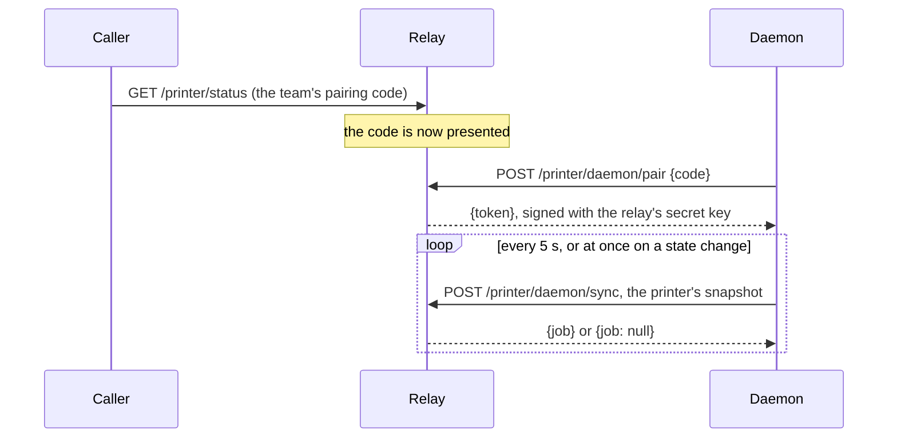
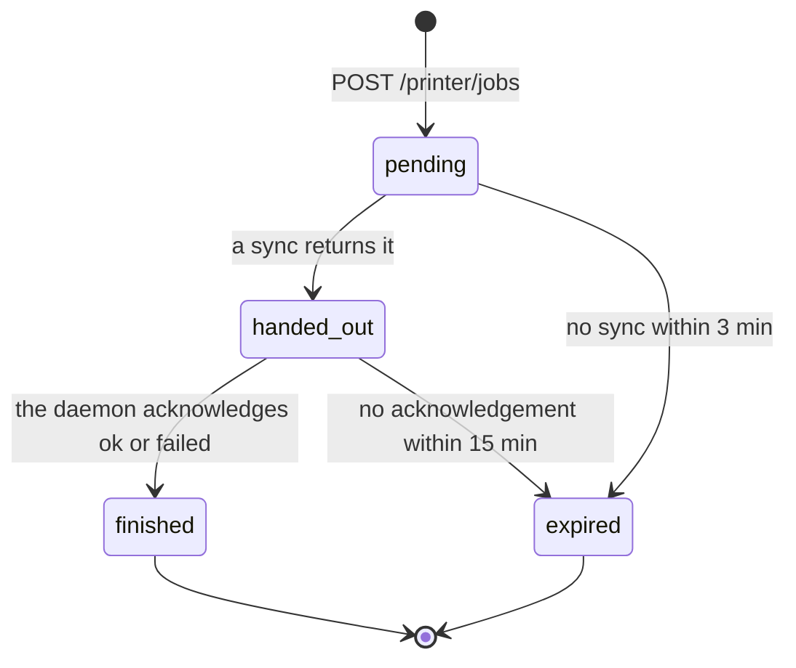

# Printer delivery

Printer delivery takes a sliced file (`.gcode.3mf`) and gets it printed on a shop's Bambu
Lab printer. It has two halves:

- **The relay** runs on the server. It holds each team's job and the printer's last
  status in memory, pairs with a daemon, and answers the caller.
- **The daemon** runs on a small computer in the shop (a Raspberry Pi). It connects
  outward to the relay, downloads the sliced file, uploads it to the printer on the local
  network and starts it. It opens no port.

The **caller** is the application that runs the relay and asks it to deliver sliced files:
it signs its users in, knows their team's pairing code, and holds the sliced file. Printer
delivery knows nothing of slicing, of how the caller signs anyone in, or of where the
caller keeps a team's configuration.

This is a port of the printer relay and daemon from PenguinCAM's
`feature/onshape-test-bed` branch (commit `da39282`). Behaviour, wire shapes and messages
are as they were; the known faults are pinned by tests, not fixed (see
[Known faults](#known-faults)).

## Layout

| Path | What it is |
|---|---|
| `relay/` | The relay: the `penguin-delivery-relay` project, package `penguin_delivery_relay`, and its tests |
| `daemon/` | The daemon: the `penguin-delivery-daemon` project (its `pyproject.toml` is the one pin of its dependencies), package `penguin_delivery_daemon`, its tests and fixtures, `install.sh` (which also writes the systemd unit) |
| `together/` | The together run: both halves and a stand-in printer in one process |
| `tests/` | Tests that need both halves at once |
| `pyproject.toml` | The uv workspace that holds both projects and the dev tools |

**Why two projects in one workspace.** The daemon must install alone on a Raspberry Pi
with only its three pinned dependencies (`bambulabs_api`, `requests`, `tomli-w`), and
must never pull in Flask. The relay needs Flask and nothing of the daemon's. So each half
is its own project with its own dependencies, and the workspace root (not a package itself)
installs both into one development environment, with pytest and coverage, for the tests
that exercise them together. A test checks that the daemon imports nothing but itself, the
standard library and its pins; another that the relay state module imports no Flask.

The package names start with `penguin_delivery_` so they cannot collide with the slice
service's. On a Pi the installed names stay those of the original daemon (the
`penguincam-printer` command and service, the `penguincam` user, `/etc/penguincam-printer`,
the `penguincam-printer/1.0.0` User-Agent, the token salt), so a Pi already in a shop
keeps working after an upgrade.

## How the relay and the daemon pair

The **pairing code** is eight symbols of Crockford base32 without I, L, O and U (forty
random bits), shown as `7K3M-Q9XW`. The daemon's `pair` command makes it on the Pi. A
mentor gives it to the caller, which keeps it with the team. Everywhere a code is read it is
normalised first (upper case, no dash or spaces, O read as 0, I and L as 1).



- The exchange succeeds only for a code the caller has presented since the relay started,
  and only while no daemon with that code has been heard for two minutes. Every refusal is
  the same `404 {"error": "not paired"}`, so a guesser learns nothing. It is limited to
  sixty a minute for the whole relay, whatever the address.
- The token carries the code and is checked by signature alone, so the relay needs no
  storage to recognise a daemon, and a restarted relay with the same secret key accepts it
  at once. A relay restarted with a different key answers `401 {"error": "repair"}`; the
  daemon then blanks its token and exchanges again, which works once the caller has
  presented the code again.
- A second Pi with a copied config file is refused while the first is alive.
- Outside development mode, every daemon route refuses a request that did not arrive over
  HTTPS (judged after the trusted proxies, one by default).

## Job states

A job is one sliced file on its way to the printer. The relay holds at most one per
pairing code.



| State | Meaning | Seen by the caller as |
|---|---|---|
| `pending` | Accepted, waiting for the daemon's next sync | `job.state` = `pending` |
| `handed_out` | A sync gave it to the daemon. Every later sync returns it again, so a restarted daemon sees it too | `job.state` = `handed_out` |
| finished | The daemon acknowledged it, `ok` or with a one-line reason | `job` is null, `last_result` = `{ok, reason, age_seconds}` |
| expired | A deadline passed: "printer did not pick up the job" or "printer did not confirm the job" | `last_result` with `ok: false` and that reason |

`last_result` is shown for ten minutes. A sync whose snapshot names the job's file clears
it, **even when it was a success** ("the printer has the job whatever the acknowledgement
said"), so a caller that polls less often than the daemon syncs may never see `ok`.
Deadlines are lazy: they are applied on the next read of that team's record, and every
read uses the relay's own clock, never the Pi's.

The daemon runs one job at a time on its own thread, so syncs continue during an upload.
For each job it checks the printer first (a job the printer already reports as running,
paused or finished is acknowledged without a second upload), then downloads the sliced
file, uploads it as `<name>-<job id>.gcode.3mf`, starts it, and waits up to sixty seconds
for the printer to report that file before it acknowledges.

## The interface the relay offers its caller

```python
from penguin_delivery_relay import create_app, relay_of, SlicedFile, Team

app = create_app(
    secret_key=KEY,                                  # stable across restarts
    identify=lambda request: Team(pairing_code=..., team_number=..., user=...) or None,
    find_sliced_file=lambda token, team: SlicedFile(filename=..., path=... or stream=...),
)
relay_of(app).relay.note_code(code)                  # optional: present a code at sign-in
```

`identify(request)` answers who is asking: a `Team`, or `None` (401). If it raises, a
status poll reads as a team with no pairing code (so a stale cookie never turns a poll
into a 500), and a send is refused with `delivery.identity_unreadable`.

`find_sliced_file(token, team)` turns the token the caller's page posted into a
`SlicedFile`, or `None` (404). It is asked only for a non-empty string; any other token
is refused as not found without asking. If it raises, the send is refused with
`delivery.sliced_file_unreadable`.

**The caller's duty: `find_sliced_file` must return `None` for a token that belongs to
another team.** The relay cannot know who owns a send token. It passes the very `Team`
that `identify` answered for the request, and trusts the answer; this check is the only
thing that keeps one team from printing another team's sliced file. Everything else (the
job, the status, the result, the download) is keyed on the pairing code inside the relay,
and the tests drive two teams through one relay to show none of it crosses.

A `SlicedFile` has exactly one of:

- `path`: a file the caller owns and keeps until the job is finished or expired (at most
  eighteen minutes). The relay never deletes it. A path that is not a file at the send is
  refused as not found.
- `stream`: a binary file object. The relay copies it once, at the send, and deletes its
  copy when it no longer holds the job.

`sliced_at` (optional) is when the file was made; a send more than forty minutes later is
refused with "slice again". The other arguments of `create_app` (`clock`, `log`,
`on_event`, `dev`, `dev_pairing_code`, `trusted_proxy_hops`, `installer_path`,
`spool_dir`) are described in `relay/penguin_delivery_relay/app.py`. The caller runs the
app on its own or mounts it beside its own (for example with werkzeug's
`DispatcherMiddleware`) so that `/printer/*` reaches it.

| Route | Who calls it | Answers |
|---|---|---|
| `GET /printer/status` | The caller's page, every few seconds | `paired`, `waiting`, `online`, `age_seconds`, `status` (the printer's snapshot plus `display_name`), `job`, `last_result`, `code`. 120 a minute per team |
| `POST /printer/jobs` `{token}` | The caller's page, on send | `202 {ok, job_id}`, or a refusal. 10 a minute per team |
| `POST /printer/daemon/pair` | The daemon | `{token}` or `404` |
| `POST /printer/daemon/sync` | The daemon, every 5 s | `{job}`: `id`, `download_path`, `filename`, `created_at` |
| `POST /printer/daemon/jobs/<id>/ack` | The daemon | `{ok: true}`, or `404` when the relay no longer holds the job (final for the daemon) |
| `GET /printer/daemon/ping` | `penguincam-printer status` | `{ok, waiting, online}`. Stores nothing |
| `GET /printer/download/<token>` | The daemon | The sliced file of a job the relay still holds. The token is the whole authority |
| `GET /install-printer.sh` | A mentor's `curl` | `install.sh`, when `installer_path` is given |

`on_event(kind, team_number=, user=, metadata=)` receives `printer_send` for each job sent
and `printer_ack` for each job acknowledged or expired (`metadata.expired` set on an
expiry), so the caller's metrics see every job's end.

### What was cut from PenguinCAM, and how

| In PenguinCAM | In the port |
|---|---|
| The pairing code read from `TeamConfig` in the Flask session; an Onshape-session gate; a config refresh before each status | The caller's `identify(request)`, returning a `Team` |
| The sliced file found through PenguinCAM's file-token manager and served by its `/download/<token>` route, for an hour whatever happened to the job | The caller's `find_sliced_file(token, team)`; the relay holds the file and serves it at `/printer/download/<token>` only while it holds the job, so a second download after the acknowledgement or expiry answers 404 |
| The sliced file served from where PenguinCAM had written it, never copied | A `stream` is copied in full before the send is accepted or refused, so a refused send still costs one copy of the file (at most ten a minute per team) |
| The app's flask-limiter instance with an app-wide default | `limits.py`: a fixed window per route and key on the relay's own clock (about sixty lines), the same limits, `429` with `Retry-After` |
| `app.debug` and `RAILWAY_ENVIRONMENT` for development mode; `PRINTER_DEV_PAIRING_CODE` | `create_app(dev=..., dev_pairing_code=...)` |
| The app's `log` function and metrics object | `log` and `on_event` arguments |
| The app's `ProxyFix` | `trusted_proxy_hops` (default 1) |
| A process-wide relay singleton | One relay per app, reachable as `relay_of(app).relay` |

No session, cookie or CSRF code came across: the relay never used any of its own.

## Error reports

Every failure the caller can see carries an [error report](../contracts/error-report.md)
beside the original text: refused sends as `error_report` in the response body, failed
jobs as `last_result.error_report`. The adapter (`relay/penguin_delivery_relay/errors.py`)
matches the original texts, which the port keeps word for word; `detail` is that text with
any download token removed. A daemon's acknowledgement reason is stored as one string
with any download token removed, whatever JSON type it arrived as, so `last_result.reason`
and the relay's log line carry no token either. Each code has a test that produces it on
purpose.

| Code | Comes from | Retryable |
|---|---|---|
| `delivery.no_session` | `identify` answered None | no |
| `delivery.identity_unreadable` | `identify` raised on a send (401; `detail` names the exception) | no |
| `delivery.not_paired` | The team has no pairing code | no |
| `delivery.sliced_file_missing` | `find_sliced_file` found nothing, the token was not a string, or the `path` is not a file (`action`: `slice_again`) | no |
| `delivery.sliced_file_unreadable` | `find_sliced_file` raised, or the `stream` failed while it was copied (500 with this report; `detail` names the exception) | yes |
| `delivery.sliced_file_too_old` | Sliced more than forty minutes before the send (`action`: `slice_again`) | no |
| `delivery.daemon_never_reported` | No daemon heard since the relay started | yes |
| `delivery.no_printer_status` | A daemon heard, but no snapshot yet | yes |
| `delivery.printer_offline` | The last snapshot is older than two minutes | yes |
| `delivery.printer_busy` | The printer is running a print | yes |
| `delivery.printer_paused` | The printer has a paused print | yes |
| `delivery.printer_unreachable` | The daemon cannot reach the printer | yes |
| `delivery.printer_error` | The printer reports an error | yes |
| `delivery.job_in_flight` | A job is already pending or handed out | yes |
| `delivery.rate_limited` | Over a caller route's limit | yes |
| `delivery.job_not_picked_up` | Expired pending | yes |
| `delivery.job_not_confirmed` | Expired handed out; the part may be printing | no |
| `delivery.start_refused` | The printer refused the start command | yes |
| `delivery.start_timeout` | The printer did not report the file within sixty seconds; the part may be printing | no |
| `delivery.printer_error_at_start` | The printer reported an error for the job | yes |
| `delivery.job_failed` | Any other failed acknowledgement: the download, the upload, an unexpected exception | yes |

Printer delivery sends no [progress reports](../contracts/progress-report.md) yet; the
status route is what the caller polls.

## Running the relay and the daemon together

```
make -C delivery together                    # over loopback HTTP, on a port the system picks
make -C delivery together ARGS=--in-process  # no socket at all
```

One process runs the relay, the daemon's real run loop on its own thread, and the
stand-in printer (`together/stand_in.py`, which keeps the bytes it is sent and reports
`running` under the uploaded name, like the fake printer in the daemon's tests). A caller
polls the status, sends the placeholder sliced file `together/sample_part.gcode.3mf` (or
`ARGS="--file PATH"`), and prints every state change; both halves' clocks run twenty times
faster than real time. It exits 0 when the stand-in received the very bytes sent and the
relay recorded the job as acknowledged.

## Tests

```
make -C delivery install       # uv sync
make -C delivery test          # the fast suite
make -C delivery test-parallel # on two workers, the most a shared machine should run
make -C delivery test-repeat   # ten runs in a row, each in a new random order
make -C delivery slowest       # with the ten slowest tests
make -C delivery coverage      # branch coverage per module
make -C delivery test-together # the together run on real threads, both ways
```

The fast suite opens no socket and never waits on the clock: the relay takes a `clock`,
the daemon's run loop a `clock` and a `sleep`, discovery a `clock`, and the relay is called
through Flask's test client or, for the daemon's real `RelayClient`, through
`together/transport.py`. Each test gets its own app, relay, temporary directory and fake
clocks; nothing depends on test order, the current directory, the home directory or the
user's name. pytest-randomly shuffles the order on every run.

Two markers:

- `known_fault`: the test pins a known fault's current wrong behaviour. It passes today;
  hardening fixes the fault and flips the assertion.
- `real_time`: the together run on real threads and sped-up real time. Left out of
  `make test`, run by `make test-together`.

`daemon/tests/hardware_smoke.py` starts a real print on a real printer and is never
collected (`make hardware-smoke`, with the printer's address, serial and access code in
the environment).

## Known faults

From the first test on the team's H2S (2026-10-09). Not fixed in the port.

1. **The start check reads the wrong field.** The daemon matches the uploaded name against
   `file`, which comes from the H2S's `gcode_file` (`/data/Metadata/plate_1.gcode`)
   before `subtask_name`. So a print that started is acknowledged as "did not start the
   file within 60s", a restarted daemon uploads a running job a second time, and the relay
   never clears the failed result.
2. **The upload result is not checked.** `bambulabs_api` catches a failure during the
   transfer itself, logs it and returns None; the daemon starts the missing file anyway
   and reports only the start timeout. (A refused connection or a wrong access code is
   outside the library's `try` and raises, and the daemon reports that as it happens.)

## The daemon on a Pi

`daemon/install.sh` is the installer: it checks for a 64-bit userland, creates the
`penguincam` user, a venv with the pins read from `daemon/pyproject.toml`, the
`penguincam-printer` wrapper and a hardened systemd unit, then runs `pair`. It downloads
the daemon from GitHub at a pinned commit; `SOURCE_REPOSITORY` and `DAEMON_SHA` must be
set before it will run. `make -C delivery daemon-tarball` writes the daemon alone, with
its `pyproject.toml`, to `dist/penguincam-printer-daemon.tar.gz`, for running it on a
laptop against a development relay (`pip install ./penguincam-printer-daemon`).

## Upstream

Printer delivery rests on open-source code written by others. Each version is stated in
exactly one place, and everything else reads it from there.

| Upstream | Used by | Pinned in | What it does for printer delivery |
|---|---|---|---|
| `bambulabs_api` | daemon | `daemon/pyproject.toml` | MQTT over TLS to the printer, the FTPS upload, the start command, the status document |
| `requests` | daemon | `daemon/pyproject.toml` | HTTPS to the relay |
| `tomli-w` | daemon | `daemon/pyproject.toml` | Writing the Pi's config file |
| Flask, itsdangerous | relay | `relay/pyproject.toml` (ranges) | The routes, and signing the daemon's token |

`install.sh` reads the daemon's pins out of `daemon/pyproject.toml` on the Pi; the
development workspace installs the same file; `uv.lock` records what everything resolves to,
including what `bambulabs_api` itself pulls in (`paho-mqtt`, Pillow). A test fails if any
other file of the daemon names one of the pinned versions.

**The seam.** Every call into `bambulabs_api` is in one module,
`daemon/penguin_delivery_daemon/printer.py` (`PrinterLink`, imported lazily inside
`connect`); `map_status` there is the only reader of the library's status fields. A test
fails if any other daemon module imports the library. The together run and the fast suite
replace the library with a fake at that seam (`printer_factory`). The upgrade command, the
upstream check suite and any patches to the library come with the hardening pass.

### Taking a new upstream version

Until the upgrade command and the upstream check exist, a new version is taken by hand.
The fast suite cannot notice a change in `bambulabs_api` on its own: the fakes in
`daemon/tests/daemon_fakes.py` (`FakeBambuPrinter`) carry the library's method names and
return values as they were written down, not as the installed library has them.

1. **Move the one pin.** Change the version in `daemon/pyproject.toml` and nowhere else
   (a test fails if any other file of the daemon names a pinned version). For the relay's
   Flask and itsdangerous, widen the range in `relay/pyproject.toml` if needed.
2. **Re-resolve.** `uv lock --project delivery --upgrade-package <name>`, then
   `make -C delivery install`.
3. **Read the diff of `uv.lock`.** Look for what the library itself pulls in changing
   (for `bambulabs_api`: `paho-mqtt` and Pillow), and for a new dependency the Pi would
   now have to install.
4. **Read the library's own diff for what the seam relies on.** Everything is in
   `daemon/penguin_delivery_daemon/printer.py`:
   - the calls: `Printer(ip, access_code, serial)`, `mqtt_start`, `mqtt_stop`,
     `mqtt_client_connected`, `mqtt_dump()['print']`, `upload_file(file, name)` (what it
     returns on success, which failures it swallows and returns None for, which it
     raises), `start_print(name, plate_number, use_ams=, ams_mapping=,
     flow_calibration=)`;
   - the status fields `map_status` reads: `gcode_state` and its values (`GCODE_STATE_MAP`),
     `stg_cur` and its values (`STG_IDLE`, `STG_PAUSED`), `hms`, `print_error`,
     `gcode_file`, `subtask_name`, `mc_percent`, `mc_remaining_time`, `layer_num`,
     `total_layer_num`.
   Where one of them changed, bring `FakeBambuPrinter` and `fixtures/h2s_status.json` in
   line with the new library first, so the fast suite tests the new behaviour.
5. **Run the checks.** `make -C delivery test`, then `make -C delivery hardware-smoke`
   against the shop printer: until the upstream check exists, the hardware smoke test is
   the only one that runs the real library.
6. **When something fails,** fix it in `printer.py` alone; no other module may touch the
   library. If the library now reports an error or progress badly in a way `printer.py`
   cannot work around, a small patch to the library is allowed, kept as a patch file
   against the named version with a note; that arrives with the hardening pass.
7. **Roll out.** `install.sh` reads the pins from `daemon/pyproject.toml`, so a Pi takes
   the new version when the installer runs again at the new commit.
