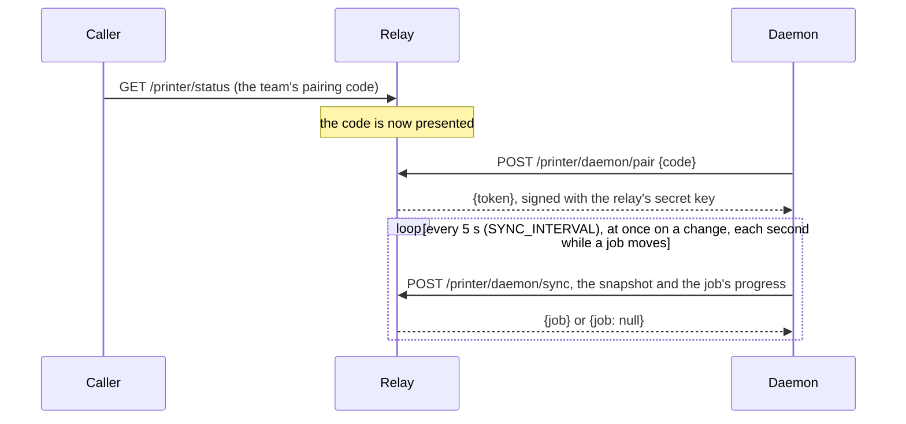
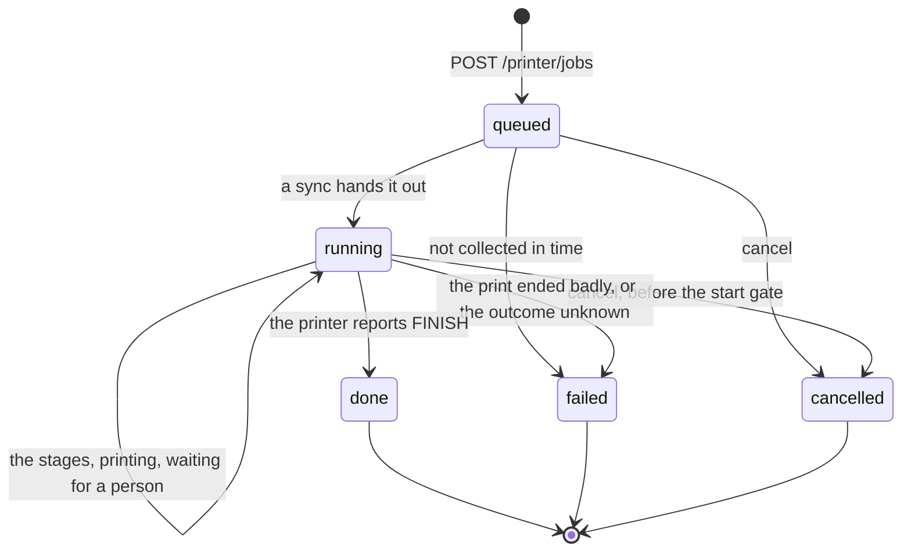

# Printer delivery

Printer delivery takes a sliced file (`.gcode.3mf`) and gets it printed on a shop's Bambu
Lab printer, reporting how the print goes. It has two halves:

- **The relay** runs on the server. It holds each team's delivery jobs and the printer's
  last status in memory, pairs with a daemon, and answers the caller.
- **The daemon** runs on a computer in the shop, on the printer's network. It connects
  outward to the relay, downloads the sliced file, uploads it to the printer and starts
  it. It opens no port. It is a plain Python program that runs on Windows, macOS or Linux.

The **caller** is the application that runs the relay and asks it to deliver sliced files:
it signs its users in, knows their team's pairing code, and holds the sliced file. Printer
delivery knows nothing of slicing, of how the caller signs anyone in, or of where the
caller keeps a team's configuration.

This began as a port of the printer relay and daemon from PenguinCAM's
`feature/onshape-test-bed` branch (commit `da39282`); the hardening since is described in
each section below, and the two faults the first hardware test found are fixed (see
[The two faults of the first hardware test](#the-two-faults-of-the-first-hardware-test)).

## Layout

| Path | What it is |
|---|---|
| `relay/` | The relay: the `penguin-delivery-relay` project, package `penguin_delivery_relay`, and its tests |
| `daemon/` | The daemon: the `penguin-delivery-daemon` project (its `pyproject.toml` is the one pin of its dependencies), package `penguin_delivery_daemon`, its tests and fixtures |
| `simulator/` | The simulated printer: an H2S played over loopback sockets, its scenarios and its suite |
| `together/` | The together run: both halves and a stand-in printer in one process; `relay_server.py`, the relay on its own for [Try it on one machine](#try-it-on-one-machine) |
| `tests/` | Tests that need both halves at once, the fault-injecting link among them |
| `scripts/` | `upgrade_printer_library.py`, behind `make upgrade-printer-library` |
| `conftest.py` | Bounds every sleep a test injects into the daemon (see [Tests](#tests)) |
| `pyproject.toml` | The uv workspace that holds both projects and the dev tools |

**Why two projects in one workspace.** The daemon must install alone with only its three
pinned dependencies (`bambulabs_api`, `requests`, `tomli-w`), and must never pull in
Flask. The relay needs Flask and nothing of the daemon's. So each half is its own project
with its own dependencies, and the workspace root (not a package itself) installs both
into one development environment, with pytest, Hypothesis and coverage. A test checks that
the daemon imports nothing but itself, the standard library and its pins; another that
the relay state module imports no Flask.

## Running the daemon

On the computer next to the printer (Windows, macOS or Linux, on the printer's network):

1. Install Python 3.11 or newer from python.org (on Windows, tick "Add python.exe to
   PATH").
2. Get the code: download the repository, or `make -C delivery daemon-tarball` and copy
   `dist/penguincam-printer-daemon.tar.gz` across and unpack it. Then
   `python -m pip install ./penguincam-printer-daemon` (or `./delivery/daemon`).
3. Pair, then run, with the same commands everywhere:

   ```
   python -m penguin_delivery_daemon pair      # finds the printer, prints the pairing code
   python -m penguin_delivery_daemon run       # the daemon; leave it running
   python -m penguin_delivery_daemon status    # what it sees, without disturbing it
   ```

Everything the daemon keeps is in one directory, its **home**: `--home DIR` on any
command, else `%LOCALAPPDATA%\PenguinDelivery` on Windows and `~/.penguin-delivery`
elsewhere (`daemon/penguin_delivery_daemon/paths.py` decides). It holds `config.toml`
(the printer's address and access code, the pairing code, the token), `downloads/`,
`recordings/` and, while a start command's outcome is not yet known, `start.json` (see
[How a start is decided](#how-a-start-is-decided)).

**Recording a real print**, for the simulated printer:
`python -m penguin_delivery_daemon record` saves every status document the printer sends,
one JSON line each, in `recordings/`, until Ctrl-C (`--seconds N` stops it sooner; `--out
FILE` names the file). Run it while a print goes from start to finish.

Not in this version: installers, running as a service or at start-up, and protection of
the stored token and access code by the operating system. The earlier installer,
`daemon/install.sh`, and the service unit it writes are **not maintained in this
version**: they are left as they were ported. Only for an install it made (the
configuration at `/etc/penguincam-printer/config.toml` on Linux) does `pair` still hand
the file to the service user and restart the service.

## Try it on one machine

The whole chain by hand, on one computer, with no printer and no server: the simulated
printer, the relay, the daemon, and `curl` as the caller. Four terminals, each started in
`delivery/` after `make install` (`uv` must be installed). Everything listens on 127.0.0.1
only. The home directory below is a scratch folder; any empty one will do.

1. **The simulated printer.** It prints the serial and the access code to give `pair`:

   ```
   uv run python -m simulator --scenario whole_print
   ```

   It listens on MQTT 18883 and FTPS 18990 (`--mqtt-port`, `--ftps-port` change them),
   and once a start command arrives it plays the scenario's print, one status document
   every 3 s (`--step-seconds`). Any scenario in `simulator/scenarios/` can be named.
2. **Pair the daemon** against a relay that is not running yet (pairing only writes the
   configuration). Answer `127.0.0.1`, `SIM00H2S0001` and `12345678`:

   ```
   uv run python -m penguin_delivery_daemon pair --home /tmp/pd-home --backend http://127.0.0.1:8787 --dev --printer-ports 18883,18990
   ```

   It connects to the simulated printer and prints a pairing code such as `B6MQ-DN77`.
   `--printer-ports` is for the simulated printer only; a real printer uses its own.
3. **The relay**, with a stand-in caller that signs every request in as one team with
   that pairing code (development mode, plain HTTP; never for a real shop):

   ```
   uv run python -m together.relay_server --code B6MQ-DN77
   ```

4. **Run the daemon**, back in the second terminal:

   ```
   uv run python -m penguin_delivery_daemon run --home /tmp/pd-home
   ```

   It says `paired with the relay`, then that it is idle. The relay's log shows a
   `request=sync` line every 5 s (`SYNC_INTERVAL`).
5. **Send the sample sliced file and watch it**, in the fourth terminal. The send answers
   with the delivery job's id; the stream gives every progress report until the final one:

   ```
   curl -s -X POST -H 'Content-Type: application/json' -d '{"token": "sample"}' http://127.0.0.1:8787/printer/jobs
   curl -sN http://127.0.0.1:8787/printer/jobs/<job_id>/events
   ```

   The reports go from `waiting_for_daemon` through `waiting_for_printer`, `uploading`,
   `starting` and `printing` (with the printer's stage and percent: heating the bed,
   levelling it, 25 and 75 percent) to `done` within about thirty seconds; the simulated
   printer shows the upload, the start command and each status document. On one machine
   the download takes a moment too short for a report of its own, so `downloading` is
   seldom seen.
6. **Cancel one at once.** Send again and cancel at once, in one line, while the job still
   waits for the daemon; the answer is `"outcome":"cancelled"`, and the job's report says
   `cancelled`:

   ```
   JOB=$(curl -s -X POST -H 'Content-Type: application/json' -d '{"token": "sample"}' http://127.0.0.1:8787/printer/jobs | python3 -c 'import sys, json; print(json.load(sys.stdin)["job_id"])'); curl -s -X POST http://127.0.0.1:8787/printer/jobs/$JOB/cancel
   curl -s http://127.0.0.1:8787/printer/jobs/$JOB
   ```

7. **Cancel one the daemon holds.** On one machine the daemon takes a job at its next sync
   and sends the start command within the same second, too quickly to cancel by hand in
   between. So give it a printer that refuses every upload: stop the simulated printer
   (Ctrl-C in the first terminal) and start it again with that scenario. The daemon keeps
   running and reconnects on its own within a few seconds:

   ```
   uv run python -m simulator --scenario upload_refused
   ```

   The daemon now tries the upload three times, waiting between the tries, for about
   fifteen seconds. Send, wait five seconds (the daemon has taken the job, or takes it at
   its next sync), then cancel. The answer is `202` with `"outcome":"cancelling"`; a few
   seconds later the
   job's report says `cancelled`, and the daemon's log says it removed the file from the
   printer and that the file was never started:

   ```
   JOB=$(curl -s -X POST -H 'Content-Type: application/json' -d '{"token": "sample"}' http://127.0.0.1:8787/printer/jobs | python3 -c 'import sys, json; print(json.load(sys.stdin)["job_id"])'); sleep 5; curl -s -X POST http://127.0.0.1:8787/printer/jobs/$JOB/cancel
   curl -s http://127.0.0.1:8787/printer/jobs/$JOB
   ```

8. **Too late to cancel.** Stop the simulated printer again and start it with
   `--scenario whole_print`, as in step 1. Send, wait ten seconds (the report says
   `printing`), then cancel: the answer is `409` with `delivery.cancel_too_late`, "The
   start command for this print has already been sent to the printer, so it can no longer
   be cancelled from here", and the print goes on to `done`.

Ctrl-C stops each program. `make together` runs the same chain in one process, with the
stand-in printer instead of the simulated one, and checks it end to end.

## How the relay and the daemon pair

The **pairing code** is eight symbols of Crockford base32 without I, L, O and U (forty
random bits), shown as `7K3M-Q9XW`. The daemon's `pair` command makes it. A mentor gives
it to the caller, which keeps it with the team. Everywhere a code is read it is normalised
first (upper case, no dash or spaces, O read as 0, I and L as 1).



- The exchange succeeds only for a code the caller has presented since the relay started,
  and only while no daemon with that code has been heard for two minutes
  (`DAEMON_ONLINE_SECONDS`). Every refusal is the same `404 {"error": "not paired"}`, so a
  guesser learns nothing. It is limited to sixty a minute for the whole relay
  (`EXCHANGE_LIMIT`).
- The token carries the code and is checked by signature alone, so a restarted relay with
  the same secret key accepts it at once. A relay restarted with a different key answers
  `401 {"error": "repair"}`; the daemon then blanks its token and exchanges again.
- A second daemon with a copied configuration is refused the exchange while the first is
  alive; one with a copied token as well can sync, but the start gate (below) lets only
  one daemon process ever start a given file.
- Outside development mode, every daemon route refuses a request that did not arrive over
  HTTPS (judged after the trusted proxies, one by default).

## Delivery jobs

A **delivery job** is one sliced file's way from the caller's send to the end of its
print. Its progress reports follow
[contracts/progress-report.md](../contracts/progress-report.md).

### States and stages

| State | Final | Meaning |
|---|---|---|
| `queued` | no | Sent; the daemon has not collected it |
| `running` | no | The daemon has it, or the printer is printing it |
| `done` | yes | The printer reported the print finished |
| `failed` | yes | It ended without a finished print, or (`delivery.outcome_unknown`) it was past the start gate and nobody could hear the printer any more, so the relay stopped following it: by the caller's decision, or after a day with no fresh word (`OUTCOME_UNKNOWN_AFTER_SECONDS`). `error` is the error report |
| `cancelled` | yes | The caller cancelled it, and it was never started |

| Stage, in order | State | Comes from | Extra fields |
|---|---|---|---|
| `waiting_for_daemon` | queued, then running once handed out | the send | |
| `waiting_for_printer` | running | the daemon: the printer is off or unreachable, has sent no report in the last 15 s (`FRESH_REPORT_SECONDS`), or has not reported its main state since the daemon connected, and the daemon waits for a whole, fresh picture that shows it free; always before the start gate, so a cancel still ends it here | |
| `waiting_for_earlier_print` | running | the daemon: the printer answers, but a start command sent for an earlier delivery job has not settled yet (see [How a start is decided](#how-a-start-is-decided)); before the gate, so a cancel still ends it here | |
| `downloading` | running | the daemon fetching the sliced file | `bytes_sent`, `bytes_total` |
| `uploading` | running | the daemon sending it to the printer | `bytes_sent`, `bytes_total`; `fraction` from bytes sent |
| `starting` | running | the daemon asking the start gate, then, past it, the start command and the wait for the printer to show the print | |
| `start_not_shown` | running | the daemon: the start command went 60 s (`START_SLOW_SECONDS`) ago and the printer has the file but has not shown the print yet; for a daemon restarted since, that cannot know whether the command went, the time counts from the start gate | `waited_s`, the seconds since the command (or the gate) |
| `printing` | running, then done or failed | the printer's own reports | `printer_stage`, `printer_stage_label`, `percent`, `layer`, `total_layers`, `remaining_min`, `expected_s`; `unrecognised` when the printer reported a value the daemon does not know |
| `waiting_for_person` | running | the printer's own reports: the print is under way but the printer waits for someone (a pause, an error code set while paused or running, a door open, filament run out, a serious fault). Never an end: back to `printing` when it resumes | as `printing`, plus `waiting_for` (a stable name), `waiting_label`, `at_the_printer` (what to do there), `printer_error` (the printer's code) and `printer_error_meaning` (where known) |

`printer_stage` is the printer's `stg_cur` mapped to a name (`heating_bed`,
`leveling_bed`, `cleaning_nozzle`, `printing`, `paused_by_user` and the rest of
`PRINTER_STAGES` in `daemon/penguin_delivery_daemon/printer.py`); an unknown code is
`stage_<n>`, "Busy (stage n)". `fraction` is for the whole delivery job: the stages
before the print take the first tenth (download 0 to 0.02, upload 0.02 to 0.08, starting
0.08 to 0.10, a convention rather than a measurement), and the print's `percent` the
rest. It is left out when it cannot be known. A figure the printer reports going
backwards or jumping is passed on as it was reported, never smoothed.



**Stale.** A running report whose daemon has not been heard for 20 s
(`STALE_AFTER_SECONDS`), or, from the start gate on, whose printer is unreachable (at
once), reports a main state this version does not know (at once; `unrecognised` names the
value) or has sent no status document for 60 s (`PRINTER_QUIET_SECONDS`),
carries `stale: true` and `stale_age_s`, the age of the last word, instead of repeating
old figures as if fresh. The printer's age is measured by the daemon from the last
document the printer actually sent, and survives a reconnect: old figures that come back
after one keep their old age. Becoming stale and recovering are each a new report (a new
`sequence`); the age grows on the same report, and a sync from a daemon that still cannot
reach the printer is not a new report.

**Only evidence that the print has ended ends a delivery job; silence never does, and
neither does a printer waiting for a person.** A delivery job reaches a final state only
on the printer's own report that the print ended (finished; its state for a failed or
stopped print; idle with an error code set; or two minutes (`PRINT_VANISH_SECONDS`) of
reports that show the print not under way: another file, no file, or idle with our file
still named, which is
`delivery.print_vanished`), on the daemon's acknowledgement, or on a start gate that was
never passed. A pause, an error code set while the print is paused or running, a door
open, filament run out, a serious fault: each is the stage `waiting_for_person`, with the
printer's code, its meaning where known and what to do at the printer, and the job goes
on (see [What the printer's report means](#what-the-printers-report-means)). A link or
printer that "seems down, then recovers" gives a stale report and a job still in
progress, which goes on from the first word that comes back:

- the daemon waits for a free printer before the start gate, where a cancel still ends
  the job; past the gate there is one look and no wait, and a printer not free at that
  look gets no start command and the job fails saying it was not started;
- after the start command the printer is held (see
  [How a start is decided](#how-a-start-is-decided)): five minutes
  (`START_SETTLE_SECONDS`) of whole, fresh pictures without the print is
  `delivery.start_timeout`, after one minute (`START_SLOW_SECONDS`) the stage is
  `start_not_shown`, and time the printer is unreachable or quiet is not counted (the
  daemon asks it for a whole report);
- the relay's 15-minute deadline (`JOB_HANDED_OUT_TIMEOUT_SECONDS`) applies only to a job
  whose start was never granted; its
  gate is shut from then on, so the file can never be started. A job past the gate keeps
  its slot until the daemon acknowledges it or the printer's report shows its file going
  (`PREPARE`, `RUNNING`, `PAUSE`), which moves it to `printing` even before the
  acknowledgement arrives. An end naming the file before that is not taken from the
  report: it may be the previous print's, left over, and only the daemon can tell;
- a daemon's start-stage failure that arrives after the printer's report named the file is
  outranked by that report, and the job goes on following the print;
- past the start gate, a job nobody can hear can be given up, honestly. The caller may
  **stop following** it (`POST /printer/jobs/<id>/stop-following`) while its report is
  stale: it ends `failed` with `delivery.outcome_unknown`, which says contact was lost
  after the print was handed over to be started and the print may be running, finished
  or never started, and to check the printer. It frees the job slot. A daemon still
  waiting for that job's print to show leaves the wait within 30 s (`HOLD_CHECK_SECONDS`;
  it asks the start gate, which answers `unknown`), so the next delivery job is taken up;
  but the first
  start command still holds the printer until the evidence settles it (see
  [How a start is decided](#how-a-start-is-decided)), so the next job waits in
  `waiting_for_earlier_print` or `waiting_for_printer`; a first print that then shows
  refuses it as `delivery.printer_busy_at_start`, and a printer that stays quiet ends it
  unstarted after ten minutes (`PRINTER_WAIT_SECONDS`). While the printer still reports
  the print, stop-following
  is refused with `delivery.still_reporting` (the print can only be stopped at the
  printer); while it answers but has not shown the print yet, with
  `delivery.start_not_shown_yet`; before the gate, with `delivery.not_started` (cancel
  instead);
- the relay does the same by itself after **24 hours of continuous staleness**
  (`OUTCOME_UNKNOWN_AFTER_SECONDS`) past the gate, whether or not anyone polls, so no
  record lives for ever. This is the one place
  where time ends a delivery job, and its sentence says the outcome is unknown, never that
  the print failed. Any fresh word in between starts the day again;
- a live job whose printer's record went (a day after anyone last touched it,
  `RECORD_TTL_SECONDS`) is not dropped: past the gate it ends `delivery.outcome_unknown`,
  before it `delivery.job_not_confirmed` (or `delivery.job_not_picked_up` if it was never
  collected), and like every final job it keeps its last report for 24 hours
  (`FINAL_TTL_SECONDS`), so a caller
  that polls only `GET /printer/jobs/<id>`, however slowly, learns how it ended.

**The job slot.** Underneath, the relay holds at most one job per pairing code that has
not started yet, as the port did: `pending` until a sync hands it out, `handed_out` until
the daemon acknowledges the start. The deadlines are lazy, applied on the next read: 3 min
(`JOB_PENDING_TIMEOUT_SECONDS`) to be picked up, and 15 min
(`JOB_HANDED_OUT_TIMEOUT_SECONDS`) to reach the start gate. Every read uses the relay's
own clock,
never the daemon's. A delivery job that ends by any route (the printer's report, stop
following, the day without word) frees its slot at once, so the printer's queue never
waits on an acknowledgement that may never arrive; the daemon's late acknowledgement then
answers `404`, which is final for it.

**One relay process.** Every record, delivery job and the start gate live in one
process's memory. Run the relay as a single process (one worker; threads are fine). With
two worker processes a delivery job fails safe (the gate in the other process answers
`unknown`, so nothing is started twice) but it fails.

**Everything stays small.** An error report's `detail` is cut to 2,000 characters, and a
daemon's one line of reason to 300, where the reports are built on the daemon and on the
relay. The relay reads no request body over 64 kB (`delivery.request_too_large`, before it
is read); of a daemon's snapshot it keeps only the fields it uses, each string cut to 200
characters and each number kept only when plain and finite; the daemon's failure code is
cut to 80 characters and its process name at the start gate to 64; every value in a log
line is cut to 200. Nothing in a report, a status answer, a stream event or a log line
grows with what a daemon or a caller sends.

### The caller's routes

| Route | Answers |
|---|---|
| `GET /printer/status` | `paired`, `waiting`, `online`, `age_seconds`, `status` (the printer's snapshot plus `display_name`), `job` (the job slot), `last_result` (`{ok, reason, age_seconds, error_report, cancelled}`, ten minutes, `LAST_RESULT_TTL_SECONDS`), `delivery` (the latest progress report of the team's most recent delivery job), `code`. 120 a minute per team (`STATUS_LIMIT`) |
| `POST /printer/jobs` `{token}` | `202 {ok, job_id}`, or a refusal with its error report. 10 a minute per team (`JOBS_LIMIT`) |
| `GET /printer/jobs/<id>` | The delivery job's latest progress report: what a caller that connects late gets at once. `404 delivery.job_unknown` when the relay has none |
| `GET /printer/jobs/<id>/events` | The progress reports as a server-sent event stream (`event: progress`, `id:` the sequence): the latest at once, then each new one, ending after a final state; a comment line every 15 s (`STREAM_HEARTBEAT_SECONDS`) of quiet |
| `POST /printer/jobs/<id>/cancel` | `200` cancelled at once (still queued); `202` cancelling (the daemon holds it; it ends `cancelled` once the daemon has stopped); `409 delivery.start_being_sent` once the start was granted, until the daemon says the command went; `409 delivery.cancel_too_late` after that; `409 delivery.already_finished` |
| `POST /printer/jobs/<id>/stop-following` | `200 {ok, outcome: "stopped", progress}`: a job past the start gate whose report is stale ends `failed`, `delivery.outcome_unknown`, and its slot is freed; `409 delivery.still_reporting` while the printer reports the print; `409 delivery.start_not_shown_yet` while it answers but has not shown it yet; `409 delivery.not_started` before the gate; `409 delivery.already_finished`; `404 delivery.job_unknown`. 10 a minute per team (`JOBS_LIMIT`) |

A success stays in `last_result` for its ten minutes (`LAST_RESULT_TTL_SECONDS`). A
failure is cleared when a later
sync shows the printer printing that very job (the printer has the job whatever the
acknowledgement said).

### Cancellation

A delivery job can be cancelled at any point before the printer is told to start it:
while queued, waiting for the printer, downloading or uploading. A queued job is
cancelled at once. A job the daemon holds is marked; the next sync tells the daemon, which
stops the download or the upload (both check between blocks), removes a partly uploaded
file from the printer, and acknowledges `delivery.cancelled`. A job the caller cancelled
that then fails before the start is reported as cancelled too.

**Cancel while the daemon is unreachable.** The daemon starts a file only after the
relay's **start gate** (`POST /printer/daemon/jobs/<id>/start`) says yes, and the relay
says yes only to a job not cancelled. So a daemon that cannot reach the relay cannot start
the file, and learns of the cancel when it returns. A cancel the daemon never answers ends
as cancelled at the 15-minute deadline (`JOB_HANDED_OUT_TIMEOUT_SECONDS`).

Every wait of the daemon comes before the gate, so a job that waits for the printer can
always be cancelled. From the gate on, a cancel is refused: with
`delivery.start_being_sent` ("may already have sent the start command", and what to do:
stop the print on the printer's screen if it starts, otherwise wait for the job's report
to end before sending again) until the daemon says the command went, with
`delivery.cancel_too_late` ("has already been sent to the printer") after; neither says
the print started. The daemon sends the command right after the gate, with no wait in
between, so the first refusal is seen in that instant, when the daemon's word was lost on
the way, or after a daemon died between the gate and its word: a restarted daemon that
cannot know whether the command went never says it did, so the relay keeps answering
`delivery.start_being_sent` until the job ends.

## The daemon's side of a delivery job

1. The printer already shows the file going (its `subtask_name` is the uploaded name
   without `.gcode.3mf`): acknowledge it, never upload it again.
2. The relay says the start was already granted (to this daemon before a restart, or to
   another daemon), or the note in the daemon's home (`start.json`) names this job: never
   start it again; rebuild the hold on the printer from the gate's age
   (`start_granted_age_s`) and wait for the evidence, as in step 7.
3. Wait for **a free printer**: a whole, fresh picture (a report younger than 15 s,
   `FRESH_REPORT_SECONDS`, with the main state reported since the daemon connected) that
   shows no print going on (idle, or its last print ended, well or badly), and no earlier
   start command holding the printer. Without one (the printer unreachable, its status
   stream quiet, only partial documents) the daemon asks the printer for a whole report
   every 10 s (`REPORT_REQUEST_SECONDS`) and waits in `waiting_for_printer` (held by an
   earlier start, in `waiting_for_earlier_print`), where a cancel still ends the job;
   after ten minutes (`PRINTER_WAIT_SECONDS`) the job ends, never started:
   `delivery.earlier_start_unsettled` when an earlier start still held the printer and the
   printer answered at all meanwhile, else `delivery.printer_unreachable_at_start`. A
   fresh report of a print going on (printing, paused, mid-calibration,
   door open, out of filament) ends it at once with `delivery.printer_busy_at_start`, and
   one of a main state this version does not know with
   `delivery.printer_state_unrecognised_at_start` (the value in `detail` and in the
   daemon's log).
4. Download, checked against the size and SHA-256 the relay sends with the job. Three
   attempts (`DOWNLOAD_ATTEMPTS`) with backoff.
5. Upload, judged by the size the printer lists for the file afterwards, not by the FTP
   reply. Three attempts (`UPLOAD_ATTEMPTS`) with backoff, waiting for the printer between
   them; a failed upload's file is removed from the printer.
6. Wait for a free printer once more, as in step 3 (still cancellable), ask the printer
   for a whole report, and ask the start gate; before every further ask of the gate the
   wait is made again, and after ten minutes (`GATE_WAIT_SECONDS`) of a gate that cannot
   be reached the job ends unstarted (`delivery.job_failed`). On the gate's yes, look
   once, without waiting: on a free printer write the note of the start (`start.json` in
   the daemon's home, below) and send the start command, once; otherwise send nothing,
   remove the file and acknowledge the failure. A start command is never sent on a
   picture older than 15 s (`FRESH_REPORT_SECONDS`), one without the main state, one that
   shows a print going on, or while an earlier start holds the printer, and never without
   its note on the disk (`delivery.start_not_recorded`). A start command that raises is
   never sent again: the printer's report decides.
7. Hold the printer and wait for the evidence of what became of the command (see
   [How a start is decided](#how-a-start-is-decided)): seen going is success; a proven end
   of ours is success (finished) or `delivery.printer_error_at_start`; five minutes
   (`START_SETTLE_SECONDS`) of whole, fresh pictures without our print is
   `delivery.start_timeout` (or `delivery.start_other_file`). Time the printer is
   unreachable, quiet, without its main state or in a state this version does not know is
   not counted: the daemon waits, asks it for a whole report every 10 s
   (`REPORT_REQUEST_SECONDS`), and the relay shows the job stale meanwhile. Every 30 s
   (`HOLD_CHECK_SECONDS`) the daemon asks the start gate whether the relay still holds
   the job; on `unknown`
   (the caller stopped following it, or the relay dropped it) it leaves the wait, leaves
   the file on the printer (it may be printing) and is free for the next delivery job,
   which waits for the hold to settle before its own start command.

### How a start is decided

The moment a print starts is one design: what counts as a free printer, when the start
command goes, what holds the printer after it, and what counts as the end of *this* print.

**A whole, fresh picture.** The printer library merges each status document into the
last (a printer may send only the fields that changed). The daemon's picture is **whole**
only once a document carrying the main state (`gcode_state`) has arrived since the
current connection to the printer began; partial documents are merged onto it for the
fields they carry. It is **fresh** while the last document of any kind is at most
`FRESH_REPORT_SECONDS` old. A picture with no main state says nothing about whether a
print is going on: its snapshot reads `unrecognised` ("no main state reported yet"), it
is never free, and the daemon treats it as it treats an old one: it asks the printer for
a whole report every `REPORT_REQUEST_SECONDS` and waits.

**The printer is free** only on a whole, fresh picture whose main state positively means
no print: `IDLE`, or the previous print's end (`FINISH`, `FAILED`, `IDLE` with an error
code), and only when no earlier start command still holds the printer (below).

**Before the gate, the wait; after it, no wait.** The daemon waits for a free printer when
the job arrives and again after the upload, in `waiting_for_printer`, where a cancel still
ends the job and its sentence says it was never started. Only then does it ask the
relay's start gate. On the gate's yes it looks once more, at once and without waiting: on
a free printer it sends the start command; otherwise it does not send it, removes the file
and acknowledges the failure (`delivery.printer_busy_at_start`,
`delivery.printer_unreachable_at_start` or `delivery.printer_state_unrecognised_at_start`),
which is true, because nothing was started. Between the gate and the daemon's word that the
command went, the relay refuses a cancel with `delivery.start_being_sent` ("may already
have sent the start command"), never with a sentence that says the command went or the
print started.

**After the start command, the printer is held.** No other start command goes to that
printer until the evidence settles what became of the first:

- the print is **seen going**: a whole, fresh picture names our file under a going or
  waiting state (`PREPARE`, `RUNNING`, `PAUSE`). The delivery job is acknowledged and
  followed;
- or `START_SETTLE_SECONDS` of whole, fresh pictures after the command show no print of
  ours (idle, another file, or an end that is not ours by the rule below). The job ends
  `delivery.start_timeout` ("the printer did not show the print as started"), or
  `delivery.start_other_file` when the printer was printing another file;
- or a proven end of ours (below).

Time without a whole, fresh picture is not counted. A printer that is slow to show the
print gets, after `START_SLOW_SECONDS`, the non-final stage `start_not_shown` ("The
printer has the file and has not shown the print yet") with `waited_s`. A delivery job
that arrives while an earlier start still holds the printer waits in
`waiting_for_earlier_print`; if the hold has not settled within `PRINTER_WAIT_SECONDS`
it ends unstarted with `delivery.earlier_start_unsettled` (or, when the printer did not
answer at all in that time, `delivery.printer_unreachable_at_start`). The hold outlives the
job that made it (a caller that stopped following it, a relay that dropped it), and it
outlives the daemon and the relay, alone or together:

- **The note in the daemon's home.** Before it sends a start command the daemon writes
  `start.json` in its home (`start_record.py`): the printer's serial, the job id, the
  file's name on the printer, and `sending`; once the command has gone (or raised on its
  way) it rewrites it as `sent`; when the evidence settles the hold it removes it. Each
  write goes whole to a temporary file, is flushed to the disk and renamed over the old
  note, so a crash mid-write leaves the old note or none, never half of one. A daemon that
  starts and finds a note holds the printer, with no help from the relay, until the
  evidence settles it; its time counts from the first picture it watches after the
  restart (never from the note's own clock time, because the computer's clock may be
  wrong), unless the relay gives the gate's age. A note that is there but cannot be read
  or understood holds the printer too, until `START_SETTLE_SECONDS` of whole, fresh
  pictures show no print going on, or a print going settles it; it never frees the
  printer. A note about another printer (the daemon was paired again since) is set aside.
  A note that cannot be written means no start command: the file is removed and the job
  ends `delivery.start_not_recorded`.
- **The relay.** Every job document names the printer's last start granted
  (`previous_start`: its job id, file name and age), so a daemon restarted while the
  relay ran rebuilds the hold from it, its time counted from the gate.

A daemon that died between the gate and the command cannot know whether the command went:
the note says `sending`, or there is none (it died before writing it) and only the relay's
grant remains. Its stage then never says the command went (`start_sent` false), so the
relay goes on refusing a cancel with `delivery.start_being_sent` rather than
`delivery.cancel_too_late`, and a job that ends `delivery.start_timeout` says in `detail`
that this process cannot know whether the command was sent.

**An end counts only if it is the end of this print.** A whole, fresh picture that names
our file under `FINISH`, `FAILED` or `IDLE` with an error code ends the delivery job only
when one of these is true:

- the print was seen going after the start command (then the relay follows it, and the
  end comes from the printer's report as usual);
- the command is at least `LEFTOVER_END_SECONDS` old (no print ends sooner, and a
  left-over is seen in the first moments) and the main state changed after the command:
  the daemon's last picture before the command had another main state, or one of its
  pictures since did, so the end arrived after the start, not before it;
- the daemon could not watch continuously since the command, so it cannot tell a
  left-over from a real end: it did not send the command (a restarted daemon; the relay
  sends `start_granted_age_s`, the gate's age) or it had no whole, fresh picture for
  `LEFTOVER_END_SECONDS` after it. Then the end counts once the command is
  `START_SETTLE_SECONDS` old, the same time after which a printer that has not shown the
  print is taken not to have started it: a real end is found, never waited on for ever.

Otherwise it is the previous print's end with our name already on it: "not showing our
print yet", counted towards `START_SETTLE_SECONDS` like any other picture without our
print. The relay holds to the same rule: it moves a job to `printing` on its own only when
the printer's report names the file under a going state; an end is taken from the
daemon's acknowledgement.

#### Two limits that wait for the real printer

Both rules above use time to decide something the printer's pictures do not show. Each
fails in one case, and whether that case can happen depends on how the real H2S behaves,
which nobody has recorded yet. Both are left as they are until the owner decides.

1. **A daemon that could not watch takes a left-over end, shown long enough, for this
   print's end.** A daemon restarted just after the start command, or one that had no
   whole, fresh picture for 2 minutes (`LEFTOVER_END_SECONDS`) after it, cannot tell the
   previous print's `FINISH` (or `FAILED`) under our file's name from our own print's end:
   the fields it reads are the same. It takes such an end once the command is 5 minutes
   (`START_SETTLE_SECONDS`) old. If the printer keeps the previous print's end under the
   new name for longer than that and only then starts the file, the job ends `done` (or
   `delivery.printer_error_at_start`) for a print that has not begun, the printer counts as
   free, and a resend sends a second start command while the first is pending.
2. **A printer slower than 5 minutes (`START_SETTLE_SECONDS`) to show a print it accepted
   is taken not to have started it.** The job ends `delivery.start_timeout` (whose remedy
   says to look at the printer first, because the part may be printing), the printer
   counts as free, and a resend sends a second start command while the first is pending.

The hardware checklist's lines on the documents between the start command and the first
`PREPARE` or `RUNNING`, and on the seconds from the command to the first document naming
the file, settle both: if the H2S shows a print within seconds and drops the previous end
at once, neither case can happen at these settings.

**The alternative, which needs no timing of the printer** (review 5). When the settle time
passes without proof (our print never seen going, no end proven ours), end the delivery
job as outcome unknown ("the printer has the file and never showed the print; look at the
printer") and keep the printer held until either a picture proves it moved on (another
file going or ended, or the printer reconnecting with a whole `IDLE` picture that names no
file) or a person says it is clear (a flag on the resend, or a small route). No clock then
ever frees a printer for a second start command. The costs: one confirmation by a person
after every start the printer truly ignored, and, for a daemon that could not watch, never
`done` from a left-over-looking end: such a job ends "outcome unknown" unless a recording
shows a field that tells the two ends apart (the layer total, perhaps). That conflicts
with the rule that a restarted daemon finds a real end, so it changes what a person must
do and is the owner's choice.

#### The settings

| Setting (`run_loop.py`) | Default | What it bounds |
|---|---|---|
| `FRESH_REPORT_SECONDS` | 15 s | The oldest picture that counts as the printer's word |
| `REPORT_REQUEST_SECONDS` | 10 s | How often the printer is asked for a whole report while the picture is not whole and fresh |
| `PRINTER_WAIT_SECONDS` | 10 min | The wait for a free printer, before the gate, before the job ends unstarted |
| `PRINTER_POLL_SECONDS` | 5 s | How often that wait looks at the printer again |
| `GATE_WAIT_SECONDS` | 10 min | How long a start gate that cannot be reached is asked again before the job ends unstarted |
| `START_SLOW_SECONDS` | 60 s | After the command, when the stage becomes `start_not_shown` |
| `START_SETTLE_SECONDS` | 5 min | Whole, fresh pictures without our print after the command, before "did not start" and before the printer is free for another start |
| `LEFTOVER_END_SECONDS` | 2 min | How old a start command must be before an end naming our file, never seen going, can count at all; and how long without a whole, fresh picture makes the daemon one that could not watch |
| `START_POLL_SECONDS` | 2 s | How often the wait after the start command looks at the printer |
| `HOLD_CHECK_SECONDS` | 30 s | How often that wait asks the relay whether it still holds the job |

Every figure is a guess until the real H2S is timed; the
[hardware checklist](#before-trusting-it-at-the-h2s-what-a-hardware-session-must-confirm)
asks for the measurements that set them. Every other time limit of printer delivery:

| Setting | Where | Default | What it bounds |
|---|---|---|---|
| `SYNC_INTERVAL` | `run_loop.py` | 5 s | The daemon's sync, when nothing changes |
| `PROGRESS_SYNC_SECONDS` | `run_loop.py` | 1 s | The quickest sync while a job's progress moves |
| `EXCHANGE_INTERVAL` | `run_loop.py` | 30 s | How often the daemon asks to trade its pairing code for a token |
| `BACKOFF_START`, `BACKOFF_CAP` | `run_loop.py` | 5 s, 60 s | The first and the longest wait after a failure |
| `LOG_EVERY`, `IDLE_LOG_EVERY` | `run_loop.py` | 1 min, 10 min | How often the daemon repeats a waiting line, and its idle line |
| `STALE_AFTER_SECONDS` | `deliveries.py` | 20 s | A daemon not heard this long makes the report stale |
| `PRINTER_QUIET_SECONDS` | `deliveries.py` | 60 s | A printer silent this long, past the gate, makes the report stale |
| `PRINT_VANISH_SECONDS` | `deliveries.py` | 2 min | Reports of the print not under way, before `delivery.print_vanished` |
| `OUTCOME_UNKNOWN_AFTER_SECONDS` | `deliveries.py` | 24 h | Continuous staleness past the gate, before `delivery.outcome_unknown` |
| `FINAL_TTL_SECONDS` | `deliveries.py` | 24 h | How long a final report is kept |
| `DAEMON_ONLINE_SECONDS` | `relay.py` | 2 min | A daemon heard this recently refuses a second pairing exchange |
| `STATUS_ONLINE_SECONDS` | `relay.py` | 2 min | A printer status older than this is `delivery.daemon_silent` |
| `JOB_PENDING_TIMEOUT_SECONDS` | `relay.py` | 3 min | A job not collected, before `delivery.job_not_picked_up` |
| `JOB_HANDED_OUT_TIMEOUT_SECONDS` | `relay.py` | 15 min | A collected job that has not reached the start gate, before `delivery.job_not_confirmed` |
| `LAST_RESULT_TTL_SECONDS` | `relay.py` | 10 min | How long `last_result` is kept |
| `RECORD_TTL_SECONDS`, `STATUS_TTL_SECONDS` | `relay.py` | 24 h | A printer's record, and its status, untouched this long go |
| `SWEEP_EVERY_SECONDS` | `relay.py` | 1 min | The most often the sweep of old records runs |
| `SLICE_MAX_AGE_SECONDS` | `routes.py` | 40 min | The oldest sliced file a send accepts |
| `STREAM_HEARTBEAT_SECONDS` | `routes.py` | 15 s | A comment line on a quiet progress stream |
| `STATUS_LIMIT`, `JOBS_LIMIT`, `SYNC_LIMIT`, `DAEMON_LIMIT`, `EXCHANGE_LIMIT`, `DOWNLOAD_LIMIT`, `INSTALLER_LIMIT` | `routes.py` | 120, 10, 120, 60, 60, 30, 30 a minute | The rate limits |

**Stopping.** Ctrl-C ends every wait of the run loop and of the job thread at once. A job
in flight ends at its next wait, unacknowledged, and its file is never started by that
run: a partial upload is removed, and the next run takes the job up from what the relay
and the printer say.

Every wait after a failure doubles from 5 s (`BACKOFF_START`) to a cap of 60 s
(`BACKOFF_CAP`), shortened by up to a quarter (`JITTER`) drawn from an injected random
source (the tests use a fixed one), so daemons that lost the
relay together do not return in step. An acknowledgement the relay did not receive is
queued and sent again with the same backoff until the relay answers. A `404` is final only
when it is the relay's own answer (JSON, `{"error": "unknown job"}`); a `404` from anything
else (a hosting platform's "application not found" page, a proxy) is a link fault and is
retried, at the acknowledgement, the start gate and the pairing exchange alike.

## What the printer's report means

The daemon reads four things in each status document: the printer's state
(`gcode_state`), its stage (`stg_cur`), its error code (`print_error`) and the severity of
each `hms` entry. `PRINTER_VALUES` in `daemon/penguin_delivery_daemon/printer.py` is the
one table that says what each value means for a print; a test checks that this copy
agrees with it. The classes, and how the snapshot's `state` reads each: **going**
(`running`), **waiting for a person** (`paused`; the delivery job's stage
`waiting_for_person`), **ended well** (`finished`), **ended badly** (`error`), **no print**
(`idle`), **unrecognised as a whole** (`unrecognised`).

**The printer's main state (`gcode_state`) decides whether a print is going on; the stage
code (`stg_cur`) only describes what a going print is doing.** They combine in this order:
a main state this version does not know, or the library's own `UNKNOWN`, is unrecognised
as a whole, whatever else the document says; then the printer's own end (`FINISH`,
`FAILED`); then `IDLE`, which is no print whatever the stage code says (with an error code
or a fatal or serious HMS entry set, it is how the last print ended badly); then, under a
going state (`PREPARE`, `RUNNING`, `PAUSE`), a stage that waits for a person, then an error
code or a fatal or serious HMS entry (waiting for a person), then a pause, else the print
is going; a stage code the table does not know is then "going, unrecognised stage". A
picture with no main state at all says nothing about whether a print is going on, whatever
its stage code, figures or file name: it is unrecognised as a whole, never free, and the
daemon asks for a whole report and waits (see
[How a start is decided](#how-a-start-is-decided)). An error code of 0 leaves the class to the
other fields. In every case a value the table does not know is kept, raw, in the
snapshot's `unrecognised`. PROVISIONAL: no pause or fault of the H2S
has been recorded yet, so what it reports while it waits is on the
[hardware checklist](#before-trusting-it-at-the-h2s-what-a-hardware-session-must-confirm).

| Field | Value | Means | Name | What to do at the printer |
|---|---|---|---|---|
| `gcode_state` | `IDLE` | no print | `idle` |  |
| `gcode_state` | `PREPARE` | going | `preparing` |  |
| `gcode_state` | `RUNNING` | going | `printing` |  |
| `gcode_state` | `PAUSE` | waiting for a person | `paused` | Resume the print on the printer's screen, or stop it there. |
| `gcode_state` | `FINISH` | ended well | `finished` |  |
| `gcode_state` | `FAILED` | ended badly | `failed` |  |
| `gcode_state` | `UNKNOWN` | unrecognised as a whole | `unknown` |  |
| `stg_cur` | `0` | going | `printing` |  |
| `stg_cur` | `1` | going | `leveling_bed` |  |
| `stg_cur` | `2` | going | `heating_bed` |  |
| `stg_cur` | `3` | going | `sweeping` |  |
| `stg_cur` | `4` | going | `changing_filament` |  |
| `stg_cur` | `5` | waiting for a person | `paused` | Check the print, then resume the print on the printer's screen. |
| `stg_cur` | `6` | waiting for a person | `paused_filament_runout` | Load new filament, then resume the print on the printer's screen. |
| `stg_cur` | `7` | going | `heating_nozzle` |  |
| `stg_cur` | `8` | going | `calibrating_extrusion` |  |
| `stg_cur` | `9` | going | `scanning_bed` |  |
| `stg_cur` | `10` | going | `inspecting_first_layer` |  |
| `stg_cur` | `11` | going | `identifying_plate` |  |
| `stg_cur` | `12` | going | `calibrating_lidar` |  |
| `stg_cur` | `13` | going | `homing` |  |
| `stg_cur` | `14` | going | `cleaning_nozzle` |  |
| `stg_cur` | `15` | going | `checking_temperature` |  |
| `stg_cur` | `16` | waiting for a person | `paused_by_user` | Resume the print on the printer's screen, or stop it there. |
| `stg_cur` | `17` | waiting for a person | `paused_cover_open` | Close the front cover, then resume the print on the printer's screen. |
| `stg_cur` | `18` | going | `calibrating_lidar` |  |
| `stg_cur` | `19` | going | `calibrating_flow` |  |
| `stg_cur` | `20` | waiting for a person | `paused_nozzle_temperature` | Check the nozzle heater, then resume the print on the printer's screen. |
| `stg_cur` | `21` | waiting for a person | `paused_bed_temperature` | Check the heated bed, then resume the print on the printer's screen. |
| `stg_cur` | `22` | going | `unloading_filament` |  |
| `stg_cur` | `23` | waiting for a person | `paused_skipped_step` | Check that nothing blocks the print head, then resume the print on the printer's screen. |
| `stg_cur` | `24` | going | `loading_filament` |  |
| `stg_cur` | `25` | going | `calibrating_motor_noise` |  |
| `stg_cur` | `26` | waiting for a person | `paused_ams_lost` | Check the AMS connection, then resume the print on the printer's screen. |
| `stg_cur` | `27` | waiting for a person | `paused_fan` | Check the hotend fan, then resume the print on the printer's screen. |
| `stg_cur` | `28` | waiting for a person | `paused_chamber_temperature` | Check the chamber temperature, then resume the print on the printer's screen. |
| `stg_cur` | `29` | going | `cooling_chamber` |  |
| `stg_cur` | `30` | waiting for a person | `paused_by_gcode` | Do what the print file paused for, then resume the print on the printer's screen. |
| `stg_cur` | `31` | going | `motor_noise_showoff` |  |
| `stg_cur` | `32` | waiting for a person | `paused_nozzle_covered` | Clear the filament from around the nozzle, then resume the print on the printer's screen. |
| `stg_cur` | `33` | waiting for a person | `paused_cutter` | Check the filament cutter, then resume the print on the printer's screen. |
| `stg_cur` | `34` | waiting for a person | `paused_first_layer` | Look at the first layer, then resume the print on the printer's screen. |
| `stg_cur` | `35` | waiting for a person | `paused_nozzle_clog` | Check the nozzle for a clog, then resume the print on the printer's screen. |
| `stg_cur` | `255` | no print | `idle` |  |
| `print_error` | `0` | going | `none` |  |
| `print_error` | `any other` | waiting for a person | `printer_error` | Deal with what the printer's screen shows, then resume the print on the printer's screen. |
| `hms severity` | `1` | waiting for a person | `printer_error` | Deal with what the printer's screen shows, then resume the print on the printer's screen. |
| `hms severity` | `2` | waiting for a person | `printer_error` | Deal with what the printer's screen shows, then resume the print on the printer's screen. |
| `hms severity` | `3` | going | `notice` |  |
| `hms severity` | `4` | going | `notice` |  |
| `gcode_state` | a value not listed | unrecognised as a whole (the raw value is kept in `unrecognised`) | | |
| `gcode_state` | missing, `null` or empty | unrecognised as a whole, whatever else the document says: it says nothing about whether a print is going on (`unrecognised` says "no main state (gcode_state) reported yet") | | |
| `stg_cur` | a value not listed | under a going state: going, unrecognised stage; under `IDLE`: no print (the raw value is kept in `unrecognised`) | | |
| `hms` severity | a value not listed | changes nothing (the raw value is kept in `unrecognised`) | | |

**What each class means for a send.** A printer with no print, or whose last print ended
(well or badly), is **free**: the relay accepts a send, and the daemon starts it on a
fresh report (step 3 above). A printer that is going or waiting for a person is busy: the
relay refuses a send (`delivery.printer_busy`, `delivery.printer_paused`), and a daemon
that finds it so fails the job with `delivery.printer_busy_at_start`. An unrecognised main
state refuses a send with `delivery.printer_state_unrecognised` (the raw value in
`detail`; retryable) and fails a job that arrives with
`delivery.printer_state_unrecognised_at_start`. A followed print under an unrecognised main
state is never ended by it: its report keeps its last figures, names the value in
`unrecognised` and is marked stale, so the caller can stop following it. The relay refuses
a send for any snapshot `state` it does not know, too.

No sentence built from the printer's figures ever shows a figure that is missing: a part
of a message that names one (a percent, a name, minutes, seconds) is left out when it is
not known (`fill` in `errors.py`; a test renders every message with no figures).

## Restarts and cleanup

**A restarted daemon** has nothing in memory. The relay re-offers the job it holds, with
`start_granted` and `cancel` as they stand (and `start_granted_age_s`, the gate's age, and
`previous_start`, the printer's last start granted to another job), and the printer's
report says whether it prints: so the new process acknowledges a job already printing,
never starts one whose start was granted, rebuilds the hold on the printer, and does the
whole of one that had not started. The note of an unsettled start command in its home
(`start.json`) holds the printer even when the relay restarted too (see
[How a start is decided](#how-a-start-is-decided)). Downloads left by the
process before are removed at start (only names a delivery job writes).

**A restarted relay** keeps nothing but its secret key: every job, delivery job and
status is in memory and is gone. What happens to each party:

| Party | After a relay restart |
|---|---|
| Caller | `GET /printer/jobs/<id>` and the stream answer `404 delivery.job_unknown`, which says the service may have restarted and to look at the printer before sending again |
| Daemon | Its token still verifies; its next sync recreates the printer's record. A job it holds that has not passed the gate is refused there (`unknown`) and never started; its file is removed from the printer. An acknowledgement answers `404`, which is final |
| Printer | A print already started goes on |
| Relay | Every copy of a sliced file the old process left in the spool directory is removed when the new process starts (only names the relay gives its copies). The spool directory belongs to one relay process |

**Records.** A printer's record goes a day (`RECORD_TTL_SECONDS`) after anything last
touched it, and a final delivery job's report 24 hours (`FINAL_TTL_SECONDS`) after it
ended, whatever ended it; a sweep, at most once a minute (`SWEEP_EVERY_SECONDS`), applies
both to records nobody reads again. A live delivery job whose printer's
record goes is ended then, not dropped (see the 24-hour rule above).

## Supportable from the server

The relay writes one structured line per request and per transition, through the
caller's `log`:

```
printer-delivery request=sync printer=3f2a9c1e status=200 state=running printer_job=sample_part-j8f3a2c1 job=- stage=-
printer-delivery request=start printer=3f2a9c1e status=200 job=j8f3a2c1 outcome=start
printer-delivery event=transition job=j8f3a2c1 printer=3f2a9c1e team=6238 state=running stage=printing code=-
```

Every caller request (status polls included, so support can see whether a page kept
asking) and every daemon exchange (pair, sync, ack, start, download, ping) has a line.
So does every refused request, on every route: its line names the route, the refusal
(`error=not_signed_in`, `identity_unreadable`, `rate_limited`, `https_required`,
`token_invalid`, `not_paired`, `file_unknown`, `job_unknown` and the send's refusals) and
the team when it is known, for example
`printer-delivery request=events printer=- status=401 team=- job=j8f3a2c1 error=not_signed_in`.
`printer` is eight hex digits of a hash of the pairing code, never the code; no line
holds a pairing code, a token, a download token or an access code.

The daemon's own log says what it is doing and what it is waiting for, and nothing in it
looks like an error unless something failed. The printer library's log is taken over
(see `printer.py`): its lines during an upload become the upload's evidence (the H2S's
harmless `426` among them), and its warnings elsewhere become one plain line. Network
failures are named in plain words ("the relay closed the connection before answering (it
may be restarting)"), and an idle daemon says so every ten minutes (`IDLE_LOG_EVERY`).

## Error reports

Every failure the caller can meet is an [error report](../contracts/error-report.md):
refused sends as `error_report` in the response body, failed delivery jobs as `error` in
the progress report and `error_report` in `last_result`. The daemon reports each failure
by its code with the evidence in `detail`; the relay's own refusals keep their one line of
text beside the report. Any exception that escapes a route is `delivery.relay_failed`,
never a bare 500 page. A caller function that raises or returns the wrong type is an
error report too. A code the relay does not know (from a newer daemon) is reported as
`delivery.job_failed` with the code kept in `detail`. Each code has a test that produces
it on purpose.

| Code | Comes from | Retryable |
|---|---|---|
| `delivery.no_session` | `identify` answered None | no |
| `delivery.identity_unreadable` | `identify` raised or returned something that is not a `Team`, on a send | no |
| `delivery.not_paired` | The team has no pairing code | no |
| `delivery.sliced_file_missing` | `find_sliced_file` found nothing, the token was not a string, or the `path` is not a file (`action`: `slice_again`) | no |
| `delivery.sliced_file_unreadable` | `find_sliced_file` raised or returned the wrong type, or the `stream` failed while copied | yes |
| `delivery.sliced_file_too_old` | Sliced more than forty minutes (`SLICE_MAX_AGE_SECONDS`) before the send (`action`: `slice_again`) | no |
| `delivery.daemon_never_reported` | No daemon heard since the relay started | yes |
| `delivery.no_printer_status` | A daemon heard, but no snapshot yet | yes |
| `delivery.daemon_silent` | The daemon was last heard more than two minutes (`STATUS_ONLINE_SECONDS`) ago (the minutes are stated) | yes |
| `delivery.printer_busy` | The printer is printing another file (named, with its percent when known) | yes |
| `delivery.printer_paused` | The printer has a paused print (named) | yes |
| `delivery.printer_unreachable` | The daemon cannot reach the printer | yes |
| `delivery.printer_state_unrecognised` | The printer's main state is one this version does not know (the raw value in `detail`) | yes |
| `delivery.job_in_flight` | A job is already waiting to start | yes |
| `delivery.rate_limited` | Over a caller route's limit | yes |
| `delivery.relay_failed` | An exception escaped a route | yes |
| `delivery.job_unknown` | No such delivery job for this team, perhaps because the relay restarted | no |
| `delivery.cancel_too_late` | Cancel after the daemon said the start command went to the printer, or after the printer showed the print | no |
| `delivery.start_being_sent` | Cancel after the start gate passed and before the daemon said the command went: it may already have gone (also for as long as a daemon restarted in between cannot know whether it did). The remedy says to stop the print on the printer's screen if it starts, else to wait for the job's report to end before sending again | no |
| `delivery.already_finished` | Cancel or stop-following after a final state | no |
| `delivery.still_reporting` | Stop-following while the printer still reports the print (it is running, or waiting for a person): only the printer can stop it | no |
| `delivery.start_not_shown_yet` | Stop-following past the gate while the printer answers but has not shown the print yet: the daemon is still watching for it | no |
| `delivery.not_started` | Stop-following before the start gate (`action`: `cancel`) | no |
| `delivery.request_too_large` | A request body over 64 kB, from a daemon or a caller | no |
| `delivery.job_not_picked_up` | Not collected within 3 min (`JOB_PENDING_TIMEOUT_SECONDS`) | yes |
| `delivery.job_not_confirmed` | Collected, but the start gate was not asked within 15 min (`JOB_HANDED_OUT_TIMEOUT_SECONDS`); the gate is then shut, so it never started | yes |
| `delivery.cancelled` | Cancelled before the start | yes |
| `delivery.printer_unreachable_at_start` | No whole, fresh picture from the printer at all for ten minutes (`PRINTER_WAIT_SECONDS`) while the daemon waited to go on (the printer unreachable, its status stream quiet, or no main state reported), or none at the one look after the start gate; never started | yes |
| `delivery.printer_busy_at_start` | A fresh report showed a print going on when the job arrived, after the upload, or at the one look after the start gate (someone started another print before ours) | yes |
| `delivery.printer_state_unrecognised_at_start` | A fresh report showed a main state this version does not know when the job arrived, after the upload or at the look after the gate; never started (the value in `detail`) | yes |
| `delivery.earlier_start_unsettled` | An earlier start command still held the printer (it had not shown what became of it) for ten minutes (`PRINTER_WAIT_SECONDS`) while this job waited and the printer answered at least once, or at the look after the gate; never started. `detail` gives the seconds of whole, fresh reports the hold has counted and needs, and how long the printer answered during the wait | yes |
| `delivery.start_not_recorded` | Past the gate, the daemon could not write its note of the start command (`start.json` in its home) to the disk, so it did not send the command; the file is removed from the printer | yes |
| `delivery.printer_error_at_start` | After the start command, the printer named our file in an error state that is an end of this print (see [How a start is decided](#how-a-start-is-decided)) before it was seen going | yes |
| `delivery.start_without_instance` | A start gate request that named no daemon process (only a daemon not of this version can send one): refused, nothing granted | no |
| `delivery.download_failed` | Three downloads failed | yes |
| `delivery.download_corrupt` | Three downloads arrived with the wrong length or checksum | yes |
| `delivery.upload_failed` | Three uploads did not leave the whole file on the printer | yes |
| `delivery.start_refused` | The printer refused the start command | yes |
| `delivery.start_timeout` | Five minutes (`START_SETTLE_SECONDS`) of whole, fresh pictures after the start command never showed our print (time it was unreachable or quiet is not counted; an end left over from the previous print does not count as ours) | no |
| `delivery.start_other_file` | The same, and the printer was printing a different file (named) | no |
| `delivery.job_failed` | Anything unexpected on the daemon, the gate unreachable for ten minutes (`GATE_WAIT_SECONDS`), or an unknown code | yes |
| `delivery.print_failed` | The printer's own report says the print ended badly (`FAILED`, or idle with an error code); its code in `detail`, its meaning in the message when known. An error code while the print is paused or running is not this: it is the stage `waiting_for_person` | yes |
| `delivery.print_stopped` | The print was stopped at the printer | yes |
| `delivery.print_vanished` | For two minutes (`PRINT_VANISH_SECONDS`) the printer's reports showed the print not under way (another file, none, or idle with ours named) without a finish | no |
| `delivery.outcome_unknown` | Past the start gate, the relay stopped following the job: the caller's stop-following of a stale job, or 24 hours (`OUTCOME_UNKNOWN_AFTER_SECONDS`) of continuous staleness. The print may be running, finished or never started; check the printer (`detail` says which, and for how long nothing fresh was heard) | no |

`delivery.job_expired` (nothing heard for six hours) is gone: silence alone ends a
delivery job only after a day (`OUTCOME_UNKNOWN_AFTER_SECONDS`) past the gate, as
`delivery.outcome_unknown`.

The printer error meanings (`PRINTER_ERROR_MEANINGS` in `errors.py`) and the stop code
(`PRINT_ERROR_0300400C`) are PROVISIONAL, from Bambu's published tables, not from the H2S.

## The interface the relay offers its caller

```python
from penguin_delivery_relay import create_app, relay_of, SlicedFile, Team

app = create_app(
    secret_key=KEY,                                  # stable across restarts
    identify=lambda request: Team(pairing_code=..., team_number=..., user=...) or None,
    find_sliced_file=lambda token, team: SlicedFile(filename=..., path=... or stream=...),
)
relay_of(app).relay.note_code(code)                  # optional: present a code at sign-in
```

`identify(request)` answers who is asking: a `Team`, or `None` (401). If it raises or
returns anything else, a status poll reads as a team with no pairing code and a send is
refused with `delivery.identity_unreadable`.

`find_sliced_file(token, team)` turns the token the caller's page posted into a
`SlicedFile`, or `None` (404). It is asked only for a non-empty string. If it raises or
returns anything but a well-formed `SlicedFile`, the send is refused with
`delivery.sliced_file_unreadable`.

**The caller's duty: `find_sliced_file` must return `None` for a token that belongs to
another team.** The relay cannot know who owns a send token. It passes the very `Team`
that `identify` answered for the request; everything else is keyed on the pairing code.

A `SlicedFile` has exactly one of `path` (a file the caller owns and keeps until the job
is finished or expired, at most eighteen minutes: `JOB_PENDING_TIMEOUT_SECONDS` and
`JOB_HANDED_OUT_TIMEOUT_SECONDS` together) or `stream` (copied once at the send, and
deleted when the relay no longer holds the job). `sliced_at` (optional) is when the file
was made; a send more than forty minutes (`SLICE_MAX_AGE_SECONDS`) later is refused. The other arguments of
`create_app` are described in `relay/penguin_delivery_relay/app.py`.

| Daemon route | Answers |
|---|---|
| `POST /printer/daemon/pair` | `{token}` or `404` |
| `POST /printer/daemon/sync` | The snapshot, with the job's progress as `job_progress`; answers `{job}`: `id`, `download_path`, `filename`, `created_at`, `size`, `sha256`, `cancel`, `start_granted`. 120 a minute |
| `POST /printer/daemon/jobs/<id>/start` `{instance}` | The start gate: `{start, outcome}` with `start`, `cancelled` or `refused`; `404` unknown |
| `POST /printer/daemon/jobs/<id>/ack` `{ok, error, code, detail}` | `{ok: true}`, or `404` (final for the daemon) |
| `GET /printer/daemon/ping` | `{ok, waiting, online}`. Stores nothing |
| `GET /printer/download/<token>` | The sliced file while the relay holds the job |
| `GET /install-printer.sh` | `install.sh`, when `installer_path` is given |

`on_event(kind, team_number=, user=, metadata=)` receives `printer_send` and
`printer_ack` (with the daemon's `code`; `metadata.expired` on an expiry).

## The simulated printer

`simulator/printer.py` plays a Bambu H2S to the daemon over real loopback sockets: MQTT
3.1.1 over TLS for status and commands, implicit FTPS for the upload, as much of each as
the printer library uses, on ports the system picks, with a throwaway certificate made
by `openssl`. Scenario files in `simulator/scenarios/` script it (see
[the scenarios' README](simulator/scenarios/README.md)): a whole print, the 426 upload,
a cut, a short and a refused upload, a start ignored, another file started, an error mid
print, a pause, resume and stop at the printer, and the whole print over TLS 1.2
(`tls12`) and over TLS 1.3 (`tls13`). Four play the printer waiting for a person and the
print going on to its finish, each followed through the relay to `done`: a pause and
resume (`pause_resume`), an error code and a serious HMS entry that appear and clear
(`error_clears`), the filament running out (`filament_runout`) and the front cover opened
(`cover_open`); `error_mid_print` is the error that ends the print. Three play the readings
of round 3: an idle printer reporting stage -1 (`idle_stage_minus_one`) or a stage left
over from its last print (`idle_stage_left_over`) takes the print; and a printer whose
status stream went quiet while someone started a print at it (`quiet_while_busy`) is asked
for a whole report before anything is started, and the answer refuses the job. Three play
the start of review 4: documents with no main state during someone else's print
(`no_main_state`: nothing is started), the previous print's FINISH with our name put on it
after the start command (`left_over_finish`: the job waits for the print, and a left-over
that stays ends `delivery.start_timeout`, never `done`), and a printer that shows the print
90 s after accepting it (`slow_start`: the stage `start_not_shown`, then the print is
followed). `python -m simulator` runs it on its own for a hand-run daemon (see
[Try it on one machine](#try-it-on-one-machine)). `drop_mqtt()` cuts the MQTT connection mid-print,
and `answer_pushall` decides whether the reconnecting library hears anything. A test
plays the print's status documents one at a time; every wait is on the library's own
message callback, which `PrinterLink` hands on through `on_document`.

**Every sequence is invented**, from the one real status document recorded (its fields
in the hardware test notes; the fixture `running_as_reported_by_h2s`) and what the notes
say the H2S reports. Replace them with recordings from `record`: the scenarios' README
says how.

`make test-sim` runs the daemon (the real `PrinterLink` and the real pinned library)
against it. The suite found two things the fakes could not: a deadlock in the daemon's
handling of the library's log, and that the library's upload loses the end of the file
when the printer speaks TLS 1.3 (the client closes the data connection with the
printer's session tickets unread, and the reset discards what the printer had not yet
read). `printer.py` now sets the library's own `unwrap` option, which closes the data
connection with a TLS shutdown first; under TLS 1.3 the whole file arrives at the first
attempt. The size check stays the guard either way. The simulator speaks TLS 1.2 unless a
scenario says `"tls": "1.3"`; which the H2S speaks is on the
[hardware checklist](#before-trusting-it-at-the-h2s-what-a-hardware-session-must-confirm).

Most of the suite's time is the library's MQTT client connecting and its certificate being
made. `PrinterLink.disconnect` sends the MQTT DISCONNECT before stopping the library's
network thread, which otherwise sat out its one-second poll in every test.

## Tests

```
make -C delivery install          # uv sync
make -C delivery test             # the fast suite: no socket, no real waiting
make -C delivery test-parallel    # on two workers, the most a shared machine should run
make -C delivery test-repeat      # ten runs in a row, each in a new random order
make -C delivery coverage         # branch coverage per module
make -C delivery test-sim         # the daemon against the simulated printer
make -C delivery test-upstream    # the upstream check (the library, and test-sim)
make -C delivery test-together    # the together run on real threads, both ways
```

The fast suite opens no socket and never waits on the clock: the relay takes a `clock`,
the daemon's run loop a `clock`, a `sleep` and a `rand`, and the progress stream a
`stream_wait`. The relay is called through Flask's test client or, for the daemon's real
`RelayClient`, through an in-process session. `tests/link_faults.py` is that session with
faults: every exchange (pairing, sync, job fetch, download, acknowledgement, start gate)
meets each of timeouts, late answers, resets, DNS and TLS failures, 5xx, 429 with and
without a hint, web pages, truncated and wrongly shaped JSON, duplicates, slow answers,
broken downloads, outages of seconds to hours, flapping, and relay or daemon restarts
between any two exchanges; Hypothesis runs random sequences of faults on both links.
`tests/test_start_decided.py` plays [How a start is decided](#how-a-start-is-decided) on
the same path: the reviewer's sequences one by one, a restart of the daemon, of the relay
and of both at each point between the gate and the settling, then random sequences; it
scales the settings of that section down so each sequence runs in milliseconds.

The three property tests (the two random ones there and the random faults of
`test_link_faults.py`) hear the printer through the real `PrinterLink`, over
`ShopLibrary` in `tests/link_faults.py`: a stand-in for the printer library that merges
status documents, keeps the last connection's picture over a reconnect and sends only
partial documents until the printer's whole one arrives. Their faults: a printer slow to
show the print or never showing it, left-over ends with our name, reconnects, quiet
streams, outages, someone starting a print at the printer while it is off the network,
link faults, stop-following, a cancel, a resend, a daemon dying anywhere or on the way to
the start command, a damaged note, a start command that raises, a relay restart.
`check_start_path` in `tests/link_faults.py` holds their invariants, read from the
printer's own truth and from what each party was told: one start command per file, none
while a print is going on or an earlier start command is unsettled, across restarts of
either half or both; every start command and every ask of the start gate on a whole,
fresh picture of a free printer; no final state without evidence (`done` only for a print
shown, "not started" only for a file never sent a start command, "refused" only for one
the printer did not take, "did not start" only for one it never printed); no sentence
claiming a start that did not happen (`printing` and `delivery.cancel_too_late` only after
a start command); no hold past `START_SETTLE_SECONDS` of whole, fresh pictures after the
gate; nothing after a final state. Each test gets its own app, temporary directory and
fake clocks; pytest-randomly shuffles the order.

**No test can hang.** Three layers. First, a hard limit per test from outside the test:
pytest-timeout (a dev dependency) fails any test of the fast suite, the simulated-printer
suite, the upstream check or the together run that runs past 30 s (`timeout` in
`pyproject.toml`). Second, every sleep a test injects into the daemon (the run loop's, the
configuration wait's, each command's) is bounded by `conftest.py` with
`daemon_fakes.SleepBound`: past two days of simulated time (`SLEEP_LIMIT_SECONDS`) or
100,000 calls (`SLEEP_LIMIT_CALLS`) the test fails
with `SimulatedTimeExceeded`, which names the function that was sleeping. The run loop's
`sleep` is a property under the tests, so a sleep a test assigns after the loop is made is
bounded too. Third, the fake clocks of both halves count their steps and fail past
1,000,000 (`CLOCK_STEP_LIMIT`), so a loop that moves simulated time cannot grow without limit (the daemon's
clock keeps every sleep in `slept`, which is then at most that long). The shop of
`tests/link_faults.py` bounds its daemons' job threads to twelve simulated hours
(`JOB_SLEEP_LIMIT_SECONDS`), the
relay tests' progress streams wait at most 100 times, and every wait on a real thread or
event has a timeout far above the time it should take, so a wait that is not woken fails
rather than passes. A start path that waits for ever fails in under a second.

When running a regression or anything that might hang by hand, bound the process that
would hang, not a wrapper around it: run pytest straight from the project's environment
under a time and a memory limit, for example
`timeout -s KILL 120 prlimit --as=2000000000 delivery/.venv/bin/python -m pytest ...`.
A timeout on `uv run` stops `uv` and can leave pytest running.

`daemon/tests/hardware_smoke.py` starts a real print on a real printer and is never
collected (`make hardware-smoke`).

## Before trusting it at the H2S: what a hardware session must confirm

Every printer sequence here is invented from one recorded document. A session at the real
H2S, with `record` running, settles these:

- [ ] `record` through one whole print, one print stopped on the screen, and one paused
      by hand; put the files in `simulator/scenarios/` as its README says and run
      `make test-sim`.
- [ ] **Whether the H2S sets `print_error` while a print is paused** (filament run out,
      door open, paused by hand), and whether it sets it for a moment while it keeps
      printing. The daemon reads either as waiting for a person, never as an end; if the
      H2S instead goes to `FAILED` for something a person can clear, the job ends `failed`.
- [ ] **What an idle H2S reports for `stg_cur`** (255, -1, or the last print's stage) at
      power-on, after a finished print and after a stopped one, and what it reports in the
      first seconds after a start command (the port read `IDLE` with a heating stage as a
      print beginning; now `IDLE` is no print whatever the stage, so the start wait simply
      goes on until `PREPARE` or `RUNNING` arrives). Any `gcode_state` it sends that the
      table does not list refuses every send (`delivery.printer_state_unrecognised`) and
      must be added to `PRINTER_VALUES`.
- [ ] **That the H2S accepts a start from its finished and failed states without anything
      being cleared at the printer first**, and how long `gcode_state: FAILED` and
      `print_error` stay after a print is stopped on the screen. A printer whose last print
      ended is treated as free; if the H2S refuses a start until its screen is cleared, the
      remedy sentences of `delivery.print_stopped` and `delivery.print_failed` change to
      say so.
- [ ] Whether a paused H2S keeps sending status documents (if not, a paused print shows
      stale after 60 s, `PRINTER_QUIET_SECONDS`), and what it does with a start command
      while it is printing.
- [ ] **The first documents after a start command, one by one** (after a finished print,
      after a print stopped on the screen, from power-on): does `subtask_name` change in
      the same document as `gcode_state`, or before it, and how long does the previous
      end stay? Do `print_error` and the HMS entries of the last print clear, and when?
      This sets `LEFTOVER_END_SECONDS` (2 min) and checks the end rule of
      [How a start is decided](#how-a-start-is-decided).
- [ ] **How long the H2S takes to show the print after the start command**, for a small
      file and the largest the team prints. It sets `START_SLOW_SECONDS` (60 s, when the
      stage becomes `start_not_shown`) and `START_SETTLE_SECONDS` (5 min of fresh reports
      without the print before "did not start" and before another start can go), which
      must stay well above it.
- [ ] **Whether the H2S sends whole status documents or only the fields that changed**,
      what the first document after a connect is, and how long its answer to a request
      for a whole report takes. A picture without the main state waits for a whole one.
- [ ] How often an idle H2S sends status documents on its own, and that it answers a
      request for a whole report every 10 s (`REPORT_REQUEST_SECONDS`) for ten minutes
      (`PRINTER_WAIT_SECONDS`) without complaint; and how old its last report may be
      (`FRESH_REPORT_SECONDS`, 15 s).
- [ ] Unplug the printer's network between the end of the upload and the start for two
      minutes, then plug it back: the page shows `waiting_for_printer` and a cancel works.
- [ ] What the H2S reports after it is switched off mid-print and on again (if it offers
      to resume, the job is already `failed`, `delivery.print_vanished`, after two minutes
      (`PRINT_VANISH_SECONDS`) of idle reports).
- [ ] The codes for a stop on the screen (assumed `PRINT_ERROR_0300400C`), for filament
      run out (assumed `PRINT_ERROR_07008011`) and for an open door (assumed
      `PRINT_ERROR_0500400E`).
- [ ] The TLS version on port 990, and whether a whole file arrives.
- [ ] The format of the `LIST` lines and the size listed for an uploaded file.
- [ ] A print shows its stages in order and `remaining_min` is minutes.
- [ ] A cancel during the upload removes the partial file from the printer's list.
- [ ] The printer's certificate: decide whether to pin it at `pair` (the library accepts
      any).

## The two faults of the first hardware test

Both fixed, with tests that pin the H2S's real report:

1. **The start check read the wrong field.** It now matches the uploaded name without
   its extension against the printer's `subtask_name` (the snapshot's `job_name`), never
   against `gcode_file`, which on the H2S is the G-code path inside the archive.
2. **The upload result was not checked.** The library swallows a failure during the
   transfer and returns None, and the H2S answers `426` even when the whole file arrived.
   Success is now judged by the size the printer lists for the file.

## Upstream

| Upstream | Used by | Pinned in | What it does for printer delivery |
|---|---|---|---|
| `bambulabs_api` | daemon | `daemon/pyproject.toml` | MQTT over TLS to the printer, the FTPS upload, listing and deleting, the start command, the status document |
| `paho-mqtt`, Pillow | the printer library | `daemon/pyproject.toml`, moved with it | Its MQTT client (which `printer.py` reaches into), and an import it makes |
| `requests` | daemon | `daemon/pyproject.toml` | HTTPS to the relay |
| `tomli-w` | daemon | `daemon/pyproject.toml` | Writing the configuration file |
| Flask, itsdangerous | relay | `relay/pyproject.toml` (ranges) | The routes, and signing the daemon's token |

A test fails if any other file of the daemon's source names one of the pinned versions.

**The seam.** Every call into `bambulabs_api` is in
`daemon/penguin_delivery_daemon/printer.py`; a test fails if any other module imports it.

**The upstream check**, `make test-upstream`, runs
`daemon/tests/upstream/test_upstream_printer_library.py` against the installed library
(each test's first line says what it protects: the calls and their arguments, the ports,
the merged status document, the GcodeState and PrintStatus tables, the start command's
payload, the upload's replies and what it swallows, the listing, the message hook the
report's age is measured from and the last document kept across a disconnect, `pushall`,
the paho client's `disconnect`, the FTPS `unwrap` option) and the simulated
printer's suite, which drives the same library over sockets.

**Patches.** None. Two gaps were closed from outside, in `printer.py`: the library's
misleading log lines are taken over, and paho's callback exceptions (a status document
that is not JSON would otherwise end the library's network thread) are suppressed on the
library's client. The library's acceptance of any printer certificate (verification off
on both protocols) is a policy question, not patched; see the
[hardware checklist](#before-trusting-it-at-the-h2s-what-a-hardware-session-must-confirm).

### Taking a new upstream version

1. `make -C delivery upgrade-printer-library VERSION=x.y.z`. It moves the library's pin in
   `daemon/pyproject.toml`, frees the pins of what the library pulls in (`paho-mqtt`,
   Pillow), re-locks, pins those two to what the lock resolved (pip on the shop computer
   reads `pyproject.toml`, not `uv.lock`, so it installs exactly the set the check runs
   on), installs, prints what changed in `uv.lock`, stops if any patch is kept, and runs
   the upstream check.
2. Read the diff of `daemon/pyproject.toml` and `uv.lock` for a new dependency the shop
   computer would have to install.
3. When the check fails, the first line of each failing test names the assumption. Fix
   it in `printer.py` alone, bring `FakeBambuPrinter` in `daemon/tests/daemon_fakes.py`
   and the fixtures in line, and run `make test`. If the library now reports an error or
   progress in a way `printer.py` cannot work around, a small patch is allowed: kept as a
   file against the named version in `daemon/patches/bambulabs_api/<version>/` with a
   note, plus the step in the upgrade command that applies it.
4. Confirm at the printer with `make hardware-smoke`.
5. To go back, run the command with the old version.

**Patches.** None is kept, and none is needed: the one gap found (uploads losing their end
under TLS 1.3) is closed by the library's own `unwrap` option, set in `printer.py`.
Applying patches is therefore not built; the command stops with a message if a patch
appears under `daemon/patches/bambulabs_api/`, so the first patch must come with the step
that applies it.

**Proved once, Fri 11-20.** In a scratch copy of `delivery/` (with `contracts/` beside
it), from 2.6.6 to 2.6.5 and back:

- to 2.6.5: the pin moved, `uv.lock` changed only `bambulabs-api 2.6.6 -> 2.6.5`
  (paho-mqtt 2.2.0 and Pillow 13.0.0 stayed), and the upstream check **failed** on two
  tests, both naming the same assumption: 2.6.5's FTPS client has no `unwrap` option
  (`test_the_ftps_client_has_the_unwrap_option_and_uses_it_in_storbinary`), and without
  it the TLS 1.3 scenario's upload lost its end and was refused by the size check
  (`TestTls13`). 37 other tests passed. So 2.6.5 is not a version to go back to;
- back to 2.6.6: `uv.lock: bambulabs-api 2.6.5 -> 2.6.6`, upstream check passed (39
  tests), and `daemon/pyproject.toml` and `uv.lock` came out byte for byte as they were.

For the relay's Flask and itsdangerous, widen the range in `relay/pyproject.toml` and run
`uv lock --project delivery --upgrade-package <name>` and `make test`.
