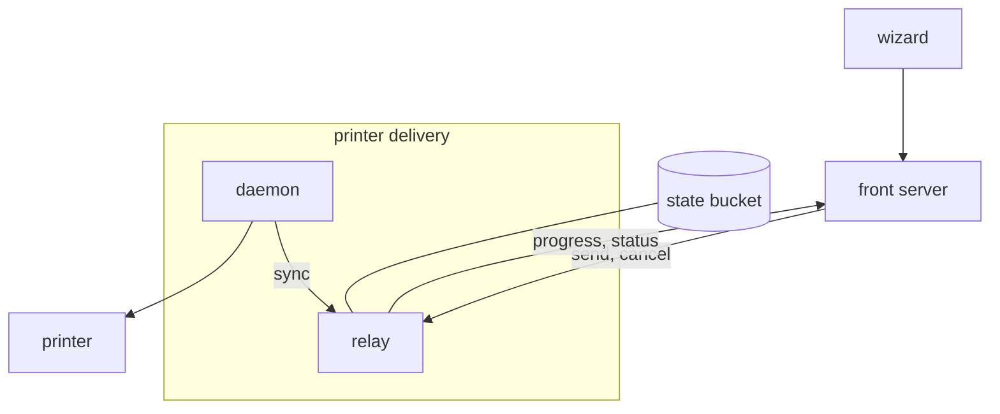
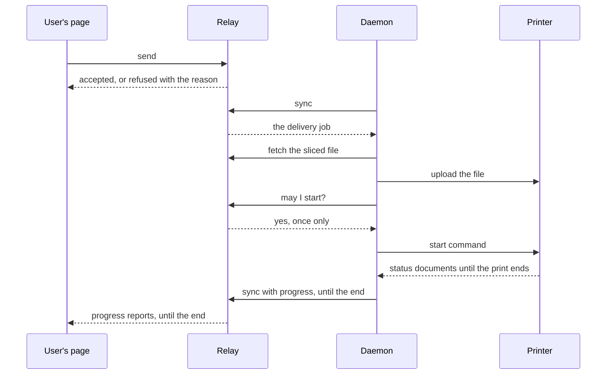

# Printer delivery

Printer delivery takes a sliced file and gets it printed on a Bambu Lab printer, and says
at every moment how that is going. Only one printer is known to it today: **the H2S**,
the Bambu Lab H2S of FRC Team 6238, the first printer. Whether any other model is
supported is undecided ([Which printers are supported](#which-printers-are-supported)).
This guide is for the person who decides whether
printer delivery is being built correctly: what it must do, how it does the hard parts,
its limits, its security, and what is still open. What a builder needs (every setting,
route, error code and required test) is in [README-details.md](README-details.md); this
guide does not depend on it. The terms are those of
[the plan](../docs/plans/penguin-slicer-plan.md) and
[the architecture](../docs/architecture.md), each said again in a sentence where it is
first used.

A large part of printer delivery is built, and a large part of the hosted design is not.
So that no sentence leaves the reader guessing, each passage says which it describes: **as
built** means the code that exists and is tested; **in phase 5** means the design for the
plan's phase 5 (the real printer), of which nothing is built. Phases 2, 3 and 4 need
nothing from printer delivery.

## What it is for

A user who has sliced a plate presses Send on the wizard's Send step. From that moment
printer delivery owns the sliced file's way to the printer: it hands the file to the
computer beside the printer, uploads it, starts the print, follows the print to its end,
and reports each stage so that the Send step and the printer-status icon (the small pill
in the wizard's header that shows the printer's state) can show it. It also answers, at
any time, what the printer is doing, whoever started the print.

It is a component of its own because it is the only one that knows printers. It owns:

- the link between a group (the users who share one configuration and one printer) and
  the daemon beside its printer;
- the **delivery job**: one sliced file on its way to one printer, from the moment it is
  sent until the print ends;
- the decision to start a print, and the guarantee that a print is never started twice;
- the reading of the printer's **status documents** (the small messages in which the
  printer reports its state): whether a print is going, waiting for a person, finished
  or failed.

It knows nothing of slicing. The sliced file is opaque to it: the profiles the plate was
sliced with travel inside the file ([the sliced file's contract](../contracts/sliced-file.md)),
so printer delivery never needs to know the filament, the plate or the nozzle. It never
signs anyone in and never learns how its caller does. It never holds a sliced file longer
than a delivery needs.

Three shapes cross its boundary, each a contract shared with the other components. It
receives the [sliced file](../contracts/sliced-file.md). It reports how far a delivery job
has got as a [progress report](../contracts/progress-report.md): a state (waiting,
running, done, failed or cancelled), a stage in words, how far through when that can be
known, and a number that rises with every report so that a missed report can be told from
a repeated one. It reports every failure as an [error report](../contracts/error-report.md):
what happened in a sentence a user understands, what to do next, whether sending again
unchanged can succeed, and the evidence for the log.

The relay and the daemon are the two halves of printer delivery, described next. The
**state bucket** is the object store in which the relay's records outlast a restart of
the front server (phase 5). The **sync** is the daemon's regular request to the relay,
described under [How the relay tells a daemon to print](#how-the-relay-tells-a-daemon-to-print).

## Two halves, and why the daemon opens no port

The printer sits on a private network, usually a shop's or a school's, behind a router
that nobody running PenguinSlicer controls. A server on the internet cannot call it. So
printer delivery has two halves.

**The relay** runs on the server, inside the process of another program, its **caller**:
the application that signs users in, holds the sliced file and asks for it to be
delivered. In PenguinSlicer the caller is the front server (the one process behind the
wizard's address), from phase 5. As built, the only callers are stand-ins used for tests
and for trying the chain by hand on one machine. The relay holds the delivery jobs and
the printer's last status, and answers the caller's pages.

**The daemon** runs on **the daemon's computer**: the computer next to the printer, on
the printer's network. It is a plain program for Windows, macOS or Linux. It has never
yet been run on Windows, the likely system. It talks to the printer over the local
network and to the relay over the internet.

**The daemon opens no port.** It only ever calls out to the relay; nothing calls it. Two
things follow. Nothing on the internet can reach the daemon's computer, so
installing the daemon exposes that computer and its network to nothing new. And no one
has to configure a router or a firewall to let traffic in, which on a school's network is
often impossible. The cost is that the relay can never tell the daemon anything of its
own accord: it can only answer when the daemon asks. Everything in
[How the relay tells a daemon to print](#how-the-relay-tells-a-daemon-to-print) follows
from that.

**How the code is divided.** The two halves are separate projects with separate
dependencies. The daemon must install alone on a stranger's computer with Python and a
handful of libraries (three of its own choosing and two the printer library needs) and
nothing of the server's; the relay needs a web framework and nothing of the daemon's.
Tests keep the wall up: one fails if the daemon imports anything beyond itself, the
standard library and the three libraries it chose. All of the daemon's dealings with the
printer go through one open-source library for Bambu printers, and every call into that
library is in one module of the daemon, so that a new version of the library can only
break one place; a separate suite, the upstream check, pins every behaviour of the
library the daemon relies on and names the broken assumption when a new version breaks
one. No patch to the library is kept. A third piece, **the simulated printer**, answers
the daemon as a printer would and exists only for tests
([The simulated printer](#the-simulated-printer)).

## What the administrator does, once

An **administrator** is whoever sets a group's printer up and pairs it; any user of the
group may be one. Setting up asks things of that person at the printer and at the
daemon's computer, and each is a requirement a reader may object to. All of it is as
built. None of it has been tried on Windows, and none of it has been confirmed at the
real printer with this code; that waits for **the session at the H2S**, one planned
session of recording and measuring at the real printer
([What only the session at the H2S can settle](#what-only-the-session-at-the-h2s-can-settle)).

**At the printer.** The printer must be in its LAN-only mode with its Developer Mode
switched on, both set at the printer's own screen. The daemon as built says why when a
printer does not answer it: the printer's firmware refuses a print started by software
other than Bambu's in any other mode. The administrator also reads the printer's
**access code** (the password the printer shows on its screen for programs on its
network) and, where the daemon cannot find the printer by itself, its network address
and serial number. What the printer gives up while in that mode (Bambu's own cloud
services, for example) is in no source of this guide and is not stated
here; it is listed under [The printer's required mode](#the-printers-required-mode).

**At the daemon's computer.** The administrator:

1. installs Python, version 3.11 or newer;
2. installs the daemon from a terminal window, from a download of the repository or
   from a packed copy of the daemon alone;
3. runs the daemon's pair command, also in a terminal. The daemon listens on the local
   network for five seconds for printers announcing themselves and lists those it
   hears, to choose from by number. If it hears none, which is usual on a school's
   network, it asks for the printer's address and serial number to be typed. It then
   asks for the access code, connects to the printer and waits up to twenty seconds
   for the printer's first status document. A printer that does not answer gets the
   advice above (check the mode and the access code) and nothing is saved. On success
   the daemon shows the pairing code ([Pairing](#pairing));
4. runs the daemon's run command and leaves that terminal window open. The daemon runs
   only while that window and that computer do; nothing starts it again after a
   restart ([A daemon that was switched off](#a-daemon-that-was-switched-off)).

A third command, status, says what the daemon sees (its settings without its secrets,
whether the printer answers, whether the relay answers) and disturbs nothing, so it can
be run beside a running daemon when the wizard says the printer is offline.

**What the daemon's screen shows while it runs.** Lines of plain words, one for each
thing it does or waits for. When it starts: its version, the relay it talks to, the
printer's address and the folder it keeps its files in. Until it is paired: that it is
waiting for the pairing code to be entered. Then that it is paired, and every ten
minutes while nothing is happening one line saying the printer's state, that the relay
is answering and that it is waiting for a print. During a delivery job: what it is
waiting for at each stage (the printer to answer, the relay's permission, the printer
to show the print). A failure of the network is named in plain words ("the relay
closed the connection before answering (it may be restarting)"), and a real error is
one line beginning "error", never a page of program trace. Stopping it with the
keyboard prints "stopping".

A program installed with a double click, with no Python and no terminal, is not built
and not designed; the plan names a daemon that is a single file as possible later work.

## Pairing

Pairing links a group to the daemon beside its printer. A group has one printer.

### Pairing in phase 5

Pairing needs someone at the daemon's computer and a signed-in user; they may be the same
person or two people on the telephone.

1. **The daemon makes the code.** Someone runs the daemon's pair command on the daemon's
   computer. The daemon finds the printer, asks for its access code, and makes two
   things: a **pairing code**, eight letters and digits shown as two groups of four
   (forty random bits, with the letters that are easily misread left out), and a **daemon
   id**, a random id it keeps for good. It shows the code and offers both to the relay
   every thirty seconds. The relay remembers, in its memory only, which daemon is
   offering which code.
2. **A user types the code into PenguinSlicer, once.** Any signed-in user of the group
   may do it, from any computer. If a daemon is offering that code, the relay writes the
   group's **paired-printer record** (one small document for each group, kept in the
   state bucket, the object store that outlasts a restart of the front server) naming
   that daemon and holding a hash of the code. If no daemon is offering it, the user is
   told at once that no daemon is showing that code and to try again in a moment.
3. **The daemon's next offer is answered with its token.** The relay checks the offered
   code against the hash in the record, gives the daemon **the daemon's token**, removes
   the hash, and the code is dead. The token names the daemon and its group, is signed
   with **the relay's secret key** (one of the front server's secrets, described under
   [Security](#security)), and is what the daemon presents on every request from then
   on.

A code is good for fifteen minutes. A daemon still unpaired then makes a new one and
shows it, so a code left on a screen overnight opens nothing. A wrong code gets the same
answer whatever was wrong with it (never offered, expired, already used), so that a
guesser learns nothing, and wrong attempts are limited for each signed-in user.

The pairing code is no longer kept anywhere once used: not in the configuration, not in
the daemon's settings, and in the state bucket only as a hash, from the moment the code
is typed until the daemon collects its token, normally under half a minute.

**Unpairing** removes the paired-printer record. Any user of the group may unpair; there
are no permissions inside a group. The daemon's next request is refused; the daemon says
plainly on its own screen that it has been unpaired, and waits for its pair command to
be run again. It sends nothing more until then. The wizard does not offer unpairing
while a print that PenguinSlicer is following is going on; whether the relay itself
refuses it then is undecided
([Unpairing while a delivery job has not ended](#unpairing-while-a-delivery-job-has-not-ended)).

**Pairing again** after unpairing is pairing: the pair command is run on the daemon's
computer and a user types the new code. Three cases of pairing again are decided by no
source and are undecided: a group that types a code while it has a paired-printer
record, a paired daemon whose pair command is run again, and a record whose daemon
never collects its token
([Pairing again: three cases](#pairing-again-three-cases)).

**What a user sees.** With no printer paired, the printer-status icon reads "No printer",
and the Send step offers no Send: it says that no printer is paired with PenguinSlicer,
shows the form in which the code is typed, links to how to pair a printer, and offers
the download of the sliced file. The form, and what it shows for a wrong code, are the
wizard's ([its guide](../wizard/README.md#pairing-a-printer)).

### Pairing as built

As built, pairing is an older scheme that phase 5 replaces, and it is weaker in one way
that matters. The daemon makes the same kind of code, but the code is a **lasting
secret**: the daemon keeps it in its settings file, and the caller keeps it too and
presents it with every request on behalf of its users, as the name of the printer they
may use. The daemon trades the code for a token every thirty seconds until it has one.
The relay grants the trade on two conditions. The caller must have presented that code
since the relay started. And no daemon with that code may have been heard in the last
two minutes, which refuses a second daemon with a copied settings file while the first
is alive. The token carries the code itself. Every refusal is the same answer. Running
the pair command again on a paired daemon keeps the same code unless a new one is asked
for, and discards the token, which the daemon then trades for again.

What phase 5 changes: the code is used once and then dead; the daemon gains its daemon
id; the relay knows each daemon by its daemon id and not by its code; the link between a
group and a daemon lives in the paired-printer record; and there is unpairing, which as
built does not exist (a token that verifies is accepted, whatever else is true).

## A daemon that was switched off

The daemon's computer may be restarted, put to sleep, or switched off for a summer. Once
the daemon is started again it reconnects and works, with no pairing again.

- **Its token has no end date.** The relay accepts a token by its signature and, in phase
  5, by the paired-printer record naming that daemon, however long the daemon was silent.
  The one exception is a replacement of the relay's secret key while the daemon was off
  for more than a week ([Replacing the relay's secret key](#replacing-the-relays-secret-key)).
  Built: the token already has no end date.
- **While the daemon is silent** the printer-status icon shows Offline, with how long the
  printer has not been heard from, and Send is disabled with a message that Send comes
  back when the printer answers. The daemon's first sync (its regular request to the
  relay, described below) puts both back. Built: the relay
  already counts a daemon not heard for two minutes as silent and refuses a send, saying
  for how many minutes.
- **A print that was running when the computer went off goes on at the printer**, which
  needs no daemon to print. The daemon keeps a **start note** on its own disk, a record
  of the print it is about to start or has started, so when it is started again it
  follows that print and does not start it a second time
  ([How a start is decided](#how-a-start-is-decided-so-that-a-print-is-never-started-twice)).
  Built.
- **Starting the daemon is not PenguinSlicer's job.** At boot or after it stops, whoever
  runs that computer starts it, by hand as built. A daemon that installs itself to start
  at boot is possible later work that nothing here depends on.

### What the daemon keeps on its computer

Everything the daemon keeps is in one folder of its own, in the home of the user who runs
it:

| What | Why it is there | How long |
|---|---|---|
| A settings file: the relay's address, the daemon's token, and the printer's address, serial number and access code. In phase 5 also the daemon id; as built also the lasting pairing code, which phase 5 removes | Everything needed to reconnect after any time off | Until paired again |
| The start note: which print the daemon was about to start, or has started, and has not yet seen settle | So that a restart can never lead to a second start | The minutes between a start command and the printer showing what became of it |
| The sliced file being delivered | It is fetched from the relay, then uploaded to the printer | The length of one delivery; anything left by a daemon that stopped is removed when it next starts |
| Recordings of the printer's status documents | Made only when someone runs the daemon's record command, to give the simulated printer real sequences | Until someone deletes them |

The settings file is readable only by the daemon's own user. It is not protected further:
the token and the printer's access code are stored as plain text, with no use of the
operating system's keychain. Anyone who can read that file can act as that daemon and can
talk to that printer; that is accepted, since such a person is already at a computer on
the printer's network.

## How the relay tells a daemon to print

Because the daemon opens no port, everything passes through one request, the **sync**.
The daemon posts it to the relay, carrying the printer's latest status and the progress
of the delivery job it holds, if any. The relay's answer carries what the daemon should
be doing: a delivery job to fetch, a cancel, or nothing. So one request does two things.
It brings the printer's information up, which the printer-status icon and the Send step
show, and it is the only moment at which the relay can hand the daemon a delivery job.

The design problem is that these pull in opposite directions. A send should reach the
daemon at once, which argues for syncing constantly; an idle printer should cost the
server almost nothing, which argues for syncing rarely.

### The rhythms in phase 5

The answer is the **held wait**: while the printer is idle, the relay does not answer a
sync straight away. It holds its answer until a delivery job arrives for that daemon, and
answers that instant; otherwise it answers after 55 seconds with nothing, and the daemon
syncs again at once. 55 seconds is inside the 125 seconds that Cloudflare, and the five
minutes that Railway, allow a request to go without data. An idle daemon therefore costs
about one request a minute, and a send still reaches it immediately.

How often the daemon syncs depends on what the printer is doing:

| The printer is | The daemon syncs | What that gives |
|---|---|---|
| Idle | Once for each held wait, and again at once when it is answered | A send reaches the daemon immediately. The idle printer's information is at most about a minute old. About one request a minute |
| Taking a delivery job: fetching the file, uploading it to the printer, starting it | Each second | The Send step moves smoothly, and a cancel reaches the daemon within a second |
| Printing, whoever started the print | Every 10 seconds | The percentage and the time left are at most 10 seconds old. Six requests a minute |
| Changing state: idle, printing, paused, failed, finished, offline | At once, whatever else is going on | The printer-status icon never waits to show a change |

The daemon keeps the held sync on a thread of its own and goes on watching the printer.
When the printer's state changes while a sync is held, the daemon posts a further sync
with the change, without waiting for the held one.

**Nothing is held during a print.** The relay refuses a send to a printer that is
printing, whether PenguinSlicer sent the print or someone started it at the printer's own
screen, so it has nothing to tell that daemon that cannot wait ten seconds.

**What the relay concludes from silence.** The relay can only notice that a daemon has
gone by not hearing from it, and the two limits are set by the rhythms above.

| Rule | Its limit | What happens past it |
|---|---|---|
| A daemon is online | Its last sync was within 2 minutes | The printer-status icon shows Offline, and Send is disabled |
| A running delivery job's progress report is fresh | The daemon's last sync was within 40 seconds | The progress report is marked stale: its figures are shown as old, with their age, and never as current |

A healthy idle daemon is never silent for much more than a minute, so two minutes means
it has missed two rounds. A printing daemon syncs every ten seconds, so forty seconds
means it has missed four, and that is how long a daemon that died during a print goes
unnoticed. Silence never ends a delivery job; what a user can do about a stale one is in
[Stop following](#stop-following).

**After a restart of the front server** every held sync closes at the same moment. Each
daemon waits a short random time before it syncs again, so that they do not all arrive
together.

**What it costs.** The front server spends one thread on every idle daemon. Set to 100
threads, it has room for about fifty idle daemons beside users' requests and **progress
streams**, the connections on which pages follow a delivery job ([the front server's guide](../front/README.md)). The held wait is plain HTTP and
keeps nothing on the connection, so a small asynchronous server can take over that one
request later and hold thousands; that is decided when the number of daemons calls for
it.

### The rhythms as built

As built there is no held wait. The daemon syncs every 5 seconds when nothing changes, at
most once a second while a delivery job's progress is moving, and at once when the
printer changes state; the relay answers every sync immediately. A send therefore reaches
the daemon within 5 seconds, and an idle daemon costs twelve requests a minute. A daemon
counts as online within 2 minutes, as in phase 5, and a running delivery job's progress
report is stale after 20 seconds without the daemon, which phase 5 changes to 40 because
a printing daemon will sync every 10 seconds and not every 5.

Built and kept by phase 5: when the relay does not answer, the daemon waits and tries
again, the wait doubling from 5 seconds to a cap of 60 and each wait shortened by a
random amount of up to a quarter, so that daemons that lost the relay together do not
return in step.

## The life of a delivery job

A delivery job runs from the send to the end of the print. Everything in this section is
built, and phase 5 keeps it, except where a sentence says otherwise.

### When a send is accepted

The relay accepts a send only when it can see that the print could start now. Nothing
queues: one printer takes one delivery job at a time, and a second send is refused, never
held. Each refusal is an error report whose sentence says what is in the way:

| What is in the way | What the user is told | Send again unchanged? |
|---|---|---|
| The user is not signed in, or (in phase 5) the user's group has no paired-printer record | That they must sign in, or that no printer is paired | No |
| The sliced file is gone | In phase 5: that the sliced file has expired and the plate must be sliced again, with slicing again offered as the one action | No |
| No daemon has been heard, or none for more than two minutes | That the daemon has not been heard from, and for how many minutes | Yes, once it is back |
| The daemon cannot reach the printer | That the printer is off or unreachable | Yes |
| The printer is printing or has a paused print | Which file, and how far through when known | Yes, when it is free |
| The printer reports a state this version does not know | That its state is not understood; the raw value goes to the log | Yes |
| Another delivery job is already on its way | That a print is already being sent | Yes, when it has ended |
| Too many requests | To wait a moment | Yes |

A printer is **free**, for a send, when it reports no print, or reports that its last
print ended, well or badly. A printer whose print finished is free at once: the printer
cannot tell whether a person has cleared the plate, so that is the user's check, and the
Send step's reminder says so ("Check that the plate is clear ... Send starts the print at
once").

### The stages, what a user sees, and what can be cancelled

A delivery job passes through nine stages, in three groups. In the first group it
**waits**: for the daemon to collect it, for the printer to answer, or for an earlier
start to settle. In the second the daemon **takes the file**: it fetches the sliced
file, uploads it to the printer and starts it. In the third **the print** runs, or
waits for a person at the printer. A delivery job can be cancelled in every stage up to
the moment the relay allows the start, and in none after. The waits have limits, after
which the delivery job ends without having started: 3 minutes for the daemon to collect
it, and 10 minutes for the printer or for an earlier start. The fetch and the upload
are each tried three times. These figures are set out with their origins in
[How well it must do it](#how-well-it-must-do-it).

| Stage | What is happening | Cancel |
|---|---|---|
| Waiting for the daemon | The delivery job is accepted and the daemon has not collected it yet: within 5 seconds as built, at once in phase 5 | Cancelled at once |
| Waiting for the printer | The daemon has the delivery job but no recent, complete status document from the printer, which is off, unreachable or quiet | Yes |
| Waiting for an earlier print | The printer answers, but a start command sent for an earlier delivery job has not yet shown what became of it (see [How a start is decided](#how-a-start-is-decided-so-that-a-print-is-never-started-twice)) | Yes |
| Fetching the file | The daemon fetches the sliced file from the relay and checks its length and checksum | Yes: the fetch stops between blocks |
| Uploading | The daemon uploads the file to the printer, then checks the size the printer lists for it | Yes: the upload stops between blocks and the partial file is removed from the printer |
| Starting | The daemon asks the relay whether it may start, sends the start command, and waits for the printer to show the print | Refused from the moment the relay says yes |
| Start not shown yet | The start command went a minute ago and the printer has the file but has not shown the print | No |
| Printing | What the printer's status documents say: what it is doing (heating the bed, levelling, cleaning the nozzle, printing), percent, layer of total layers, minutes left | No: a running print is stopped at the printer's screen |
| Waiting for a person | The print is under way but the printer waits for someone: paused, door open, filament run out, a fault. The progress report says what to do at the printer. It is never an end: when the print resumes, the stage is Printing again | No |

The Send step shows these on its track (Sending, Starting, Heating, Printing, Done), with
percent, layer of total, time left and the expected finish; the printer-status icon shows
the same state on every step and to every user of the group. Which stage shows under
which word of the track, how the three waits are shown, and how each stage is worded on
the panel are [the wizard's guide](../wizard/README.md)'s to say. The fraction for the whole
delivery job gives the stages before the print its first tenth and the print the rest,
which is a convention and not a measurement; it is left out whenever it cannot be known,
and a figure the printer reports going backwards is passed on as reported, never
smoothed.

A delivery job ends in one of three ways. **Done**: the printer reported the print
finished. **Failed**: it ended without a finished print, with an error report that says
which of many things happened (never collected, never started, the printer refused the
start, the print ended badly with the printer's code and its meaning where known, the
print was stopped at the printer, or the outcome is unknown). **Cancelled**: the user
cancelled it and it was never started.

### Cancelling

A delivery job can be cancelled at any point before the printer is told to start it, and
at no point after. Before the daemon has collected it, the cancel is immediate. Once the
daemon holds it, the cancel is marked and the daemon learns of it at its next sync (within
a second in phase 5), stops the fetch or the upload, removes a partly uploaded file from
the printer, and confirms; only then is the delivery job reported as cancelled, because
the progress report's contract says "cancelled" only after the work has stopped. The user
sees that sending was cancelled, that nothing will print, and that the sliced plate is
still there to send again.

**A cancel always wins against a daemon that cannot be reached.** The daemon starts a
print only after asking the relay, and the relay says yes only to a delivery job that is
not cancelled. So a daemon that has lost the relay cannot start the file, and learns of
the cancel when it returns. A cancel the daemon never answers ends as cancelled 15
minutes after the daemon collected the delivery job.

From the moment the relay says yes, a cancel is refused, and the refusal is exact about
what is known. Until the daemon reports that the start command went, the user is told
that the daemon may already have sent it: stop the print on the printer's screen if it
starts, otherwise wait for the delivery job to end before sending again. After that, the
user is told that the start command has already been sent to the printer, so it can no
longer be cancelled from here. Neither sentence claims that the print started.

Stopping or pausing a running print is not offered. It is done at the printer's screen,
where the person stopping it can see the printer.

### What the printer's status documents mean

The printer reports its state in status documents, small messages it sends whenever
something changes. The daemon reads four things in them: the printer's main state, a
stage code, an error code, and the severity of each health message. One table in the
daemon says what every known value means for a print, and sorts each into one of six
classes: going, waiting for a person, ended well, ended badly, no print, and
unrecognised.

The rule that orders them: **the main state decides whether a print is going on; the
stage code only describes what a going print is doing.** An idle printer is idle whatever
stage code it still shows from its last print. Under a going state, a stage that waits
for a person, an error code or a serious health message makes the print "waiting for a
person", with what to do at the printer ("Load new filament, then resume the print on the
printer's screen"); it does not end the delivery job.

A value the table does not know is never guessed at. An unknown main state refuses every
send and never ends a print that is being followed: the progress report keeps its last
figures, is marked stale, and names the value for the log. An unknown stage code under a
going state is "going, unrecognised stage". No sentence built from the printer's figures
ever shows a figure that is missing.

**Only evidence ends a delivery job; silence never does.** A delivery job reaches its end
on the printer's own status document saying that the print ended (finished, failed,
stopped, or idle with an error code), on two minutes of status documents showing the
print no longer under way without a finish, on the daemon's word that it was never
started, or because the relay never gave permission to start before its deadline. A link
or a printer that seems down and then recovers gives a stale progress report and a
delivery job still in progress, which goes on from the first status document that comes
back. The single exception is in [Stop following](#stop-following).

## How a start is decided, so that a print is never started twice

Starting a print is the one thing printer delivery does that cannot be undone, and the
worst thing it could do is start one twice: a second start on top of a running print, or
a print that begins hours later when nobody expects it. Everything that could cause that
is ordinary: a daemon that restarts just after sending the start command, a relay that
restarts, a link that drops with the answer in flight, a printer that is slow to show the
print, a user who presses Send again. The design is one set of rules for the moment of
starting. All of it is built, except the one sentence below that says "in phase 5".

**The start gate.** Before it sends the start command, the daemon asks the relay whether
it may. The relay's answer, the **start gate** (below, the gate), is yes at most once
for each delivery job, never for a cancelled one, and never after the deadline for
reaching it (15 minutes from collection) has passed. The yes goes to one running copy of
the daemon and to no other, so a second daemon with a copied settings file cannot also
start the file. In phase 5 the yes is written to the
delivery job's record in the state bucket before it is answered, so that it survives a
restart of the front server; as built it is in the relay's memory, and a restarted relay
refuses, which is safe (nothing starts) but fails the delivery job.

**A whole, fresh picture.** The printer may send only the fields that changed, so the
daemon keeps a merged **picture** of the printer. A picture is whole once a status
document carrying the main state has arrived since the daemon last connected to the
printer, and fresh while the last status document is at most 15 seconds old. A picture
that is not whole and fresh says nothing about whether a print is going on; the daemon
asks the printer for a complete status document every 10 seconds and waits.

**Before the gate, the daemon waits; after it, it does not.** The daemon waits for a free
printer on a whole, fresh picture when the delivery job arrives and again after the
upload. Both waits are before the gate, so a delivery job that is waiting can always be
cancelled. Only then does it ask the gate. On a yes it looks once more, without waiting:
on a free printer it sends the start command, once; otherwise it sends nothing, removes
the file from the printer and reports that the print was not started, which is true. A
start command is never sent on an old or partial picture, on a picture that shows a print
going on, or twice: a start command that fails on its way is not sent again, and the
printer's status documents decide what became of it.

**After the start command, the printer is held.** The daemon sends that printer no other
start command until the evidence settles what became of the first:

- the print is **seen going**: a whole, fresh picture names the file under a going or
  paused state. The delivery job is followed to its end;
- or five minutes of whole, fresh pictures show no print of that file. The delivery job
  ends, saying the printer did not show the print as started (or that it is printing
  another file, named), and the remedy says to look at the printer first, because the
  part may be printing;
- or a proven end of that print (below).

Only time during which the daemon actually watched the printer is counted. Time the
printer was unreachable or quiet does not count, and neither does time nobody was
looking. A printer slow to show the print gets, after one minute, the stage "start not
shown yet". A delivery job that arrives while an earlier start still holds the printer
waits for it, cancellable, for up to 10 minutes.

**The start note makes the hold outlive the daemon.** Before it sends a start command the
daemon writes the start note on its own disk (which printer, which delivery job, which
file), and removes it when the evidence settles the hold; a daemon that starts and finds
a note, even one it cannot read, holds the printer until the evidence settles it. A note
that cannot be written means no start command, and the delivery job ends unstarted.

**The relay makes the hold outlive the daemon's disk.** With every delivery job it hands
out, the relay names the last start it allowed for that printer and how long ago, and a
daemon that has no note rebuilds the hold from that. A daemon that died between the
gate's yes and the command cannot know whether the command went; it never claims that it
did, and the user goes on being told that the command may have been sent.

**An end counts only if it is the end of this print.** A printer that has just been sent
a start command may, for a moment, still show the previous print's "finished" with the
new file's name already on it. Taking that for the new print's end would report a print
done that has not begun. So an end naming the file counts only when the print was seen
going first; or when the command is at least two minutes old and the printer's main state
was seen to change after it; or, for a daemon that could not watch continuously (it was
restarted, or lost the printer for two minutes), once the command is five minutes old.
Otherwise it is treated as "not showing the print yet".

**What the user gains and what it costs.** No sequence of restarts, dropped links, slow
printers, repeated sends and cancels that the tests can produce starts a file twice or
starts one over a running print. The cost is that after anything uncertain the printer
may be unavailable to PenguinSlicer for up to five minutes of watched time while the
daemon waits for the evidence, and a user who sends during that time waits or is told why
not.

### Two limits that wait for the real printer

Both timed rules decide something the printer's status documents do not show, and each
fails in one case that only the real H2S can rule in or out.

1. **A daemon that could not watch may take a left-over end for this print's end.** If
   the printer keeps the previous print's "finished" under the new file's name for longer
   than five minutes and only then starts the file, a daemon restarted just after the
   start command reports the delivery job done for a print that has not begun, the
   printer counts as free, and a second send would send a second start command while the
   first is pending.
2. **A printer slower than five minutes to show a print it accepted is taken not to have
   started it.** The delivery job ends saying the print was not shown as started, the
   printer counts as free, and a second send would send a second start command while the
   first is pending.

If the H2S shows a print within seconds and drops the previous end at once, neither can
happen at these settings. The session at the H2S measures exactly this
([What only the session at the H2S can settle](#what-only-the-session-at-the-h2s-can-settle)).
Only if it shows the H2S slow, or keeping an old end under a new name, would a rule that
needs no timing be considered: ending such a delivery job as "outcome unknown" and
keeping the printer held until a status document or a person shows it is clear. That rule would
cost users a manual step after every uncertain start.

## When the daemon, the relay or the printer goes away

The rule in every case: a print that has started goes on at the printer, which needs
neither half; nothing is started that the user cannot see; and the user is told what is
known and no more.

A delivery job does not depend on any page. If the user closes the page, the delivery
job and the print go on, and any user of the group sees it on the printer-status icon.
A page that connects late, or comes back, gets the latest progress report at once and
does not wait for the next change. Both are built.

The table says what happens when the printer, the daemon or the link between them goes
away, before the start gate and after the start; the relay and the front server follow
it.

| What went away | Before the start gate | After the start |
|---|---|---|
| **The printer** (off, unplugged, off the network) | The delivery job waits, cancellable, showing that it is waiting for the printer; after 10 minutes it ends, never started | The progress report is marked stale at once when the printer is unreachable, or after 60 seconds of a silent printer. The delivery job goes on from the first status document that comes back. If the printer comes back idle, two minutes of that end the delivery job saying the print is no longer under way |
| **The daemon** (crashed, computer asleep or off) | The delivery job is not started. It fails 3 minutes after the send if never collected, or 15 minutes after collection if the daemon never asked to start; a cancel wins | The print goes on. The progress report is stale after 20 seconds as built, 40 in phase 5, and the printer-status icon reads Offline after 2 minutes. A restarted daemon finds its start note, sees the print in the printer's status documents and follows it; it never starts it again |
| **The link between them** | The same as the daemon going away: the daemon cannot start without the relay's yes | The same; whatever the daemon could not report it sends again until the relay has it |

**The relay, as built, restarts.** Every delivery job is in the relay's memory and is
gone. Before the start gate, the daemon's token still works, but a delivery job it holds
is refused at the gate and never started, and its file is removed from the printer.
After the start, the print goes on and nothing follows it any more. In both cases the
page is told that the service may have restarted and to look at the printer before
sending again.

**The front server, in phase 5, restarts.** Before the start gate, the daemon's next
sync is accepted and receives the delivery job from its record in the state bucket, and
the daemon fetches the sliced file through the front server as before. After the start,
the print goes on; the printer-status icon and the Send step are blank until the
daemon's next sync brings the status and progress back, within ten seconds plus the
daemon's short random wait. If the restart fell between the gate's yes and the daemon's
word that the command went, the record still says the start was allowed, and it is never
allowed again. Whether the limits of 3 minutes, 15 minutes and 24 hours on a delivery
job run on across such a restart is undecided
([What of a delivery job is written to its record](#what-of-a-delivery-job-is-written-to-its-record-and-its-deadlines-across-a-restart)).

That restart is the reason for the largest change of phase 5, the delivery job's record
([What the relay keeps, and where](#what-the-relay-keeps-and-where)).

**A deploy** is a planned restart of the front server, and the project is deployed
continuously, so it must interrupt no user. In phase 5 the relay, asked to stop, closes
its progress streams and answers its held syncs with nothing, so that pages and daemons
reconnect to the front server that replaces it. As built nothing in the relay reacts to
being asked to stop. An installed daemon may be much older than the relay, so a change
to the relay may add to what it sends a daemon and may never remove or change what an
installed daemon relies on. How an installed daemon is brought to a new version is
undecided ([Daemon versions](#daemon-versions)).

**Stopping the daemon** on purpose ends its waits at once. A delivery job it was taking
is left unstarted by that run, a partial upload is removed, and the next run takes the
delivery job up from what the relay and the printer say.

### Stop following

A delivery job past the start gate cannot be cancelled and cannot be ended by silence.
If the daemon's computer dies during a ten-hour print, the delivery job would otherwise
hold the printer in PenguinSlicer's eyes until someone revived that computer. **Stop
following** is the way out: the user gives up a delivery job that nobody can hear.

- It is offered only for a delivery job past the start gate whose progress report is
  stale.
- The delivery job ends as failed with one honest sentence: contact was lost after the
  print was handed over to be started; the print may be running, finished or never
  started; check the printer.
- It frees the printer for the next send, once the daemon is back and the printer is
  free.
- It is refused while the printer still reports the print (only the printer can stop it),
  while the printer answers but has not shown the print yet (the daemon is still watching
  for it), and before the gate (cancel instead).
- It does not lift the daemon's hold on the printer. Within 30 seconds the daemon learns
  that the relay has let go and will take the next delivery job, but that delivery job
  still waits, cancellable, until the evidence settles the earlier start.
- The relay does the same by itself after 24 hours of unbroken staleness past the gate,
  so that no delivery job lives for ever. This is the one place where time ends a
  delivery job, and its sentence says that the outcome is unknown, never that the print
  failed. Any fresh progress report in between starts the 24 hours again.

Built, with the stale limit of 20 seconds; phase 5 keeps it with 40.

## What the relay keeps, and where

### As built: everything in memory

As built the relay keeps everything in the memory of one process: each printer's last
status, each delivery job and its latest progress report, and the start gate's answers.
A sliced file that its caller hands it as a stream it copies once to its own disk; one
handed over as a file on disk stays the caller's. Only its secret key outlasts a
restart. It must run as a single process. That was acceptable for a relay that restarts
rarely; it is not acceptable for a front server that is deployed continuously, because a
daemon told that the relay no longer knows its delivery job treats that delivery job as
finished and drops it, and because the start gate's "yes, once" must not be forgotten.

### In phase 5: records in a store the front server supplies

The relay does not choose where its records live. Its caller hands it a store: hosted,
the state bucket (an object store at Cloudflare R2, which the front server alone can
write); on one machine, a folder. The relay stays ignorant of buckets and credentials,
and can be tested with a store that is a plain folder or a fake.

**The delivery job's record**, one for each delivery job, holds what must not be lost:

- which group and which daemon it is for, and which sliced file it uses (which is how the
  front server knows when a sliced file's last print ended);
- who sent it (the user's Onshape display name) and a one-line description of the plate,
  such as "8 instances of Gusset Plate", since the file's generated name means nothing to
  a user;
- how far it has got in the ways that matter after a restart: waiting, collected, cancel
  asked, **whether the start was allowed**, ended;
- proposed: when it was sent and when it was collected, so that the limits of 3 minutes
  and 15 minutes run on across a restart (undecided:
  [What of a delivery job is written to its record](#what-of-a-delivery-job-is-written-to-its-record-and-its-deadlines-across-a-restart));
- how it ended and when, and for a failed print the layer at which it stopped;
- the number of its format, so that a record written by the previous version of the front
  server is read by the next.

Four of these serve the wizard, whose [guide](../wizard/README.md) requires them, and
the relay as built gives each only in part:

- **Who sent it.** The wizard says "Sent by Alex Chen", with "(you)" for the user's own,
  in the printer details (the small box that opens from the printer-status icon) and on
  the card the Send step shows when the printer is busy. As built the sender's name
  reaches the log only.
- **What it is.** The same places say what is printing in words, from the plate's
  one-line description. As built only the file's name exists.
- **How the last print ended, and when**, and for a failed print when it stopped and at
  which layer. As built the relay keeps a final progress report for 24 hours, but with
  no end time and no sender, and its short answer about how the last delivery job ended
  lasts ten minutes.
- **Finding one's own work after a refresh.** A page that has lost its state asks for
  its user's live delivery job and its user's last print, and reopens on the Send step.
  As built a page can ask only for the printer's most recent delivery job, and cannot
  tell whose it is.

The wizard also shows a print that was started at the printer's own screen, as a busy
printer with no sender and no description. It needs nothing of a record for that: such
a print has no delivery job, and the printer's status, which the relay holds whoever
started the print, gives which file is printing and how far through.

Users of one group do see each other's names and plate descriptions; that is intended.

A record is kept for a day after its delivery job ends, so that the Send step and the
printer-status icon can show how the last print ended to someone who comes back hours
later; the wizard shows the last print for 12 hours or until another plate is sent,
which the day covers. The live figures of a print (percent, layer, minutes left) and the printer's
status are not in the record: they stay in the relay's memory, change every few seconds,
and are back within seconds of a restart from the daemon's next sync.

**The paired-printer record**, one for each group, holds the id of the group's daemon,
the printer's display name, who paired it and when, which of the relay's secret keys the
daemon's token was last issued under (there are two, the current one and the previous
one: [Replacing the relay's secret key](#replacing-the-relays-secret-key)), the time of the daemon's last sync, written once
when the daemon goes offline, and, from the moment a user types the pairing code until
the daemon collects its token, a hash of that code. It is kept until the group unpairs.

**How long a printer has been silent.** The printer details say "Not heard from for 7
minutes", and must still be able to say so after a restart of the front server, when the
relay's memory is empty. The rule has four parts.

1. When a daemon goes offline (no sync for two minutes), the relay writes the time of
   that daemon's last sync to the paired-printer record: one write at that moment, not
   one a minute while the daemon is healthy, and no further write however long it stays
   off.
2. When the daemon syncs again, the printer is back online and the relay clears the
   recorded time, so that the record never holds the time of an outage that is over.
3. A recorded time survives a restart of the front server and is used as it is: the
   wizard says the printer has not been heard from since that time.
4. After a restart of the front server, a paired daemon not heard from within two
   minutes whose record holds no time (it was healthy, or silent for less than two
   minutes, when the front server restarted) is shown as silent "for at least" the time
   since the front server started.

Parts 1, 3 and 4 are the design. Part 2 is this guide's proposal: it follows from part 1
and is written in no source. It costs a second write for each outage, and a clearing
write that fails would leave an old time behind. Whether to clear, and what
the relay does when the clearing fails, are undecided
([Clearing the recorded time of silence](#clearing-the-recorded-time-of-silence)).

**Pairing codes on offer** stay in the relay's memory only. A restart loses them, and
each unpaired daemon offers again within half a minute; a user who types a code in that
half minute is told, as for any wrong code, to try again in a moment.

### The sliced file

In phase 5 the state bucket's copy of a sliced file is the only one. The front server
stores it when the slice ends; on a send the relay records which sliced file the delivery
job uses, and when the daemon fetches it the relay reads it from the store and passes it
on. The relay keeps no copy of its own. A printer therefore only ever receives a file the
slice service made. A sliced file is kept until two hours after its slice ended or two
hours after its last print ended, whichever is later, so the same plate can be sent again
after a print of any length; a send of a sliced file that has gone is answered that it
has expired and the plate must be sliced again
([the front server's guide](../front/README.md) owns the keeping and deleting).

As built the caller hands the relay either a file on disk, which the caller keeps until
the delivery job no longer needs it (at most eighteen minutes: the 3 minutes to be
collected and the 15 to the start gate), or a stream, which the relay copies once into a
folder of its own and removes when the delivery job no longer needs it; a restarted
relay empties that folder. A send is refused for a sliced file more than
40 minutes old, a limit that phase 5 replaces with the rule above.

Built and kept: the daemon checks the fetched file against the length and checksum sent
with the delivery job, and fetches again from the start a file whose fetch was cut off or
arrived damaged, up to three attempts. It uploads the file to the printer under its own
name with the delivery job's id added, which is how it recognises its print in the
printer's status documents; the sliced file's contract guarantees that a sliced file's
name can never be mistaken for one that already carries such an id.

A file that was printed stays on the printer; nothing removes it. The daemon removes a
file from the printer only when the upload failed or the print was not started. Whether
it should also remove a printed file is undecided
([Printed files left on the printer](#printed-files-left-on-the-printer)).

## How well it must do it

Each figure says what it bounds and where it comes from. "Built" figures are settings of
the code; none has been timed against the real printer, so every one that concerns the
printer is a considered guess until the session at the H2S.

### Talking to the relay

| Figure | What it bounds | Where it comes from | How it is checked |
|---|---|---|---|
| Held wait, 55 seconds (phase 5) | How long an idle daemon's sync goes unanswered; so about one request a minute for each idle daemon | Under Cloudflare's 125 seconds and Railway's five minutes for a request without data | A test on a fake clock: answered at 55 seconds with nothing, at once on a send |
| Each second while taking a delivery job (phase 5; as built at most once a second while progress moves) | How stale the Send step is, and how long a cancel takes to reach the daemon | The progress report's contract: at least every second while the fraction moves | A fake-clock test |
| Every 10 seconds while printing (phase 5; 5 seconds as built) | The age of percent and time left on screen; six requests a minute for each printing daemon | The design | A fake-clock test |
| Online within 2 minutes (built) | When the icon says Offline and Send is disabled | Two missed rounds of an idle daemon | A fake-clock test |
| Stale after 40 seconds (phase 5; 20 as built) | How long a daemon that died mid-print goes unnoticed | Four missed syncs | A fake-clock test |
| About fifty idle daemons (phase 5) | How many printers one front server serves | One thread for each held wait, of 100 | Not measured; the front server's memory with fifty held syncs is still to be measured |
| A comment line on a quiet progress stream every 15 seconds (built) | Keeps a page's connection open through Cloudflare and Railway | Their limits on a request without data | A test |
| Retry waits from 5 to 60 seconds, each shortened by up to a quarter at random (built) | How hard daemons press a relay that is down, and that they do not return together | A proposal | Tests with a fixed random source |

### A delivery job

Each built figure in this table has a test on a fake clock that reaches it; none is
checked against the real printer.

| Figure | What it bounds | Where it comes from |
|---|---|---|
| 3 minutes to be collected (built) | How long a send waits for a daemon before failing | A proposal |
| 15 minutes from collection to the start gate (built) | How long a delivery job may hold the printer's one place without starting; also when an unanswered cancel takes effect | A proposal |
| 10 minutes waiting for a free printer, and 10 for an unreachable start gate (built) | How long a delivery job waits, cancellable, before ending unstarted | A proposal |
| A picture is fresh for 15 seconds, and the printer is asked for a complete status document every 10 (built) | How old the printer's last status document may be when a start is decided | A guess until the printer is timed |
| "Start not shown yet" after 60 seconds (built) | When the user is told the printer is slow to show the print | A guess until the printer is timed |
| 5 minutes of watched time without the print (built) | When a start command is taken not to have worked, and when the printer is free for another | A guess until the printer is timed; must stay well above the printer's real time to show a print |
| 2 minutes before an end can count for a print never seen going (built) | Protection against the previous print's end under the new name | A guess until the printer is timed |
| 2 minutes of status documents with the print not under way (built) | When a print that disappeared ends the delivery job | A proposal |
| 60 seconds of a silent printer (built) | When a printing delivery job's progress report is marked stale for the printer's sake | A guess: whether a paused H2S keeps sending is not known |
| 24 hours of unbroken staleness (built) | The longest a delivery job nobody can hear is kept alive | A proposal: longer than any print |
| Three attempts each at the fetch and the upload (built) | How much a flaky link is tolerated before the delivery job fails | A proposal |

### What is kept, and how big

Each built figure in this table has a test that reaches it, on a fake clock where it is
a time; the figures of phase 5 get theirs when they are built, and the sliced file's
size is a measurement.

| Figure | What it bounds | Where it comes from |
|---|---|---|
| A delivery job's record, a day after it ends (phase 5; as built its final progress report, 24 hours, in memory) | How long a returning user can learn how a print ended | The design; the wizard needs 12 hours |
| A sliced file, two hours after its slice or its last print ended (phase 5; as built, sendable for 40 minutes) | How long Send works for a sliced plate | The front server's rule |
| A pairing code, 15 minutes, used once (phase 5) | How long a code on a screen is worth anything | The design |
| The previous secret key, one week (phase 5) | How long a daemon may be off across a planned key replacement | The design |
| 64 kB for any request the relay reads (built) | Memory a single request can take | A proposal |
| Text from a daemon or the printer cut to fixed lengths: an error's evidence to 2,000 characters, a log value to 200 (built) | Nothing in a progress report, an answer or a log line grows with what a daemon or a caller sends | A proposal |
| A sliced file of 8.8 to 14.1 MB on the plates measured | The size of each fetch and upload | Measured on the slice service's target plates; far under the 100 MB Cloudflare allows |

Not measured at all: how long a fetch through the hosted front server and an upload to
the H2S take for a file of that size, and so how long a user watches "Sending".

## Security

**Who can reach it.** The relay has two kinds of request. The caller's pages reach it
only through the caller's sign-in: in phase 5 every request of a user must carry the
front server's sign-in cookie and a **current group** (the one group, of those the user
belongs to, whose printer the user is using now) that the cookie lists. A daemon's
requests must carry the daemon's token, and outside development are refused unless they
arrived over HTTPS. One request carries neither: an unpaired daemon's offer of its
pairing code.

**What the relay trusts, and what its caller must do.** The relay trusts its caller for
two things it cannot check. The first is who is asking: the signed-in user and the
current group. The second is whose a sliced file is. The relay cannot tell that, so its
caller must refuse a send that names a sliced file the signed-in user may not use. In
phase 5 that check is the front server's, by user key (the signed-in user's Onshape
id): it is the front server, not the relay, that keeps one user from sending another
user's or another group's sliced file. As built the same duty lies on whichever caller
the relay runs inside, which decides for each send whether the request may use the
sliced file it names.

**The daemon's token.** It is what makes a program the daemon of a group. In phase 5 it
names the daemon id and the group and is signed with the relay's secret key; the relay
accepts it when the signature verifies and the group's paired-printer record names that
daemon. It has no end date and is revoked by unpairing. As built it carries the lasting
pairing code and is accepted on its signature alone.

**The relay's secret key** signs every daemon's token. It is one of the front server's
secrets, an environment setting that is in no file, bucket or log line. Whoever holds it
can forge a daemon, and so can receive a group's sliced files and report anything about
its printer; it cannot start a print by itself, because a print starts only from a send,
which needs a sign-in.

**Nothing read from the state bucket can start a print or pose as a daemon.** A
paired-printer record holds only a hash of the pairing code, and only until the daemon
has its token. Writing to the state bucket is another matter: someone who could write to
it could plant a delivery job's record, which is why only the front server's credential
and the owner can.

**What the relay treats as hostile.** Everything a daemon sends: the relay keeps only the
fields it uses, cut to fixed lengths, and accepts numbers only when plain and finite. An
error code it does not know, from a newer daemon, is reported as a general failure with
the code kept for the log. Everything the printer sends reaches the user only through the
daemon's table of known values.

**No secret in a sentence or a log.** No error report, progress report or log line holds
a pairing code, a token or the printer's access code. As built the log names a printer by
a short hash of its pairing code.

### Replacing the relay's secret key

In phase 5 the relay accepts a token signed with either of two secret keys, the current
one and the previous one, and answers a daemon whose token was signed with the previous
key with a new token, which the daemon saves. The previous key is kept for one week, so
a planned replacement interrupts nobody whose daemon syncs within that week, and a
daemon switched off for the whole week must be paired again. In an emergency, when the
key has leaked, it is replaced and not kept as the previous key, and every printer is
paired again; that cost is accepted. The procedure is
[the architecture](../docs/architecture.md#security)'s, under "Replacing a secret".

As built there is one key. A relay restarted with a different key refuses every token,
and each daemon then trades its lasting pairing code for a new one, which is possible
only because the code is lasting.

### Who may send, and the accepted risk

In phase 5 a print is started only by a signed-in user whose current group has a
paired-printer record. Inside a group there is no further limit, and two consequences are
accepted on purpose:

- **Any user of a group can start a print from anywhere.** They need not be near the
  printer, or in the building.
- **A sent print starts by itself.** Nobody at the printer confirms it. The printer cannot
  tell whether the plate is clear of the last print, so a send onto an uncleared plate
  starts and fails, or worse. The only guard is the user's own check, which the Send step
  asks for in words.

That is accepted for the small groups PenguinSlicer is meant for, where everyone who can
send is trusted with the printer. Permissions inside a group, or a confirmation at the
printer, would be added if a group needs them. One more consequence belongs to the
front server's sign-in: until the Onshape app is public, a user removed from an Onshape
company keeps its printer for up to thirty days.

Other risks accepted:

- **The daemon does not check the printer's certificate.** The printer presents a
  certificate of its own making, and the daemon accepts any. Someone already on the
  printer's network could pose as the printer and collect a sliced file and the access
  code.
- **A copy of the daemon's settings file is the daemon**, as far as the relay can tell.
  The start gate still lets only one of the two start a given file.
- **The stand-in caller signs everyone in.** The stand-in caller used to try the chain
  on one machine listens only on that machine, over plain HTTP, and treats every request
  as signed in. It must never be given a network address: anyone who reached it could
  start a print.

### Limits on the rate of requests

In phase 5 requests are counted for whoever makes them: for the signed-in user on the
pages' requests, and for the daemon on a daemon's requests, so that two users of a group,
or two daemons, cannot use up each other's allowance. Wrong pairing codes are counted for
each signed-in user. The offer of a pairing code, which has neither a user nor a daemon
behind it, is limited to sixty a minute for the whole relay (which, at one offer from
each unpaired daemon every thirty seconds, is 60 ÷ 2 = 30 unpaired daemons offering at
once: this guide's arithmetic, not a figure of the design) and also counted for the
address Cloudflare reports it came from, so that one stranger cannot use up everyone's offers.

As built there is no user and no daemon id to count for, so requests are counted for each
pairing code: 120 status requests and 10 sends, cancels or stop-followings a minute from
pages; 120 syncs and 60 other requests a minute from the daemon. The trade of a pairing
code is limited to 60 a minute for the whole relay, and fetches of a sliced file to 30 a
minute for each address. A page over its limit gets an error report saying to wait; a
daemon is told how long to wait. The figures for phase 5 are not decided
([The rate limits of phase 5](#the-rate-limits-of-phase-5)).

## The log, and daemon telemetry

The owner runs this service alone and cannot look at a user's screen or at the daemon's
computer, so a failed print must be diagnosable from the server.

**Built.** The relay writes one line for every request from a page or a daemon, for every
refusal with its reason, and for every change of a delivery job's state or stage. The
lines are plain text of names and values. The daemon writes its own log on its own
computer, in plain words: what it is doing, what it is waiting for, and nothing that
looks like an error unless something failed. The printer library's own alarming lines are
taken over and turned into one calm line each.

**In phase 5** the relay's lines follow the rules for the whole service's log, which
[the architecture](../docs/architecture.md#reading-what-happened) owns, and go with the
front server's lines to the **log bucket** (the object store that keeps log lines for
ninety days). Printer delivery's own addition is on the line that ends a delivery job,
which carries the three figures that size the service: how long the file took to reach
the printer, how long the print ran, and how it ended.

**Daemon telemetry** is the missing half. The daemon's log is on a computer the owner
cannot see, and the daemon runs on hardware nobody controls: a misconfigured network, a
computer that goes to sleep or is overloaded, a daemon timing out because its computer is
slow. Daemon telemetry is a protocol by which the daemon sends messages about its own
state to the relay from the moment it starts. The relay keeps them in the log bucket
for ninety days, so that a broken setup can be diagnosed from the server. What is designed so
far is only this: that it exists, that it is part of phase 5, that a daemon's errors
arrive with its ordinary requests, that the messages are kept with the log, and that the
protocol must be simple enough to carry over when the daemon is rewritten as a single
executable in Rust or Go. Everything else is not designed
([Daemon telemetry](#daemon-telemetry)).

## How it is tested

The standing rule: a test never sleeps and never waits a number of seconds to see whether
something has happened. Time passes through a fake clock that the test moves, a test
waits on an event and never on a duration, and anything that depends on the order of
events on a network is tested with fakes that let the test put those events in an exact
order.

**What the fast suite proves.** It opens no network connection and uses no real time.
The relay and the daemon each take their clock, their waiting and their randomness from
outside, so a test can make ten minutes pass in a line. The daemon's real code for
talking to the relay is run against the relay's real code inside one process, through a
link that can be made to fail in every way a real one does: timeouts, late and duplicated
answers, dropped connections, failed name lookups, errors from a hosting platform's own
pages, cut-off and misshapen answers, outages from seconds to hours, and a restart of
either half between any two exchanges. Every error report has a test that produces it on
purpose, and every refusal, limit and deadline in this guide has a test that reaches it.

**Random sequences.** Further tests generate random sequences of those faults, together
with a printer that is slow to show a print, shows a left-over end, goes quiet, or has a
print started at its screen while it is off the network. After every step they check
the rules of
[How a start is decided](#how-a-start-is-decided-so-that-a-print-is-never-started-twice)
against the simulated truth: one start command for each file; none while a print is going
or an earlier start is unsettled; no "done" for a print never shown; no sentence claiming
a start that did not happen; no hold longer than its limit; nothing after an end. Nine
known faults each have a hand-written sequence in the fast suite. No test can hang:
every test and every fake wait has a hard limit.

### The simulated printer

The simulated printer is a program that plays a Bambu H2S to the daemon over real network
connections on the same machine: the encrypted message channel on which the printer sends
status documents and receives commands, and the encrypted file upload. It is scripted by
scenario files, each a sequence of status documents: a whole print; uploads that are cut
off, come up short or are refused; a start command that is ignored; another file started
instead; an error that ends a print; a pause, a resume and a stop at the printer; an
error that appears and clears; filament running out; the cover opened; a printer that
shows the print 90 seconds late; the previous print's end under the new file's name.

**What it can prove.** That the real daemon, with the real printer library, works over
real connections, which fakes inside the process cannot show. Only this suite can show a
deadlock in the daemon's handling of the library's log, or an upload that loses its end
under the newer version of TLS; both are covered.

**What it cannot prove.** Anything about the real printer. Every sequence it plays is
invented. It shows that the daemon does the right thing if the H2S behaves as imagined,
and nothing about whether it does.

### Tests that wait on the wall clock

The suite against the simulated printer and the run of both halves together on real
threads do not meet the standing rule. They wait on real events, but each wait has a
ceiling in real seconds, and that run speeds up a real clock and polls. Such
tests are slower than they need be and can fail on a loaded machine for no fault of the
code.

The work item, which is the first piece of phase 5's work on printer delivery: these
tests are rewritten to use a fake clock and fakes that put the network's events in an
exact order. Everything else phase 5 builds (the held wait, the rhythms, the records, the
restarts of the front server, the key replacement) is then built on those fakes, so that
"a send arrives during a held wait" or "the front server restarts between the gate's yes
and the daemon's report" is a sequence a test writes down, not a race it hopes to win.

### What only the session at the H2S can settle

What is known about the real H2S is one recorded status document, taken at 0 percent of a
print, and two observations from the one time the earlier code met the printer: that the
H2S names a print by the uploaded file's name without its extension, and that it answers
an upload with an error even when the whole file arrived, which is why an upload is
judged by the size the printer lists afterwards. Everything else is invented from those
and from Bambu's published tables: every sequence of status documents, the meaning of
every error code, and every timing.

The session at the H2S, with the daemon's record command saving every status document,
settles it. It has two parts: recording prints started at the printer's own screen, and a
print started by the daemon, which needs a relay the daemon can reach from another
machine, and so the hosted front server of phase 5. It must answer:

- **The first status documents after a start command**, one by one: how long the H2S
  takes to show a print, for a small file and a large one, and whether the previous
  print's end stays under the new name. This decides the
  [two limits that wait for the real printer](#two-limits-that-wait-for-the-real-printer)
  and whether the timed rule can stay.
- **Whether the H2S sends whole status documents or only changes**, how often an idle or
  paused printer sends anything, and whether it tolerates being asked for a complete one
  every 10 seconds.
- **What it reports while waiting for a person**: whether a pause, an open door or a
  filament run-out sets an error code, and whether it ever reports "failed" for something
  a person can clear, which would end a delivery job that should have waited.
- **Whether it accepts a start from its finished and failed states** with nothing cleared
  at its screen. If not, the sentence after a failed or stopped print must say to clear
  the screen first.
- **What an idle H2S reports**, and any main state the table does not list, which as built
  refuses every send until the value is added.
- **The upload**: its TLS version, the form of the printer's file listing, and its answer
  to removing a file it does not have.
- **A network cable pulled** between the upload and the start, and the printer switched
  off mid-print and on again.
- **The printer's required mode**: whether the H2S in fact refuses a start from the
  daemon unless it is in LAN-only mode with Developer Mode on, as the daemon as built
  tells the administrator, and what the printer no longer does in that mode
  ([The printer's required mode](#the-printers-required-mode)).
- **The daemon on Windows**, the likely system of the daemon's computer, where it has
  never run: installing, pairing, running, finding the printer through the firewall.

The recordings then replace the invented scenarios, and the simulated printer starts to
prove something about the real one.

## What is built and what is not

**Built and tested, on the main branch.** The relay and the daemon; pairing in its older
form with a lasting code; delivery jobs with progress reports through the delivery and
the whole print; cancelling up to the start gate; the start gate, the hold, the start
note and the rule that an end counts only if it is the end of this print; stop
following; restarts of the daemon, with
or without the relay; every error report; the plain-text log lines; the simulated printer
and its scenarios; the upstream check and the command that takes a new version of the
printer library.

**Built, and replaced or extended in phase 5.** The lasting pairing code; a token that
carries it; everything in the relay's memory; the relay's own copy of the sliced file;
the 40-minute limit on a sliced file's age; the sync every 5 seconds; staleness at 20
seconds; one secret key; limits counted for each pairing code.

**Not built, all phase 5.**

- Rewriting the tests that wait on the wall clock (first).
- The relay inside the front server, with a store supplied by its caller.
- Pairing with a code typed once, the daemon id, the paired-printer record, unpairing,
  and whatever is decided for pairing again.
- The held wait and the three rhythms; the random wait after a restart.
- The delivery job's record, with the start gate's answer in it; the rule for how long a
  printer has been silent.
- The sliced file read from the store.
- Two secret keys and the replacement procedure.
- Limits counted for each user and each daemon.
- Closing progress streams and answering held syncs when asked to stop.
- JSON log lines with their new figures.
- The sender, the plate's description, the end time and the failed layer; a page finding
  its user's delivery job.
- Daemon telemetry, after its own design.
- The session at the H2S, and recordings in place of invented scenarios.

**Never done.** Run against the real printer by this code. Run on Windows. Reached by a
daemon on another machine.

**Not handled, by design.** Stopping or pausing a running print. More than one printer
for a group. A queue of prints. Checking the printer's certificate. Starting the daemon
at boot.

**Known wart.** Some sentences the relay and the daemon write, and some names in the
relay's interface to its caller, still say "team" for what is now a group or a user;
changing them is a change of its own with its tests.

## What is undecided or unmeasured

Each item says what it is, what is known, the options and what each costs, and a
recommendation. The first group is undecided in the design; the second waits for a
measurement.

### Undecided in the design

#### Clearing the recorded time of silence

The rule for how long a printer has been silent
([In phase 5: records in a store the front server supplies](#in-phase-5-records-in-a-store-the-front-server-supplies))
records the time of a daemon's last sync when the daemon goes offline, and clears it
when the daemon syncs again. The design fixes the first write ("one write at that
moment and not one a minute"); the clearing follows from it but is written in no source,
and two things about it are open.

- **Its cost.** Clearing is a second write to the state bucket for each outage. An
  outage is a daemon silent for two minutes, so a daemon on a computer that sleeps every
  night costs two writes a day. The other way to keep an old time from being shown is to
  write nothing on the daemon's return and have the relay trust a recorded time only if
  it wrote that time since it started; after a restart every silent printer would then
  read "for at least" the time since the restart, and the exact "Not heard from for 3
  weeks" would be lost at every deploy, which defeats the purpose of recording it.
- **A clearing write that fails.** If the state bucket refuses the write, the record
  keeps the time of an outage that is over. It is shown wrongly only if the front server
  then restarts and that daemon never syncs again: the wizard would say "Not heard from
  for 3 weeks" of a daemon heard a minute before the restart. The options are to try the
  clearing again on the daemon's following syncs until it succeeds, or to accept the
  rare wrong sentence.

Recommendation: clear on the daemon's return, as the guide states, and try a failed
clearing again on following syncs. The writes are few and tiny, and the sentence a user
reads is then right in every case but a restart inside the seconds of a failing write.

#### Unpairing while a delivery job has not ended

The design says unpairing removes the paired-printer record and that any user of the
group may do it. The wizard's guide says the wizard does not offer unpairing while a
print that PenguinSlicer is following is going on. No source says whether the relay
itself refuses, nor what happens to a delivery job whose group unpairs.

- **The relay refuses to unpair while a delivery job of that group has not ended.** A
  user who gets past the wizard (a second page, an old page) is told that the printer is
  printing and to unpair when the print has ended. The cost: a group whose daemon's
  computer died during a print cannot unpair until it has used
  [Stop following](#stop-following), or until 24 hours have passed.
- **The relay allows it and ends the delivery job** as failed, saying that the printer
  was unpaired and the print may still be running. The print goes on at the printer
  with nobody following it, and the daemon, refused at its next sync, cannot report its
  end.
- **The relay allows it only before the start gate**, cancelling the delivery job, and
  refuses after.

Recommendation: the first. It matches what the wizard shows, keeps every started print
followed to an end, and Stop following already exists for the print nobody can hear.

#### Pairing again: three cases

No source decides any of these. Each is described as it would be met by a user.

1. **A group that has a paired-printer record types a second code.** A daemon is
   offering the code, perhaps a new computer beside the same printer, perhaps a second
   printer. Replacing the record silently unpairs the first daemon, which then says on
   its screen that it has been unpaired; if a print was being followed, the case above
   arises. Refusing tells the user that the group already has a printer and to unpair it
   first; it costs two steps for a group moving its daemon to a new computer, and makes
   the change deliberate. Recommendation: refuse, with that sentence.
2. **The pair command is run again on a paired daemon.** As built it keeps the lasting
   code and discards the token. In phase 5 the code is dead once used, so running pair
   again must make a new code, and the daemon would give up a token that still works for
   a pairing nobody may complete, taking a working printer offline. The options: pair
   says that the daemon is already paired and changes nothing unless told to start
   afresh; or pair always starts afresh, and the old record names a daemon that no
   longer answers until the new code is typed (which then meets case 1). Whether a fresh
   start keeps the daemon id is part of the choice: keeping it lets the relay see the
   same computer pairing again. Recommendation: pair says it is already paired and
   stops; starting afresh is asked for in words, keeps the daemon id, and the user
   unpairs in PenguinSlicer first.
3. **A record whose daemon never collects its token.** A user types the code and the
   daemon's computer is switched off, or loses its network, before its next offer. The
   record names a daemon nobody hears: the group shows a printer that is offline, Send
   is disabled, and the hash of the code stays in the record. The pairing code expires
   on the daemon after fifteen minutes, so a daemon that returns later offers a new code
   and can never collect the token. The options: leave the record until a user unpairs
   it (the user sees "Offline" with no reason and must know to unpair and pair again);
   or remove a record whose token was not collected within the code's fifteen minutes,
   so that the group reads "No printer" again and the pairing form returns.
   Recommendation: remove it after the fifteen minutes, and have the wizard say until
   then that the daemon has not finished pairing, in the wizard's own words for the
   daemon ("the PenguinSlicer program on the computer beside the printer"). The time is
   this guide's proposal.

#### Printed files left on the printer

As built the daemon removes a file from the printer when its upload failed or its print
was not started. A file that was printed is never removed, so sliced files, 8.8 to
14.1 MB each on the plates measured, gather on the printer's storage, against the plan's
standing requirement that nothing accumulates on disk. Not known: how much storage the
H2S has, what it does to an upload when that is full, and whether the H2S lets a file be
removed while or just after it prints.

- **Leave them.** Nothing to build. One day an upload fails, and the user is told the
  upload failed with no hint that the printer is full; someone clears files at the
  printer's screen.
- **The daemon removes its own file when the print ends**, well or badly. It recognises
  its files by the delivery job's id in the name and touches no other. The cost is one
  more exchange with the printer and its failure cases; a print whose end the daemon
  never saw leaves its file. A person can no longer print the same file again from the
  printer's screen.
- **The daemon removes its older files before each upload**, keeping the last one or
  few. Reprinting at the screen still works for the latest; the storage stays bounded.

Recommendation: remove the file when the print ends, and before each upload remove any
of the daemon's own files left by a print whose end was not seen; decide after the
session at the H2S has shown what a removal does there. Whatever is chosen, a failed
upload to a full printer should say that the printer's storage may be full.

#### Daemon versions

An installed daemon may be much older than the relay, and the design's only rule is that
the relay may add to what it sends a daemon and never remove or change what an installed
daemon relies on. No source says how an installed daemon is brought to a new version,
whether the relay can tell which version a daemon runs, or what the relay does about a
daemon too old to be safe. Known: as built the daemon sends its name and version with
every request and the relay does not read them; installing a new version is the
administrator installing again from a terminal
([What the administrator does, once](#what-the-administrator-does-once)); the daemon is
to be rewritten later as a single executable, which changes how it is installed.

- **Nothing more.** Every fix to the daemon reaches a printer only when its
  administrator happens to install again, and the owner cannot see who has not.
- **The relay records each daemon's version** in its log and in the printer's status,
  and the wizard's printer details tell the group when its daemon is older than the
  current one, with how to install the new one. One field and one sentence; no daemon
  is refused.
- **The relay also refuses a daemon below a stated version**, with a line on the
  daemon's screen saying to install the new one. This is the only way to withdraw a
  daemon with a dangerous fault, and it takes a group's printer offline until someone
  acts.
- **The daemon updates itself.** No person involved; it means a program on a stranger's
  computer that fetches and runs new code, which is a security design of its own.

Recommendation: record and show the version in phase 5, keep the refusal as a rule that
is built but set to refuse nothing, and leave self-updating to the design of the single
executable.

#### Which printers are supported

This guide says "a Bambu Lab printer"; everything known is one H2S. The printer library
is written for Bambu's printers in general, the daemon's table of status values is written from
Bambu's published tables and one recorded status document of the H2S, and the plate's
size and the profiles come from the configuration and not from printer delivery. So
another Bambu model may work, and nothing shows that it does. The options: say that
only the H2S is supported and have the pair command warn when it meets another model
(the daemon learns the model from the printer when pairing); or pair with any Bambu
printer and treat what goes wrong as findings. A user of an unsupported printer would
see sends refused because its state is not understood, or prints reported wrongly.
Recommendation: support the H2S only until the session at the H2S is done, and have the
pair command say so, without refusing, for any other model.

#### The rate limits of phase 5

The design says for whom requests are counted and gives
one figure, sixty offers of a pairing code a minute for the whole relay. It gives none
for a user, for a daemon, or for wrong pairing codes. The proposal is to carry over the
built figures: 120 status requests and 10 sends a minute for each user, 120 syncs and 60
other requests a minute for each daemon. A daemon taking a delivery job syncs sixty times
a minute, so 120 leaves a factor of two; a page that polls the printer's status once a
second would use half its allowance, which matters if progress streams turn out not to
pass through Cloudflare and Railway
([Progress streams through Cloudflare and Railway](#progress-streams-through-cloudflare-and-railway)).
For wrong pairing codes the proposal, this guide's, is ten a minute for each user: with
forty random bits and a code that lasts fifteen minutes, that is 150 guesses at a code,
which leaves guessing hopeless, and a stricter limit costs a user who mistypes. The
sentence a user over the limit reads is printer delivery's to write, and it names the
wait the figure gives; with ten a minute it is of this kind, which the wizard's guide
quotes as its example: "Too many wrong codes. Wait a minute, then try again."

#### A send repeated while its delivery job is live

As built a second send, even of the
same sliced file by the same user, is refused with "a print is already being sent". A
double press of Send, or a page that retries a send whose answer was lost, would show the
user an error for a send that worked. The proposal is that such a repeat is answered with
the delivery job already under way. The cost is one more rule in the relay; the risk it
must not create is a second delivery job, which the one-at-a-time rule already prevents.

#### How the daemon's fetch of the sliced file is authorised in phase 5

As built the
daemon fetches the file from an unguessable address that is its whole authority, with no
token, and fetches are counted for each network address. The design says the relay reads
the file from the store when the daemon fetches it, and does not say whether the fetch
should require the daemon's token. Requiring it is stricter and costs a change to an
exchange installed daemons already use; keeping the unguessable address is simpler, and
whoever learned such an address would get one group's sliced file and nothing else. The
proposal is to keep the unguessable address and the count for each network address.

#### What of a delivery job is written to its record, and its deadlines across a restart

The design fixes that
the start gate's answer is written before it is given, that the record is kept a day, and
what the wizard needs from it. It does not list every field or say whether each stage
before the print is a write. Each write is a request to R2; writing only the changes that
matter after a restart (accepted, collected, cancel asked, start allowed, ended) is the
proposal, at four or five writes for each delivery job (this guide's count of the changes
just listed; a delivery job never cancelled makes four), with live progress left in
memory.

The design also does not say what a restart of the front server does to the three limits
that run on a delivery job: 3 minutes to be collected, 15 minutes from collection to the
start gate (which is also when an unanswered cancel takes effect), and 24 hours of
unbroken staleness. The project deploys continuously, so a restart in the middle of any
of them is ordinary. If the record holds when the delivery job was sent and when it was
collected, the first two run on across a restart at no further cost, since both moments
are already writes. If it does not, each restart starts them again, and a delivery job
nobody collects could outlive several deploys, with Send disabled for the group
meanwhile. The 24 hours count staleness, which changes with every sync; to run on across
a restart they would need a write when a delivery job turns stale and when it turns
fresh. Recommendation: the 3 and the 15 minutes run on, from the two times in the
record; the 24 hours start again at a restart, which can only lengthen a limit whose
purpose is that no delivery job lives for ever. This is for phase 5's design spec.

#### Daemon telemetry

Not designed: what a message holds (the plan's list of what is hard
to foresee: the network, the computer's capacity, sleep, overload, slowness); what proves
a message comes from a paired daemon, and what an unpaired daemon that cannot pair may
send, which is when telemetry is most needed and when there is no token; what a message
must never hold; its size and rate limits; and how the owner reads it. It gets its own
design in phase 5.

#### The messages of the pairing exchange

The steps are designed; the exact messages, and
what the daemon shows on its screen at each, are left to phase 5's design spec.

#### What the wizard's guide asks of printer delivery

Four items are owned by another guide, with their options there. Each would change
printer delivery, so each is noted here with the same recommendation.

- **Where the printer's name comes from.** The paired-printer record holds the printer's
  display name, and no source says who gives it. Recommended in the wizard's guide: the
  daemon reads the printer's own name and sends it when it is paired, which is one more
  field in the pairing exchange
  ([Where the name of the printer comes from](../wizard/README.md#where-the-name-of-the-printer-comes-from)).
- **A print that is no longer followed.** After Stop following, or after the relay gives
  a delivery job up at 24 hours, the delivery job ends as failed. Recommended in the
  wizard's guide: the relay reports that ending apart from a failure at the printer, so
  that the wizard can say that how the print ended is not known and never that it failed
  ([After a print is no longer followed](../wizard/README.md#after-a-print-is-no-longer-followed)).
- **Who writes the one-line description of a plate.** Proposed in the wizard's guide:
  the front server writes it from the plate configuration and hands it to the relay
  with the send; the relay only keeps it in the delivery job's record
  ([Who writes the one-line description of a plate](../wizard/README.md#who-writes-the-one-line-description-of-a-plate)).
- **Following a print without a progress stream.** Recommended in the front server's
  guide: a page follows a print and the printer's status by a short request every ten
  seconds, so that a print lasting hours holds none of the front server's threads. The
  relay already answers such a request; what changes is the contract and the count of
  status requests for each user
  ([How many users at once](../front/README.md#how-many-users-at-once-and-what-happens-when-the-threads-run-out)).

### Waiting for a measurement

#### The two timed limits on a start

Described in full under
[Two limits that wait for the real printer](#two-limits-that-wait-for-the-real-printer).
Known: the rule is safe if the H2S shows a print within seconds. Proposal: keep the timed
rule and measure. The alternative costs a manual step after every uncertain start.

#### The printer's required mode

The daemon as built tells the administrator that the printer must be in LAN-only mode
with Developer Mode on, because the firmware refuses a print started by software other
than Bambu's in any other mode. That sentence is the code's; it was not confirmed at the
H2S with this code, and no source of this guide says what the printer no longer does in
that mode. A group may be giving up something it uses (Bambu's own services are the
likely case) for PenguinSlicer, and should be told before pairing. To settle: read
Bambu's documentation for the H2S's firmware and state here exactly what LAN-only mode
and Developer Mode switch off; and try at the session at the H2S whether a start is
refused in each other mode. If the cost is high, the alternative is a daemon that prints
through Bambu's own services, which is a different design. Recommendation: keep the
requirement, state its cost in this guide and in the page on how to pair a printer once
it is known, and treat the requirement as unconfirmed until the session at the H2S.

#### Progress streams through Cloudflare and Railway

Neither Cloudflare nor Railway promises to pass a progress stream on without holding its
events back. The question is one item for every progress stream, owned by the front
server's guide and settled by one slice on the hosted service in phase 3
([Whether progress arrives as it is sent](../front/README.md#whether-progress-arrives-as-it-is-sent));
what follows is printer delivery's part of it. The
relay as built sends a comment line on a quiet stream every 15 seconds to keep the
connection open, which does not show that events arrive promptly. If either holds them
back, the page asks for the latest progress report every second or two, which the relay
already answers. A user would see the same progress, a second or two later. The cost is
in the allowance for status requests: a page asking every second uses 60 of the proposed
120 a minute for each user, and two pages of one user use all of it. Recommendation:
if the measurement shows that asking is needed, count those requests apart from the
status requests.

#### Every timing that concerns the printer

The 15 seconds of freshness, the minute before
"start not shown yet", the five minutes of settling, the two minutes for a left-over end
and the minute of printer silence are guesses. The session at the H2S sets them. If they
are too short, good prints are reported as not started; too long, and the printer is
unavailable for longer after anything uncertain.

#### Whether Cloudflare challenges a daemon

Cloudflare's protection against automated
clients may, in principle, answer a daemon with a challenge page meant for a browser. The
daemon already recognises such a page and says so in its log; whether it ever happens was
not checked. If it does, the daemon's requests need an exception at Cloudflare.
Recommendation: check it with a daemon on another machine as soon as the hosted front
server of phase 5 runs the relay, before the session at the H2S.

#### Whether recording and running can be connected to the printer at once

Not known. If
they cannot, the session at the H2S records the daemon-started print some other way, or
the daemon gains a way to record while it runs.

#### Windows

Nothing has run there. The risks are the installation, the folder the daemon
keeps its files in, file names the printer or Windows will not accept, and finding the
printer through the Windows firewall, for which a typed address is the fallback. The
session at the H2S tries the daemon on Windows.

#### Capacity

What the front server's memory is with fifty held syncs, and how long the
fetch and the upload of a 14 MB sliced file take on a real link and a real H2S, were
never measured. The first is the front server's item
([The front server's memory](../front/README.md#the-front-servers-memory)) and is
measured on the hosted front server of phase 5 before the figure of fifty daemons is
relied on; the second is measured at the session at the H2S.
