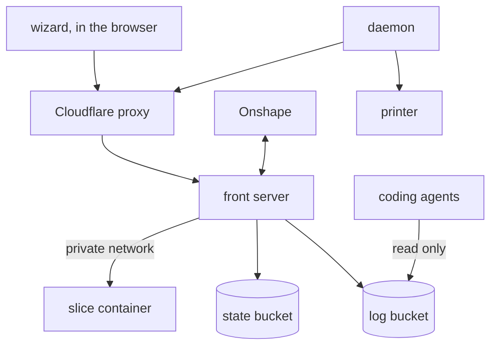

# PenguinSlicer: the architecture

This document says how the wizard, the front server, the slice service and printer
delivery fit together when they are hosted: what runs where, where each piece of state
lives, what a restart does, who may reach what, and where the project's owner reads what
happened. It is kept current. It gives no time estimates.

**Read after:** [the plan](plans/penguin-slicer-plan.md), whose terms it uses.

It covers what spans components. What one component must do is in that component's
guide, and this document gives a few sentences and a link wherever a guide holds the
full explanation:

| Component | Guide |
|---|---|
| The wizard, the code in the browser | [wizard/README.md](../wizard/README.md) |
| The front server | [front/README.md](../front/README.md) |
| The slice service | [slice/README.md](../slice/README.md) |
| Printer delivery: the relay and the daemon | [delivery/README.md](../delivery/README.md) |

Most of this design is not built yet. Each guide says what of its component is built,
and [the plan](plans/penguin-slicer-plan.md) says which phase builds the rest. The design
was approved by the project's owner on Thu 2026-11-26, Pacific time, as
[the hosted architecture design](specs/2026-11-25-hosted-architecture-design.md), which
stays as the record of that approval;
[the map of its decisions](orchestration/hosted-architecture/decision-map.md) says where
each decision made there now lives.

## Short answer

- **Two containers on Railway, behind Cloudflare,** at
  `https://penguinslicer.popcornpenguins.com/`. Railway is a hosting service that runs
  containers and bills by use. The **front server** serves the wizard's
  pages, signs users in and, from phase 5, runs the relay; it is the only thing the
  internet reaches. The **slice
  container** runs one slice service process and is reachable only from the front server.
- **The browser holds the user's parts and layout,** in its own storage. The slice
  container keeps a copy of each part for two hours after its last use, and the state
  bucket keeps each sliced file for two hours after its slice.
- **What must last is in two object stores.** The state bucket holds each group's
  configuration and paired-printer record (which daemon is the group's), the sliced
  files, and a record of each delivery job. The log bucket holds log lines.
- **A deploy at any moment interrupts no user.** The project is deployed continuously,
  so a restart of either container is routine: connections drop briefly and come back
  by themselves, a slice that was cut off starts again, and a print goes on.
- **Every user signs in with Onshape,** in Onshape's panel and outside Onshape alike. A
  **group** is the users who share one configuration and one printer: an Onshape company
  or classroom. Every user of a group may edit its configuration.
- **Development spends almost none of Onshape's yearly allowance of calls.** Work on one
  machine and the tests make no calls; the hosted service makes two at each sign-in and
  no others until phase 4.
- **A pairing code is used once.** After pairing, the state bucket holds a record linking
  a group to its daemon, and nothing read from the state bucket lets anyone start a
  print.
- **An idle daemon and the relay exchange about one request a minute, and a send still
  reaches the daemon at once,** because the relay holds its answer until it has a
  delivery job to hand over. During a print the daemon syncs every ten seconds.
- **The log records every error, the figures needed to size the service, and who uses
  it.** Its lines go to Railway's log view and to files in the log bucket, which the
  project owner's coding agents can read.
- **Every secret can be replaced,** and a planned replacement interrupts nobody who
  uses PenguinSlicer within a week of it.

## Terms

These terms belong to this design; every other term is the plan's.

| Term | Meaning |
|---|---|
| **group** | The users who share one configuration and one printer. It is one Onshape company or classroom, named by Onshape's id for it. A user who belongs to none is a group of one, named by the user's Onshape id. |
| **current group** | The one group, of those a user belongs to, whose configuration and printer the user is using now. |
| **front server** | The component, and the one process, that serves the wizard's pages, signs users in, passes parts and slice jobs to the slice service, keeps sliced files and configurations in the state bucket and, from phase 5, runs the relay. Hosted, it runs in a container of its own on Railway; in phase 2 it is a process on the one machine. |
| **wizard** | The code in the browser: the pages a user sees and what they keep in the browser's storage. It talks only to the front server. |
| **slice container** | The container on Railway that runs one slice service process and nothing else. |
| **state bucket** | The object store that holds everything that must outlast a restart of the front server: each group's configuration and paired-printer record, the sliced files, and a record of each delivery job. |
| **log bucket** | The object store that holds log lines and daemon telemetry as files. |
| **paired-printer record** | One small document per group in the state bucket: the id of the group's daemon, the printer's display name, who paired it and when, which of the relay's secret keys the daemon's token was last issued under, and, until the daemon has its token, a hash of the pairing code. |
| **daemon id** | A random id a daemon makes for itself when its `pair` command is run, and keeps. It names the daemon in its token, in the paired-printer record and in the relay's memory. |
| **progress stream** | The connection, of server-sent events, on which a page follows a slice job or a delivery job. |
| **part store** | The slice service's folder of uploaded parts, each kept for two hours after it was last used. It is a cache: the browser's storage is the record of a user's parts. |
| **user key** | The signed-in user's Onshape id, which the front server passes to the slice service with every request to say whose part or slice job it is. The slice service compares user keys and never interprets them. |
| **development identity** | A fixed made-up user and group that the front server signs in when a setting tells it to, for work on one machine. |
| **send** | The request by which a user's page asks the relay to print a sliced file. It creates a delivery job. |
| **sync** | The request a daemon posts to the relay, carrying the printer's status and its delivery job's progress; the answer tells the daemon what to do. |
| **held wait** | The time, up to 55 seconds, for which the relay holds back its answer to an idle daemon's sync, ending the moment a delivery job arrives for that daemon. |

## The shape

One address serves everything: `https://penguinslicer.popcornpenguins.com/`. The wizard's
pages, the address a daemon is given for the relay and the redirect address of the
Onshape OAuth app are all on it. The domain's DNS is at Cloudflare, whose proxy hides the
host's address and turns away floods of requests; it holds no logic of PenguinSlicer's.
The browser and the daemons talk only to the front server, and the front server calls the
slice service over Railway's private network. So the slice service's HTTP interface is
not reachable from the internet, and the browser never makes a cross-origin request.

**Why two containers.** Orca reads files that strangers upload. The slice container holds
no credentials, so a flaw in Orca reaches no sign-in secret and no bucket. The split also
keeps Orca's memory spike, and a deploy of the slice container, from cutting off every
daemon, and lets a change to the wizard be deployed without touching a running slice.
Railway bills by use, so two containers cost what one would. What the split adds is the
front server passing parts and slice jobs through, fetching each sliced file, and a route
from which it fetches the slice service's log lines.

**The wizard and the front server are two components** with a contract between them, as
between any two components here. The wizard is the code in the browser and reaches
nothing but the front server; the front server is everything behind that address.

**The buckets are at Cloudflare R2.** The design needs three things of its object store,
and R2 has them: a credential that only reads one bucket, deleting files after a set
number of days, and writing a file only if it has not changed. R2 is storage only, so
Cloudflare still runs no logic. The front server holds the one credential that writes to
the buckets; beyond it, only the project's owner can, through Cloudflare's own console.

**Size.** The slice container is allowed 8 GB, the most one container gets on Railway's
Hobby plan. Both containers stay running: nothing is started on demand, so a slice never
waits for a container to start.

**Leaving Railway.** The design needs two things of its host besides running containers:
a private network between the two, and a view of recent log lines. On AWS that is one EC2
machine running both containers with the slice container's port closed to the outside.

**A new Orca version** is rolled out as a new image of the slice container, built with
the pinned version after the upstream check passes, and deployed like any other change.

### Limits on a slice, and how many at once

The slice service stops an Orca that passes the memory ceiling (6,000 MB proposed, of the
slice container's 8 GB) or the time limit (240 seconds until measured on Railway), and
reports each as an error the wizard explains. How many Orcas run at once and how many
slice jobs may wait are settings, starting at one and two; memory decides the first,
since the slice container never runs more Orcas than fit with each at the memory
ceiling. The reasoning, the measurements behind the figures and what is still to be
measured are in [the slice service's guide](../slice/README.md).

### Progress streams

The browser follows a slice job and a delivery job as server-sent events, through the
front server. Railway closes a request after fifteen minutes, or after five without data,
and Cloudflare after 125 seconds without data. So every stream sends a comment line at
least every fifteen seconds while it has nothing to report, and the page reconnects when
a stream closes. A stream that connects late gets the latest progress report at once.

## Where each piece of state lives

Neither container keeps a database or a table of sessions. This section follows one
plate from its parts to its print and then says, in a few sentences each, how the parts,
the sliced file, a returning page and the configuration are kept, with a link to the
guide that explains each in full. Once sign-in, printers and the log have been described,
[All the state, in one table](#all-the-state-in-one-table) gathers every kind.

### One plate, from parts to print

1. **The user adds a part.** The page keeps the part in the browser's storage and uploads
   it. The slice service checks it and keeps it in the part store.
2. **The user lays out the plate and chooses settings.** This exists only in the
   browser's storage.
3. **The user goes to the Preview step.** The page sends the front server a plate
   configuration: the layout, the settings, and the hash of each part. It carries no
   files, because the parts are already in the part store. The slice job waits or runs
   in the slice container.
4. **The slice ends.** The front server fetches the sliced file from the slice container
   and stores it in the state bucket.
5. **The page draws the preview** from the sliced file, which it fetches through the
   front server.
6. **The user presses Send** (from phase 5). The relay writes a record of the delivery
   job to the state bucket. The daemon fetches the sliced file through the front server
   and hands it to the printer.

### Parts

A part is uploaded once, when the user adds it, in a request of at most 7.5 MB, and is
then referred to by the SHA-256 hash of its bytes. The slice service checks it on arrival
and keeps it in the part store under the user key for two hours after its last use; a
plate configuration names parts by hash and carries no files, so slicing again uploads
nothing. The part store is a cache: the browser's storage is the record of a user's
parts, and the page uploads again, unasked, any part the slice service no longer has.
The part store, its limits and its checks are in
[the slice service's guide](../slice/README.md); what the page keeps and when it uploads
are in [the wizard's guide](../wizard/README.md).

### The sliced file

When a slice ends, the front server fetches the sliced file from the slice container and
stores it in the state bucket, whether or not a page is open. That copy is the one the
browser previews and downloads and the one the relay hands to the daemon; the browser
never stores or uploads a sliced file, so a printer only ever receives a file the slice
service made. A sliced file is kept for two hours after its slice ended, which the front
server enforces. How the front server follows slice jobs, and the rules for keeping and
deleting sliced files, are in [the front server's guide](../front/README.md).

### Coming back

A slice job, once submitted, runs to its end whether or not anything is following it:
through a refresh, a dropped connection or a closed laptop lid. A page that has lost its
state reads its plate and the id of the plate's slice job from the browser's storage and
asks the front server about that slice job; what it does with each answer is in
[the wizard's guide](../wizard/README.md). A user has one unfinished slice job at a
time. Work does not follow a user to another computer or browser.

### The configuration

A group's configuration is one JSON document in the state bucket, read whole and written
whole, holding the group's filaments with the profiles to slice with and the units of
uploaded files, and no secret. An edit is written on the condition that the document has
not changed since it was read, so two users cannot silently overwrite each other. A
group with no document gets a built-in default configuration. Reading and writing it are
in [the front server's guide](../front/README.md), and its shape is to be a contract in
[contracts/](../contracts/README.md).

## Sign-in

Every user signs in with Onshape's OAuth, the same way in Onshape's panel and outside
Onshape. A sign-in sets one encrypted cookie in the browser, lasting thirty days, which
holds the user's identity, groups and Onshape tokens; nothing about a session is kept on
the front server, so a restart signs nobody out. A user's groups are the Onshape
companies and classrooms they belong to, or the user alone when there are none. A user
with several groups uses one at a time, the current group, and the front server accepts
a current group only if the cookie lists it.

Until the Onshape app is public, its calls count against a yearly allowance of 2,500 on
the owning account, so nothing calls Onshape that can be done without it: work on one
machine and the tests make no calls, and the hosted service makes two at each sign-in.
On one machine a development identity stands in for Onshape. Safari is not supported.

The whole of this, with the routes that need no sign-in, the protection against requests
from other sites and the count of calls, is in
[the front server's guide](../front/README.md).

## Printers

A group is linked to the daemon beside its printer by pairing: the daemon's `pair`
command makes a pairing code and shows it, a signed-in user types it into PenguinSlicer,
and the relay writes the group's paired-printer record to the state bucket and gives the
daemon its token. The code is used once. A daemon that was switched off for any length of
time reconnects when it is started again, with no pairing again; starting it is the job
of whoever runs that computer.

The daemon opens no port, so everything passes through the sync, a request the daemon
posts to the relay. While the printer is idle the relay holds its answer for up to 55
seconds (the held wait) and answers at once when a delivery job arrives, so an idle
daemon costs about one request a minute and a send still reaches it immediately. During
a print the daemon syncs every 10 seconds, and a change of the printer's state is sent at
once. The printer-status icon shows Offline when a daemon's last sync is more than 2
minutes old, and a running delivery job's report is stale after 40 seconds.

Pairing, sending and unpairing, the syncs and every limit are in
[printer delivery's guide](../delivery/README.md).

## Reading what happened

The project's owner runs this service alone and cannot look at a user's screen or at the
computer beside a user's printer. The log has to answer three questions without either:
what went wrong, whether the service is the right size, and who is using it.

### What is written

**Everything that goes wrong.**

- Every error a user is shown, with its code (such as `slice.out_of_memory`), the user
  key and name, the group and the job it belongs to. Errors can then be counted by kind.
- Every exception, with its stack trace, including one that no user saw because the
  request was tried again.
- Every refusal: no room for a slice job to wait, a limit on the rate of requests, a failed sign-in, a
  wrong pairing code, a request for something that belongs to another user.
- Every start of a container, with the version that started.
- A daemon's errors, which arrive as daemon telemetry with its requests.

**What happened to each job.** Every component writes one line for every transition of
a job, and the front server writes one for every call it makes to Onshape. The line that
ends a job carries the figures needed to size the service.

| Job | Figures on the line that ends it |
|---|---|
| A slice job | The number of parts, and the bytes and measurements (triangles, dimensions, volume) of each, the number of instances, how long it waited, how long Orca ran, Orca's peak memory beside the memory ceiling and beside the slice service's estimate, and the bytes of the sliced file |
| A delivery job | How long the file took to reach the printer, how long the print ran, and how it ended |

A slice that passes 80 percent of the memory ceiling or of the time limit also writes a
line marked as a warning, so that near misses can be found without reading every slice.

**How full each container is.** Once a minute each container writes one line: the
memory it holds, the slices running and waiting, and, for the front server, the
connections held open and the threads in use. A job's own line cannot show how close a
container came to its limit; these lines can.

**Who is using it.** Each sign-in writes a line with the user key, the user's name and
their groups, and every line about a slice or a send carries the user key and the
current group.

### Where it goes

- **Railway's log view** shows each container's lines as they are written and keeps them
  seven days.
- **The log bucket** keeps them ninety days, long enough to look into a problem that is
  reported weeks after it happened, after which R2 deletes them. The front server gathers
  its own lines and the relay's, fetches the slice service's from a route on the private
  network (the slice container has no credential to write them itself), and writes them
  to the log bucket as a new file about once a minute. Files are named by date and
  component.

Each file is newline-separated JSON: one JSON object on each line, one line for each log
line, so a file is read a line at a time with ordinary tools. Every line carries the
time, the component, and whichever of these it concerns: the group, the user key, the
slice job, the delivery job and the daemon. A user's name is written at sign-in and on
an error, and found for any other line by its user key. The slice service knows only the user key,
so the front server adds the group to the slice service's lines as it gathers them.

### Reading it

One command, kept in the repository, reads the log bucket. It pulls everything about one
group, one user, one daemon or one job, and it reports: errors counted by code, the
users and groups active each day, slices and prints for each group, the busiest hours,
the slices that came near a limit, and the year's calls to Onshape.

The project owner's coding agents read the log bucket with the read-only credential. It
cannot read the state bucket.

No log line holds a secret, a token, a pairing code or a part's geometry. Log lines do
hold users' names and part names, so the log bucket is private.

## All the state, in one table

Every kind of state the two containers, the buckets and the browser keep, where it
lives, and what a restart of the container holding it does. The daemon's own settings
file is described under [A daemon that was off](../delivery/README.md).

| State | Lives in | How long | A restart of that container |
|---|---|---|---|
| Parts, layout, chosen settings, the current group, the id of the plate's slice job and when it was submitted | The browser's storage | Until the page, on opening, finds the plate's sliced file expired; the current group, until the user changes it | Not affected |
| Who is signed in, their groups, their Onshape tokens | An encrypted cookie in the browser | Thirty days | Not affected |
| Uploaded parts | The part store, in the slice container | Two hours after last use | Gone; the page uploads them again, unasked |
| Slice jobs | The slice service process's memory | Until two hours after the slice ends | Gone; the page submits a waiting or running plate again, unasked, and a finished one is known by its sliced file |
| A sliced file not yet collected | The slice container's disk | The moments until the front server has stored it | Gone; that slice runs again |
| Sliced files | The state bucket | Two hours after the slice ended, or until the daemon has fetched one a delivery job needs | Kept |
| Configuration | The state bucket, one document per group | Until edited | Kept |
| Paired-printer record | The state bucket, one per group | Until unpaired | Kept |
| Delivery jobs | The state bucket, one record each | Until a day after the delivery job ends | Kept |
| Printer status and the progress of a print | The relay's memory | Until the next sync replaces them | Gone; the daemon's next sync brings them back, within seconds |
| Pairing codes that daemons are offering | The relay's memory | Fifteen minutes at most, while the daemon keeps offering | Gone; back within half a minute, as each daemon offers again |
| Log lines, daemon telemetry | The log bucket | Ninety days | Kept, except the last minute before a crash, which stays only in Railway's log view (seven days) |

## Restarts and deploys

The project is deployed continuously: a change goes out when it is ready, at any time of
day, while people are using the service. So a restart of a container is routine, and the
design's rule is that **a deploy at any moment interrupts no user.** A user may see a
pause while the container comes back and its clients reconnect. No work of a user's is
lost and a print goes on. Two things can take longer than the pause itself: a slice that
was cut off runs again from its start, and a pairing code typed just after a restart has
to be typed again.

### What a restart does

**The slice container restarts.**

| What was happening | What the user sees |
|---|---|
| A slice was waiting or running | Progress starts again. A page that is open uploads its parts again from the browser's storage and submits the same plate, unasked. A page that is closed does so when it is next opened |
| A slice had finished | Nothing. The sliced file is in the state bucket |
| A print was being sent or was printing | Nothing. Printer delivery does not pass through the slice container |

**The front server restarts.**

| What was happening | What the user sees |
|---|---|
| Any page was open | Its requests pause and its progress stream reconnects. Nobody is signed out, because the cookie's key is a setting of the front server and not something in its memory |
| A slice was running | It keeps running in the slice container. The page shows its progress again once reconnected, and the front server, having asked the slice service for its slice jobs at start, stores the sliced file when the slice ends |
| A delivery job was waiting for its daemon | The daemon's next sync is accepted, since its token still verifies, and receives the delivery job from its record in the state bucket. It fetches the sliced file through the front server, which reads it from the state bucket |
| A print was running | It goes on. The printer-status icon and the Send step are blank until the daemon's next sync brings the printer's status and progress back, which is within ten seconds of the front server answering again |
| A pairing code had just been typed in | The paired-printer record is already in the state bucket, and the daemon gets its token when it next offers its code, which the relay checks against the record |
| A user types a pairing code in the half minute after the restart | They are told, as for any wrong code, that no daemon is showing that code and to try again in a moment |

The records of delivery jobs are in the state bucket, not the relay's memory, because a
daemon that is told the relay no longer knows its delivery job treats the job as finished
and drops it. Before a daemon sends the printer the command to start, it asks the relay,
which allows it once for each delivery job. The record holds whether that was allowed,
which is what keeps a print from being started twice.

Beyond what the two tables show, a crash (not a deploy) loses the last minute of log lines, which stays
only in Railway's log view, and a slice whose sliced file the front server had not yet
stored, which runs again.

### What makes a deploy cheap

A crash gets the treatment above. A deploy is planned, so it can do better.

- **Only the container that changed is deployed.** Each of the two is built from its own
  folders of the repository, so a change to the wizard does not restart the slice
  container, nor the reverse.
- **A container asked to stop finishes what it is doing.** The slice container finishes
  the slice it is running and waits for the front server to fetch the sliced file. The
  front server finishes the uploads and downloads in progress, and closes its progress
  streams and answers its held syncs, so that pages and daemons reconnect to its
  replacement. Each
  has the time Railway allows a stopping container. A slice still waiting when the slice
  container stops is submitted again by its page.
- **Every client retries.** The daemon waits and tries again when the relay does not
  answer. The page does the same for every request it makes, so a request that falls in
  the gap is repeated and the user sees a pause, not an error.

### Old and new versions together

A deploy replaces a container and nothing else, so for a while the new front server
meets things made for the old one. Every change must keep three kinds of thing working;
of the rules here it is the one most easily broken by accident.

- **A page loaded before the deploy** keeps working against the new front server. Every
  answer carries the front server's version; a page that sees a newer version reloads itself at the
  next moment when nothing is in flight, which loses nothing because its state is in the
  browser's storage.
- **An installed daemon,** which may be much older than the relay, keeps working. A
  change to the relay may add to what it sends a daemon, and may not remove or change
  what an installed daemon relies on.
- **A record in the state bucket** written by the old front server is read by the new one.
  Each record carries the number of its format.

### Keeping it true

Each row of the two tables under [What a restart does](#what-a-restart-does) is a test that runs with the rest of the suite: the
container is restarted at that moment and the result checked. Tests of the same kind run
the previous version's page and daemon against the new front server. After each deploy, a
short scripted check runs against the hosted service.

## Security

**Who may use it.** Only users signed in with Onshape. A user has one unfinished slice
job at a time, every slice is bounded in memory and time, and the part store holds at
most 25 parts for one user key (the most a plate can use), so one user cannot take
every place a slice job may wait in, or fill the slice container's disk. Limits on the rate of requests are counted for the
signed-in user or the daemon. The one request that has neither, a daemon without a
token offering its pairing code, is counted for the address Cloudflare reports it came
from, as well as for the whole relay, so one stranger cannot use up the offers of
everyone.

**Users' models.** Outside the browser, a part exists only in the slice container, for
two hours after its last use. A sliced file is in the state bucket at Cloudflare R2 for two
hours after its slice, or up to about two days if the front server fails to delete it
(see [The sliced file](#the-sliced-file)). The bucket is private: the front server's
credential reads it, and otherwise only the project's owner. A user reaches only their own parts, slice jobs and
sliced files: the front server sets the user key from the cookie and the browser cannot
name one. Log lines carry a part's name, size in bytes and measurements, never its geometry.
Users of one group do see each other's names and a one-line description of a plate that
is printing, on the printer-status icon.

**Uploaded files as hostile input.** Orca and the slice service's own checks run in the
slice container, which holds no credentials and accepts requests only from the front
server. Inside it, Orca runs as a Unix user of its own that can write only the scratch
folder of its slice job, so a flaw in Orca cannot alter the slice service or reach
another slice job's files. A flaw in the slice service itself is worse: until the slice
container restarts, it could read every part uploaded and hand the front server any file
as a sliced file, which the front server would store and a printer would then run. The
slice container can also call the front server over the private network, where it meets
the same sign-in as anyone else.

**Printers.** The aim is that nobody outside a group can reach its printer.

- **Pairing needs the code on the daemon's screen.** The code is forty random bits, good
  for fifteen minutes and used once, and wrong attempts are limited for each signed-in
  user.
- **Sending needs a sign-in to the group.** A print is started only by a signed-in user
  whose current group has a paired-printer record naming the daemon, and the front
  server accepts a current group only if the cookie lists it.
- **Nothing read from the state bucket can start a print.** Nothing it holds, the
  configuration included, does once read: a paired-printer record holds a hash of the code only until
  its daemon has its token (see [Pairing](../delivery/README.md)). The two keys in the list of secrets
  below could forge a sign-in or a daemon's token, which is why they are secrets. Someone who
  could write to the state bucket could plant a record of a delivery job, which is why
  only the front server's credential and the project's owner can write to it.
- **The daemon opens no port.** It only calls out to the relay, so nothing on the
  internet can call the computer beside the printer.

Inside a group there is no further limit. Any user of a group can send a print from
anywhere, and a sent print starts by itself with nobody at the printer. That is accepted
for the small groups PenguinSlicer is meant for; permissions are added later if a group
needs them.

**Secrets.** There are six.

1. The Onshape app's client id and secret.
2. The key that encrypts the cookie.
3. The relay's secret key, which signs the daemons' tokens.
4. The credential with which the front server reads and writes the two buckets.
5. The credential that only reads the log bucket.
6. The project owner's own sign-in to Cloudflare, which reaches both buckets.

The first four are environment variables of the front server, set in Railway. The fifth
is kept with the project owner's other secrets and reaches a coding agent as environment
variables. The sixth is the owner's alone. None is in the repository, a bucket, a log line or a page.

**Replacing a secret.** Every secret can be replaced, and a planned replacement
interrupts nobody. Replacing any of the first four changes a setting of the front server, which restarts as
at any deploy.

| Secret | How a planned replacement loses nothing |
|---|---|
| The key that encrypts the cookie | The front server holds two keys: the current one, and the previous one for reading only. A cookie read with the previous key is written back with the current one |
| The relay's secret key | The relay accepts a token signed with either key, and answers a daemon whose token was signed with the previous key by giving it a new one, which the daemon saves. Each paired-printer record notes which key its daemon's token was last issued under |
| The buckets' credentials | A new credential is made at Cloudflare and given to the front server, or for the read-only one to the project owner's secrets, and the old one is then cancelled |
| The Onshape app's secret | Onshape's developer portal makes a new secret for the same app. No cookie depends on it, so nobody is signed out |
| The project owner's sign-in to Cloudflare | Changed at Cloudflare; nothing in PenguinSlicer holds it |

The previous key of either pair is removed after one week, or sooner for the relay's
secret key once every paired-printer record shows the current key. The front server
writes a log line each time a previous key is used, and a command lists the daemons
still to be given a new token. So a daemon switched off for the whole week after the
relay's secret key is replaced must be paired again. Likewise a user who does not open
PenguinSlicer in the week after the cookie's key is replaced signs in again. With no
replacement under way neither limit applies.

In an emergency, when a key has leaked, it is replaced and is not kept as the previous
key. Every user
then signs in again, or every printer is paired again. That cost is accepted.

The steps are written down in the repository as a procedure, and a test covers each
replacement: a cookie and a token made with the previous key are accepted and renewed.

## To confirm before building on it

Each of these is believed and not yet checked.

- **What Railway does at a deploy.** Whether it deploys one of two services without the
  other when only that one's folders changed, whether it starts the new container before
  stopping the old one, and how long it lets a stopping container finish. Until tried,
  the design assumes the worst case, a plain stop and start, which
  [What a restart does](#what-a-restart-does) covers.
- **Orca on Railway's machines, up to the memory ceiling.** Every measurement of memory
  and time so far is from aarch64 Linux and from plates under 2,600 MB. Plates of rising
  weight up to the proposed 6,000 MB are sliced on the slice container, each measured
  for memory and time, before users rely on it. The memory ceiling, the time limit and
  the estimates are set from those runs. The same runs show how many processors the
  slice container has and what Orca makes of them.
- **Railway's limit on a request body.** Its documents state none. A 7.5 MB part should
  pass; one real upload settles it.
- **Railway's 8 GB for one container on its Hobby plan, and x86_64 machines.** Both are
  inferred from Railway's pages and staff posts, not stated outright.
- **Onshape's allowance.** What allowance the project owner's account has; whether the
  development OAuth app and the hosted one draw on the same allowance, as two apps of
  one account; and whether renewing a token counts as a call, which matters from phase 4.
- **Progress streams through Cloudflare and Railway.** Neither promises to pass
  server-sent events on without holding them back. If one does hold them, the page asks
  for the latest progress report every second or two instead, by a route both
  interfaces have.
- **Replacing the Onshape app's secret.** Onshape's help says the developer portal can
  make a new secret for an app. Whether the old secret stops working at that moment,
  which would fail sign-ins until the front server has the new one, and whether, from
  phase 4, tokens issued under the old secret can still be renewed, were not checked.
- **A daemon through Cloudflare.** Whether Cloudflare's protection against automated
  clients ever challenges a daemon's requests was not checked.
- **The cookie's size.** A browser cookie holds about 4 KB, and it must carry the user's
  identity, groups and both Onshape tokens, encrypted. Two requests renewing the tokens
  at once must not leave a spent refresh token in the cookie.
- **An Onshape account with no company or classroom.** What Onshape answers for one was
  not checked.
- **The daemon after a cut-off fetch.** Whether the daemon fetches a sliced file again
  when the connection drops mid-way was not read from its code.
- **Memory and disk.** What the front server uses with fifty held syncs, what the part
  store takes on disk, and what the slice service itself needs beside Orca (the 2 GB
  left above the memory ceiling) were never measured.
- **Cost.** By Railway's published rates the two containers together cost about $7 a
  month with a few slices a day. About $40 a month is the figure for 5,000 slices and
  1,000 daemons, which also needs the asynchronous server mentioned under
  [printer delivery's guide](../delivery/README.md). The
  buckets hold two hours of sliced files and some small records, and cost cents. The
  first month's bill settles it.
