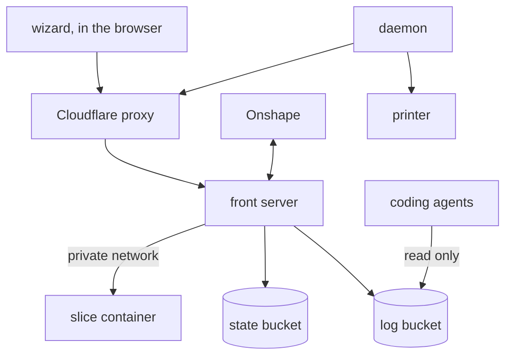

# PenguinSlicer: the architecture

This document says how the wizard, the front server, the slice service and printer
delivery fit together when they are hosted: what runs where, where each piece of state
lives, what a restart does, who may reach what, and where the owner of the project reads what
happened. It is kept current. It gives no time estimates.

**Read after:** [the plan](plans/penguin-slicer-plan.md), whose terms it uses.

It covers what spans components. What one component must do is in that component's
guide, and this document gives a few sentences and a link wherever a guide holds the
full explanation:

| Component | Guide |
|---|---|
| The wizard, the code in the browser | [wizard/README.md](../wizard/README.md) |
| The front server | [front/README.md](../front/README.md) |
| The slice service | [slice/README.md](../slice/README.md) |
| Printer delivery: the relay and the daemon | [delivery/README.md](../delivery/README.md) |

Most of this design is not built yet. Each guide says what of its component is built,
and [the plan](plans/penguin-slicer-plan.md) says which phase builds the rest. The design
was approved by the owner on Thu 2026-11-26, Pacific time, as
[the hosted architecture design](specs/2026-11-25-hosted-architecture-design.md), which
stays as the record of that approval;
[the map of its decisions](orchestration/hosted-architecture/decision-map.md) says where
each decision made there now lives.

## Short answer

- **Two containers on Railway, behind Cloudflare,** at
  `https://penguinslicer.popcornpenguins.com/`. Railway is a hosting service that runs
  containers and bills by use. The **front server** serves the wizard's
  pages, signs users in and, from phase 5, runs the relay; it is the only thing the
  internet reaches. The **slice
  container** runs one slice service process and is reachable only from the front server.
- **The browser holds the user's parts and layout,** in its own storage, a plate for
  each tab, dropped after 12 hours unused. The slice container keeps a copy of each part
  for two hours after its last use, and the state bucket keeps each sliced file until
  two hours after its slice ended or two hours after its last print ended, whichever is
  later, so the same plate can be sent again after a print of any length.
- **What must last is in two object stores.** The state bucket holds each group's
  configuration and paired-printer record (which daemon is the group's), the sliced
  files, and a record of each delivery job. The log bucket holds log lines.
- **A deploy at any moment interrupts no user.** The project is deployed continuously,
  so a restart of either container is routine: connections drop briefly and come back
  by themselves, a slice that was cut off starts again, and a print goes on.
- **Every user signs in with Onshape,** in Onshape's panel and outside Onshape alike,
  and signing in is not something a user manages: inside the panel it is not felt as
  separate from being signed in to Onshape. A **group** is the users who share one
  configuration and one printer: an Onshape company or classroom, or a user who belongs to
  none. Every user of a group
  may edit its configuration.
- **Development spends almost none of Onshape's yearly allowance of calls.** Work on one
  machine and the tests make no calls; the hosted service makes two at each sign-in and
  no others until phase 4.
- **A pairing code is used once.** After pairing, the state bucket holds a record linking
  a group to its daemon, and nothing read from the state bucket lets anyone start a
  print.
- **An idle daemon and the relay exchange about one request a minute, and a send still
  reaches the daemon at once,** because the relay holds its answer until it has a
  delivery job to hand over. During a print the daemon syncs every ten seconds.
- **The log records every error, the figures needed to size the service, and who uses
  it.** Its lines go to Railway's log view and to the log bucket, one file each minute
  holding the lines of every component, which the owner's coding agents can read.
- **Every secret can be replaced,** and a planned replacement interrupts nobody who
  uses PenguinSlicer within a week of it.

## Terms

These terms belong to this design; every other term is the plan's. **Group**, **front
server** and **wizard** are the plan's too, repeated here with what the hosted design adds.

| Term | Meaning |
|---|---|
| **group** | The users who share one configuration and one printer. It is one Onshape company or classroom, named by Onshape's id for it. A user who belongs to none is a group of one, named by the user's Onshape id. |
| **current group** | The one group, of those a user belongs to, whose configuration and printer the user is using now. |
| **front server** | The component, and the one process, that serves the wizard's pages, signs users in, passes parts and slice jobs to the slice service, keeps sliced files and configurations in the state bucket and, from phase 5, runs the relay. Hosted, it runs in a container of its own on Railway; in phase 2 it is a process on the one machine. |
| **wizard** | The code in the browser: the pages a user sees and what they keep in the browser's storage. It talks only to the front server. |
| **slice container** | The container on Railway that runs one slice service process and nothing else. |
| **state bucket** | The object store that holds everything that must outlast a restart of the front server: each group's configuration and paired-printer record, the sliced files, and a record of each delivery job. |
| **log bucket** | The object store that holds log lines and daemon telemetry as files. |
| **paired-printer record** | One small document per group in the state bucket: the id of the group's daemon, the printer's display name (the name the printer itself reports, sent by the daemon when it is paired), who paired it and when, which of the relay's secret keys the daemon's token was last issued under, the time of the daemon's last sync, written once when the daemon goes offline (whether it is cleared when the daemon syncs again is undecided: [printer delivery's item](../delivery/README.md#clearing-the-recorded-time-of-silence)), and, until the daemon has its token, a hash of the pairing code. |
| **daemon id** | A random id a daemon makes for itself when its `pair` command is run, and keeps. It names the daemon in its token, in the paired-printer record and in the relay's memory. |
| **progress stream** | The connection, of server-sent events, on which a page follows a slice job and, from phase 5, a delivery job. |
| **part store** | The slice service's folder of uploaded parts, each kept for two hours after it was last used. It is a cache: the browser's storage is the record of a user's parts. |
| **user key** | The signed-in user's Onshape id, which the front server passes to the slice service with every request to say whose part or slice job it is. The slice service compares user keys and never interprets them. |
| **development identity** | A fixed made-up user and group that the front server signs in when a setting tells it to, for work on one machine. |
| **send** | The request by which a user's page asks the relay to print a sliced file. It creates a delivery job. |
| **sync** | The request a daemon posts to the relay, carrying the printer's status and its delivery job's progress; the answer tells the daemon what to do. |
| **held wait** | The time, up to 55 seconds, for which the relay holds back its answer to an idle daemon's sync, ending the moment a delivery job arrives for that daemon. |

## The shape

One address serves everything: `https://penguinslicer.popcornpenguins.com/`. The wizard's
pages, the address a daemon is given for the relay and the redirect address of the
Onshape app are all on it. The domain's DNS is at Cloudflare, whose proxy hides the
host's address and turns away floods of requests; it holds no logic of PenguinSlicer's.
The browser and the daemons talk only to the front server, and the front server calls the
slice service over Railway's private network. So the slice service's HTTP interface is
not reachable from the internet, and the browser never makes a cross-origin request.

**Why two containers.** Orca reads files that strangers upload. The slice container holds
no credentials, so a flaw in Orca reaches no sign-in secret and no bucket. The split also
keeps Orca's memory spike, and a deploy of the slice container, from cutting off every
daemon, and lets a change to the wizard be deployed without touching a running slice.
Railway bills by use, so two containers cost what one would. What the split adds is the
front server passing parts and slice jobs through, fetching each sliced file, and a route
from which it fetches the slice service's log lines.

**The wizard and the front server are two components** with a contract between them, as
between any two components here. The wizard is the code in the browser and reaches
nothing but the front server; the front server is everything behind that address.

**The buckets are at Cloudflare R2.** The design needs three things of its object store,
and R2 has them: a credential that only reads one bucket, deleting files after a set
number of days, and writing a file only if it has not changed. R2 is storage only, so
Cloudflare still runs no logic. The front server holds the one credential that writes to
the buckets; beyond it, only the owner can, through Cloudflare's own console.

**Size.** The slice container is allowed 8 GB, the most one container gets on Railway's
Hobby plan. Both containers stay running: nothing is started on demand, so a slice never
waits for a container to start.

**Leaving Railway.** The design needs two things of its host besides running containers:
a private network between the two, and a view of recent log lines. On AWS that is one EC2
machine running both containers with the slice container's port closed to the outside.

**A new Orca version** is rolled out as a new image of the slice container, built with
the pinned version after the upstream check passes, and deployed like any other change.

### Limits on a slice, and how many at once

The slice service stops an Orca that passes the memory ceiling (6,000 MB proposed, of the
slice container's 8 GB) or the time limit (240 seconds until measured on Railway), and
reports each in an error report whose sentences it writes itself and the wizard shows as
they are: each component writes the sentences of its own failures. It also ends a slice
whose sliced file would pass 50 MB, the most a sliced file may be. How many Orcas run at
once and how many slice jobs may wait are settings, starting at one and two; memory
decides the first, since the slice container never runs more Orcas than fit with each
at the memory ceiling. Every user shares these places: nothing limits the slice jobs of
one user, so one user can hold every place, which is accepted, and capacity is added if
it proves too little. The figures, the reasoning and the measurements behind them are in
[the slice service's guide](../slice/README.md#how-well-it-must-do-it), and what is still
to be measured under its [Unmeasured](../slice/README.md#unmeasured).

### Progress streams

The browser follows a slice job and a delivery job as server-sent events, through the
front server. Railway closes a request after fifteen minutes, or after five without data,
and Cloudflare after 125 seconds without data. So every stream sends a comment line at
least every fifteen seconds while it has nothing to report, and the page reconnects when
a stream closes. A stream that connects late gets the latest progress report at once.
The page counts on the fifteen seconds: it treats a stream that has carried nothing for
45 seconds as failed, and one it cannot reopen within 20 seconds as failed too. Each
stream a page holds takes one of the front server's threads, so one user may hold only a
few at once; the figures are in
[the front server's guide](../front/README.md#how-many-users-at-once-and-what-happens-when-the-threads-run-out).

## Where each piece of state lives

Neither container keeps a database or a table of sessions. This section follows one
plate from its parts to its print and then says, in a few sentences each, how the parts,
the sliced file, a returning page and the configuration are kept, with a link to the
guide that explains each in full. Once sign-in, printers and the log have been described,
[All the state, in one table](#all-the-state-in-one-table) gathers every kind.

### One plate, from parts to print

1. **The user adds a part.** The page keeps the part in the browser's storage, in the
   plate of its tab, and uploads it. The slice service checks it and keeps it in the part
   store.
2. **The user lays out the plate and chooses settings.** This exists only in the
   browser's storage.
3. **The user goes to the Preview step.** The page sends the front server a plate
   configuration: the layout, the settings, and the hash and units of each part. It
   carries no files, because the parts are already in the part store. The slice job
   waits or runs in the slice container.
4. **The slice ends.** The front server fetches the sliced file from the slice container
   and stores it in the state bucket, and only then tells the page the slice job is
   finished.
5. **The page draws the preview** from the sliced file, which it fetches through the
   front server.
6. **The user presses Send** (from phase 5). The relay writes a record of the delivery
   job to the state bucket. The daemon fetches the sliced file through the front server
   and hands it to the printer.

### Parts

A part is uploaded once, when the user adds it, in a request of at most 7.5 MB, and is
then referred to by the SHA-256 hash of its bytes. Its units, inches or millimetres,
travel beside it as a label: the browser never changes a part's bytes, and only the slice
service applies the scale. The slice service checks it on arrival, with its units, and
keeps it in the part store under the user key, the hash and the units for two hours after
its last use, so the same file under other units is another part; a
plate configuration names parts by hash and carries no files, so slicing again uploads
nothing. The part store is a cache: the browser's storage is the record of a user's
parts, and the page uploads again, unasked, any part the slice service no longer has.
The part store, its limits and its checks are in
[the slice service's guide](../slice/README.md#keep-each-part-once-the-part-store); what
the page keeps and when it uploads are in
[the wizard's guide](../wizard/README.md#what-the-browser-keeps-and-why-it-is-the-record).

### The sliced file

When a slice ends, the front server fetches the sliced file from the slice container and
stores it in the state bucket, whether or not a page is open. That copy is the one the
browser previews and downloads and the one the relay hands to the daemon; the browser
never stores or uploads a sliced file, so a printer only ever receives a file the slice
service made. A sliced file is 8.8 to 14.1 MB on the plates measured so far and at most
50 MB: the slice service ends a slice whose file would be larger, and the front server
refuses to store a larger one. So each fetch by a browser or a daemon stays well inside
the 100 MB Cloudflare allows one request.

A sliced file is kept until two hours after its slice ended or two hours after its last
print ended, whichever is later, which the front server enforces. Its last print ended
when the latest delivery job that used it ended, and each delivery job's record names the
sliced file it used, so Send is enabled again for the same sliced plate after a print of
any length. R2's own rule for deleting old files counts in whole days and removes a file
typically within 24 hours after it falls due, so it cannot enforce two hours; a three-day
rule on the sliced files is set as well, to catch any file the front server failed to
delete. The rule counts from when a file was stored, and a send stores the sliced file
afresh, so the backstop runs from the last send and three days outlast the longest print
and the two hours after it. A file the front server failed to delete can rest at R2 for
up to about four days after it was last stored. A send whose sliced file has gone is
answered that the sliced file has expired and the plate must be sliced again. The front
server tells the page, with the sliced file's details, the moment at which it will refuse
the file as expired, so an open page can say so on time. How the front server follows
slice jobs, and the rules for keeping and deleting sliced files, are in the front
server's guide, under
[The front server follows every slice job itself](../front/README.md#the-front-server-follows-every-slice-job-itself)
and [How long a sliced file lives](../front/README.md#how-long-a-sliced-file-lives).

### Coming back

A slice job, once submitted, runs to its end whether or not anything is following it:
through a refresh, a dropped connection or a closed laptop lid. Nobody cancels a slice by
hand. A slice job ends without a result for only two reasons a page can meet: the same
plate's later slice replaced it, or the slice service was asked to stop. A user may have
several slice jobs under way, one for each tab's plate, since each tab works with a plate
of its own; within one plate, a changed plate's new slice replaces that plate's own
earlier unfinished one.

A page that has lost its state reads its plate and the id of the plate's slice job from
the browser's storage and asks the front server about that slice job; what it does with
each answer is in
[the wizard's guide](../wizard/README.md#coming-back-to-running-work). A refresh keeps
the work, since it is in the browser's storage. A newly opened tab shows the user's most
recently used plate, if it was used less than 12 hours ago and no other open tab holds
it, and otherwise an empty plate; a stored plate that has not been used for 12 hours is
dropped. A stored plate therefore outlives its sliced file: a returning page whose
sliced file has expired keeps its parts, layout and settings and offers to slice again.
The stored work is tied to the signed-in user, and when a different user signs in at the
same browser the previous user's stored work is cleared. Work does not follow a user to
another computer or browser. All of this is in
[What the browser keeps](../wizard/README.md#what-the-browser-keeps-and-why-it-is-the-record).

### The configuration

A group's configuration is one JSON document in the state bucket, read whole and written
whole, holding the group's filaments, each with a colour and with the profiles the wizard
offers for it; the printer's Orca profile, from which the plate's size and height come;
and the units of uploaded files; and no secret. An edit is written on the condition that
the document has not changed since it was read, so two users cannot silently overwrite
each other. A group with no document gets a built-in default configuration, and until
the edit screens exist the configurations are a fixed set. The wizard is never given an
invalid configuration: when a group's saved document cannot be used, the front server
serves the default in its place, leaves the saved file untouched and writes an error to
the log, and the wizard's header names the configuration in use. The list of settings
for advanced mode and the names of the profile catalog come from the slice service,
which alone knows the Orca version it runs, and the front server passes them on.
Reading and writing it are in
[the front server's guide](../front/README.md#the-configuration); what it must hold is in
[its contract](../contracts/configuration.md).

## Sign-in

Every user signs in with Onshape's OAuth, the same way in Onshape's panel and outside
Onshape, and PenguinSlicer keeps no accounts and no passwords. Signing in is open to
anyone with an Onshape account. A sign-in sets one encrypted cookie in the browser,
which holds the user's identity, groups and Onshape tokens; nothing about a session is
kept on the front server, so a restart signs nobody out, and the front server accepts a
current group only if the cookie lists it.

Signing in is not something a user manages.

- **When the sign-in is missing or has run out,** the front server answers the page that
  it is not signed in, and the page makes the trip to Onshape by itself at a quiet
  moment and returns to the same step. A user signed in to Onshape sees nothing. A
  message with a button to sign in appears only when that trip fails.
- **Outside Onshape** a sign-in lasts thirty days from its last use, extended by each
  use, and the page has a sign-out link, which removes the cookie.
- **Inside Onshape's panel** the sign-in is not felt as separate from Onshape's: it lasts
  as long as the user is signed in to Onshape, and there is no sign-out link. The means
  is PenguinCAM's, known to work: a cookie of the kind a browser sends to a page
  embedded in another site, and, the first time in a browser, a Connect button that
  opens a small window in which the trip is made and which closes itself. A trip the
  user never sees is what phase 4 tries for, not what the design relies on.
- **A different person signed in to Onshape** at the same browser is followed: the
  sign-in is made again for that person, and the previous user's stored work is
  cleared.
- **The front server reads a user's groups again itself,** at every sign-in and when
  Onshape says the user is working in a company that the sign-in does not list; there is
  nothing for a user to press. Inside Onshape the current group is the group of the
  document the user has open. Until the Onshape app is public, a user removed from an
  Onshape company keeps its configuration and printer for as long as they keep using
  PenguinSlicer outside Onshape, which is accepted; once it is public, groups are read
  daily.

From phase 3 the Onshape app asks permission to read who the user is, their companies
and classrooms, and their documents, and never to write. Calls to Onshape count against
a yearly allowance until the app is public, so work on one machine (where the development
identity stands in for Onshape) and the tests make none, the hosted service makes two at
each sign-in, and each is logged and counted.

The whole of this, with the allowance, the routes that need no sign-in and the protection
against requests from other sites, is in
[the front server's guide](../front/README.md#signing-in), and what a user sees is in
[the wizard's guide](../wizard/README.md#signing-in). Chrome is the supported browser and
Edge is tested; Safari is not supported, and the front server shows a user of Safari a
plain page saying that PenguinSlicer needs Chrome
([Browsers other than Chrome](../wizard/README.md#browsers-other-than-chrome)).

## Printers

A group is linked to the daemon beside its printer by pairing: any signed-in user of the
group types the pairing code the daemon shows into PenguinSlicer, once, from any
computer, in the wizard's printer details, and the relay writes the group's
paired-printer record to the state bucket and gives the daemon its token, after which the
code is dead and a daemon switched off for any length of time reconnects with no pairing
again. The printer's name is the one the printer itself reports, sent by the daemon when
it is paired; nobody types it. Any user of the group may unpair, except while a print is
being followed. A print whose daemon has gone silent can be given up ("stop following")
by the user who sent it and by nobody else; if that user is away, the stale print holds
the printer until the daemon reports again or the relay gives the print up after a day
without word. The daemon opens no port, so everything passes through the sync, and while the
printer is idle the relay holds its answer for up to 55 seconds (the held wait), so an
idle daemon costs about one request a minute and a send still reaches it at once. During
a print the daemon syncs every 10 seconds; the printer-status icon shows Offline after 2
minutes without a sync, and a running delivery job's report is stale after 40 seconds.
When a daemon goes offline the relay notes the time of its last sync in the paired-printer
record, one write at that moment, so the wizard can say how long a printer has been
silent even after a restart of the front server. A daemon that went silent just before
a restart has no time noted; after the restart, a paired daemon not heard from within two
minutes, for which the record holds no offline time, is shown as silent for at least the
time since the front server started. Whether the relay clears the noted time when the
daemon syncs again, and what it does when that clearing fails, are undecided
([Clearing the recorded time of silence](../delivery/README.md#clearing-the-recorded-time-of-silence)).

Pairing, sending and unpairing, the syncs and every limit are in printer delivery's guide:
[Pairing](../delivery/README.md#pairing),
[How the relay tells a daemon to print](../delivery/README.md#how-the-relay-tells-a-daemon-to-print),
[The life of a delivery job](../delivery/README.md#the-life-of-a-delivery-job),
[Stop following](../delivery/README.md#stop-following),
[How long a printer has been silent](../delivery/README.md#how-long-a-printer-has-been-silent)
and [How well it must do it](../delivery/README.md#how-well-it-must-do-it).

## Reading what happened

The owner runs this service alone and cannot look at a user's screen or at the
computer beside a user's printer. The log has to answer three questions without either:
what went wrong, whether the service is the right size, and who is using it.

### What is written

**Everything that goes wrong.**

- Every error a user is shown, with its code (such as `slice.out_of_memory`), the user
  key and name, the group and the job it belongs to. Errors can then be counted by kind.
- Every exception, with its stack trace, including one that no user saw because the
  request was tried again.
- Every refusal: no room for a slice job to wait, a limit on the rate of requests, a failed sign-in, a
  wrong pairing code, a request for something that belongs to another user.
- Every start of a container, with the version that started.
- Every saved configuration found invalid, with the group and what is wrong.
- A daemon's errors, which arrive as daemon telemetry with its requests.
- Every failure in the browser, which the page reports to the front server: what
  failed, on which step, the page's version, the browser's name and version, whether 3D
  is drawn in software, and the hash of the part concerned. Never a part's bytes or
  geometry and never the contents of the browser's storage, and at most a few reports a
  minute from one page.

**How well the drawing goes on users' machines.** For each use of the Layout view and of
the Preview step the page reports one summary, never frame by frame: frames a second,
the time to the first layer drawn, the longest stretch the browser's main thread was
held, how much was drawn, and what the machine is (browser, operating system, whether
drawing is by a graphics card or in software, processors, memory, the panel's width,
and whether the wizard is inside Onshape's panel). The front server writes it to the
log. The fields are listed in
[the wizard's guide](../wizard/README.md#what-the-wizard-reports-about-itself).

**What happened to each job.** Every component writes one line for every transition of
a job, and the front server writes one for every call it makes to Onshape. The line that
ends a job carries the figures needed to size the service.

| Job | Figures on the line that ends it |
|---|---|
| A slice job | The number of parts, and the bytes and measurements (triangles, dimensions, volume) of each, the number of instances, how long it waited, how long Orca ran, Orca's peak memory beside the memory ceiling and beside the slice service's estimate, and the bytes of the sliced file |
| A delivery job | How long the file took to reach the printer, how long the print ran, and how it ended |

A slice that passes 80 percent of the memory ceiling or of the time limit also writes a
line marked as a warning, so that near misses can be found without reading every slice.

**How full each container is.** Once a minute each container writes one line: the
memory it holds, the slices running and waiting, and, for the front server, the
connections held open and the threads in use. A job's own line cannot show how close a
container came to its limit; these lines can.

**Who is using it.** Each sign-in writes a line with the user key, the user's name and
their groups, and every line about a slice or a send carries the user key and the
current group.

### Where it goes

- **Railway's log view** shows each container's lines as they are written and keeps them
  seven days.
- **The log bucket** keeps them ninety days, long enough to look into a problem that is
  reported weeks after it happened, after which R2 deletes them. The front server is the
  only thing that writes to it, so it gathers for every component: its own lines, the
  relay's and the daemons' telemetry, the page's reports, and the slice service's, which
  it fetches from a route on the private network (the slice container has no credential
  to write them itself).
- **One file each minute holds the lines of all components.** A file is written once
  and never rewritten, because the store has no way to add to a file. The files sit in
  folders by year, then month, then day, so that no folder holds more than about 1,440
  files; their names use UTC. In phase 2 the same files are written into a folder that
  stands in for the log bucket.

Each file is newline-separated JSON: one JSON object on each line, one line for each log
line, so a file is read a line at a time with ordinary tools. Every line carries the
time, the component that wrote it, and whichever of these it concerns: the group, the user key, the
slice job, the delivery job and the daemon. A user's name is written at sign-in and on
an error, and found for any other line by its user key. The slice service knows only the user key,
so the front server adds the group to the slice service's lines as it gathers them.

### Reading it

One command, kept in the repository and built in phase 3, reads the log bucket. Picking
out one component's lines is its job, not the store's, and it shows every time in
Pacific time. It pulls everything about one component, one group, one user, one daemon
or one job, and it reports: errors counted by code, the
users and groups active each day, slices and prints for each group, the busiest hours,
the slices that came near a limit, and the year's calls to Onshape.

The owner's coding agents read the log bucket with the read-only credential. It
cannot read the state bucket.

No log line holds a secret, a token, a pairing code or a part's geometry. Log lines do
hold users' names and part names, so the log bucket is private.

## All the state, in one table

Every kind of state the two containers, the buckets and the browser keep, where it
lives, and what a restart of the container holding it does. What the daemon keeps on its
own computer is described under
[What the daemon keeps on its computer](../delivery/README.md#what-the-daemon-keeps-on-its-computer).

| State | Lives in | How long | A restart of that container |
|---|---|---|---|
| A plate for each tab: its parts with their units and hashes, its layout, its chosen settings, the step, the id of its slice job and when it was submitted, and the user and group it belongs to | The browser's storage | Until no tab has used it for 12 hours, its tab's user presses New plate or changes the current group, or a different user signs in at the browser; an expired sliced file does not drop it | Not affected |
| How STL files are read, and, for a user in several groups outside Onshape, the current group | The browser's storage | Until the user changes it | Not affected |
| Who is signed in, their groups, their Onshape tokens | An encrypted cookie in the browser | Thirty days from its last use, each use extending it, or until the user signs out | Not affected |
| Uploaded parts | The part store, in the slice container | Two hours after last use | Gone; the page uploads them again, unasked |
| Slice jobs | The slice service process's memory | Until two hours after the slice ends | Gone; the page submits a waiting or running plate again, unasked, and a finished one is known by its sliced file |
| A sliced file not yet collected | The slice container's disk | The moments until the front server has stored it | Gone; that slice runs again |
| Sliced files, at most 50 MB each, with their summaries | The state bucket | Until two hours after the slice ended or two hours after its last print ended, whichever is later; at most about four days after it was last stored, by R2's three-day backstop rule | Kept |
| Configuration | The state bucket, one document per group | Until edited; an invalid one is left untouched and the default is served in its place | Kept |
| Paired-printer record, with the time of its daemon's last sync, noted when the daemon goes offline | The state bucket, one per group | Until unpaired; the time is written once each time the daemon goes offline, and whether it is cleared on the daemon's return is [undecided](../delivery/README.md#clearing-the-recorded-time-of-silence) | Kept |
| Delivery jobs, each naming the sliced file it used | The state bucket, one record each | Until a day after the delivery job ends | Kept |
| Printer status and the progress of a print | The relay's memory | Until the next sync replaces them | Gone; the daemon's next sync brings them back, within seconds |
| Pairing codes that daemons are offering | The relay's memory | Fifteen minutes at most, while the daemon keeps offering | Gone; back within half a minute, as each daemon offers again |
| Log lines of every component, daemon telemetry and the page's reports, one file each minute | The log bucket | Ninety days | Kept, except the last minute before a crash, which stays only in Railway's log view (seven days) |

## Restarts and deploys

The project is deployed continuously: a change goes out when it is ready, at any time of
day, while people are using the service. So a restart of a container is routine, and the
design's rule is that **a deploy at any moment interrupts no user.** A user may see a
pause while the container comes back and its clients reconnect, and after 20 seconds a
message that the server is being slow. No work of a user's is lost and a print goes on. Two things can take longer than the pause itself: a slice that
was cut off runs again from its start, and a pairing code typed just after a restart has
to be typed again.

### What a restart does

**The slice container restarts.**

| What was happening | What the user sees |
|---|---|
| A slice was waiting or running | Progress starts again. A page that is open uploads its parts again from the browser's storage and submits the same plate, unasked. A page that is closed does so when it is next opened, if that is within two hours of submitting; later it opens with the plate as it was and the expired message, with Slice again ([the wizard's guide](../wizard/README.md#coming-back-to-running-work)). A slice still waiting when the slice service is asked to stop is ended early, with the reason that the slice service was asked to stop, and its page submits it again by itself |
| A user submits a plate while the slice service is stopping | The slice is shown as waiting, with words saying the slicer is restarting; the page submits again by itself until the new slice service accepts, for up to 300 seconds, and then shows ordinary progress ([What a user sees while the slice service stops](../slice/README.md#what-a-user-sees-while-the-slice-service-stops)) |
| A slice had finished | Nothing. The sliced file is in the state bucket |
| A print was being sent or was printing | Nothing. Printer delivery does not pass through the slice container |

**The front server restarts.**

| What was happening | What the user sees |
|---|---|
| Any page was open | Its requests pause and its progress stream reconnects. Nobody is signed out, because the cookie key is a setting of the front server and not something in its memory |
| A slice was running | It keeps running in the slice container. The page shows its progress again once reconnected, and the front server, having asked the slice service for its slice jobs at start, stores the sliced file when the slice ends |
| A delivery job was waiting for its daemon | The daemon's next sync is accepted, since its token still verifies, and receives the delivery job from its record in the state bucket. It fetches the sliced file through the front server, which reads it from the state bucket |
| A print was running | It goes on. Until the daemon's next sync brings the printer's status and progress back, which is within ten seconds, plus the daemon's short random wait, of the front server answering again, the printer's status is not known: the printer-status icon shows a grey dot and "…", the Send step says it is waiting to hear from the printer, and a print card keeps its last figures ([the wizard's guide](../wizard/README.md#the-printer-status-icon)) |
| A daemon had gone silent just before the restart | Its offline time was never noted. Two minutes after the restart its printer shows Offline, silent for at least the time since the front server started |
| A pairing code had just been typed in | The paired-printer record is already in the state bucket, and the daemon gets its token when it next offers its code, which the relay checks against the record |
| A user types a pairing code in the half minute after the restart | They are told, as for any wrong code, that no daemon is showing that code and to try again in a moment |

The records of delivery jobs are in the state bucket, not the relay's memory, because a
daemon that is told the relay no longer knows its delivery job treats the job as finished
and drops it. Before a daemon sends the printer the command to start, it asks the relay,
which allows it once for each delivery job. The record holds whether that was allowed,
which is what keeps a print from being started twice.

Beyond what the two tables show, a crash (not a deploy) loses the last minute of log lines, which stays
only in Railway's log view, and a slice whose sliced file the front server had not yet
stored, which runs again.

### What makes a deploy cheap

A crash gets the treatment above. A deploy is planned, so it can do better.

- **Only the container that changed is deployed.** Each of the two is built from its own
  folders of the repository, so a change to the wizard does not restart the slice
  container, nor the reverse.
- **A container asked to stop finishes what it is doing.** The slice container finishes
  the slice it is running and waits for the front server to fetch the sliced file. The
  front server finishes the uploads and downloads in progress, and closes its progress
  streams and answers its held syncs, so that pages and daemons reconnect to its
  replacement. Each
  has the time Railway allows a stopping container. A slice still waiting when the slice
  container stops is ended early, with the reason that the slice service was asked to
  stop, and is submitted again by its page. A plate submitted while the slice service
  stops is answered with the slice service's own answer, never "busy". The front server
  holds nothing back for later and passes that answer on; the wizard shows the slice as
  waiting, says the slicer is restarting, and submits again by itself for up to 300
  seconds
  ([What a user sees while the slice service stops](../slice/README.md#what-a-user-sees-while-the-slice-service-stops)).
- **Every client retries.** The daemon waits and tries again when the relay does not
  answer. The page does the same for every request it makes, so a request that falls in
  the gap is ridden out by retrying. It retries quietly at first, so a user sees nothing
  if the gap is under 20 seconds. After 20 seconds of failed retries it shows a message
  that the server is being slow and the browser is retrying, with a countdown to the next
  attempt and a "Retry now" link, on the panel's line, the waits between attempts
  growing. It keeps retrying for up to 300 seconds in
  all, then stops, says the server could not be reached and offers to try again. Nothing
  of the user's work is dropped
  ([the wizard's guide](../wizard/README.md#when-the-server-is-slow-or-cannot-be-reached)).

### Old and new versions together

A deploy replaces a container and nothing else, so for a while the new front server
meets things made for the old one. Every change must keep three kinds of thing working;
of the rules here it is the one most easily broken by accident.

- **A page loaded before the deploy** keeps working against the new front server. Every
  answer carries the front server's version, and a page that sees a newer version
  reloads itself, which loses nothing because its state is in the browser's storage. The
  page never refreshes under a person who is looking at it or touching it: it reloads
  only when the user moves between steps of the wizard, or once at least 120 seconds
  have passed since the user last interacted with it, and in either case it waits while
  a request of its own is pending. It says nothing afterwards
  ([the wizard's guide](../wizard/README.md#the-page-reloading-itself-for-a-new-version)).
- **An installed daemon,** which may be much older than the relay, keeps working. A
  change to the relay may add to what it sends a daemon, and may not remove or change
  what an installed daemon relies on.
- **A record in the state bucket** written by the old front server is read by the new one.
  Each record carries the number of its format.

The front server and the slice service are deployed separately, so a new one of either
meets the previous one of the other. The rule is that **each container's previous
version works against the other's new one:** a change to the plate configuration's
contract or to the slice service's HTTP interface keeps the previous front server
working against the new slice service, and the previous slice service against the new
front server
([the slice service's guide](../slice/README.md#what-a-user-sees-while-the-slice-service-stops),
[the front server's guide](../front/README.md#old-and-new-versions-together)).

### Keeping it true

Each row of the two tables under [What a restart does](#what-a-restart-does) is tested, at
two levels. Each component's own fast suite asserts its half of the row against stand-ins
for the others: for the slice container's rows, the slice service that its part store is
empty at start and that it lists the missing parts, ends a waiting slice early with the
reason that it was asked to stop and answers a submission during a stop that it is
stopping; the front server that its following ends when the slice service no longer knows a
slice job, that it then answers the page that the slice job is unknown, and that it passes
the stopping answer on unchanged; the wizard that it uploads the parts again and submits
again, and shows a slice as waiting while the slicer restarts. For the front server's rows,
the front server is stopped at that moment and started again on the same folders and
stand-ins. Then one joined suite, outside the fast suites, runs the real front server and
the real slice service together with the slice service's stand-in for Orca, drives the
wizard in a browser, and restarts the slice service at the moment of each row of the slice
container's table; it lives at the repository's root as a project of its own, `together/`,
and is written by the front server's builder once the three components exist
([the front server's details](../front/README-details.md#running-phase-2-on-one-machine)).
Tests of the same kind run
the previous version's page and daemon against the new front server. After each deploy, a
short scripted check runs against the hosted service; when it fails it tells the owner,
who puts the previous version back by hand. Something outside the host that watches the
service comes later, once users rely on it.

## Security

**Who may use it.** Only users signed in with Onshape, which anyone with an Onshape
account may do. What a stranger can take is a share of what everyone shares. Nothing
limits the slice jobs of one user, so one user can hold every place a slice job may run
or wait in, and others are told the slicer is busy; every slice is bounded in memory and
time, the log shows who slices, and that is accepted. The part store is bounded by a
limit on the disk it may take in all, and the front server limits how fast one user may
upload parts, so one user cannot fill the slice container's disk. Limits on the rate of
requests are counted for the signed-in user or the daemon. The one request that has neither, a daemon without a
token offering its pairing code, is counted for the address Cloudflare reports it came
from, as well as for the whole relay, so one stranger cannot use up the offers of
everyone.

**Users' models.** Outside the browser, a part exists only in the slice container, for
two hours after its last use. A sliced file is in the state bucket at Cloudflare R2 until two
hours after its slice ended or two hours after its last print ended, whichever is later,
or up to about four days after it was last stored if the front server fails to delete it
(see [The sliced file](#the-sliced-file)). The bucket is private: the front server's
credential reads it, and otherwise only the owner. A user reaches only their own parts, slice jobs and
sliced files: the front server sets the user key from the cookie and the browser cannot
name one. Every answer except the wizard's own page files is marked as not to be kept by
any proxy or browser, so that no proxy ever holds one user's sliced file or
configuration. Log lines carry a part's name, size in bytes and measurements, never its
geometry, and the page's reports never carry a part's bytes or geometry.
Users of one group do see each other's names and a one-line description of a plate that
is printing, on the printer-status icon.

**Uploaded files as hostile input.** Orca and the slice service's own checks run in the
slice container, which holds no credentials and accepts requests only from the front
server. Inside it, Orca runs as a Unix user of its own that can write only the scratch
folder of its slice job, so a flaw in Orca cannot alter the slice service or reach
another slice job's files. A flaw in the slice service itself is worse: until the slice
container restarts, it could read every part uploaded and hand the front server any file
as a sliced file, which the front server would store and a printer would then run. The
slice container can also call the front server over the private network, where it meets
the same sign-in as anyone else.

**Printers.** The aim is that nobody outside a group can reach its printer.

- **Pairing needs the code on the daemon's screen.** The code is forty random bits, good
  for fifteen minutes and used once, and wrong attempts are limited for each signed-in
  user.
- **Sending needs a sign-in to the group.** A print is started only by a signed-in user
  whose current group has a paired-printer record naming the daemon, and the front
  server accepts a current group only if the cookie lists it.
- **Nothing read from the state bucket can start a print.** Nothing it holds, the
  configuration included, does once read: a paired-printer record holds a hash of the code only until
  its daemon has its token (see [Pairing in phase 5](../delivery/README.md#pairing-in-phase-5)). The two keys in the list of secrets
  below could forge a sign-in or a daemon's token, which is why they are secrets. Someone who
  could write to the state bucket could plant a record of a delivery job, which is why
  only the front server's credential and the owner can write to it.
- **The daemon opens no port.** It only calls out to the relay, so nothing on the
  internet can call the computer beside the printer.

Inside a group there is no further limit, except that only the sender of a print may
stop following it. Any user of a group can send a print from anywhere, pair or unpair
its printer, and a sent print starts by itself with nobody at the printer. That is accepted
for the small groups PenguinSlicer is meant for; permissions are added later if a group
needs them.

**Secrets.** There are six.

1. The Onshape app's client id and secret.
2. The cookie key, which encrypts the cookie.
3. The relay's secret key, which signs the daemons' tokens.
4. The credential with which the front server reads and writes the two buckets.
5. The credential that only reads the log bucket.
6. The owner's own sign-in to Cloudflare, which reaches both buckets.

The first four are environment variables of the front server, set in Railway. The fifth
is kept with the owner's other secrets and reaches a coding agent as environment
variables. The sixth is the owner's alone. None is in the repository, a bucket, a log line or a page.

**Replacing a secret.** Every secret can be replaced, and a planned replacement
interrupts nobody who uses PenguinSlicer within a week of it. Replacing any of the first four changes a setting of the front server, which restarts as
at any deploy.

| Secret | How a planned replacement loses nothing |
|---|---|
| The cookie key | The front server holds two keys: the current one, and the previous one for reading only. A cookie read with the previous key is written back with the current one |
| The relay's secret key | The relay accepts a token signed with either key, and answers a daemon whose token was signed with the previous key by giving it a new one, which the daemon saves. Each paired-printer record notes which key its daemon's token was last issued under |
| The buckets' credentials | A new credential is made at Cloudflare and given to the front server, or for the read-only one to the owner's secrets, and the old one is then cancelled |
| The Onshape app's secret | Onshape's developer portal makes a new secret for the same app. No cookie depends on it, so nobody is signed out |
| The owner's sign-in to Cloudflare | Changed at Cloudflare; nothing in PenguinSlicer holds it |

The previous key of either pair is removed after one week, or sooner for the relay's
secret key once every paired-printer record shows the current key. The front server
writes a log line each time a previous key is used, and a command lists the daemons
still to be given a new token. So a daemon switched off for the whole week after the
relay's secret key is replaced must be paired again. Likewise a user who does not open
PenguinSlicer in the week after the cookie key is replaced signs in again. With no
replacement under way neither limit applies.

In an emergency, when a key has leaked, it is replaced and is not kept as the previous
key. Every user
then signs in again, or every printer is paired again. That cost is accepted.

The steps are written down in the repository as a procedure, and a test covers each
replacement: a cookie and a token made with the previous key are accepted and renewed.

## To confirm before building on it

Each of these is believed and not yet checked.

- **What Railway does at a deploy.** Whether it deploys one of two services without the
  other when only that one's folders changed, whether it starts the new container before
  stopping the old one, how long it lets a stopping container finish, and how long a
  replacement takes to start. Until tried, the design assumes the worst case, a plain
  stop and start, which [What a restart does](#what-a-restart-does) covers. A stopping
  slice service and its replacement's start must together stay under the 300 seconds
  for which a page submits again.
- **Orca on Railway's machines, up to the memory ceiling.** Every measurement of memory
  and time so far is from aarch64 Linux and from plates under 2,600 MB. Plates of rising
  weight up to the proposed 6,000 MB are sliced on the slice container, each measured
  for memory and time, before users rely on it. The memory ceiling, the time limit and
  the estimates are set from those runs. The same runs show how many processors the
  slice container has and what Orca makes of them.
- **Railway's limit on a request body.** Its documents state none. A 7.5 MB part going
  up and a sliced file of up to 50 MB coming down should pass; real transfers settle it.
- **Railway's 8 GB for one container on its Hobby plan, and x86_64 machines.** Both are
  inferred from Railway's pages and staff posts, not stated outright.
- **Onshape's allowance.** Which allowance the owner's account has; whether the
  development Onshape app and the hosted one draw on the same allowance, as two apps of
  one account; and whether renewing a token counts as a call, which matters from phase 4.
- **Progress streams through Cloudflare and Railway.** Neither promises to pass
  server-sent events on without holding them back. If one does hold them, the page asks
  for the latest progress report every second or two instead, with the same request a
  returning page uses.
- **What Onshape tells a panel,** in phase 4. Onshape is known to give the panel the
  document and the element. Whether it also gives the user and the company is not known.
  Without the company, finding the group of the document open costs a call to Onshape
  for each document; without the user, nothing tells PenguinSlicer that a different
  person is signed in to Onshape until the sign-in is next made.
- **What Chrome allows a page embedded in Onshape,** in phase 4: whether it always sends
  the cookie and keeps the storage, and whether the trip to Onshape can be made in the
  panel without the user seeing it. If it can, the Connect button goes; the baseline is
  one click the first time in a browser.
- **Whether any Onshape account can approve the app before it is public.** If not, the
  sign-in is closed to strangers by Onshape until then.
- **Replacing the Onshape app's secret.** Onshape's help says the developer portal can
  make a new secret for an app. Whether the old secret stops working at that moment,
  which would fail sign-ins until the front server has the new one, and whether, from
  phase 4, tokens issued under the old secret can still be renewed, were not checked.
- **A daemon through Cloudflare.** Whether Cloudflare's protection against automated
  clients ever challenges a daemon's requests was not checked.
- **The cookie's size.** A browser cookie holds about 4 KB, and it must carry the user's
  identity, groups and both Onshape tokens, encrypted. (Two requests renewing the tokens
  at once must not leave a spent refresh token in the cookie; how is designed with
  phase 4, in
  [the front server's guide](../front/README.md#two-requests-renewing-the-tokens-at-once).)
- **An Onshape account with no company or classroom.** What Onshape answers for one was
  not checked.
- **Memory and disk.** What the front server uses with fifty held syncs and forty
  progress streams, what the part store takes on disk (which sets its limit), and what the slice service itself needs beside Orca (the 2 GB
  left above the memory ceiling) were never measured.
- **Cost.** By Railway's published rates the two containers together cost about $7 a
  month with a few slices a day. About $40 a month is the figure for 5,000 slices and
  1,000 daemons, which also needs the asynchronous server listed in
  [the plan](plans/penguin-slicer-plan.md#known-future-work). The
  buckets hold a few hours of sliced files and some small records, and cost cents. The
  first month's bill settles it.
