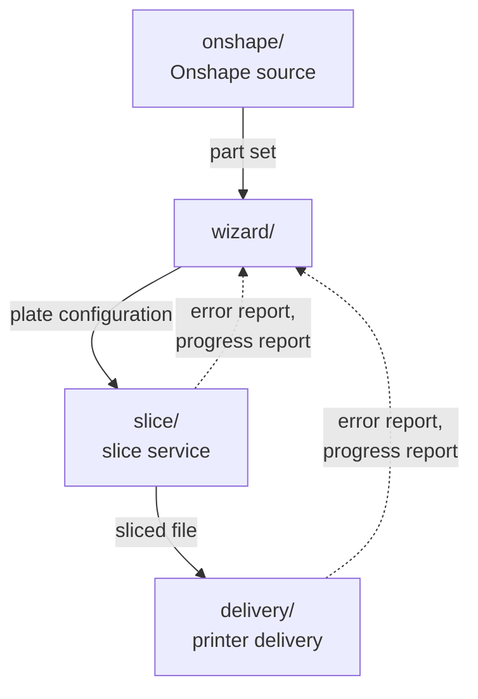

# PenguinSlicer: plan

First written Thu 2026-11-19, Pacific time, from a planning session with the owner, and
kept to the present state (last revised Fri 2026-11-20 12:20 PT). It says where the
project is and what is planned. It replaces the order of work in the
[print path restart notes](https://github.com/chondl/PenguinCAM-notes/blob/main/handoffs/2026-10-11-print-path-restart-notes.md)
(their sections 6 and 8) and the milestones of the
[print roadmap](https://github.com/chondl/PenguinCAM-notes/blob/main/plans/2026-10-09-print-roadmap.md).
Those two files remain the account of the first attempt and of the owner's feedback on
it. The state of each component in detail is in
[the session summary](../handoffs/2026-11-20-penguin-slicer-session-summary.md),
section 4.

## 1. Short answer

Section 2 defines the terms. The one to know first: the **print branch** is
`feature/onshape-test-bed` in PenguinCAM, which holds the first attempt at 3D printing.

- **The 3D printing work lives in its own repository**, PenguinSlicer
  (https://github.com/6238/PenguinSlicer, public), built on PenguinCAM's stack so that it
  can return to PenguinCAM later. Every change reaches `main` through a pull request.
- **The repository holds four components that are developed as separate projects:** the
  slice service, printer delivery, the wizard and the Onshape source. Each one runs and is
  tested without the other three, and each has one interface by default.
- **The initial work has three pieces.** Where each stands:
  1. the slice service: ported, hardened, and brought into line with the owner's feedback
     of Fri 11-20;
  2. printer delivery: ported and hardened, its small open items fixed; still to come are
     the session at the real printer and daemon telemetry (section 7.3);
  3. the wizard mockup: in its third version, for the owner to try (section 8).
- The changes of Fri 11-20 are on `main` (pull requests 4 and 5).
- **The wizard is the big unknown.** Its requirements come from the owner's reactions to
  the mockup. Nothing of the wizard is built before that.
- **Planning stops there on purpose.** When the initial work is done and the owner has
  tried the mockup, the next plan is made from what was learned. Section 10 lists the
  known future work, taking Orca 2.5.x among it.

This plan gives no time estimates and no priorities. Where it orders work, the order is by
risk, riskiest first, with what makes each item risky.

## 2. Terms

Each term means one thing everywhere in this plan.

| Term | Meaning |
|---|---|
| **Orca** | Orca Slicer, the open-source slicer that turns models into printer instructions. It runs on the server with no window. Version 2.4.2 is the one in use. |
| **H2S** | The team's Bambu Lab H2S printer. |
| **print branch** | The branch `feature/onshape-test-bed` in `6238/PenguinCAM`, which holds the first attempt at 3D printing. It is now only a source to port from. |
| **PenguinSlicer** | The repository and the product in it. |
| **component** | One of the four parts of PenguinSlicer, each developed as its own project: the slice service, printer delivery, the wizard, the Onshape source. |
| **part, instance, plate** | A part is one distinct solid to print. An instance is one placement of a part on the plate; a part printed once has one instance. The plate is the printer's bed and everything on it. |
| **part set** | The models to print: one STL file per part, each with a name and a quantity. |
| **plate configuration** | What to slice: the parts, where each instance sits on the plate and how it is turned, and the chosen profiles and settings. It is a description, not work. |
| **slice service** | The component that takes a plate configuration, runs Orca and returns a sliced file. |
| **slice job** | The work of slicing one plate configuration in the slice service, from its arrival to its end. |
| **slice service process** | One running slice service: one process, which holds its slice jobs in its memory. |
| **HTTP interface** | The slice service's web routes, its one interface. |
| **plate 3MF** | The 3MF model file the slice service builds from a plate configuration and hands to Orca, with every instance already in its place. |
| **plate limits** | The caps on what one plate configuration may hold: the instances, the different parts, the triangles and bytes of one part, and each part's size against the plate and the printer. |
| **reference plates** | The plates the team must be able to print. They decide how large a plate the slice service must handle (section 6). |
| **memory watchdog** | The slice service's thread that measures Orca's memory while it runs and stops Orca past a ceiling. |
| **printer delivery** | The component that sends a sliced file to a printer and reports how the print goes. It has two halves, the relay and the daemon. |
| **relay** | The half of printer delivery that runs on the server: it holds delivery jobs for the daemon and the printer's last status. |
| **daemon** | The half of printer delivery that runs on the daemon's computer. It connects outward to the relay and talks to the printer on the local network. |
| **the daemon's computer** | The computer next to the printer, on the printer's network, that runs the daemon. |
| **daemon telemetry** | Messages the daemon sends about its own state to the server, where they are kept (section 7.3). |
| **delivery job** | One sliced file on its way to one printer, from the moment it is sent until the print ends. |
| **start command** | The message the daemon sends the printer to begin printing an uploaded file. |
| **status document** | One message of the printer's own report of its state. |
| **recording** | A file of status documents saved from the real printer by the daemon's `record` command. |
| **simulated printer** | A program that answers the daemon as an H2S would, over real network connections, from scripted status documents. |
| **pairing code** | The code a daemon shows when it is set up. A team enters it in its configuration, and it tells the relay which daemon, and so which printer, belongs to that team. |
| **team configuration** | The settings file each team keeps in its Onshape account, which PenguinCAM reads at sign-in. |
| **wizard** | The step-by-step user interface (Setup step, Parts step, Layout step, Preview step), designed for Onshape's right panel, about 320 px wide. |
| **Onshape source** | The component that turns a student's selection in Onshape into a part set. |
| **mockup** | A click-through imitation of the wizard that runs entirely in the browser, with no server and no real slicing. |
| **sliced file** | The `.gcode.3mf` file Orca writes, which the printer runs. |
| **error report** | The one shape in which every component reports a failure (section 5.1). |
| **progress report** | The one shape in which every component reports how far a long job has got (section 5.2). |
| **profile** | One of Orca's named bundles of settings for a printer, a filament or a printing process. The profile catalog is the set of them the slice service offers. |
| **upstream** | Open-source code written by others that a component rests on: Orca for the slice service, the `bambulabs_api` library for the daemon. |
| **upstream check** | A component's suite of tests that pins every behaviour of its upstream code the component relies on (`make test-upstream`); the upgrade command runs it. |
| **port** | Bringing code and its tests from the print branch into PenguinSlicer and making them pass there, without changing behaviour. |
| **hardening** | Bringing a ported component up to the standing requirements of section 5, plus the changes listed for that component in section 6 or 7. |
| **fast suite** | A component's everyday tests: no real Orca, no real printer, no real waiting. |
| **review round** | One check of a component by a fresh reviewer that never sees the builder's own account. |
| **ledger** | The coordinating session's running account of a build run: every dispatch, return and ruling. |

## 3. The approach

The print branch grew to 412 changed files against PenguinCAM's `main` (about 9,000 lines
of program code, 6,000 of tests, most of the rest Orca's profile data). The parts of it
that turn a plate into a sliced file and send it to a printer work: Orca slices on the
server, and the team's H2S printed a part through the relay on Fri 10-09. Its user
interface was built before its requirements were known and lacked what matters: a Layout
step in 3D with direct manipulation, a preview like Orca's, real progress, and errors a
student can act on. The owner's feedback of Sun 10-11 is quoted in the
[print path restart notes](https://github.com/chondl/PenguinCAM-notes/blob/main/handoffs/2026-10-11-print-path-restart-notes.md),
section 6.

Three premises shape this plan:

1. **The four components are largely independent.** The wizard produces a plate
   configuration without ever running Orca. The slice service needs nothing from Onshape.
   Printer delivery needs only a sliced file. So each can be built and proven alone.
2. **Three of the four are mostly solved.** The slice service and printer delivery needed
   porting and hardening, not invention. The Onshape source is also a solved problem:
   PenguinCAM's CNC wizard already runs in Onshape's panel, in production, and gathers
   several selected parts into one job, with a selection request that stays armed while
   parts are clicked. The print branch holds the printing version of that code (selecting
   parts in a Part Studio or an Assembly and exporting each as an STL file); it has never
   run against real Onshape. What stays unverified until the Onshape source is taken up is
   small: the answer Onshape gives when whole bodies are selected where CNC selects faces,
   the STL export where CNC exports a drawing, and picking parts inside an assembly. Those
   are checked by hand in Onshape at that point (section 10).
3. **The risk is in the wizard's requirements,** so that is where the owner's attention
   goes, through a mockup.

## 4. The repository

PenguinSlicer is https://github.com/6238/PenguinSlicer, public. One repository, never
several. Each component has its own folder, its own tests and its own guide (its
`README.md`).

| Folder | Holds | State |
|---|---|---|
| `contracts/` | The definitions of the plate configuration, sliced file, error report and progress report, each with example files ([contracts/README.md](../../contracts/README.md)); the part set is not written yet | Written |
| `slice/` | The slice service: the code that runs Orca, the profile catalog, the writer of the plate 3MF, the job pool, the HTTP interface, its tests and its scripts ([guide](../../slice/README.md)) | Ported and hardened |
| `delivery/` | Printer delivery: `relay/`, `daemon/` and the simulated printer ([guide](../../delivery/README.md)) | Ported and hardened |
| `wizard/` | The wizard | Empty until the wizard's requirements exist |
| `onshape/` | The Onshape source | Empty |
| `docs/` | Specs, plans, research, the mockup (`docs/mockups/print-wizard/`), session summaries, and the ledger, briefs and result files of each build run under `docs/orchestration/` | Kept with the code |

Rules that keep the components separate:

- A component depends only on `contracts/`, never on another component's code.
- **One interface per component is the default, not a hard rule.** The slice service has
  one, its HTTP interface; there is no command for slicing by hand, and for testing and
  development an agent writes throwaway scripts against its routes. The wizard may exist
  both inside Onshape and as a page reached directly from a browser, and the Onshape
  source may likewise have two homes.
- A component can be exercised through its interface with the example files in
  `contracts/`: submit the example plate configuration to the slice service's HTTP
  interface; deliver a sliced file to the simulated printer.
- In production the components may run inside one server and call each other directly.
  The files in `contracts/` are seams for development and testing, not a deployment.
- Code was ported by copying files, with a commit message naming the print branch commit
  they came from. The print branch stays as it is.

**How changes reach `main`.** Every change goes on a branch and reaches `main` through a
pull request; nothing is committed or pushed to `main` directly. A change to a component
is checked by someone who did not write it before its pull request is merged.

The stack is PenguinCAM's: Python managed with `uv`, Flask where a component needs HTTP,
plain JavaScript in the browser. The repository's notes for agents are in
[CLAUDE.md](../../CLAUDE.md).

## 5. Standing requirements

These hold for every component. A component is not done until each is shown by a test.
The owner's reason: the quality of real software is decided by how it handles the unusual
case.

### 5.1 Errors

Every failure is an error report with five parts:

- a stable code, so support and tests can name it;
- what happened, in a sentence a student understands;
- where: the part, the instance and the height or step, when that is known;
- what to do next, and which single action fixes it when one does;
- the underlying detail (Orca's own words, the printer's status), kept for the server log
  and never thrown away.

Each error report has a test that produces it on purpose.

### 5.2 Progress

Every job that can take more than a few seconds sends progress reports from start to
finish: the stage it is in, how far through it is when that can be known, the time taken
so far and the time expected. A client that connects late gets the current progress
report at once.

### 5.3 Cancellation

Every long job can be cancelled at any moment. Cancelling stops the work itself (the Orca
process, the upload), not only the reporting of it, and ends in a state from which the
same work can be started again.

### 5.4 Cleanup

When a client goes away without cancelling, the component notices, waits a stated time in
case the client returns, then stops the work and removes its files. Nothing is left
running and nothing accumulates on disk. A restart of the component leaves no job in an
unknown state.

### 5.5 Supportable from the server

Every transition of a job writes one log line with enough in it to diagnose a failure
without asking the team for anything. No secret appears in a log.

### 5.6 Upstream code

- **Taking a new version is routine.** Each upstream's version is pinned in one place,
  one command moves the pin and regenerates what is derived from it, and the upstream
  check pins down every behaviour of that code the component relies on, so a new version
  that breaks an assumption fails a test that says which.
- **Small patches are allowed** where upstream reports an error or progress too poorly to
  meet sections 5.1 and 5.2, never for a new feature. A patch is kept as a file against a
  named version, with a note saying what gap it closes, and the upgrade command applies
  it. Patching Orca means building it from source, so each such patch is the owner's
  decision. There is no patch to Orca and none to the printer library.

### 5.7 Tests

- The fast suite uses no real Orca, no real printer, no real waiting and no fixed ports,
  finishes in seconds, and passes in any order, any number of times. A test that fails
  once is fixed at its cause, never retried or skipped.
- Every refusal, limit, timeout and state transition has a test that reaches it and
  asserts what the caller sees. Branch coverage does not fall.
- A change is reviewed by a fresh reviewer, who reruns the suites in random order, breaks
  the changed checks on purpose and tries hostile inputs.

## 6. Work 1: the slice service

**State: ported, hardened, and brought into line with the owner's feedback of Fri 11-20.**
The guide, [slice/README.md](../../slice/README.md), describes it in full.

- **One interface.** The HTTP interface takes a plate configuration and its STL files,
  sends progress reports, takes a cancel, and returns the sliced file from one route and
  its summary, as JSON, from another. `serve` starts it. One slice service process holds
  its slice jobs; several may run, and a client keeps talking to the slice service
  process that accepted its slice job.
- **Errors.** Every part is checked before Orca runs, and every failure is an error
  report. Orca's reason for a failed slice is read from the result file Orca writes and,
  when Orca gives only its general failure, from Orca's debug log, with the warnings found
  there labelled as possibly unrelated. One reason Orca 2.4.2 never writes to any file
  (a part whose first layer is empty, such as a needle 0.3 mm across) gets only the
  general sentence; only a patch to Orca could surface it.
- **Progress, cancellation, cleanup.** Orca's own stages and percentage are the progress.
  A cancel, a timeout or a memory watchdog stop leaves no Orca process and no files.
- **Memory.** The memory watchdog stops Orca past a ceiling, a setting, 900 MB by default;
  the memory estimate from the parts' volume is only logged. The hosting choice changes
  the ceiling later.
- **The reference plates** are five: (1) a typical FRC mechanism plate of several
  different functional parts; (2) a full plate of small instances; (3) one large organic
  part; (4) a plate of two or three large organic parts; (5) one of these with supports
  on; and a sixth, 100 instances of a spacer for a 3/8 inch hex shaft, 1/8 inch thick, in
  a 10 by 10 grid.
- **Plate limits.** Up to 150 instances (100 spacers peak near half the ceiling) of up to
  25 different parts (a bound on the upload, not a measured limit), with limits on the
  triangles and bytes of one part; no limit on the triangles of the whole plate, where the
  memory watchdog decides.
- **Upstream.** The pin stays at Orca 2.4.2. `make -C slice upgrade-orca VERSION=x.y.z`
  installs a release beside the old one, moves the pin, regenerates the profile catalog
  and runs the upstream check, which also verifies the reading of Orca's debug log.

The changes of Fri 11-20 to the slice service and printer delivery are merged.

## 7. Work 2: printer delivery

### 7.1 State

**Ported and hardened, and its small open items fixed.** The guide,
[delivery/README.md](../../delivery/README.md), describes it in full. The relay holds
delivery jobs and pairs with a daemon through the team's pairing code, which the caller
gives it. The daemon fetches the sliced file, uploads it to the printer and starts it only
when whole, fresh status documents say the printer is free, then holds the printer until evidence
settles what became of the start. The caller follows progress reports through the whole
delivery and the print. Both faults of the first hardware test of Fri 10-09, described in
the
[first hardware test notes](https://github.com/chondl/PenguinCAM-notes/blob/main/handoffs/2026-10-09-printer-relay-first-hardware-test.md),
are fixed.

The daemon is a plain Python program, started by hand, that runs wherever Python does,
with no installer, no running as a service and no operating-system protection of its
stored secrets. It stays in Python for now; later it moves to a technology that makes one
lightweight executable, most likely Rust or Go, checked against the simulated printer and
the tests built here. For the first real testing the daemon's computer will likely be the
owner's Windows computer on the printer's network, which is always on. The daemon accepts
any certificate the printer presents.

**The timed rule after a start command** is as built: after 5 minutes of whole, fresh
status documents with no print shown, the printer is taken not to have started the file; a daemon that
could not watch the start takes an end shown by the printer as this print's end once the
command is 5 minutes old. Each is wrong only if the H2S is slower than that or keeps the
previous print's end under the new name that long. The session at the real printer
measures both.

The simulated printer's status sequences are invented from the one status document the
first hardware test saved, taken at 0 percent.

### 7.2 The session at the real printer

One session at the H2S, with the daemon's `record` command saving every status document,
gives the simulated printer real sequences (a whole print, a print stopped on the screen,
a print paused by hand) and measures what the timed rule depends on: how long the H2S
takes to show a print after a start command, and how long the previous print's end stays.
The checklist is the guide's section "Before trusting it at the H2S", with a checklist
for the daemon's computer in the session summary, section 2.4. A print started by the
daemon needs a relay the daemon can reach; an agent prepares that as a written walk and
tries it against the simulated printer first. One confirmation on the real H2S closes
this work.

### 7.3 Daemon telemetry

**Part of the initial work on printer delivery, not yet designed or built.** A protocol
by which the daemon sends messages about its own state back to the server, from the
moment it starts, where they are kept. It matters because the daemon runs on a wide
variety of hardware and its problems are hard to foresee: a misconfigured network, what
the daemon's computer can and cannot do, the user interface, the daemon's computer going
to sleep or being overloaded, and the daemon timing out because its computer runs slowly. Telemetry lets a
mentor's broken setup be diagnosed from the server. It helps development now, and the
protocol is designed to be ported when the daemon moves to Rust or Go. It is new
behaviour on both halves, so it gets its own design before it is built. Today both
halves write structured log lines only.

## 8. Work 3: the wizard mockup

The mockup lets the owner go through the whole wizard, at panel width, before any of it is
built. It shows the four steps in the conventions of PenguinCAM's CNC wizard, the
capabilities the owner asked for on Sun 10-11, mocked progress for slicing and printing,
and a set of errors that can be triggered on purpose.

State: mockup version 3 is in
[docs/mockups/print-wizard](../mockups/print-wizard/index.html), with every design choice
and every fake listed beside it in [DECISIONS.md](../mockups/print-wizard/DECISIONS.md),
and uses the terms of section 2. Its questions for the owner are in the session summary,
section 2.3.

The owner's direction for it: keep the CNC wizard's conventions unless additive
manufacturing is distinctly different; make the common case short, since most prints use
one filament and one of a few profiles; keep every slicing setting reachable; bring over
capabilities from the two main views of Orca's desktop application: its Prepare tab, where
parts are arranged on the plate, and its Preview tab, where the sliced result is inspected
layer by layer.

The mockup is thrown away afterwards. What it produces is the owner's reactions, written
up as the wizard's requirements. That document is the input to the next plan.

## 9. The remaining initial work, by risk

Riskiest first, with what makes each risky. This is not a schedule and not a statement of
priority.

| Work | What makes it risky |
|---|---|
| **The session at the real printer** (section 7.2) | Feasibility: everything printer delivery knows about the H2S beyond one status document is invented; the upload's TLS version, the file listing format and the first status documents after a start command can each break delivery, and the timed rule hangs on its timings. Resources: the owner, the printer and the daemon's computer together, and a relay the daemon can reach. |
| **The wizard's requirements, from the owner's reactions to the mockup** (section 8) | Feasibility: the requirements are still being discovered; direct manipulation in 3D at 320 px is the least proven part, and how wide Onshape lets the panel be dragged is unknown. Resources: the owner's time with the mockup. |
| **Daemon telemetry** (section 7.3) | Feasibility: what it must report is what is hard to foresee on hardware nobody controls, and the protocol must survive the daemon's move to Rust or Go. Resources: new design on both halves and on the server that keeps the messages. |
| **The last fix round and the pull request of the changes of Fri 11-20** | Low in feasibility: the third review round of each component judged its change fit to merge; the two low defects of each are a test, a guide's figure, a log line and a name. Resources: one fix round of the slice service, then the pull request. |

## 10. Known future work

Not part of the initial work, and not in any order.

| Item | Why it waits, or what it needs |
|---|---|
| **Taking Orca 2.5.x** | Orca 2.5.x packs the Bambu Lab profiles in one file, `BBL.opc`, that the script building the profile catalog cannot read yet. The pin stays at 2.4.2 until it can; the size of the work is unknown until the format is examined. |
| Building the wizard | Its requirements come from the mockup. |
| The Onshape source, and with it the checks against real Onshape | It feeds the wizard's Parts step. When the wizard exists, it is ported from the print branch and brought into line with PenguinCAM's CNC integration. |
| Using printing without Onshape | That is the wizard's own file upload, once the wizard is built. The print branch's "local mode" stays on the print branch. |
| Joining the components, and returning to PenguinCAM | It follows a working whole. |
| Choosing the hosting | It follows measurements of real team plates on the candidate host; the slice service needs about 400 MB of its own beside Orca's ceiling (a slice service process still grows about 4 MB a plate), and a client must keep talking to one slice service process. |
| Moving the daemon to Rust or Go, as one executable | Checked against the simulated printer, the tests built here and the telemetry protocol. |
| Printer adapters for other brands, the preview image on the printer's screen, file names that say which part and when | Each is new design, described in the [first hardware test notes](https://github.com/chondl/PenguinCAM-notes/blob/main/handoffs/2026-10-09-printer-relay-first-hardware-test.md). |
| The Onshape test bed on the print branch (recorded and replayed Onshape sessions) | It serves the Onshape source and stays on the print branch until that is planned. |
