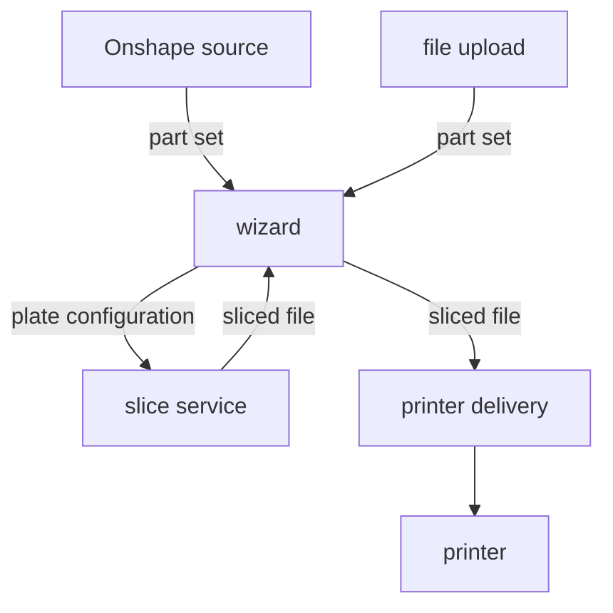

# PenguinSlicer: the plan

Written Tue 2026-11-24, Pacific time, from the owner's plan of attack of that evening. It
says what PenguinSlicer is, where each component stands, and the five phases of work that
come next, in the owner's order. It is kept to the present state: when something is
decided, the text says the result. It gives no time estimates. Where something is open, it
says so.

## Short answer

- **PenguinSlicer** (https://github.com/6238/PenguinSlicer, public, MIT) takes parts, lays
  them out on a printer's plate, slices them with Orca on a server and sends the sliced
  file to the printer. It holds four components, each its own project, which depend only
  on the shapes in [contracts/](../../contracts/README.md).
- **Built and tested:** the slice service (complete for one machine) and printer delivery
  (tested against the simulated printer only, never against the real H2S). **Not
  started:** the wizard's real code and the Onshape source. The wizard exists as a mockup,
  version 5 on `main` and version 6 in progress.
- **The phases, in the owner's order:** (1) finish the mockup and write the wizard's spec;
  (2) the wizard outside Onshape, on one machine, with the slice service, ending in a
  downloaded sliced file; (3) the same hosted on AWS; (4) the wizard inside Onshape, with
  the Onshape source; (5) the real printer, with daemon telemetry.
- **Each phase that builds something starts with a design spec agreed with the owner.**
  This plan names what each phase must settle; it decides none of it.

## Terms

Each term means one thing everywhere in this plan, in the components' guides and in the
code.

| Term | Meaning |
|---|---|
| **PenguinSlicer** | The repository and the product in it. |
| **user** | The person using PenguinSlicer to print. |
| **administrator** | Whoever edits the configuration. |
| **configuration** | The settings an administrator sets once for everyone who uses one PenguinSlicer: the printers, the filaments with each filament's own profiles, the pairing code, and whether parts uploaded from files are read in inches or millimetres. Where it is kept is open in every phase. |
| **component** | One of the four parts of PenguinSlicer, each developed as its own project: the slice service, printer delivery, the wizard, the Onshape source. |
| **guide** | A component's `README.md`. |
| **Orca** | Orca Slicer, the open-source slicer that turns models into printer instructions. It runs on the server with no window. Version 2.4.2 is the one in use. |
| **H2S** | The Bambu Lab H2S printer of FRC Team 6238, the Popcorn Penguins, which own the repository. |
| **part, instance, plate** | A part is one distinct solid to print. An instance is one placement of a part on the plate; a part printed once has one instance. The plate is the printer's bed and everything on it. |
| **part set** | The parts to print, one STL file each with a name and a quantity, as the Onshape source or a file upload hands them to the wizard. Its contract is not written yet. |
| **plate configuration** | What to slice: the parts, where each instance sits on the plate and how it is turned, and the chosen profiles and settings. It is a description, not work. |
| **profile** | One of Orca's named bundles of settings for a printer, a filament or a printing process. |
| **slice service** | The component that takes a plate configuration, runs Orca and returns a sliced file. |
| **HTTP interface** | The slice service's web routes, its one interface. |
| **slice job** | The work of slicing one plate configuration in the slice service, from its arrival to its end. |
| **slice service process** | One running slice service: one process, which holds its slice jobs in its memory. |
| **memory ceiling** | The most memory the slice service lets Orca use for one slice job, a setting, 2,000 MB by default. |
| **memory watchdog** | The slice service's thread that measures Orca's memory while it runs and stops Orca past the memory ceiling. |
| **sliced file** | The `.gcode.3mf` file Orca writes, which the printer runs. |
| **printer delivery** | The component that sends a sliced file to a printer and reports how the print goes. It has two halves, the relay and the daemon. |
| **relay** | The half of printer delivery that runs on the server: it holds delivery jobs for the daemon and the printer's last status. |
| **daemon** | The half of printer delivery that runs on the daemon's computer. It connects outward to the relay and talks to the printer on the local network. |
| **the daemon's computer** | The computer next to the printer, on the printer's network, that runs the daemon. |
| **caller** | The application that runs the relay and asks it to deliver sliced files: it signs users in, knows the pairing code and holds the sliced file. |
| **pairing code** | The code the daemon shows when it is set up. An administrator puts it in the configuration, and it tells the relay which daemon, and so which printer, a request may use. |
| **delivery job** | One sliced file on its way to one printer, from the moment it is sent until the print ends. |
| **start command** | The message the daemon sends the printer to begin printing an uploaded file. |
| **status document** | One message of the printer's own report of its state. |
| **simulated printer** | A program that answers the daemon as an H2S would, over real network connections, from scripted status documents. |
| **recording** | A file of status documents saved from the real printer by the daemon's `record` command. |
| **daemon telemetry** | Messages the daemon sends about its own state to the server, where they are kept. Not designed. |
| **wizard** | The step-by-step user interface: the Parts, Settings, Layout, Preview and Send steps. It works at 320 px, the width of Onshape's right panel, and lays out wider when the panel is dragged wider. |
| **mockup** | A click-through imitation of the wizard that runs entirely in the browser, with nothing real behind it. |
| **Onshape source** | The component that turns a user's selection in Onshape into a part set. |
| **error report** | The one shape in which every component reports a failure. |
| **progress report** | The one shape in which every component reports how far a long job has got. |
| **upstream** | Open-source code written by others that a component rests on: Orca for the slice service, the `bambulabs_api` library for the daemon. |
| **upstream check** | A component's suite of tests that pins every behaviour of its upstream code the component relies on (`make test-upstream`). |
| **fast suite** | A component's everyday tests (`make test`): no real Orca, no real printer, no real waiting. |
| **print branch** | The branch `feature/onshape-test-bed` in `6238/PenguinCAM`, which holds the first attempt at 3D printing. It is only a source to port from. |
| **phase** | One of the five steps of work in [The phases](#the-phases). |

## The repository

One repository, never several, built on PenguinCAM's stack (Python managed with `uv`,
Flask where a component needs HTTP, plain JavaScript in the browser) so that it can return
to PenguinCAM later.

- **[contracts/](../../contracts/README.md)** defines the shapes that pass between
  components (the plate configuration, the sliced file, the error report and the
  progress report), each with example files; the part set is not written yet.
- **The slice service**, in `slice/`, takes a plate configuration and its STL files through
  its HTTP interface, runs Orca under the memory watchdog and returns the sliced file and
  its summary ([its guide](../../slice/README.md)).
- **Printer delivery**, in `delivery/`, takes a sliced file from the caller and gets it
  printed: the relay on the server, the daemon on the daemon's computer, and the simulated
  printer for tests ([its guide](../../delivery/README.md)).
- **The wizard**, in `wizard/` (not yet created), is the user interface; its guide is to be
  written from the mockup in phase 1. The mockup is in
  [docs/mockups/print-wizard](../mockups/print-wizard/index.html), with every design
  choice in its [DECISIONS.md](../mockups/print-wizard/DECISIONS.md).
- **The Onshape source**, in `onshape/` (not yet created), will turn a selection in
  Onshape into a part set (phase 4).

In the diagram the wizard stands for the application around it: the sliced file goes to
printer delivery through the caller, which holds it.

Rules that keep the components separate:

- A component depends only on `contracts/`, never on another component's code.
- **One interface per component is the default, not a hard rule.** The slice service has
  one, its HTTP interface; there is no command for slicing by hand, and for testing an
  agent writes throwaway scripts against its routes. The wizard may exist both inside
  Onshape and as a page reached directly from a browser, and the Onshape source may
  likewise have two homes.
- Each component can be exercised through its interface with the example files in
  `contracts/examples/`.
- In production the components may run inside one server and call each other directly;
  the files in `contracts/` are seams for development and testing, not a deployment.
- Code from the print branch came over by copying files, with each commit naming the print
  branch commit it came from. The print branch stays as it is.

**How changes reach `main`.** Every change goes on a branch and reaches `main` through a
pull request; nothing is committed or pushed to `main` directly. A change to a component
is checked by someone who did not write it before it is merged. Notes for agents are in
[CLAUDE.md](../../CLAUDE.md).

## Standing requirements

These hold for every component. A component is not done until each is shown by a test.
The owner's reason: the quality of real software is decided by how it handles the unusual
case.

**Errors.** Every failure is an error report
([contracts/error-report.md](../../contracts/error-report.md)) with a stable code, what
happened in a sentence a user understands, where (the part, the instance, the height or
step, when known), what to do next and which single action fixes it when one does, and the
underlying detail (Orca's own words, the printer's status), kept for the server log and
never thrown away. Each code is listed in its component's guide and has a test that
produces it on purpose. People read errors, so an error says more than a screen does: what
went wrong and whatever is specific to this error and helps to understand or fix it (which
part, what about it, where to look), with no generic troubleshooting and nothing of
PenguinSlicer's internals.

**Words.** No sentence a user sees says "student", "mentor" or "team": PenguinSlicer is
used by people who are not FRC teams. Where a difference in permissions must be named, the
word is "administrator". The sentences the slice service and printer delivery write today
still use the old words; changing them is known future work.

**Progress.** Every job that can take more than a few seconds sends progress reports from
start to finish: the stage, how far through when that can be known (never invented), the
time taken so far and the time expected. A client that connects late gets the current
progress report at once.

**Cancellation.** Every long job can be cancelled at any moment. Cancelling stops the work
itself (the Orca process, the upload), not only the reporting of it, and ends in a state
from which the same work can be started again.

**Cleanup.** When a client goes away without cancelling, the component notices, waits a
stated time in case the client returns, then stops the work and removes its files.
Nothing is left running and nothing accumulates on disk. A restart leaves no job in an
unknown state.

**Supportable from the server.** Every transition of a job writes one log line with enough
in it to diagnose a failure without asking the user for anything. No secret appears in a
log.

**Upstream code.** Taking a new upstream version is routine: each version is pinned in one
place, one command moves the pin and regenerates what is derived from it, and the upstream
check fails, naming the assumption, when a new version breaks one. Small patches to
upstream are allowed only where it reports an error or progress too poorly to meet the
requirements above, never for a feature; each is a file against a named version with a
note, applied by the upgrade command. Patching Orca means building it from source, so
each such patch is the owner's decision. There is no patch to Orca and none to the printer
library.

**Tests.** The fast suite uses no real Orca, no real printer, no network beyond loopback,
no real waiting and no fixed ports, finishes in seconds, and passes in any order, any
number of times. A test that fails once is fixed at its cause, never retried, skipped or
given a longer timeout. Every refusal, limit, timeout and state transition has a test that
reaches it and asserts what the caller sees; branch coverage does not fall. Each test is
written first and seen to fail. A reviewer reruns the suites in random order, breaks the
changed checks on purpose and tries hostile inputs.

## Where things stand

On `main` after pull request 12 (Sat 2026-11-21):

- **The slice service** is ported from the print branch, brought up to the standing
  requirements, and measured on eight real parts of the Popcorn Penguins' robot. Its state
  is in its guide, [Where it stands](../../slice/README.md#where-it-stands).
- **Printer delivery** is ported and brought up to the standing requirements, and tested
  against the simulated printer only. Its state is in its guide,
  [Where it stands](../../delivery/README.md#where-it-stands).
- **The mockup** is at version 5; version 6, built from the owner's review of version 5 on
  Tue 2026-11-24, is in progress. Its design and its open questions are in
  [DECISIONS.md](../mockups/print-wizard/DECISIONS.md).
- **The wizard and the Onshape source** have no code. The print branch holds code for
  selecting parts in Onshape and exporting them as STL files that has never run against
  real Onshape.

## The phases

The order is the owner's. Each phase that builds something starts with a design spec
agreed with the owner, and a component's guide is updated as the phase changes it.

### Phase 1: finish the mockup

The owner reviews the Layout step, the one step not reviewed in the round of
Tue 2026-11-24, and then the wizard's spec is written as `wizard/README.md` from the
mockup and its [DECISIONS.md](../mockups/print-wizard/DECISIONS.md). The owner's
direction for the wizard stands: keep the conventions of PenguinCAM's CNC wizard and its
look unless additive manufacturing is distinctly different; make the common case short,
since most prints use one filament and one of a few profiles; keep every slicing setting
reachable; and bring over what is needed from Orca's Prepare tab (arranging parts on the
plate) and Preview tab (inspecting the sliced result layer by layer). The mockup is thrown
away once the spec exists.

- **Done when** the owner has reviewed every step of the mockup and has agreed
  `wizard/README.md`.
- **Components:** the wizard (its mockup and its spec). The spec also says what the
  wizard needs from the slice service and from printer delivery that they do not provide;
  [DECISIONS.md](../mockups/print-wizard/DECISIONS.md) lists those needs today.
- **Risks:** the Layout step is the least proven part of the wizard: placing instances by
  direct manipulation in 3D at 320 px. The mockup's laying of parts on a face, its
  orientation and its arranging were measured only on the mockup's own generated parts.
  Orca's code for orienting and arranging cannot be taken over (Orca is AGPL; PenguinSlicer
  is MIT), so the wizard's are written fresh.

### Phase 2: the wizard outside Onshape, on one machine

The wizard's real code, opened directly in a browser (not inside Onshape). The user adds
parts from STL files, and the wizard talks to the slice service running on the same
machine. The user downloads the sliced file. No printer.

- **Done when** a person on one machine opens the wizard in a browser, adds parts from STL
  files, lays them out, slices them through the slice service on that machine, inspects
  the preview and downloads the sliced file.
- **Components:** the wizard (built for the first time), the slice service (used through
  its HTTP interface, extended where the spec needs it), and `contracts/` (the part set,
  for parts from files).
- **What it needs from the slice service, each open until the phase's spec settles it:**
  - Settings. The HTTP interface takes four overrides (infill, walls, supports, brim), each
    with listed values; the mockup's advanced mode shows every setting of the process
    profile.
  - Profiles per filament. The configuration lists each filament's own profiles; the
    wizard needs the catalog's names for its menus, and where it reads them from is open.
  - Units. The plate configuration takes STL files in millimetres, and a file upload is
    read in inches unless the configuration says millimetres; where the scaling happens
    (the wizard, or a field of the plate configuration) is open.
  - The preview. The Preview step draws the sliced result layer by layer. The slice
    service returns the sliced file and a summary, not toolpaths, and the heaviest real
    plate measured has about a million lines of G-code (an 8.8 MB sliced file).
  - Coming back. A page that has lost its state finds its running or finished slice job
    and plate configuration; the HTTP interface offers no way to find a slice job except
    by its id.
  - The browser. The HTTP interface sends no cross-origin headers, so a wizard served from
    another address cannot call it; how the wizard and the slice service share an address
    is open.
- **Risks:** feasibility of the preview in a browser at that size, and of the Layout step
  on real parts (exported parts with tens of thousands of corners may need a faster hull
  for laying a part on a face); resources: the wizard is the largest piece of building
  left.

### Phase 3: the same on AWS

The slice service and the wizard hosted on AWS. Nothing about hosting has been designed.

- **Done when** a person on another network opens the wizard at its AWS address, uploads
  parts, slices them through the slice service on AWS and downloads the sliced file.
- **Components:** the slice service and the wizard, and the hosting itself, which is new.
- **Risks:** resources: the memory a slice needs is several times what small hosts offer,
  and only one Orca runs per slice service process, so cost grows with the number of slices
  at once; feasibility: the slice service process holds its slice jobs in memory, so the
  host must keep a client on one process. Orca's install script supports Linux x86_64,
  Linux aarch64 and macOS arm64, and every measurement so far is from aarch64 Linux. The
  memory and time estimates the slice service logs are rough and were never refitted on a
  candidate host.

The questions the phase's design session must answer, none of them answered here:

- Which AWS service runs the slice service, and which serves the wizard.
- Memory per slice job and per slice service process. A slice peaks at 1 to 2 GB; the
  slice service's guide sizes a host at 3.5 GB for one slice service process with the
  default memory ceiling (Orca's worst measured case, about 2,500 MB, beside the slice
  service's own 400 MB), measured on an aarch64 Linux machine
  ([Sizing the host](../../slice/README.md)).
- How many slice jobs run at once. A slice service process runs one Orca at a time and
  queues two more; a client must keep talking to the slice service process that accepted
  its slice job, so a server with several workers behind one address loses slice jobs.
- Who may use a page reached from the open internet, and how they sign in.
- Where uploaded parts and sliced files are stored and how long they live. Today a
  finished slice job keeps its uploads and sliced file for an hour, in the slice service
  process's work folder; the disk this takes was never measured.
- Logs and telemetry: where the slice service's log lines go and how support reads them.
- Cost.
- How a new Orca version is rolled out to the hosted slice service.

### Phase 4: inside Onshape

The wizard in Onshape's right panel; the Onshape source, which picks parts, exports them
and reads the document's units; and the Onshape app registration.

- **Done when** a user opens PenguinSlicer in Onshape's right panel in a real Part Studio
  and a real Assembly, picks parts there, sees them arrive in the Parts step in the
  document's units, and slices and downloads them.
- **Components:** the Onshape source (built for the first time, ported from the print
  branch and brought into line with PenguinCAM's CNC integration), the wizard (its Onshape
  home), and `contracts/` (the part set from Onshape).
- **Units from Onshape:** the units of the Assembly or Part Studio; failing that, the
  part's own units or Onshape's default units, whichever Onshape's API gives.
- **Risks:** low in feasibility for the mechanism: PenguinCAM's CNC wizard already runs in
  Onshape's panel in production and gathers several selected parts into one job. What only
  real Onshape can settle: how wide a user can drag the right panel, whether full screen
  works from inside it, Onshape's mouse, trackpad and touch gestures, selecting whole
  bodies where the CNC wizard selects faces, exporting STL where it exports a drawing,
  picking parts inside an assembly, and the speed of the wizard's orienting and arranging
  in Chrome inside Onshape on real parts. Resources: an Onshape app registration, its
  OAuth settings and where its secrets live, which the phase's spec settles. The print
  branch's Onshape test bed (recorded and replayed Onshape sessions) is there to port if
  the spec wants it.

### Phase 5: the real printer

Printer delivery, built and tested against the simulated printer only, sends to the real
H2S. Daemon telemetry is part of this phase and is not designed.

- **Done when** a user sends a sliced file from the wizard's Send step and it prints on the
  H2S through the relay and the daemon, the printer-status icon follows it to the end, and
  every line of the hardware checklist in printer delivery's guide is answered.
- **Components:** printer delivery (the relay on the server, the daemon on the daemon's
  computer, the simulated printer replaced by recordings), the wizard (the Send step and the
  printer-status icon), and the application that is the relay's caller.
- **The session at the real printer.** One session at the H2S with the daemon's `record`
  command saving every status document gives the simulated printer real sequences and
  measures what the timed rule after a start command depends on. Its checklist is in
  printer delivery's guide,
  [Before trusting it at the H2S](../../delivery/README.md#before-trusting-it-at-the-h2s-what-a-hardware-session-must-confirm).
  A print started by the daemon needs a relay the daemon can reach; an agent prepares that
  as a written walk and tries it against the simulated printer first.
- **Daemon telemetry.** A protocol by which the daemon sends messages about its own state
  to the server from the moment it starts, where they are kept. It matters because the
  daemon runs on a wide variety of hardware and its problems are hard to foresee: a
  misconfigured network, what the daemon's computer can and cannot do, the user interface,
  the daemon's computer going to sleep or being overloaded, and the daemon timing out
  because its computer runs slowly. It lets an administrator's broken setup be diagnosed
  from the server, helps development now, and is designed to be ported when the daemon
  moves to Rust or Go. It is new behaviour on both halves and gets its own design. Today
  both halves write structured log lines only.
- **What the wizard needs from printer delivery:** who sent the print going on (the
  user's Onshape name), the end time of the last print, and a way for a page that has lost
  its state to find its user's delivery job; [DECISIONS.md](../mockups/print-wizard/DECISIONS.md)
  lists them, and none is provided today.
- **Risks:** feasibility: everything printer delivery knows about the H2S beyond one
  status document is invented; the upload's TLS version, the format of the printer's file
  listing and the first status documents after a start command can each break delivery
  outright, and the timed rule after a start command rests on timings nobody has measured.
  The daemon has never run on Windows, where the daemon's computer is likely to be. What
  telemetry must report is what is hard to foresee on hardware nobody controls. Resources:
  the owner, the printer and the daemon's computer together, a relay the daemon can reach,
  and new design on both halves and on the server that keeps telemetry.

## Known future work

Not part of the phases, and in no order.

| Item | Why it waits, or what it needs |
|---|---|
| **The words the components write** | The sentences of the slice service's and printer delivery's error and progress reports, and the relay's caller interface (its `Team` type), still say "student", "mentor" or "team". Changing them is its own change, with its tests. |
| **Taking Orca 2.5.x** | Orca 2.5.x packs the Bambu Lab profiles in one file, `BBL.opc`, that the script building the profile catalog cannot read yet. The pin stays at 2.4.2 until it can; the size of the work is unknown until the format is examined. |
| **Moving the daemon to Rust or Go**, as one lightweight executable | Checked against the simulated printer, the tests built here and the telemetry protocol. |
| **Joining the components, and returning to PenguinCAM** | It follows a working whole. |
| **Printer adapters for other brands, the preview image on the printer's screen, file names that say which part and when** | Each is new design, described in the [first hardware test notes](https://github.com/chondl/PenguinCAM-notes/blob/main/handoffs/2026-10-09-printer-relay-first-hardware-test.md). |

The first attempt, its order of work and the owner's feedback on it are in the
[print path restart notes](https://github.com/chondl/PenguinCAM-notes/blob/main/handoffs/2026-10-11-print-path-restart-notes.md)
and the [print roadmap](https://github.com/chondl/PenguinCAM-notes/blob/main/plans/2026-10-09-print-roadmap.md)
in the notes repository; this plan replaces their order of work.
