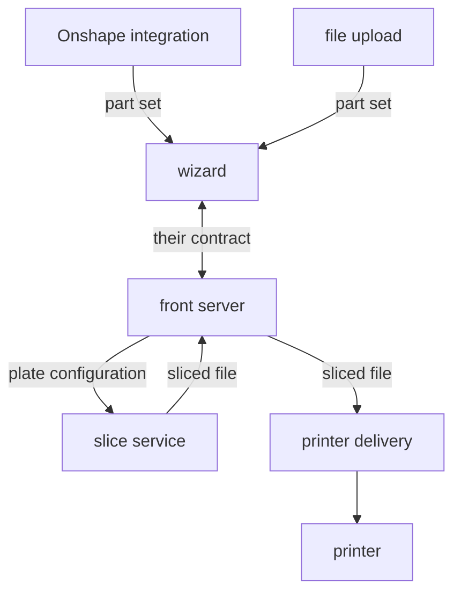

# PenguinSlicer: the plan

Written Tue 2026-11-24, Pacific time, from the owner's plan of attack of that evening, and
revised Thu 2026-11-26, to bring it into line with the approved hosted architecture, and
Fri 2026-11-27, with the owner's decisions of that day. It says what PenguinSlicer is,
where each component stands, and the five phases of work that come next, in the owner's
order. It is kept to the present state: when something is decided, the text says the
result. It gives no time estimates. Where something is open, it says so.

## Short answer

- **PenguinSlicer** (https://github.com/6238/PenguinSlicer, public, MIT) takes parts, lays
  them out on a printer's plate, slices them with Orca on a server and sends the sliced
  file to the printer. It holds five components, each its own project, which depend only
  on the shapes in [contracts/](../../contracts/README.md).
- **Built and tested:** the slice service (built and tested for one slice service process)
  and printer delivery (tested against the simulated printer only, never against the real
  H2S). **Being built in phase 2:** the wizard (its build, the geometry of the Layout
  step, retrying and the panel as a whole; not yet the five steps' contents) and the front
  server. **Not started:** the Onshape integration. The wizard's mockup, version 8, which
  the owner accepted as the last version on Thu 2026-11-26, is kept as the reference for
  how the wizard looks.
- **How the components fit together when hosted is designed** and approved by the owner
  (Thu 2026-11-26): it is in [the architecture](../architecture.md). Each component's guide
  says what that design asks of it and what of that is built.
- **The phases, in the owner's order:** (1) the wizard's guide, which is written; (2) the
  wizard and the front server outside Onshape, on one machine, with the slice service,
  ending in a downloaded sliced file; (3) the same hosted on Railway, with Onshape
  sign-in; (4) the wizard inside Onshape, with the Onshape integration; (5) the real
  printer, with daemon telemetry.
- **Phase 2 is built from the four guides, their details files and the contracts,**
  which are written in full. It opens with the two trials the wizard's guide names. Each
  later phase that builds something starts with a design spec agreed with the owner, for
  what the guides do not yet settle.

## The documents

| Document | Read after | Explains |
|---|---|---|
| This plan | Nothing | What PenguinSlicer is, its terms, the standing requirements, where each component stands, and the phases |
| [The architecture](../architecture.md) | This plan | The hosted design's terms, what runs where when hosted, where each piece of state lives, restarts and deploys, security, the log, and what is still to be confirmed |
| A component's guide: [slice](../../slice/README.md), [delivery](../../delivery/README.md), [wizard](../../wizard/README.md), [front](../../front/README.md) (the Onshape integration has none yet) | This plan | For the person who decides: what the component must do and why, how it does the hard parts, its limits and its security, what is built and what is to be built, and, in its last part, what is undecided or unmeasured |
| A component's details file: [slice](../../slice/README-details.md), [delivery](../../delivery/README-details.md), [wizard](../../wizard/README-details.md), [front](../../front/README-details.md) | Its guide | For the builder: everything someone building or changing the component needs, with the code-level names, every figure, rule, error code and required test |
| [contracts/](../../contracts/README.md) | This plan | The list of the contracts and the rules every contract follows |
| [The part set](../../contracts/part-set.md) | The contracts' list | The parts the Onshape integration or a file upload hands the wizard |
| [The wizard and the front server](../../contracts/wizard-front-server.md) | The architecture | Every request the wizard makes of the front server and every answer |
| [The configuration](../../contracts/configuration.md) | The contracts' list | What a group's configuration holds, with an example for writing one by hand |
| [The table of settings](../../contracts/settings-table.md) | The contracts' list | The settings the slice service accepts, with Orca's labels, groups and explanations, for the wizard's advanced mode |
| [The plate configuration](../../contracts/plate-configuration.md) | The contracts' list | What the wizard, through the front server, asks the slice service to slice |
| [The sliced file](../../contracts/sliced-file.md) | The contracts' list | What the slice service returns, and what printer delivery receives |
| [The slice service's HTTP interface](../../contracts/slice-http-interface.md) | The contracts' list | Every request the front server makes of the slice service and every answer |
| [The error report](../../contracts/error-report.md) and [the progress report](../../contracts/progress-report.md) | The contracts' list | The one shape of a failure and the one shape of progress, for every component |
| [The mockup](../mockups/print-wizard/index.html) and [its decisions](../mockups/print-wizard/DECISIONS.md) | This plan | The reference for how the wizard looks, kept in the repository; what the wizard does is in its guide |
| [The hosted architecture design](../specs/2026-11-25-hosted-architecture-design.md) | This plan | The record of what the owner approved on Thu 2026-11-26; not kept current, and needed only to check what was approved: nothing else depends on it |
| [The map of the hosted design's decisions](../orchestration/hosted-architecture/decision-map.md) | The hosted architecture design | Which living document holds each decision of the approved design, and of the owner's decisions since |
| The records of the owner's decisions of Fri 2026-11-27: [the day's decisions](../orchestration/guides/decisions-2026-11-27.md) and the reviews of the guides of [the wizard](../orchestration/guides/owner-review-wizard.md), [the front server](../orchestration/guides/owner-review-front.md), [the slice service](../orchestration/guides/owner-review-slice.md) and [printer delivery](../orchestration/guides/owner-review-delivery.md) | The decision map | Working records of what the owner decided; the guides state each decision as the design, so none is needed to build |

Research, reference material and the build records of each piece of work are under
`docs/research/`, `docs/reference/` and `docs/orchestration/`; none is needed to read the
documents above.

## Terms

Each term means one thing everywhere in this plan, in the components' guides and in the
code.

| Term | Meaning |
|---|---|
| **PenguinSlicer** | The repository and the product in it. |
| **user** | The person using PenguinSlicer to print. |
| **administrator** | Whoever edits the configuration and pairs the printer, which is every user of a group. |
| **configuration** | The settings one group shares: its filaments, each with its colour and its profiles; the printer's Orca profile; and the units of parts uploaded from files ([its contract](../../contracts/configuration.md)). |
| **component** | One of the five parts of PenguinSlicer, each developed as its own project: the slice service, printer delivery, the wizard, the front server, the Onshape integration. |
| **guide** | A component's `README.md`, written in plain words for the person who decides whether the component is being built correctly. |
| **Orca** | Orca Slicer, the open-source slicer that turns models into printer instructions, run on the server with no window. |
| **H2S** | The Bambu Lab H2S printer of FRC Team 6238, the Popcorn Penguins, which own the repository. |
| **part, instance, plate** | A part is one distinct solid to print. An instance is one placement of a part on the plate; a part printed once has one instance. The plate is the printer's bed and everything on it. |
| **part set** | The parts to print, each with its name, its quantity and its units, as the Onshape integration or a file upload hands them to the wizard. |
| **plate configuration** | What to slice: the parts, where each instance sits on the plate and how it is turned, and the chosen profiles and settings. It is a description, not work. |
| **profile** | One of Orca's named bundles of settings for a printer, a filament or a printing process. |
| **profile catalog** | The profiles a plate configuration may name, taken from the version of Orca the slice service uses. |
| **slice service** | The component that takes a plate configuration, runs Orca and returns a sliced file. |
| **HTTP interface** | The slice service's web routes, its one interface. |
| **slice job** | The work of slicing one plate configuration in the slice service, from its arrival to its end. |
| **slice service process** | One running slice service, which holds its slice jobs in its memory. |
| **memory ceiling** | The most memory the slice service lets Orca use for one slice job. |
| **memory watchdog** | The part of the slice service that measures Orca's memory while it runs and stops Orca past the memory ceiling. |
| **sliced file** | The file Orca writes, which the printer runs. |
| **printer delivery** | The component that sends a sliced file to a printer and reports how the print goes. It has two halves, the relay and the daemon. |
| **relay** | The half of printer delivery that runs inside its caller's process, handing delivery jobs to the daemon and holding the printer's last status. |
| **daemon** | The half of printer delivery that runs on the daemon's computer, calling out to the relay and talking to the printer on the local network. |
| **the daemon's computer** | The computer next to the printer, on the printer's network, that runs the daemon. |
| **caller** | The application that runs the relay and asks it to deliver sliced files: in PenguinSlicer, the front server. |
| **pairing code** | The code the daemon shows, which a user types into PenguinSlicer once to link the user's group to that daemon, and so to its printer. |
| **delivery job** | One sliced file on its way to one printer, from the moment it is sent until the print ends. |
| **start command** | The message the daemon sends the printer to begin printing an uploaded file. |
| **status document** | One message of the printer's own report of its state. |
| **simulated printer** | A program that answers the daemon as an H2S would, over real network connections, from scripted status documents. |
| **recording** | A file of status documents saved from the real printer by the daemon. |
| **daemon telemetry** | Messages the daemon sends about its own state to the relay, to be kept in the log. |
| **wizard** | The component that is the step-by-step user interface, the code in the browser: the Parts, Settings, Layout, Preview and Send steps. |
| **front server** | The component, and the one process, that the internet reaches: everything behind the wizard's address, standing between the browser and the slice service, the stores, Onshape and the relay. |
| **group** | The users who share one configuration and one printer: one Onshape company or classroom, or a user who belongs to none. |
| **advanced mode** | The wizard's view that fills the panel with every slicing setting. |
| **printer-status icon** | The small pill in the wizard's header that shows the printer's state. |
| **mockup** | A click-through imitation of the wizard that runs entirely in the browser, with nothing real behind it. |
| **Onshape integration** | The component that makes PenguinSlicer work inside Onshape: the Onshape app and its panel, the exchange with Onshape's page about the document, the element and what is selected, and the export of the selected parts with the document's units, handed to the wizard as a part set. |
| **error report** | The one shape in which every component reports a failure. |
| **progress report** | The one shape in which every component reports how far a long job has got. |
| **upstream** | Open-source code written by others that a component rests on: Orca for the slice service, a library for Bambu Lab printers for the daemon. |
| **upstream check** | A component's suite of tests that pins every behaviour of its upstream code the component relies on. |
| **fast suite** | A component's everyday tests, those that need no real Orca and no real printer. |
| **phase** | One of the five steps of work in [The phases](#the-phases). |

The terms that belong to the hosted design (the slice container, the state bucket, the log
bucket, the paired-printer record, the part store, the user key, the sync, the held wait
and others) are defined in [the architecture](../architecture.md#terms).

## The repository

One repository, never several, built on PenguinCAM's stack: Python managed with `uv`,
Flask where a component needs HTTP, plain JavaScript in the browser. Returning to
PenguinCAM is a possible direction, not decided, which the design must not close off:
that is why PenguinSlicer keeps PenguinCAM's stack and joins its components only through
contracts.

- **[contracts/](../../contracts/README.md)** defines the shapes that pass between
  components, each with example files: the part set, the requests between the wizard and
  the front server, the configuration, the table of settings, the plate configuration,
  the sliced file, the slice service's HTTP interface, the error report and the progress
  report. All are written; what phase 2 builds is marked in each as to be built.
- **The slice service**, in `slice/`, takes a plate configuration and its parts through
  its HTTP interface, runs Orca under the memory watchdog and returns the sliced file and
  its summary ([its guide](../../slice/README.md)).
- **Printer delivery**, in `delivery/`, takes a sliced file from the caller and gets it
  printed: the relay inside the caller's process, the daemon on the daemon's computer, and
  the simulated printer for tests ([its guide](../../delivery/README.md)).
- **The wizard**, in `wizard/`, is the user interface: the code in the browser. It is being
  built in phase 2: its build, the geometry of the Layout step, retrying and the panel as
  a whole exist, and the five steps' contents do not yet. [Its guide](../../wizard/README.md) is its design, every step included. The
  wizard looks the same as the mockup, which is kept in
  [docs/mockups/print-wizard](../mockups/print-wizard/index.html), with every design choice
  in its [DECISIONS.md](../mockups/print-wizard/DECISIONS.md), as the reference for the
  look. Its behaviour follows its guide, since the mockup's scripts were faked; and for the
  Layout and Preview steps, where the guide and the mockup are silent, Orca's behaviour is
  the model.
- **The front server**, in `front/`, is everything behind the wizard's address: it serves
  the wizard's pages, signs users in, calls the slice service, keeps sliced files and
  configurations, and from phase 5 runs the relay. None of it is built
  ([its guide](../../front/README.md)).
- **The Onshape integration**, in `onshape/` (not yet created), makes PenguinSlicer work
  inside Onshape (phase 4): the Onshape app and its panel; the exchange with Onshape's page
  that tells the wizard which document and element it is in and what is selected; and the
  export of the selected parts and the document's units, delivered to the wizard as a part
  set. Signing in is not part of it; that is the front server's.
- **The joined suite**, in `together/`, is not a component: it runs the real front server
  and the real slice service together on one machine, through their start commands and
  interfaces alone. Both halves are built: the first drives the front server's requests as
  the wizard makes them; the second drives the real wizard in a browser over the two
  servers; each has one walk with the real Orca ([its README](../../together/README.md)).

The wizard calls nothing but the front server. The sliced file goes from the slice
service to printer delivery through the front server, which keeps it as the relay's
caller. What runs where when hosted is in [the architecture](../architecture.md#the-shape).
How the Onshape integration divides between the browser and the server, and so how its
part set reaches the wizard, is settled by phase 4's design spec.

Rules that keep the components separate:

- A component depends only on `contracts/`, never on another component's code.
- **One interface per component is the default, not a hard rule.** The slice service has
  one, its HTTP interface; there is no command for slicing by hand, and for testing an
  agent writes throwaway scripts against its routes. The wizard may exist both inside
  Onshape and as a page reached directly from a browser, and the Onshape integration may
  likewise have two homes.
- Each component can be exercised through its interface with the example files in
  `contracts/examples/`.
- Hosted, the front server and the relay run in one process and the slice service in a
  container of its own ([the architecture](../architecture.md#the-shape)); the files in
  `contracts/` are the seams between components wherever they run.

**How changes reach `main`.** Every change goes on a branch and reaches `main` through a
pull request; nothing is committed or pushed to `main` directly. A change to a component
is checked by someone who did not write it before it is merged. Notes for agents are in
[CLAUDE.md](../../CLAUDE.md).

## Standing requirements

These hold for every component. A component is not done until each, apart from Words, is
shown by a test.
The owner's reason: the quality of real software is decided by how it handles the unusual
case.

**Errors.** Every failure is an error report
([contracts/error-report.md](../../contracts/error-report.md)) with a stable code, what
happened in a sentence a user understands, where (the part, the instance, the height or
step, when known), what to do next and which single action fixes it when one does, and the
underlying detail (Orca's own words, the printer's status), kept for the server log and
never thrown away. Each component writes the sentences of its own failures, and the wizard
shows them as they are; Orca's own words reach a user in only two failures of a slice,
quoted and marked as Orca's
([Orca's own sentence under Details](../../wizard/README.md#orcas-own-sentence-under-details)).
Each code is listed in its component's details file and has a test
that produces it on purpose. People read errors, so an error says more than a screen
does: what went wrong and whatever is specific to this error and helps to understand or
fix it (which part, what about it, where to look), with no generic troubleshooting and
nothing of PenguinSlicer's internals.

**Words.** No sentence a user sees says "student", "mentor" or "team": PenguinSlicer is
used by people who are not FRC teams. Where a difference in permissions must be named, the
word is "administrator". The sentences the slice service and printer delivery write today
still use the old words; changing them is known future work.

**Progress.** Every job that can take more than a few seconds sends progress reports from
start to finish: the stage, how far through when that can be known (never invented), the
time taken so far and the time expected. A client that connects late gets the current
progress report at once.

**Cancellation.** Every long job can be stopped at any moment by the component that runs
it. Stopping ends the work itself (the Orca process, the upload), not only the reporting
of it, and ends in a state from which the same work can be started again. A slice job is
not cancelled by hand: the wizard offers no way to, and neither it nor the front server
asks the slice service to. The slice service stops a slice job only for its own reasons
(its time limit, its memory ceiling, the same plate's later slice, or being asked to
stop), and a user who no longer wants a slice changes the plate or lets it finish
([the slice service's guide](../../slice/README.md#end-a-slice-job-early)). A delivery job can be
cancelled until the printer is told to start it, and at no point after
([printer delivery's guide](../../delivery/README.md#cancelling)).

**Cleanup.** When a client goes away without cancelling, the component notices, waits a
stated time in case the client returns, then stops the work and removes its files.
Nothing is left running and nothing accumulates on disk. A restart leaves no job in an
unknown state. From phase 2, a slice job is the exception: it goes on when its page goes
away, bounded by the slice service's time limit, so that a user who refreshes, loses the
network or closes a laptop lid finds it done; the slice service is built so
([the slice service's guide](../../slice/README.md#go-on-without-the-page)).

**Deploys.** The project is deployed continuously, so a deploy at any moment interrupts no
user: connections drop briefly and come back by themselves, work that was cut off starts
again without the user asking, a print goes on, and a page or a daemon made for the
previous version keeps working. How each component meets this is in
[the architecture](../architecture.md#restarts-and-deploys).

**Supportable from the server.** Every transition of a job writes one log line with enough
in it to diagnose a failure without asking the user for anything. So does every error a
user is shown, every exception and every refusal. The line that ends a job carries the
figures needed to size the service, and the log shows who is using it. No secret appears
in a log. What is written and where it goes is in
[the architecture](../architecture.md#reading-what-happened).

**Upstream code.** Taking a new upstream version is routine: each version is pinned in one
place, one command moves the pin and regenerates what is derived from it, and the upstream
check fails, naming the assumption, when a new version breaks one. The strong preference
is not to patch upstream code, and a workaround that avoids a patch is almost always
preferred, because every patch is paid for again at each new upstream version. A small
patch is reasonable when it is needed to reach a goal, whether for an error, for progress
or for a minor feature. Each patch is a file against a named version with a note, applied
by the upgrade command. Patching Orca means building it from source, so each such patch is
the owner's decision. There is no patch today, to Orca or to the printer library.

An implementer may read Orca's source to understand its algorithms and methods, and never
copies its code: Orca is licensed under the AGPL and PenguinSlicer under the MIT licence,
and the licence covers the code as written, not the idea behind it. The table of settings
the slice service accepts, with Orca's own labels, groups and explanations, is taken from
Orca's source each time an Orca version is integrated, so taking a new Orca version needs
that version's source as well as its release
([Taking a new Orca version](../../slice/README.md#taking-a-new-orca-version)).

**Tests.** A test never sleeps and never waits a number of seconds to see whether
something has happened: time passes through a fake clock that the test moves, and a test
waits on an event, never on a duration. Code that talks over a network or depends on the
order of events is tested with fakes that let the test put the events in an exact order.
The fast suite uses no real Orca, no real printer, no network beyond loopback and no fixed
ports, finishes in seconds, and passes in any order, any number of times. A test that
fails once is fixed at its cause, never retried, skipped or given a longer timeout. Every
refusal, limit, timeout and state transition has a test that reaches it and asserts what
the caller sees; branch coverage does not fall. Each test is written first and seen to
fail. A reviewer reruns the suites in random order, breaks the changed checks on purpose
and tries hostile inputs.

## Where things stand

As of Fri 2026-11-27:

- **The slice service** is brought up to the standing requirements except Deploys, which
  its guide lists as still to be built, and measured on real parts of the Popcorn
  Penguins' robot. Its state is in [its guide](../../slice/README.md).
- **Printer delivery** is brought up to the standing requirements except Deploys, which
  its guide lists as still to be built, and tested against the simulated printer only.
  Its state is in [its guide](../../delivery/README.md).
- **The mockup** is at version 8, which the owner accepted as the last version on Thu
  2026-11-26, every step reviewed. It is kept as the reference for the look, with its
  [DECISIONS.md](../mockups/print-wizard/DECISIONS.md); the wizard's guide says where
  the wizard's behaviour departs from it. The build records of each version are under
  `docs/orchestration/`.
- **The hosted architecture** is designed and approved by the owner (Thu 2026-11-26):
  [the architecture](../architecture.md). Almost none of it is built; each component's
  guide says what it asks of that component and which phase builds it.
- **The four guides** (the slice service's, printer delivery's, the front server's and
  the wizard's) were reviewed by the owner on Fri 2026-11-27, except printer delivery's,
  which the owner has not yet read; it carries the decisions of the other reviews that
  bear on it. With their details files and the contracts they are enough to build
  phase 2.
- **The wizard** is built for phase 2, but for the test of the previous release's page
  against the new front server, which needs a second release: its project and build, both opening trials, the
  Layout step's geometry in its worker, the module that makes every request with retrying,
  and the panel as a whole (header, step tabs, panel line, plate summary, Back and Next, the
  six ways of telling, tooltips), matched to the mockup at each width; who the user is and
  the configuration, the browser's storage with a plate for each tab, and the worker's
  reading of a part and its picture; the Parts step; the Layout step; the Settings step
  with advanced mode; the Preview step's submitting, following and every slice failure,
  with progress streams; the layer preview, on the first trial's method, with the result
  around it; a sliced plate that expires; the Send step with Download as its one button,
  so that the phase's whole path can be walked against a fake front server; coming back to
  running work; reloading for a new version; and its reports about itself. Its state is in
  [its guide](../../wizard/README.md).
- **The front server** is built for phase 2 but for the tests of a previous release (its
  guide says so), the joined suite runs the wizard in a browser over it and the slice service
  (Sat 2026-11-28), and **the Onshape integration** has no code.

**What is undecided.** The last part of each of the four guides, "What is undecided or
unmeasured", holds what remains open in its component: what only a trial, the real host,
real Onshape or the real printer can show, and the few choices still open, each with
what is known, the options and a recommendation. Where such an item touches phase 2, the
guide's recommendation or proposal is what is built until the item is decided.

## The phases

The order is the owner's. Phase 2 is built from the components' guides, their details
files and the contracts; each later phase that builds something starts with a design spec
agreed with the owner, for what the guides do not yet settle. A component's guide is
updated as each phase changes it.

### Phase 1: the wizard's guide

Written, and reviewed by the owner on Fri 2026-11-27. The owner reviewed every step of
the mockup over versions 6 to 8 and accepted version 8 on Thu 2026-11-26.
[The wizard's guide](../../wizard/README.md) is the wizard's design in full: every step a
user sees, with the screens the mockup never showed designed in words on the mockup's
patterns, and what the architecture asks of the code in the browser. The order of
authority for what the wizard is: its look is the mockup's, which is kept in the
repository as the reference; its behaviour is the guide's; and for the Layout and Preview
steps, where both are silent, Orca's behaviour is the model. The direction for the
wizard stands: keep the conventions of PenguinCAM's CNC wizard and its look unless
additive manufacturing is distinctly different; make the common case short, since most
prints use one filament and one of a few profiles; keep every slicing setting reachable;
and bring over what is needed from Orca's Prepare tab (arranging parts on the plate) and
Preview tab (inspecting the sliced file layer by layer).

- **Done:** the owner has reviewed the wizard's guide.
- **Components:** the wizard (its guide). The guide also says what the wizard needs from
  the front server, the slice service and printer delivery.
- **Risk carried into phase 2:** the Layout step's tools on real parts. Placing instances
  by direct manipulation at 320 px, the narrowest width the wizard must work at, is shown
  to work by the mockup. What is unproven is laying a part on a face, orienting and
  arranging on real exported parts: the mockup tried them only on its own generated
  parts, and the wizard's are written fresh, since Orca's code cannot be taken over (see
  [Upstream code](#standing-requirements)). Phase 2 tries them first.

### Phase 2: the wizard and the front server outside Onshape, on one machine

The wizard's real code, opened directly in a browser (not inside Onshape). The user adds
parts from STL files, and the wizard talks to the front server, which calls the slice
service, all three on the same machine. The user downloads the sliced file. No printer,
and no Onshape: the front server signs in a made-up development identity, and a folder
stands in for each bucket.

The phase is built from the four guides, their details files and the contracts, which
are written in full. Printer delivery's guide bears on it only for the Send step's place
in the wizard; the rest of it waits for phase 5.

- **Done when** a user on one machine opens the wizard in a browser, adds parts from STL
  files, lays them out, slices them through the slice service on that machine, inspects
  the preview and downloads the sliced file from the Send step.
- **Components:**
  - The wizard, built for the first time, as [its guide](../../wizard/README.md#what-is-to-be-built-by-phase)
    lists: opened directly, with parts from files; all five steps, the Send step with
    "Download the sliced file" as its one button, so that the steps keep their names when
    the printer arrives; the browser's storage, with a plate for each tab; uploading,
    submitting by hash, the returning page, progress streams, retrying, reloading for a
    new version; the preview; the wizard's reports about itself; and the mark only the
    wizard's own page can add, on every changing request (checked by the front server
    from phase 3).
  - The front server, built for the first time, as [its guide](../../front/README.md#what-is-built-in-which-phase)
    lists: serving the pages; the development identity and the cookie, with one cookie
    key; the user key and the check of the current group; passing parts and slice jobs;
    following slice jobs and storing sliced files; refusing and deleting expired sliced
    files; the configuration, never served invalid, and the table of settings passed on
    from the slice service; a folder for each bucket; the log, gathered into the folder
    for the log bucket, with the page's reports and the slice service's lines; the version
    on every answer, for the wizard's reloading; the format number on the configuration and
    on every record the front server writes. The development identity and the folders
    exercise all of these on one machine.
  - The slice service, extended as [its guide](../../slice/README.md#what-is-built-and-what-is-not)
    lists for this phase: the user key; the part store, with each part's units; parts
    named by hash; a plate's later slice replacing its earlier one; a repeated submission
    answered with the first attempt's slice job; a slice job that runs to its end whether
    or not anyone follows it; a slice job remembered for a while after it ends; the route
    that lists the slice jobs; a waiting slice job's place in the queue; the table of
    settings and the profile catalog's names; finishing the running slice when asked to
    stop; its log lines given to the front server, each carrying the component's name, the
    time and the user key; an instance laid on any face of its part's convex hull; and,
    first of all, the shared set of plates for the two placement checks. With it, the slice
    container's half of [Restarts and deploys](../architecture.md#what-a-restart-does),
    with the slice service's half of each row of the table "The slice container restarts"
    in its own suite.
  - `contracts/`: what each contract marks as to be built in phase 2.
  - The joined suite, which runs the front server and the slice service together on one
    machine and drives the wizard in a browser, through the phase's "Done when" and each
    row of the table "The slice container restarts"
    ([Keeping it true](../architecture.md#keeping-it-true)). It is built: the two servers
    run together and driven over HTTP as the wizard drives them, through the same walk and
    every row that needs no page; the real wizard driven in Chromium over them, through the
    "Done when", every row that needs a page and four scenarios of common use; and a walk of
    each with the real Orca. What the joining found is in the records of the two seams,
    [the front server and the slice service](../orchestration/phase-2/seam-front-slice.md)
    and [the wizard and the front server](../orchestration/phase-2/seam-wizard-front.md).
- **Run on one machine** as
  [Running phase 2 on one machine](../../front/README-details.md#running-phase-2-on-one-machine)
  says: the start commands, each setting's default and the development identity's values.
- **Needing an answer from the owner,** none of which holds up the building, since each
  guide's recommendation or proposal is built until it is answered:
  - what a quick change's menu shows when the profile's value is not on it
    ([the wizard's guide](../../wizard/README.md#a-quick-change-whose-value-is-not-on-its-menu));
  - the five proposals of the slice service's guide nobody has ruled on
    ([Proposals nobody has ruled on](../../slice/README.md#proposals-nobody-has-ruled-on));
  - for the second trial, round parts exported from Onshape at its coarse and fine settings,
    which only the owner can supply; until they arrive the trial uses the real parts in the
    repository ([how the trials are run](../../wizard/README-details.md#how-the-trials-and-measurements-are-run));
  - each trial's part for the owner: the renders and the Mac's frame rate for the preview,
    and a look at each real part's chosen orientation, neither of which the builder waits
    for.
- **How the building runs.** The builders get as far as they can without stopping to ask.
  Where a trial misses its target, where the built screens cannot be made to match the
  mockup, or where no document decides something, a builder takes the guide's
  recommendation or, failing one, the simplest thing that fits the guides, goes on, and
  writes it down. The phase ends with a short guide for the owner, kept in the repository:
  what to look at and in what order, what is known to fall short of a target, and every
  decision a builder made that the owner may want to overrule. The owner reviews what is
  built from that guide.
- **Settled by [the architecture](../architecture.md#where-each-piece-of-state-lives):** how
  parts reach the slice service, where the sliced file is kept, how a page that has lost
  its state comes back to its work, and how the browser reaches the slice service
  (through the front server, at one address, as [the shape](../architecture.md#the-shape)
  says). Everything under that section is built in this phase, except what it says of
  Send and of delivery jobs, which waits for phase 5.
- **Settled by the guides and the contracts,** for what the wizard needs of the slice
  service:
  - Settings: the slice service accepts every setting Orca allows that is a parameter
    with a value, and the wizard's advanced mode offers them all; it refuses the settings
    that run a program, name a file on the server or carry custom G-code
    ([the slice service's guide](../../slice/README.md#accept-settings)). The slice
    service supplies the table of settings, with Orca's own labels, groups and
    explanations, and the front server passes it to the wizard
    ([the table of settings](../../contracts/settings-table.md)).
  - Profiles: the configuration names each filament's profiles, each under the group's
    own name and purpose, and the wizard offers those
    ([the configuration's contract](../../contracts/configuration.md)).
  - Units: a part's units travel beside it as a label, the browser never changes a part's
    bytes, and only the slice service applies the scale
    ([the slice service's guide](../../slice/README.md#units),
    [the plate configuration's contract](../../contracts/plate-configuration.md)).
  - The preview: Orca makes the sliced file, and the user inspects it layer by layer at a
    stated frame rate, in a stated browser, on a stated machine, with the appearance the
    mockup requires
    ([the wizard's guide](../../wizard/README.md#the-layer-preview-as-a-requirement)). How
    it is drawn is found while building.
- **Tried first,** since each could show that part of the design cannot be built as
  written, the two trials the wizard's guide names open the phase
  ([The risks to try first in phase 2](../../wizard/README.md#the-risks-to-try-first-in-phase-2)):
  the layer preview's speed on a machine without a graphics card, on the heaviest real
  plates; and laying on a face, auto-orient and Arrange on real exported parts.
- **Risks:** this is the first time components run joined, and a mismatch between them
  shows first here; feasibility: the two trials above; resources: the wizard is the
  largest piece of building left.

### Phase 3: the same, hosted

The wizard, the front server and the slice service hosted on Railway, behind Cloudflare,
at `https://penguinslicer.popcornpenguins.com/`, with Onshape sign-in. The design is
[the architecture](../architecture.md): two containers, two buckets at Cloudflare R2, and
no database. Railway is the host because it bills only the memory a container holds at
each moment, which keeps the cost to a few dollars a month while few people slice; it has
no operating system to patch; and PenguinCAM already runs there. The buckets are at R2
because it has the three things the design needs of its object store
([the architecture](../architecture.md#the-shape)).

- **Done when** a user on another network opens the wizard at that address, signs in
  with Onshape, uploads parts, slices them and downloads the sliced file; a deploy of
  either container while they work costs them a pause and nothing else; and the owner's
  coding agents can read what happened from the log bucket.
- **Components:**
  - The front server, as [its guide](../../front/README.md) lists: its own container at
    the public address; the two buckets at R2, the log bucket among them; Onshape sign-in,
    with groups read from Onshape; the second cookie key; finishing work when asked to
    stop; the checks that matter only when hosted, on requests from other sites and the
    refusal to start with the development identity on Railway.
  - The wizard, as [its guide](../../wizard/README.md#what-is-to-be-built-by-phase) lists:
    signing in with Onshape by the page's own trip, a page that comes back from a trip
    still not signed in, Sign out, the stored work tied to its user, and choosing a group
    for a user in several.
  - The slice service, as [its guide](../../slice/README.md) lists for this phase: its
    limits as settings; the memory ceiling set for the slice container; the measurements
    below; the comment line on its progress stream; Orca as a Unix user of its own; and
    its three new kinds of log line.
  - The rules of
    [Old and new versions together](../architecture.md#old-and-new-versions-together)
    that phase 2 does not build: the test that a record written by the previous front
    server is read by the new one. (Its rule for an installed daemon applies from phase 5.)
  - The command that reads the log bucket, the check that runs after each deploy, and the
    hosting itself, which is new.
- **First, what Railway does at a deploy,** since the standing requirement on deploys
  rests on it: whether one of the two containers can be deployed without the other, and
  how long a stopping container is given.
- **Then the measurements that set the limits:** plates of rising weight sliced on the
  slice container, each measured for memory and time, which set the memory ceiling, the
  time limit and the estimates ([the slice service's guide](../../slice/README.md#unmeasured)). Every
  measurement so far is from aarch64 Linux and from plates far lighter than the proposed
  ceiling.
- **Onshape's allowance of calls.** The owner intends to make the Onshape app public;
  until then its calls count against a yearly allowance, and development and testing
  with users must fit inside it with room to spare. The figures and the count are in
  [the front server's guide](../../front/README.md#onshapes-yearly-allowance-of-calls).
- **Risks:** feasibility: everything listed in the architecture under
  [To confirm before building on it](../architecture.md#to-confirm-before-building-on-it)
  is believed and not checked, Railway's behaviour at a deploy and Orca's on Railway's
  machines first among them; resources: an Onshape app registered for the hosted address,
  a Railway account and a Cloudflare R2 account, with their secrets.

### Phase 4: inside Onshape

The wizard in Onshape's right panel, with the Onshape integration: the Onshape app and its
panel, the exchange with Onshape's page that tells the wizard which document and element
it is in and what is selected, and the export of the selected parts and the document's
units, delivered to the wizard as a part set. Signing in is the front server's and is
already there from phase 3: the panel uses the same sign-in and the same routes as
phase 3, made inside the panel as PenguinCAM does, by a Connect button and a small window
the first time in a browser, and the current group follows the document the user has
open ([the wizard's guide](../../wizard/README.md#to-be-confirmed-inside-onshape-in-phase-4)
says what only real Onshape can confirm). How the integration divides between the browser and the server is for this
phase's design spec.

- **Done when** a user opens PenguinSlicer in Onshape's right panel in a real Part Studio
  and a real Assembly, picks parts there, sees them arrive in the Parts step in the
  document's units, and slices and downloads them.
- **Components:** the Onshape integration (built for the first time, in line with
  PenguinCAM's CNC integration), the wizard (its Onshape home), the front server (what of
  the integration the design spec gives it), and `contracts/` (the part set from
  Onshape). The branch `feature/onshape-test-bed` in `6238/PenguinCAM` holds code for
  selecting and exporting parts in Onshape, with a test bed of recorded and replayed
  Onshape sessions, never run against real Onshape, which may be ported.
- **Calls to Onshape.** Reading parts costs several calls for each part against the
  yearly allowance ([the front server's guide](../../front/README.md#onshapes-yearly-allowance-of-calls)). The phase's design
  spec counts them for each part before anything is built.
- **Units from Onshape:** the units of the Assembly or Part Studio; failing that, the
  part's own units or Onshape's default units, whichever Onshape's API gives.
- **Risks:** low in feasibility for the mechanism: PenguinCAM's CNC wizard already runs in
  Onshape's panel in production and gathers several selected parts into one job. What only
  real Onshape can settle: how wide a user can drag the right panel, whether full screen
  works from inside it, matching Onshape's mouse, trackpad and touch gestures inside its
  panel, selecting whole bodies where the CNC wizard selects faces, exporting STL where it
  exports a drawing, picking parts inside an assembly, and the speed of the wizard's
  orienting and arranging in Chrome inside Onshape on real parts. Resources: the Onshape
  app's settings for the right panel.

### Phase 5: the real printer

Printer delivery, built and tested against the simulated printer only, sends to the real
H2S. Daemon telemetry is part of this phase and is not designed.

- **Done when** a user sends a sliced file from the wizard's Send step and it prints on the
  H2S through the relay and the daemon, the printer-status icon follows it to the end,
  every line of the hardware checklist in printer delivery's details is answered, and
  daemon telemetry does what its own design says.
- **Components:** printer delivery (the relay in the front server, the daemon on the
  daemon's computer, the simulated printer's invented sequences replaced by recordings),
  the wizard (the Send step exists from phase 2 with Download as its one button; this
  phase adds sending to the printer, the print card, the printer-status icon and pairing
  in the printer details), and the front server (the relay's caller, and the store for
  the relay's records).
- **First, printer delivery's tests on a fake clock.** The first piece of this phase's work
  on printer delivery rewrites its tests that wait on the wall clock to use a fake clock
  and fakes that put network events in an exact order, and the new work of the phase is
  built on those fakes. Six tests run on the wall clock today: two in the fast suite,
  whose code waits on the real clock until the test stops it, two that use the simulated
  printer, and two of the together run on real threads; the slice service's fast suite
  has none ([the audit](../orchestration/guides/sleep-audit.md)).
- **The session at the H2S.** One session at the H2S, with the daemon saving every status
  document, gives the simulated printer real sequences and measures what the timed rule
  after a start command depends on. Its checklist is in printer delivery's details,
  [Before trusting it at the H2S](../../delivery/README-details.md#before-trusting-it-at-the-h2s-what-the-session-at-the-h2s-must-confirm).
  A print started by the daemon needs a relay. The only one today is for tests on one
  machine, with the relay and the daemon on the same computer; a relay the daemon reaches
  from another machine is the hosted front server of this phase. An agent prepares the
  print started by the daemon as a written walk and tries it against the simulated
  printer first.
- **Settled by the architecture:** pairing with a code used once and how often a
  daemon talks to the relay ([Printers](../architecture.md#printers)), what a restart of
  the front server does to a print
  ([What a restart does](../architecture.md#what-a-restart-does)), and how the relay's
  secret key is replaced ([Security](../architecture.md#security)). What that asks of the
  relay and the daemon is in [printer delivery's guide](../../delivery/README.md). The
  messages of the pairing exchange in detail are left to this phase's design spec.
- **Daemon telemetry.** A protocol by which the daemon sends messages about its own state
  to the relay from the moment it starts, where they are kept. It matters because the
  daemon runs on a wide variety of hardware and its problems are hard to foresee: a
  misconfigured network, what the daemon's computer can and cannot do, the user interface,
  the daemon's computer going to sleep or being overloaded, and the daemon timing out
  because its computer runs slowly. It lets an administrator's broken setup be diagnosed
  from the server, helps development now, and is designed to be ported when the daemon
  moves to Rust or Go. It is new behaviour on both halves and gets its own design. Today
  both halves write structured log lines only.
- **What the wizard needs from printer delivery:** who sent a delivery job, a one-line
  description of the plate, when it ended and, for a failure, its layer; "stop following"
  accepted from the sender only; the printer's name as the printer itself reports it,
  sent by the daemon when it is paired; the sliced file each delivery job used; a page's way to find its user's live delivery job and last
  print; and the time of a daemon's last sync before it went offline, written once to the
  paired-printer record (whether it is cleared when the daemon syncs again is undecided:
  [printer delivery's item](../../delivery/README.md#clearing-the-recorded-time-of-silence)).
  Each is not provided, or only in part
  ([printer delivery's details](../../delivery/README-details.md#what-the-wizard-needs)
  list them as to be built).
- **Risks:** feasibility: everything printer delivery knows about the H2S beyond one
  status document is invented; the upload's TLS version, the format of the printer's file
  listing and the first status documents after a start command can each break delivery
  outright, and the timed rule after a start command rests on timings nobody has measured.
  The daemon has never run on Windows, where the daemon's computer is likely to be. What
  telemetry must report is what is hard to foresee on hardware nobody controls. Resources:
  the owner, the printer and the daemon's computer together, a relay the daemon can reach
  from another machine (today's is for one machine only), and new design on both halves
  for telemetry.

The security questions of this phase are answered in
[the architecture](../architecture.md#security): who may send to a printer, the pairing
code, the relay's secret key and its replacement, and showing who sent a print. What the
daemon keeps on its computer is in
[printer delivery's details](../../delivery/README-details.md#a-daemon-that-was-off).
One is still open, for the design of daemon telemetry: what proves a message comes from a
paired daemon, what a message must never hold, and its size and rate limits. (The
printer's certificate is not a question: by design the daemon accepts any, as printer
delivery's guide says.)

## Known future work

Not part of the phases, and in no order.

| Item | Why it waits, or what it needs |
|---|---|
| **The words the components write** | The sentences of the slice service's and printer delivery's error reports, the text the daemon prints when it pairs, and names in printer delivery's log and in its interface to its caller still say "student", "mentor" or "team". Changing them is its own change, with its tests. |
| **Taking Orca 2.5.x** | Orca 2.5.x packs the Bambu Lab profiles in a file the script building the profile catalog cannot read yet, so the slice service stays on Orca 2.4.2 until it can; the size of the work is unknown until the format is examined. |
| **Moving the daemon to Rust or Go**, as one lightweight executable | Checked against the simulated printer, the tests built here and the telemetry protocol. |
| **Returning to PenguinCAM** | A possible direction, not decided, which the design keeps open ([The repository](#the-repository)). |
| **Edit screens for the configuration** | A feature of their own, in no phase yet, with a design spec of their own. Until they exist the configurations are a fixed set: the built-in default and documents the owner puts into the state bucket by hand, following the annotated example in [its contract](../../contracts/configuration.md). |
| **Permissions inside a group** | Every user of a group may edit its configuration, pair its printer and send a print from anywhere. Limits are added if a group needs them. |
| **More than one printer for a group** | The design links one group to one daemon. |
| **Making the Onshape app public** | It lifts the yearly allowance of calls to Onshape. |
| **An asynchronous server for the held wait** | The front server spends one thread on each idle daemon, which limits how many daemons it serves; one route moves to a small asynchronous server when the number of daemons calls for it ([the front server's guide](../../front/README.md#how-many-users-at-once-and-what-happens-when-the-threads-run-out)). |
| **More than one slice container** | The design has one. |
| **A daemon that installs itself to start at boot** | Starting the daemon is the job of whoever runs its computer. A later version may make it a single file that installs itself. |
| **Printer adapters for other brands, the preview image on the printer's screen, file names that say which part and when** | Each is new design, described in the [first hardware test notes](https://github.com/chondl/PenguinCAM-notes/blob/main/handoffs/2026-10-09-printer-relay-first-hardware-test.md). |
