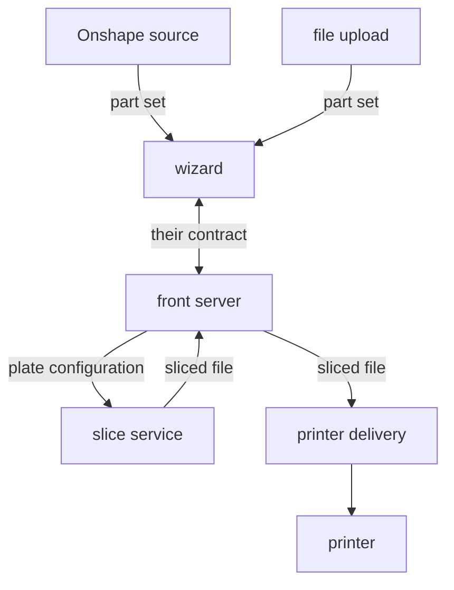

# PenguinSlicer: the plan

Written Tue 2026-11-24, Pacific time, from the owner's plan of attack of that evening. It
says what PenguinSlicer is, where each component stands, and the five phases of work that
come next, in the owner's order. It is kept to the present state: when something is
decided, the text says the result. It gives no time estimates. Where something is open, it
says so.

## Short answer

- **PenguinSlicer** (https://github.com/6238/PenguinSlicer, public, MIT) takes parts, lays
  them out on a printer's plate, slices them with Orca on a server and sends the sliced
  file to the printer. It holds five components, each its own project, which depend only
  on the shapes in [contracts/](../../contracts/README.md).
- **Built and tested:** the slice service (built and tested for one slice service process)
  and printer delivery (tested against the simulated printer only, never against the real
  H2S). **Not started:** the wizard, the front server and the Onshape source. The wizard
  exists as a mockup, version 8, which the owner accepted as the last version on Thu
  2026-11-26.
- **How the components fit together when hosted is designed** and approved by the owner
  (Thu 2026-11-26): it is in [the architecture](../architecture.md). Each component's guide says what
  that design asks of it and what of that is built.
- **The phases, in the owner's order:** (1) write the rest of the wizard's guide from the
  accepted mockup;
  (2) the wizard and the front server outside Onshape, on one machine, with the slice
  service, ending in a downloaded sliced file; (3) the same hosted on Railway, with
  Onshape sign-in; (4) the wizard inside Onshape, with the Onshape source; (5) the real
  printer, with daemon telemetry.
- **Each phase that builds something starts with a design spec agreed with the owner.**
  The architecture settles what spans components; a phase's design spec settles the rest.

## The documents

| Document | Read after | Explains |
|---|---|---|
| This plan | Nothing | What PenguinSlicer is, its terms, the standing requirements, where each component stands, and the phases |
| [The architecture](../architecture.md) | This plan | The hosted design's terms, what runs where when hosted, where each piece of state lives, restarts and deploys, security, the log, and what is still to be confirmed |
| A component's guide: [slice](../../slice/README.md), [delivery](../../delivery/README.md), [wizard](../../wizard/README.md), [front](../../front/README.md) (the Onshape source has none yet) | This plan | What the component does, how to run and test it, what is built and what is to be built |
| A component's `README-details.md` | Its guide | Everything someone changing the component needs: every figure, rule, error code and required test |
| [contracts/](../../contracts/README.md) | This plan; for the contract between the wizard and the front server, the architecture | The shapes that pass between components |
| [The mockup's decisions](../mockups/print-wizard/DECISIONS.md) | This plan | Every design choice of the wizard's mockup, until the wizard's guide replaces it |
| [The hosted architecture design](../specs/2026-11-25-hosted-architecture-design.md) | This plan | The record of what the owner approved on Thu 2026-11-26; not kept current, and needed only to check what was approved: nothing else depends on it |
| [The map of the hosted design's decisions](../orchestration/hosted-architecture/decision-map.md) | The hosted architecture design | Which living document holds each decision of the approved design |

Research, reference material and the build records of each piece of work are under
`docs/research/`, `docs/reference/` and `docs/orchestration/`; none is needed to read the
documents above.

## Terms

Each term means one thing everywhere in this plan, in the components' guides and in the
code.

| Term | Meaning |
|---|---|
| **PenguinSlicer** | The repository and the product in it. |
| **user** | The person using PenguinSlicer to print. |
| **administrator** | Whoever edits the configuration and pairs the printer. Every user of a group is one: nothing distinguishes one user of a group from another. |
| **configuration** | The settings shared by everyone in one group: the filaments, each with a colour (shown where the user chooses a filament, never in the layer preview) and its own profiles under the group's own names and purposes; the printer's Orca profile, from which the plate's size and height come; and whether parts uploaded from files are read in inches or millimetres. It is one document for each group, kept by the front server, and holds no secret ([the architecture](../architecture.md#the-configuration), [its contract](../../contracts/configuration.md)). |
| **component** | One of the five parts of PenguinSlicer, each developed as its own project: the slice service, printer delivery, the wizard, the front server, the Onshape source. |
| **guide** | A component's `README.md`, written for a person. Beside it, `README-details.md` holds everything someone changing the component needs. |
| **Orca** | Orca Slicer, the open-source slicer that turns models into printer instructions. It runs on the server with no window. Version 2.4.2 is the one in use. |
| **H2S** | The Bambu Lab H2S printer of FRC Team 6238, the Popcorn Penguins, which own the repository. |
| **part, instance, plate** | A part is one distinct solid to print. An instance is one placement of a part on the plate; a part printed once has one instance. The plate is the printer's bed and everything on it. |
| **part set** | The parts to print, one STL file each with a name and a quantity, as the Onshape source or a file upload hands them to the wizard. Its contract is not written yet. |
| **plate configuration** | What to slice: the parts, where each instance sits on the plate and how it is turned, and the chosen profiles and settings. It is a description, not work. |
| **profile** | One of Orca's named bundles of settings for a printer, a filament or a printing process. |
| **profile catalog** | The profiles a plate configuration may name: every Bambu Lab H2S printer profile and every filament and process profile that names one, flattened from the pinned Orca into the slice service's `profiles/catalog/`. |
| **slice service** | The component that takes a plate configuration, runs Orca and returns a sliced file. |
| **HTTP interface** | The slice service's web routes, its one interface. |
| **slice job** | The work of slicing one plate configuration in the slice service, from its arrival to its end. |
| **slice service process** | One running slice service: one process, which holds its slice jobs in its memory. |
| **memory ceiling** | The most memory the slice service lets Orca use for one slice job, a setting, 2,000 MB by default. |
| **memory watchdog** | The slice service's thread that measures Orca's memory while it runs and stops Orca past the memory ceiling. |
| **sliced file** | The `.gcode.3mf` file Orca writes, which the printer runs. |
| **printer delivery** | The component that sends a sliced file to a printer and reports how the print goes. It has two halves, the relay and the daemon. |
| **relay** | The half of printer delivery that runs inside its caller's process (the front server, from phase 5): it hands delivery jobs to the daemon and holds the printer's last status. |
| **daemon** | The half of printer delivery that runs on the daemon's computer. It connects outward to the relay and talks to the printer on the local network. |
| **the daemon's computer** | The computer next to the printer, on the printer's network, that runs the daemon. |
| **caller** | The application that runs the relay and asks it to deliver sliced files: it signs users in and holds the sliced file. In PenguinSlicer it is the front server, from phase 5. |
| **pairing code** | The code the daemon shows when its `pair` command is run. A user types it into PenguinSlicer once, which links the user's group to that daemon, and so to its printer; after that the code is dead. As built it is still a lasting secret the caller presents; phase 5 changes that. |
| **delivery job** | One sliced file on its way to one printer, from the moment it is sent until the print ends. |
| **start command** | The message the daemon sends the printer to begin printing an uploaded file. |
| **status document** | One message of the printer's own report of its state. |
| **simulated printer** | A program that answers the daemon as an H2S would, over real network connections, from scripted status documents. |
| **recording** | A file of status documents saved from the real printer by the daemon's `record` command. |
| **daemon telemetry** | Messages the daemon sends about its own state to the relay, after which they are kept in the log. What they hold is not designed. |
| **wizard** | The component that is the step-by-step user interface, the code in the browser: the Parts, Settings, Layout, Preview and Send steps. It talks only to the front server. It works from 320 px, the narrowest width it must work at, and lays out wider when it has more room. |
| **front server** | The component, and the one process, that the internet reaches: it serves the wizard's pages, signs users in through Onshape, passes parts and slice jobs to the slice service, keeps sliced files and configurations, and from phase 5 runs the relay as its caller. |
| **group** | The users who share one configuration and one printer: one Onshape company or classroom, named by Onshape's id for it. A user who belongs to none is a group of one, named by the user's Onshape id. |
| **advanced mode** | The wizard's view that fills the panel with every slicing setting. |
| **printer-status icon** | The small pill at the right of the wizard's header that shows the printer's state; a click shows its details. |
| **mockup** | A click-through imitation of the wizard that runs entirely in the browser, with nothing real behind it. |
| **Onshape source** | The component that turns a user's selection in Onshape into a part set. |
| **error report** | The one shape in which every component reports a failure. |
| **progress report** | The one shape in which every component reports how far a long job has got. |
| **upstream** | Open-source code written by others that a component rests on: Orca for the slice service, the `bambulabs_api` library for the daemon. |
| **upstream check** | A component's suite of tests that pins every behaviour of its upstream code the component relies on (`make test-upstream`). |
| **fast suite** | A component's everyday tests (`make test`): no real Orca, no real printer, no real waiting. |
| **print branch** | The branch `feature/onshape-test-bed` in `6238/PenguinCAM`, which holds the first attempt at 3D printing. It is only a source to port from. |
| **phase** | One of the five steps of work in [The phases](#the-phases). |

The terms that belong to the hosted design (the slice container, the state bucket, the log
bucket, the paired-printer record, the part store, the user key, the sync, the held wait
and others) are defined in [the architecture](../architecture.md#terms).

## The repository

One repository, never several, built on PenguinCAM's stack (Python managed with `uv`,
Flask where a component needs HTTP, plain JavaScript in the browser) so that it can return
to PenguinCAM later.

- **[contracts/](../../contracts/README.md)** defines the shapes that pass between
  components (the plate configuration, the sliced file, the error report and the
  progress report), each with example files. Not written yet: the part set. Begun: the
  [configuration](../../contracts/configuration.md), whose contract says what it must
  hold and whose fields are not written yet, and the
  [contract between the wizard and the front server](../../contracts/wizard-front-server.md),
  which says what it must provide and whose routes are not written yet.
- **The slice service**, in `slice/`, takes a plate configuration and its STL files through
  its HTTP interface, runs Orca under the memory watchdog and returns the sliced file and
  its summary ([its guide](../../slice/README.md)).
- **Printer delivery**, in `delivery/`, takes a sliced file from the caller and gets it
  printed: the relay inside the caller's process, the daemon on the daemon's computer, and the simulated
  printer for tests ([its guide](../../delivery/README.md)).
- **The wizard**, in `wizard/`, is the user interface: the code in the browser. None of it
  is built. [Its guide](../../wizard/README.md) is begun, with what the architecture asks
  of it; the steps a user sees are still to be written into it from the mockup, in
  phase 1. The mockup is in [docs/mockups/print-wizard](../mockups/print-wizard/index.html),
  with every design choice in its [DECISIONS.md](../mockups/print-wizard/DECISIONS.md).
- **The front server**, in `front/`, is everything behind the wizard's address: it serves
  the wizard's pages, signs users in, calls the slice service, keeps sliced files and
  configurations, and from phase 5 runs the relay. None of it is built
  ([its guide](../../front/README.md)).
- **The Onshape source**, in `onshape/` (not yet created), will turn a selection in
  Onshape into a part set (phase 4).

The wizard calls nothing but the front server. The sliced file goes from the slice
service to printer delivery through the front server, which keeps it as the relay's
caller. What runs where when hosted is in [the architecture](../architecture.md#the-shape).
How the Onshape source's part set reaches the wizard is settled in phase 4's design spec;
the calls to Onshape are the front server's.

Rules that keep the components separate:

- A component depends only on `contracts/`, never on another component's code.
- **One interface per component is the default, not a hard rule.** The slice service has
  one, its HTTP interface; there is no command for slicing by hand, and for testing an
  agent writes throwaway scripts against its routes. The wizard may exist both inside
  Onshape and as a page reached directly from a browser, and the Onshape source may
  likewise have two homes.
- Each component can be exercised through its interface with the example files in
  `contracts/examples/`.
- Hosted, the front server and the relay run in one process and the slice service in a
  container of its own ([the architecture](../architecture.md#the-shape)); the files in `contracts/`
  are the seams between components wherever they run.
- Code from the print branch came over by copying files, with each commit naming the print
  branch commit it came from. The print branch stays as it is.

**How changes reach `main`.** Every change goes on a branch and reaches `main` through a
pull request; nothing is committed or pushed to `main` directly. A change to a component
is checked by someone who did not write it before it is merged. Notes for agents are in
[CLAUDE.md](../../CLAUDE.md).

## Standing requirements

These hold for every component. A component is not done until each, apart from Words, is
shown by a test.
The owner's reason: the quality of real software is decided by how it handles the unusual
case.

**Errors.** Every failure is an error report
([contracts/error-report.md](../../contracts/error-report.md)) with a stable code, what
happened in a sentence a user understands, where (the part, the instance, the height or
step, when known), what to do next and which single action fixes it when one does, and the
underlying detail (Orca's own words, the printer's status), kept for the server log and
never thrown away. Each code is listed in its component's guide and has a test that
produces it on purpose. People read errors, so an error says more than a screen does: what
went wrong and whatever is specific to this error and helps to understand or fix it (which
part, what about it, where to look), with no generic troubleshooting and nothing of
PenguinSlicer's internals.

**Words.** No sentence a user sees says "student", "mentor" or "team": PenguinSlicer is
used by people who are not FRC teams. Where a difference in permissions must be named, the
word is "administrator". The sentences the slice service and printer delivery write today
still use the old words; changing them is known future work.

**Progress.** Every job that can take more than a few seconds sends progress reports from
start to finish: the stage, how far through when that can be known (never invented), the
time taken so far and the time expected. A client that connects late gets the current
progress report at once.

**Cancellation.** Every long job can be cancelled at any moment. Cancelling stops the work
itself (the Orca process, the upload), not only the reporting of it, and ends in a state
from which the same work can be started again.

**Cleanup.** When a client goes away without cancelling, the component notices, waits a
stated time in case the client returns, then stops the work and removes its files.
Nothing is left running and nothing accumulates on disk. A restart leaves no job in an
unknown state. From phase 2, a slice job is the exception: it goes on when its page goes
away, bounded by the slice service's time limit, so that a user who refreshes, loses the
network or closes a laptop lid finds it done. As built, a slice job nobody follows is
cancelled after 120 s.

**Deploys.** The project is deployed continuously, so a deploy at any moment interrupts no
user: connections drop briefly and come back by themselves, work that was cut off starts
again without the user asking, a print goes on, and a page or a daemon made for the
previous version keeps working. How each component meets this is in
[the architecture](../architecture.md#restarts-and-deploys).

**Supportable from the server.** Every transition of a job writes one log line with enough
in it to diagnose a failure without asking the user for anything. So does every error a
user is shown, every exception and every refusal. The line that ends a job carries the
figures needed to size the service, and the log shows who is using it. No secret appears
in a log. What is written and where it goes is in
[the architecture](../architecture.md#reading-what-happened).

**Upstream code.** Taking a new upstream version is routine: each version is pinned in one
place, one command moves the pin and regenerates what is derived from it, and the upstream
check fails, naming the assumption, when a new version breaks one. Small patches to
upstream are allowed only where it reports an error or progress too poorly to meet the
requirements above, never for a feature; each is a file against a named version with a
note, applied by the upgrade command. Patching Orca means building it from source, so
each such patch is the owner's decision. There is no patch to Orca and none to the printer
library.

**Tests.** The fast suite uses no real Orca, no real printer, no network beyond loopback,
no real waiting and no fixed ports, finishes in seconds, and passes in any order, any
number of times. A test that fails once is fixed at its cause, never retried, skipped or
given a longer timeout. Every refusal, limit, timeout and state transition has a test that
reaches it and asserts what the caller sees; branch coverage does not fall. Each test is
written first and seen to fail. A reviewer reruns the suites in random order, breaks the
changed checks on purpose and tries hostile inputs.

## Where things stand

As of Thu 2026-11-26:

- **The slice service** is ported from the print branch, brought up to the standing
  requirements except Deploys, which its guide lists under To be built, and measured on
  eight real parts of the Popcorn Penguins' robot. Its state is in
  [its guide](../../slice/README.md).
- **Printer delivery** is ported and brought up to the standing requirements except
  Deploys, which its guide lists under To be built, and tested against the simulated
  printer only. Its state is in [its guide](../../delivery/README.md).
- **Thirteen design rulings in those two guides** (R1 to R3, R5 to R12, R14, R18) were
  made by an agent and are not yet confirmed by the owner; each is named, with the guide
  section where it stands, in
  [the plan's fix round](../orchestration/plan-by-phase/fix-1.md#rulings-the-owner-has-not-read-for-the-orchestrator).
- **The mockup** is at version 8 (pull request 16), and the owner accepted it as the last
  version on Thu 2026-11-26, every step reviewed. Its design, the requirements it puts on
  the implementation and its open questions are in
  [DECISIONS.md](../mockups/print-wizard/DECISIONS.md); the open questions are its section
  "Please react to these" (M1 to M29), plus whether the Layout view's pointer line should
  be larger than 11 px. The build records of each version are in
  `docs/orchestration/mockup-v6/` to `mockup-v8/`.
- **The hosted architecture** is designed and approved by the owner (Thu 2026-11-26):
  [the architecture](../architecture.md). Almost none of it is built; each guide says what
  it asks of that component: under "To be built" for the slice service and printer
  delivery, and by phase for the wizard and the front server.
- **The wizard, the front server and the Onshape source** have no code. The print branch holds code for
  selecting parts in Onshape and exporting them as STL files that has never run against
  real Onshape.

## The phases

The order is the owner's. Each phase that builds something starts with a design spec
agreed with the owner, and a component's guide is updated as the phase changes it.

### Phase 1: the wizard's guide

The owner has reviewed every step, the Layout step included, over versions 6 to 8, and
accepted version 8 on Thu 2026-11-26. What remains is the rest of the wizard's guide. [The guide](../../wizard/README.md) is
begun with what the architecture asks of the code in the browser; the steps a user sees
are written into it from the mockup and its
[DECISIONS.md](../mockups/print-wizard/DECISIONS.md), together with the screens the
architecture needs and the mockup does not show, which the guide lists. That guide is
the wizard's part of phase 2's design spec. The owner's
direction for the wizard stands: keep the conventions of PenguinCAM's CNC wizard and its
look unless additive manufacturing is distinctly different; make the common case short,
since most prints use one filament and one of a few profiles; keep every slicing setting
reachable; and bring over what is needed from Orca's Prepare tab (arranging parts on the
plate) and Preview tab (inspecting the sliced file layer by layer). The mockup is thrown
away once the wizard's guide is complete. The guide cannot settle the questions in
[DECISIONS.md](../mockups/print-wizard/DECISIONS.md)'s "Please react to these" on its
own: each is either answered by the owner or carried into the guide with its backing,
as an open choice.

- **Done when** the owner has agreed the wizard's guide (the review of every step of the
  mockup is done).
- **Components:** the wizard (its mockup and its guide). The guide also says what the
  wizard needs from the slice service and from printer delivery that they do not provide;
  [DECISIONS.md](../mockups/print-wizard/DECISIONS.md) lists those needs today.
- **Risks:** the Layout step is the least proven part of the wizard: placing instances by
  direct manipulation in 3D at 320 px. The mockup's laying of parts on a face, its
  orientation and its arranging were measured only on the mockup's own generated parts.
  Orca's code for orienting and arranging cannot be taken over (Orca is AGPL; PenguinSlicer
  is MIT), so the wizard's are written fresh.

### Phase 2: the wizard and the front server outside Onshape, on one machine

The wizard's real code, opened directly in a browser (not inside Onshape). The user adds
parts from STL files, and the wizard talks to the front server, which calls the slice
service, all three on the same machine. The user downloads the sliced file. No printer,
and no Onshape: the front server signs in a made-up development identity, and a folder
stands in for each bucket.

- **Done when** a user on one machine opens the wizard in a browser, adds parts from STL
  files, lays them out, slices them through the slice service on that machine, inspects
  the preview and downloads the sliced file.
- **Components:**
  - The wizard, built for the first time, as
    [its guide](../../wizard/README.md#what-is-to-be-built-by-phase) lists: opened
    directly, with parts from files; the browser's storage, uploading, submitting by hash,
    the returning page, progress streams, retrying, reloading on a newer version, the
    current group, the preview and the download.
  - The front server, built for the first time, as
    [its guide](../../front/README.md#what-is-built-in-which-phase) lists: serving the
    pages; the development identity and the cookie, with one cookie key; the user key and
    the check of the current group; passing parts and slice jobs; following slice jobs and
    storing sliced files; refusing and deleting sliced files after two hours; the
    configuration; a folder for each bucket; the log, gathered into the folder for the log
    bucket; the version on every answer, for the wizard's reloading. The development
    identity and the folders exercise all of these on one machine.
  - The slice service, extended as [its guide](../../slice/README.md#to-be-built) lists
    for this phase: the user key; the part store; parts named by hash; one unfinished
    slice job for each user key; a slice job that runs to its end whether or not anyone
    follows it; a slice job remembered for two hours after it ends; the route that lists
    the slice jobs; a waiting slice job's place in the queue; finishing the running slice
    when asked to stop. With it, the slice container's half of
    [Restarts and deploys](../architecture.md#what-a-restart-does), with a test for each
    row of the table "The slice container restarts".
  - `contracts/`: the part set for parts from files, the routes of the contract between
    the wizard and the front server, the fields of the configuration.
- **Settled by [the architecture](../architecture.md#where-each-piece-of-state-lives):** how parts
  reach the slice service, where the sliced file is kept, how a page that has lost its
  state comes back to its work, and how the browser reaches the slice service (through
  the front server, at one address, as [the shape](../architecture.md#the-shape) says).
  Everything under that section is built in this phase, except what it says of Send and
  of delivery jobs, which waits for phase 5.
- **What it needs from the slice service, each open until the phase's design spec settles it:**
  - Settings. The HTTP interface takes four overrides (infill, walls, supports, brim), each
    with listed values; the mockup's advanced mode shows every setting of the process
    profile.
  - Profiles per filament. The configuration lists each filament's own profiles; the
    wizard needs the profile catalog's names for its menus, and where it reads them from
    is open.
  - Units. The plate configuration takes STL files in millimetres, and a file upload is
    read in inches unless the configuration says millimetres; where the scaling happens
    (the wizard, or a field of the plate configuration) is open.
  - The preview. The Preview step draws the sliced file layer by layer. The slice
    service returns the sliced file and a summary, not toolpaths. The heaviest target
    plate of the Popcorn Penguins has about a million lines of G-code (an 8.8 MB sliced
    file); a plate of twelve Elevator Block Bottom Inners gives a 10.8 MB sliced file, and 14.1 MB with
    supports on. The preview must show no combs and no show-through at any viewing angle,
    stay within a frame budget on a machine without a graphics card, and draw again after
    a lost WebGL context; the implementer proves its appearance with test renders of real
    sliced plates, looked at one by one. The requirements, and the mockup's artefacts that
    prompted them, are in decision 33 of [the mockup's decisions](../mockups/print-wizard/DECISIONS.md).
- **Risks:** this is the first time components run joined, and a mismatch between
  them shows first here; feasibility of the preview in a browser at that size, and of the Layout step
  on real parts (exported parts with tens of thousands of corners may need a faster hull
  for laying a part on a face); resources: the wizard is the largest piece of building
  left.

### Phase 3: the same, hosted

The wizard, the front server and the slice service hosted on Railway, behind Cloudflare,
at `https://penguinslicer.popcornpenguins.com/`, with Onshape sign-in. The design is
[the architecture](../architecture.md): two containers, two buckets at Cloudflare R2, and no database.
Railway is the host because it bills the memory a container actually holds ($10 for a
gigabyte held for a month; the two containers hold about half a gigabyte between slices,
about $7 a month while few people slice), it has no operating system to patch, and
PenguinCAM already runs there. The buckets are at R2 because it has the three things the
design needs of its object store
([the architecture](../architecture.md#the-shape)).

- **Done when** a user on another network opens the wizard at that address, signs in
  with Onshape, uploads parts, slices them and downloads the sliced file; a deploy of
  either container while they work costs them a pause and nothing else; and the owner's
  coding agents can read what happened from the log bucket.
- **Components:**
  - The front server, as [its guide](../../front/README.md#what-is-built-in-which-phase)
    lists: its own container at the public address; the two buckets at R2, the log bucket
    among them; Onshape sign-in, with groups read from Onshape; the second cookie key;
    finishing work when asked to stop; the checks that matter only when hosted, on
    requests from other sites and the refusal to start with the development identity on
    Railway.
  - The wizard, as [its guide](../../wizard/README.md#what-is-to-be-built-by-phase)
    lists: Onshape sign-in and "sign in again"; the header on every changing request.
  - The slice service, as [its guide](../../slice/README.md#to-be-built) lists for this
    phase: its limits as settings; the memory ceiling set for the slice container; the
    measurements below; the comment line on its progress stream; Orca as a Unix user of
    its own; the route that gives the front server its log lines, and its new log lines.
  - The rules of
    [Old and new versions together](../architecture.md#old-and-new-versions-together)
    that phase 2 does not build: a format number on each record in the state bucket.
    (Its rule for an installed daemon applies from phase 5.)
  - The command that reads the log bucket, the check that runs after each deploy, and the
    hosting itself, which is new.
- **First, what Railway does at a deploy,** since the standing requirement on deploys
  rests on it: whether one of the two containers can be deployed without the other, and
  how long a stopping container is given.
- **Then the measurements that set the limits:** plates of rising weight sliced on the
  slice container, each measured for memory and time, which set the memory ceiling
  (6,000 MB is proposed), the time limit and the estimates. Every measurement so far is
  from aarch64 Linux and from plates under 2,600 MB.
- **Onshape's allowance of calls.** The owner intends to make the Onshape app public;
  until then its calls count against a yearly allowance, and development and testing
  with users must fit inside it with room to spare. The figures and the count are in
  [the front server's guide](../../front/README.md#signing-in).
- **Risks:** feasibility: everything listed in the architecture under
  [To confirm before building on it](../architecture.md#to-confirm-before-building-on-it) is believed
  and not checked, Railway's behaviour at a deploy and Orca's on Railway's machines
  first among them; resources: an Onshape app registered for the hosted address,
  a Railway account and a Cloudflare R2 account, with their secrets.

### Phase 4: inside Onshape

The wizard in Onshape's right panel, and the Onshape source, which picks parts, exports
them and reads the document's units. Onshape sign-in and the Onshape app are already
there from phase 3: the panel uses the same sign-in and the same routes as phase 3.

- **Done when** a user opens PenguinSlicer in Onshape's right panel in a real Part Studio
  and a real Assembly, picks parts there, sees them arrive in the Parts step in the
  document's units, and slices and downloads them.
- **Components:** the Onshape source (built for the first time, ported from the print
  branch and brought into line with PenguinCAM's CNC integration), the wizard (its Onshape home), the front server (its calls to Onshape for parts), and
  `contracts/` (the part set from Onshape).
- **Calls to Onshape.** Reading parts costs several calls for each part against the
  yearly allowance ([the front server's guide](../../front/README.md#signing-in)). The
  phase's design spec counts them for each part before anything is built.
- **Units from Onshape:** the units of the Assembly or Part Studio; failing that, the
  part's own units or Onshape's default units, whichever Onshape's API gives.
- **Risks:** low in feasibility for the mechanism: PenguinCAM's CNC wizard already runs in
  Onshape's panel in production and gathers several selected parts into one job. What only
  real Onshape can settle: how wide a user can drag the right panel, whether full screen
  works from inside it, Onshape's mouse, trackpad and touch gestures, selecting whole
  bodies where the CNC wizard selects faces, exporting STL where it exports a drawing,
  picking parts inside an assembly, and the speed of the wizard's orienting and arranging
  in Chrome inside Onshape on real parts. Resources: the Onshape app's settings for the right panel. The
  print branch's Onshape test bed (recorded and replayed Onshape sessions) is there to
  port if the design spec wants it.

### Phase 5: the real printer

Printer delivery, built and tested against the simulated printer only, sends to the real
H2S. Daemon telemetry is part of this phase and is not designed.

- **Done when** a user sends a sliced file from the wizard's Send step and it prints on the
  H2S through the relay and the daemon, the printer-status icon follows it to the end,
  every line of the hardware checklist in printer delivery's detailed guide is answered, and daemon
  telemetry does what its own design says.
- **Components:** printer delivery (the relay in the front server, the daemon on the daemon's
  computer, the simulated printer's invented sequences replaced by recordings), and the wizard (the Send step and the printer-status icon), and the front server (the relay's
  caller, and the store for the relay's records).
- **The session at the H2S.** One session at the H2S with the daemon's `record`
  command saving every status document gives the simulated printer real sequences and
  measures what the timed rule after a start command depends on. Its checklist is in
  printer delivery's detailed guide,
  [Before trusting it at the H2S](../../delivery/README-details.md#before-trusting-it-at-the-h2s-what-the-session-at-the-h2s-must-confirm).
  A print started by the daemon needs a relay. The only one today binds 127.0.0.1 and
  signs everyone in, so it is for tests on one machine only, with the relay and the daemon
  on the same computer; a relay the daemon reaches from another machine is the hosted front server of this phase. An agent prepares the print started by the daemon as a written walk and
  tries it against the simulated printer first.
- **Settled by the architecture:** pairing with a code used once and how often a
  daemon talks to the relay ([Printers](../architecture.md#printers)), what a restart of
  the front server does to a print
  ([What a restart does](../architecture.md#what-a-restart-does)), and how the relay's
  secret key is replaced ([Security](../architecture.md#security)). What that asks of the
  relay and the daemon is in [printer delivery's guide](../../delivery/README.md), under
  "To be built". The messages of the pairing exchange in detail are left to this phase's
  design spec.
- **Daemon telemetry.** A protocol by which the daemon sends messages about its own state
  to the relay from the moment it starts, where they are kept. It matters because the
  daemon runs on a wide variety of hardware and its problems are hard to foresee: a
  misconfigured network, what the daemon's computer can and cannot do, the user interface,
  the daemon's computer going to sleep or being overloaded, and the daemon timing out
  because its computer runs slowly. It lets an administrator's broken setup be diagnosed
  from the server, helps development now, and is designed to be ported when the daemon
  moves to Rust or Go. It is new behaviour on both halves and gets its own design. Today
  both halves write structured log lines only.
- **What the wizard needs from printer delivery:** who sent the print going on (the
  user's Onshape name), the end time of the last print, and a way for a page that has lost
  its state to find its user's delivery job; [DECISIONS.md](../mockups/print-wizard/DECISIONS.md)
  lists them, and each is not provided, or only in part.
- **Risks:** feasibility: everything printer delivery knows about the H2S beyond one
  status document is invented; the upload's TLS version, the format of the printer's file
  listing and the first status documents after a start command can each break delivery
  outright, and the timed rule after a start command rests on timings nobody has measured.
  The daemon has never run on Windows, where the daemon's computer is likely to be. What
  telemetry must report is what is hard to foresee on hardware nobody controls. Resources:
  the owner, the printer and the daemon's computer together, a relay the daemon can reach
  from another machine (today's binds 127.0.0.1 only and signs everyone in), and new
  design on both halves for telemetry.

The security questions of this phase are answered in
[the architecture](../architecture.md#security): who may send to a printer, the pairing code, the
relay's secret key and its replacement, and showing who sent a print. What the daemon
keeps on its computer is in
[printer delivery's detailed guide](../../delivery/README-details.md#a-daemon-that-was-off).
One is still open, for the design of daemon telemetry: what
proves a message comes from a paired daemon, what a message must never hold, and its
size and rate limits. (The printer's certificate is not a question: by design the daemon
accepts any, as printer delivery's guide says.)

## Known future work

Not part of the phases, and in no order.

| Item | Why it waits, or what it needs |
|---|---|
| **The words the components write** | The sentences of the slice service's and printer delivery's error reports, the text the daemon's `pair` command prints, the relay's log field `team=` and its caller interface (its `Team` type) still say "student", "mentor" or "team". Changing them is its own change, with its tests. |
| **Taking Orca 2.5.x** | Orca 2.5.x packs the Bambu Lab profiles in one file, `BBL.opc`, that the script building the profile catalog cannot read yet. The pin stays at 2.4.2 until it can; the size of the work is unknown until the format is examined. |
| **Moving the daemon to Rust or Go**, as one lightweight executable | Checked against the simulated printer, the tests built here and the telemetry protocol. |
| **Returning to PenguinCAM** | It follows a working whole. |
| **Edit screens for the configuration** | A feature of their own, in no phase yet, with a design spec of their own. Until they exist a group uses the built-in default, or a document the owner puts into the state bucket through Cloudflare's console, following the annotated example in [its contract](../../contracts/configuration.md). |
| **Permissions inside a group** | Every user of a group may edit its configuration, pair its printer and send a print from anywhere. Limits are added if a group needs them. |
| **More than one printer for a group** | The design links one group to one daemon. |
| **Making the Onshape app public** | It lifts the yearly allowance of calls, after which a user's groups are read again each day. |
| **An asynchronous server for the held wait** | The front server spends one thread on each idle daemon, which serves about fifty; one route moves to a small asynchronous server when the number of daemons calls for it. |
| **More than one slice container** | The design has one. |
| **A daemon that installs itself to start at boot** | Starting the daemon is the job of whoever runs its computer. A later version may make it a single file that installs itself. |
| **Printer adapters for other brands, the preview image on the printer's screen, file names that say which part and when** | Each is new design, described in the [first hardware test notes](https://github.com/chondl/PenguinCAM-notes/blob/main/handoffs/2026-10-09-printer-relay-first-hardware-test.md). |

The first attempt, its order of work and the owner's feedback on it are in the
[print path restart notes](https://github.com/chondl/PenguinCAM-notes/blob/main/handoffs/2026-10-11-print-path-restart-notes.md)
and the [print roadmap](https://github.com/chondl/PenguinCAM-notes/blob/main/plans/2026-10-09-print-roadmap.md)
in the notes repository; this plan replaces their order of work.
