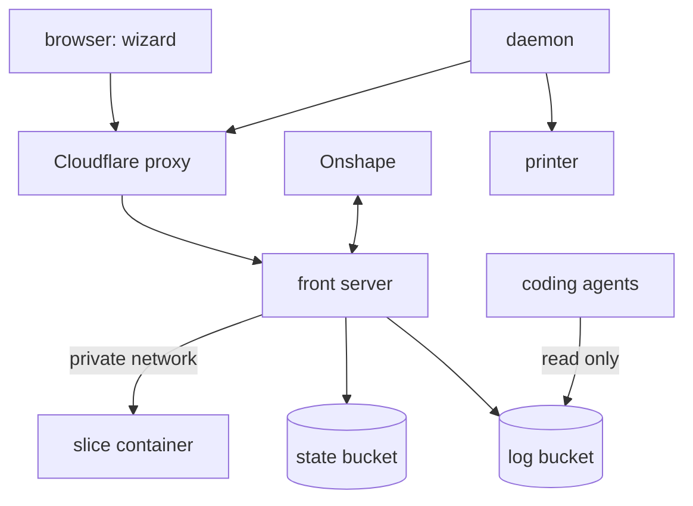

# PenguinSlicer: the hosted architecture

Written Wed 2026-11-25, Pacific time, from a design discussion with the project's owner,
and revised Thu 2026-11-26 after the owner's review. The owner has reviewed "The shape",
"Where each piece of state lives", "Sign-in" and an earlier form of "Restarts and
deploys" and of the table of all the state. The owner decided how often a daemon talks to the
relay, what the log holds and how a secret is replaced on that day, and has not yet read
"Printers", "Reading what happened" or "Security" as written, nor agreed the document. It says how the wizard, the slice service
and printer delivery fit together when they are hosted: where each piece of state lives,
who may reach what, what a restart does, how a daemon is told to print, and where the
project's owner reads what happened. It gives no time estimates.

**Read after:** [the plan](../plans/penguin-slicer-plan.md). This document uses the
plan's terms. Where it differs from the plan or from the code as built, the difference is
stated near the end, in [What this changes in the plan](#what-this-changes-in-the-plan)
or [What changes in each component](#what-changes-in-each-component). Every other
section describes the design as it is to be, with one exception that must speak of the
code as built: [To confirm before building on it](#to-confirm-before-building-on-it),
which lists what was not checked. The plan is brought into line once
the project's owner has agreed this document.

It answers the questions the plan lists under phase 3, and of the security questions
under phase 5 those about who may send to a printer, the pairing code, the relay's
secret key, what the daemon keeps on its computer and showing who sent a print. It leaves to each phase's own design spec: the
wizard's steps and the preview's drawing (phase 2), the configuration's edit screens,
reading parts from Onshape and what that costs in calls to Onshape (phase 4), and for
phase 5 the messages of the pairing exchange in detail and what daemon telemetry holds.

## Short answer

- **Two containers on Railway, behind Cloudflare,** at
  `https://penguinslicer.popcornpenguins.com/`. Railway is a hosting service that runs
  containers and bills by use. The **front server** (the wizard's server side and, from
  phase 5, the relay, in one process) is the only thing the internet reaches. The **slice
  container** runs one slice service process and is reachable only from the front server.
- **The browser holds the user's parts and layout,** in its own storage. The slice
  container keeps a copy of each part for two hours after its last use, and the state
  bucket keeps each sliced file for two hours after its slice.
- **What must last is in two object stores.** The state bucket holds each group's
  configuration and paired-printer record (which daemon is the group's), the sliced
  files, and a record of each delivery job. The log bucket holds log lines.
- **A deploy at any moment interrupts no user.** The project is deployed continuously,
  so a restart of either container is routine: connections drop briefly and come back
  by themselves, a slice that was cut off starts again, and a print goes on.
- **Every user signs in with Onshape,** in Onshape's panel and outside Onshape alike. A
  **group** is the users who share one configuration and one printer: an Onshape company
  or classroom. Every user of a group may edit its configuration.
- **Development spends almost none of Onshape's yearly allowance of calls.** Work on one
  machine and the tests make no calls; the hosted service makes two at each sign-in and
  no others until phase 4.
- **A pairing code is used once.** After pairing, the state bucket holds a record linking
  a group to its daemon, and nothing in the state bucket can start a print.
- **An idle daemon and the relay exchange about one request a minute, and a send still
  reaches the daemon at once,** because the relay holds its answer until it has a print
  to hand over. During a print the daemon reports every ten seconds.
- **The log records every error, the figures needed to size the service, and who uses
  it.** Its lines go to Railway's log view and to files in the log bucket, which the
  project owner's coding agents can read.
- **Every secret can be replaced without interrupting anyone.**

## Terms

These are new here; every other term is the plan's.

| Term | Meaning |
|---|---|
| **group** | The users who share one configuration and one printer. It is one Onshape company or classroom, named by Onshape's id for it. A user who belongs to none is a group of one, named by the user's Onshape id. |
| **current group** | The one group, of those a user belongs to, whose configuration and printer the user is using now. |
| **front server** | The one process that runs the wizard's server side and, from phase 5, the relay with it. Hosted, it runs in a container of its own on Railway; in phase 2 it is a process on the one machine. |
| **slice container** | The container on Railway that runs one slice service process and nothing else. |
| **state bucket** | The object store that holds everything that must outlast a restart of the front server: each group's configuration and paired-printer record, the sliced files, and a record of each delivery job. |
| **log bucket** | The object store that holds log lines and daemon telemetry as files. |
| **paired-printer record** | One small document per group in the state bucket: the id of the group's daemon, the printer's display name, who paired it and when. |
| **daemon id** | A random id a daemon makes for itself when its `pair` command is run, and keeps. It names the daemon in its token, in the paired-printer record and in the relay's records. |
| **progress stream** | The connection, of server-sent events, on which a page follows a slice job or a delivery job. |
| **part store** | The slice service's folder of uploaded parts, each kept for two hours after it was last used. It is a cache: the browser's storage is the record of a user's parts. |
| **user key** | The signed-in user's Onshape id, which the front server passes to the slice service with every request to say whose part or slice job it is. The slice service compares user keys and never interprets them. |
| **development identity** | A fixed made-up user and group that the front server signs in when a setting tells it to, for work on one machine. |
| **sync** | The request a daemon posts to the relay, carrying the printer's status and its delivery job's progress; the answer tells the daemon what to do. |
| **held wait** | The time, up to 55 seconds, for which the relay holds back its answer to an idle daemon's sync, ending the moment a delivery job arrives for that daemon. |

## The shape

One address serves everything: `https://penguinslicer.popcornpenguins.com/`. The wizard's
pages, the address a daemon is given for the relay and the redirect address of the
Onshape OAuth app are all on it. The domain's DNS is at Cloudflare, whose proxy hides the
host's address and turns away floods of requests; it holds no logic of PenguinSlicer's.
The browser and the daemons talk only to the front server, and the front server calls the
slice service over Railway's private network. So the slice service's HTTP interface is
not reachable from the internet, and the browser never makes a cross-origin request.

**Why two containers.** Orca reads files that strangers upload. The slice container holds
no credentials, so a flaw in Orca reaches no sign-in secret and no bucket. The split also
keeps Orca's memory spike, and a deploy of the slice container, from cutting off every
daemon, and lets a change to the wizard be deployed without touching a running slice.
Railway bills by use, so two containers cost what one would. What the split adds is the
front server passing parts and slice jobs through, fetching each sliced file, and a route
from which it fetches the slice service's log lines.

**The buckets are at Cloudflare R2.** The design needs three things of its object store,
and R2 has them: a credential that only reads one bucket, deleting files after a set
number of days, and writing a file only if it has not changed. R2 is storage only, so
Cloudflare still runs no logic. The front server holds the one credential that writes to
the buckets; beyond it, only the owner of the Cloudflare account can, through
Cloudflare's own console.

**Size.** The slice container is allowed 8 GB, the most one container gets on Railway's
Hobby plan. Railway's machines are believed to be x86_64. Both containers stay running: nothing is started on demand, so a slice never
waits for a container to start.

**Leaving Railway.** The design needs two things of its host besides running containers:
a private network between the two, and a view of recent log lines. On AWS that is one EC2
machine running both containers with the slice container's port closed to the outside.

**A new Orca version** is rolled out as a new image of the slice container, built with
the pinned version after the upstream check passes, and deployed like any other change.

### Limits on one slice

The slice service stops an Orca that uses too much memory (the memory ceiling) or runs
too long (the time limit), and reports each as an error the wizard explains. Both are
settings of the slice service.

**The memory ceiling uses most of the 8 GB.** 6,000 MB leaves 2 GB of the slice container
for the slice service process, its checks on uploaded parts and the operating system.
The margin matters because Railway stops a container that passes its 8 GB, which would
take the waiting slice jobs with it, where the ceiling ends only the one slice. The
figure is the project owner's to change. A high ceiling costs money only while a heavy
plate is slicing, since Railway bills the memory a container holds at each moment.

What is known about memory: the heaviest plate ever measured peaked at 2,569 MB (six
Stanford bunnies with supports). For heavier plates, the slice service's estimates of
memory and time are extended beyond what was measured.

**The time limit must be long enough that every plate which would finish does finish,**
and no longer, because a slice that hangs holds up everyone waiting behind it. What is
known about time: the slowest plate of the Popcorn Penguins' real parts took 22 seconds,
and the starting time limit, 240 seconds, is twenty times what a plate of 150 small spacers took. Those were
measured on aarch64 machines, not Railway's x86_64, and on plates far lighter than 6,000 MB;
a plate that heavy will take longer. So both figures are settled by one set of
measurements on the slice container, listed under
[To confirm before building on it](#to-confirm-before-building-on-it): plates of rising
weight up to the memory ceiling, each timed. The time limit is then set at a few times
the slowest plate that finishes.

| Limit | Value | Error |
|---|---|---|
| Memory ceiling: the most memory one Orca may reach | 6,000 MB, proposed | `slice.out_of_memory` |
| Time limit: the longest one Orca may run | 240 seconds, until measured on Railway | `slice.timeout` |

### How many slices at once

How many Orcas run at once, and how many slice jobs may wait behind them, are settings of
the slice service and not part of this design. The hosted service starts with one
running and two waiting, and both are changed from what is seen in use. The design fixes
only what the rest of it depends on:

- **Memory decides how many run at once.** The slice container never runs more Orcas
  than fit in its memory with each at the memory ceiling. With a ceiling of 6,000 MB that
  is one; two at once would need a ceiling of about 3,000 MB each, and so smaller plates.
  Orca uses several processors by itself, so a second Orca would share them, not use
  idle ones.
- **A slice that cannot start yet waits,** and its user is shown that it is waiting and
  how many slices are ahead of it.
- **When no more may wait,** the user is told the slice service is busy and to try
  again shortly.

Not yet known, and the reason these stay settings: how many processors Railway gives the
slice container, how long real plates take there, and how often two users slice at the
same moment. Growing beyond one slice container is later work, outside this design.

## Where each piece of state lives

Neither container keeps a database or a table of sessions. This section follows one
plate from its parts to its print, then takes the parts, the sliced file, a returning
page and the configuration in turn. Once sign-in, printers and the logs have been described,
[All the state, in one table](#all-the-state-in-one-table) gathers every kind.

### One plate, from parts to print

1. **The user adds a part.** The page keeps the part in the browser's storage and uploads
   it. The slice service checks it and keeps it in the part store.
2. **The user lays out the plate and chooses settings.** This exists only in the
   browser's storage.
3. **The user goes to the Preview step.** The page sends the front server a plate
   configuration: the layout, the settings, and the name of each part. It carries no
   files, because the parts are already in the part store. The slice job waits or runs
   in the slice container.
4. **The slice ends.** The front server fetches the sliced file from the slice container
   and stores it in the state bucket.
5. **The page draws the preview** from the sliced file, which it fetches through the
   front server.
6. **The user presses Send** (from phase 5). The relay writes a record of the delivery
   job to the state bucket. The daemon fetches the sliced file through the front server
   and hands it to the printer.

### Parts

A part is uploaded once and then referred to by name. The wizard uploads each part by
itself at the moment the user adds it, in one request of at most 7.5 MB (the plate
configuration's limit for one part), far under the 100 MB that Cloudflare allows a
request. The front server passes the part to the slice service with the user key, and
the slice service keeps it in the part store under the user key and the SHA-256 hash of
its bytes. A plate configuration names each part by that hash.

This buys two things.

- **A part is checked when it is added.** The slice service runs its checks on the part
  as it arrives, so a part that cannot be sliced is refused on the Parts step, on its
  own row, before the user has laid anything out.
- **Slicing again uploads nothing.** A user who looks at the preview, changes a setting
  or moves a part, and slices again sends only a small plate configuration each time.

A part stays in the part store for two hours after it was last used, and each slice that
names it counts as a use. The part store is a cache, and the browser's storage is the
record of the user's parts. When a plate configuration names a part that is no longer in
the part store, the slice service answers with an error report listing the missing
hashes, and the page uploads those parts again from the browser's storage and submits
again; the user sees nothing of it.

The part store holds at most 25 parts for one user key, the most a plate can use. When a
further part arrives, the one least recently used is removed, and the page uploads it
again if a plate ever names it.

A part is found only under its user key, so two users who upload the same file each have
their own entry and nobody can learn whether someone else uploaded a given file.

### The sliced file

When a slice ends, the front server fetches the sliced file from the slice container and
stores it in the state bucket under the user key and the slice job's id. It does this
whether or not a page is open; when the front server starts, it asks the slice service
for its slice jobs and collects each finished one it has not yet stored. From then on the state bucket's is the copy everything
uses: the browser fetches it through the front server to draw the Preview step and to
offer the download, and on Send the relay hands it to the daemon. The browser does not
store the sliced file and never uploads one, so a printer only ever receives a file the
slice service made.

A sliced file is 8.8 to 14.1 MB on the plates measured so far, so each fetch by a
browser or a daemon is small against the 100 MB Cloudflare allows. Once the front server
has stored a sliced file, the slice container deletes its own copy.

**Two hours.** A sliced file can be previewed, downloaded, sent, and sent again after a
print, for two hours after its slice ended. The front server enforces this: it refuses a
sliced file older than two hours and deletes it. A sliced file that a delivery job still
needs is kept until the daemon has fetched it.

R2's own rule for deleting old files cannot do this alone. It counts in whole days, and
Cloudflare says a file is typically removed within 24 hours after it falls due. So a
one-day rule on the sliced files is set as well, to catch any file the front server
failed to delete, and such a file can rest at R2 for up to about two days.

### Coming back

**A slice goes on without its page.** Once submitted, a slice job runs to its end
whether or not anything is following it: through a refresh, a dropped network connection
or a closed laptop lid. This is the mockup's
[decision 46](../mockups/print-wizard/DECISIONS.md). A slice whose user never returns
holds an Orca until it ends, which the time limit bounds.

A page that has lost its state (a refresh, a closed and reopened panel) reads the parts,
the layout, the id of the plate's slice job and the time it was submitted from the
browser's storage, and asks the front server about that slice job. The slice service
remembers a slice job for two hours after it ends, and a finished one is also known by
its sliced file in the state bucket.

| The front server answers | The page |
|---|---|
| Still waiting or running | Shows its progress on the Preview step |
| Finished, and its sliced file is in the state bucket | Opens on the Preview step with the result |
| Unknown, and the page submitted it less than two hours ago: the slice container restarted | Uploads the parts and submits the plate again |
| Ended in an error | Shows the error on the Preview step, as when the page was open |
| Cancelled by a later slice of the same user | Shows the plate on the Preview step and offers to slice it; it does not submit by itself, so two pages cannot cancel each other in turn |
| Unknown, and the page submitted it more than two hours ago: its sliced file has expired | Opens on the Parts step with one line saying the earlier plate's sliced file has expired, as the mockup's [decision 48](../mockups/print-wizard/DECISIONS.md) has it, and drops the stored parts |

From phase 5, a page whose plate has a delivery job opens on the Send step.

A user has one unfinished slice job at a time. Submitting a plate cancels the user's
earlier unfinished slice job, which is what the Preview step does when a plate changes;
with the wizard open in two tabs, the later slice wins.

Work does not follow a user to another computer or browser: there the wizard opens
empty. Chrome also keeps the storage of a page inside Onshape's panel apart from the
storage of the same page opened directly, so work begun in the panel does not appear at
the address opened in a tab of its own, nor the reverse.

### The configuration

A group's configuration is one JSON document in the state bucket, read whole and written
whole. It holds the group's filaments and the units of uploaded files. For each filament
it gives the colour for the layer preview and the profiles to slice with, by the names
Orca gives them, with any settings that replace a profile's own. It holds no secret. A
group with no document gets a built-in default configuration, so a new group can slice
without setting anything up.

The front server reads the document when a user signs in and again when the wizard asks.
An edit writes the whole document on the condition that it has not changed since it was
read, so two users editing at once cannot silently overwrite each other; the second is
told to reload. Every edit writes a log line with the user's name and what changed.

The edit screens are a feature of their own. Until they exist, a group uses the default
configuration, or a document the project's owner puts into the state bucket through
Cloudflare's console, following the annotated example in the document's contract.

A user who belongs to several groups uses one at a time, the current group. The wizard's
header names it, as the mockup's "Config:" line does, and the user changes it there. The
choice is kept in the browser and sent with each request; the front server accepts it
only if the user's sign-in cookie (see [Sign-in](#sign-in)) lists that group among the
user's.

## Sign-in

Every user signs in with Onshape's OAuth, the same way in Onshape's panel and outside
Onshape, through one Onshape OAuth app. Onshape tells the front server who the user is
and which companies and classrooms they belong to; those are the user's groups, or the
user alone when there are none. No other sign-in is offered, so PenguinSlicer keeps no
accounts and no passwords and never has to decide whether two sign-ins are the same
person.

Every route of the front server refuses a request without a signed-in user, with three
exceptions: the sign-in routes themselves; the daemon's routes, which carry the daemon's
token; and the one request by which a daemon without a token offers its pairing code,
which is limited to sixty a minute for the whole relay and also counted for each address
(see [Security](#security)).

The cookie holds the user's identity, groups and Onshape tokens, is encrypted, and lasts
thirty days: long enough that signing in is rare, since each sign-in costs calls to
Onshape (below). Nothing about a session is kept on the front server, so a restart signs
nobody out. Onshape's access token lasts an hour. It is renewed with its refresh token
only when a call to Onshape needs one, which nothing does before phase 4, and the renewed
tokens are written back to the cookie.

### Calls to Onshape

Until an OAuth app is public in Onshape's App Store, its calls count against a yearly
allowance of the account that owns it: 2,500 a year on a free or education account. The
project's owner intends to make the app public; until then, development and testing with
users must fit inside that allowance with room to spare. The rule is that nothing calls
Onshape that can be done without it.

**Groups are read at sign-in.** A person the front server has not seen has no cookie, signs
in, and their groups are read then. How often a signed-in user's groups are read again
is a setting, and until the app is public it is "never": the groups in the cookie stand
until the cookie ends. Two things follow.

- A user removed from an Onshape company keeps its configuration and its printer for up
  to thirty days. Once the app is public, the setting becomes one day, and such a user
  loses both within a day.
- A user added to an Onshape company after signing in does not see the new group. The
  wizard's header has a "sign in again" action beside the current group's name, which
  reads the groups afresh for two calls.

Where the calls go:

| Use | Calls to Onshape |
|---|---|
| Work on one machine, with the development identity | None |
| The automated tests, which use a stand-in for Onshape | None |
| A sign-in to the hosted service | 2, once in thirty days for each browser |
| Reading a user's groups again | None until the app is public |
| Reading parts from Onshape, in phase 4 | Several for each part; counted in phase 4's design before it is built |

So until phase 4, twenty people using the hosted service for two months spend about 80
calls.

**Every call is counted.** The front server writes a log line for each call it makes to
Onshape, and the command that reads the log bucket reports the year's total (see
[Reading what happened](#reading-what-happened)).

### Requests from other sites

Inside Onshape's panel the cookie must be one that browsers send to an embedded page, so
the cookie alone does not prove a request came from the wizard. Every route that changes
something therefore also requires a header that only the wizard's own page can set and
checks the request's origin; no route allows cross-origin requests; the sign-in callback
checks the value it sent out; and the pages may be embedded by Onshape only.

### On one machine

With no Onshape app to redirect to, the front server signs in the development identity
when a setting tells it to. The command that launches the hosted front server never sets
that setting, and the front server refuses to start with it when it finds itself on
Railway or finds Onshape credentials in its environment. The test is the setting and not
the address it listens on, because a front server in a development container must listen
on every address for a browser on the same computer to reach it.

### Browsers

Safari is not supported. Inside Onshape's panel, sign-in and the stored parts depend on
Chrome allowing cookies and storage to an embedded page.

## Printers

### Pairing

Pairing links a group to the daemon beside its printer. The pairing code is used once.

1. A user runs the daemon's `pair` command on the daemon's computer. The daemon makes a
   pairing code and a daemon id, shows the code, and offers both to the relay every
   thirty seconds. The relay remembers, in its memory only, which daemon is offering
   which code.
2. A signed-in user types the code into PenguinSlicer. If a daemon is offering that code,
   the relay writes the paired-printer record for the user's current group to the state
   bucket, naming that daemon and holding a hash of the code. If none is, the user is
   told at once that no daemon is showing that code.
3. The daemon's next offer is answered with its token, provided the code it offers
   matches the hash in the record. The hash is then removed from the record, and the
   code is dead.

A code is good for fifteen minutes; a daemon still unpaired then makes a new one.

The daemon's token names the daemon and its group and is signed with the relay's secret
key, so nothing in the state bucket can be used to start a print or to pose as a daemon.
A wrong code gets the same answer whatever was wrong with it, and attempts are limited
for each user.

A send is the request by which a user's page asks the relay to print a sliced file,
which creates a delivery job. It is accepted when the signed-in user's current group has
a paired-printer record naming the daemon. A delivery job's record is kept for a day
after the delivery job ends, so that the Send step and the printer-status icon can show
how the last print ended. Unpairing removes the paired-printer record; the daemon's next request is refused,
and the daemon says that it has been unpaired and waits for `pair` to be run again.

### A daemon that was off

The daemon's computer may be restarted, or switched off for any length of time. Once the
daemon is started again it reconnects and works, with no pairing again.

- **Everything the daemon needs is in one settings file on its computer:** the relay's
  address, its daemon id and token, and the printer's address, serial number and access
  code. The file is readable only by the daemon's own user.
- **The token has no end date.** The relay accepts it by its signature and by the
  paired-printer record, however long the daemon was silent. The one exception is a
  replacement of the relay's secret key while the daemon was off for more than a week
  (see [Security](#security)).
- **While the daemon is silent** the printer-status icon shows Offline and Send is
  disabled. The daemon's first sync puts both back.
- **A print that was running when the computer went off goes on at the printer.** The
  daemon keeps a note of the print it started, so when it is started again it follows
  that print and does not start it a second time.

Starting the daemon, at boot or after it stops, is the job of whoever runs that computer
and not of PenguinSlicer. A later version may make the daemon a single file that installs
itself to start at boot; this design does not include that and does not depend on it.

### How often a daemon talks to the relay

The daemon opens no port, so the relay can never call it. Everything passes through the
**sync**: a request the daemon posts to the relay, carrying the printer's latest status
and the progress of the delivery job it holds, if any. The relay's answer carries what
the daemon should be doing: a delivery job to fetch, a cancel, or nothing. So one request
does two things. It brings the printer's information up, which the printer-status icon
and the Send step show, and it is the only moment the relay can tell the daemon about a
print.

How often the daemon syncs depends on what the printer is doing.

| The printer is | The daemon syncs | What that gives |
|---|---|---|
| Idle | Once, and the relay holds its answer for up to 55 seconds. When the answer comes, the daemon syncs again at once | A send reaches the daemon immediately. The idle printer's information is at most about a minute old. About one request a minute |
| Taking a delivery job: fetching the file, uploading it to the printer, starting it | Each second | The Send step moves smoothly, and a cancel reaches the daemon within a second |
| Printing, whoever started the print | Every 10 seconds | The percentage and the time left are at most 10 seconds old. Six requests a minute |
| Changing state: idle, printing, paused, failed, finished, offline | At once, whatever else is going on | The printer-status icon never waits to show a change |

**The held wait.** While the printer is idle and the daemon has no delivery job, the
relay does not answer a sync straight away. It answers the moment a delivery job arrives
for that daemon, and otherwise after 55 seconds, which is inside the 125 seconds that
Cloudflare, and the five minutes that Railway, allow a request without data. The daemon
then syncs again at once, with the printer's status as it is then. So an idle daemon and
the relay exchange about one request a minute, and yet a send never waits.

The daemon keeps the held sync on a thread of its own and goes on watching the printer.
When the printer's state changes while a sync is held, the daemon posts a further sync
with the change, without waiting for the held one to be answered.

**Nothing is held during a print.** The relay refuses a send to a printer that is
printing, so it has nothing to tell that daemon that cannot wait ten seconds. This is
true whether PenguinSlicer sent the print or someone started it at the printer's own
screen: what counts is the printer's state.

**What the relay concludes from silence.**

| Rule | Its limit | What happens past it |
|---|---|---|
| A daemon is online | Heard from in the last 2 minutes | The printer-status icon shows Offline, and Send is disabled |
| A running delivery job's report is fresh | The daemon spoke in the last 40 seconds | The report is marked stale. A stale delivery job whose print was started may be given up by the user ("stop following"), which frees the printer for the next send while the print may still be running |

A healthy idle daemon is never silent for much more than a minute, so two minutes means
it has missed two rounds. A printing daemon syncs every ten seconds, so forty seconds
means it has missed four, and that is how long a daemon that died during a print goes
unnoticed.

**After a restart of the front server** every held sync closes at the same moment. Each
daemon waits a short random time before it syncs again, so that they do not all arrive
together.

**What it costs.** The front server spends one thread on every idle daemon. With its
server set to 100 threads, it has room for about fifty idle daemons beside the users'
requests and progress streams. The held wait is plain HTTP and keeps nothing on the
connection, so a small asynchronous server can take over that one route later and hold
thousands; that is decided when the number of daemons calls for it.

### Progress streams

The browser follows a slice job and a delivery job as server-sent events, through the
front server. Railway closes a request after fifteen minutes, or after five without data,
and Cloudflare after 125 seconds without data. So every stream sends a comment line at
least every fifteen seconds while it has nothing to report, and the page reconnects when a stream closes. A stream that
connects late gets the latest progress report at once.

## Reading what happened

The project's owner runs this service alone and cannot look at a user's screen or at the
computer beside a user's printer. The log has to answer three questions without either:
what went wrong, whether the service is the right size, and who is using it.

### What is written

**Everything that goes wrong.**

- Every error a user is shown, with its code (such as `slice.out_of_memory`), the user,
  the group and the job it belongs to. Errors can then be counted by kind.
- Every exception, with its stack trace, including one that no user saw because the
  request was tried again.
- Every refusal: a full queue, a limit on the rate of requests, a failed sign-in, a
  wrong pairing code, a request for something that belongs to another user.
- Every start of a container, with the version that started.
- A daemon's errors, which arrive as daemon telemetry with its requests.

**What happened to each job.** Every component writes one line for every transition of
a job, and the front server writes one for every call it makes to Onshape. The line that
ends a job carries the figures needed to size the service.

| Job | Figures on the line that ends it |
|---|---|
| A slice job | The number of parts and the bytes of each, the number of instances, how long it waited, how long Orca ran, Orca's peak memory beside the memory ceiling and beside the slice service's estimate, and the bytes of the sliced file |
| A delivery job | How long the file took to reach the printer, how long the print ran, and how it ended |

A slice that passes 80 percent of the memory ceiling or of the time limit also writes a
line marked as a warning, so that near misses can be found without reading every slice.

**How full each container is.** Once a minute each container writes one line: the
memory it holds, the slices running and waiting, and, for the front server, the
connections held open and the threads in use. A job's own line cannot show how close a
container came to its limit; these lines can.

**Who is using it.** Each sign-in writes a line with the user and their groups, and
every line about a slice or a send carries the user and the current group.

### Where it goes

- **Railway's log view** shows each container's lines as they are written and keeps them
  seven days.
- **The log bucket** keeps them ninety days, long enough to look into a problem that is
  reported weeks after it happened, after which R2 deletes them. The front server gathers
  its own lines and the relay's, fetches the slice service's from a route on the private
  network (the slice container has no credential to write them itself), and writes them
  to the log bucket as a new file about once a minute. Files are named by date and
  component.

Each file is newline-separated JSON: one JSON object on each line, one line for each log
line, so a file is read a line at a time with ordinary tools. Every line carries the
time, the component, and whichever of these it concerns: the group, the user key, the
slice job, the delivery job and the daemon. The slice service knows only the user key,
so the front server adds the group to the slice service's lines as it gathers them.

### Reading it

One command, kept in the repository, reads the log bucket. It pulls everything about one
group, one user, one daemon or one job, and it reports: errors counted by code, the
users and groups active each day, slices and prints for each group, the busiest hours,
the slices that came near a limit, and the year's calls to Onshape.

The project owner's coding agents read the log bucket with the read-only credential. It
cannot read the state bucket.

No log line holds a secret, a token, a pairing code or a part's geometry. Log lines do
hold users' names and part names, so the log bucket is private.

## All the state, in one table

Every kind of state the two containers, the buckets and the browser keep, where it
lives, and what a restart of the container holding it does. The daemon's own settings
file is described under [A daemon that was off](#a-daemon-that-was-off).

| State | Lives in | How long | A restart of that container |
|---|---|---|---|
| Parts, layout, chosen settings, the current group, the id of the plate's slice job and when it was submitted | The browser's storage | Until its sliced file expires | Not affected |
| Who is signed in, their groups, their Onshape tokens | An encrypted cookie in the browser | Thirty days | Not affected |
| Uploaded parts | The part store, in the slice container | Two hours after last use | Gone; the page uploads them again, unasked |
| Slice jobs | The slice service process's memory | Until two hours after the slice ends | Gone; the page submits a waiting or running plate again, unasked, and a finished one is known by its sliced file |
| A sliced file not yet collected | The slice container's disk | The moments until the front server has stored it | Gone; that slice runs again |
| Sliced files | The state bucket | Two hours after the slice ended, or until the daemon has fetched one a delivery job needs | Kept |
| Configuration | The state bucket, one document per group | Until edited | Kept |
| Paired-printer record | The state bucket, one per group | Until unpaired | Kept |
| Delivery jobs | The state bucket, one record each | Until a day after the delivery job ends | Kept |
| Printer status and the progress of a print | The relay's memory | Until the next sync replaces them | Gone; the daemon's next sync brings them back, within seconds |
| Pairing codes that daemons are offering | The relay's memory | Fifteen minutes at most, while the daemon keeps offering | Gone; back within half a minute, as each daemon offers again |
| Log lines, daemon telemetry | The log bucket | Ninety days | Kept, but for the last minute before a crash, which is only in Railway's log view, for seven days |

## Restarts and deploys

The project is deployed continuously: a change goes out when it is ready, at any time of
day, while people are using the service. So a restart of a container is routine, and the
design's rule is that **a deploy at any moment interrupts no user.** A user may see a
pause while the container comes back and its clients reconnect. No work of a user's is
lost and a print goes on. Two things can take longer than the pause itself: a slice that
was cut off runs again from its start, and a pairing code typed just after a restart has
to be typed again.

### What a restart does

**The slice container restarts.**

| What was happening | What the user sees |
|---|---|
| A slice was waiting or running | Progress starts again. A page that is open uploads its parts again from the browser's storage and submits the same plate, unasked. A page that is closed does so when it is next opened |
| A slice had finished | Nothing. The sliced file is in the state bucket |
| A print was being sent or was printing | Nothing. Printer delivery does not pass through the slice container |

**The front server restarts.**

| What was happening | What the user sees |
|---|---|
| Any page was open | Its requests pause and its progress stream reconnects. Nobody is signed out, because the cookie's key is a setting of the front server and not something in its memory |
| A slice was running | It keeps running in the slice container. The page shows its progress again once reconnected, and the front server, having asked the slice service for its slice jobs at start, stores the sliced file when the slice ends |
| A send was waiting for its daemon | The daemon's next sync is accepted, since its token still verifies, and receives the delivery job from its record in the state bucket. It fetches the sliced file from the state bucket |
| A print was running | It goes on. The printer-status icon and the Send step are blank until the daemon's next sync brings the printer's status and progress back, which is within ten seconds of the front server answering again |
| A pairing code had just been typed in | The paired-printer record is already in the state bucket, and the daemon gets its token when it next offers its code, which the relay checks against the record |
| A user types a pairing code in the half minute after the restart | They are told no daemon is showing that code yet and to try again in a moment |

The relay's records of delivery jobs are in the state bucket, not its memory, because a
daemon that is told the relay no longer knows its delivery job treats the job as finished
and drops it. Before a daemon sends the printer the command to start, it asks the relay,
which allows it once for each delivery job. The record holds whether that was allowed,
which is what keeps a print from being started twice.

Two things are lost at a restart, neither of them a user's work. The last minute of log
lines before a crash is only in Railway's log view. And if the slice container crashes in the
seconds between a slice ending and the front server storing its sliced file, that slice
runs again.

### What makes a deploy cheap

A crash gets the treatment above. A deploy is planned, so it can do better.

- **Only the container that changed is deployed.** Each of the two is built from its own
  folders of the repository, so a change to the wizard does not restart the slice
  container, nor the reverse.
- **A container asked to stop finishes what it is doing.** The slice container finishes
  the slice it is running and waits for the front server to fetch the sliced file. The
  front server finishes the uploads and downloads in progress, and closes its progress
  streams and answers its held syncs, so that pages and daemons reconnect to its
  replacement. Each
  has the time Railway allows a stopping container. A slice still waiting when the slice
  container stops is submitted again by its page.
- **Every client retries.** The daemon waits and tries again when the relay does not
  answer. The page does the same for every request it makes, so a request that falls in
  the gap is repeated and the user sees a pause, not an error.

### Old and new versions together

A deploy replaces a container and nothing else, so for a while the new front server
meets things made for the old one. Every change keeps three of them working. This is a rule for
each change, and the one most easily broken by accident.

- **A page loaded before the deploy** keeps working against the new front server. Every
  answer carries the front server's version; a page that sees a newer version reloads itself at the
  next moment when nothing is in flight, which loses nothing because its state is in the
  browser's storage.
- **An installed daemon,** which may be much older than the relay, keeps working. A
  change to the relay may add to what it sends a daemon, and may not remove or change
  what an installed daemon relies on.
- **A record in the state bucket** written by the old front server is read by the new one.
  Each record carries the number of its format.

### Keeping it true

Each row of the two tables above is a test that runs with the rest of the suite: the
container is restarted at that moment and the result checked. Tests of the same kind run
the previous version's page and daemon against the new front server. After each deploy, a
short scripted check runs against the hosted service.

## Security

**Who may use it.** Only users signed in with Onshape. A user has one unfinished slice
job at a time, every slice is bounded in memory and time, and the part store holds at
most 25 parts for one user key (the most a plate can use), so one user cannot fill the
slice container's queue or its disk. Limits on the rate of requests are counted for the
signed-in user or the daemon. The one request that has neither, a daemon without a
token offering its pairing code, is counted for the address Cloudflare reports it came
from, as well as for the whole relay, so one stranger cannot use up the offers of
everyone.

**Users' models.** Outside the browser, a part exists only in the slice container, for
two hours after its last use. A sliced file is in the state bucket at Cloudflare R2 for two
hours after its slice, or up to about two days if the front server fails to delete it
(see [The sliced file](#the-sliced-file)). The bucket is private: the front server's
credential reads it, and otherwise only the owner of the Cloudflare account. A user reaches only their own parts, slice jobs and
sliced files: the front server sets the user key from the cookie and the browser cannot
name one. Log lines carry a part's name, size and measurements, never its geometry.
Users of one group do see each other's names and a one-line description of a plate that
is printing, on the printer-status icon.

**Uploaded files as hostile input.** Orca and the slice service's own checks run in the
slice container, which holds no credentials and accepts requests only from the front
server. Inside it, Orca runs as a Unix user of its own that can write only the scratch
folder of its slice job, so a flaw in Orca cannot alter the slice service or reach
another slice job's files. A flaw in the slice service itself is worse: until the slice
container restarts, it could read every part uploaded and hand the front server any file
as a sliced file, which the front server would store and a printer would then run. The
slice container can also call the front server over the private network, where it meets
the same sign-in as anyone else.

**Printers.** The aim is that nobody outside a group can reach its printer.

- **Pairing needs the code on the daemon's screen.** The code is forty random bits, good
  for fifteen minutes and used once, and wrong attempts are limited for each signed-in
  user.
- **Sending needs a sign-in to the group.** A print is started only by a signed-in user
  whose current group has a paired-printer record naming the daemon, and the front
  server accepts a current group only if the cookie lists it.
- **Nothing stored can start a print.** Neither the state bucket nor the configuration
  holds anything that does: a paired-printer record holds a hash of the code only until
  its daemon has its token (see [Pairing](#pairing)). The two keys in the list of secrets
  below could forge a sign-in or a daemon's token, which is why they are secrets.
- **The daemon opens no port.** It only calls out to the relay, so nothing on the
  internet can call the computer beside the printer.

Inside a group there is no further limit. Any user of a group can send a print from
anywhere, and a sent print starts by itself with nobody at the printer. That is accepted
for the small groups PenguinSlicer is meant for; permissions are added later if a group
needs them.

**Secrets.** There are six.

1. The Onshape app's client id and secret.
2. The key that encrypts the cookie.
3. The relay's secret key, which signs the daemons' tokens.
4. The credential with which the front server reads and writes the two buckets.
5. The credential that only reads the log bucket.
6. The project owner's own sign-in to Cloudflare, which reaches both buckets.

The first four are environment variables of the front server, set in Railway. The fifth
is kept with the project owner's other secrets and reaches a coding agent as environment
variables. The sixth is the owner's alone. None is in the repository, a bucket, a log line or a page.

**Replacing a secret.** Every secret can be replaced, and a planned replacement
interrupts nobody. Replacing one changes a setting of the front server, which restarts
as at any deploy.

| Secret | How a planned replacement loses nothing |
|---|---|
| The key that encrypts the cookie | The front server holds two keys: the current one, and the previous one for reading only. A cookie read with the previous key is written back with the current one |
| The relay's secret key | The relay accepts a token signed with either key, and answers a daemon whose token was signed with the previous key by giving it a new one, which the daemon saves. Each paired-printer record notes which key its daemon's token was last issued under |
| The buckets' credentials | A new credential is made at Cloudflare and given to the front server, and the old one is then cancelled |
| The Onshape app's secret | Onshape's developer portal makes a new secret for the same app. No cookie depends on it, so nobody is signed out |

The previous key of either pair is removed after one week, or sooner for the relay's
secret key once every paired-printer record shows the current key. The front server
writes a log line each time a previous key is used, and a command lists the daemons
still to be given a new token. One week is therefore the longest a daemon may stay
switched off across a replacement of the relay's secret key: a daemon off for all of it
is paired again, and a user who did not open PenguinSlicer in the week after the cookie's
key was replaced signs in again. With no replacement under way neither limit applies.

In an emergency, when a key has leaked, its previous key is removed at once. Every user
then signs in again, or every printer is paired again. That cost is accepted.

The steps are written down in the repository as a procedure, and a test covers each
replacement: a cookie and a token made with the previous key are accepted and renewed.

## What this changes in the plan

- **The host.** Phase 3 is hosted on Railway, not AWS. A machine with 8 GB costs $37 to
  $55 a month on EC2 whether used or not. Railway bills the memory a container actually
  holds, at $10 for a gigabyte held for a month, and the two containers hold about half
  a gigabyte between slices, so the same load costs about $7 a month while few people
  slice. Railway also has no operating system to patch, and PenguinCAM already runs
  there.
- **The buckets are at Cloudflare R2, not Railway.** Railway's buckets promise none of
  the three things the design needs of its object store (see [The shape](#the-shape)).
- **A new standing requirement:** a deploy at any moment interrupts no user (see
  [Restarts and deploys](#restarts-and-deploys)).
- **The standing requirement Cleanup is amended for slice jobs.** A slice job goes on
  when its page goes away, bounded by the time limit, where the requirement has the
  component stop the work after a stated wait.
- **Sliced files and the relay's records are kept in the state bucket,** where the plan
  has the slice service and the relay each keep their own. This is what lets a container
  restart without a user losing work.
- **Phase 2 builds more than the plan lists:** the part store, parts named by hash in the
  plate configuration, the front server and the development identity.
- **The configuration** is one document per group in the state bucket and holds no
  secret. The plan's configuration file in the Onshape account, for phase 4, is dropped:
  setting it up has been hard for PenguinCAM's users.
- **The pairing code** is typed into PenguinSlicer once and is then dead. It is no longer
  kept in the configuration.
- **The administrator** is every user of a group: nothing distinguishes one user of a
  group from another. Permissions are added later if a group needs them.
- **Onshape sign-in** and the registration of the Onshape OAuth app move from phase 4 to
  phase 3. Only the panel itself and reading parts from Onshape stay in phase 4.
- **One printer per group** for now, where the plan's configuration lists printers.
- **How many slices run at once and how many may wait** are settings, where the plan
  states one and two.

## What changes in each component

This is the list of what differs from the code as built, for the plan and the phases'
own design specs to take up.

**The slice service.**

- It gains the part store, with a route to upload one part that is checked on arrival.
  The route that takes a whole plate's files in one request, of up to 188.5 MB, is
  removed.
- A plate configuration names parts by hash and carries no files; an error report lists
  parts missing from the part store.
- Every request carries the user key, and each user key has one unfinished slice job.
- A route lists its slice jobs, by which a restarted front server finds the slices it
  must still collect.
- How many Orcas run at once and how many slice jobs may wait become settings; they are
  fixed in the code at one and two. A waiting slice job's progress report says how many
  are ahead of it, where it says only that it is waiting.
- The rule that cancels a slice job nobody has followed for 120 seconds is removed.
- Asked to stop, it finishes the slice it is running and waits for the sliced file to be
  fetched.
- Its memory ceiling is set to the hosted figure (the setting exists and defaults to
  2,000 MB). Its time limit, fixed in the code at 240 seconds, becomes a setting.
- It runs Orca as a Unix user of its own, empties its folders at start, and bounds the
  disk the part store may take.
- Its progress stream sends a comment line when it has nothing to report, as the relay's
  does.
- It deletes its copy of a sliced file once the front server has fetched it, where it
  keeps a finished slice job's sliced file for an hour. The part store removes a user
  key's least recently used part when a twenty-sixth arrives.
- A route gives the front server its log lines, which gain the time and the user key.
  The line that ends a slice job already carries Orca's peak memory, its estimates and
  its times; it gains the bytes of each part and of the sliced file, the wait and the
  memory ceiling. The slice service gains the warning line, the line written once a
  minute, and a line for every exception and refusal.
- It remembers an ended slice job for two hours, where it does so for one.

**Printer delivery.**

- Syncs as in [How often a daemon talks to the relay](#how-often-a-daemon-talks-to-the-relay).
  As built, the daemon syncs every 5 seconds when nothing changes and up to once a second
  whenever a delivery job's progress changes, the relay answers every sync at once, and
  a running delivery job's report is stale after 20 seconds. The relay gains the held
  wait; the daemon gains the thread that holds a sync, the 10-second rhythm during a
  print, and the random wait before it syncs again after losing the relay; the stale
  limit becomes 40 seconds.
- Replacing the relay's secret key: the relay accepts two keys and gives a new token to
  a daemon holding one signed with the previous key, where a token that does not verify
  makes the daemon blank it and wait to be paired again.
- Pairing as in [Pairing](#pairing). As built, the code is a lasting secret that the
  caller presents from the configuration, the token carries the code, and the relay's
  records are kept by code. The daemon gains its daemon id, offers it with its code, and
  makes a new code after fifteen minutes; the relay keeps its records by daemon id,
  writes the paired-printer record and checks an offered code against the hash in it.
- The relay's records of delivery jobs are kept in a store its caller supplies (the
  state bucket hosted, a folder on one machine), where they are kept in its memory.
- The relay takes the sliced file from that store when the daemon fetches it, and no
  longer keeps a copy of its own. Its limit on the age of a sliced file it will send
  rises from forty minutes to two hours.
- The daemon fetches again a sliced file whose fetch was cut off, and says plainly when
  it has been unpaired.
- Limits on the rate of requests are counted for each user and each daemon, where they
  are counted for each pairing code. The limit on offers of a pairing code, sixty a
  minute for the whole relay, is also counted for each address.
- Asked to stop, the relay closes its progress streams and answers its held syncs.
- Its log lines become JSON and gain the time, the group and the user key. The line that
  ends a delivery job gains the figures listed in
  [Reading what happened](#reading-what-happened).

These join what the plan already lists for phase 5.

**The wizard.**

- Its server side is built as described here: Onshape sign-in and the development
  identity, the encrypted cookie, the user key, reading and writing the configuration,
  passing parts and slice jobs through, storing, serving and deleting sliced files,
  gathering log lines, a log line for each call to Onshape, each sign-in, each exception
  and each refusal, the line written once a minute, two keys for the cookie, and the
  check of the current group against the cookie.
- Its code in the browser keeps the parts, the layout and the slice job's id in the
  browser's storage; submits a plate again when its slice job has become unknown;
  retries every request; reloads itself when the front server's version has changed; and
  offers "sign in again".

**The contracts.**

- The plate configuration's part names a hash, not a file sent with it.
- A contract for the configuration document is written, with an annotated example.
- Each record kept in the state bucket carries the number of its format.

## By phase

- **Phase 2, one machine.** The front server, without the relay, and one slice service
  process run on the one machine, with the development identity. A folder stands in for
  each bucket, behind the same interface. Everything under
  [Where each piece of state lives](#where-each-piece-of-state-lives) is built here,
  except what it says of Send and of delivery jobs, which waits for phase 5. So are the
  slice container's half of [Restarts and deploys](#restarts-and-deploys) and its tests.
- **Phase 3, hosted.** The first thing tried is what Railway does at a deploy, since the
  rest of [Restarts and deploys](#restarts-and-deploys) rests on it. Then the two
  containers on Railway at `https://penguinslicer.popcornpenguins.com/`, the buckets,
  Onshape sign-in, the log bucket and the command that reads it, the check that runs
  after each deploy, and the measurements that set the memory ceiling and the time
  limit.
- **Phase 4, inside Onshape.** The panel uses the same sign-in and the same routes.
- **Phase 5, the real printer.** The relay joins the front server. Pairing, the chosen
  syncs with the held wait, the relay's records in the state bucket and daemon telemetry.

## To confirm before building on it

Each of these is believed and not yet checked.

- **What Railway does at a deploy.** Whether it deploys one of two services without the
  other when only that one's folders changed, whether it starts the new container before
  stopping the old one, and how long it lets a stopping container finish. Until tried,
  the design assumes the worst case, a plain stop and start, which
  [What a restart does](#what-a-restart-does) covers.
- **Orca on Railway's machines, up to the memory ceiling.** Every measurement of memory
  and time so far is from aarch64 Linux and from plates under 2,600 MB. Plates of rising
  weight up to the proposed 6,000 MB are sliced on the slice container, each measured
  for memory and time, before users rely on it. The memory ceiling, the time limit and
  the estimates are set from those runs. The same runs show how many processors the
  slice container has and what Orca makes of them.
- **Railway's limit on a request body.** Its documents state none. A 7.5 MB part should
  pass; one real upload settles it.
- **Railway's 8 GB for one container on its Hobby plan, and x86_64 machines.** Both are
  inferred from Railway's pages and staff posts, not stated outright.
- **Onshape's allowance.** What allowance the project owner's account has; whether the
  development OAuth app and the hosted one draw on the same allowance, as two apps of
  one account; and whether renewing a token counts as a call, which matters from phase 4.
- **Progress streams through Cloudflare and Railway.** Neither promises to pass
  server-sent events on without holding them back. If one does hold them, the page asks
  for the latest progress report every second or two instead, by a route both
  interfaces have.
- **Replacing the Onshape app's secret.** Onshape's help says the developer portal can
  make a new secret for an app. Whether the old secret stops working at that moment,
  which would fail sign-ins until the front server has the new one, and whether, from
  phase 4, tokens issued under the old secret can still be renewed, were not checked.
- **A daemon through Cloudflare.** Whether Cloudflare's protection against automated
  clients ever challenges a daemon's requests was not checked.
- **The cookie's size.** A browser cookie holds about 4 KB, and it must carry the user's
  identity, groups and both Onshape tokens, encrypted. Two requests renewing the tokens
  at once must not leave a spent refresh token in the cookie.
- **An Onshape account with no company or classroom.** What Onshape answers for one was
  not checked.
- **The daemon after a cut-off fetch.** Whether the daemon fetches a sliced file again
  when the connection drops mid-way was not read from its code.
- **Memory and disk.** What the front server uses with fifty held syncs, what the part
  store takes on disk, and what the slice service itself needs beside Orca (the 2 GB
  left above the memory ceiling) were never measured.
- **Cost.** By Railway's published rates the two containers together cost about $7 a
  month with a few slices a day. About $40 a month is the figure for 5,000 slices and
  1,000 daemons, which also needs the asynchronous server mentioned under
  [How often a daemon talks to the relay](#how-often-a-daemon-talks-to-the-relay). The
  buckets hold two hours of sliced files and some small records, and cost cents. The
  first month's bill settles it.
