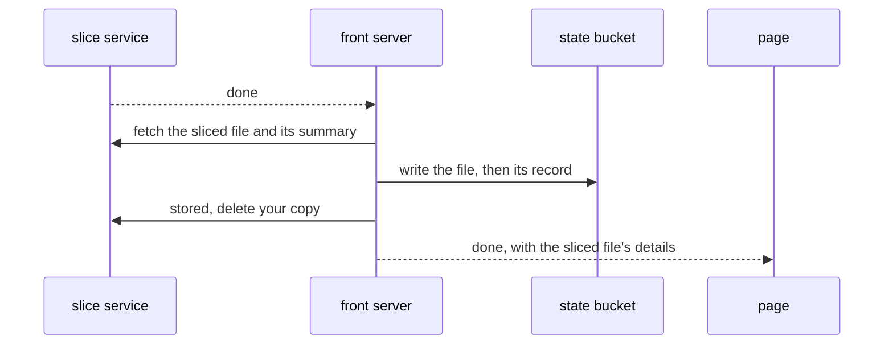

# The front server: the builder's document

This is the builder's document for the front server. The guide beside it,
[README.md](README.md), is what the owner reads and decides from. Where the two differ, the
guide is right and this file is to be corrected. Of the front server, items 1 to 9 of
[Phase 2](#phase-2-one-machine-no-onshape-no-printer) are built: the project and its fakes,
[the bucket interface](#the-bucket-interface) in its folder form,
[the rules for every request](#rules-for-every-request) with
[the version on every answer](#the-version-and-old-and-new-versions-together),
[the log's writer](#the-log), [the development identity](#the-development-identity) and
[the cookie](#the-cookie) with one cookie key,
[serving the wizard's pages](#serving-the-wizards-pages),
[the current group's check and `GET /api/me`](#groups-and-the-current-group),
[the configuration](#the-configuration) and [the table of settings](#the-table-of-settings).
What this file says of those is true of the code in `front/`;
every other sentence is design: it restates each requirement of the guide in the builder's
terms, with the code-level names (requests, settings, constants, error codes, records) and
the tests each requirement needs.

The names of every request and answer between the wizard and the front server, their
headers, statuses and error codes, are fixed by
[the contract between the wizard and the front server](../contracts/wizard-front-server.md),
and the shapes that pass are fixed by the data contracts it names. This file uses those
names and does not restate the shapes; where this file and a contract differ on a name or a
shape, the contract is right. The slice service's requests and answers are fixed the same
way by [the slice service's HTTP interface](../contracts/slice-http-interface.md). Names
marked *proposed* (constants, the names of records in the buckets, test names) are this
file's suggestions, and the builder settles them while building; the settings and their
defaults are fixed under [Running phase 2 on one machine](#running-phase-2-on-one-machine). A
line marked **Open** names an item the guide leaves undecided or unmeasured, with a link to
it in the guide; build nothing past it until it is settled, and where something must be
built before it is settled, the line says which reading to build.

**Terms.** The **front server** is everything behind PenguinSlicer's one address: it serves
the wizard's page files, signs users in with Onshape, passes parts and plate configurations
to the slice service, keeps sliced files and configurations, writes the log, and from
phase 5 runs the relay. It is a component of its own, in `front/`. The **wizard** is the code
in the browser, in `wizard/` ([the wizard's guide](../wizard/README.md)); a **page** is the
wizard as loaded in one browser tab or in Onshape's panel. **The Onshape integration**, in
`onshape/`, is the component that makes PenguinSlicer work inside Onshape: the Onshape app
and its panel, the exchange with Onshape's page that tells the wizard which document and
element it is in and what is selected, and the export of the selected parts and the
document's units to the wizard as a part set. Signing in is the front server's, not the
Onshape integration's. A **stand-in** is a fake of something outside the front server that a
test controls. The phases are those of [the plan](../docs/plans/penguin-slicer-plan.md):
phase 2, one machine; phase 3, hosted on Railway; phase 4, inside Onshape; phase 5, the
printer.

## Contents

- [Where the front server sits](#where-the-front-server-sits)
- [Rules for every request](#rules-for-every-request)
- [Serving the wizard's pages](#serving-the-wizards-pages)
- [Signing in](#signing-in)
- [The cookie](#the-cookie)
- [Signing out](#signing-out)
- [Groups and the current group](#groups-and-the-current-group)
- [Calls to Onshape](#calls-to-onshape)
- [Requests from other sites](#requests-from-other-sites)
- [The development identity](#the-development-identity)
- [The user key](#the-user-key)
- [The slice service's requests](#the-slice-services-requests)
- [Parts](#parts)
- [Submitting a plate configuration](#submitting-a-plate-configuration)
- [Following slice jobs and storing sliced files](#following-slice-jobs-and-storing-sliced-files)
- [Asking about a slice job](#asking-about-a-slice-job)
- [Progress streams](#progress-streams)
- [The sliced file's details and the sliced file](#the-sliced-files-details-and-the-sliced-file)
- [Two hours, the sweep, and the backstop](#two-hours-the-sweep-and-the-backstop)
- [The configuration](#the-configuration)
- [The table of settings](#the-table-of-settings)
- [The bucket interface](#the-bucket-interface)
- [The log](#the-log)
- [The page's reports about itself](#the-pages-reports-about-itself)
- [The version, and old and new versions together](#the-version-and-old-and-new-versions-together)
- [Starting, and what a restart does](#starting-and-what-a-restart-does)
- [Stopping](#stopping)
- [Threads](#threads)
- [Running the relay, from phase 5](#running-the-relay-from-phase-5)
- [Secrets and settings](#secrets-and-settings)
- [Running phase 2 on one machine](#running-phase-2-on-one-machine)
- [Limits](#limits)
- [Security](#security)
- [Error reports](#error-reports)
- [The fast suite](#the-fast-suite)
- [What is undecided or unmeasured, and where it bears](#what-is-undecided-or-unmeasured-and-where-it-bears)
- [By phase](#by-phase)

## Where the front server sits

Guide: [What it is for](README.md#what-it-is-for).

One address, `https://penguinslicer.popcornpenguins.com/`, serves the wizard's pages, the
address a daemon is given for the relay, and the redirect address of the Onshape app. The
browser and the daemons talk only to the front server. The front server calls the slice
service over Railway's private network (on one machine, over the loopback address), so the
slice service cannot be reached from the internet and the browser never makes a request to
another site ([the architecture](../docs/architecture.md#the-shape)).

The slice service runs in a container of its own, the **slice container**, which holds no
secret and no credential and accepts requests only from the front server. So the front
server passes every part and plate configuration through, fetches every sliced file, and
fetches the slice service's log lines ([The slice service's requests](#the-slice-services-requests)).

Cloudflare's proxy sits in front of the address and runs none of PenguinSlicer's logic.
Every answer except the wizard's page files carries `Cache-Control: no-store`
([the contract](../contracts/wizard-front-server.md#not-kept-by-any-proxy-or-browser)), so no
proxy or browser ever keeps one user's sliced file or configuration.

**What it holds.** No database, no table of sessions, no accounts. What must outlast a
restart is in one of two places the front server does not itself contain:

- **The browser:** who is signed in is in [the cookie](#the-cookie); the user's parts,
  layout and chosen settings are in the browser's storage, which is the wizard's.
- **Two object stores at Cloudflare R2:** the **state bucket** (each group's configuration;
  the sliced files, each with its record; from phase 5 the relay's records) and the **log
  bucket** (the log as files). On one machine, in phase 2, a folder stands in for each,
  behind [the bucket interface](#the-bucket-interface).

The front server holds the only credential that writes to the buckets; beyond it only the
owner can, through Cloudflare's console.

**What it never holds:** a user's part (it passes through, no copy kept); a session; a
password or an account; a plate configuration that is waiting (it passes each one to the
slice service at once and keeps none back, even while the slice service is stopping); and
anything that is lost by restarting it, with three exceptions: the log lines gathered in
the last minute before a crash; from phase 5 the printers' latest status, which each daemon
sends again within seconds; and from phase 5 the pairing codes daemons are offering, which
each daemon offers again within half a minute.

**One process.** *Proposed:* the front server runs as one process with a fixed pool of 100
threads ([Threads](#threads)), because it follows each unfinished slice job once, and from
phase 5 the relay's memory (the printers' status, the pairing codes on offer, the held
syncs) belongs to one process.

**What it exchanges.**

| With | What passes | Contract |
|---|---|---|
| The wizard | Pages; parts and plate configurations going up; progress, the sliced file's details and the sliced file coming down; the group's configuration; the table of settings; the page's reports about itself; from phase 5, sends and the printer's status | [The wizard and the front server](../contracts/wizard-front-server.md); [error reports](../contracts/error-report.md); [progress reports](../contracts/progress-report.md) |
| The slice service | Parts and [plate configurations](../contracts/plate-configuration.md) in; progress, the [sliced file](../contracts/sliced-file.md) and its summary, the [table of settings](../contracts/settings-table.md), the list of slice jobs and log lines out | [The slice service's HTTP interface](../contracts/slice-http-interface.md) |
| Onshape | Who a user is and their companies and classrooms; from phase 4, the parts a user selected, on behalf of the Onshape integration | Onshape's public interface |
| The state bucket | Configurations, sliced files and their records; from phase 5 the relay's records | [The configuration](../contracts/configuration.md) for the configuration |
| The relay, from phase 5 | Who is asking; a store for its records; the sliced file | [The interface the relay offers its caller](../delivery/README-details.md#the-interface-the-relay-offers-its-caller) |

**Open:** [the cost](README.md#the-cost); nothing to build depends on it.

### Tests

- Every answer other than a page file carries `Cache-Control: no-store`; the test
  enumerates the front server's requests from the application itself.
- No part's bytes are in the state bucket or the log bucket after the whole fast suite.

## Rules for every request

Guide: [What it exchanges](README.md#what-it-exchanges-and-under-which-contract).
Contract: [Rules for every request](../contracts/wizard-front-server.md#rules-for-every-request).

The contract's rules hold for every request. What the front server must build for them:

- **The requests at a glance.** The front server offers exactly the requests of
  [the contract's table](../contracts/wizard-front-server.md#the-requests-at-a-glance) that
  its phase builds, and answers any other path or method `404` `front.no_such_request`. It
  offers no request to cancel a slice job and none to read a user's groups again.
- **Answers.** A successful `/api/` answer is a JSON object, except the sliced file and the
  progress streams. Every failure is an [error report](../contracts/error-report.md) as the
  whole body: the front server's own (`front.*`, [Error reports](#error-reports)), or the
  slice service's (`slice.*`) and, from phase 5, printer delivery's (`delivery.*`) passed
  unchanged with the status the component gave. A request that should carry JSON and does
  not is `400` `front.bad_request`. An exception inside the front server is answered `500`
  `front.unexpected`, and its trace goes to the log.
- **Times.** A time is RFC 3339 in UTC to the second; a length of time is whole seconds in
  a field ending `_s`; where the page must act at a moment the front server reckons, the
  answer gives the seconds from the answer to that moment (`expires_in_s`).
- **Ids.** A slice job's id is the slice service's, a delivery job's the relay's: opaque
  strings of 1 to 64 letters, digits, `-` and `_`. A group's id is Onshape's id for the
  company or classroom, or the user's own Onshape id for a group of one. The front server
  refuses an id of another form in a path as `404` before it asks anyone.
- **Every request is safe to repeat.** The page retries quietly for up to 300 seconds, so
  any request may arrive several times; each section below says how a repeat is
  recognised. The quiet retries are the page's; the front server's part is to answer the
  codes that the page retries quietly (`front.slice_unreachable`,
  `front.state_bucket_unreachable`, `front.onshape_unreachable`, `front.too_many_requests`,
  `front.unexpected`) exactly when they apply, with `Retry-After` on the `429`s.

The cookie, the current group, the wizard's mark and the version are in their own sections
below: [The cookie](#the-cookie), [Groups and the current group](#groups-and-the-current-group),
[Requests from other sites](#requests-from-other-sites) and
[The version](#the-version-and-old-and-new-versions-together).

**As built** (`penguin_front.app`, `penguin_front.errors`):

- A handler refuses by raising `FrontError(code, detail)`; the application answers its
  report with the code's status. Each code the front server produces is in
  `errors.FRONT_REPORTS` with its status, `retryable` and its two sentences, added in the
  commit that first produces it. So far: `front.bad_request`, `front.no_such_request`,
  `front.unexpected`, `front.not_signed_in`, `front.group_not_allowed`,
  `front.configuration_changed`, `front.configuration_invalid`, `front.slice_unreachable`
  and `front.state_bucket_unreachable`. A report whose sentence must say what in particular
  went wrong (`front.configuration_invalid`) passes its own `message`. Another component's
  report is passed by raising `PassedReport(status, body, report)`, answered with its bytes
  unchanged.
- **Not offered** includes an `OPTIONS` request to any path, a request target whose path
  does not start with a slash (`GET x`, or `GET http://host` with no path at all), a path
  with a doubled slash anywhere in it, its start included, a path holding an encoded slash
  `%2F` (in either case) anywhere, which the server would decode into a slash and serve
  `/t%2Fx` as `/t/x`, and a path that differs from an offered one only by a trailing slash, all `404`
  `front.no_such_request`, never a redirect, with no `Allow` header. The check reads the
  path of the request's target as sent (`REQUEST_URI`, without its query and, in the
  absolute form `http://host/path`, without its scheme and host), since waitress drops a
  path's leading slashes before the application sees it and would have `//x` served as
  `/x`; the report and the log line give that path, still percent-encoded. A doubled slash
  in the query alone is no reason to refuse. A `HEAD` is answered wherever a `GET` is, as
  HTTP requires. `tests/test_server.py` sends these request lines through waitress itself.
- **Not JSON** (`json_body()`): the body is read as JSON whatever its `Content-Type` says;
  an empty body, one cut short, one not in UTF-8, one using `NaN` or `Infinity`, one
  holding a number too large for a float (`1e999`, which would be read as an infinity), or
  one nested too deeply for Python's reader (whole or cut short) is `400`
  `front.bad_request`. A refusal of the web framework's own below 500 (a body too large, a
  header too long) is `front.bad_request` too, and one of 500 or more `front.unexpected`.
- **Unexpected:** the report's `detail` names an incident id and nothing of the failure;
  the log line carries the same `incident` and the whole `trace`.
- **One line for each error report answered**, event `error`: `code`, `status`, `method`,
  `path` (never the query string, which carries Onshape's code from phase 3), `detail`
  except on a `500`, `user_key` and `group` once the request has read the cookie and
  checked the current group, and `page_version` when `X-PenguinSlicer-Page` has the version's form
  (a header of any other form is not written).
- **The page files** are marked by `page_file(response, cache_control)`; every other answer,
  an error report from a page file's request included, gets `Cache-Control: no-store`.

### Tests

- The application's requests, enumerated from the application, are exactly the contract's
  for the phase built: the test reads the contract's table "The requests at a glance" from
  [the contract](../contracts/wizard-front-server.md#the-requests-at-a-glance) and holds the
  application to `BUILT` in `tests/test_rules.py`, the requests built so far, every one of
  them a phase 2 row. Each item that builds a request adds it to `BUILT`.
- A path and a method the front server does not offer each answer `404`
  `front.no_such_request`.
- A request whose JSON body is not JSON answers `400` `front.bad_request`.
- A handler made to raise (by a stand-in) answers `500` `front.unexpected`, and the log
  holds the trace.
- Every failure answer of every request is an error report with all its required fields.

## Serving the wizard's pages

Guide: [Why it is the one thing the internet reaches](README.md#why-it-is-the-one-thing-the-internet-reaches).
Contract: [The page files and the version](../contracts/wizard-front-server.md#the-page-files-and-the-version).

The page files are built from `wizard/` and go out with the front server, so a deploy of
one is a deploy of both. What the wizard's build hands over, and how the front server finds
it, is fixed in [The wizard's built files](../contracts/wizard-front-server.md#the-wizards-built-files):
`make -C wizard build` writes `wizard/dist/index.html` and `wizard/dist/assets/`, every asset
already named with the hash of its contents and every reference to it already written; the
front server finds the folder by `PENGUIN_WIZARD_DIST` (default: `wizard/dist/` of its
checkout), reads `index.html` once at start, replaces the placeholder
`__PENGUINSLICER_VERSION__` with its version, and serves the assets as it finds them. Its
version is `PENGUIN_VERSION`, set by a release build, or, unset, the moment it started in UTC
followed by `-0000000`. A hosted release's image holds the built folder.

- **`GET /`.** Signed in: the wizard's page, with its version in
  `<meta name="penguinslicer-version">`, `Cache-Control: private, no-cache`. Not signed in,
  outside Onshape's panel: `302` to `/signin?return=<path and query>`; in phase 2 the trip
  signs in [the development identity](#the-development-identity) at once. Not signed in,
  inside the panel (`in=onshape`, phase 4): `200` with the **Connect page**, a plain page
  with the header's first line and one button, Connect, and none of the wizard's code. Any
  query string is kept through a sign-in.
- **`GET /assets/<file>`.** `200` with `Cache-Control: private, max-age=31536000,
  immutable`; `401` `front.not_signed_in` without a sign-in, so that no browser without a
  signed-in user receives the wizard's code; `404` `front.no_such_request` for a name this
  release does not have.
- **Safari** (phase 3). `GET /` from Safari, in a tab or in the panel, signed in or not,
  answers `200` with a plain page saying that PenguinSlicer needs Chrome, and none of the
  wizard's code. *Proposed:* Safari is recognised by a user agent that names `Safari` and
  none of `Chrome`, `Chromium`, `CriOS` or `Edg`. Chrome is the supported browser and Edge
  is tested ([the wizard's guide](../wizard/README.md#browsers-other-than-chrome)).
- **The content security policy.** Every page answer carries the contract's whole
  `Content-Security-Policy` ([The wizard's built files](../contracts/wizard-front-server.md#the-wizards-built-files)),
  whose `frame-ancestors` is `'self'` on one machine and `https://cad.onshape.com` from
  phase 3.
- **Starting without the page files.** A folder without `index.html`, or an `index.html`
  without the placeholder, stops the start with a log line naming the folder.

**As built** (`penguin_front.pages`): `load_pages(folder, version)` reads `index.html` (UTF-8)
and the bytes of every file directly in `assets/` once, at start, so a rebuild of the folder
while the front server runs changes nothing it serves; a file in a folder inside `assets/`
or one whose name starts with `.` is not served. A folder that cannot be served raises
`PagesUnusable`, a `SettingError` of `PENGUIN_WIZARD_DIST`, so the start writes
`start_refused` naming the setting and the folder and exits with status 2. `GET /` without
a sign-in answers `302` to `/signin?return=` followed by the path and query as sent,
percent-encoded whole. An asset answers with its kind from a fixed table (`.js` and `.mjs`
`text/javascript`, `.css`, `.woff2`, `.woff`, `.svg`, `.png`, `.json`, `.wasm`, `.map`), and
otherwise the machine's, and `X-Content-Type-Options: nosniff`. The policy's
`frame-ancestors` is Onshape's address whenever `PENGUIN_BASE_URL` is `https`, and `'self'`
otherwise (`CSP_HOSTED`, `CSP_ONE_MACHINE`).

### Tests

Built: `tests/test_pages.py`, except the Safari page (phase 3) and the Connect page (phase 4).

- `GET /` with no cookie answers `302` to `/signin` with `return`, and the answer holds no
  byte of the wizard's built files; `GET /assets/<file>` with no cookie answers `401`
  `front.not_signed_in`.
- With a cookie, `GET /` answers the page with the version in its `meta` and
  `private, no-cache`; an asset answers with `immutable`; an unknown asset `404`.
- A Safari user agent receives the plain page, signed in and not, with no wizard code; a
  Chrome and an Edge user agent receive the wizard (phase 3).
- Every page answer carries the contract's whole content security policy, with
  `frame-ancestors` Onshape's address alone hosted and `'self'` on one machine.
- The page is served with the placeholder replaced by the version, from a built folder the
  test makes; a folder without the placeholder stops the start; with `PENGUIN_VERSION` unset
  the version is the fake clock's start moment followed by `-0000000`.
- `GET /?in=onshape` with no cookie answers the Connect page (phase 4).

## Signing in

Guide: [Signing in](README.md#signing-in),
[Onshape is the only sign-in](README.md#onshape-is-the-only-sign-in-and-there-are-no-accounts),
[Who may sign in](README.md#who-may-sign-in).
Contract: [Signing in and signing out](../contracts/wizard-front-server.md#signing-in-and-signing-out).

Every user signs in with Onshape's OAuth, the same way inside Onshape's panel and outside
it, through one registered Onshape app. No other sign-in is offered, so PenguinSlicer keeps
no accounts and no passwords. Signing in is open to anyone with an Onshape account: there
is no list of permitted users or groups. From phase 3 the Onshape app asks permission for
three things: to read who the user is, to read their companies and classrooms, and to read
their documents (unused until phase 4, asked from the start so nobody approves the app
twice). It never asks permission to write.

A sign-in is a **trip**: the browser goes to Onshape and comes back.

1. **`GET /signin?return=<path>`** sends the browser to Onshape's approval page with a
   random value of the front server's own making, which it also keeps in a short-lived
   cookie of its own for the callback to compare (*proposed*: OAuth's `state`, in a cookie
   named `penguinslicer_trip`, lasting ten minutes, `SIGNIN_TRIP_S` 600). `return` must
   start with a single `/`; anything else is ignored and `/` used. A signed-in browser makes
   the trip as well; each trip makes a fresh value and the last one wins. In phase 2,
   with the development identity on, it sets the development identity's cookie and goes
   straight to `return`.
2. **`GET /signin/callback`** checks that the returned value is the one sent out.
3. It exchanges the code for tokens and makes the only two calls of a sign-in: who the user
   is, and their companies and classrooms ([Calls to Onshape](#calls-to-onshape)).
4. It sets [the cookie](#the-cookie), writes the sign-in's log line (the user key, the
   user's name and their groups) and answers `302` to `return`. It reads no configuration:
   the page, once it opens, asks for the current group's.

A user who belongs to no company or classroom is a group of one: one group whose id is the
user's own Onshape id and whose name is the user's name. **Open:**
[what Onshape answers for an account with no company or classroom](README.md#what-onshape-answers-for-an-account-with-no-company-or-classroom);
build the group of one from an empty list, and add a test of the real answer once it is
seen in phase 3. **Open:**
[whether any Onshape account can approve the app before it is public](README.md#whether-any-onshape-account-can-approve-the-app-before-it-is-public);
nothing to build depends on it.

**The callback's answers** are the contract's: `302` with the cookie; in the small window
(`window=1`, phase 4) `200` with a small page that posts `{"penguinslicer": "signed_in"}`
to its opener at the front server's own address only and closes itself; otherwise the
**failed sign-in page**, a plain page served by the front server with the header's first
line, the error report's `message` and `remedy`, that the user's parts, layout and settings
are kept in this browser, and one button, Sign in with Onshape, a link to `/signin` with
the same `return`:

| Status | When | Error report |
|---|---|---|
| `401` | The user refused Onshape's request | `front.sign_in_refused` |
| `401` | The value is not the one sent out (including a callback used a second time, whose value is spent), or Onshape refused the code | `front.sign_in_failed` |
| `503` | Onshape did not answer | `front.onshape_unreachable` |

In the small window the failed page posts `{"penguinslicer": "sign_in_failed", "report":
<error report>}` to its opener and closes itself.

**What starts a trip** is the page's: a request answered `front.not_signed_in` tells an
open page to make the trip at a quiet moment and return to the same step; a page that comes
back still not signed in does not leave again by itself
([the wizard's guide](../wizard/README.md#signing-in)). The front server's part is to answer
`401` `front.not_signed_in` to every `/api/` and `/assets/` request without a readable
cookie in date, and `302` to `/signin` for `GET /`. Nothing offers a user a way to sign in
again by hand.

### Which requests need a signed-in user

Every request needs one except `/`, `/signin`, `/signin/callback`, `/api/signout` and
`/signed-out`, which each say what they do without one, and, from phase 5, the daemon's own
requests to the relay, which carry the relay's token instead, and the offer of a pairing
code by a daemon not yet paired, which carries neither
([printer delivery's details](../delivery/README-details.md#pairing)).

### Tests

On the stand-in for Onshape, with a fake clock:

- Every request but the exceptions, enumerated from the application, refuses a request
  with no cookie: `/api/` and `/assets/` with `401` `front.not_signed_in`.
- `/signin` answers `302` to the stand-in's approval page with a fresh `state`, and sets
  the trip's cookie; a `return` of `//other.example/`, `https://other.example/` or `x`
  comes back as `/`.
- The callback with a `state` other than the one sent out answers `401` with the failed
  sign-in page and `front.sign_in_failed`, and writes a refusal line; a callback repeated
  after success does the same.
- The stand-in refusing the code gives `front.sign_in_failed`; the user's refusal,
  `front.sign_in_refused`; the stand-in not answering, `503` `front.onshape_unreachable`;
  each page holds the report's sentences and a Sign in with Onshape link carrying the same
  `return`.
- A sign-in makes exactly two calls, sets the cookie, writes the sign-in line with the user
  key, name and groups, reads nothing from the state bucket, and answers `302` to `return`.
- A user the stand-in reports with no company or classroom gets one group, their own id
  and name.
- A trip past `SIGNIN_TRIP_S` on the fake clock is refused `front.sign_in_failed`.
- The authorization request names the three permissions and no permission to write
  (phase 3).
- In the small window, success and failure each answer the small page with the message the
  contract gives, addressed to the front server's own address (phase 4).

## The cookie

Guide: [The cookie, and why there are no sessions](README.md#the-cookie-and-why-there-are-no-sessions),
[The cookie inside Onshape's panel](README.md#the-cookie-inside-onshapes-panel).
Contract: [Signed in](../contracts/wizard-front-server.md#signed-in).

A sign-in sets one cookie, **the cookie**, named `penguinslicer`, `HttpOnly`, `Path=/`.
Hosted it is `Secure; SameSite=None`, the kind a browser sends to a page embedded in another
site, so that the same cookie serves Onshape's panel from phase 4; on one machine over plain
HTTP it is `SameSite=Lax` without `Secure`. It holds the user's Onshape id and name, each
of their groups by id and name in a fixed order, the two tokens Onshape issued (the access
token, which authorises calls for an hour, and the refresh token, which renews it), the
time of its last use and a format number. It is encrypted and authenticated with the
**cookie key**, a secret only the front server has, so the browser can neither read it nor
change it (*proposed*: AES-GCM or Fernet over the JSON of its fields).

**No session on the server.** The cookie is the whole of the sign-in. Nothing about it is
kept in memory or in a bucket, and the cookie key is a setting the front server is given at
start. So a restart or a deploy signs nobody out, two front servers of different versions
agree at once about who a user is, and a cookie set by the previous front server is read by
the new one.

**Thirty days from its last use.** A sign-in lasts thirty days (`COOKIE_LIFETIME_S`,
2,592,000 s; *proposed* name) from its last use, and each use extends it: an answer to a
signed-in request carries a new `Set-Cookie` moving the thirty days on. How often is the
builder's (*proposed*: when more than a day, `COOKIE_EXTEND_AFTER_S` 86,400, has passed
since the cookie's last-use time, so that most answers carry no `Set-Cookie`). A cookie
past its thirty days, one neither cookie key reads, or one that is missing is treated as no
sign-in. A user who opens PenguinSlicer at least once in thirty days is never asked to sign
in again in that browser. Two answers extending the same cookie at once carry the same
tokens, so either may win.

**Onshape's tokens.** The access token is renewed with the refresh token only when a call
to Onshape needs one, and the renewed tokens are written back into the cookie. Before
phase 4 nothing needs one, unless the Onshape app is public by then and the daily reading
of groups ([Groups and the current group](#groups-and-the-current-group)) needs one. **Open:**
[two requests renewing the tokens at once](README.md#two-requests-renewing-the-tokens-at-once):
designed with phase 4; build no renewal before then. **Open:**
[whether renewing a token counts as a call](README.md#whether-renewing-a-token-counts-as-a-call):
log every renewal as a call to Onshape until it is known.

**Size.** A browser drops a cookie over about 4 KB without a word, and that user could
never sign in. **Open:** [whether the cookie fits](README.md#whether-the-cookie-fits),
measured with a real account in phase 3; if it does not fit, the tokens leave the cookie
until phase 4 needs them. The front server writes a log line, with the size, whenever a
cookie it sets is over 3,800 bytes (*proposed*).

### Two cookie keys, and replacing one

Guide: [Secrets](README.md#secrets). From phase 3 the front server holds two cookie keys,
the current one and the previous one for reading only (*proposed* settings:
`PENGUIN_COOKIE_KEY`, `PENGUIN_COOKIE_KEY_PREVIOUS`). A cookie it can read only with the
previous key is rewritten with the current one, and each such use writes a log line. A
planned replacement makes the current key the previous one and a new key current, which is
a change of settings and so a restart; the previous key is removed one week after the
replacement (`PREVIOUS_COOKIE_KEY_KEPT`, 7 days; *proposed*; the removal is the owner's
change of settings). A user who does not open PenguinSlicer in that week signs in again, for
two calls to Onshape. A leaked key is replaced and not kept as the previous key, and every
user signs in again. The steps are written in the repository as a procedure
([the architecture](../docs/architecture.md#security)). Phase 2 has one cookie key.

**Open (phase 4):** [what Chrome allows an embedded page](README.md#what-chrome-allows-an-embedded-page),
whether Chrome always sends this cookie to the page embedded in Onshape. Build the cookie
as above; phase 4 tries it in real Chrome first.

**As built** (`penguin_front.cookie`, `penguin_front.identity`): the fields are one JSON
object (`format` 1, `user` `id` and `name`, `groups` each `id` and `name`, `tokens`, null
for the development identity, and `used_at` in whole seconds), sealed with AES-256-GCM
under a key derived from `PENGUIN_COOKIE_KEY` by HKDF-SHA256, a fresh 12-byte nonce each
time, written as unpadded base64url. `CookieKey.open` gives None for text over 8,192
characters or of the wrong form, a changed byte, another key, a format other than 1 to
`COOKIE_FORMAT`, a shape it does not read, or `used_at` thirty days or more ago. The thirty
days (`COOKIE_LIFETIME_S`) move on when more than `COOKIE_EXTEND_AFTER_S` (86,400 s) has
passed since `used_at`, on every answer to a request that read the cookie, an error
included; a request that reads no cookie (a path not offered) carries none. The cookie goes
out with `Max-Age` of the thirty days; `Secure; SameSite=None` whenever `PENGUIN_BASE_URL`
is `https`, `SameSite=Lax` otherwise. A cookie set over `COOKIE_SIZE_LINE_BYTES` (3,800)
writes `cookie_large` with `bytes`, `user_key` and `groups` (the count). Measured: the
development identity's cookie is far under it; one of a user in sixty groups of
80-character names, with two 40-character tokens, is 10,360 bytes, which no browser keeps
([Whether the cookie fits](README.md#whether-the-cookie-fits) stays open for phase 3).

### Tests

Built: `tests/test_identity.py`, except the previous cookie key (phase 3).

On a fake clock:

- A cookie made with the current key is read; one changed by a single byte, or made with
  an unknown key, is treated as no sign-in.
- A cookie used twenty-nine days after its last use is read, and its answer moves the
  thirty days on; one unused for thirty days is treated as no sign-in; a cookie used every
  twenty days for a year is still read.
- An answer within a day of the last extension carries no `Set-Cookie`.
- The cookie hosted carries `HttpOnly`, `Secure`, `SameSite=None` and `Path=/`; on one
  machine `HttpOnly`, `SameSite=Lax`, no `Secure`.
- A cookie made with the previous key is accepted, rewritten with the current key, and the
  use is logged (phase 3).
- The cookie of a user with sixty groups of 80-character names (*proposed* figures) is set,
  and the test reports its size; one over 3,800 bytes writes the size line.
- A restart of the front server with the same keys reads every cookie set before it.
- A cookie of the previous format is read by the new front server.

## Signing out

Guide: [Signing out](README.md#signing-out). Contract:
[`POST /api/signout`](../contracts/wizard-front-server.md#post-apisignout--sign-out),
[`GET /signed-out`](../contracts/wizard-front-server.md#get-signed-out--the-page-after-signing-out).
Phase 3.

Outside Onshape the page has a Sign out link; inside the panel there is none.
`POST /api/signout` answers `200` `{}` with a `Set-Cookie` that removes the cookie; it costs
no call to Onshape and needs no sign-in, so a second sign-out answers the same. It carries
the wizard's mark. `GET /signed-out` is a plain page with the header's first line, "You are
signed out of PenguinSlicer.", and one button, Sign in with Onshape, a link to `/signin`;
nothing on it leaves for Onshape by itself, it needs no sign-in and holds none of the
wizard's code. Signing out of PenguinSlicer does not sign the user out of Onshape (accepted:
on a shared computer the next person is one click from the previous user's sign-in).

### Tests

- Sign-out removes the cookie, makes no call to the stand-in, and answers the same with no
  cookie.
- `/signed-out` holds the sentence and the link, and no wizard code.

## Groups and the current group

Guide: [Groups and the current group](README.md#groups-and-the-current-group).
Contract: [The current group](../contracts/wizard-front-server.md#the-current-group),
[`GET /api/me`](../contracts/wizard-front-server.md#get-apime),
[Inside Onshape's panel](../contracts/wizard-front-server.md#inside-onshapes-panel).

A **group** is the users who share one configuration and one printer: one Onshape company or
classroom, or a user alone who belongs to none. Every user of a group may do everything in
it; there are no roles. A user works in one group at a time, the **current group**: outside
Onshape the one the user chooses in the header when they are in several; inside Onshape's
panel, from phase 4, the group of the document the user has open, with no choice offered.

**The check.** A request that acts for a group carries the current group in the header
`X-PenguinSlicer-Group`, a group's `id` as `/api/me` gives it; a `GET` may carry it instead
in the query parameter `group`, and when both are present they must be equal. The front
server accepts it only when the cookie lists it among the user's groups. A request that acts
for a group and names none, names one the cookie does not list, or names two that differ is
answered `403` `front.group_not_allowed` and the refusal is logged. The requests that act
for a group: `GET` and `PUT /api/configuration`; `POST /api/parts`; `POST /api/slices`;
`GET /api/slices/<slice>`, its `/events`, `/summary` and `/file`; and from phase 5 every
`/api/printer` request. The page's reports carry the group when the page has one and are
never refused for it. `/api/me`, `/api/settings-table`, the page files and the sign-in
requests act for no group.

**`GET /api/me`** answers from the cookie, with no call to Onshape: `user` (`id`, the user
key, and `name`) and `groups` (at least one, each `id` and `name`, in a fixed order; "the
first of the user's groups" is the first of this list). In phase 2 it answers the
development identity's made-up user and group. *Proposed:* the order is Onshape's order at
sign-in, with a group of one last.

**When the groups are read again.** The groups in the cookie are read from Onshape at every
sign-in, and in two other cases:

- **Inside Onshape's panel, from phase 4.** A request carrying `X-PenguinSlicer-In:
  onshape` whose current group the cookie does not list makes the front server read the
  user's groups again from Onshape, with the tokens in the cookie, and write the fresh list
  into the cookie in the same answer; only then is the request accepted or answered
  `front.group_not_allowed`. Without the group header, the front server finds the company
  of `X-PenguinSlicer-Onshape-Document` from Onshape. What the browser says is never proof:
  it can cause a fresh read, and only Onshape's answer adds a group. Outside the panel
  nothing causes a fresh read. Onshape not answering is `503` `front.onshape_unreachable`.
- **Once a day, once the Onshape app is public.** How often a signed-in user's groups are
  read again on a schedule is a setting (*proposed*: `PENGUIN_GROUPS_REREAD`, `never` or a
  number of seconds; the cookie holds the time of the last read). Until the app is public it
  is `never`, so a user removed from an Onshape company keeps that group for as long as they
  keep using PenguinSlicer outside Onshape (accepted). Once the app is public it becomes one
  day. Built when the app is public, in no phase yet.

**A different person at the same browser** (phase 4). When `X-PenguinSlicer-Onshape-User`
is not the user the cookie names, the request is answered `401` `front.not_signed_in`, as
one that is not signed in; the page makes the trip by Connect, and the wizard clears the
previous user's stored work.

**Open (phase 4):** [what Onshape tells a panel](README.md#what-onshape-tells-a-panel):
whether it gives the user and the company. Without the company, finding the group of a
document costs a call for each document; without the user, nothing triggers the new sign-in.
Also open there: what a user meets for a document of a company they are not in, answered
`front.group_not_allowed` as designed. Phase 4's design counts the calls before building.

**As built** (`penguin_front.identity`): `signed_in()` gives the cookie's `Identity` or
raises `front.not_signed_in`; `current_group(identity)` reads the header, and on a `GET` or
`HEAD` the query's `group` (a changing request naming its group in the query alone names
none), compares the id exactly with the cookie's, and on a refusal writes `refused`
(`reason` `group_not_allowed`, `why`, `user_key`, `method`, `path` as sent, still
percent-encoded like the `error` line's, and the `header` and the first `query` named, each
cut to 200 characters) before the `error` line. A query naming `group` twice is accepted
when both are the same id and refused when they differ. Each request that acts
for a group is marked `@acts_for_group`, which is how the tests find them. `/api/me` keeps
the cookie's order of groups; with the development identity that is its one group.

### Tests

Built: `tests/test_groups.py`, except those marked phase 4.

- On every request that acts for a group, enumerated from the application, a request naming
  a group the cookie lists is accepted; one naming another group, one naming none, one
  whose header and query differ (on a `GET`; a changing request reads the header alone) and
  one whose query names two groups are each refused `403` `front.group_not_allowed` with a
  refusal line.
- A `GET` with the group in the query alone is accepted.
- `/api/me` answers the cookie's user and groups in order, and the stand-in for Onshape
  receives no call.
- With `PENGUIN_GROUPS_REREAD` `never`, no request reads the groups again, however old the
  cookie (fake clock).
- In the panel, a company the cookie does not list makes one read from the stand-in; a
  company the stand-in now lists is accepted and the answer's cookie holds it; one it still
  lacks is refused; outside the panel the same request makes no call (phase 4).
- In the panel, an `X-PenguinSlicer-Onshape-User` other than the cookie's user answers `401`
  `front.not_signed_in` (phase 4).

## Calls to Onshape

Guide: [Onshape's yearly allowance of calls](README.md#onshapes-yearly-allowance-of-calls),
[Sign-ins and the allowance](README.md#sign-ins-and-the-allowance).

Until an Onshape app is public in Onshape's App Store, every call it makes counts against a
yearly allowance of the account that owns it: 2,500 calls a year on a free or education
account (Onshape's figure). **Nothing calls Onshape that can be done without it.**

| Use | Calls to Onshape |
|---|---|
| Work on one machine, with the development identity | None |
| The automated tests, which use a stand-in for Onshape | None |
| A sign-in to the hosted service | 2; for a user who keeps coming back, once for each browser |
| Reading a signed-in user's groups once a day | None until the app is public |
| Reading a user's groups again when Onshape names a company the cookie does not list, from phase 4 | Counted in phase 4's design before anything is built |
| Reading parts from Onshape, from phase 4 | Several for each part; counted in phase 4's design before anything is built |

Nothing limits how often a user signs in; 1,250 sign-ins spend the year's allowance
(accepted). **Every call is counted:** each call the front server makes to Onshape writes
one log line naming it (*proposed* event `onshape_call`, with the endpoint and the user
key), and the command that reads the log reports the year's total.

**Open:** [which allowance the owner's account has](README.md#which-allowance-the-owners-account-has)
and [whether a second Onshape app shares the allowance](README.md#whether-a-second-onshape-app-shares-the-allowance);
nothing to build depends on either.

### Tests

- The whole fast suite runs with no route to Onshape: the client for Onshape is given the
  stand-in, and a test fails if any other client is built or any real address is called.
- Each call to the stand-in writes exactly one log line naming it; a sign-in writes two and
  the stand-in counts two.

## Requests from other sites

Guide: [Requests from other sites](README.md#requests-from-other-sites).
Contract: [The wizard's mark and the origin](../contracts/wizard-front-server.md#the-wizards-mark-and-the-origin).
Phase 3; the page sends the mark from phase 2, and the front server ignores it until
phase 3.

- **The wizard's mark and the origin.** Every request that changes something (every `POST`,
  `PUT` and `DELETE`) must carry `X-PenguinSlicer-Wizard: 1`, and its `Origin` header, when
  present, must be the front server's own address; when absent, `Sec-Fetch-Site` must be
  `same-origin`. These are: `POST /api/parts`, `POST /api/slices`, `PUT /api/configuration`,
  `POST /api/signout`, `POST /api/reports/failure`, `POST /api/reports/drawing`, and from
  phase 5 `POST` and `DELETE /api/printer/pairing`, `POST /api/printer/deliveries`, its
  `/cancel` and its `/stop-following`. A request that fails either test is answered `403`
  `front.not_from_wizard` and logged. No `GET` changes anything.
- **No reads from other sites.** No answer carries `Access-Control-Allow-Origin` or any
  other header that lets another site read it, the answer to a preflight included.
- **The sign-in checks the random value it sent out** ([Signing in](#signing-in)).
- **Only Onshape may frame the pages** ([Serving the wizard's pages](#serving-the-wizards-pages)).

### Tests

- Each changing request, enumerated from the application as every route whose method is not
  `GET` or `HEAD`, refuses one with a valid cookie but no mark, one whose `Origin` is
  another site, and one with no `Origin` and `Sec-Fetch-Site: cross-site`, each `403`
  `front.not_from_wizard` with a refusal line.
- No answer of any request, a preflight included, carries `Access-Control-Allow-Origin`.

## The development identity

Guide: [The development identity](README.md#the-development-identity).
Contract: [`GET /signin`](../contracts/wizard-front-server.md#get-signin--start-the-trip).

The **development identity** is a fixed, made-up user in a fixed, made-up group that the
front server signs in when a setting tells it to (`PENGUIN_DEV_IDENTITY=1`), for work on one
machine; its four fixed values are under
[Running phase 2 on one machine](#running-phase-2-on-one-machine). With it on, `/signin` sets the development identity's cookie at once
with no call to Onshape. Everything else runs as it does hosted: the cookie, the current
group's check, the user key. Built in phase 2 (`penguin_front.identity.DEV_IDENTITY`):
`/signin` sets the cookie, writes `sign_in` (`user_key`, `user_name`, `groups`,
`dev_identity` true) and answers `302` to `return` when it is a path of this site (a single
leading `/`, no `\`, which a browser reads as a slash, and no control character), and to `/`
otherwise. With the development identity off, `/signin` answers `404`
`front.no_such_request` until phase 3 builds signing in with Onshape.

**It can never be on in the hosted service** (phase 3). The command that starts the hosted
front server never sets it, and the front server refuses to start with it on when it finds
itself on Railway (*proposed*: any of the variables Railway sets, such as
`RAILWAY_ENVIRONMENT`) or finds an Onshape app's credentials among its settings
(`ONSHAPE_CLIENT_ID` or `ONSHAPE_CLIENT_SECRET`); it writes one log line saying why and
exits with a failure status.

### Tests

- With the setting on, `/signin` sets the development identity's cookie and the stand-in
  for Onshape receives no call; `/api/me` answers its user and group.
- With the setting on and a Railway variable present, the front server does not start,
  writes the one line and exits with a failure status; the same with an Onshape client id
  or secret present (phase 3).
- The hosted start command, read from the repository, does not set the setting (phase 3).

## The user key

Guide: [Whose it is](README.md#whose-it-is).

The **user key** is the signed-in user's Onshape id, taken from the cookie and from nowhere
else. With every request about a part or a slice job the front server tells the slice
service whose it is by the user key, in the header `X-Penguin-User-Key`
([the slice service's interface](../contracts/slice-http-interface.md#rules-for-every-request)). A user
key, or anything like one, in a request from the browser is never read. So a user reaches
only their own parts, slice jobs and sliced files, even among users of one group.

A slice job, sliced file or delivery job of another user is answered exactly as one that
does not exist (`404` `front.slice_unknown`, or `front.delivery_unknown` from phase 5), so
nobody learns whether another user's is there, and the attempt is logged as a refusal. The
slice service answers `slice.unknown_job` for another user key's slice job, and the front
server turns that into `front.slice_unknown`; sliced files are kept under the user key in
the state bucket, so another user's is never found.

### Tests

- A request carrying a user key or another user's id in its body, query or headers reaches
  the stand-in for the slice service with the cookie's user key.
- Asking about, following, and fetching the details or the file of another user's slice
  job each answer `404` `front.slice_unknown`, the same body as for one that never existed,
  and write a refusal line.
- No request to the stand-in for the slice service lacks the user key, except the three that
  answer for the whole slice service (the table of settings, the list of slice jobs, the
  log).

## The slice service's requests

Guide: [What it does for a part and for a slice](README.md#what-it-does-for-a-part-and-for-a-slice).

The front server is the slice service's only caller. Its client for the slice service is
given the slice service's address by the setting `PENGUIN_SLICE_URL`: the private network's
address hosted; on one machine, by default, `http://127.0.0.1:8640`, the slice service's
own default. The requests it uses, with every answer's shape, status and code, are fixed by
[the slice service's HTTP interface](../contracts/slice-http-interface.md):

| The slice service's request | The front server uses it for |
|---|---|
| `POST /parts?units=` | [Uploading a part](#parts) |
| `POST /slices` (JSON) | [Submitting a plate configuration](#submitting-a-plate-configuration) |
| `GET /slices` | [Starting](#starting-and-what-a-restart-does): every slice job the slice service process knows, with its user key and whether its sliced file is still there |
| `GET /slices/<job>` | [Asking about a slice job](#asking-about-a-slice-job) |
| `GET /slices/<job>/events` | [Following](#following-slice-jobs-and-storing-sliced-files) each unfinished slice job |
| `GET /slices/<job>/file`, `GET /slices/<job>/summary` | Collecting the sliced file and its summary |
| `DELETE /slices/<job>/file` | Telling the slice service the sliced file is stored |
| `GET /settings-table` | [The table of settings](#the-table-of-settings) |
| `GET /log?after=<n>` | [Gathering](#the-log) the slice service's log lines |

The front server never uses the slice service's request to cancel a slice job
(`DELETE /slices/<job>`): a slice cannot be cancelled by hand, and the front server offers
the page no request to cancel one. A slice service that does not answer is, to the page,
`503` `front.slice_unreachable`, a quiet retry. A slice service's answer of `slice.no_user_key`
is a fault of the front server's and is answered `500` `front.unexpected`.

**As built** (`penguin_front.slice_client.SliceClient`, used so far by the table of
settings): one httpx client for `PENGUIN_SLICE_URL`, with `trust_env` off so that no proxy
or `.netrc` the environment names is used for it; `get_raw(path, headers)` gives the
status, the headers and the answer's bytes as sent, never decompressed; no connection, a
connection cut, or nothing for `SLICE_TIMEOUT_S` (30 s, *proposed*) is `SliceUnreachable`.

### Tests

- The stand-in for the slice service answers as [its contract](../contracts/slice-http-interface.md)
  says, its answers checked against the contract's examples, and lets a test put its events
  in an exact order; it records every request it receives (built:
  `tests/test_slice_standin.py`).
- No request of the whole fast suite reaches the stand-in's cancel.
- The stand-in not answering gives `503` `front.slice_unreachable` on each request that
  calls it.

## Parts

Guide: [A part](README.md#a-part).
Contract: [`POST /api/parts`](../contracts/wizard-front-server.md#post-apiparts--upload-one-part).

The page uploads each part by itself, at the moment the user adds it, in one request: the
query parameter `units` (`mm` or `in`), the part's binary STL as the body with
`Content-Length`. The front server passes it to the slice service's `POST /parts?units=`
with the user key, and passes the answer back unchanged: `201` with the part's record, or
the slice service's refusal (`slice.part_too_detailed`, `slice.part_unreadable`,
`slice.part_not_binary`, `slice.part_too_small`, `slice.part_no_volume`,
`slice.part_too_large`, `slice.bad_units`), which the page shows on the Parts step as a
notification without adding the part. Neither the browser nor the front server ever changes
a part's bytes; only the slice service applies the scale. The slice service keeps a part
that passes in its **part store**, under the user key, the part's SHA-256 **hash** and its
units, for two hours after its last use. The front server keeps no copy.

- **Size.** At most 7,500,084 bytes (7.5 MB, the plate configuration's `MAX_PART_BYTES`).
  A `Content-Length` over it is refused `413` before the body is read, with the slice
  service's own report for that limit, `slice.part_too_detailed`, exactly as
  [examples/error-report-part-over-size.json](../contracts/examples/error-report-part-over-size.json)
  holds it; the slice service's suite asserts its own answer against the same file. No
  `Content-Length` is `400` `front.bad_request`.
- **Passed in pieces.** *Proposed:* the body passes to the slice service in pieces and is
  never held whole in memory, so the front server's memory does not grow with the uploads
  under way.
- **A repeat.** The same bytes under the same units answer the same record and count as a
  use; nothing more is needed of the front server.
- **How fast.** Uploads are limited for each signed-in user; past the limit, `429`
  `front.too_many_requests` with `Retry-After`, a quiet retry. The figure is the builder's
  (*proposed*: 120 uploads a minute for each user, `PART_UPLOADS_PER_MINUTE`, enough for a
  part set of 25 parts uploaded again after a restart of the slice service with room to
  spare).

**Open:** [Railway's limit on one request](README.md#railways-limit-on-one-request): build
the 7.5 MB limit; a lower limit has no fallback.

### Tests

- An uploaded part reaches the stand-in byte for byte with the cookie's user key and its
  `units`; the stand-in's record reaches the page unchanged, `201`.
- Each refusal of the stand-in reaches the page unchanged with its status.
- A `Content-Length` of 7,500,085 is refused `413` before any byte of the body is read
  (the stand-in receives nothing), with a body equal to
  [examples/error-report-part-over-size.json](../contracts/examples/error-report-part-over-size.json);
  7,500,084 passes. No `Content-Length` is `400` `front.bad_request`.
- A part streamed through a stand-in that reads slowly does not raise the front server's
  memory by the part's size (*proposed*: measured by the bytes held in the pipe).
- Past the limit on a fake clock, `429` `front.too_many_requests` with `Retry-After`; once
  the clock moves on, accepted.

## Submitting a plate configuration

Guide: [A plate configuration](README.md#a-plate-configuration),
[A plate configuration submitted twice](README.md#a-plate-configuration-submitted-twice),
[A plate configuration submitted while the slice service stops](README.md#a-plate-configuration-submitted-while-the-slice-service-stops).
Contract: [`POST /api/slices`](../contracts/wizard-front-server.md#post-apislices).

On the Preview step the page sends a **plate configuration** in its phase 2 form: each part
named by `sha256` and `units` with no files, the plate's `plate_id` and the submission's
`submission_id` ([the plate and the submission](../contracts/plate-configuration.md#the-plate-and-the-submission)),
the three profile names and the `overrides`. The front server passes it to the slice
service's `POST /slices` with the user key, and the slicing of it, a **slice job**, waits its
turn or runs in the slice container.

- **Size.** At most 1,048,576 bytes (1 MB, the plate configuration's
  `MAX_PLATE_CONFIGURATION_BYTES`, *proposed* there); a larger body is refused `413` before
  it is read, with the slice service's report for that limit, exactly as
  [examples/error-report-plate-configuration-over-size.json](../contracts/examples/error-report-plate-configuration-over-size.json)
  holds it, which both components' suites assert.
- **The current group** is noted beside the slice job, for the log and for the sliced
  file's record. *Proposed:* on acceptance the front server writes the slice job's record
  in the state bucket ([The records](#the-records-of-a-sliced-file)) with the group and the
  state `submitted`, so that a front server started later still knows the group; a write
  that fails is not an error for the page, and the group is then kept in memory only.
- **The answer** is the contract's: `202` `{"slice": {"id", "plate_id", "submission_id",
  "progress"}}` made from the slice service's `202` (`job`, `plate_id`, `submission_id`,
  `progress`, `part_warnings`; [its example](../contracts/examples/slice-http/slice-accepted.json)). The
  slice service's refusals reach the page unchanged: `slice.part_missing` with
  `where.missing_parts` (the page uploads those parts again and submits again with the same
  `submission_id`), the plate's checks (`slice.bad_plate_configuration`,
  `slice.too_many_instances`, `slice.too_many_parts`, `slice.unknown_printer`,
  `slice.profiles_not_offered`, `slice.bad_overrides`, `slice.part_too_large`,
  `slice.placement_off_plate`, `slice.placement_too_tall`, `slice.placement_too_close`),
  **the busy answer** `slice.busy` (`503`, which the page shows and never retries by
  itself), and **the stopping answer** `slice.stopping` (`503`, `retryable` true), passed
  unchanged: the page shows the slice as waiting with the words that the slicer is
  restarting, and submits again by itself with the same `submission_id` for up to 300
  seconds. The front server holds no submission back for later and never turns
  `slice.stopping` into another answer.
- **Several slice jobs for one user.** Nothing limits a user's slice jobs; everyone shares
  the slice service's places (one running and two waiting, as it starts). The only slice job
  a submission replaces is the earlier unfinished slice job of the same plate (the same user
  key and `plate_id`), which the slice service ends, its last report `cancelled` with
  `cancel_reason` `replaced`. The front server does nothing for the replacement except
  follow both slice jobs to their ends.
- **A repeat.** The slice service recognises a repeat by the user key and `submission_id`
  and answers `202` with the first attempt's slice job; the front server passes the value
  in and the answer back, and has nothing of its own to remember.
- **No cancel.** A slice cannot be cancelled by hand; the front server offers no request for
  it. A user who no longer wants a slice changes the plate or leaves it to finish.
- **How fast.** Submissions are limited for each signed-in user; past the limit, `429`
  `front.too_many_requests` with `Retry-After`. The figure is the builder's (*proposed*: 30
  a minute for each user, `SUBMISSIONS_PER_MINUTE`).

Once accepted, the front server [follows](#following-slice-jobs-and-storing-sliced-files)
the slice job.

### Tests

- A plate configuration reaches the stand-in with the cookie's user key, unchanged; the
  answer has the contract's shape, with the stand-in's first progress report.
- `slice.part_missing` with `where.missing_parts`, each of the plate's refusals,
  `slice.busy` and `slice.stopping` reach the page unchanged with their statuses; the
  stopping answer is never `slice.busy` and never `front.slice_unreachable`.
- A body of 1,048,577 bytes is refused before it is read, with a body equal to the
  contract's example; 1,048,576 passes.
- Two submissions of one user with different `plate_id`s give two slice jobs, both
  followed; a later submission of the same plate leaves the earlier one followed to its
  `cancelled` report with `cancel_reason` `replaced`.
- A repeat with the same `submission_id` answers the first attempt's slice job, and the
  front server follows one slice job, not two.
- After acceptance the slice job's record holds the current group (*proposed*).
- No request offered by the front server reaches the stand-in's cancel.
- Past the limit on a fake clock, `429` `front.too_many_requests` with `Retry-After`.

## Following slice jobs and storing sliced files

Guide: [The front server follows every slice job itself](README.md#the-front-server-follows-every-slice-job-itself).

**The front server follows every unfinished slice job itself**, page or no page: for each it
holds the slice service's progress stream (`GET /slices/<job>/events`, with the slice job's
user key). A slice job runs to its end through a refresh, a lost network or a closed laptop
lid, and the front server is what notices that it has ended and collects the result. Each
page's [progress stream](#progress-streams) is fed from the one stream the front server
holds, so three tabs watching one slice job cost the slice service one connection.

- **Each report once.** The front server passes each report on with its own `sequence` and
  drops a report whose `sequence` it has already passed (the slice service as built
  repeats its latest report every fifteen seconds on a quiet stream until phase 3).
- **A stream that closes** before a final report is reopened, with waits that grow
  (*proposed*: one second doubling to thirty, on the fake clock in tests). A slice service
  that answers the slice job unknown (the slice container restarted, or the record expired)
  ends the following; the pages' streams are closed, and each page then learns
  `front.slice_unknown` and decides from the time it kept
  ([the contract](../contracts/wizard-front-server.md#asking-about-a-slice-job)).

**When a slice ends** with a `done` report, the front server holds that report back from
every page and:

1. fetches the sliced file (`GET /slices/<job>/file`) and its **summary**
   (`GET /slices/<job>/summary`: the predicted print time, the filament used, the layer
   count and the warnings, [the sliced file](../contracts/sliced-file.md#summary));
2. stores both in the state bucket under the user key and the slice job's id, with the time
   the slice ended and the group ([The records](#the-records-of-a-sliced-file));
3. tells the slice service they are stored (`DELETE /slices/<job>/file`), and the slice
   container deletes its own copy;
4. only then passes the `done` report to every page that is following, adding to it the
   field `sliced_file`, [the sliced file's details](#the-sliced-files-details-and-the-sliced-file).



- **Nothing half-written.** The file is written first and the record last, so a record
  always names a whole file; a fetch that fails partway writes no record and is tried again.
  *Proposed:* the file passes from the slice service to the state bucket in pieces and is
  never held whole in memory.
- **The state bucket not answering.** The front server keeps trying, with waits that grow;
  the slice container keeps its copy until told it is stored, and every page goes on seeing
  the slice job as running.
- **The slice container restarting before the file is stored** ends the following as
  above; that slice runs again when the page submits again.
- **At most 50 MB.** A sliced file larger than 50 MB (`MAX_SLICED_FILE_BYTES`, *proposed*,
  the same name and figure as the slice service's) is not stored: the front server reads
  its `Content-Length`, and counts the bytes as they pass in case it lies, stops at the
  limit, still tells the slice service to delete its copy, writes the slice job's record as
  failed, and passes the `done` report to the pages as `failed`, with the same `sequence`
  and the error `front.sliced_file_too_large`. The slice service ends such a slice first,
  as `slice.output_too_large`, so this is a second defence. The plates sliced so far gave
  8.8 to 14.1 MB.

From then on the state bucket's copy is the one everything uses. The browser never stores a
sliced file, and no request takes one from a browser, so a printer only ever runs a file
the slice service made.

### The records of a sliced file

*Proposed* names and fields, within [the bucket interface](#the-bucket-interface):

- `sliced/<user_key>/<slice>.gcode.3mf`: the sliced file, byte for byte as the slice
  service gave it.
- `sliced/<user_key>/<slice>.json`: its record: `format` (1), `slice`, `group`, `state`
  (`submitted`, `stored`, `failed` or `expired`), `file` (the sliced file's name),
  `size_bytes`, `summary` (the slice service's, unchanged), `slice_ended_at`, the `done`
  report as passed to pages (or the `failed` one), and from phase 5 `last_print_ended_at`.

The record of a stored file is what lets the front server answer about a slice job after the
slice service has forgotten it.

### Tests

With the stand-in for the slice service putting its events in an exact order, and a fake
clock:

- A slice job that ends with no page following has its sliced file and record in the state
  bucket under the user key and the slice job's id, with the time the slice ended and the
  group, and the stand-in received the delete after both were written.
- A page following a slice job receives `done` only after the stand-in received the delete,
  and the `done` carries `sliced_file`; until then it receives the last report before `done`.
- A report repeated with the same `sequence` reaches a page once.
- The stand-in's stream closing before a final report is reopened; the slice job answered
  unknown on reopening ends the following and closes the pages' streams.
- The stand-in failing mid-fetch leaves no record, and the fetch is tried again until it
  succeeds.
- The state bucket refusing writes: the front server keeps trying, never sends the delete,
  and a page asking sees the slice job running.
- A stand-in giving a sliced file of 50 MB and one byte (the test may lower the limit)
  leaves nothing stored, sends the delete, and reaches the page as `failed` with
  `front.sliced_file_too_large` and the `done` report's `sequence`; one at the limit is
  stored. A `Content-Length` that understates the size is caught by the count.
- Three pages on one slice job make one connection to the stand-in.

## Asking about a slice job

Guide: [A page that comes back](README.md#a-page-that-comes-back).
Contract: [`GET /api/slices/<slice>`](../contracts/wizard-front-server.md#get-apislicesslice).

A page that has lost its state still has, in the browser's storage, the id of its plate's
slice job and the time it submitted it, and asks about it. The same request is the fallback
for a progress stream the hosts hold back. The answer is always the slice job's latest
progress report as the front server reckons it, `{"progress": …}`. The front server looks
in the state bucket first, then asks the slice service (`GET /slices/<job>`), which
remembers a slice job for two hours after it ends:

| Answer | Status | `progress` | When |
|---|---|---|---|
| Waiting or running | `200` | `state` `queued` (with `ahead`) or `running` | The slice service says so; also when the slice has ended but its sliced file is not yet stored |
| Finished | `200` | `state` `done`, with `sliced_file` | The record says `stored` and the file is not due |
| Ended in an error | `200` | `state` `failed`, with `error` | The slice service says so, or the record says `failed` (a sliced file over 50 MB) |
| Expired | `200` | `state` `failed`, with `error` `front.sliced_file_expired` | The sliced file was stored and is now due or gone: the record's `done` report turned `failed`, with `sequence` one more |
| Replaced | `200` | `state` `cancelled`, `cancel_reason` `replaced` | The slice service says so |
| Ended because the slice service was asked to stop | `200` | `state` `cancelled`, `cancel_reason` `shutdown` | The slice service says so; the page submits again by itself with a new `submission_id` |
| Unknown | `404` | none: `front.slice_unknown` | Neither the state bucket nor the slice service knows it, or it is another user's |

Asking about a sliced file that is due deletes it ([Two hours](#two-hours-the-sweep-and-the-backstop)).
To answer "expired" after the file is deleted, the record is kept, with `state` `expired`,
for a day more (*proposed*: `EXPIRED_RECORD_KEPT_S`, 86,400 s; the sweep then deletes it);
past that the answer is unknown, and the page, from the time it kept, knows the file has
expired. A state bucket that does not answer is `503` `front.state_bucket_unreachable`; a
slice service that does not answer, when the state bucket holds no record, is `503`
`front.slice_unreachable`.

### Tests

One test for each row, the stand-in and the folder form set up for it on a fake clock,
including "waiting or running" for a slice that has ended and whose sliced file is not yet
stored, "expired" a day before and unknown a day after the record's extra day, "ended in an
error" for a record of a file over 50 MB, and unknown for another user's slice job. Also: the
state bucket not answering gives `front.state_bucket_unreachable`; the slice service not
answering with no record gives `front.slice_unreachable`, and with a stored record answers
"finished" without it.

## Progress streams

Guide: [Progress](README.md#progress).
Contract: [Progress streams](../contracts/wizard-front-server.md#progress-streams).

A **progress stream** is one connection on which the front server sends a job's progress
reports as server-sent events. `GET /api/slices/<slice>/events` answers `200`,
`Content-Type: text/event-stream`, then:

- first, an event `version` with the front server's version;
- second, the latest progress report at once, as an event `progress` whose `id` is the
  report's `sequence`, so a page that connects late or reconnects catches up in one event;
- then each new report as it happens, `done` only once the sliced file is stored and
  carrying `sliced_file`;
- a comment line (`: keep-alive`) at least every fifteen seconds while there is nothing to
  report (`PROGRESS_KEEPALIVE_S`, 15; *proposed* name), because Cloudflare closes a request
  after 125 seconds without data and Railway after five minutes; the page treats a stream
  that has carried nothing for 45 seconds as failed;
- after a final report (`done`, `failed`, `cancelled`) the front server closes the stream.
  Railway closes any request after fifteen minutes and every restart closes every stream;
  the page reopens a stream that closed before a final report.

**Refused before the stream starts,** with an ordinary JSON answer: `401`, `403`, `404`
`front.slice_unknown`, and `429` `front.too_many_streams` when the user already holds four
progress streams, on slice jobs and on delivery jobs together (`MAX_STREAMS_PER_USER`, 4;
*proposed* name). The count is the front server's, for each user key, in memory. A stream
whose page has gone is noticed when a keep-alive or a report fails to write, within fifteen
seconds; so that a page reconnecting at once is not refused on account of its own dropped
stream, *proposed:* a new stream of a user on a job that user already follows closes that
user's oldest stream on the same job before it is counted.

**Open:** [whether progress arrives as it is sent](README.md#whether-progress-arrives-as-it-is-sent)
(phase 3; the fallback, the page asking `GET /api/slices/<slice>` every second or two, needs
nothing new of the front server); [the figures for users at once](README.md#the-figures-for-users-at-once)
(four streams for one user is the guide's proposal; build it as a constant); and
[the fifth progress stream](README.md#the-fifth-progress-stream) (what the page then shows
is the wizard's; the front server refuses it as above).

### Tests

On a fake clock:

- A stream's first event is `version` and its second the latest report; a stream opened
  after the slice job started gets the latest report as its second event.
- A stream with nothing to report sends a comment line when the clock moves fifteen seconds,
  and none before.
- A stream closes after a final report; `done` arrives only after the sliced file is stored
  and carries `sliced_file`.
- A fifth stream of one user, over slice jobs (and from phase 5, delivery jobs), is refused
  `429` `front.too_many_streams` before it starts; when one of the four closes, a new one is
  accepted; a second stream of a user on the same job closes the first.
- A stream on another user's slice job is refused `404` `front.slice_unknown`.
- A stream whose writer fails is removed from the user's count.

## The sliced file's details and the sliced file

Guide: [How long a sliced file lives](README.md#how-long-a-sliced-file-lives),
[Telling the page when a sliced file expires](README.md#telling-the-page-when-a-sliced-file-expires).
Contract: [The sliced file](../contracts/wizard-front-server.md#the-sliced-file).

**The sliced file's details** are the contract's object: `slice`, `file` (the sliced file's
name), `size_bytes`, `summary` (unchanged), `slice_ended_at`, `expires_at` (the moment the
front server will refuse it, as the front server reckons it; `null` while a delivery job
that uses it has not ended) and `expires_in_s` (the seconds from this answer to
`expires_at`, so the page counts on its own clock). They are carried by the `done` report as
`sliced_file` and answered by `GET /api/slices/<slice>/summary`, and from phase 5 again in
a delivery job's final report and in `GET /api/printer/mine`, since a print's end moves the
moment.

- **`GET /api/slices/<slice>/summary`**: `200` `{"sliced_file": …}`; `409`
  `front.sliced_file_not_ready` while the slice job has not finished or its sliced file is
  not yet stored; `410` `front.sliced_file_expired` once it is due or has gone from the state
  bucket by any means; `404` `front.slice_unknown` for one not known or another user's.
- **`GET /api/slices/<slice>/file`**: `200`, `Content-Type: application/octet-stream`,
  `Content-Length`, `Content-Disposition: attachment; filename="<file>"`, read from the state
  bucket and passed through in pieces (*proposed*), never held whole; the same refusals as
  `/summary`. The current group may come in the query (`?group=<id>`), so that a plain link
  downloads the file. A fetch cut off is fetched again from the start.

The page fetches the file for the Preview step and for Download; from phase 5 the relay
hands it to the daemon ([Running the relay](#running-the-relay-from-phase-5)). Each serving
writes a log line.

### Tests

- The details of a stored file have every field, and `expires_in_s` is `expires_at` less the
  fake clock's now.
- `/summary` and `/file` each answer `409` `front.sliced_file_not_ready` for a slice job
  still running and for one ended but not yet stored, `410` `front.sliced_file_expired` for
  one due and for one whose file was removed from the folder by hand, and `404`
  `front.slice_unknown` for another user's.
- `/file` serves the state bucket's copy, byte for byte, after the stand-in has deleted its
  own, with the contract's headers; with the group in the query alone it is served.
- A file larger than the tests' memory chunk passes through without being held whole
  (*proposed*).

## Two hours, the sweep, and the backstop

Guide: [The rule](README.md#the-rule),
[Why R2's own rule cannot do this alone](README.md#why-r2s-own-rule-cannot-do-this-alone).

**The rule.** A sliced file can be previewed, downloaded, sent to the printer, and sent again
after a print, until two hours after its slice ended or two hours after its last print
ended, whichever is later (`SLICED_FILE_KEPT_S`, 7,200 s; *proposed* name). Before phase 5
nothing is printed, so two hours after the slice ended is the whole rule. A sliced file is
**due** once both limits have passed; one that a delivery job not yet ended uses is never
due, and its two hours count from the moment that print ends.

The front server enforces it itself, in three ways:

- **It refuses a sliced file that is due** with `front.sliced_file_expired`, and deletes it
  (the file; the record turns `expired`).
- **It sweeps.** At a regular interval it deletes every sliced file that is due, so a file
  nobody asks for again is still gone on time. The interval is the builder's (*proposed*:
  ten minutes, `SWEEP_INTERVAL_S` 600); it bounds only how long past its due time an
  unasked-for file can exist, since a file somebody asks for is refused exactly on time.
  *Proposed:* the sweep lists `sliced/` through [the bucket interface](#the-bucket-interface)
  and reads the records, and also deletes records `expired` for longer than
  `EXPIRED_RECORD_KEPT_S`.
- **From phase 5, a sliced file whose print is under way is kept.** A delivery job's record
  names the sliced file it used, by the user key and slice job id it is stored under, and
  records when the delivery job ended; the front server learns from the relay when a
  delivery job ends and writes that time into the sliced file's record as
  `last_print_ended_at` (*proposed*), so the sweep reads no delivery job's record
  ([printer delivery's details](../delivery/README-details.md#the-records-of-delivery-jobs)).

**The backstop at R2.** R2's own rule for deleting old files counts in whole days, removes a
file typically within 24 hours after it falls due, and counts from when a file was stored,
knowing nothing of prints. So it is only a backstop for a file the front server failed to
delete, set at **three days** on the sliced files (*proposed*: an R2 lifecycle rule on
`sliced/`, set by the owner at R2 in phase 3 and written in the repository's procedure).
Three, because the file must still be there two hours after the longest print ends.

**A send stores the sliced file afresh** (phase 5). Each send copies the file onto itself
(*proposed*: R2 counts that as a new store), so R2's three days run from the last send. A
print that runs longer than about three days from its send loses its sliced file to the
backstop (the print is not affected; sending the plate again then means slicing it again),
and a file the front server failed to delete can rest at R2 for up to about four days after
it was last stored, in a private bucket (both accepted). A send whose sliced file has gone,
deleted by the rule, by the backstop or otherwise, is answered `410`
`front.sliced_file_expired`: the plate must be sliced again.

### Tests

All on a fake clock; none waits.

- A sliced file one second under two hours after its slice ended is served; at two hours,
  never printed, it is refused `410` `front.sliced_file_expired`, deleted, and asking about
  its slice job answers "expired".
- The sweep deletes a file that fell due and leaves one that has not; a restarted front
  server's sweep finds a file stored before the restart; an `expired` record past its extra
  day is deleted.
- A sliced file whose delivery job ended five hours after its slice is served one hour after
  that delivery job ended, and refused and deleted two hours after it; `expires_at` moved
  with the end (phase 5).
- A sliced file used by a delivery job not yet ended is kept past two hours after its slice,
  its `expires_at` is `null`, and it is served to the daemon (phase 5).
- A send stores the sliced file afresh: the folder form records a new store time, and the R2
  form's suite checks the object's new upload time (phase 5).
- A send whose sliced file is gone is answered `410` `front.sliced_file_expired` (phase 5).

## The configuration

Guide: [The configuration](README.md#the-configuration).
Contract: [the configuration](../contracts/configuration.md),
[`GET /api/configuration`](../contracts/wizard-front-server.md#get-apiconfiguration--read-it),
[`PUT /api/configuration`](../contracts/wizard-front-server.md#put-apiconfiguration--write-it).

A group's **configuration** is the settings everyone in the group shares: one JSON document
for each group, in the state bucket under the group's id (*proposed* name:
`config/<group id>.json`), read whole and written whole. Its fields are the contract's:
`format`, `printer`, `upload_units`, `filaments` (each `name`, `colour`, `profiles`, each
profile `name`, `purpose`, `printer`, `filament`, `process`, `overrides`), and `note`. It
holds no secret.

**Reading.** `GET /api/configuration` answers the current group's configuration whenever
the wizard asks (when a page opens, and so after every sign-in, and when the user presses
the reload glyph): `configuration`, `source` (`"group"` or `"default"`), `name` (the
group's name, or `"PenguinSlicer default"`) and `revision` (the state bucket's marker of the
saved document as it stands, invalid or not, or `null` when there is none). **The front
server never gives the wizard a configuration it cannot use:**

- A group with no saved document gets the **built-in default**,
  [examples/configuration-default.json](../contracts/examples/configuration-default.json),
  which names the Bambu Lab H2S with the 0.6 mm High Flow nozzle.
- A group whose saved document is invalid, by the six rules of
  [When a document is invalid](../contracts/configuration.md#when-a-document-is-invalid)
  (larger than 256 KB, *proposed* there; not a JSON object; an unknown `format`; a missing or
  unlisted field; a wrong type or a broken rule; a profile's `printer` not the document's; an
  override not a string), gets the built-in default in its place, with `source`
  `"default"`. The saved file is left untouched, and the front server writes an error line
  to the log naming the group, the first rule broken and the path of the field
  (`filaments[1].profiles[0].purpose`). It is never an error for the page.
- The front server does not check the Orca names against the profile catalog or the
  overrides against the table of settings; the slice service does, when a plate
  configuration arrives.

**Writing.** `PUT /api/configuration` takes `{"based_on": <revision>, "configuration": …}`
and writes the whole document only if the saved one is still `based_on` (a conditional
write; `null` creates one only if none exists). Answers: `200` `{"revision", "source":
"group", "name"}`; `409` `front.configuration_changed` when someone else changed it first,
nothing written or merged; `422` `front.configuration_invalid` for a document that breaks
the six rules, its sentence naming the first rule broken. **A repeat** whose first attempt
was written finds `based_on` stale: when the condition fails and the saved document is the
one this request carries, the answer is `200` with the current `revision` (*proposed*: the
front server writes the document in one canonical form, and compares that form). Every edit
writes a log line with the user's name and what changed (*proposed*: the paths of the fields
that changed, with old and new values). An edit replaces the document; nothing else deletes
it.

**The fixed set, until the edit screens exist.** The edit screens are a feature of their
own, in no phase yet ([the plan](../docs/plans/penguin-slicer-plan.md#known-future-work)).
Until they exist every group gets the built-in default, unless the owner places a document by
hand in the state bucket through Cloudflare's console, following
[the annotated example](../contracts/configuration.md#an-annotated-example-for-writing-one-by-hand).
`PUT` is built in phase 2 all the same, with nothing in the wizard using it, to prove the
conditional write on a folder and then on R2.

**A format number.** The front server reads every format up to its own. A change that raises
the configuration's format is served only to a page whose `X-PenguinSlicer-Page` reads it;
an older page is answered in the format it reads
([the contract](../contracts/wizard-front-server.md#a-page-loaded-before-a-deploy)). Nothing
is built for it while there is one format.

**Open:** [a configuration that names a profile the catalog has lost](README.md#a-configuration-that-names-a-profile-the-catalog-has-lost),
settled at the first Orca upgrade; build no comparison.

**As built** (`penguin_front.configuration`): the built-in default is
`penguin_front/default_configuration.json`, the contract's example file byte for byte. A
saved document over `MAX_CONFIGURATION_BYTES` (262,144) is not read. The line for an invalid
one is `configuration_invalid` (`group`, `user_key`, `rule` 1 to 6, `path`, empty for the
whole document, `why` in plain words, `revision`). Bytes nested deeper than Python's
reader goes (it raises `RecursionError`) are rule 1's "not JSON", on a read and where a
write reads the old document alike. A field's name is shown cut to 200 characters in a
`path`, a `why` and an answer, and a wrong `format` by its kind or as JSON cut to 40. The
first rule broken is the lowest number broken, and within it the first mistake the checks
meet. The checks run in a fixed order of fields, not in the document's order: in each
object the fields missing (by name) before the fields not listed (in the document's order);
then the document's `printer`, `upload_units`, `note` and `filaments`; each filament's
`name`, `colour`, `note` and `profiles`; each profile's `name`, `purpose`, `printer`,
`filament`, `process`, `note` and `overrides`; filaments and profiles in their lists'
order. So a document whose `note` is too long and whose `upload_units` is `"cm"` is named at
`upload_units`, whichever comes first in it. The rules are those
of the contract and no more: a `note` is text of at most 2,000 characters, a colour's
hexadecimal digits may be of either case, names are compared exactly. A write checks the
document as sent, its own `format` included, and writes it with `records.record_bytes`, the
one canonical form; a write whose condition fails is answered `200` with the saved marker
when the saved bytes are exactly the bytes it would write, `409` otherwise (a `based_on`
of a document that is gone included). A body that is not an object holding `based_on` (a
revision of at least one character, or null) and `configuration` is `400`
`front.bad_request`. `configuration_edited` holds `group`, `user_key`, `user_name`,
`revision` and `changes`, each `{"path", "old", "new"}` for a leaf that differs, null for a
field not there; an old document that cannot be read counts as empty, and one read but nested
deeply is walked whole (the walk keeps a list of its own, not Python's calls). A state bucket that
fails is `503` `front.state_bucket_unreachable` on either request.

### Tests

Built: `tests/test_configuration.py`.

- A group with no document gets `source` `"default"`, `name` `"PenguinSlicer default"`,
  `revision` `null`, and a configuration equal to the contract's default example file.
- A group's valid document is answered with `source` `"group"`, the group's name and its
  revision; [the hand-written example](../contracts/examples/configuration-hand-written.json)
  is read as valid.
- For each of the six rules, a document breaking it is answered as the default, is left byte
  for byte as it was, and writes the error line with the group, the rule and the field's
  path.
- A read for a group the cookie does not list is refused `front.group_not_allowed`.
- Two writes based on the same revision: the first is written, the second answers `409`
  `front.configuration_changed`, and the document holds the first.
- A write breaking a rule answers `422` `front.configuration_invalid` naming the rule, and
  nothing is written.
- A write repeated after its first attempt was written answers `200` with the current
  revision.
- A saved document nested deeper than Python's reader goes is answered as the default
  (rule 1), and a write over it, or over one read but nested deeper than Python's limit of
  calls, is written.
- Among one rule, the checks' fixed order of fields decides which mistake is named.
- A write with `based_on` `null` creates the document; a second such write answers `409`.
- An edit writes a line with the user's name and the changed fields.

## The table of settings

Guide: [The list of settings and the profile catalog's names](README.md#the-list-of-settings-and-the-profile-catalogs-names).
Contract: [`GET /api/settings-table`](../contracts/wizard-front-server.md#get-apisettings-table),
[the table of settings](../contracts/settings-table.md).

`GET /api/settings-table` answers `200` with the [table of settings](../contracts/settings-table.md)
as the slice service that is running supplies it (`GET /settings-table`), unchanged and
whole, with the profile catalog's names and each process profile's values in it. It is a few
hundred kilobytes and goes compressed when the browser accepts it (*proposed*: the slice
service's compressed answer passed through as it is). It needs a signed-in user and acts for
no group. `503` `front.slice_unreachable` when the slice service does not answer.

The front server keeps no copy from one start to the next. *Proposed:* it keeps none in
memory either, since the slice service is deployed separately and a new Orca version changes
the table under a running front server; it asks the slice service each time, which is rare
(the page asks once when it opens, and again only when a configuration read again names a
printer its table lacks).

**As built** (`penguin_front.settings_table`): the front server asks with
`Accept-Encoding: gzip` when the browser's `Accept-Encoding` names `gzip` or `*` with a
weight above zero (`accepts_gzip`), and `identity` otherwise, and answers the bytes and the
`Content-Encoding` as the slice service sent them, with `Vary: Accept-Encoding`. It sends no
user key. A failure answered with the slice service's own error report (a JSON object whose
`code` starts `slice.`, not compressed) is passed byte for byte with its status; any other
failure answer is `500` `front.unexpected`, its status and first bytes in the trace.

### Tests

Built: `tests/test_settings_table.py`.

- The answer is the stand-in's table, byte for byte once decompressed, compressed when the
  request accepts it.
- A changed table at the stand-in is answered at the next request with no restart.
- The stand-in not answering gives `503` `front.slice_unreachable`.

## The bucket interface

Guide: [What it holds, and what it never holds](README.md#what-it-holds-and-what-it-never-holds).

The front server reaches each bucket through one interface with two forms: R2, hosted
(phase 3), and a folder, on one machine (`penguin_front.buckets.FolderBucket`, built; its
settings `PENGUIN_STATE_DIR` and `PENGUIN_LOG_DIR`; the R2 form's under
[Secrets and settings](#secrets-and-settings)). Both give the same operations:

| Operation | What it does |
|---|---|
| `open(name)` | A `Stored` file to read in pieces (`chunks()`), with its `marker`, `size` and `stored_at`; a context manager |
| `get(name)` | The whole of a small file and its marker |
| `put(name, data, if_marker=None, if_absent=False)` | Write from bytes, an iterable of byte pieces or a binary file object, and give the new marker; with `if_marker`, only if the file's marker is still that one; with `if_absent`, only if no such file exists |
| `delete(name)` | Remove a file; one already gone is not an error |
| `copy_onto_itself(name)` | Give the file a new store time, its contents unchanged |
| `list(prefix)` | Every file whose name starts with `prefix`, sorted by name, each an `Entry` of `name`, `size` and `stored_at` |

A file not there is `NotFound`; a conditional write whose condition does not hold is
`ConditionFailed` and writes nothing; a store that cannot be read or written is
`BucketUnavailable`, which a request answers `front.state_bucket_unreachable`; a name no file
may have is `BadName`, a fault of the code. A name is 1 to 1,024 bytes (`MAX_NAME_BYTES`) of
parts separated by `/`, each at most 255 bytes (`MAX_PART_BYTES`, a file system's limit on
one file's name), none empty, `.` or `..`, none starting with `.`, with no `\` and no NUL,
so no name leaves its bucket and both forms take the same names. A name that is a folder of other
files' names in the folder form is not found and its delete is harmless, and a listing under
a file is empty, as R2 answers. One difference remains and the layout never meets it: R2
can hold a file `a` beside a file `a/b`, the folder form cannot, and a write that would make
a name both a file and a folder is `BucketUnavailable` there. Reads and writes pass in pieces of at
most `CHUNK_BYTES` (1 MiB), so a sliced file is never held whole in memory. *Proposed:* the
R2 form uses R2's S3-compatible interface, with `If-Match` and `If-None-Match` for the
conditional writes and the ETag as the marker. The folder form writes to a temporary file
beside its place (named `.tmp-<random>`, which no listing shows) and renames it over the
place, so a reader sees the old file or the new and a write that fails partway leaves the old
file as it was; its marker is the SHA-256 of the contents; its store time is the file's
modification time, set from the front server's clock; a lock makes each conditional write's
check and rename one step, which holds because the front server is one process.

Every record the front server writes to the state bucket carries its format number
(`format`, counting from 1; [the contracts](../contracts/README.md#rules)), and the front
server reads every format up to its own and refuses one it does not know, saying so in the
log. As built (`penguin_front.records`): `write_record(bucket, name, kind, record)` is the
one way a record is written, and always writes the front server's format for its kind
(`FORMATS`: `configuration` 1, `sliced_file` 1), whatever `format` the record held;
`read_record(bucket, name, kind, log)` gives the record and its marker when its `format` is a
whole number from 1 to the front server's, and otherwise raises `UnreadableRecord` and writes
one line, `record_unreadable`, with the record's name, its kind, the format found and the
newest read. A file that is not a JSON object is refused the same way. From phase 5 the same
interface, on the state bucket, is the store the front server gives the relay.

The configurations and the paired-printer records have no second copy; if the bucket is
damaged, or a hand-written document is overwritten, nothing restores them (accepted).

### Tests

- One set of tests (`tests/test_buckets.py`, every form in its `FORMS`) runs against the
  folder form in the fast suite, in a fresh temporary folder for each test, and against the
  R2 form outside it (phase 3): read with its marker; write; a conditional write that
  succeeds, one that fails because the file changed, a conditional create that fails
  because the file exists; eight writers racing on one marker leave one winner; delete;
  copy onto itself, which gives a new store time; a listing under a prefix; a stream larger
  than the tests' memory chunk; a stream that fails halfway leaves the old file; every name
  of the wrong form refused; a store that cannot be written or read is unavailable.
- Every record the front server writes carries a format number; a record of the previous
  format is read; a record of a format newer than the front server's is refused and logged
  (built: `tests/test_records.py`).

## The log

Guide: [The log](README.md#the-log).

Each log line is one JSON object carrying the time (UTC), the **component** that wrote it
(*proposed* values: `front`, `slice`, `relay`, `daemon`, `wizard` for the page's reports),
the event, and whichever of the group, the user key, the slice job, the delivery job and the
page's version it concerns; the form of a line is the architecture's
([Reading what happened](../docs/architecture.md#reading-what-happened)).

**The front server's own lines:**

- each sign-in: the user key, the user's name and their groups;
- each call to Onshape;
- each edit of a configuration: the user's name and what changed;
- every error a user is shown: its code, the user, the group, and the slice job or delivery
  job it belongs to;
- every unexpected failure inside the front server, with its trace, including one no user
  saw because the request was retried;
- every saved configuration found invalid: the group and what is wrong;
- every refusal: a failed sign-in; a request for something that belongs to another user; a
  current group the cookie does not list; a changing request without the wizard's mark or
  from another address;
- what happened to each sliced file: stored (with its size, and *proposed*, the time from
  the slice's end to its storing), served, expired, deleted;
- once a minute: the memory it holds, the slice jobs running and waiting, the connections it
  holds open and the threads in use;
- each start, with the version that started; each use of the previous cookie key.

Every line about a slice or a send carries the user key and the current group. No line holds
a secret, a token, a pairing code, the cookie or a part's shape. Lines do hold users' names
and parts' names, which is why the log bucket is private.

**Gathering.** The front server is the only thing that can write to the log bucket, so it
gathers for the others: the slice service's lines, fetched over the private network
([`GET /log?after=<n>`](../contracts/slice-http-interface.md#get-logaftern), passing back the
last `n` received, asking again at once while `more` is true, starting again from `0` when
the answer's `process` changes, and writing one line of its own whenever `dropped` is not 0);
the page's [reports about itself](#the-pages-reports-about-itself); and from
phase 5 the relay's lines and what the daemons report about themselves. It adds to each of
the slice service's lines the group, which the slice service never knows, from the group
noted beside the slice job ([Submitting](#submitting-a-plate-configuration)); a line whose
slice job it cannot place keeps no group.

**One file each minute holds the lines of all components.** About once a minute
(`LOG_FLUSH_S`, 60) the front server writes everything gathered since the
last file as one new file of newline-separated JSON, written once and never rewritten, since
an object store cannot add to a file. **The files sit in folders by year, then month, then
day,** so no folder holds more than about 1,440 files; names use UTC:
`<YYYY>/<MM>/<DD>/<HHMMSS>-<8 hexadecimal digits>.jsonl`, the moment of writing, each created
only if its name is free (`if_absent`), with a new random part tried up to `NAME_ATTEMPTS`
(5) times. A minute with no lines writes no file. Picking out one component's lines is the
reader's job. Every line of the front server's own also goes to standard output at once,
which Railway's log view shows and keeps seven days; the log bucket keeps the files ninety
days (an R2 lifecycle rule, set in phase 3). In phase 2 the files go into the folder that
stands for the log bucket. A crash loses up to the last minute of lines from the log bucket;
they remain in Railway's log view. A deploy loses none, since a stopping front server writes
what it has gathered ([Stopping](#stopping)).

**A failure to write the log never changes an answer.** A file that cannot be written leaves
its lines kept for the next minute, and the failure is said on standard output only
(`log_bucket_unwritable`, with the lines kept and the store's words). At most
`MAX_PENDING_LINES` (100,000) lines are kept; past that the oldest are dropped, and the next
file written starts with a line `log_lines_dropped` giving how many. A standard output that
fails is ignored.

**The writer as built** (`penguin_front.log.Log`): `write(event, **fields)` writes a line of
the front server's own (component `front`); `write_as(component, event, **fields)` a line it
writes for another component, as for the page's reports (component `wizard`); both print
the line and keep it. `gather(lines)` keeps lines another component wrote, which already
carry their component and are in that component's own output, so they are not printed again.
A line's `time` is UTC, RFC 3339, to the millisecond, as the slice service's are; `time`,
`component` and `event` come first and no field can replace them; a value JSON cannot hold
(an object, `NaN`, an infinity) is written as its text, a key that is not text as its text,
and as a short note a value or key with no text (an integer past Python's limit of 4,300
digits, an object whose text fails), a list, tuple or mapping whose items cannot be read
(`<Type that cannot be read>`), a value met again inside itself and anything nested past
`MAX_DEPTH` (64) levels (`line_text`), so no field can make writing a line fail. When a
file fails, `log_bucket_unwritable` gives in `lines_kept` the lines kept for the next
minute, not counting the `log_lines_dropped` line, which is made again for the next file. `start()` runs the minute's loop on the front server's clock;
`stop()` ends it and writes what is gathered. The running front server writes `start`
(with `version`, `host`, `port`, `threads`, `dev_identity`) and, when stopped, `stop`.

**Reading** (phase 3). The owner and the owner's coding agents read the log bucket with a
credential that can read it and nothing else, through one command kept in the repository
(*proposed*: `make -C front log ...`). It filters by component, shows every time in Pacific
time, and reports the year's calls to Onshape; what else it reports is in
[the architecture](../docs/architecture.md#reading-it).

Accepted: users' names and parts' names stay ninety days, and removing one user's lines on
request is not designed.

### Tests

- Each kind of line above is written by a test that causes it, and holds the fields listed.
- On a fake clock, a minute's gathered lines of every component (the front server's, the
  stand-in slice service's, the page's reports) are written as one new file under its year,
  month and day folders, named in UTC; nothing is written to a file already written
  (`tests/test_log.py`, built).
- The log folder unwritable keeps the lines for the next minute; lines past the bound are
  dropped oldest first and counted; a failing standard output changes nothing (built).
- The stand-in slice service's lines gain the group of their slice job, are fetched in order
  with the last number passed back, and none is fetched twice; a `more` answer is followed at
  once; a changed `process` starts again from `0`; a `dropped` count is written as a line.
- A stop writes the gathered lines before the process ends (phase 3).
- No line written during the whole fast suite contains the cookie, an Onshape token, a cookie
  key, the relay's secret key, a daemon's token or a pairing code; the test searches every
  line for the values the suite used.
- The log folder failing to be written leaves every answer unchanged (built).

## The page's reports about itself

Guide: [What the wizard's guide asks of the front server](README.md#what-the-wizards-guide-asks-of-the-front-server).
Contract: [The page's reports about itself](../contracts/wizard-front-server.md#the-pages-reports-about-itself).
Phase 2.

The page reports two kinds of thing, and the front server writes one log line for each
report, component `wizard`:

- **`POST /api/reports/failure`**: a failure that happened only in the browser: `page`,
  `what`, `step`, `browser`, `browser_version`, `software_3d`, and optionally `part_sha256`
  and `detail`, with the page's version from `X-PenguinSlicer-Page`.
- **`POST /api/reports/drawing`**: one summary for each use of the Layout view and of the
  Preview step: `page`, `view`, `fps_typical`, `fps_worst`, `first_layer_ms` (with
  `preview`), `longest_hold_ms`, `instances`, `sliced_file_bytes` and `sliced_file_lines`
  (with `preview`), `browser`, `browser_version`, `os`, `drawing`, and optionally
  `graphics_card`, `processors`, `memory_gb`, then `panel_width_px`, `pixel_ratio`,
  `in_onshape`.

The front server writes only the fields the contract lists, cuts each string to the length
given there (`browser` and the like at 40 characters, `graphics_card` at 120, `detail` at
1,000), checks each enumerated value against its list, and drops anything else a report
carries, since a report comes from a browser like any other request. It holds each page to a
few reports a minute, counted for the signed-in user and the report's `page`; past it, `429`
`front.too_many_reports` (*proposed*: six a minute, `REPORTS_PER_PAGE_PER_MINUTE`). Answers:
`204`, no body; `429`; or the refusals every request can meet. The group is written when
sent and never a reason to refuse. A report never holds a part's bytes or geometry, a part's
name in a drawing summary, or the browser's storage.

### Tests

- Each kind of report is written as one line with exactly the contract's fields; a field
  not listed is dropped; a string over its length is cut; an enumerated value off its list
  is dropped or refused (*proposed*: refused `400` `front.bad_request`).
- A seventh report from one page in a minute (fake clock) is refused `429`
  `front.too_many_reports`; another page of the same user is not.
- A report without a sign-in is refused `401`; one naming a group not the user's is still
  written, without the group.

## The version, and old and new versions together

Guide: [Old and new versions together](README.md#old-and-new-versions-together).
Contract: [The version on every answer](../contracts/wizard-front-server.md#the-version-on-every-answer),
[A page loaded before a deploy](../contracts/wizard-front-server.md#a-page-loaded-before-a-deploy).

Every answer of the front server, whatever its status, carries `X-PenguinSlicer-Version`:
the version of the front server and of the wizard's page files it serves, written
`YYYYMMDDTHHMMSSZ-<commit>` (the moment the release was built, in UTC, then the first seven
characters of its commit). A progress stream carries it as its first event too. The page
sends its own version in `X-PenguinSlicer-Page`, which the front server writes in its log
lines. A page that sees a newer version reloads at a quiet moment; that is the wizard's
([the wizard's guide](../wizard/README.md#the-page-reloading-itself-for-a-new-version)).
A release build sets the version in the setting `PENGUIN_VERSION`; unset, as when run from a
checkout, it is the moment the front server started, in UTC, then `-0000000`
([The wizard's built files](../contracts/wizard-front-server.md#the-wizards-built-files)).
A `PENGUIN_VERSION` not of that form stops the start. Built (`penguin_front.version`, the
header added to every answer by `penguin_front.app`); the progress stream's first event is
built with the streams.

Three rules hold across a deploy:

- **A page loaded before the deploy keeps working against the new front server,** at least
  until it reloads. A change to the contract may only add; the contract lists what is
  forbidden. Of all the rules here this is the one most easily broken by accident.
- **Each container's previous version works against the other's new one.** A change to the
  plate configuration's contract or to the slice service's HTTP interface is made so that
  the previous front server works against the new slice service, and the previous slice
  service against the new front server.
- **What the old front server wrote, the new one reads:** every record in the state bucket,
  and the cookie; from phase 5 an installed daemon keeps working
  ([the architecture](../docs/architecture.md#old-and-new-versions-together)).

### Tests

- Every answer of every request carries `X-PenguinSlicer-Version` in the contract's form,
  including a `404`, an error report and a `500` (built); a progress stream's first event is
  `version`.
- The previous release's page (its built files) is run against the new front server.
- The new front server reads a record of each kind and a cookie written by the previous one.
- The new front server runs against the previous release's stand-in for the slice service,
  kept from its example requests and answers, and the new one.

## Starting, and what a restart does

Guide: [Restarts and deploys](README.md#restarts-and-deploys),
[Why nothing is lost](README.md#why-nothing-is-lost).

A restart of the front server is routine: it interrupts no user and loses nothing a user did.
From phase 5, a pairing code typed just after a restart must be typed again.

**When it starts,** the front server writes the start line with its version, then asks the
slice service for all its slice jobs (`GET /slices`), and asks again until the slice service
answers (*proposed*: waits growing from one second to thirty, on the fake clock in tests).
It follows the unfinished ones again, and collects every finished one whose sliced file it
has not yet stored (the list's `file_on_disk` is true and the state bucket has no stored
record), taking each one's group from its record and its `slice_ended_at` from the list's
`ended_at`, from which the two hours are counted. So a slice that ended while the
front server was down is stored a moment after it comes back. It answers requests meanwhile.
A secret it needs and lacks stops the start ([Secrets and settings](#secrets-and-settings)).

| What the user did | Where it is | After a restart of the front server |
|---|---|---|
| Signed in | The cookie | Still signed in; the cookie key is a setting |
| Added parts, laid out a plate, chose settings | The browser's storage | Untouched |
| Submitted a slice job that is still running | The slice container | It keeps running; the front server finds it again when it starts |
| Finished a slice | The state bucket | Untouched |
| Edited the configuration | The state bucket | Untouched |
| Paired a printer; sent a print (phase 5) | The state bucket | Untouched; the print goes on, and the printer's status is not known until the daemon's next sync, within about ten seconds; the printer's `state` is `not_heard_from` meanwhile |
| A daemon fell silent just before the restart (phase 5) | Its offline time was never noted | Two minutes after the restart its printer is `offline`, with `silent_at_least` true and `silent_for_s` the time since the front server started |
| Typed a pairing code in the half minute after a restart (phase 5) | The relay's memory, which the restart emptied | Told that no daemon is showing that code; typing it again a moment later works |

**Every request is safe to repeat**: uploading the same part again gives the same answer; a
repeated submission is answered with the first attempt's slice job. For a repeated send,
**Open** (printer delivery's):
[a send repeated while its delivery job is live](../delivery/README.md#a-send-repeated-while-its-delivery-job-is-live).

### Tests

- Each row of the table is a test: the front server is stopped at that moment and started
  again on the same folders and the same stand-ins, and the result is checked.
- A front server started while the stand-in holds one unfinished slice job and one
  finished, unstored one follows the first and stores the second, with the group its record
  holds.
- A finished slice job whose sliced file is already stored is not fetched again at start.
- A front server started while the stand-in does not answer keeps asking (fake clock),
  answers other requests meanwhile, and follows the slice jobs once the stand-in answers.

## Stopping

Guide: [Restarts and deploys](README.md#restarts-and-deploys). Phase 3.

Asked to stop (`SIGTERM`, as at every deploy), the front server takes no new requests, lets
uploads and downloads in progress finish, closes its progress streams and, from phase 5,
answers its held syncs, so that pages and daemons reconnect to its replacement; and it
writes the log lines it has gathered. It does not touch the slice container and ends no
slice job; a slice job it was following is found again by its replacement at start. It has
whatever time Railway allows a stopping container (*proposed*: its own bound on the stop, a
setting, `PENGUIN_FRONT_STOP_S`, set below Railway's once Railway's is known).

**Open:** [what Railway does at a deploy](README.md#what-railway-does-at-a-deploy), tried
first in phase 3. Build the stop for the worst case, a plain stop and then a start. The
check after each deploy, which tells the owner when it fails, is in
[A deploy that fails](README.md#a-deploy-that-fails-and-learning-that-the-service-is-down)
(*proposed* target: `make -C front test-hosted`).

### Tests

- A stop during an upload lets it finish; during a download, lets it finish; with a progress
  stream open, closes it; writes the gathered lines; with a held sync open, answers it
  (phase 5).
- A request arriving after the stop began is not accepted.
- No request reaches the stand-in for the slice service's cancel during a stop.

## Threads

Guide: [The limits that matter](README.md#the-limits-that-matter),
[How many users at once](README.md#how-many-users-at-once-and-what-happens-when-the-threads-run-out).

The front server serves requests with 100 threads (built: waitress in one process with a
fixed pool of `PENGUIN_FRONT_THREADS` threads, default 100). Each of these holds a thread for as long as
it lasts:

- from phase 5, an idle daemon's **held sync**, which the relay holds for up to 55 seconds
  (the **held wait**);
- a page's open progress stream, on a slice job or, from phase 5, on a print;
- the front server's own following of an unfinished slice job, counted among the 100: the
  slice service starts with one slice running and two waiting, so at most three;
- an upload or a download in progress, and every short request for its moment.

**The target,** the guide's proposal, is about fifty idle daemons and forty pages following
a slice job or a print at once: 50 + 40 + 3 + 7 for uploads, downloads and short requests =
100. **When no thread is free, a request waits its turn**; the page's retrying covers the
wait, and the once-a-minute log line shows the threads in use so that it is seen coming. Moving
the held syncs and the progress streams to a server of a different kind is known future work,
in no phase.

**Open:** [the figures for users at once](README.md#the-figures-for-users-at-once) (fifty,
forty and four; build the four as a constant and the test below against fifty and forty) and
[the front server's memory](README.md#the-front-servers-memory) (whether 100 is safe).

### Tests

- The once-a-minute line reports the threads in use and the connections held open, checked
  with a known number of open progress streams and followings.
- With every thread held by the tests' streams, a further request waits and is served when
  one closes (event-ordered, no sleep).
- Forty progress streams and three followings held open against the stand-ins, with short
  requests still answered; from phase 5, with fifty held syncs beside them.

## Running the relay, from phase 5

Guide: [Running the relay, from phase 5](README.md#running-the-relay-from-phase-5).
Contract: [The printer, from phase 5](../contracts/wizard-front-server.md#the-printer-from-phase-5).
Printer delivery's side: [the front server's requests](../delivery/README-details.md#the-front-servers-requests)
and [the interface the relay offers its caller](../delivery/README-details.md#the-interface-the-relay-offers-its-caller).

The **relay** is the half of printer delivery that runs on a server; the **daemon** is the
half on the computer beside the printer, which opens no port and only calls out. From phase 5
the relay runs inside the front server's process, and the daemon reaches it at the same
public address. The relay stays a separate component with its own tests. The relay's
interface to its caller as built (`create_app(secret_key, identify, find_sliced_file)`, an
identity keyed on a pairing code) is changed in phase 5 by printer delivery's work, and the
front server is built against the changed interface. The front server:

- **Answers each `/api/printer` request** of the contract by calling the relay with the
  signed-in user's user key and name and the current group, already checked against the
  cookie; the relay never sees the cookie. Printer delivery's refusals reach the page
  unchanged. Around the relay the front server adds what the contract gives it: a delivery
  job of another user, or one not known, is `404` `front.delivery_unknown`; a final report
  carries `sliced_file` `{slice, expires_at, expires_in_s}`; a delivery job's progress
  stream counts toward the user's four; a repeated cancel answers as the first; a repeated
  stop-following answers `200` with the same final report. Stop following is accepted from
  the sender of the print only, which the relay checks as well. The printer's name pages
  show is the one the printer reports, sent by the daemon at pairing, passed on unchanged.
- **Ties a printer to a group** through the paired-printer record the relay writes when a
  user types the code a daemon shows: a send is accepted when the current group has such a
  record, and goes to the daemon it names.
- **Gives the relay a store** through [the bucket interface](#the-bucket-interface) on the
  state bucket: each group's paired-printer record, and a record for each **delivery job**
  (one sliced file on its way to one printer, from the send until the print ends), kept a
  day after it ends. Each delivery job's record names the sliced file it used and holds
  whether the daemon has been allowed to start the print.
- **Supplies the sliced file.** On a send it checks that the slice job's sliced file is the
  signed-in user's and not due (`410` `front.sliced_file_expired`, `404`
  `front.slice_unknown`), stores it afresh, and hands it to the relay; when the daemon
  fetches it, the front server passes it from the state bucket. When a delivery job ends it
  writes the end into the sliced file's record ([Two hours](#two-hours-the-sweep-and-the-backstop)).
- **Lets the daemon's requests in without a sign-in:** they carry the relay's token, and a
  daemon not yet paired offers its code with neither; these are excepted from the signed-in
  check and from the wizard's mark.
- **Holds the relay's secret key** (*proposed*: `PENGUIN_RELAY_SECRET_KEY`, with the
  previous key beside it as [the relay's procedure](../delivery/README-details.md#replacing-the-relays-secret-key)
  requires), **answers the held syncs when stopping**, **gathers** the relay's lines and the
  daemons' telemetry, gives the relay its start time for `silent_at_least`, and **applies
  the limits** on how fast one user or one daemon may send the relay requests, which are
  printer delivery's ([its limits](../delivery/README-details.md#limits-on-the-rate-of-requests)).

**Open** (each owned elsewhere; build nothing past it):

- [a send repeated while its delivery job is live](../delivery/README.md#a-send-repeated-while-its-delivery-job-is-live)
  (recommended: answered with the same delivery job; the contract fits either answer);
- [the one-line description of a plate](README.md#the-one-line-description-of-a-plate)
  (recommended: the front server writes it from the plate configuration, which it would
  then keep beside the sliced file until the send; until settled, the send's optional
  `description` is passed on);
- [how the daemon's fetch of the sliced file is authorised](../delivery/README.md#how-the-daemons-fetch-of-the-sliced-file-is-authorised-in-phase-5);
- [clearing the recorded time of silence](../delivery/README.md#clearing-the-recorded-time-of-silence);
- [the rate limits of phase 5](../delivery/README.md#the-rate-limits-of-phase-5);
- [unpairing while a delivery job has not ended](../delivery/README.md#unpairing-while-a-delivery-job-has-not-ended)
  and [pairing again](../delivery/README.md#pairing-again-three-cases);
- [a daemon through Cloudflare](README.md#a-daemon-through-cloudflare).

### Tests

Against the real relay on the folder form, with fakes for the daemons and a fake clock:

- The front server's store passes the relay's own tests of a store.
- The relay is given the cookie's user and the checked current group, never the cookie; a
  request naming a group the cookie does not list never reaches the relay.
- Each `/api/printer` request answers with the contract's fields and status; another user's
  delivery job and one not known each answer `404` `front.delivery_unknown`, identical.
- A send from a group with no paired-printer record is refused by the relay; one with a
  record reaches that record's daemon.
- A send of an expired sliced file answers `410`; a send stores the file afresh; the end of
  a delivery job moves the sliced file's `expires_at`.
- A fifth progress stream across slice and delivery jobs is refused `front.too_many_streams`.
- The daemon's requests are reached without a cookie and refused without a valid token.
- A daemon silent from just before a restart is reported, two minutes after it, as
  `offline` with `silent_at_least`.

## Secrets and settings

Guide: [Secrets](README.md#secrets).

PenguinSlicer has six secrets. The front server holds four, as settings given to it through
Railway (*proposed* names): the Onshape app's identifier and secret (`ONSHAPE_CLIENT_ID`,
`ONSHAPE_CLIENT_SECRET`), from phase 3; the cookie key (`PENGUIN_COOKIE_KEY`, and from
phase 3 `PENGUIN_COOKIE_KEY_PREVIOUS`); from phase 5 the relay's secret key
(`PENGUIN_RELAY_SECRET_KEY`); and the credential that reads and writes both buckets, from
phase 3 (`PENGUIN_R2_ACCESS_KEY_ID`, `PENGUIN_R2_SECRET_ACCESS_KEY`, with the account's
endpoint and the buckets' names, `PENGUIN_R2_ENDPOINT`, `PENGUIN_STATE_BUCKET`,
`PENGUIN_LOG_BUCKET`, as plain settings). None is in the repository, a bucket, a log line or
a page. A secret the front server needs and lacks stops the start with a log line naming the
missing setting, never its value. On one machine the development identity stands in for
Onshape's two, and the folder form for the bucket credential.

The other settings: `PENGUIN_DEV_IDENTITY`, `PENGUIN_SLICE_URL`, `PENGUIN_STATE_DIR`,
`PENGUIN_LOG_DIR`, `PENGUIN_WIZARD_DIST`, `PENGUIN_VERSION`, `PENGUIN_GROUPS_REREAD`,
`PENGUIN_FRONT_THREADS`, `PENGUIN_FRONT_STOP_S`, and the public address (`PENGUIN_BASE_URL`,
used for the callback's address and the origin check). Each one's default is in
[Running phase 2 on one machine](#running-phase-2-on-one-machine).

**As built** (`penguin_front.settings.Settings.from_environ`), each is read once at start
and checked for its form; one of the wrong form stops the start with `SettingError`, whose
message begins with the setting's name and never quotes a secret; the command writes the
log line `start_refused` (`setting`, `detail`) on standard output, where every log line
goes (the log bucket is itself a setting, so this line reaches no file), says the same
words on standard error, and exits with status 2. `PENGUIN_DEV_IDENTITY` is `1` (on), or
unset, empty or `0` (off). `PENGUIN_SLICE_URL` and `PENGUIN_BASE_URL` are `http` or `https`
addresses with no path (a trailing `/` is dropped), no user or password, and a port, if
given, from 1 to 65535. The three folders are absolute paths. `PENGUIN_VERSION` has the
version's form and a real date and time. `PENGUIN_GROUPS_REREAD` is `never` (the default) or a whole number of
seconds of at least 1. `PENGUIN_FRONT_THREADS` is a whole number from 1 to 1,000.
`PENGUIN_FRONT_STOP_S` is unset or a whole number of at least 1. `PENGUIN_COOKIE_KEY`, when
the development identity is off, must be set and not empty; its value never appears in the
settings' printed form. In phase 2 an unset `PENGUIN_STATE_DIR` or `PENGUIN_LOG_DIR` means
the folder of the table below, since the R2 form is not built; phase 3 changes this to R2.

Every secret can be replaced, and a planned replacement interrupts nobody who uses
PenguinSlicer within a week of it; the procedures are in
[the architecture](../docs/architecture.md#security) and are written in the repository in
phase 3. The cookie key's two keys are under [Two cookie keys](#two-cookie-keys-and-replacing-one).
The Onshape app's secret: no cookie depends on it, so replacing it signs nobody out.
**Open:** [replacing the Onshape app's secret](README.md#replacing-the-onshape-apps-secret)
(whether sign-ins fail between Onshape issuing the new secret and the front server having it);
the written procedure says what is learned.

### Tests

- A start lacking each needed secret stops with a line naming the setting and not holding
  any value.
- No answer, page or log line of the whole suite carries any secret's value.

## Running phase 2 on one machine

Guide: [What is built in which phase](README.md#what-is-built-in-which-phase). Built in
phase 2.

The three components run on one machine as three processes of one person, started in this
order, each from the repository's root:

```
make -C slice install                      # once: the slice service's environment and Orca
make -C wizard install                     # once: the wizard's tools
make -C front install                      # once: the front server's environment

uv run --project slice python -m penguin_slice serve --work /var/tmp/penguin-slice
make -C wizard build                       # wizard/dist/
PENGUIN_DEV_IDENTITY=1 uv run --project front python -m penguin_front serve
```

then a browser opens `http://127.0.0.1:8600/`. The slice service listens on
`127.0.0.1:8640`, its default as built. The front server listens on `127.0.0.1:8600` by
default (`python -m penguin_front serve --host` and `--port`, as the slice service's take,
built; it serves with waitress, `PENGUIN_FRONT_THREADS` threads, and stops on Ctrl-C or
`SIGTERM`, writing its `stop` line and what its log has gathered); it may start before the slice service, since it asks for the slice jobs
until the slice service answers ([Starting](#starting-and-what-a-restart-does)), and answers
`front.slice_unreachable` meanwhile. `make -C wizard build` is run again after each change to
the wizard; the front server reads the built folder at start, so it is restarted to serve
the new files, and an open page then reloads itself for the new version.

| Setting | Default on one machine | Hosted (phase 3) |
|---|---|---|
| `PENGUIN_DEV_IDENTITY` | unset: off; `1` turns the development identity on | never set; the front server refuses to start with it |
| `PENGUIN_SLICE_URL` | `http://127.0.0.1:8640` | the slice container's private address |
| `PENGUIN_STATE_DIR` | `/var/tmp/penguin-front/state` | unset: the state bucket at R2 |
| `PENGUIN_LOG_DIR` | `/var/tmp/penguin-front/log` | unset: the log bucket at R2 |
| `PENGUIN_WIZARD_DIST` | `wizard/dist/` of the checkout | the built folder in the image |
| `PENGUIN_VERSION` | unset: the start moment in UTC, then `-0000000` | set by the release build |
| `PENGUIN_BASE_URL` | `http://127.0.0.1:8600` | `https://penguinslicer.popcornpenguins.com` |
| `PENGUIN_COOKIE_KEY` | unset with the development identity on: a key made at start and kept in memory | required |
| `PENGUIN_GROUPS_REREAD` | as [Groups](#groups-and-the-current-group) says | the same |
| `PENGUIN_FRONT_THREADS` | 100 | 100 |
| `PENGUIN_FRONT_STOP_S` | unset: no bound of its own | below Railway's, once known |

**The cookie key on one machine.** With the development identity on and `PENGUIN_COOKIE_KEY`
unset, the front server makes a random key at start, keeps it in memory only and writes one
log line saying so (built: `cookie_key_made`, just after the `start` line). A restart then makes every cookie unreadable; the page's next request
is answered `front.not_signed_in`, it makes the trip, and `/signin` signs the development
identity in again at once, so nothing is lost. A test of the restart table sets the key. With
the development identity off, a missing key stops the start, as every missing secret does.

**The development identity's values,** fixed, so that a configuration can be written by hand
for its group and a joined test can name them:

| Value | |
|---|---|
| The user's Onshape id, and so the user key | `dev-user` |
| The user's name | `Development User` |
| The group's id | `dev-group` |
| The group's name | `Development Group` |

A configuration for it is written by hand at `config/dev-group.json` under
`PENGUIN_STATE_DIR` ([the configuration's example](../contracts/examples/configuration-hand-written.json));
without one the built-in default is served.

**The joined suite.** One suite outside the three fast suites runs the components together,
as printer delivery's `test-together` does for its two halves. It is its own `uv` project at
the repository's root, `together/`, run with `make -C together test`. It starts the real
slice service with the slice service's stand-in Orca (`PENGUIN_SLICE_ORCA` naming a small
executable wrapper the suite writes, which runs `slice/tests/fake_orca.py` with Python, as
`install_fake_orca` in `slice/tests/helpers.py` does; the file is not executable by itself)
and the real front server with the development identity, each on
a port the system chooses and each with fresh folders, builds the wizard, and drives the
wizard in Chromium through Playwright: the phase's "Done when" from adding parts to the
download, and each row of the architecture's table "The slice container restarts", the slice
service being restarted at that row's moment
([Keeping it true](../docs/architecture.md#keeping-it-true)). It waits on events, never on a
duration, behind a backstop that fails the test. The front server's builder writes it, as the
last item of phase 2, once the three components exist; it reaches the components only
through their interfaces and their start commands, never by importing their code.

### Tests

- With no setting given, the front server listens on `127.0.0.1:8600`, calls the slice
  service at `http://127.0.0.1:8640`, and uses the two folders of the table (built:
  `tests/test_settings.py`, `tests/test_server.py`).
- With the development identity on and no cookie key, a key is made, the line is written,
  and after a restart the development identity is signed in again by the trip; with it off
  and no key, the start stops.
- `/api/me` with the development identity answers the four values of the table.

## Limits

Guide: [The limits that matter](README.md#the-limits-that-matter). A figure that is a length
of time is checked by a test with a fake clock.

| Limit | Figure | Protects | From | Name (*proposed*) |
|---|---|---|---|---|
| Threads serving requests | 100 | The front server's memory; a known ceiling | The design's choice | `PENGUIN_FRONT_THREADS` |
| Idle daemons served (phase 5) | About fifty | Room for users' requests | The guide's proposal | |
| Pages following a slice job or a print at once | Forty | A user's request finding a thread | The guide's proposal | |
| Progress streams one user may hold | Four | One user not taking every thread | The guide's proposal | `MAX_STREAMS_PER_USER` |
| One part | 7,500,084 bytes (7.5 MB) | The slice service's checks and memory | The plate configuration's contract | `MAX_PART_BYTES` |
| One plate configuration | 1,048,576 bytes (1 MB) | What one submission makes the slice service read | The plate configuration's contract (*proposed* there) | `MAX_PLATE_CONFIGURATION_BYTES` |
| A sliced file | 50 MB; 8.8 to 14.1 MB so far | Every fetch inside the 100 MB Cloudflare allows one request | The design's choice | `MAX_SLICED_FILE_BYTES` |
| A stream with nothing to report | A comment at least every 15 s | The stream staying open, and the page's 45 s | Cloudflare's 125 s and Railway's five minutes | `PROGRESS_KEEPALIVE_S` |
| Any one request | Closed by Railway after 15 minutes | Nothing of ours | Railway | |
| How long a sign-in lasts | Thirty days from its last use | Onshape's allowance | The design's choice | `COOKIE_LIFETIME_S` |
| The cookie's size | About 4 KB | Being able to sign in | Browsers | |
| A sign-in | 2 calls to Onshape | The allowance of 2,500 a year | Onshape's interface | |
| The previous cookie key kept | One week | Users away briefly | The design's choice | `PREVIOUS_COOKIE_KEY_KEPT` |
| A sliced file kept | Two hours after its slice ended, or after its last print ended if later | Sending again after a print | The design's choice | `SLICED_FILE_KEPT_S` |
| R2's backstop on sliced files | Three days from last stored | A file the front server failed to delete | The design's choice | An R2 lifecycle rule |
| Log files in the log bucket | Ninety days | A problem reported weeks later | The design's choice | An R2 lifecycle rule |
| Gathering the log | About once a minute | Lines lost in a crash | The design's choice | `LOG_FLUSH_S` |
| The page's reports about itself | A few a minute from one page (*proposed*: six) | The log not filling from one page | The design's choice | `REPORTS_PER_PAGE_PER_MINUTE` |
| Uploads of parts by one user | The builder's (*proposed*: 120 a minute) | The slice service's checks | The builder's | `PART_UPLOADS_PER_MINUTE` |
| Submissions by one user | The builder's (*proposed*: 30 a minute) | The slice service's places | The builder's | `SUBMISSIONS_PER_MINUTE` |
| The sweep | The builder's (*proposed*: ten minutes) | How long an unasked-for file outlives its two hours | The builder's | `SWEEP_INTERVAL_S` |

The relay's limits (the held wait of 55 seconds, offers of pairing codes, wrong codes, the
rate of status requests and sends) are printer delivery's
([its guide](../delivery/README.md#how-well-it-must-do-it)); how long the page retries is
the wizard's. No target for time is set for the front server, not for an answer, nor for the
time between a slice ending and the page being told, nor for a fetch of a sliced file; a
target is set from what the first slices on the hosted service show, which is why the
stored line carries the time from the slice's end to its storing.

## Security

Guide: [Security](README.md#security).

**Who can reach it.** Anyone on the internet. It answers three kinds of caller: a browser
with a cookie it can read; from phase 5 a daemon with a token the relay signed; and, for the
one request of offering a pairing code, an unpaired daemon, which is rate-limited. Everyone
else gets the sign-in or a refusal. The sign-in is open to anyone with an Onshape account,
and what bounds such a person is what bounds every user: the slice service's places, which
all users share; the part store's limit on disk, which bounds all users' parts together with
no count for one user; the limits on how fast one user may upload parts and submit plate
configurations; every slice bounded in memory and time; four progress streams; and from
phase 5 wrong pairing codes limited for each signed-in user.

**What it trusts:** Onshape's word on who a user is and their groups; its own secrets; the
contents of the state bucket, because only it and the owner can write there; the slice
service's results. **What it treats as hostile:** everything from a browser: the cookie until
it decrypts and is in date; the current group until the cookie confirms it; what the page
says Onshape told it about the user or the company, which can cause a new sign-in or a fresh
read of the groups and grants nothing; any claim about whose a thing is; any changing request
without the wizard's mark; and the page's reports about itself. Uploaded parts are hostile
too, but the front server never opens or parses them. The slice container can call the front
server over the private network and meets the same sign-in there as anyone else
(*proposed*: no request trusts the private network).

**What a flaw in it would expose: everything.** It holds all four secrets and, from phase 3,
tokens that open a user's name, companies and classrooms and their documents to read. That
is why it is kept small, opens no uploaded file and runs no Orca.

**Accepted risks** are the guide's list: a removed user keeping a group while they keep
using PenguinSlicer outside Onshape, until the app is public; anyone signing in as often as
they like and taking the shared places; no permissions inside a group; users of a group
seeing each other's names and the one-line description of a printing plate; a flaw in the
slice service itself handing the front server any file of up to 50 MB as a sliced file, which
is not inspected; a sliced file resting at R2 until the backstop; a leaked key costing every
user a sign-in or every group a pairing; a shared computer one click from the previous user's
sign-in; names in the log for ninety days; no second copy of the configurations and
paired-printer records.

## Error reports

Guide: [When things go wrong](README.md#when-things-go-wrong).
Contract: [The front server's error reports](../contracts/wizard-front-server.md#the-front-servers-error-reports).

Every failure a caller can see is an [error report](../contracts/error-report.md), and each
has a test that produces it on purpose. The front server passes the slice service's
(`slice.*`) and, from phase 5, printer delivery's (`delivery.*`) reports unchanged, with the
status the component gave, `slice.stopping` among them. Its own sentences say "your CAD
program", never "Onshape", since a sentence written on a server cannot know whether the page
is inside Onshape. Its own codes are the contract's, and none other:

| Code | Status | When | `retryable` | The test that produces it |
|---|---|---|---|---|
| `front.not_signed_in` | `401` | No cookie, one neither key reads, one past its thirty days, or (phase 4) a different person signed in to Onshape | false | [Signing in](#signing-in), [The cookie](#the-cookie), [Groups](#groups-and-the-current-group) |
| `front.sign_in_refused` | `401` | The user refused Onshape's request | false | [Signing in](#signing-in) |
| `front.sign_in_failed` | `401` | The returned value was not the one sent out, or Onshape refused the code | false | [Signing in](#signing-in) |
| `front.onshape_unreachable` | `503` | Onshape did not answer, at sign-in or while reading the groups again | true | [Signing in](#signing-in), [Groups](#groups-and-the-current-group) |
| `front.group_not_allowed` | `403` | No group, or one the cookie does not list, even after reading the groups again | false | [Groups](#groups-and-the-current-group) |
| `front.not_from_wizard` | `403` | A changing request without the wizard's mark, or from another address | false | [Requests from other sites](#requests-from-other-sites) |
| `front.configuration_changed` | `409` | A write whose `based_on` is no longer the saved document | false | [The configuration](#the-configuration) |
| `front.configuration_invalid` | `422` | A write of a document that breaks the configuration's rules | false | [The configuration](#the-configuration) |
| `front.slice_unknown` | `404` | No such slice job for this user, or another user's | false | [Asking about a slice job](#asking-about-a-slice-job) |
| `front.sliced_file_not_ready` | `409` | The sliced file of a slice job not finished or not yet stored | false | [The sliced file](#the-sliced-files-details-and-the-sliced-file) |
| `front.sliced_file_expired` | `410` | The sliced file is due, or gone from the state bucket | false | [Two hours](#two-hours-the-sweep-and-the-backstop) |
| `front.sliced_file_too_large` | in a `failed` report | A sliced file over 50 MB reached the front server | false | [Following](#following-slice-jobs-and-storing-sliced-files) |
| `front.delivery_unknown` | `404` | No such delivery job for this user (phase 5) | false | [Running the relay](#running-the-relay-from-phase-5) |
| `front.slice_unreachable` | `503` | The slice service did not answer | true | [The slice service's requests](#the-slice-services-requests) |
| `front.state_bucket_unreachable` | `503` | Reading or writing the state bucket failed | true | [Asking about a slice job](#asking-about-a-slice-job) |
| `front.too_many_requests` | `429` | Parts uploaded or plate configurations submitted faster than allowed | true | [Parts](#parts), [Submitting](#submitting-a-plate-configuration) |
| `front.too_many_streams` | `429` | The user already holds four progress streams | true | [Progress streams](#progress-streams) |
| `front.too_many_reports` | `429` | The page sends reports about itself faster than allowed | false | [The page's reports](#the-pages-reports-about-itself) |
| `front.bad_request` | `400` | No `Content-Length` on a part, a body that is not JSON where JSON is required | false | [Rules](#rules-for-every-request), [Parts](#parts) |
| `front.no_such_request` | `404` | A path or method this front server does not offer | false | [Rules](#rules-for-every-request) |
| `front.unexpected` | `500` | An unexpected failure inside the front server; the trace goes to the log | true | [Rules](#rules-for-every-request) |

A saved configuration that is invalid is not an error: the default is served in its place.
**Cancelling:** a slice cannot be cancelled by hand, and a changed plate's new slice job
replaces that plate's earlier unfinished one in the slice service; from phase 5 a cancel of a
print is passed to the relay. The front server has no long work of its own to cancel. **A
page that goes away** cancels nothing: the slice runs to its end and the front server
collects the result.

### Tests

- Every code above is produced on purpose by the test named, with its status and
  `retryable`; every report has `message`, `remedy`, `retryable` and `detail`, and no
  `message` or `remedy` says "Onshape".
- A `slice.*` and a `delivery.*` report from the stand-ins reach the page byte for byte with
  their status.

## The fast suite

Guide: [How it is tested](README.md#how-it-is-tested).

The front server is its own `uv` project in `front/`, whose commands run with
`make -C front ...`: `install`, `test` (random order on each run), `test-parallel`
(`WORKERS`, default 2) and `coverage` (branch coverage, failing under 100%), built; and
outside the fast suite, from phase 3, `test-r2` and `test-hosted`, the short scripted check
run against the hosted service after each deploy. Each target runs pytest from the project's
environment, bounded on pytest's own process by `timeout` (`RUN_LIMIT_S`, 600) and by
`prlimit` on its address space (`RUN_MEMORY`, 4G); each test is bounded to 30 seconds by
pytest-timeout.

The fast suite uses no real network, no real waiting and no fixed ports, and passes in any
order, any number of times. A test that fails once is fixed at its cause, never retried.

- **Onshape** is a stand-in that answers as Onshape's OAuth and its user and company calls
  do, and counts the calls it receives. A test fails if anything calls the real one.
- **The slice service** is a stand-in that answers as its HTTP interface does and lets a test
  put its events in an exact order: a slice ending just before a restart, a fetch failing
  halfway, a stopping answer.
- **The relay** (phase 5) is the real relay with fakes for the daemons, which put syncs in an
  exact order.
- **The buckets** are the folder form, in a fresh temporary folder for each test.
- **Time** is a fake clock the test moves: thirty days, two hours, a minute and fifteen
  seconds pass in an instant. A test waits on an event, never on a duration; a test that
  calls `time.sleep` fails, and a check fails if any module of `penguin_front` other than
  `clock.py` reads the real clock or sleeps.
- **Servers** a test needs listen on a port the system chooses.
- **No network beyond loopback:** a name lookup of, or a connection to, any address but the
  loopback address fails the test where it is made, naming the address, so no test can reach
  Onshape or R2.

**The fakes as built** (in `front/tests/`):

- `front_fakes.py`: `FakeClock` (`now()`, `sleep(seconds, stop)`, `wake()`, `advance()`,
  `wait_for_sleepers(n)`, and a step limit that fails a test whose loop moves time without
  end); `Announcer`, on which fakes announce each change so a test waits by being told;
  `LoopbackServer`, which serves a fake on the loopback address and can stop listening and
  listen again on the same port; and `BACKSTOP_S`, the bound after which a wait fails the
  test, never a time a test relies on.
- `slice_standin.py`: `SliceStandIn`, every request of
  [the slice service's HTTP interface](../contracts/slice-http-interface.md), checked against
  each of its examples. A slice job moves only when the test calls `report`; `repeat` sends
  the fifteen-second repeat; `close_streams` closes a stream before its final report;
  `cut_file` cuts the sliced file partway; a job's `send_length` false sends it without a
  `Content-Length`; `answer_next` gives one request a chosen answer; `stopping`, `restart`,
  `unreachable` and `reachable` put the service in each state; `requests` records every
  request, `refusals` counts the requests about another user key's slice job, and `cancels()`
  lists every cancel received.
- `onshape_standin.py`: `OnshapeStandIn`, Onshape's approval page and token exchange and the
  two calls of a sign-in, counting each call (`calls`); `refuse_approval`, `refuse_codes`,
  `unreachable`.

Rules the suite is held to:

- Every refusal, limit and change of state in this document has a test that reaches it and
  checks what the caller sees; every error report has a test that produces it on purpose.
- The tests that every request needs a signed-in user, that every request acting for a group
  checks the group, and that every changing request needs the wizard's mark discover the
  front server's requests by themselves, so a request added later cannot be forgotten.
- Each row of the restart table is a test.
- The previous release's page is run against the new front server, and the previous
  release's stand-in for the slice service against the new front server.
- No log line of the whole run holds the cookie, a token or a key.
- The folder form and the R2 form of the buckets pass the same tests.
- From phase 5, the front server's store passes the relay's own tests of a store.

For each row of the architecture's table "The slice container restarts", this suite asserts
the front server's half against the stand-in: following ends when the stand-in answers the
slice job unknown, the page is answered `front.slice_unknown`, a stopping answer is passed
unchanged, a finished slice's stored file is untouched. The three components together are
the joined suite's ([Running phase 2 on one machine](#running-phase-2-on-one-machine)).

What only the real thing can prove: how Railway behaves at a deploy; that Cloudflare and
Railway pass progress on as it is sent; that a 7.5 MB upload and a 50 MB download pass both;
what Onshape really answers, above all for an account with no company; what Onshape tells a
panel and what Chrome allows a page embedded in Onshape; and the front server's memory under
load. After each deploy a short scripted check runs against the hosted service.

## What is undecided or unmeasured, and where it bears

Each item is in the guide's [What is undecided or unmeasured](README.md#what-is-undecided-or-unmeasured);
this list says only where each bears on the work. Build nothing past an item until it is
settled, except as the line says.

| Item | Bears on | Build meanwhile |
|---|---|---|
| [What Railway does at a deploy](README.md#what-railway-does-at-a-deploy) | [Stopping](#stopping); the first work of phase 3 | The stop for a plain stop and start |
| [Whether progress arrives as it is sent](README.md#whether-progress-arrives-as-it-is-sent) | [Progress streams](#progress-streams) | Streams; the fallback needs nothing new |
| [Railway's limit on one request](README.md#railways-limit-on-one-request) | [Parts](#parts), [the sliced file](#the-sliced-files-details-and-the-sliced-file) | The 7.5 MB and 50 MB limits |
| [The front server's memory](README.md#the-front-servers-memory) | [Threads](#threads) | 100 threads |
| [The cost](README.md#the-cost) | Nothing to build | |
| [A daemon through Cloudflare](README.md#a-daemon-through-cloudflare) | [The relay](#running-the-relay-from-phase-5) | Nothing |
| [What Onshape tells a panel](README.md#what-onshape-tells-a-panel) | [Groups](#groups-and-the-current-group), phase 4 | The contract's headers; phase 4's design counts the calls |
| [What Chrome allows an embedded page](README.md#what-chrome-allows-an-embedded-page) | [The cookie](#the-cookie), phase 4 | The Connect button and its window |
| [Whether any Onshape account can approve the app before it is public](README.md#whether-any-onshape-account-can-approve-the-app-before-it-is-public) | [Signing in](#signing-in) | Nothing changes |
| [Which allowance the owner's account has](README.md#which-allowance-the-owners-account-has) | [Calls to Onshape](#calls-to-onshape) | Nothing changes |
| [Whether a second Onshape app shares the allowance](README.md#whether-a-second-onshape-app-shares-the-allowance) | [Calls to Onshape](#calls-to-onshape) | Nothing changes |
| [Whether renewing a token counts as a call](README.md#whether-renewing-a-token-counts-as-a-call) | [The cookie](#the-cookie), phase 4 | Log each renewal as a call |
| [What Onshape answers for an account with no company or classroom](README.md#what-onshape-answers-for-an-account-with-no-company-or-classroom) | [Signing in](#signing-in) | The group of one from an empty list |
| [Replacing the Onshape app's secret](README.md#replacing-the-onshape-apps-secret) | [Secrets](#secrets-and-settings) | The procedure says what is learned |
| [Whether the cookie fits](README.md#whether-the-cookie-fits) | [The cookie](#the-cookie) | The cookie with tokens, and its size line |
| [The figures for users at once](README.md#the-figures-for-users-at-once) | [Threads](#threads), [Progress streams](#progress-streams) | Four streams, and the test at fifty and forty |
| [A configuration that names a profile the catalog has lost](README.md#a-configuration-that-names-a-profile-the-catalog-has-lost) | [The configuration](#the-configuration) | No comparison |
| [Two requests renewing the tokens at once](README.md#two-requests-renewing-the-tokens-at-once) | [The cookie](#the-cookie), phase 4 | No renewal before phase 4 |
| [The one-line description of a plate](README.md#the-one-line-description-of-a-plate) | [The relay](#running-the-relay-from-phase-5), phase 5 | The send's `description` passed on |
| [The fifth progress stream](README.md#the-fifth-progress-stream) | [Progress streams](#progress-streams) | The refusal |

## By phase

From [the guide](README.md#what-is-built-in-which-phase).

### Phase 2: one machine, no Onshape, no printer

The front server runs beside one slice service process on one machine, with the development
identity and a folder for each bucket. Build in this order; each item rests on those before
it, and each is done with its tests. Items 1 to 9 are built.

1. **The project and its fakes** (built). `front/` as a `uv` project with its make targets; the
   fake clock; the stand-in for the slice service on the requests of
   [its contract](../contracts/slice-http-interface.md), checked against its examples; the
   stand-in for Onshape (no test calls Onshape from the first test on); the settings and
   their defaults ([Secrets and settings](#secrets-and-settings),
   [Running phase 2 on one machine](#running-phase-2-on-one-machine)).
2. **The bucket interface, folder form** (built), with the format number on every record it writes
   ([The bucket interface](#the-bucket-interface);
   guide: [What it holds](README.md#what-it-holds-and-what-it-never-holds)).
3. **The rules for every request** (built): error reports, `front.no_such_request`,
   `front.bad_request`, `front.unexpected`, `Cache-Control: no-store`, and the version on
   every answer ([Rules](#rules-for-every-request), [The version](#the-version-and-old-and-new-versions-together);
   contract: [Rules for every request](../contracts/wizard-front-server.md#rules-for-every-request)).
4. **The log's writer** (built): lines on standard output and gathered into one file a minute in the
   log folder, by year, month and day ([The log](#the-log); guide: [The log](README.md#the-log)).
5. **The development identity and the cookie, with one cookie key** (built): `GET /signin` for the
   development identity, the cookie's thirty days extended by use
   ([The development identity](#the-development-identity), [The cookie](#the-cookie);
   contract: [`GET /signin`](../contracts/wizard-front-server.md#get-signin--start-the-trip),
   [Signed in](../contracts/wizard-front-server.md#signed-in)).
6. **Serving the wizard's pages** (built): `GET /` and `GET /assets/<file>`, `frame-ancestors 'self'`
   ([Serving the wizard's pages](#serving-the-wizards-pages); contract:
   [The page files](../contracts/wizard-front-server.md#the-page-files-and-the-version)).
7. **The current group's check and `GET /api/me`** (built)
   ([Groups and the current group](#groups-and-the-current-group); contract:
   [The current group](../contracts/wizard-front-server.md#the-current-group),
   [`GET /api/me`](../contracts/wizard-front-server.md#get-apime)).
8. **The configuration** (built): the built-in default, reading, the default served in place of an
   invalid document with its log line, and the conditional write
   ([The configuration](#the-configuration); contract:
   [`GET` and `PUT /api/configuration`](../contracts/wizard-front-server.md#the-configuration)).
9. **The table of settings** passed from the slice service (built)
   ([The table of settings](#the-table-of-settings); contract:
   [`GET /api/settings-table`](../contracts/wizard-front-server.md#get-apisettings-table)).
10. **The user key, and uploading a part,** with its limit on how fast
    ([The user key](#the-user-key), [Parts](#parts); contract:
    [`POST /api/parts`](../contracts/wizard-front-server.md#post-apiparts--upload-one-part)).
11. **Submitting a plate configuration,** with each plate's id and each submission's value
    passed through, the stopping answer passed unchanged, and the limit on how fast
    ([Submitting a plate configuration](#submitting-a-plate-configuration); contract:
    [`POST /api/slices`](../contracts/wizard-front-server.md#post-apislices)).
12. **Following every slice job and storing the sliced file and its summary,** with the
    refusal of one over 50 MB ([Following](#following-slice-jobs-and-storing-sliced-files);
    guide: [The front server follows every slice job itself](README.md#the-front-server-follows-every-slice-job-itself)).
13. **Progress streams,** four at most for one user
    ([Progress streams](#progress-streams); contract:
    [`GET /api/slices/<slice>/events`](../contracts/wizard-front-server.md#get-apislicessliceevents)).
14. **Asking about a slice job** ([Asking about a slice job](#asking-about-a-slice-job);
    contract: [`GET /api/slices/<slice>`](../contracts/wizard-front-server.md#get-apislicesslice)).
15. **The sliced file's details and the sliced file,** with the moment it expires
    ([The sliced file's details](#the-sliced-files-details-and-the-sliced-file); contract:
    [`/summary`](../contracts/wizard-front-server.md#get-apislicesslicesummary),
    [`/file`](../contracts/wizard-front-server.md#get-apislicesslicefile)).
16. **The two-hour rule:** refusing, deleting and the sweep
    ([Two hours](#two-hours-the-sweep-and-the-backstop); guide: [The rule](README.md#the-rule)).
17. **Collecting at start** ([Starting](#starting-and-what-a-restart-does)).
18. **The log's gathering of the slice service's lines, and the page's reports about
    itself** ([The log](#the-log), [The page's reports](#the-pages-reports-about-itself);
    contract: [The page's reports about itself](../contracts/wizard-front-server.md#the-pages-reports-about-itself)).
19. **The tests across the whole:** each row of the restart table; the previous release's
    page and the previous slice service's stand-in against the new front server (from the
    second release on); forty progress streams with short requests still answered; no
    secret in any log line or answer.
20. **The joined suite,** `together/`, once the wizard and the slice service's phase 2
    exist ([Running phase 2 on one machine](#running-phase-2-on-one-machine)).

In phase 2 the page sends the wizard's mark, and the front server does not yet check it.

### Phase 3: hosted

First, before anything else of this phase,
[what Railway does at a deploy](README.md#what-railway-does-at-a-deploy) is tried. Then:

- the front server in its own container at `https://penguinslicer.popcornpenguins.com/`,
  calling the slice container over the private network;
- the two buckets at R2 (the R2 form passing the bucket interface's tests), with the
  three-day backstop on sliced files and the ninety days for the log;
- signing in with Onshape outside Onshape: `/signin` and `/signin/callback`, the failed
  sign-in page, the three permissions, the thirty days extended by use, every call counted,
  signing out and `/signed-out`, and the plain page for Safari;
- the defences against requests from other sites: the wizard's mark, the origin check, and
  `frame-ancestors` naming Onshape;
- the second cookie key, and the written procedure for replacing each secret;
- the test that a record written by the previous front server is read by the new one (the
  format number is written from phase 2; this test starts with the first release after one
  that wrote a record);
- finishing work in flight when asked to stop;
- the refusal to start with the development identity on Railway;
- the command that reads the log bucket, and the check that runs after each deploy and
  tells the owner when it fails.

### Phase 4: inside Onshape

The panel uses the same sign-in and the same requests. New: the Connect page, `/signin`'s
`window=1` and the callback's small page; the headers of a page in the panel; the current
group taken from the document the user has open, with the groups read again when Onshape
names a company the cookie does not list; the sign-in made again when Onshape names a
different person; and the front server's calls to Onshape for the parts a user selected, on
behalf of the Onshape integration, which use the tokens in the cookie, and so the renewal of
tokens. How that work divides between the browser and the front server, and what it costs in
calls, is designed in that phase before anything is built, together with
[two requests renewing the tokens at once](README.md#two-requests-renewing-the-tokens-at-once).

### Phase 5: the printer

The relay joins the front server's process ([Running the relay](#running-the-relay-from-phase-5)):
the `/api/printer` requests; who is asking; the store for the relay's records; the sliced
file and the second half of its rule (two hours after the last print, and storing afresh at
each send); progress streams for prints; the relay's secret key; the daemons' requests let in;
the limits on how fast one user or one daemon may send the relay requests; the held syncs
answered when stopping; and the relay's lines and the daemons' telemetry gathered. It builds
on printer delivery's tests rewritten on a fake clock, which are the first piece of phase 5.

### In no phase

The configuration's edit screens; permissions inside a group; more than one printer for a
group; the different kind of server for many connections; something outside the host that
watches the service; and, until the Onshape app is public, reading a signed-in user's groups
once a day.
