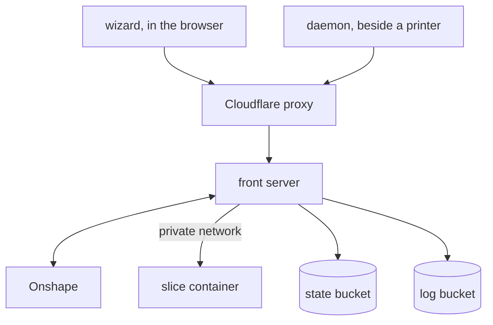
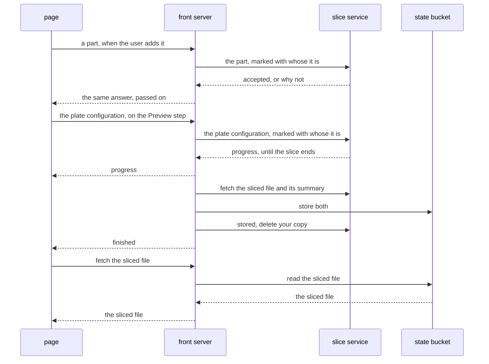

# The front server

Nothing of the front server is built. Every sentence of this guide describes the design,
and the section [What is built in which phase](#what-is-built-in-which-phase) says which
phase of [the plan](../docs/plans/penguin-slicer-plan.md) builds each piece of it. This
guide is for the person who decides whether the design is right;
[README-details.md](README-details.md) holds what a builder needs: the names, the rules
one by one and the tests each needs.

## What it is for

A user of PenguinSlicer opens one address, `https://penguinslicer.popcornpenguins.com/`,
in a browser or in Onshape's right panel. Everything behind that address is the **front
server**. It hands the browser the wizard's pages, signs the user in with Onshape, takes
the user's parts and plate configurations to the slice service and brings back the
result, keeps the sliced file for as long as the user may still want it, keeps the
settings a group of users shares, writes down what happened, and from phase 5 runs the
half of printer delivery that lives on a server. The user never sees it as a thing of
its own: they see a wizard that knows who they are without asking, a slice that finishes
whether or not they are watching, and a sliced file that is still there after a
three-hour print.

### Why it is a component of its own

PenguinSlicer has five components, each depending only on written contracts. The front
server stands between three of the others, and it is apart from each for a different
reason.

**Apart from the wizard.** The **wizard** is the code that runs in the browser: the
Parts, Settings, Layout, Preview and Send steps. A **page** is the wizard as loaded in
one browser tab or in Onshape's panel, and this guide says "the page" for whatever sends
the front server a user's request. Whatever runs in a browser can be read and changed by
the person at that browser, so the wizard can be trusted with nothing: no secret, no say
over who the user is, no say over whose parts a request concerns. The front server is
where those things are decided. The two are joined only by
[the contract between the wizard and the front server](../contracts/wizard-front-server.md),
so that the wizard can later be placed somewhere else (inside PenguinCAM, for one
possibility the design keeps open) without the front server changing.

**Apart from the slice service.** The **slice service** runs Orca on files that
strangers upload, and Orca is a large program that was not written to resist hostile
files. So, hosted, the slice service runs in a container of its own, the **slice
container**, which holds no secret and no credential and accepts requests only from the
front server. A flaw in Orca then reaches no sign-in secret and no stored file. The
split has two more uses: Orca's short, steep rise in memory and a deploy of the slice
container cannot cut off the printers' connections, which the front server holds, and a
change to the wizard goes out without touching a slice that is running. Railway, the
host, bills for the memory actually held, so two containers cost what one would. What
the split costs is work for the front server: it must pass every part and plate
configuration through, fetch every sliced file, and fetch the slice service's log lines,
since the slice container can write nowhere.

**Apart from printer delivery.** Printer delivery has two halves. The **daemon** is a
program on **the daemon's computer**, the computer beside the printer. The **relay** is
the half on a server, and is written to run inside some application that signs users in
and holds sliced files. From phase 5 the front server is that application. The relay
stays a separate component with its own tests; the front server supplies what the relay
asks for and nothing more (see [Running the relay](#running-the-relay-from-phase-5)).

### Why it is the one thing the internet reaches

The wizard's pages, the address a daemon is given and the address Onshape sends a user
back to after signing in are all at one address. Three things follow from there being
only one.

- The slice service cannot be reached from the internet at all. Only the front server
  can call it, over the private network between the two containers.
- The browser never talks to a second site, so the front server never has to allow
  another site's pages to call it, which closes a whole class of attack
  (see [Requests from other sites](#requests-from-other-sites)).
- There is one place where every request is checked for a signed-in user, and one place
  to defend.

The domain's name service is at Cloudflare, whose proxy sits in front of the address,
hides the host and turns away floods of requests. Cloudflare runs no logic of
PenguinSlicer's. The front server marks every answer except the wizard's own page files
as not to be kept by any proxy or browser, so that no proxy ever holds a copy of one
user's sliced file or configuration that it could hand to another.

**Serving the wizard's pages** is the simplest thing the front server does: the page
files are built from the wizard's folder of the repository and go out with the front
server, so a deploy of one is a deploy of both. A browser with no signed-in user is sent
to the sign-in and receives none of the wizard's code.

The front server keeps what must last in two stores at Cloudflare, the state bucket and
the log bucket, which the next section explains.

### What it holds, and what it never holds

The front server keeps no database, no table of sessions and no accounts. What it must
remember across a restart is in one of two places it does not itself contain.

- **In the browser.** Who is signed in is in a cookie. The user's parts, layout and
  chosen settings are in the browser's storage, which is the wizard's business.
- **In two object stores at Cloudflare R2.** An object store keeps files under names and
  nothing more. The **state bucket** holds what must outlast a restart of the front
  server: each group's configuration, the sliced files, each with a short summary of
  what it will print, and from phase 5 the relay's records. The **log bucket** holds log
  lines as files. On one machine, in phase 2, a folder stands in for each bucket, and
  the front server uses bucket and folder in the same way.

The front server holds four secrets, listed under [Secrets](#secrets), and it holds the
only credential that can write to the buckets; beyond it, only the owner can, through
Cloudflare's own console.

What it never holds:

- **A user's part.** A part passes through it on the way to the slice service and no
  copy is kept. The browser's storage is the record of a user's parts.
- **A session.** Nothing in its memory or in a bucket says who is signed in.
- **A password or an account.** Onshape is the only way in.
- **A plate configuration that is waiting.** It passes each one to the slice service and
  keeps none back, even while the slice service is stopping.
- **Anything that is lost by restarting it,** with three small exceptions: the log
  lines of the last minute before a crash; from phase 5 the printers' latest status,
  which each daemon sends again within seconds; and from phase 5 the pairing codes
  daemons are offering, which each daemon offers again within half a minute.

### What it exchanges, and under which contract

The table names everything the front server talks to. Each thing that passes is
explained in the section of this guide that deals with it.

| With | What passes | The contract |
|---|---|---|
| The wizard | Pages; parts and plate configurations going up; progress and the sliced file coming down; the group's configuration; the list of settings for advanced mode; the wizard's reports about itself; from phase 5, sends and the printer's status | [The wizard and the front server](../contracts/wizard-front-server.md), whose exact requests are written with phase 2's design; failures as [error reports](../contracts/error-report.md), progress as [progress reports](../contracts/progress-report.md) |
| The slice service | Parts and [plate configurations](../contracts/plate-configuration.md) going in; progress, the [sliced file](../contracts/sliced-file.md), the list of settings, the profile catalog's names and log lines coming out | The slice service's own interface ([its guide](../slice/README.md)) |
| Onshape | Who a user is and which companies and classrooms they belong to; from phase 4, the parts a user selected | Onshape's public interface |
| The state bucket | Each group's configuration, the sliced files and, from phase 5, what the relay must remember | [The configuration's contract](../contracts/configuration.md) for the configuration |
| The relay, from phase 5 | Who is asking; a place to keep what it must remember; the sliced file | The relay's interface to its caller ([printer delivery's guide](../delivery/README.md)) |

What spans all the components (the two containers, where every kind of state lives,
restarts, security, the log) is in [the architecture](../docs/architecture.md). This
guide gives the front server's part of each in full and links there for the rest.

## Signing in

Signing in is not something a user manages. Outside Onshape a user who keeps coming back
is asked once in each browser and never again. Inside Onshape's panel being signed in to
PenguinSlicer is not felt as separate from being signed in to Onshape. The parts of this
section say how the front server makes both true.

### Onshape is the only sign-in, and there are no accounts

Every user signs in with Onshape, by the standard exchange in which Onshape asks the
user to approve the app and then tells the app who they are (OAuth). It is the same in
Onshape's panel and outside it, through one registered Onshape app. Onshape tells the
front server two things at a sign-in: who the user is, and which Onshape companies and
classrooms they belong to.

From phase 3 the Onshape app asks a user's permission for three things: to read who they
are, to read their companies and classrooms, and to read their documents. Reading
documents is not used until phase 4, which reads the parts a user selected; it is asked
for from the start so that nobody is asked to approve the app a second time. The app
never asks for permission to write anything.

Because no other sign-in is offered, PenguinSlicer keeps no accounts and no passwords,
has no "forgot my password", and never has to decide whether two sign-ins are the same
person. Who may use a group's printer is decided by who is in the Onshape company, which
somebody already keeps up to date for other reasons.

A sign-in is made by a **trip**: the browser goes to Onshape and comes back. It goes
like this.

1. The front server sends the browser to Onshape's approval page, with a random value of
   its own making and a note of the step the page was on.
2. Onshape sends the browser back with that value. The front server checks that it is
   the value it sent out, and refuses the sign-in otherwise, so that nobody can be
   signed in by a link someone else prepared.
3. The front server asks Onshape who the user is and which companies and classrooms they
   belong to. That is two calls to Onshape, and they are the only two.
4. It sets the cookie that is the sign-in (see
   [The cookie](#the-cookie-and-why-there-are-no-sessions)), writes a log line with the
   user and their groups, and returns the browser to the step it left. The page, once it
   opens, asks for the configuration of the current group.

The first time, Onshape shows the user its approval page. After that a user who is
signed in to Onshape passes through the trip without being asked anything.

**What starts a trip.** A request for one of the wizard's pages with no signed-in user
starts one at once; inside Onshape's panel the first trip in a browser starts from a
button instead
([The cookie inside Onshape's panel](#the-cookie-inside-onshapes-panel)). Any other
request with no signed-in user is answered that the user
is not signed in, and that answer is what tells an open page to make the trip: it does
so by itself, at a moment when the user is not in the middle of a gesture, and comes
back to the same step with the plate as it was. Nothing is lost by it, because the
user's work is in the browser's storage and the front server holds no session to
expire.

**When a trip fails,** the front server returns the browser to the same step with its
own sentences in place of the step's content: that PenguinSlicer could not sign the user
in with Onshape, what is specific (the user refused Onshape's request, Onshape did not
answer, the returned value was not the one sent out), and that the user's parts, layout
and settings are kept in the browser, with one button, Sign in with Onshape. A trip that
comes back with the browser still not signed in counts as failed too, and the page does
not leave again by itself; so a browser that withholds the cookie cannot repeat sign-ins
without end. The screens are in [the wizard's guide](../wizard/README.md#signing-in).

**Browsers.** Chrome is the supported browser and Edge is tested
([the wizard's guide](../wizard/README.md#browsers-other-than-chrome)). Safari is not
supported, in Onshape's panel or outside it: the front server gives a user of Safari a
plain page saying that PenguinSlicer needs Chrome, and none of the wizard's code, which
cannot be relied on there.

### Who may sign in

Signing in is open to anyone with an Onshape account, which is free to make. There is no
list of permitted users or groups. A person whose account belongs to no company or
classroom is a group of one: they are given the default settings every new group gets
([The configuration](#the-configuration)), can upload parts, slice, fetch their sliced
files for as long as any user can and, from phase 5, pair a printer of their own.

A stranger reaches nothing of anyone else's: not another user's parts or sliced files,
and not another group's configuration or printer. What a stranger can take is a share of
what everyone shares. The slice service's places (one slice running and two waiting, as
it starts) are shared by all users, so strangers slicing heavy plates can leave known
users told that the slicer is busy; each slice is bounded by the slice service's memory
ceiling and time limit, and Railway bills the memory held, so strangers' slices are paid
for by the owner. Each sign-in also spends two calls to Onshape
([Sign-ins and the allowance](#sign-ins-and-the-allowance)). Both are accepted; the log
shows who signs in and who slices.

### The cookie, and why there are no sessions

A sign-in sets one **cookie** in the browser. It holds the user's Onshape id and name,
each of their groups by id and name, and the two tokens Onshape issued (one that
authorises calls for an hour, one that renews it). It is encrypted with a secret only
the front server has, the **cookie key**, so the browser can neither read it nor change
it.

The cookie is the whole of the sign-in. Nothing about it is kept on the server, and the
cookie key is a setting the front server is given when it starts, not something it
makes up in memory. That is why a restart or a deploy signs nobody out, why there is no
table of sessions to store, clean or lose, and why two front servers of different
versions agree at once about who a user is.

**A sign-in lasts thirty days from its last use.** Each use extends it, so a user who
opens PenguinSlicer at least once in thirty days is never asked to sign in again in that
browser, and a browser left unused for thirty days makes the trip afresh. The figure is
long because each sign-in spends calls to Onshape
([Onshape's yearly allowance of calls](#onshapes-yearly-allowance-of-calls)).

**When a user's groups are read.** The groups in the cookie are read from Onshape at
every sign-in. They are read again in one other case, inside Onshape's panel, described
under [Groups and the current group](#groups-and-the-current-group). Until the Onshape
app is public in Onshape's App Store they are read at no other time; once it is public
they are read once a day (the reason is the allowance, below).

Two consequences are accepted until the app is public.

- **A user removed from an Onshape company keeps that group's configuration and printer
  for as long as they keep using PenguinSlicer outside Onshape,** because a sign-in
  extended by use is never made again, and so their groups are not read again. They
  lose access when thirty days pass without use, or when the daily reads begin.
- **A user added to an Onshape company does not see the new group outside Onshape**
  until their next sign-in. Inside Onshape they see it at once, because working in a
  document of that company is what makes the front server read their groups again.

Onshape's hour-long token is renewed only when a call to Onshape needs one, and the
renewed tokens are written back into the cookie. Before phase 4 nothing needs one,
unless the Onshape app has been made public by then. How two requests renewing at the
same moment are kept from spoiling the cookie is not designed (see
[Two requests renewing the tokens at once](#two-requests-renewing-the-tokens-at-once)).

### Groups and the current group

A **group** is the users who share one configuration and one printer. It is one Onshape
company or classroom. A user who belongs to none is a group of one. Every user of a
group may do everything in it: there are no roles.

A user works in one group at a time, the **current group**. Which one it is depends on
where the wizard is.

- **Outside Onshape,** a user in one group, which is nearly every user, has nothing to
  choose. A user in more than one chooses in the wizard's header, and the browser keeps
  the choice
  ([the wizard's guide](../wizard/README.md#a-user-in-several-groups-outside-onshape)).
- **Inside Onshape's panel, from phase 4,** the current group is the group of the
  document the user has open, and no choice is offered, even to a user in several
  groups. The page tells the front server which company Onshape says the user is
  working in.

Either way the page sends the current group with each request, and the front server
accepts it only if the cookie lists that group among the user's. This one check is what
keeps a user out of another group's configuration and away from another group's
printer. It is made on every request that acts for a group: reading and writing the
configuration; uploading a part; submitting a plate configuration; asking about and
following a slice job; fetching a sliced file; and from phase 5 everything to do with a
printer.

**A group the cookie does not list.** When the page names a company that Onshape says
the user is working in and the cookie does not list it, the front server reads the
user's groups again from Onshape itself, with the tokens in the cookie, and writes the
fresh list into the cookie. That is how a user just added to a company gets its
configuration and printer without doing anything; there is nothing for a user to press
to have their groups read again. If the fresh list still lacks the group, or the request
names no group, the request is refused and the refusal is logged. What the browser says
about the company is never taken as proof of anything: it can cause a fresh read from
Onshape, and only Onshape's answer adds a group.

The page cannot read the cookie, so the front server tells it, on request, the user's
name and the names of their groups, from the cookie and without calling Onshape. The
wizard uses that to name the configuration in use, to tie the work stored in the browser
to its user, and to offer a user in several groups the others.

### The cookie inside Onshape's panel

In Onshape's panel, from phase 4, the page is embedded in Onshape's site. The design
there is PenguinCAM's, because it is known to work in production.

- **The cookie is of the kind a browser sends to a page embedded in another site.** It
  is the same cookie as outside Onshape and follows the same thirty-day rule. A cookie
  of that kind is sent with requests that other sites cause as well, which is why the
  cookie alone is not taken as proof that a request came from the wizard (see
  [Requests from other sites](#requests-from-other-sites)).
- **The first time in a browser, the user presses one button.** The panel shows a
  Connect button; pressing it opens a small window in which the trip to Onshape is made,
  and the window closes itself when the trip is done. One click, the first time in a
  browser, is the baseline the design relies on. A trip the user never sees, with no
  button and no window, is what phase 4 tries for and does not rely on.
- **After that the sign-in is not felt.** A user can only see the panel while signed in
  to Onshape, and each use of the panel extends the cookie, so a user who opens the
  panel at least once in thirty days never meets the button again in that browser. For
  that user the sign-in lasts as long as they are signed in to Onshape. A cookie that
  is missing or has run out is replaced by one click on Connect, as the first time; if
  the unseen trip proves possible, it is replaced without the user being asked
  anything.
- **A different person at the same browser.** When Onshape says that the person signed
  in to it is not the one the cookie names, the sign-in is made again for that person,
  by the same trip. The page tells the front server whom Onshape names; the front
  server compares that with the cookie and answers a mismatch as it answers a request
  that is not signed in. The wizard then clears the previous user's stored work
  ([the wizard's guide](../wizard/README.md#signing-in)).

Two things here rest on what Onshape tells a panel and on what Chrome allows an embedded
page, and can only be confirmed in phase 4: see
[What Onshape tells a panel](#what-onshape-tells-a-panel) and
[What Chrome allows an embedded page](#what-chrome-allows-an-embedded-page).

### Signing out

Outside Onshape the page has a Sign out link; inside the panel there is none. Signing
out removes the cookie and nothing else: it costs no call to Onshape, and the front
server has nothing of its own to forget. The user is shown a plain page saying they are
signed out, from which nothing leaves for Onshape by itself
([the wizard's guide](../wizard/README.md#sign-out)).

Signing out of PenguinSlicer does not sign the user out of Onshape. On a shared
computer, a person who presses Sign in with Onshape while the previous user is still
signed in to Onshape in that browser is signed in as the previous user; handing a
computer on means signing out of Onshape as well.

### Onshape's yearly allowance of calls

Until an Onshape app is public in Onshape's App Store, every call it makes counts
against a yearly allowance of the account that owns the app: 2,500 calls a year on a
free or education account (Onshape's figure). The intention is to make the app public,
which lifts the allowance. Until then, all development and all testing with users must
fit inside it with room to spare. So the rule is: **nothing calls Onshape that can be
done without it.** The cookie's thirty days extended by use, the absence of any periodic
check, the development identity (a made-up user for work on one machine, described
below) and the stand-in used in tests all come from this rule.

| Use | Calls to Onshape |
|---|---|
| Work on one machine, with the development identity | None |
| The automated tests, which use a stand-in for Onshape | None |
| A sign-in to the hosted service | 2; for a user who keeps coming back, once for each browser |
| Reading a signed-in user's groups once a day | None until the app is public |
| Reading a user's groups again when Onshape names a company the cookie does not list, from phase 4 | Counted in phase 4's design before anything is built |
| Reading parts from Onshape, from phase 4 | Several for each part; counted in phase 4's design before anything is built |

So until phase 4, twenty people using the hosted service, each in two browsers, spend
about 80 calls of the 2,500.

How often a signed-in user's groups are read again on a schedule is a setting of the
front server. Until the app is public it is "never". Once the app is public it becomes
once a day, so a removed user then keeps access for a day at most; a public app's calls
do not count against the allowance, so the daily reads cost nothing.

### Sign-ins and the allowance

Nothing limits how often a user signs in. Each sign-in spends 2 of the 2,500 calls, so
1,250 sign-ins in Onshape's year spend all of it, and one person can repeat a sign-in as
often as they like by signing out or clearing the cookie. That is accepted, and it is
watched: every call the front server makes to Onshape writes a log line, and the command
that reads the log reports the year's total.

If the allowance were ever spent, nobody without a cookie could sign in until Onshape's
year turned, and from phase 4 reading parts from Onshape would stop too; users who hold
a cookie would go on slicing uploaded parts. Making the Onshape app public lifts the
allowance and ends the matter.

### The development identity

On one machine there is no registered Onshape app to send a browser to, and work there
must spend no calls. So the front server has a setting that makes it sign in a fixed,
made-up user in a fixed, made-up group, the **development identity**, the moment a
browser arrives, without contacting Onshape. Everything else then runs as it does
hosted: the cookie, the current group's check, the marking of parts and slice jobs with
whose they are.

This setting would be a way past the sign-in if it were ever on in the hosted service.
Two independent things prevent that. The command that starts the hosted front server
never turns it on. And the front server refuses to start at all with it on when it
finds itself running on Railway, or finds an Onshape app's credentials among its
settings; it writes one log line saying why and stops.

### Requests from other sites

A browser attaches a site's cookie to requests that other sites cause, and inside
Onshape's panel PenguinSlicer's cookie has to be of the kind that is attached most
freely. A hostile page a signed-in user happens to visit could therefore try to make
the user's browser send, say, a print to their group's printer. Four defences stand
against it. They are built in phase 3, with the sign-in: on one machine there is no
other site and no real cookie to protect.

- **Every request that changes something must carry a mark that only the wizard's own
  page can add, and must come from the front server's own address.** A browser will not
  let another site's page add that mark or disguise where a request came from. This
  covers uploading a part, submitting a plate configuration, writing the configuration,
  signing out, the wizard's reports about itself, and from phase 5 pairing, sending,
  cancelling a print, giving up on following one, and unpairing. A request that fails
  either test is refused and logged.
- **No other site's page is allowed to read the front server's answers.** The front
  server never tells a browser that another site may.
- **The sign-in checks the random value it sent out,** as described above.
- **Only Onshape may embed the pages.** Every page tells the browser that it may be
  shown inside Onshape's site and no other, so no other site can put the wizard in a
  hidden frame and trick a user into clicking in it.

## What it does for a part and for a slice

The whole path, before each piece is taken in turn:

### Whose it is

With every request it makes to the slice service, the front server says whose part or
slice job this is. It says so with the **user key**: the signed-in user's Onshape id,
taken from the cookie and from nowhere else. Nothing the browser sends can name a user
key; if a request tries to, the attempt is ignored. The slice service only compares user
keys and never interprets them. The result is that a user reaches only their own parts,
slice jobs and sliced files, even among users of the same group.

A request for a slice job or a sliced file that belongs to someone else is answered
exactly as if it did not exist, so nobody can find out whether another user's is there,
and the attempt is logged as a refusal.

### A part

The page uploads each part by itself, at the moment the user adds it, in one request
of at most 7.5 MB (the plate configuration's limit for one part). The front server
passes it to the slice service with the user key and with the part's units, inches or
millimetres, which travel beside the file as a label. Neither the browser nor the front
server ever changes a part's bytes; only the slice service applies the scale.

The slice service checks the part as it arrives and keeps it for two hours after its
last use, in its **part store**, under the user key and the part's **hash** (a SHA-256
hash of the file's bytes, a short value that changes if any byte does) together with
its units; the same file in other units is a different part. A part that cannot be
sliced is refused there; the front server passes the refusal back as it came, and the
user sees it on the Parts step as a notification and the part is not added. This is the
reason for uploading at once: a bad part is caught before the user has laid anything
out.

The front server keeps no copy. If the slice service has dropped a part by the time a
plate configuration names it, the page uploads it again from the browser's storage; the
front server's part in that is only to pass the slice service's list of missing parts
back.

### A plate configuration

On the Preview step the page sends a **plate configuration**: the layout, the settings
and each part's hash and units, with no files in it. The front server passes it to the
slice service with the user key, and the slicing of that plate configuration, a **slice
job**, waits its turn or runs in the slice container. Because a plate configuration
carries no files, slicing again after moving a part or changing a setting uploads
almost nothing.

**A user may have several slice jobs under way.** Each tab works with its own plate, and
one tab's slice never stops another's. Nothing limits the slice jobs of one user;
everyone shares the slice service's places. The only slice job a submission replaces is
the earlier unfinished slice job of the same plate, which is what the Preview step wants
when a plate changes. For that the page makes an id for each plate and sends it with
every submission of that plate, and the slice service ends the plate's earlier
unfinished slice job when the later one arrives
([the slice service's guide](../slice/README.md#run-one-slice-at-a-time-and-let-a-few-wait)).

**A slice cannot be cancelled by hand.** The front server offers the page no request to
cancel a slice job. A user who no longer wants a slice changes the plate or leaves it to
finish ([the wizard's guide](../wizard/README.md#slicing)).

**When no more slice jobs may wait,** the slice service says so and the front server
passes that on: the user is told the slicer is busy and to try again in a minute, and
the page does not try again by itself.

### A plate configuration submitted twice

The page retries a request whose answer it did not receive, so the same submission can
arrive twice. A repeat must not start a second slice job that replaces the first. So the
page makes a value for each submission, and a repeat that carries the same value is
answered with the first attempt's slice job. The value is remembered beside the slice
job by the slice service, which is what the front server relies on
([the slice service's guide](../slice/README.md#a-plate-configuration-submitted-twice));
the front server passes the value in and the answer back. It is the same idea as the
repeated send of phase 5.

### A plate configuration submitted while the slice service stops

A slice service asked to stop for a deploy finishes its running slice, bounded by its
time limit of 240 seconds, and meanwhile refuses each new slice job with an answer of
its own, different from "busy"
([the slice service's guide](../slice/README.md#when-things-go-wrong), under "When asked
to stop"). The front server holds nothing back for later: it passes that answer to the
page. The wizard shows the slice as waiting, says that the slicer is restarting, and
submits again by itself until the replacement accepts, for up to 300 seconds. Past the
300 seconds it treats the server as one that cannot be reached
([the wizard's guide](../wizard/README.md#when-the-server-is-slow-or-cannot-be-reached)).
The replacement starts with an empty part store, so the page uploads the plate's parts
again when it is told they are missing. A user sees a slicing card that waits and then
its ordinary progress.

A slice job that was still waiting when the slice service was asked to stop is ended by
the slice service, saying why, and the page submits it again in the same way.

### Progress

The page follows a slice job on a **progress stream**: one connection the front server
keeps open and sends progress reports down as they happen (server-sent events). For a
waiting slice job the report says how many are ahead of it. From phase 5 a page follows
a print on a progress stream as well.

Three limits of the hosts shape this. Railway closes any request after fifteen minutes,
and after five minutes if no data has passed; Cloudflare closes one after 125 seconds
without data ([the architecture](../docs/architecture.md#progress-streams)). So a stream
with nothing to report carries a line that means nothing at least every fifteen seconds,
which keeps it open through both, and the page reconnects whenever a stream closes,
which is how it survives the fifteen-minute cut and every restart of the front server.
A stream that connects late gets the latest progress report at once, so a reconnecting
page catches up in one message. The page counts on the fifteen seconds: it treats a
stream that has carried nothing for 45 seconds as failed.

One user may hold at most four progress streams at once. The figure is this guide's
proposal
([How many users at once](#how-many-users-at-once-and-what-happens-when-the-threads-run-out)).

A slice job is reported finished on the stream only once its sliced file is in the
state bucket, because that is where the page fetches it from; reporting sooner would
send the page to fetch a file that is not there yet. The user waits, for it, the moment
it takes to move the sliced file between the two services.

### The front server follows every slice job itself

A slice job, once submitted, runs to its end whether or not anyone is watching: through
a refresh, a lost network or a closed laptop lid. Something must therefore notice that
it has ended and collect the result when no page is open. That something is the front
server. For every unfinished slice job it holds the slice service's own progress
stream, page or no page. The streams it serves to pages are fed from the one it holds,
so three tabs watching one slice job cost the slice service one connection.

When a slice ends, the front server:

1. fetches the sliced file from the slice container, with its **summary** (the
   predicted print time, the filament used, the layer count and the warnings, which the
   slice service gives beside the file);
2. stores both in the state bucket, under the user key and the slice job's id, with the
   time the slice ended;
3. tells the slice service that they are stored, and the slice container deletes its
   own copy;
4. only then reports the slice job finished to any page that is following.

The summary is kept beside the file, and for as long, because the Preview step needs it
after the slice container's copy is gone. If the state bucket does not answer, the front
server keeps trying; the slice container keeps its copy until it is told the file is
stored, and the page goes on showing the slice job as running. If the slice container
restarts before the file is stored, that slice runs again.

**A sliced file is at most 50 MB.** The plates sliced so far gave 8.8 to 14.1 MB. The
limit keeps every fetch well inside the 100 MB Cloudflare allows one request and bounds
what each preview, download and print moves. The slice service ends a slice whose file
would be larger, as a failed slice with its own sentences
([the slice service's guide](../slice/README.md#when-things-go-wrong)), so that is what
a user meets. The front server refuses to store a larger one all the same, as a second
defence, and reports that slice job as failed with a sentence of its own.

From then on the state bucket's copy is the one everything uses. The page fetches it
through the front server to draw the Preview step and to offer the download, and from
phase 5 the relay hands it to the daemon. The browser never stores a sliced file and
the front server accepts none from a browser, so a printer only ever runs a file the
slice service made.

### A page that comes back

A page that has lost its state (a refresh, a reopened panel) still has, in the
browser's storage, the id of its plate's slice job and the time it submitted it. It
asks the front server about that slice job. The front server asks the slice service,
which remembers a slice job for two hours after it ends, and looks in the state bucket.
It gives one of six answers.

| The front server answers | When |
|---|---|
| Still waiting or running, with the latest progress report | The slice service says so; also when the slice has ended but its sliced file is not yet stored |
| Finished | The sliced file is in the state bucket |
| Ended in an error, with the error report | The slice service says so; also when the sliced file was stored and has since expired, in which case the error is that it has expired |
| Replaced by a later slice job of the same plate | The slice service says so |
| Ended because the slice service was asked to stop | The slice service says so; the page submits the plate again by itself |
| Unknown | Neither the slice service nor the state bucket knows it, or it is another user's |

What the page does with each answer is the wizard's business and is in
[the wizard's guide](../wizard/README.md#coming-back-to-running-work).

## How long a sliced file lives

### The rule

A sliced file can be previewed, downloaded, sent to the printer, and sent again after a
print, **until two hours after its slice ended or two hours after its last print ended,
whichever is later.** Two hours after slicing gives the user time to look at the
preview and decide. Two hours after the last print lets the same plate be printed again
after a print of any length, without slicing again. Before phase 5 nothing is printed,
so two hours after the slice ended is the whole rule.

The front server enforces the rule itself, in three ways.

- **It refuses a sliced file that is past both limits,** tells the user it has expired,
  and deletes it. A user who presses Send or Download on one is told that it has expired
  and that the plate must be sliced again.
- **It sweeps.** At regular intervals it deletes every sliced file that has passed both
  limits, so that a file nobody asks for again is still gone on time.
- **From phase 5, a sliced file whose print is under way is kept;** its two hours are
  counted from the moment that print ends.

To know when a sliced file's last print ended, the front server relies on the relay's
record of each **delivery job** (one sliced file on its way to one printer, from the
send until the print ends): that record names the sliced file it used.

### Telling the page when a sliced file expires

The two hours run whether or not a page is open, so a user can be looking at a result
when it expires, and the page's own clock may be wrong. So the front server tells the
page the moment at which it will refuse the sliced file as expired, as the front server
reckons it. The moment goes out with the sliced file's details (its summary), and again
when a print of the plate ends, since that moves it. At that moment the page shows, in
place of the result, a message that the plate's slice has expired, with Slice again
([the wizard's guide](../wizard/README.md#a-sliced-plate-that-expires)).

### Why R2's own rule cannot do this alone

R2 can delete files by itself after a set age, and it would be simpler to leave it to
that. It cannot serve, for three reasons: its rule counts in whole days, not hours;
Cloudflare says a file is typically removed within 24 hours after it falls due, so even
a one-day rule means up to about two days; and it counts from when a file was stored,
knowing nothing of prints.

R2's rule is still used, as a backstop for a file the front server failed to delete: a
crash at the wrong moment, or a fault in the sweep. It is set at **three days**. Three,
because R2 counts from when the file was stored, and the file must still be there two
hours after the longest print ends. So that a file sent late in its life is not caught
by the backstop, **sending a sliced file stores it afresh,** which starts R2's count
again; the three days therefore run from the last send.

What follows for a user and for privacy:

- A print that runs longer than about three days from its send loses its sliced file to
  the backstop. The print itself is not affected, since the printer already has the
  file. Sending the same plate again afterwards means slicing it again.
- A sliced file the front server failed to delete can rest at R2 for up to about four
  days after it was last stored: three days, and up to a day more for Cloudflare to
  remove it. It is in a private bucket for that time.

## The configuration

### What it holds

A group's **configuration** is the settings everyone in the group shares. It is one
document for each group, kept in the state bucket, and it holds:

- **The group's filaments.** Each has a **colour**, shown where the user chooses a
  filament so that two filaments of one material (a red PLA and a green PLA) can be
  told apart. That colour is never used in the layer preview, which draws every plate
  in the same four fixed colours.
- **The profiles the wizard offers for each filament.** Each filament has its own list,
  not one list for all. A profile is what a user picks on the Settings step, and the
  configuration holds for it **the three Orca profile names that go into a plate
  configuration** (Orca's printer profile, its filament profile and its process
  profile), any settings that replace Orca's own, and **the group's own name and
  purpose** for it. The Settings step offers profiles by the group's names (such as
  "Structural") and shows the purpose as a tooltip, because Orca's names are not names a
  group would choose and say nothing of what a profile is for. The plate's size and
  height, for the Layout step and for slicing, come from the printer profile named.
  Which physical printer is the group's is recorded elsewhere, by pairing. Nothing
  checks that the two agree, so a group that names the wrong printer profile sees a
  plate of the wrong size.
- **The units of uploaded files:** whether a part uploaded as a file, which carries no
  units, is read in inches or millimetres.
- **No secret.** No token, key or pairing code is ever in it.

Its exact fields are written with phase 2's design, in
[the configuration's contract](../contracts/configuration.md), with an example that
explains every field.

### Reading it and writing it

The front server gives a group's configuration whenever the wizard asks, always for the
current group: when a page opens, and so after every sign-in, and when the user presses
the reload glyph in the wizard's header.

**The front server never gives the wizard a configuration it cannot use.** A group with
no saved document gets the **built-in default**, which names the profiles of the Bambu
Lab H2S, the Popcorn Penguins' printer, so a new group can slice without setting
anything up. A group whose saved document is invalid (damaged, or of a format the front
server does not know) gets the built-in default in its place as well. The saved file is
left untouched, so a hand-written document is never lost to a typing mistake, and the
front server writes an error to the log naming the group and what is wrong.

With every configuration the front server gives the name of the configuration in use:
the group's name, or that it is the default. The wizard's header shows that name, which
is how someone who wrote a document by hand sees that it was not taken
([the wizard's guide](../wizard/README.md#the-current-group)). The wizard has no screen
for an invalid configuration and needs none.

**Writing.** The document is read whole and written whole. With no finer grain than
that, two users editing at once could each save over the other without knowing. So a
write is conditional: the front server remembers which version of the document an edit
started from, and the state bucket accepts the write only if the document is still that
version. The first of two simultaneous edits is saved. The second user is told that the
configuration was changed by someone else and to reload; their edit is not saved and
nothing is merged. That costs the second user their edit, which is acceptable for a
document a small group changes rarely, and it needs nothing but the conditional write
the object store already offers.

Every edit writes a log line with the user's name and what changed. An edit replaces
the document, and nothing else ever deletes it.

### The list of settings and the profile catalog's names

Two things about Orca are known only to the slice service, which alone holds Orca's
profiles and settings for the Orca version it runs.

- **The list of settings** for the wizard's advanced mode: every setting the slice
  service accepts, with Orca's own label, group and explanation for it, its kind and
  permitted values, and each profile's own value
  ([the wizard's guide](../wizard/README.md#advanced-mode)).
- **The profile catalog's names:** the names of the Orca profiles the slice service can
  slice with.

The slice service supplies both
([its guide](../slice/README.md#where-the-wizard-gets-the-list-of-settings-and-the-profile-catalogs-names)).
The front server asks it for them and passes them to the wizard on request. It keeps no
copy from one start to the next, so both always match the slice service that is
running.

The front server does not compare a group's configuration with the catalog's names.
Whether something should, and what, is open; see
[A configuration that names a profile the catalog has lost](#a-configuration-that-names-a-profile-the-catalog-has-lost).

### The fixed set, until the edit screens exist

The screens for editing a configuration are a feature of their own, in no phase yet.
Until they exist every group gets the built-in default, unless the owner writes a
document by hand for that group and places it in the state bucket through Cloudflare's
console, following the contract's example. No user can change one. The front server
must therefore expect documents written by hand, and say clearly in the log what is
wrong with one.

The conditional write is built in phase 2 all the same, with nothing in the wizard yet
using it. That proves the bucket's conditional write early, on a folder and then on R2,
costs little, and lets the edit screens be added without changing the front server.

## Running the relay, from phase 5

The daemon opens no port; it only calls out. The relay hands the daemon its work and
holds the printer's latest status. From phase 5 the relay runs inside the front
server's process, and the daemon reaches it at the same public address as everything
else. How pairing, sending and the daemon's requests work is printer delivery's own
subject, in [its guide](../delivery/README.md). This section is what the front server
does so that the relay can run.

**It tells the relay who is asking.** The relay never looks at a cookie. For each
request from a page, the front server gives it the signed-in user and the current
group, already checked against the cookie. When a user types the code a daemon is
showing, the relay links that daemon to the user's current group by writing the group's
**paired-printer record**. A send is accepted when the current group has such a record,
and goes to the daemon it names. So the chain that protects a printer runs through the
front server: Onshape says who the user is, the cookie carries their groups, the
current group must be one of them, and only that group's record names the daemon.

Two rules of the relay's rest on being told who is asking. A request to stop following a
print is accepted from the sender of that print only; the relay makes that check
([printer delivery's guide](../delivery/README.md#stop-following)). And the printer's
name that pages show is the one the printer itself reports, which the daemon sends when
it is paired ([printer delivery's guide](../delivery/README.md#pairing-in-phase-5));
nobody types it, and the front server passes it on unchanged.

**It gives the relay a place to keep its records.** The relay's records are the
paired-printer record of each group and one record for each delivery job, kept until a
day after the delivery job ends. They go in the state bucket (a folder on one machine)
and not in memory, because a daemon that is told the relay no longer knows its delivery
job treats the job as finished and drops it. The record of a delivery job also holds
whether the daemon has been allowed to start the print, which is what keeps a print
from starting twice across a restart.

**It supplies the sliced file.** The relay keeps no copy. When the daemon fetches the
file, the front server reads it from the state bucket, where it is kept under the rule
above.

**It makes a repeated send harmless.** A page retries a request whose answer it did not
receive. A send repeated by the same user with the same sliced file, while its delivery
job is still live, is answered with that same delivery job. It does not start a second
print and is not refused on the grounds that the printer is now busy. Printer delivery
as built refuses the repeat instead; changing that is part of phase 5.

**It spends a thread on each idle daemon.** A daemon's regular request to the relay is
the **sync**. While a printer is idle the relay holds its answer to the daemon's sync
for up to 55 seconds (the **held wait**), so that a send reaches the daemon at once
although nothing can call the daemon. Each held sync occupies one of the front server's
threads; see [The limits that matter](#the-limits-that-matter).

**It lets the daemon's requests in without a sign-in.** A daemon has no cookie; its
requests carry a token the relay issued and checks, and a daemon not yet paired offers
its pairing code with neither.

The front server also holds the relay's secret key, answers the held syncs when
stopping, and gathers the relay's log lines with its own. The relay's own mechanisms
are in [printer delivery's guide](../delivery/README.md): the held wait, the limits on
offers and on wrong pairing codes, and the note it makes in the paired-printer record
when a daemon goes offline (no sync from it for two minutes), which is the time of that
daemon's last sync, written once.

Who writes the one-line description of a plate that other users of the group read while
it prints is still open; see
[The one-line description of a plate](#the-one-line-description-of-a-plate).

## Restarts and deploys

PenguinSlicer is deployed continuously: a change goes out when it is ready, at any
hour, while people are using it. A restart of the front server is therefore routine,
and the rule is that it interrupts no user and loses nothing a user did. One thing is
outside the rule: from phase 5, a pairing code typed just after a restart must be typed
again, as the last row of the table below says.

### Why nothing is lost

Nothing a user did is in the front server's memory. Each thing is somewhere a restart
does not touch. The one thing a user is about to do that does depend on the front
server's memory is typing a pairing code: the codes daemons are offering are held in
the relay's memory.

| What the user did | Where it is | After a restart of the front server |
|---|---|---|
| Signed in | The cookie | Still signed in; the cookie key is a setting, not memory |
| Added parts, laid out a plate, chose settings | The browser's storage | Untouched |
| Submitted a slice job that is still running | The slice container | It keeps running; the front server finds it again when it starts |
| Finished a slice | The state bucket | Untouched |
| Edited the configuration | The state bucket | Untouched |
| Paired a printer; sent a print (phase 5) | The state bucket | Untouched; the print goes on, and the printer's status is not known until the daemon's next sync, within about ten seconds. The wizard shows a grey dot and "…" on the printer-status icon meanwhile |
| Typed a pairing code in the half minute after a restart (phase 5) | The relay's memory, which the restart emptied | Told that no daemon is showing that code; typing it again a moment later works, because each unpaired daemon offers its code again within half a minute |

**When it starts,** the front server asks the slice service for all its slice jobs, and
asks again until the slice service answers. It follows the unfinished ones again, and
collects every finished one whose sliced file it has not yet stored. So a slice that
ended while the front server was down is stored a moment after it comes back.

**When it is asked to stop,** as at every deploy, it takes no new requests, lets
uploads and downloads in progress finish, closes its progress streams and, from phase
5, answers the held syncs, so that pages and daemons reconnect to its replacement; and
it writes the log lines it has gathered to the log bucket. It has whatever time Railway
allows a stopping container, which is not known (see
[What Railway does at a deploy](#what-railway-does-at-a-deploy)).

**Every request is safe to repeat.** The page retries every request it makes. A request
sent twice because its first answer was lost must leave the same result as one sent
once: uploading the same part again gives the same answer; a repeated submission is
answered with the first attempt's slice job; a repeated send is answered with the same
delivery job.

What the user sees is the wizard's doing: nothing at all if the gap is under 20
seconds; after that a message that the server is being slow and the browser is
retrying, with a countdown to the next attempt; and a message that the server could not
be reached, with an offer to try again, only after 300 seconds. Nothing of the user's
work is dropped at any point
([the wizard's guide](../wizard/README.md#when-the-server-is-slow-or-cannot-be-reached)).

The whole table of what a restart does, for both containers, is in
[the architecture](../docs/architecture.md#what-a-restart-does).

### A deploy that fails, and learning that the service is down

A short scripted check runs against the hosted service after each deploy. When it
fails, it tells the owner, and the owner puts the previous version back through Railway
by hand. Nothing puts a version back by itself. Until the owner has done so, users see
the page's retrying and, after 300 seconds, its message that the server could not be
reached; their work stays in the browser, and a print already at the printer goes on.

At any other time the owner learns that the service is down from a user or from the
log, which is read on demand. Something outside the host that asks the service every
few minutes whether it answers, and tells the owner when it does not, comes later, once
users rely on the service.

### Old and new versions together

A deploy replaces one thing at a time, so for a while the new meets what was made for
the old. Three rules cover it.

**A page loaded before the deploy keeps working against the new front server,** at
least until it reloads. Every answer the front server gives, errors and progress
included, carries the front server's version. A page that sees a newer version than its
own reloads at a moment when the user is not looking at it or touching it, which loses
nothing because its state is in the browser's storage. Of all the rules here this is
the one most easily broken by accident.

**Each container's previous version works against the other's new one.** The front
server and the slice service are deployed separately, so a new one of either meets the
previous one of the other. A change to the plate configuration's contract or to the
slice service's interface is therefore made so that the previous front server still
works against the new slice service, and the previous slice service against the new
front server.

**What the old front server wrote, the new one reads.** Every record in the state
bucket carries the number of its format, a cookie set by the old front server is read by
the new one, and from phase 5 an installed daemon keeps working. These rules are in
[the architecture](../docs/architecture.md#old-and-new-versions-together).

## Secrets

PenguinSlicer has six secrets. The front server holds four, as settings given to it
through Railway: the Onshape app's identifier and secret, which prove to Onshape that a
sign-in comes from PenguinSlicer; the cookie key; from phase 5 the relay's secret key,
which signs the tokens that prove a daemon is paired; and the credential that reads and
writes both buckets. None is in the repository, a bucket, a log line or a page.

Every one can be replaced, and a planned replacement interrupts nobody who uses
PenguinSlicer within a week of it; how each is replaced, and what an emergency
replacement costs, is in [the architecture](../docs/architecture.md#security). Two
points are the front server's own.

- **The cookie key.** The front server holds two: the current one, and the previous one
  for reading only. A cookie it can read only with the previous key is rewritten with
  the current one, and the use is logged. The previous key is removed one week after a
  replacement; a user who does not open PenguinSlicer in that week signs in again, at
  the cost of two calls to Onshape.
- **The Onshape app's secret.** No cookie depends on it, so replacing it signs nobody
  out. Whether sign-ins fail in the moments between Onshape issuing the new secret and
  the front server having it is not confirmed (see
  [Replacing the Onshape app's secret](#replacing-the-onshape-apps-secret)).

## The log

The owner runs the service alone and cannot look at a user's screen. The log must
answer three questions without it: what went wrong, whether the service is the right
size, and who is using it.

### What the front server writes

- **Who uses it:** each sign-in, with the user key, the user's name and their groups.
- **What it spends:** each call to Onshape.
- **What changed:** each edit of a configuration, with the user's name and what
  changed.
- **Everything that goes wrong:** every error a user is shown, with its kind, the user,
  the group and the slice job or delivery job it belongs to; every unexpected failure
  inside the front server, with the trace of where it happened, including one no user
  saw because the request was retried; and every saved configuration found invalid,
  with the group and what is wrong.
- **Every refusal:** a failed sign-in; a request for something that belongs to another
  user; a current group the cookie does not list; a changing request without the
  wizard's mark or from another address.
- **What happened to each sliced file:** stored, with its size; served; expired;
  deleted.
- **How full it is:** once a minute, the memory it holds, the slice jobs running and
  waiting, the connections it holds open and the threads in use.
- **Housekeeping:** each start, with the version that started, and each use of the
  previous cookie key.

Every line about a slice or a send carries the user key and the current group. No line
holds a secret, a token, a pairing code, the cookie or a part's shape. Lines do hold
users' names and parts' names, which is why the log bucket is private.

### What the wizard's guide asks of the front server

A failure that happens only in the browser reaches no server by itself, and a target
for drawing speed that is checked only before a release says nothing of what users get
on their own machines. So the page reports two kinds of thing about itself, and the
front server writes each report to the log
([the wizard's guide](../wizard/README.md#what-the-wizard-reports-about-itself)).

- **A failure in the browser.** One log line for each: what failed, on which step, the
  page's version, the browser's name and version, whether 3D is drawn in software, and
  the hash of the part concerned, by which the part can be found in the slice service's
  own lines.
- **A summary of its drawing,** one for each use of the Layout view and of the Preview
  step: frames a second, typical and worst; the time to the first layer drawn; the
  longest stretch the browser's main thread was held; how much was drawn; and of the
  machine, the browser and its version, the operating system, whether drawing is by a
  graphics card or in software and the card's name, the number of processors and the
  memory as the browser reports them, the panel's width and the screen's pixel density,
  and whether the wizard is inside Onshape's panel.

A report never holds a part's bytes or geometry, and never the contents of the
browser's storage; the front server writes only the fields above and drops anything
else a report carries, since a report comes from a browser like any other request. The
page sends at most a few reports a minute, and the front server holds one page to the
same limit itself, so that a broken or hostile page cannot fill the log.

### Where it goes, and who reads it

Every line goes to Railway's log view at once, where Railway keeps it seven days, and
about once a minute to the log bucket, where it is kept ninety days so that a problem
reported weeks later can still be looked into.

**One file each minute holds the lines of all components:** the front server's own, the
slice service's, and from phase 5 the relay's and what the daemons report about
themselves, together with the page's reports. The front server is the only thing that
can write to the log bucket, so it gathers for the others. It fetches the slice
service's lines over the private network, and it adds the group to each of them, since
the slice service knows only the user key and the front server knows which group each
slice was submitted for. A file is written once and never rewritten, because an object
store has no way to add to a file.

**Every line carries the component that wrote it.** Picking out one component's lines
is the reader's job, not the store's.

**The files sit in folders by year, then month, then day,** so that no folder holds
more than about 1,440 files, one for each minute of a day. Their names use UTC.

The owner and the owner's coding agents read the log bucket with a credential that can
read it and nothing else, through one command kept in the repository, built in phase 3.
That command filters by component and shows every time in Pacific time. What else it
reports, and the form of a line, are in
[the architecture](../docs/architecture.md#reading-what-happened).

A crash loses up to the last minute of lines from the log bucket; they remain in
Railway's log view for its seven days. A deploy loses none, since a stopping front
server writes what it has gathered.

## The limits that matter

Each figure, what it protects and where it comes from. "The design's choice" means a
figure this design sets, which nobody else imposes and which has not been measured.
"This guide's proposal" marks three figures that this guide puts forward and that have
not been ruled on; they are explained under
[How many users at once](#how-many-users-at-once-and-what-happens-when-the-threads-run-out).
A figure that is a length of time is checked by a test with a clock the test moves, so no
test waits; the last column is filled only where the check is something else. The
limits of the relay (how long it holds an idle daemon's request, how many pairing
codes may be offered a minute) are in
[printer delivery's guide](../delivery/README.md#how-well-it-must-do-it), and how long
the page keeps retrying is in
[the wizard's guide](../wizard/README.md#when-the-server-is-slow-or-cannot-be-reached).

| Limit | Figure | What it protects | Where it comes from | Checked otherwise than by a moved clock |
|---|---|---|---|---|
| Threads serving requests | 100 | The front server's memory, and a known ceiling on what it does at once | The design's choice | The once-a-minute log line |
| Idle daemons served | About fifty | Room left for users' requests | This guide's proposal, within the 100 threads | A test that holds that many open; the same log line |
| Pages following a slice job or a print at once | Forty | A user's request finding a free thread | This guide's proposal, within the 100 threads | The same test and log line |
| Progress streams one user may hold | Four | One user not taking every thread | This guide's proposal | A test with a fifth stream |
| One part | At most 7.5 MB | The slice service's checks and memory | The plate configuration's contract | A test at the limit; one real upload |
| A sliced file | At most 50 MB; 8.8 to 14.1 MB so far | Every fetch staying inside the 100 MB Cloudflare allows one request | The design's choice; the range is measured on the plates sliced so far | A test with a larger file; the log line that records each stored file's size |
| A progress stream with nothing to report | A line at least every 15 seconds | The stream staying open, and the page's 45 seconds | Cloudflare's and Railway's limits | |
| Any one request | Closed by Railway after 15 minutes | Nothing of ours | Railway's limit | Tried on the hosted service |
| How long a sign-in lasts | Thirty days from its last use | Onshape's allowance | The design's choice | |
| The cookie's size | About 4 KB | The user being able to sign in | Browsers' limit | A test with many groups |
| What a sign-in costs | 2 calls to Onshape | The allowance of 2,500 a year | Onshape's interface | Calls counted in a test and in the log |
| The previous cookie key kept | One week | Users away briefly | The design's choice | |
| A sliced file kept | Two hours after its slice ended, or after its last print ended if later | Sending again after a print | The design's choice | |
| R2's backstop on sliced files | Three days from last stored | A file the front server failed to delete | The design's choice | Set at R2 |
| Log lines in the log bucket | Ninety days | A problem reported weeks later | The design's choice | Set at R2 |
| Gathering the log | About once a minute | Lines lost in a crash | The design's choice | |
| The page's reports about itself | A few a minute from one page | The log not filling from one page | The design's choice | A test that reports faster than the limit |

A sentence more on each row that needs one.

**The cookie's size** is unconfirmed to fit; see
[Whether the cookie fits](#whether-the-cookie-fits).

**The backstop** means a file the front server failed to delete is gone within about
four days, as [Why R2's own rule cannot do this alone](#why-r2s-own-rule-cannot-do-this-alone)
explains.

**No target for time is set for the front server:** not for how long it may take to
answer, nor for the time between a slice ending and the page being told it is finished,
nor for a fetch of a sliced file by a browser or a daemon. A target is set from what
the first slices on the hosted service show.

**The builder settles three figures:** how fast one user may upload parts, how fast one
user may submit plate configurations, and how often the sweep of expired sliced files
runs. The sweep's interval bounds only how long past its two hours a sliced file nobody
asks for can exist; a file somebody does ask for is refused exactly on time. The limits
on how fast one user or one daemon may send the relay requests, from phase 5, are
printer delivery's
([its guide](../delivery/README.md#the-rate-limits-of-phase-5)).

### How many users at once, and what happens when the threads run out

Threads are the front server's scarce resource. It serves requests with 100, and each
of these holds one for as long as it lasts:

- an idle daemon's held sync, from phase 5;
- a page's open progress stream, on a slice job or, from phase 5, on a print, which
  lasts hours;
- the front server's own following of an unfinished slice job. These are counted among
  the 100 and not apart, so there is one set of threads to size and to watch. The slice
  service starts with one slice running and two allowed to wait, so they take at most
  three;
- an upload or a download in progress, and every short request for the moment it takes.

**The target, which is this guide's proposal,** is about fifty idle daemons and forty
pages following a slice job or a print at once. The sum is 50 threads for idle daemons,
40 for pages following, 3 for the front server's own following of slice jobs and 7 left
for uploads, downloads and short requests: 100. The use intended at first, a few groups
with a printer each, is far below it.

**One user may hold at most four progress streams,** which is this guide's proposal as
well. Without a limit, one user with fifty tabs open would hold fifty threads; with it,
ten users with four streams each fill the forty. A fifth stream is refused, with an
answer that says the user has too many open; what that page then shows is the wizard's
to design ([The fifth progress stream](#the-fifth-progress-stream)).

The three proposed figures are listed, with what depends on them, under
[The figures for users at once](#the-figures-for-users-at-once).

**When no thread is free, a request waits its turn.** The page's retrying covers the
wait: nothing for 20 seconds, then the message that the server is being slow, then
after 300 seconds that it could not be reached; a daemon retries. So a front server out
of threads looks to every user, and to anyone signing in, like a server that is slow,
and the once-a-minute log line shows the threads in use so that it is seen coming.

When the number of daemons or of prints followed calls for more, the held syncs and the
progress streams can move to a small server of a different kind that holds thousands of
idle connections cheaply. That is known future work, not part of any phase.

## Security

**Who can reach it.** Anyone on the internet can send it a request; it is the only part
of PenguinSlicer of which that is true. It answers three kinds of caller: a browser
with a cookie it can read, a daemon with a token the relay signed, and, for the one
request of offering a pairing code, an unpaired daemon, which is rate-limited. Everyone
else gets the sign-in or a refusal.

The sign-in is open to anyone with an Onshape account
([Who may sign in](#who-may-sign-in)). What bounds such a person is what bounds every
user: the slice service's places, which all users share; at most 25 parts in the part
store for one user key (the most a plate can use); every slice bounded in memory and
time; four progress streams; and, from phase 5, wrong pairing codes limited for each
signed-in user.

**What it trusts.** Onshape's word on who a user is and which groups they are in. Its
own secrets. The contents of the state bucket, because only it and the owner can write
there. The slice service's results, with the reservation below.

**What it treats as hostile.** Everything from a browser: the cookie until it decrypts
and is in date; the current group until the cookie confirms it; what the page says
Onshape told it about the user or the company, which can cause a new sign-in or a fresh
read of the user's groups and can grant nothing; any claim about whose a thing is, which
it ignores in favour of the cookie; any changing request without the wizard's mark; and
the page's reports about itself. Uploaded parts are hostile too, but the front server
does not open them; it passes them to the slice container, which exists to contain
them. The slice container can itself call the front server over the private network,
and meets the same sign-in there as anyone else.

**What a flaw in the front server would expose.** Everything. It holds all four
secrets, so someone who took control of it could forge a sign-in as any user, forge a
daemon's token, read and write every sliced file and configuration, plant a record that
starts a print, and call Onshape with the tokens of whichever users' requests pass
through it. From phase 3 those tokens open, at Onshape, a user's name, their companies
and classrooms, and their documents to read; they never open anything to write. This is
the reason the front server is kept small, opens no uploaded file, runs no Orca, and is
the one place where care is concentrated.

**What is accepted as a risk, and why.**

- A user removed from an Onshape company keeps that group for as long as they keep
  using PenguinSlicer outside Onshape, until the app is public
  ([The cookie](#the-cookie-and-why-there-are-no-sessions)), because the alternative
  spends the allowance of calls.
- Anyone with an Onshape account can sign in as often as they like, take the slice
  service's places and spend the allowance
  ([Who may sign in](#who-may-sign-in),
  [Sign-ins and the allowance](#sign-ins-and-the-allowance)). The log shows it.
- Inside a group there are no permissions: any user may edit the configuration, pair
  the printer and send a print from anywhere, and a sent print starts with nobody at
  the printer. This suits the small groups PenguinSlicer is meant for; permissions are
  known future work.
- Users of one group see each other's names, and a one-line description of the plate
  that is printing.
- A flaw in the slice service itself, as opposed to Orca, could hand the front server
  any file of up to 50 MB as a sliced file, which it would store and a printer would
  run. The front server does not inspect a sliced file.
- A sliced file the front server failed to delete, resting at R2 until the backstop
  removes it ([Why R2's own rule cannot do this alone](#why-r2s-own-rule-cannot-do-this-alone)).
- A leaked key costs every user a sign-in, or every group a pairing.
- On a shared computer, signing out of PenguinSlicer without signing out of Onshape
  leaves the next person one click from the previous user's sign-in
  ([Signing out](#signing-out)).
- Users' names and parts' names stay in the log bucket ninety days. Removing one user's
  lines on request is not designed.
- The configurations and the paired-printer records in the state bucket have no second
  copy. If the bucket is damaged, or a hand-written document is overwritten, nothing
  restores them; a second copy is not designed.

The security of printers as a whole (the pairing code, what the state bucket can and
cannot be used for) is in [the architecture](../docs/architecture.md#security).

## When things go wrong

Every failure the front server reports is an
[error report](../contracts/error-report.md): what happened in a sentence a user
understands, what to do next, and the underlying detail kept for the log. The slice
service's and the relay's error reports are passed to the page as they came. These are
the front server's own.

| What happened | What the user sees | What they can do |
|---|---|---|
| The cookie is missing, unreadable or thirty days past its last use | Nothing, if they are signed in to Onshape: the page makes the trip to Onshape by itself and returns to the same step. The first time in a browser, Onshape's approval page; inside the panel, the Connect button | Nothing, or approve, or press Connect |
| Onshape refused the sign-in, the user refused Onshape's request, or the returned value was not the one sent | In place of the step: that PenguinSlicer could not sign them in with Onshape, what is specific, and that their work is kept in the browser, with the button Sign in with Onshape | Try again |
| Onshape did not answer during a sign-in | The same, saying that Onshape did not answer | Try again |
| The browser is Safari | A plain page saying that PenguinSlicer needs Chrome | Open it in Chrome |
| The request names no group, or one the user is not in even after their groups were read again | That they are not in that group. The page then takes the first of the user's groups by itself and says so | Outside Onshape, choose another group in the header |
| A changing request without the wizard's mark | Nothing, in honest use; this is the refusal of another site's attempt | Nothing |
| Someone else changed the configuration first | That it was changed by someone else | Reload and make the edit again |
| The group's saved configuration is invalid | No error. The wizard works with the built-in default, and its header names the default | Whoever wrote the document reads what is wrong in the log |
| The sliced file has expired | That it has expired | Slice the plate again |
| There is no such sliced file of theirs | That it is not known | Slice the plate again |
| A sliced file larger than 50 MB reached the front server | That the sliced file is too large to keep. In practice the slice service ends such a slice first, with its own sentences | Put fewer instances on the plate, or use a new plate |
| The user already holds four progress streams | The wizard's to design | Close a tab |
| The slice service is stopping for a deploy | The slice shown as waiting, with words that the slicer is restarting | Nothing: the page submits again by itself, for up to 300 seconds |
| The slice service did not answer | Nothing at first, then that the server is being slow | Nothing: the page retries |
| The state bucket did not answer | The same | Nothing: the page retries |

**Cancelling.** A slice cannot be cancelled by hand; a changed plate's new slice job
replaces that plate's earlier unfinished one, and the slice service stops Orca for it.
From phase 5 a cancel of a print is passed to the relay. The front server has no long
work of its own to cancel.

**A page that goes away.** Nothing is cancelled. The slice runs to its end, bounded by
the slice service's time limit, and the front server collects the result, so a user who
closes a laptop lid finds the plate sliced on return, within the two hours.

**A restart or a deploy** is covered under
[Restarts and deploys](#restarts-and-deploys).

## How it is tested

The everyday tests of the front server use no real network, no real waiting and no
fixed network ports, and pass in any order, any number of times. That is possible
because each thing outside the front server has a stand-in the test controls.

- **Onshape** is a stand-in that answers as Onshape does and counts the calls it
  receives. No test calls Onshape, and a test fails if anything tries.
- **The slice service** is a stand-in that answers as its interface does, and lets a
  test put its events in an exact order: a slice ending just before a restart, a fetch
  failing halfway, an answer that it is stopping.
- **The buckets** are the folder form, in a fresh temporary folder for each test.
- **Time** is a clock the test moves. Thirty days, two hours, a minute and fifteen
  seconds each pass in an instant, and no test ever waits to see whether something has
  happened.

Rules a manager can hold the builder to:

- Every refusal, limit and change of state in this guide has a test that reaches it and
  checks what the caller sees. Every error report has a test that produces it on
  purpose.
- The tests that every request needs a signed-in user, that every request acting for a
  group checks the group, and that every changing request needs the wizard's mark, are
  written to discover the front server's requests by themselves, so a request added
  later cannot be forgotten.
- Each row of the table of what a restart of the front server does is a test: the front
  server is stopped at that moment and started again, and the result is checked.
- The previous version's page is run against the new front server, and the previous
  version of each container's stand-in against the new version of the other.
- The target for users at once is held open in a test: fifty idle daemons and forty
  progress streams against the stand-ins, with short requests still answered.
- No log line written during the whole run contains the cookie, a token or a key; a
  test searches every line for the values the run used.
- The folder form and the R2 form of the buckets pass the same set of tests. The R2
  form's run is outside the everyday tests, because it needs R2.
- From phase 5, the front server's place for the relay's records passes the relay's own
  tests of such a place.

What only the real thing can prove: how Railway behaves at a deploy; that Cloudflare
and Railway pass progress on as it is sent; that a 7.5 MB upload and a 50 MB download
pass both; what Onshape really answers, above all for an account with no company; what
Onshape tells a panel and what Chrome allows a page embedded in Onshape; and the front
server's memory under load. After each deploy, a short scripted check runs against the
hosted service.

## What is built in which phase

Nothing exists. The phases are the plan's.

**Phase 2: one machine, no Onshape, no printer.** The front server runs beside one
slice service on one machine, with the development identity and a folder for each
bucket. Built here:

- serving the wizard's pages, with every other answer marked as not to be kept;
- the development identity and the cookie, with one cookie key;
- the user key, and the check of the current group against the cookie;
- telling the page the user's name and the names of their groups;
- limits on how fast one user may upload parts and submit plate configurations, whose
  figures the builder settles;
- passing parts and plate configurations to the slice service, with each plate's id and
  each submission's value, answering a page that comes back, and the progress streams,
  four at most for one user;
- following every slice job, storing the sliced file and its summary, refusing one over
  50 MB, collecting at start;
- the two-hour rule: refusing, deleting, the sweep, and telling the page the moment a
  sliced file expires;
- the configuration: the built-in default, reading, the default served in place of an
  invalid document, and the conditional write;
- passing the list of settings and the profile catalog's names to the wizard;
- the log, with the page's reports about itself, gathered once a minute into the folder
  that stands for the log bucket, one file for all components, in folders by day;
- the version on every answer.

**Phase 3: hosted.** First, before anything else of this phase,
[what Railway does at a deploy](#what-railway-does-at-a-deploy) is tried. Then:

- the front server in its own container at the public address, calling the slice
  container over the private network;
- the two buckets at R2, with the three-day backstop and the ninety days for the log;
- signing in with Onshape outside Onshape: the trip that returns to the same step, the
  three permissions, the thirty days extended by use, every call counted, signing out,
  and the plain page for Safari;
- the defences against requests from other sites;
- the second cookie key, and the written procedure for replacing each secret;
- the format number on every record in the state bucket;
- finishing work in flight when asked to stop;
- the refusal to start with the development identity on Railway;
- the command that reads the log bucket, and the check that runs after each deploy and
  tells the owner when it fails.

**Phase 4: inside Onshape.** The panel uses the same sign-in and the same requests.
What is new: the cookie of the kind sent to an embedded page, with the Connect button
and its small window; the current group taken from the document the user has open;
reading a user's groups again when Onshape names a company the cookie does not list;
making the sign-in again when Onshape names a different person; and the front server's
calls to Onshape for the parts a user selected, on behalf of the Onshape integration,
the component that makes PenguinSlicer work inside Onshape. Those calls use the tokens
in the cookie, which is when renewing them first matters. How that work divides between
the browser and the front server, and what it costs in calls, is designed in that phase
before anything is built.

**Phase 5: the real printer.** The relay joins the front server's process. The front
server gives it who is asking, the place for its records and the sliced file; applies
the second half of the sliced file's rule (two hours after the last print, and storing
afresh at each send); serves progress streams for prints; holds the relay's secret key;
lets the daemons' requests in; applies the limits on how fast one user or one daemon
may send the relay requests; answers the held syncs when stopping; and gathers the
relay's log lines and what the daemons report about themselves.

In no phase: the configuration's edit screens, permissions inside a group, more than
one printer for a group, the different kind of server for many connections, something
outside the host that watches the service, and, until the Onshape app is public,
reading a signed-in user's groups once a day.

## What is undecided or unmeasured

What remains is what only the real host, real Onshape or real Chrome can show, and
five points that the design leaves open, one of which is three figures this guide
proposes. Each item says what is to be learned or settled, why it matters and what
decision depends on it.

### About the host

#### What Railway does at a deploy

To be learned: whether Railway deploys the front server alone when only the front
server's and the wizard's folders changed; whether it starts the new container before
stopping the old; how long it gives a stopping container; how long a replacement takes
to start; and whether it keeps the old container running when the new one fails to
start. Why it matters: the design assumes the worst, a plain stop and then a start, and
is built to lose nothing in that case, but the length of the pause a user sees is
Railway's. What depends on it: if a stopping container gets very little time, downloads
in progress are cut and retried by the page; if a stopping slice service and its
replacement's start together take more than the 300 seconds for which the page submits
again, a user who submits during a deploy of the slice container ends at the message
that the server could not be reached, and either the 300 seconds or the slice service's
time limit of 240 seconds must change. The rest of
[Restarts and deploys](#restarts-and-deploys) rests on this, which is why it comes
first in phase 3.

#### Whether progress arrives as it is sent

To be learned: whether Cloudflare and Railway pass a progress stream on without holding
it back to send in batches, which neither promises. Why it matters: if either holds it,
progress would arrive in lumps or not until the end. What depends on it: the fallback,
which is designed. The page asks for the latest progress report every second or two,
using the same request a returning page uses; the user sees progress up to two seconds
late, and the front server answers a short request every second or two for each
watching page instead of holding one connection open. This guide owns the item for all
four guides; printer delivery's adds what asking would cost against its limits on the
rate of requests
([Progress streams through Cloudflare and Railway](../delivery/README.md#progress-streams-through-cloudflare-and-railway)).

#### Railway's limit on one request

To be learned: the largest request Railway passes, which its documents do not state,
and whether Cloudflare's 100 MB applies to a file coming down as it does to one going
up. Why it matters: a part may be 7.5 MB going up and a sliced file 50 MB coming down.
What depends on it: if either limit proves lower, the limit on a sliced file comes
down with it; a lower limit on a part has no fallback, and sending a part in pieces
would be new design in the wizard, the front server and the slice service.

#### The front server's memory

To be learned: the memory the front server holds at rest and at its target of fifty
held syncs and forty progress streams. Why it matters: it decides the front server's
share of the bill. What depends on it: whether 100 threads and the target are safe
figures, or must come down, or the move to the different kind of server must come
sooner.

#### The cost

To be learned: the monthly bill. By Railway's published rates the two containers
together cost about $7 a month with a few slices a day, and the buckets cost cents; the
figure is the architecture's
([To confirm before building on it](../docs/architecture.md#to-confirm-before-building-on-it)).
Why it matters: the owner pays it, and anyone with an Onshape account may slice. What
depends on it: nothing in the design unless the real figure is several times larger.

#### A daemon through Cloudflare

To be learned: whether Cloudflare's protection against automated clients ever
challenges a daemon's requests. Why it matters: a daemon cannot answer a challenge
meant for a browser, so a challenged daemon receives no sends. What depends on it:
whether the daemon's requests need an exception at Cloudflare. It concerns the front
server because the daemon's address is the front server's. The item is printer
delivery's
([Whether Cloudflare challenges a daemon](../delivery/README.md#whether-cloudflare-challenges-a-daemon)).

### About Onshape and Chrome

#### What Onshape tells a panel

To be learned in phase 4: whether Onshape tells a panel who the user is and which
company they are working in. It is known to give the document and the element. Why it
matters, and the fallback for each:

- Without the company, finding the group of the document the user has open costs a call
  to Onshape for each document, out of the yearly allowance, and phase 4's count of
  calls must include it.
- Without the user, nothing tells the front server that a different person is now
  signed in to Onshape at the same browser. PenguinSlicer then follows that person only
  when the sign-in is next made, and until then the panel works as the previous user.

Also to be learned: what the panel should do for a document of a company the user does
not belong to, such as one shared with them. As designed the request is refused, like
any group the user is not in; whether that is what a user of a shared document should
meet is decided with phase 4's design.

#### What Chrome allows an embedded page

To be learned in phase 4, in real Chrome: whether Chrome always sends the cookie to a
page embedded in Onshape, in particular for a user who has chosen to block cookies from
other sites and in a private window; and whether the trip to Onshape can be made inside
the panel without the user seeing it. What is known: PenguinCAM's panel works this way
in production with a cookie of the same kind, by a Connect button and a small window;
the browser's storage, where the user's parts and layout are kept, depends on the same
permission from Chrome. Why it matters: when Chrome withholds the cookie the panel
cannot sign anyone in, and the user is left at the message of a failed sign-in. What
depends on it: whether the Connect button stays or the trip becomes invisible; and, if
withholding is common, whether the panel needs a cookie that Chrome keeps separately
for PenguinSlicer inside Onshape, at the cost of a user signing in once in the panel
and once outside it.

#### Whether any Onshape account can approve the app before it is public

To be learned: whether Onshape lets every account approve an app that is not yet in its
App Store. What depends on it: if it does not, the sign-in is closed to strangers by
Onshape until the app is public, and what
[Who may sign in](#who-may-sign-in) accepts does not arise before then.

#### Which allowance the owner's account has

To be learned: which kind of account owns the app. 2,500 calls a year is Onshape's
figure for a free or education account. Why it matters: every count of calls in this
guide is set against that figure. What depends on it: the design spends so little that
only a much smaller figure would change anything.

#### Whether a second Onshape app shares the allowance

To be learned: whether a second app of the same account, registered for development
against real Onshape, draws on the same allowance as the hosted app. What depends on
it: if it does, development against real Onshape is counted with the users' sign-ins,
which is one more reason the development identity and the stand-in exist.

#### Whether renewing a token counts as a call

To be learned: whether renewing Onshape's hour-long token counts against the allowance.
It matters from phase 4, when reading parts needs a fresh token for a user whose hour
has passed. What depends on it: if it counts, each working session in phase 4 costs at
least one call beyond the calls for parts, and phase 4's count must include it.

#### What Onshape answers for an account with no company or classroom

To be learned: what Onshape returns for such an account. Why it matters: signing in is
open to anyone, so such accounts will arrive, and each is a group of one, named by the
user's own Onshape id. What depends on it: only how the sign-in recognises the case; it
must reach a group of one from whatever the answer is.

#### Replacing the Onshape app's secret

To be learned: whether the old secret stops working the moment Onshape issues a new
one, and whether, from phase 4, tokens issued under the old secret can still be
renewed. What depends on it: if the old one stops at once, sign-ins fail from then
until the front server has restarted with the new one, and the written procedure for
replacing the secret must say so; if the tokens cannot be renewed, users in the middle
of work with Onshape parts make the trip to Onshape again.

#### Whether the cookie fits

To be learned, with a real account: the size of the cookie. A browser cookie holds
about 4 KB, and this one must carry the identity, every group's id and name, and two
tokens, all encrypted, which adds size. Why it matters: a cookie that is too large is
silently dropped by the browser, so a user in many groups could never sign in. What
depends on it: if it does not fit, the tokens leave the cookie until phase 4 needs
them, which removes most of its size; any design that keeps part of the sign-in on the
server instead would give up "no sessions" for that part.

### Left open by the design

#### The figures for users at once

Three figures are this guide's proposal and have not been ruled on: about fifty idle
daemons served, forty pages following a slice job or a print at once, and at most four
progress streams for one user. They are sized to the 100 threads: 50 + 40 + 3 for the
front server's own following of slice jobs + 7 for uploads, downloads and short
requests = 100
([How many users at once](#how-many-users-at-once-and-what-happens-when-the-threads-run-out)).
Why it matters: past the target a request waits for a free thread, which a user sees
as a slow server, and a user's fifth stream is refused, so the figures decide when a
user first meets a limit; the use intended at first is far below all three. What depends on them: the test that holds the target
open, the refusal of a fifth stream, and what the fifth tab shows
([The fifth progress stream](#the-fifth-progress-stream)). Changing a figure changes
nothing else in the design, provided the sum stays within the 100 threads; whether 100
is itself safe waits on [The front server's memory](#the-front-servers-memory).

#### A configuration that names a profile the catalog has lost

A configuration names Orca's profiles by Orca's names, and the profile catalog belongs
to the Orca version the slice service runs. The question is who notices a configuration
that names a profile the catalog no longer has, and what a user of that group then
sees. It arises only when Orca is upgraded, because that is the only time a name can
leave the catalog. Until then the catalog does not change, so no configuration can lose
a profile, and nothing needs to notice. As designed, nothing compares the two: such a
group's slices would fail with the slice service's sentence that the profile is not
accepted. The question is settled at the first Orca upgrade; the slice service's guide
holds it from its side
([Who notices a configuration that names a profile the catalog has lost](../slice/README.md#who-notices-a-configuration-that-names-a-profile-the-catalog-has-lost)).

#### Two requests renewing the tokens at once

Onshape's renewal token is spent when used. If two of a user's requests both find the
hour passed and both renew, one may write back a token the other has already spent, and
the user's next call to Onshape fails until the sign-in is made again. It must be
prevented, and how is not designed. It cannot happen before something needs a token,
which is phase 4, or the day the app becomes public; it is designed with phase 4.

#### The one-line description of a plate

The description that other users of a group read while a plate prints ("8 instances of
Gusset Plate") is written either by the page, with its send, or by the front server,
from the plate configuration. The item is the wizard's, with both options
([Who writes the one-line description of a plate](../wizard/README.md#who-writes-the-one-line-description-of-a-plate)),
and its recommendation is the front server, so that another user's panel never shows
text a page made up. For the front server that means keeping the description, or what
it is made from, beside the sliced file until the send, and handing it to the relay
with the send.

#### The fifth progress stream

The front server refuses a user's fifth progress stream. With a plate for each tab, a
user with several tabs slicing or following a print could meet that limit, and what the
fifth tab shows is not designed. The item is the wizard's to settle
([its guide](../wizard/README.md#open-items-of-the-other-guides-that-would-change-the-panel)).
One answer costs
the front server nothing new: the page without a stream asks for the latest progress
report by short requests, as in the fallback under
[Whether progress arrives as it is sent](#whether-progress-arrives-as-it-is-sent), and
the user sees progress up to two seconds late.
