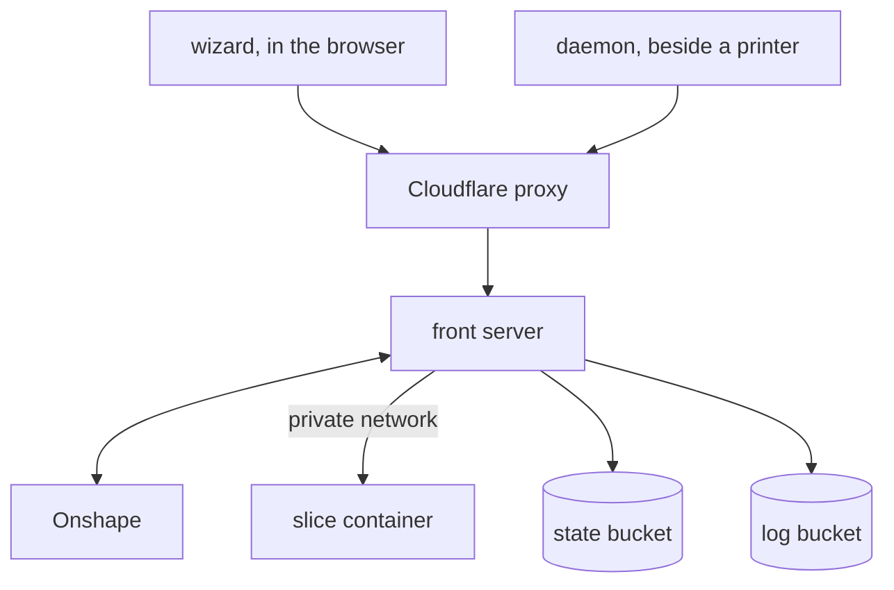
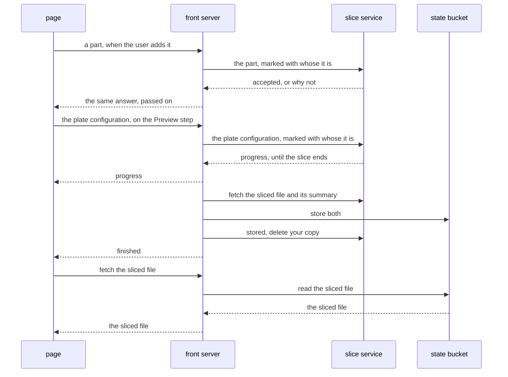

# The front server

Nothing of the front server is built. Every sentence of this guide describes the design,
and the section [What is built in which phase](#what-is-built-in-which-phase) says which
phase of [the plan](../docs/plans/penguin-slicer-plan.md) builds each piece of it. This
guide is for the person who decides whether the design is right;
[README-details.md](README-details.md) holds what a builder needs: the names, the rules
one by one and the tests each needs.

## What it is for

A user of PenguinSlicer opens one address, `https://penguinslicer.popcornpenguins.com/`,
in a browser or in Onshape's right panel. Everything behind that address is the **front
server**. It hands the browser the wizard's pages, signs the user in with Onshape, takes
the user's parts and plate configurations to the slice service and brings back the
result, keeps the
sliced file for as long as the user may still want it, keeps the settings a group of
users shares, writes down what happened, and from phase 5 runs the half of printer
delivery that lives on a server. The user never sees it as a thing of its own: they see
a wizard that remembers who they are, a slice that finishes whether or not they are
watching, and a sliced file that is still there after a three-hour print.

### Why it is a component of its own

PenguinSlicer has five components, each depending only on written contracts. The front
server stands between three of the others, and it is apart from each for a different
reason.

**Apart from the wizard.** The **wizard** is the code that runs in the browser: the
Parts, Settings, Layout, Preview and Send steps. A **page** is the wizard as loaded in
one browser tab or in Onshape's panel, and this guide says "the page" for whatever sends
the front server a user's request. Whatever runs in a browser can be read
and changed by the person at that browser, so the wizard can be trusted with nothing: no
secret, no say over who the user is, no say over whose parts a request concerns. The
front server is where those things are decided. The two are joined only by
[the contract between the wizard and the front server](../contracts/wizard-front-server.md),
so that the wizard can later be placed somewhere else (inside PenguinCAM, for one
possibility the design keeps open) without the front server changing.

**Apart from the slice service.** The **slice service** runs Orca on files that
strangers upload, and Orca is a large program that was not written to resist hostile
files. So, hosted, the slice service runs in a container of its own, the **slice
container**, which holds no secret and no credential and accepts requests only from the
front server. A flaw in Orca then reaches no sign-in secret and no stored file. The
split has two more uses: Orca's short, steep rise in memory and a deploy of the slice
container cannot cut off the printers' connections, which the front server holds, and a
change to the wizard goes out without touching a slice that is running. Railway, the
host, bills for the memory actually held, so two containers cost what one would. What
the split costs is work for the front server: it must pass every part and plate configuration through,
fetch every sliced file, and fetch the slice service's log lines, since the slice
container can write nowhere.

**Apart from printer delivery.** Printer delivery has two halves. The **daemon** is a
program on **the daemon's computer**, the computer beside the printer. The **relay** is the half on a server, and is
written to run inside some application that signs users in and holds sliced files. From
phase 5 the front server is that application. The relay stays a separate component with
its own tests; the front server supplies what the relay asks for and nothing more
(see [Running the relay](#running-the-relay-from-phase-5)).

### Why it is the one thing the internet reaches

The wizard's pages, the address a daemon is given and the address Onshape sends a user
back to after signing in are all at one address. Three things follow from there being
only one.

- The slice service cannot be reached from the internet at all. Only the front server
  can call it, over the private network between the two containers.
- The browser never talks to a second site, so the front server never has to allow
  another site's pages to call it, which closes a whole class of attack
  (see [Requests from other sites](#requests-from-other-sites)).
- There is one place where every request is checked for a signed-in user, and one place
  to defend.

The domain's name service is at Cloudflare, whose proxy sits in front of the address,
hides the host and turns away floods of requests. Cloudflare runs no logic of
PenguinSlicer's. Proposed, since no source states it: the front server marks every
answer except the wizard's own page files as not to be kept by any proxy or browser, so
that Cloudflare's proxy never holds a copy of one user's sliced file or configuration
that it could hand to another.

**Serving the wizard's pages** is the simplest thing the front server does: the page
files are built from the wizard's folder of the repository and go out with the front
server, so a deploy of one is a deploy of both. A browser with no signed-in user is sent
to the sign-in and receives none of the wizard's code.

The front server keeps what must last in two stores at Cloudflare, the state bucket and
the log bucket, which the next section explains.

### What it holds, and what it never holds

The front server keeps no database, no table of sessions and no accounts. What it must
remember across a restart is in one of two places it does not itself contain.

- **In the browser.** Who is signed in is in a cookie. The user's parts, layout and
  chosen settings are in the browser's storage, which is the wizard's business.
- **In two object stores at Cloudflare R2.** An object store keeps files under names and
  nothing more. The **state bucket** holds what must outlast a restart of the front
  server: each group's configuration, the sliced files, each with a short summary of what it will print, and from
  phase 5 the relay's records. The **log bucket** holds log lines as files. On one
  machine, in phase 2, a folder stands in for each bucket, and the front server reaches
  bucket and folder through the same four operations: read a file, write a file, write
  a file only if it has not changed since it was read, delete a file.

The front server holds four secrets, listed under [Secrets](#secrets), and it holds the
only credential that can write to the buckets; beyond it, only the owner can, through
Cloudflare's own console.

What it never holds:

- **A user's part.** A part passes through it on the way to the slice service and no
  copy is kept. The browser's storage is the record of a user's parts.
- **A session.** Nothing in its memory or in a bucket says who is signed in.
- **A password or an account.** Onshape is the only way in.
- **Anything that is lost by restarting it,** with three small exceptions: the log
  lines of the last minute before a crash; from phase 5 the printers' latest status,
  which each daemon sends again within seconds; and from phase 5 the pairing codes
  daemons are offering, which each daemon offers again within half a minute.

### What it exchanges, and under which contract

| With | What passes | The contract |
|---|---|---|
| The wizard | Pages; parts and plate configurations going up; progress and the sliced file coming down; the group's settings both ways; from phase 5, sends and the printer's status | [The wizard and the front server](../contracts/wizard-front-server.md), whose exact requests are written with phase 2's design; failures as [error reports](../contracts/error-report.md), progress as [progress reports](../contracts/progress-report.md) |
| The slice service | Parts and [plate configurations](../contracts/plate-configuration.md) going in; progress, the [sliced file](../contracts/sliced-file.md) and log lines coming out | The slice service's own interface ([its guide](../slice/README.md)) |
| Onshape | Who a user is and which companies and classrooms they belong to; from phase 4, the parts a user selected | Onshape's public interface |
| The state bucket | Each group's settings, the sliced files and, from phase 5, what the relay must remember | [The configuration's contract](../contracts/configuration.md) for the settings |
| The relay, from phase 5 | Who is asking; a place to keep what it must remember; the sliced file | The relay's interface to its caller ([printer delivery's guide](../delivery/README.md)) |

What spans all the components (the two containers, where every kind of state lives,
restarts, security, the log) is in [the architecture](../docs/architecture.md). This
guide gives the front server's part of each in full and links there for the rest.

## Signing in

### Onshape is the only sign-in, and there are no accounts

Every user signs in with Onshape, by the standard exchange in which Onshape asks the
user to approve the app and then tells the app who they are (OAuth). It is the same in
Onshape's panel and outside it, through one registered Onshape app. Onshape tells the
front server two things: who the user is, and which Onshape companies and classrooms
they belong to. In phase 3 that is all the app asks Onshape's permission for. What it
must ask for in phase 4, to read a user's parts, is not settled; it decides what a
stolen token opens, and is listed under
[The permissions the Onshape app asks for](#the-permissions-the-onshape-app-asks-for).

Anyone with an Onshape account, which is free to make, can sign in. Nothing limits who,
and whether something should is undecided: see
[Who may sign in](#who-may-sign-in).

Because no other sign-in is offered, PenguinSlicer keeps no accounts and no passwords,
has no "forgot my password", and never has to decide whether two sign-ins are the same
person. Who may use a group's printer is decided by who is in the Onshape company, which
somebody already keeps up to date for other reasons.

A sign-in goes like this.

1. A request arrives from a browser the front server cannot identify. The front server
   sends the browser to Onshape's approval page, with a random value of its own making.
2. Onshape sends the browser back with that value. The front server checks that it is
   the value it sent out, and refuses the sign-in otherwise, so that nobody can be
   signed in by a link someone else prepared.
3. The front server asks Onshape who the user is and which companies and classrooms they
   belong to. That is two calls to Onshape, and they are the only two.
4. It sets the cookie, reads the configuration of the user's current group, and writes
   a log line with the user and their groups.

A request for one of the wizard's pages with no signed-in user starts the sign-in. Any
other request with no signed-in user is answered that the user is not signed in, and
the page starts the sign-in itself.

Chrome is the supported browser. Safari is not supported, in Onshape's panel or outside
it. What a user of Safari is shown is not designed; proposed: a plain page saying that
PenguinSlicer needs Chrome.

Inside Onshape's panel the sign-in is the same exchange, and it depends on Chrome
sending the cookie to a page embedded in another site. Whether Chrome always does, and
whether Onshape's approval page appears inside the panel or in a window of its own the
first time, are undecided: see
[The cookie inside Onshape's panel](#the-cookie-inside-onshapes-panel).

### Groups and the current group

A **group** is the users who share one configuration and one printer. It is one Onshape
company or classroom. A user who belongs to none is a group of one. Every user of a
group may do everything in it: there are no roles.

A user who belongs to several groups works in one at a time, the **current group**. The
wizard's header names it and the user changes it there. The browser keeps the choice and
sends it with each request, and the front server accepts it only if the cookie lists
that group among the user's. This one check is what keeps a user out of another group's
configuration and away from another group's printer. It is made on every request that
acts for a group: reading and writing the configuration; uploading a part; submitting a
plate configuration; asking about, following and cancelling a slice job; fetching a
sliced file; and from phase 5
everything to do with a printer. A request that names no group, or a group the cookie
does not list, is refused and the refusal is logged.

The page cannot read the cookie, so the front server tells it, on request, the user's
name and the names of their groups, from the cookie and without calling Onshape. That
is what the header's list of groups is drawn from.

### The cookie, and why there are no sessions

A sign-in sets one **cookie** in the browser. It holds the user's Onshape id and name,
each of their groups by id and name, and the two tokens Onshape issued (one that
authorises calls for an hour, one that renews it). It is encrypted with a secret only
the front server has, the **cookie key**, so the browser can neither read it nor change
it.

The cookie is the whole of the sign-in. Nothing about it is kept on the server, and the
cookie key is a setting the front server is given when it starts, not something it
makes up in memory. That is why a restart or a deploy signs nobody out, why there is no
table of sessions to store, clean or lose, and why two front servers of different
versions agree at once about who a user is.

The cookie lasts thirty days from the sign-in. The figure is long so that signing in is
rare, because each sign-in spends calls to Onshape (next section). The thirty days run
from the sign-in and are not extended by use: when the front server rewrites the cookie
for any reason, its end stays where it was. So a user signs in once in thirty days in
each browser, however much or little they use it, and the groups in a cookie are never
more than thirty days old.

Three consequences are accepted.

- **A user removed from an Onshape company keeps its configuration and printer until
  their cookie ends,** up to thirty days, because the groups are read at sign-in and,
  for now, at no other time.
- **A user added to an Onshape company does not see the new group** until they sign in
  again. The header has a "sign in again" action beside the current group's name for
  exactly this. It costs two calls, and nothing limits how often it is used, which is
  undecided (see [Sign-ins and the allowance](#sign-ins-and-the-allowance)).
- **Inside Onshape's panel the cookie must be one the browser sends to a page embedded
  in another site.** A cookie of that kind is sent with requests that other sites cause
  as well, which is why the cookie alone is not taken as proof that a request came from
  the wizard (see [Requests from other sites](#requests-from-other-sites)). What
  happens when Chrome withholds such a cookie is undecided (see
  [The cookie inside Onshape's panel](#the-cookie-inside-onshapes-panel)).

Onshape's hour-long token is renewed only when a call to Onshape needs one, and the
renewed tokens are written back into the cookie. Before phase 4 nothing needs one,
unless the Onshape app has been made public by then. How two requests renewing at the
same moment are kept from spoiling the cookie is not designed (see
[Two requests renewing the tokens at once](#two-requests-renewing-the-tokens-at-once)).

### Onshape's yearly allowance of calls

Until an Onshape app is public in Onshape's App Store, every call it makes counts
against a yearly allowance of the account that owns the app: 2,500 calls a year on a
free or education account (Onshape's figure). The intention is to make the app public,
which lifts the allowance. Until then, all development and all testing with users must
fit inside it with room to spare. So the rule is: **nothing calls Onshape that can be
done without it.** The cookie's thirty days, the absence of any periodic check, the
development identity (a made-up user for work on one machine, described in the next
section) and the stand-in used in tests all come from this rule.

| Use | Calls to Onshape |
|---|---|
| Work on one machine, with the development identity | None |
| The automated tests, which use a stand-in for Onshape | None |
| A sign-in to the hosted service | 2, once in thirty days for each browser |
| Reading a signed-in user's groups again | None until the app is public |
| Reading parts from Onshape, from phase 4 | Several for each part; counted in phase 4's design before anything is built |

So until phase 4, twenty people using the hosted service for two months spend about 80
calls of the 2,500.

That sum assumes each person signs in once in thirty days. Nothing in the design makes
it so: one person who signs in 1,250 times, by "sign in again" or by clearing the
cookie, spends the whole allowance, and after that nobody can sign in until Onshape's
year turns. A limit on sign-ins is undecided: see
[Sign-ins and the allowance](#sign-ins-and-the-allowance).

How often a signed-in user's groups are read again is a setting of the front server.
Until the app is public it is "never". Once the app is public it becomes once a day,
so a removed user then keeps access for a day and not thirty; a public app's calls do
not count against the allowance, so the daily reads cost nothing.

Every call the front server makes to Onshape writes a log line, and the command that
reads the log reports the year's total, so the spend is watched and not assumed.

### The development identity

On one machine there is no registered Onshape app to send a browser to, and work there
must spend no calls. So the front server has a setting that makes it sign in a fixed,
made-up user in a fixed, made-up group, the **development identity**, the moment a
browser arrives, without contacting Onshape. Everything else then runs as it does
hosted: the cookie, the current group's check, the marking of parts and slice jobs with
whose they are.

This setting would be a way past the sign-in if it were ever on in the hosted service.
Two independent things prevent that. The command that starts the hosted front server
never turns it on. And the front server refuses to start at all with it on when it
finds itself running on Railway, or finds an Onshape app's credentials among its
settings; it writes one log line saying why and stops.

### Requests from other sites

A browser attaches a site's cookie to requests that other sites cause, and inside
Onshape's panel PenguinSlicer's cookie has to be of the kind that is attached most
freely. A hostile page a signed-in user happens to visit could therefore try to make
the user's browser send, say, a print to their group's printer. Four defences stand
against it.

- **Every request that changes something must carry a mark that only the wizard's own
  page can add, and must come from the front server's own address.** A browser will not
  let another site's page add that mark or disguise where a request came from. This
  covers uploading a part, submitting a plate configuration, cancelling a slice job,
  writing the configuration, and from phase 5 pairing, sending, cancelling a print,
  giving up on following one, and unpairing. A request that fails either test is
  refused and logged.
- **No other site's page is allowed to read the front server's answers.** The front
  server never tells a browser that another site may.
- **The sign-in checks the random value it sent out,** as described above.
- **Only Onshape may embed the pages.** Every page tells the browser that it may be
  shown inside Onshape's site and no other, so no other site can put the wizard in a
  hidden frame and trick a user into clicking in it.

## What it does for a part and for a slice

The whole path, before each piece is taken in turn:

### Whose it is

With every request it makes to the slice service, the front server says whose part or
slice job this is. It says so with the **user key**: the signed-in user's Onshape id, taken
from the cookie and from nowhere else. Nothing the browser sends can name a user key;
if a request tries to, the attempt is ignored. The slice service only compares user
keys and never interprets them. The result is that a user reaches only their own parts,
slice jobs and sliced files, even among users of the same group.

A request for a slice job or a sliced file that belongs to someone else is answered
exactly as if it did not exist, so nobody can find out whether another user's is there,
and the attempt is logged as a refusal.

### A part

The page uploads each part by itself, at the moment the user adds it, in one request
of at most 7.5 MB (the plate configuration's limit for one part). The front server
passes it to the slice service with the user key and with the part's units, inches or
millimetres, which travel beside the file as a label. Neither the browser nor the front
server ever changes a part's bytes; only the slice service applies the scale. Proposed,
since no source states it: a part passes through the front server in pieces and is
never held whole in its memory, so that the memory it takes does not grow with the
number of uploads under way.

The slice service checks the part as it arrives and keeps it for two hours after its
last use, in its **part store**, under the user key and the part's **hash** (a SHA-256
hash of the file's bytes, a short value that changes if any byte does) together with
its units; the same file in other units is a different part. A part that cannot be
sliced is refused there; the front server passes the refusal back
as it came, and the user sees it on the Parts step as a notification and the part is
not added. This is the reason for uploading at once: a bad part is caught before the
user has laid anything out.

The front server keeps no copy. If the slice service has dropped a part by the time a
plate configuration names it, the page uploads it again from the browser's storage; the front
server's part in that is only to pass the slice service's list of missing parts back.

### A plate configuration

On the Preview step the page sends a **plate configuration**: the layout, the settings
and each part's hash and units, with no files in it. The front server passes it to the
slice service with the user key, and the slicing of that plate configuration, a **slice
job**, waits its turn or runs in the slice container. Because a plate configuration
carries no files, slicing again after moving a part or changing a setting uploads
almost nothing.

A user has one unfinished slice job at a time. Submitting a plate configuration cancels
the same user's earlier unfinished slice job, which is what the Preview step wants when
a plate changes; with the wizard open in two tabs, the later slice job wins. The front
server also passes on a user's own cancel.

When no more slice jobs may wait, the slice service says so and the front server passes
that on: the user is told the slicer is busy and to try again shortly. A slice service
that is merely stopping for a deploy must not be reported that way. The user is to
notice nothing of a deploy, so in that case the page must be answered that the service
did not answer, which it retries silently; whether the slice service says so itself or
the front server turns its refusal into that answer is settled with phase 2's design.

### Progress

The page follows a slice job on a **progress stream**: one connection the front server
keeps open and sends progress reports down as they happen (server-sent events). For a
waiting slice job the report says how many are ahead of it.

Three limits of the hosts shape this. Railway closes any request after fifteen minutes,
and after five minutes if no data has passed; Cloudflare closes one after 125 seconds
without data. So a stream with nothing to report sends an empty line at least every
fifteen seconds, which keeps it open through both, and the page reconnects whenever a
stream closes, which is how it survives the fifteen-minute cut and every restart of the
front server. A stream that connects late gets the latest progress report at once, so a
reconnecting page catches up in one message.

A slice job is reported finished on the stream only once its sliced file is in the
state bucket, because that is where the page fetches it from; reporting sooner would
send the page to fetch a file that is not there yet.

### The front server follows every slice job itself

A slice job, once submitted, runs to its end whether or not anyone is watching: through
a refresh, a lost network or a closed laptop lid. Something must therefore notice that
it has ended and collect the result when no page is open. That something is the front
server. For every unfinished slice job it holds the slice service's own progress
stream, page or no page. The streams it serves to pages are fed from the one it holds,
so three tabs watching one slice job cost the slice service one connection.

When a slice ends, the front server:

1. fetches the sliced file from the slice container, with its **summary** (the
   predicted print time, the filament used, the layer count and the warnings, which the
   slice service gives beside the file);
2. stores both in the state bucket, under the user key and the slice job's id, with the
   time the slice ended;
3. tells the slice service that they are stored, and the slice container deletes its
   own copy;
4. only then reports the slice job finished to any page that is following.

The summary is kept beside the file, and for as long, because the Preview step needs it
after the slice container's copy is gone. A fetch that fails partway leaves nothing
half-written in the state bucket and is tried again. If the state bucket does not
answer, the front server keeps trying; the slice container keeps its copy until it is
told the file is stored, and the page goes on showing the slice job as running. If the
slice container restarts before the file is stored, that slice runs again.

A sliced file is 8.8 to 14.1 MB on the plates sliced so far, well inside the 100 MB
Cloudflare allows one request. Nothing in the design bounds its size, which is listed
under [No ceiling on a sliced file](#no-ceiling-on-a-sliced-file). Proposed, since no
source states it: the sliced file passes through the front server in pieces, on its way
into the state bucket and on its way out to a browser or a daemon, and is never held
whole in memory.

From then on the state bucket's copy is the one everything uses. The page fetches it
through the front server to draw the Preview step and to offer the download, and from
phase 5 the relay hands it to the daemon. The browser never stores a sliced file and
the front server accepts none from a browser, so a printer only ever runs a file the
slice service made.

### A page that comes back

A page that has lost its state (a refresh, a reopened panel) still has, in the
browser's storage, the id of its plate's slice job and the time it submitted it. It
asks the front server about that slice job. The front server asks the slice service,
which remembers a slice job for two hours after it ends, and looks in the state bucket.
It gives one of five answers.

| The front server answers | When |
|---|---|
| Still waiting or running, with the latest progress report | The slice service says so; also when the slice has ended but its sliced file is not yet stored |
| Finished | The sliced file is in the state bucket |
| Ended in an error, with the error report | The slice service says so; also when the sliced file was stored and has since expired, in which case the error is that it has expired |
| Cancelled by a later slice of the same user | The slice service says so |
| Unknown | Neither the slice service nor the state bucket knows it, or it is another user's |

What the page does with each answer is the wizard's business and is in
[the wizard's guide](../wizard/README.md).

## How long a sliced file lives

### The rule

A sliced file can be previewed, downloaded, sent to the printer, and sent again after a
print, **until two hours after its slice ended or two hours after its last print ended,
whichever is later.** Two hours after slicing gives the user time to look at the
preview and decide. Two hours after the last print lets the same plate be printed again
after a print of any length, without slicing again. Before phase 5 nothing is printed,
so two hours after the slice ended is the whole rule.

The front server enforces the rule itself, in three ways.

- **It refuses a sliced file that is past both limits,** tells the user it has expired,
  and deletes it. A user who comes back to an expired plate is told that the earlier
  plate's sliced file has expired; a user who presses Send on one is told that it has
  expired and that the plate must be sliced again.
- **It sweeps.** At regular intervals it deletes every sliced file that has passed both
  limits, so that a file nobody asks for again is still gone on time.
- **From phase 5, a sliced file whose print is under way is kept;** its two hours are
  counted from the moment that print ends.

To know when a sliced file's last print ended, the front server relies on the relay's
record of each **delivery job** (one sliced file on its way to one printer, from the
send until the print ends): that record names the sliced file it used.

### Why R2's own rule cannot do this alone

R2 can delete files by itself after a set age, and it would be simpler to leave it to
that. It cannot serve, for three reasons: its rule counts in whole days, not hours;
Cloudflare says a file is typically removed within 24 hours after it falls due, so even
a one-day rule means up to about two days; and it counts from when a file was stored,
knowing nothing of prints.

R2's rule is still used, as a backstop for a file the front server failed to delete: a
crash at the wrong moment, or a fault in the sweep. It is set at **three days**. Three,
because R2 counts from when the file was stored, and the file must still be there two
hours after the longest print ends. So
that a file sent late in its life is not caught by the backstop, **sending a sliced
file stores it afresh,** which starts R2's count again; the three days therefore run
from the last send.

What follows for a user and for privacy:

- A print that runs longer than about three days from its send loses its sliced file to
  the backstop. The print itself is not affected, since the printer already has the
  file. Sending the same plate again afterwards means slicing it again.
- A sliced file the front server failed to delete can rest at R2 for up to about four
  days after it was last stored: three days, and up to a day more for Cloudflare to
  remove it. It is in a private bucket for that time.

## The configuration

### What it holds

A group's **configuration** is the settings everyone in the group shares. It is one
document for each group, kept in the state bucket, and it holds:

- **The group's filaments.** Each has a **colour**, shown where the user chooses a
  filament so that two filaments of one material (a red PLA and a green PLA) can be
  told apart. That colour is never used in the layer preview, which draws every plate
  in the same four fixed colours.
- **The profiles the wizard offers for each filament.** Each filament has its own list,
  not one list for all. Each profile is one of Orca's, named by Orca's name, with any
  settings that replace Orca's own, and beside it **the group's own name and purpose**
  for it. The Settings step offers profiles by the group's names (such as "Structural")
  and shows the purpose as a tooltip, because Orca's names are not names a group would
  choose and say nothing of what a profile is for.
- **The printer's Orca profile,** from which the plate's size and height come, for the
  Layout step and for slicing. The configuration names only the profile to slice for;
  which physical printer is the group's is recorded elsewhere, by pairing. Nothing
  checks that the two agree, so a group that names the wrong profile sees a plate of
  the wrong size.
- **The units of uploaded files:** whether a part uploaded as a file, which carries no
  units, is read in inches or millimetres.
- **No secret.** No token, key or pairing code is ever in it.

Its exact fields are written with phase 2's design, in
[the configuration's contract](../contracts/configuration.md), with an example that
explains every field.

### Reading it and writing it

The front server reads a group's document when a user signs in and again whenever the
wizard asks, always for the current group. A group with no document gets a default
built into the front server, which names the profile of the Bambu Lab H2S, the Popcorn
Penguins' printer, so a new group can slice
without setting anything up.

The document is read whole and written whole. With no finer grain than that, two users
editing at once could each save over the other without knowing. So a write is
conditional: the front server remembers which version of the document an edit started
from, and the state bucket accepts the write only if the document is still that
version. The first of two simultaneous edits is saved. The second user is told that the
configuration was changed by someone else and to reload; their edit is not saved and
nothing is merged. That costs the second user their edit, which is acceptable for a
document a small group changes rarely, and it needs nothing but the conditional write
the object store already offers.

Every edit writes a log line with the user's name and what changed. An edit replaces
the document, and nothing else ever deletes it.

A document that cannot be understood (damaged, or of a format the front server does not
know) is reported as an error, and is never silently replaced by the default, so a
group's hand-written document is not lost to a typing mistake.

### The fixed set, until the edit screens exist

The screens for editing a configuration are a feature of their own, in no phase yet.
Until they exist the set of configurations is fixed: a group uses the built-in default,
or a document the owner writes by hand and places in the state bucket through
Cloudflare's console, following the contract's example. No user can change one. The
front server must therefore expect documents written by hand, and report their faults
clearly.

The conditional write is built in phase 2 all the same, with nothing in the wizard yet
using it. That proves the bucket's conditional write early, on a folder and then on R2,
costs little, and lets the edit screens be added without changing the front server.

## Running the relay, from phase 5

The daemon opens no port; it only calls out. The relay hands the daemon its work and
holds the printer's latest status. From phase 5 the relay runs inside the front
server's process, and the daemon reaches it at the same public address as everything
else. How pairing, sending and the daemon's requests work
is printer delivery's own subject, in [its guide](../delivery/README.md). This section
is what the front server does so that the relay can run.

**It tells the relay who is asking.** The relay never looks at a cookie. For each
request from a page, the front server gives it the signed-in user and the current
group, already checked against the cookie. When a user types the code a daemon is
showing, the relay links that daemon to the user's current group by writing the group's
**paired-printer record**. A send is accepted when the current group has such a record,
and goes to the daemon it names. So the chain that protects a printer runs through the
front server: Onshape says who the user is, the cookie carries their groups, the
current group must be one of them, and only that group's record names the daemon.

**It gives the relay a place to keep its records.** The relay's records are the
paired-printer record of each group and one record for each delivery job, kept until a
day after the delivery job ends. They go in the state bucket (a folder on one machine)
and not in memory, because a daemon that is told the relay no longer knows its delivery
job treats the job as finished and drops it. The record of a delivery job also holds
whether the daemon has been allowed to start the print, which is what keeps a print
from starting twice across a restart.

**It supplies the sliced file.** The relay keeps no copy. When the daemon fetches the
file, the front server reads it from the state bucket, where it is kept under the rule
above.

**It makes a repeated send harmless.** A page retries a request whose answer it did not
receive. A send repeated by the same user with the same sliced file, while its delivery
job is still live, is answered with that same delivery job. It does not start a second
print and is not refused on the grounds that the printer is now busy. Printer delivery
as built refuses the repeat instead; changing that is part of phase 5.

**It spends a thread on each idle daemon.** While a printer is idle its daemon keeps
one request open to the relay, so that a send reaches it at once although nothing can
call the daemon. Each such open request occupies one of the front server's threads; see
[The limits that matter](#the-limits-that-matter).

**It lets the daemon's requests in without a sign-in.** A daemon has no cookie; its
requests carry a token the relay issued and checks, and a daemon not yet paired offers
its pairing code with neither.

The front server also holds the relay's secret key, answers the daemons' open requests
when stopping, and gathers the relay's log lines with its own. The relay's own
mechanisms are in [printer delivery's guide](../delivery/README.md): how long it holds
an idle daemon's request, the limits on offers and on wrong pairing codes, and the note
it makes in the paired-printer record when a daemon goes offline (no request from it
for two minutes), which is the time of that daemon's last request, written once.

## Restarts and deploys

PenguinSlicer is deployed continuously: a change goes out when it is ready, at any
hour, while people are using it. A restart of the front server is therefore routine,
and the rule is that it interrupts no user and loses nothing a user did. One thing is
outside the rule: from phase 5, a pairing code typed just after a restart must be typed
again, as the last row of the table says.

### Why nothing is lost

Nothing a user did is in the front server's memory. Each thing is somewhere a restart
does not touch. The one thing a user is about to do that does depend on the front
server's memory is typing a pairing code: the codes daemons are offering are held in
the relay's memory.

| What the user did | Where it is | After a restart of the front server |
|---|---|---|
| Signed in | The cookie | Still signed in; the cookie key is a setting, not memory |
| Added parts, laid out a plate, chose settings | The browser's storage | Untouched |
| Submitted a slice job that is still running | The slice container | It keeps running; the front server finds it again when it starts |
| Finished a slice | The state bucket | Untouched |
| Edited the configuration | The state bucket | Untouched |
| Paired a printer; sent a print (phase 5) | The state bucket | Untouched; the print goes on, and the printer's status is blank until the daemon's next request, within about ten seconds |
| Typed a pairing code in the half minute after a restart (phase 5) | The relay's memory, which the restart emptied | Told that no daemon is showing that code; typing it again a moment later works, because each unpaired daemon offers its code again within half a minute |

**When it starts,** the front server asks the slice service for all its slice jobs, and
asks again until the slice service answers. It follows the unfinished ones again, and
collects every finished one whose sliced file it has not yet stored. So a slice that
ended while the front server was down is stored a moment after it comes back.

**When it is asked to stop,** as at every deploy, it takes no new requests, lets
uploads and downloads in progress finish, closes its progress streams and, from phase
5, answers the daemons' open requests, so that pages and daemons reconnect to its
replacement; and it writes the log lines it has gathered to the log bucket. It has
whatever time Railway allows a stopping container, which is not known (see
[What Railway does at a deploy](#what-railway-does-at-a-deploy)).

**Every request is safe to repeat.** The page retries every request it makes. A request
sent twice because its first answer was lost must leave the same result as one sent
once: uploading the same part again gives the same answer; a repeated send is described
above. A repeated submission must not leave the page following a slice job that the
repeat itself cancelled, and how that is met is not designed (see
[A plate configuration submitted twice](#a-plate-configuration-submitted-twice)).

What the user sees is the wizard's doing: nothing at all if the gap is under 20
seconds; after that a message that the server is being slow and the browser is
retrying, with a countdown to the next attempt; and an error with an offer to try again
only after 300 seconds. Nothing of the user's work is dropped at any point.

All of this is a deploy that works. Nothing is designed for one that does not: a new
front server that fails to start, or fails the check that runs after each deploy. Users
would then see the page's retrying and, after 300 seconds, its error; see
[A deploy that fails, and learning that the service is down](#a-deploy-that-fails-and-learning-that-the-service-is-down).

The whole table of what a restart does, for both containers, is in
[the architecture](../docs/architecture.md#what-a-restart-does).

### Old and new versions together

A deploy replaces the front server and nothing else, so for a while the new front
server meets things made for the old one. The front server's own rule is this: **a page
loaded before the deploy keeps working against the new front server,** at least until
it reloads. Every answer the front server gives, errors and progress included, carries
the front server's version. A page that sees a newer version than its own reloads at
the next moment when nothing is in flight, which loses nothing because its state is in
the browser's storage. Of all the rules here this is the one most easily broken by
accident.

The same holds for what the old front server wrote: every record in the state bucket
carries the number of its format, a cookie set by the old one is read by the new one,
and from phase 5 an installed daemon keeps working. These rules are in
[the architecture](../docs/architecture.md#old-and-new-versions-together).

## Secrets

PenguinSlicer has six secrets. The front server holds four, as settings given to it
through Railway: the Onshape app's identifier and secret, which prove to Onshape that a
sign-in comes from PenguinSlicer; the cookie key; from phase 5 the relay's secret key,
which signs the tokens that prove a daemon is paired; and the credential that reads and
writes both buckets. None is in the repository, a bucket, a log line or a page.

Every one can be replaced, and a planned replacement interrupts nobody who uses
PenguinSlicer within a week of it; how each is replaced, and what an emergency
replacement costs, is in [the architecture](../docs/architecture.md#security). Two
points are the front server's own.

- **The cookie key.** The front server holds two: the current one, and the previous one
  for reading only. A cookie it can read only with the previous key is rewritten with
  the current one, keeping its end, and the use is logged. The previous key is removed
  one week after a replacement; a user who does not open PenguinSlicer in that week
  signs in again, at the cost of two calls to Onshape.
- **The Onshape app's secret.** No cookie depends on it, so replacing it signs nobody
  out. Whether sign-ins fail in the moments between Onshape issuing the new secret and
  the front server having it is not confirmed (see
  [Replacing the Onshape app's secret](#replacing-the-onshape-apps-secret)).

## The log

The owner runs the service alone and cannot look at a user's screen. The log must
answer three questions without it: what went wrong, whether the service is the right
size, and who is using it.

### What the front server writes

- **Who uses it:** each sign-in, with the user key, the user's name and their groups.
- **What it spends:** each call to Onshape.
- **What changed:** each edit of a configuration, with the user's name and what
  changed.
- **Everything that goes wrong:** every error a user is shown, with its kind, the user,
  the group and the slice job or delivery job it belongs to; every unexpected failure inside the
  front server, with the trace of where it happened, including one no user saw because
  the request was retried.
- **Every refusal:** a failed sign-in; a request for something that belongs to another
  user; a current group the cookie does not list; a changing request without the
  wizard's mark or from another address.
- **What happened to each sliced file:** stored, served, expired, deleted.
- **How full it is:** once a minute, the memory it holds, the slice jobs running and
  waiting, the connections it holds open and the threads in use.
- **Housekeeping:** each start, with the version that started, and each use of the
  previous cookie key.

Every line about a slice or a send carries the user key and the current group. No line
holds a secret, a token, a pairing code, the cookie or a part's shape. Lines do hold
users' names and parts' names, which is why the log bucket is private.

### Where it goes, and who reads it

Every line goes to Railway's log view at once, where Railway keeps it seven days, and
about once a minute to the log bucket, where it is kept ninety days so that a problem
reported weeks later can still be looked into. The owner and the owner's coding agents
read the log bucket with a credential that can read it and nothing else, through one
command kept in the repository, built in phase 3. What that command reports, and the
form of a line, are in
[the architecture](../docs/architecture.md#reading-what-happened).

The front server is the only thing that can write to the log bucket, so it gathers for
the others. It fetches the slice service's lines over the private network, and it adds
the group to each of them, since the slice service knows only the user key and the
front server knows which group each slice was submitted for. From phase 5 it gathers
the relay's lines and what the daemons report about themselves.

A crash loses up to the last minute of lines from the log bucket; they remain in
Railway's log view for its seven days. A deploy loses none, since a stopping front
server writes what it has gathered.

## The limits that matter

Each figure, what it protects and where it comes from. "The design's choice" means a
figure this design sets, which nobody else imposes and which has not been measured. A
figure that is a length of time is checked by a test with a clock the test moves, so no
test waits; the last column is filled only where the check is something else. The
limits of the relay (how long it holds an idle daemon's request, how many pairing
codes may be offered a minute) are in
[printer delivery's guide](../delivery/README.md#how-well-it-must-do-it), and how long
the page keeps retrying is in
[the wizard's guide](../wizard/README.md#when-the-server-is-slow-or-cannot-be-reached).

| Limit | Figure | What it protects | Where it comes from | Checked otherwise than by a moved clock |
|---|---|---|---|---|
| Threads serving requests | 100 | The front server's memory, and a known ceiling on what it does at once | The design's choice | The once-a-minute log line |
| Idle daemons served | About fifty | Room left for users' requests | 100 threads, one for each idle daemon | The same log line |
| Users served at once | None set | A user's request finding a free thread | Undecided | |
| One part | At most 7.5 MB | The slice service's checks and memory | The plate configuration's contract | A test at the limit; one real upload |
| A sliced file | No ceiling of its own; 8.8 to 14.1 MB so far | A fetch staying inside the 100 MB Cloudflare allows one request | Measured on the plates sliced so far | The log line that ends each slice |
| A progress stream with nothing to report | An empty line at least every 15 seconds | The stream staying open | Cloudflare's and Railway's limits | |
| Any one request | Closed by Railway after 15 minutes | Nothing of ours | Railway's limit | Tried on the hosted service |
| The cookie | Thirty days from sign-in | Onshape's allowance | The design's choice | |
| The cookie's size | About 4 KB | The user being able to sign in | Browsers' limit | A test with many groups |
| A sign-in | 2 calls to Onshape | The allowance of 2,500 a year | Onshape's interface | Calls counted in a test and in the log |
| Sign-ins by one user, or in one day | None set | The same allowance | Undecided | |
| The previous cookie key kept | One week | Users away briefly | The design's choice | |
| A sliced file kept | Two hours after its slice ended, or after its last print ended if later | Sending again after a print | The design's choice | |
| R2's backstop on sliced files | Three days from last stored | A file the front server failed to delete | The design's choice | Set at R2 |
| Log lines in the log bucket | Ninety days | A problem reported weeks later | The design's choice | Set at R2 |
| Gathering the log | About once a minute | Lines lost in a crash | The design's choice | |

A sentence more on each row that needs one.

**Threads are the front server's scarce resource.** Each of these holds one thread for
as long as it lasts: a page's open progress stream; an idle daemon's open request; the
front server's own following of an unfinished slice job; an upload or a download in
progress. The slice service starts with one slice running and two allowed to wait, so
following slice jobs takes at most three. The figure of about fifty daemons assumes the
other threads are enough for the users. When the number of daemons calls for it, the
daemons' open requests can move to a small server of a different kind that holds
thousands of idle connections cheaply; that is known future work, not part of any
phase.

**Users served at once has no figure.** No source says how many pages following a slice
job or a print the front server must serve at once, nor what a user sees when no thread
is free; from phase 5 a page following a print holds a thread for the whole print. This
is undecided: see
[How many users at once, and what happens when the threads run out](#how-many-users-at-once-and-what-happens-when-the-threads-run-out).

**Sign-ins have no limit,** which leaves the allowance open to one person; see
[Sign-ins and the allowance](#sign-ins-and-the-allowance).

**A sliced file has no ceiling.** The measured range tells how much passes through for
each preview, download and print; see
[No ceiling on a sliced file](#no-ceiling-on-a-sliced-file).

**The cookie's size** is unconfirmed to fit; see
[Whether the cookie fits](#whether-the-cookie-fits).

**The backstop** means a file the front server failed to delete is gone within about
four days, as [Why R2's own rule cannot do this alone](#why-r2s-own-rule-cannot-do-this-alone)
explains.

**No target for time is set for the front server:** not for how long it may take to
answer, nor for the time between a slice ending and the page being told it is finished,
nor for a fetch of a sliced file by a browser or a daemon. Measuring these on
the first slices on the hosted service, in phase 3, is what a target would be set from.

**How often the sweep runs is not fixed.** It bounds how long past its two hours a
sliced file nobody asks for can exist. A file somebody does ask for is refused exactly
on time whatever the sweep's interval.

**Limits on how fast one user or one daemon may send requests** are counted for the
signed-in user or the daemon. Their figures are proposed for phase 5 and absent for
phase 2; see [Rate limits and the sweep's interval](#rate-limits-and-the-sweeps-interval).

## Security

**Who can reach it.** Anyone on the internet can send it a request; it is the only part
of PenguinSlicer of which that is true. It answers three kinds of caller: a browser
with a cookie it can read, a daemon with a token the relay signed, and, for the one
request of offering a pairing code, an unpaired daemon, which is rate-limited. Everyone
else gets the sign-in or a refusal.

The sign-in is open: anyone with an Onshape account, which is free to make, can sign in
and slice, and there is no list of permitted users or groups. What bounds such a person
is what bounds every user: one unfinished slice job at a time, at most 25 parts in the
part store for one user key (the most a plate can use), every slice bounded in memory
and time, and, from phase 5, wrong pairing codes limited for each signed-in user.
Whether the sign-in should stay open is undecided: see
[Who may sign in](#who-may-sign-in).

**What it trusts.** Onshape's word on who a user is and which groups they are in. Its
own secrets. The contents of the state bucket, because only it and the owner can write
there. The slice service's results, with the reservation below.

**What it treats as hostile.** Everything from a browser: the cookie until it decrypts
and is in date; the current group until the cookie confirms it; any claim about whose a
thing is, which it ignores in favour of the cookie; any changing request without the
wizard's mark. Uploaded parts are hostile too, but the front server does not open them;
it passes them to the slice container, which exists to contain them. The slice
container can itself call the front server over the private network, and meets the same
sign-in there as anyone else.

**What a flaw in the front server would expose.** Everything. It holds all four
secrets, so someone who took control of it could forge a sign-in as any user, forge a
daemon's token, read and write every sliced file and configuration, plant a record that
starts a print, and call Onshape with the tokens of whichever users' requests pass
through it. What those tokens open at Onshape depends on the permissions the app asks
for: in phase 3 a user's name, companies and classrooms; from phase 4 it is not settled
(see [The permissions the Onshape app asks for](#the-permissions-the-onshape-app-asks-for)).
This is the reason it is kept small, opens no uploaded file, runs no Orca,
and is the one place where care is concentrated.

**What is accepted as a risk, and why.**

- A removed user's thirty days of access
  ([The cookie](#the-cookie-and-why-there-are-no-sessions)), because the alternative
  spends the allowance of calls.
- Inside a group there are no permissions: any user may edit the configuration, pair
  the printer and send a print from anywhere, and a sent print starts with nobody at
  the printer. This suits the small groups PenguinSlicer is meant for; permissions are
  known future work.
- Users of one group see each other's names, and a one-line description of the plate
  that is printing.
- A flaw in the slice service itself, as opposed to Orca, could hand the front server
  any file as a sliced file, which it would store and a printer would run. The front
  server does not inspect a sliced file.
- A sliced file the front server failed to delete, resting at R2 until the backstop
  removes it ([Why R2's own rule cannot do this alone](#why-r2s-own-rule-cannot-do-this-alone)).
- A leaked key costs every user a sign-in, or every group a pairing.
- Users' names and parts' names stay in the log bucket ninety days. Removing one user's
  lines on request is not designed.
- The configurations and the paired-printer records in the state bucket have no second
  copy. If the bucket is damaged, or a hand-written document is overwritten, nothing
  restores them; a second copy is not designed.

The security of printers as a whole (the pairing code, what the state bucket can and
cannot be used for) is in [the architecture](../docs/architecture.md#security).

## When things go wrong

Every failure the front server reports is an
[error report](../contracts/error-report.md): what happened in a sentence a user
understands, what to do next, and the underlying detail kept for the log. The slice
service's and the relay's error reports are passed to the page as they came. These are
the front server's own.

| What happened | What the user sees | What they can do |
|---|---|---|
| The cookie is missing, unreadable or past its thirty days | The sign-in | Sign in; their work is still in the browser |
| Onshape refused the sign-in, or the returned value was not the one sent | That signing in failed | Try again |
| Onshape did not answer | That Onshape could not be reached | Nothing at first: the page retries |
| The request names no group, or one the user is not in | That they are not in that group | Choose another group, or "sign in again" if they were added recently |
| A changing request without the wizard's mark | Nothing, in honest use; this is the refusal of another site's attempt | Nothing |
| Someone else changed the configuration first | That it was changed by someone else | Reload and make the edit again |
| The group's configuration cannot be understood | That the configuration cannot be read | Tell whoever wrote it; the document is left as it is |
| The sliced file has expired | That it has expired | Slice the plate again |
| There is no such sliced file of theirs | That it is not known | Slice the plate again |
| The slice service did not answer | Nothing at first, then that the server is being slow | Nothing: the page retries |
| The state bucket did not answer | The same | Nothing: the page retries |

**Cancelling.** A user's cancel of a slice job is passed to the slice service, which
stops Orca itself; submitting a new plate configuration cancels the earlier slice job
in the same way. From phase
5 a cancel of a print is passed to the relay. The front server has no long work of its
own to cancel.

**A page that goes away.** Nothing is cancelled. The slice runs to its end, bounded by
the slice service's time limit, and the front server collects the result, so a user who
closes a laptop lid finds the plate sliced on return, within the two hours.

**A restart or a deploy** is covered under
[Restarts and deploys](#restarts-and-deploys).

## How it is tested

The everyday tests of the front server use no real network, no real waiting and no
fixed network ports, and pass in any order, any number of times. That is possible
because each thing outside the front server has a stand-in the test controls.

- **Onshape** is a stand-in that answers as Onshape does and counts the calls it
  receives. No test calls Onshape, and a test fails if anything tries.
- **The slice service** is a stand-in that answers as its interface does, and lets a
  test put its events in an exact order: a slice ending just before a restart, a fetch
  failing halfway.
- **The buckets** are the folder form, in a fresh temporary folder for each test.
- **Time** is a clock the test moves. Thirty days, two hours, a minute and fifteen
  seconds each pass in an instant, and no test ever waits to see whether something has
  happened.

Rules a manager can hold the builder to:

- Every refusal, limit and change of state in this guide has a test that reaches it and
  checks what the caller sees. Every error report has a test that produces it on
  purpose.
- The tests that every request needs a signed-in user, that every request acting for a
  group checks the group, and that every changing request needs the wizard's mark, are
  written to discover the front server's requests by themselves, so a request added
  later cannot be forgotten.
- Each row of the table of what a restart of the front server does is a test: the front
  server is stopped at that moment and started again, and the result is checked.
- The previous version's page is run against the new front server.
- No log line written during the whole run contains the cookie, a token or a key; a
  test searches every line for the values the run used.
- The folder form and the R2 form of the buckets pass the same set of tests. The R2
  form's run is outside the everyday tests, because it needs R2.
- From phase 5, the front server's place for the relay's records passes the relay's own
  tests of such a place.

What only the real thing can prove: how Railway behaves at a deploy; that Cloudflare
and Railway pass progress on as it is sent; that a 7.5 MB upload passes Railway; what
Onshape really answers, above all for an account with no company; that Chrome keeps the
cookie for a page embedded in Onshape
([The cookie inside Onshape's panel](#the-cookie-inside-onshapes-panel)); and the front
server's memory under load. After
each deploy, a short scripted check runs against the hosted service.

## What is built in which phase

Nothing exists. The phases are the plan's.

**Phase 2: one machine, no Onshape, no printer.** The front server runs beside one
slice service on one machine, with the development identity and a folder for each
bucket. Built here:

- serving the wizard's pages;
- the development identity and the cookie, with one cookie key;
- the user key, and the check of the current group against the cookie;
- telling the page the user's name and the names of their groups, for the header;
- limits on how fast one user may upload parts and submit plate configurations, whose
  figures nobody has proposed yet;
- passing parts and plate configurations to the slice service, answering a page that comes back, and
  the progress streams;
- following every slice job, storing the sliced file and its summary, collecting at
  start;
- the two-hour rule: refusing, deleting and the sweep;
- the configuration: the default, reading, and the conditional write;
- the log, gathered once a minute into the folder that stands for the log bucket;
- the version on every answer.

**Phase 3: hosted.** First, before anything else of this phase,
[what Railway does at a deploy](#what-railway-does-at-a-deploy) is tried. Then:

- the front server in its own container at the public address, calling the slice
  container over the private network;
- the two buckets at R2, with the three-day backstop and the ninety days for the log;
- signing in with Onshape, with every call counted, and "sign in again";
- the defences against requests from other sites;
- the second cookie key, and the written procedure for replacing each secret;
- the format number on every record in the state bucket;
- finishing work in flight when asked to stop;
- the refusal to start with the development identity on Railway;
- the command that reads the log bucket, and the check that runs after each deploy.

**Phase 4: inside Onshape.** The panel uses the same sign-in and the same requests, so
nothing of the above changes. What is new is the front server's calls to Onshape for
the parts a user selected, on behalf of the Onshape integration, the component that
makes PenguinSlicer work inside Onshape. Those calls use the tokens in the cookie,
which is when renewing them first matters. How that work divides between the browser
and the front server, and what it costs in calls for each part, is designed in that
phase before anything is built.

**Phase 5: the real printer.** The relay joins the front server's process. The front
server gives it who is asking, the place for its records and the sliced file; applies
the second half of the sliced file's rule (two hours after the last print, and storing
afresh at each send); holds the relay's secret key; lets the daemons' requests in;
applies the limits on how fast one user or one daemon may send the relay requests;
answers the daemons' open requests when stopping; and gathers the relay's log lines and
what the daemons report about themselves.

In no phase: the configuration's edit screens, permissions inside a group, more than
one printer for a group, the different kind of server for many daemons, and, until the
Onshape app is public, reading a signed-in user's groups again once a day with the
renewing of tokens that it needs.

## What is undecided or unmeasured

Each item says what it is, what is known, the choices with what each costs and what a
user would see, and what is recommended. Every figure in a recommendation is a
proposal. The first part holds what no source decides about the design; the parts after
it hold what is unmeasured or unconfirmed about the host and about Onshape, and smaller
open points.

### Gaps in the design that need a decision

#### Who may sign in

**What it is.** Anyone with an Onshape account can sign in to the hosted service, and
an account is free to make. A person whose account belongs to no company or classroom
becomes a group of one, is given the built-in default configuration, and can upload
parts, slice, keep sliced files for their two hours and, from phase 5, pair a printer
of their own. No source limits this, and no source says it is intended.

**What is known.** A stranger reaches nothing of anyone else's: not another user's
parts or sliced files, and not another group's configuration or printer. What a
stranger can take is capacity and allowance.

- Capacity. The slice service starts with one slice running and two allowed to wait,
  and a user has one unfinished slice job at a time. So three accounts slicing heavy
  plates one after another hold every place, and the users PenguinSlicer is meant for
  are told the slicer is busy. Each slice is bounded by the slice service's memory
  ceiling and time limit, and Railway bills the memory held, so strangers' slices are
  paid for by the owner.
- Allowance. Each sign-in spends two calls to Onshape
  ([Sign-ins and the allowance](#sign-ins-and-the-allowance)).
- Not checked: whether Onshape lets any account approve an app that is not yet public
  in its App Store. If it does not, the sign-in is closed to strangers by Onshape until
  the app is public, and this decision can wait until then.

**The choices.**

| Choice | What a user sees | What it costs |
|---|---|---|
| Leave the sign-in open | Nothing new. If strangers slice heavily, known users are told the slicer is busy | Nothing to build. The queue and the bill are open to anyone |
| A list of permitted groups that the owner keeps, where an empty list means anyone | A user none of whose groups is listed is told, after signing in, that PenguinSlicer is not open to their Onshape account yet | One list, one check, one error report and their tests. The owner adds each new group by hand, and a user in no company is added by themselves. A refused sign-in still spends its two calls, because a user's groups are known only after Onshape has been asked |
| Leave it open, and build the list only when the log shows strangers | As the first choice, until then | Nothing now. The service is exposed between the first abuse and the fix |

**Recommended:** the list, with an empty list meaning anyone, built in phase 3 with the
sign-in, and kept where the owner can change it without a deploy (as a hand-written
configuration is placed in the state bucket). The reason: until the Onshape app is
public and Orca's cost on Railway has been measured, the service slices one plate at a
time and every sign-in draws on the allowance, while the first users are a few known
groups. The list costs little, and opening the service later is emptying it. The list
does not protect the allowance; only the next item does.

#### Sign-ins and the allowance

**What it is.** Each sign-in spends 2 of the 2,500 calls a year, and nothing limits how
often anyone signs in.

**What is known.**

- Expected use is small: twenty users signing in once in thirty days spend about 80
  calls in two months.
- 1,250 sign-ins spend the whole allowance. One person can repeat a sign-in in three
  ways: by "sign in again" in the header; by clearing the cookie or opening a private
  window; and without meaning to, when the browser withholds the cookie and the sign-in
  repeats by itself
  ([The cookie inside Onshape's panel](#the-cookie-inside-onshapes-panel)). A person
  refused by a list of permitted groups spends two calls each time as well.
- "Sign in again" is not in this guide's list of requests that must carry the wizard's
  mark ([Requests from other sites](#requests-from-other-sites)). If it stays out,
  another site's page could make a signed-in user's browser repeat it.
- When the allowance is spent, nobody without a cookie can sign in, and a user whose
  cookie ends cannot come back, until Onshape's year turns; when that is has not been
  checked. Users who hold a cookie go on working until phase 4, since nothing else
  calls Onshape; from phase 4 reading parts from Onshape stops too.
- Every call is logged and the command that reads the log totals the year, but the
  owner reads the log on demand. Nothing tells the owner that the count is climbing.
- Making the Onshape app public lifts the allowance, and this item goes with it.

**The choices.**

| Choice | What a user sees | What it costs |
|---|---|---|
| No limit; watch the year's total in the log | Nothing, until the day nobody can sign in | Nothing to build. One person can spend the allowance within an hour, and it is found afterwards |
| Limit "sign in again" for each user (proposed: three a day) and require the wizard's mark for it | A user over the limit is told to try again tomorrow | A count for each user in the front server's memory, which a restart forgets. It does nothing about sign-ins from a browser with no cookie, where the user is known only after Onshape has been called |
| That, and a ceiling on all sign-ins in one day (proposed: fifty for the whole service, which is 100 calls, and ten from one address) | At the ceiling, a person trying to sign in is told that PenguinSlicer cannot sign anyone in until tomorrow. Users who hold a cookie are not affected | Counts in memory, which a restart forgets. A hostile person can reach the ceiling on purpose and keep new users out for that day. Spending the whole allowance then takes at least 25 days at the ceiling, which the log shows |

A count of the year's calls kept in the state bucket, with sign-ins refused once it
reaches a reserve, is the one variant that a restart does not reset. It costs a record
written at every sign-in.

**Recommended:** the third choice, built in phase 3 with the sign-in. The reason: the
cookie's thirty days, the development identity and the stand-in in tests all exist to
protect the allowance, and without a limit one person undoes all three in an hour. A
few counts in memory turn that hour into weeks that the log shows.

#### How many users at once, and what happens when the threads run out

**What it is.** The front server serves requests with 100 threads. No source says how
many users, or pages following a slice job or a print, it must serve at once, and none
says what happens when every thread is held.

**What is known.**

- What holds a thread is listed under
  [The limits that matter](#the-limits-that-matter): a page's progress stream, an idle
  daemon's open request, the front server's own following of a slice job, an upload or
  a download.
- Following slice jobs is bounded by the slice service: with one slice running and two
  waiting there are at most three unfinished slice jobs, though each may be followed
  from several tabs.
- Following prints is not bounded. The contract has a page follow a delivery job on a
  progress stream, and a print lasts hours, so from phase 5 each page open on a print
  holds a thread for those hours.
- From phase 5 the printer-status icon is in the header of every open page. Whether it
  is kept current over an open connection or by short repeated requests is not stated.
  Printer delivery's proposed limit of 120 status requests a minute for each user
  suggests short requests.
- With about fifty idle daemons and three slice jobs followed, 47 threads are left: 47
  pages following at once, fewer while parts and sliced files are passing through.
- Nothing limits how many streams one user holds. One user with fifty tabs open holds
  fifty threads.
- When no thread is free, the likely behaviour is that a request waits for one. The
  page then shows nothing for 20 seconds, then that the server is being slow, then
  after 300 seconds an error; a daemon retries. So a front server out of threads looks
  to every user, and to anyone signing in, like a server that is down.
- The front server's memory with every thread busy was never measured.
- The use intended at first, a few groups with a printer each, is far below any of
  this. The item matters as use grows, and because the design states "about fifty
  daemons" on an assumption nobody has checked.

**The choices.**

| Choice | What a user sees | What it costs |
|---|---|---|
| Keep progress streams for slice jobs and prints; state a target; limit the streams one user may hold (proposed: four) | Nothing in ordinary use. A fifth tab is refused its stream. When threads run out, every user sees the slow-server message | A count for each user. The ceiling stays near 47 pages following at once with fifty daemons, and long prints fill it |
| Follow a print and the printer's status by a short request (proposed: every ten seconds, which is how often a printing daemon reports), and keep progress streams for slice jobs only, limited for each user as above | Print progress as fresh as it would be on a stream, since it changes only every ten seconds | A change to the contract, which follows a delivery job on a stream. Each open page makes six short requests a minute and holds no thread between them. What holds threads is then bounded by three slice jobs and the daemons |
| Move now to the different kind of server that holds thousands of connections | Nothing | The known future work brought forward: the front server, or the part of it that holds connections, written and tested another way |

**Recommended:** the second choice, with a stated target (proposed: fifty idle daemons
and fifty open pages at once), checked by a test that holds that many open against the
stand-ins and by the once-a-minute log line on the hosted service; and, when no thread
is free, that a request waits its turn, which the page's retrying already covers. The
reason: a print lasts hours and changes every ten seconds, so a thread held for it buys
nothing. With prints off the threads, "about fifty daemons" stops resting on an
assumption.

#### The cookie inside Onshape's panel

**What it is.** In Onshape's panel, from phase 4, the page is embedded in Onshape's
site, and the sign-in works only if Chrome sends the cookie to an embedded page. Chrome
can withhold it, and nothing is designed for that case.

**What is known.**

- PenguinCAM's panel works this way in production today, with a cookie of the same
  kind. The ordinary case is therefore expected to work.
- Believed and not tried: Chrome withholds such a cookie when a user has chosen to
  block cookies from other sites, and in a private window. Chrome's default for
  ordinary windows could change.
- The browser's storage, where the user's parts and layout are kept, depends on the
  same permission from Chrome.
- What the user sees when the cookie is withheld: the front server sends the browser to
  Onshape, Onshape sends it back, the cookie is set and never returned, and the next
  request starts the sign-in again. It repeats without end, and each round spends two
  calls to Onshape.
- Not stated in any source: whether Onshape's approval page can appear inside the panel
  the first time a user signs in, or must open in a window of its own.
- Outside Onshape, in phase 3, the page is not embedded and none of this applies.

**The choices.**

| Choice | What a user sees | What it costs |
|---|---|---|
| Break the repeat and say so: the front server notices a sign-in that came back from Onshape without its cookie following, and stops | A plain page saying that the browser is blocking PenguinSlicer inside Onshape, with a link that opens PenguinSlicer in a tab of its own. There the user works without what the panel knows of their Onshape selection | A marker carried through the sign-in, one page, their tests. It stops the repeat from spending the allowance. It does not make the panel work |
| A cookie that Chrome keeps separately for PenguinSlicer inside Onshape and sends even when it blocks other sites' cookies (Chrome calls these partitioned cookies) | The panel works for these users. A user signs in once in the panel and once outside it, since the two cookies are separate | Believed to work, not tried. Two more calls for each such user each thirty days. The sign-in must finish inside the panel for the cookie to land there, which rests on the unanswered question about Onshape's approval page |
| No cookie in the panel: the page holds the sign-in itself and sends it with each request | The panel works whatever Chrome does. The user may sign in each time the panel opens | A second sign-in design for the panel, which gives up the rule that the page cannot read the sign-in, and may spend two calls at each opening |

**Recommended:** build the first choice in phase 3 with the sign-in, and make a trial of
the second the first step of phase 4, in real Chrome: an ordinary window, a private
window, and with other sites' cookies blocked, before anything else of phase 4 is built
on the panel. The reason: this is a risk to whether phase 4 can work for every user,
the trial is cheap, and the first choice is worth having in any case because it closes
one way of spending the allowance.

#### No ceiling on a sliced file

**What it is.** Nothing in the design bounds the size of a sliced file.

**What is known.** Sliced files are 8.8 to 14.1 MB on the plates sliced so far, and a
full plate at a fine layer height is not among them. Each sliced file passes through
the front server into the state bucket and out again for each preview, download and
print. Cloudflare allows 100 MB for one request; whether that applies to a file coming
down as it does to one going up has not been checked. The log line that ends each slice
records the size.

**The choices.** Set no ceiling and measure: a user sees nothing, and a sliced file too
large to fetch would show as a preview that never loads. Or have the front server
refuse, when it collects it, a sliced file over a ceiling (proposed: 100 MB): the user
is told the sliced file is too large and to slice fewer parts or coarser layers, at the
cost of one check and one error report.

**Recommended:** measure first. The plates of rising weight that are sliced on the
slice container in phase 3 give the sizes; add the ceiling only if one comes within a
factor of two of 100 MB. A ceiling set before that would refuse plates for no known
cause.

#### A plate configuration submitted twice

**What it is.** The page retries a request whose answer it did not receive, and
submitting a plate configuration cancels the same user's earlier unfinished slice job.
So a repeated submission can cancel the slice job its own first attempt made. The
requirement is that the page never ends up following a cancelled slice job; no source
gives the means.

**The choices.** The page gives each submission a value of its own making, and a repeat
carrying the same value is answered with the first attempt's slice job: exact, at the
cost of remembering the value beside the slice job, which touches the slice service's
interface. Or a submission identical to the user's unfinished slice job is answered
with that slice job: no value to carry, but the slice service must compare plate
configurations. Or nothing: the repeat cancels the first and the page follows the
second, which loses a few seconds of slicing and goes wrong only if the two answers
arrive out of order.

**Recommended:** the value of the page's own making, designed with the contract's
requests before phase 2 is built, because it is exact and is the same idea as the
repeated send.

### About the host

#### What Railway does at a deploy

Three things are unknown: whether it deploys the
front server alone when only the front server's and the wizard's folders changed;
whether it starts the new container before stopping the old; and how long it gives a
stopping container. The design assumes the worst, a plain stop and then a start, and is
built to lose nothing in that case; the user then sees a pause of however long the
start takes, which the page's retrying covers. If Railway overlaps old and new, the
pause shrinks towards nothing. If it gives a stopping container very little time,
downloads in progress are cut and retried by the page. It is tried first in phase 3,
because the rest of [Restarts and deploys](#restarts-and-deploys) rests on it.

#### A deploy that fails, and learning that the service is down

Nothing is designed for a new front server that fails to start or fails the check that
runs after each deploy, nor for how the owner learns that the service is down at any
other time: the log is read on demand. Whether Railway keeps the old container running
when the new one fails to start is part of what is unknown about its deploys. Meanwhile
users see the page's retrying and, after 300 seconds, its error; their work stays in
the browser, and a print already at the printer goes on.

The choices: nothing, so that the owner hears of it from a user; or the check that runs
after each deploy tells the owner when it fails, and the owner puts the previous
version back through Railway by hand; or, beyond that, something outside Railway asks
the service every few minutes whether it answers and tells the owner when it does not.

Recommended: the second in phase 3, since the check is to be built anyway and lacks
only someone to tell; the third once users rely on the service.

#### Whether progress arrives as it is sent

Neither Cloudflare nor Railway promises to
pass a progress stream on without holding it back to send in batches. If either holds
it, progress would arrive in lumps or not until the end. The fallback is designed: the
page asks for the latest progress report every second or two, using the same request a
returning page uses. The user would see progress up to two seconds late; the front
server would answer a short request every second or two for each watching page instead
of holding one connection open. One slice on the hosted service settles it.

#### Railway's limit on one request

Its documents state none. A part may be 7.5 MB. One
real upload settles it. No fallback is designed if the limit proves lower; sending a
part in pieces would be new design in the wizard, the front server and the slice
service.

#### The front server's memory

Never measured, at rest or with fifty daemons' requests held open. It decides the front
server's share of the bill and whether 100 threads is a safe figure. The once-a-minute
log line is there to answer it once the service runs.

#### The cost

By Railway's published rates the two containers together cost about $7 a month with a
few slices a day, and the buckets cost cents. The figure is the architecture's
([To confirm before building on it](../docs/architecture.md#to-confirm-before-building-on-it));
the first month's bill settles it.

#### A daemon through Cloudflare

Whether Cloudflare's protection against automated
clients ever challenges a daemon's requests is unchecked. It concerns the front server
because the daemon's address is the front server's.

### About Onshape

#### The permissions the Onshape app asks for

No source lists them. In phase 3 the app needs only to read who the user is and their
companies and classrooms, which is what the wizard tells a user it reads. In phase 4,
reading a user's parts needs permission to read their Onshape documents, and how
narrowly Onshape lets an app ask for that has not been checked. It matters because the
tokens are in the cookie: someone who took the cookie key, or control of the front
server, could then read whatever the permission covers, for every signed-in user.

Recommended: ask in phase 3 only for the user's identity, companies and classrooms; add
permission to read documents in phase 4 and not before, which means each user approves
the app once more then; never ask for permission to write. It is settled with phase 4's
design.

#### Which allowance the owner's account has

2,500 a year is Onshape's figure for a
free or education account. Which kind the account is has not been confirmed. The design
spends so little that only a much smaller figure would matter.

#### Whether a second Onshape app shares the allowance

Development against real Onshape
would use a second app of the same account, registered for development. Whether its calls and the
hosted app's draw on one allowance, as two apps of one account, is unknown. If they do,
development against real Onshape is counted with the users' sign-ins, which is one more
reason the development identity and the stand-in exist.

#### Whether renewing a token counts as a call

It matters from phase 4, when reading
parts needs a fresh token for a user whose hour has passed. If it counts, each working
session in phase 4 costs at least one call beyond the calls for parts, and phase 4's
count must include it.

#### What Onshape answers for an account with no company or classroom

The design says such a user is a group of one, named by their own Onshape id. What
Onshape actually returns for them is unchecked. The sign-in must reach a group of one
from whatever it is. The first such account tried settles it.

#### Replacing the Onshape app's secret

Onshape's help says a new secret can be made
for an app. Whether the old one stops working at that moment is unchecked. If it does,
sign-ins fail from then until the front server has restarted with the new one; signed-in
users are not affected. Whether, from phase 4, tokens issued under the old secret can
still be renewed is also unchecked; if not, users in the middle of work with Onshape
parts would have to sign in again.

### About the design itself

#### Whether the cookie fits

A browser cookie holds about 4 KB. This one must carry the identity, every group's id
and name, and two tokens, all encrypted, which adds size. It was never measured. A user
in many groups is the case that could fail, and a cookie that is too large is silently
dropped by the browser, so that user could never sign in. No alternative is designed.
One fact leaves room: nothing needs the tokens before phase 4, unless the app is public
by then, so until then the cookie could be set without the tokens, which removes most
of its size. Any design that keeps part of this on the server instead would give up "no
sessions" for that part. The measurement comes first, in phase 3, with a real account.

#### Two requests renewing the tokens at once

Onshape's renewal token is spent when
used. If two of a user's requests both find the hour passed and both renew, one may
write back a token the other has already spent, and the user's next call to Onshape
fails until they sign in again. It must be prevented, and how is not designed. It
cannot happen before something needs a token, which is phase 4, or the day the app
becomes public.

#### Choices the owner has not yet confirmed

Each is stated above as the design, and each can be changed without disturbing the
rest. For each: what a user sees, and what the other choice would cost.

- The cookie's thirty days run from the sign-in and are not extended by use, so a user
  signs in once in thirty days however often they come. The other choice, thirty days
  from last use, means fewer sign-ins for regular users and lets a removed user keep
  access without end while the groups are never read again.
- A slice job is reported finished only once its sliced file is stored, so the user
  waits the moment it takes to move the sliced file between two services before the
  preview opens. Reporting sooner would send the page to fetch a file that is not there
  yet.
- A damaged configuration is reported, never replaced by the default, so the group
  cannot slice until the owner repairs the document. Replacing it with the default
  would let the group slice with settings that are not theirs and hide the mistake.
- The log is built in phase 2, into a folder, and the defences against other sites in
  phase 3. A user sees neither. Building the defences in phase 2 would test them on one
  machine, where there is no other site and no real cookie to protect.
- Following slice jobs is counted among the 100 threads, so the room for daemons is
  about fifty, less up to three. A user sees nothing of it. Counting them apart would
  mean a second set of threads to size and to watch.
- A group's configuration is the built-in default or a document the owner places by
  hand for that group, as the plan and the configuration's contract say. If the fixed
  set should instead be a few named configurations shipped with the front server, from
  which a group is given one, something must also record which one each group has.

#### Signing out

Nothing is designed for it. A user stops being signed in when the
cookie ends, or when they clear it in the browser. On a shared computer the next person
at that browser is the previous user for up to thirty days. Whether the header needs a
"sign out" beside "sign in again" is open; it would cost no call to Onshape, only the
removal of the cookie, and the user's next visit would cost the two calls of a sign-in.

Recommended: add it in phase 3 with "sign in again", since it is one small request and
without it a shared computer cannot be handed from one user to the next.

#### Smaller points this guide proposes or leaves to a phase's design

Each is stated where it applies and marked there. None has a source, so each needs a
yes or a correction.

- The front server marks every answer except the wizard's own page files as not to be
  kept by any proxy or browser
  ([Why it is the one thing the internet reaches](#why-it-is-the-one-thing-the-internet-reaches)).
  Without it, a proxy could hand one user's sliced file to another.
- A user of Safari is shown a plain page saying that PenguinSlicer needs Chrome
  ([Onshape is the only sign-in](#onshape-is-the-only-sign-in-and-there-are-no-accounts)).
  Without it, such a user sees whatever fails first.
- A part and a sliced file pass through the front server in pieces and are never held
  whole in its memory ([A part](#a-part),
  [The front server follows every slice job itself](#the-front-server-follows-every-slice-job-itself)).
  Holding them whole is simpler to build and makes the front server's memory grow with
  the number of files passing through at once.
- Which component makes a slice service that is stopping for a deploy look, to the
  page, like a service that did not answer: the slice service itself, or the front
  server turning its refusal into that answer
  ([A plate configuration](#a-plate-configuration)). A user sees the same either way.
  It is settled with phase 2's design.

#### Rate limits and the sweep's interval

For phase 5, printer delivery's guide proposes carrying over the figures built today:
120 status requests and 10 sends a minute for each user, and 120 syncs and 60 other
requests a minute for each daemon (a sync is the request by which a daemon reports to
the relay); see
[printer delivery's guide](../delivery/README.md#the-rate-limits-of-phase-5). For
wrong pairing codes it proposes ten a minute for each user. For phase 2's requests, a user's uploads of
parts and submissions of plate configurations, nothing is proposed anywhere; the user
key's limits (one unfinished slice job, 25 parts in the part store) bound what such
requests can hold but not how fast they come. The sweep's interval has no figure
either. The builder proposes the missing figures with phase 2's and phase 5's designs.
