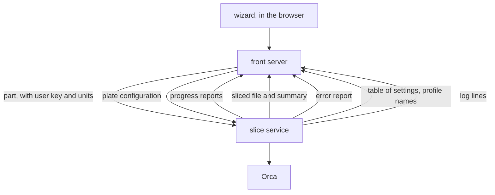

# The slice service

This guide is for the person who decides whether the slice service is being built
correctly: what it must do, how it does the hard parts, how well it must do them, and what
is still open. It uses the terms of [the plan](../docs/plans/penguin-slicer-plan.md).
[README-details.md](README-details.md) holds what a builder needs: the names in the code,
every error code, every measurement in full and the required tests.

Part of what this guide describes exists and part is still to be built. Each section
about what the slice service does opens with a line that says which, by the phase of the
plan that builds the rest, and elsewhere the sentence itself says it: phase 2 runs
everything on one machine, phase 3 hosts it on Railway. Phase 4 (inside
Onshape) and phase 5 (the real printer) change nothing in the slice service.

## What it is for

A user of PenguinSlicer lays parts out on a picture of the printer's plate and asks for
them to be sliced. **Slicing** is turning the solid shapes into the printer's instructions,
layer by layer: where the nozzle moves, how much plastic it pushes, at what temperature
and speed. PenguinSlicer does not write a slicer of its own. It runs **Orca** (Orca
Slicer, an open-source slicer; version 2.4.2 is the one in use, called the pinned Orca
below) on a server, with no window. The slice service is the component that does this: it takes a description of one
plate, checks it, runs Orca on it, watches Orca while it runs, and hands back the file the
printer runs, or a plain statement of why there is none.

### What goes in and what comes out

What goes in is a **plate configuration**: the description of one plate. It names the
parts (each a binary STL file, a list of triangles that describe a surface), says for each
**instance** (one placement of a part on the plate; a part printed four times has four
instances) which way up it lies, how far it is turned and where its centre sits, and
names three **profiles** (Orca's named bundles of settings: one for the printer, one for
the filament, one for the printing process) together with any settings that replace
values of the process profile. A plate configuration is a description, not work. The work
of slicing one plate configuration is a **slice job**.

What comes out is a **sliced file**: the one file Orca exports for a sliced plate, a
`.gcode.3mf` archive, ready for the printer. The profiles it was sliced with travel inside
it, so whatever sends it to a printer never needs to know the printer, the filament, the
plate or the nozzle. With it comes a **summary**: the file's name, the number of
instances, Orca's predicted print time, the filament used in metres and in grams, the
number of layers, Orca's warnings about the plate, and the slice service's own warnings
about the parts. A number Orca did not report is left empty and the sliced file is still
good. The wizard's Preview step draws its layers from the sliced file itself; the slice
service produces nothing else for it.

Two more things come out of a slice job. While it waits and runs it sends **progress
reports**, and when anything fails the answer is an **error report**: a sentence a user
understands saying what happened, which part or instance it concerns when that is known,
what to do next, and the underlying evidence for the log. Nothing fails in any other
shape.

The shapes are fixed in four contracts, which are all that any other component knows of
the slice service: [the plate configuration](../contracts/plate-configuration.md),
[the sliced file](../contracts/sliced-file.md),
[the error report](../contracts/error-report.md) and
[the progress report](../contracts/progress-report.md).

From phase 2 one thing comes out that belongs to no slice job: the **table of settings**,
which describes each setting a plate configuration may replace, supplied with the names
of the profiles a plate configuration may name. The wizard draws its advanced mode from
it ([Accept settings](#accept-settings)).

### Why it is a component of its own

The slice service owns everything that touches Orca: the profiles Orca is given, the file
Orca reads, Orca's process, Orca's memory, and the reading of everything Orca writes. A
change in a new Orca version is absorbed here and nowhere else.

It is kept ignorant on purpose. It knows nothing of Onshape, of sign-in, of groups, of
printers or of the configuration. It holds no credentials at all. The reason is that Orca
reads files that strangers upload, and a program that large, reading hostile input, must
be assumed to have flaws; a flaw in Orca, or in the slice service around it, then reaches
no sign-in secret and no stored file of anyone's.

Only one thing sends it requests, the **front server**, the component that the browser
talks to and that signs users in. The **wizard**, the code in the browser, never reaches
the slice service directly; "the page" in this guide is the wizard, open in one browser
tab. From phase 2 the front server passes a **user key** with every request: the
signed-in user's Onshape id, which says whose part or slice job this is. The slice service
compares user keys and never interprets them. Today no request carries one.

It has one interface, a set of web routes called its **HTTP interface**. There is no
command for slicing by hand.

A running slice service is one **slice service process**, and its slice jobs live in that
process's memory. This has two consequences that shape the rest of the design. A restart
forgets every slice job, which is acceptable only because the browser holds the user's
work and can submit it again. And the slice service must run as exactly one process behind
its address: a server that started several worker processes would send a request about a
slice job to a process that never heard of it.

Hosted, that one process runs alone in the **slice container**, a container on Railway
that nothing but the front server can reach. How the containers, the state bucket and the
log bucket (the two stores at Cloudflare R2 that the front server writes) and the browser
fit together is in [the architecture](../docs/architecture.md#the-shape).

## What it must do

### Check a part when it arrives

*Built today: every check below, run when a plate configuration arrives with its files. To
be built in phase 2: each part sent once, by itself, and checked at that moment.*

From phase 2 the wizard sends each part by itself at the moment the user adds it, and the
slice service checks it then. This puts the refusal where the user can act on it: a part
that cannot be sliced is refused on the wizard's Parts step, as a notification, and is not
added, before the user has laid anything out. Today the same checks run later, when the
whole plate arrives with its files.

A check either refuses the part or only warns. The rule that divides them: a finding that
makes a slice impossible or pointless refuses, and a finding that Orca copes with warns. A
warning travels with the part and into the summary of any sliced file made from it.

| What is found | Outcome | What it protects |
|---|---|---|
| The file is empty, too short, cut off, padded, has no triangles, has a coordinate that is not a number, or is not an STL at all (an image, a PDF, a zip or 3MF, an HTML or JSON error page saved under the wrong name) | Refused: the file could not be read as a part | The user, from a slice that fails minutes later with a reason nobody can read, and Orca, from input that is not what it claims to be |
| A text STL | Refused: a binary STL is needed | The strict reader: one format, whose length can be checked exactly against the count of triangles in its header |
| More than 150,000 triangles, or more than 7,500,084 bytes (7.5 MB, a binary STL of exactly that many triangles) | Refused: too detailed | The time the slice service spends reading and checking one part, and the size of one upload |
| 0.1 mm or less in every direction, or in one direction (flat) | Refused: too small, or flat | The user, from a part no nozzle can print |
| Every triangle is a line or a point, or no triangle shares an edge with another, or the surface is closed but encloses no volume | Refused: nothing to print | The same |
| Fits the printer in no orientation at any angle | Refused: too large | The user, before any layout work |
| Holes in the surface, or faces laid on top of each other | Warned | A part with holes is the one that later fails with empty layers, so the warning names it before the slice |
| A closed surface with its faces wound inwards | Warned | The user, who probably has an export problem |
| Every side under 5 mm | Warned: this may be a file in inches read as millimetres | The user, from a print 25.4 times too small |

The test of whether a part fits the printer is deliberately lenient: it compares the
part's least width with the plate's short side, its longest extent with the plate's
diagonal, and its height, so a part it refuses truly fits nowhere. A long part that fits
only along the diagonal passes, and the placement check decides later. Today the test uses
the printer the plate names. From phase 2 a part arrives before any plate names a printer,
so on arrival the test uses the largest printer in the profile catalog (the slice
service's own list of Orca's profiles, described below), and it runs again against the
plate's own printer when a plate names the part. A part too large for every printer is
thus refused on the Parts step, and one too large only for the plate's own printer when
the plate is submitted.

Why the last three only warn: the pinned Orca slices an open box, an inside-out box, two
shells, two boxes that pass through each other and a 2 by 1 by 0.5 mm block, and the
**upstream check** (the suite of tests that run the real Orca) proves it. Refusing them
would refuse good prints.

Two things are known limits of the checks, and stay as they are. A part whose surface
passes through itself is not looked for: Orca sliced the cases tried, so nothing is
refused wrongly, and such a part may print as something the user did not mean, with no
warning. And a part whose very first layer is empty (a needle thinner than the nozzle
prints, for example) is not caught on arrival: its slice fails with only the general
sentence, "The slicer could not slice this plate.", because the pinned Orca writes that
reason nowhere the slice service can read.

### Units

*To be built in phase 2. Today every part is taken to be in millimetres.*

An STL file carries no units: the same numbers can mean inches or millimetres. So the
units of a part travel beside it as a label, inches or millimetres. For a part uploaded
from a file the label is the user's choice on the wizard's Parts step, which starts at
the value in the group's configuration; from phase 4, for a part exported from Onshape, it
is the units of the Onshape document.

The rule is that exactly one place applies the scale, and it is the slice service. The
browser reads a part to draw it and to lay it out, and never changes its bytes; the front
server passes the part and its label on untouched. The slice service uses the units in
its checks when the part arrives, so "too small", "too large" and "every side under 5 mm"
are judged on the part's true size, and it applies the scale when it prepares the plate
for Orca. The plate configuration's contract gains the units of each part. The slice
service never guesses units. It refuses a part that arrives without a units label, or
with one that is neither inches nor millimetres, and it refuses a plate configuration
that names a part without one. Taking a missing label as millimetres would slice a part
in inches 25.4 times too small without a word.

The reason for one place: if the browser rewrote the file, the bytes the slice service
checked would not be the bytes the user chose, and the hash of its bytes, by which a part
is named (see the part store, below), would name something the user never had. With a
label, a wrong guess about units is corrected by changing a label, not by exporting the
part again.

The same file under different units is a different part. A part 2 inches long and a part
2 mm long are different objects with different check results, so the part store keeps
them apart: a part is kept under its user key, its hash and its units together, so the
same file under inches and under millimetres is two parts.

The warning for a part with every side under 5 mm stays. With the label in place it points
at a label that is probably wrong. It is not raised for a part labelled in inches: the
warning exists to catch a file in inches read as millimetres, and a part labelled in
inches cannot be that.

### Keep each part once: the part store

*To be built in phase 2. Today every plate configuration arrives with all its files, and
slicing the same plate again sends them all again.*

The **part store** is the slice service's folder of uploaded parts. A part is uploaded
once, in a request of at most 7.5 MB, and from then on is named by the SHA-256 hash of its
bytes. A plate configuration names its parts by hash and carries no files. This buys two
things: a part is checked when it is added, as above, and slicing again uploads nothing,
so a user who looks at the preview, changes a setting and slices again sends only a small
description each time.

The part store is a cache. The record of a user's parts is the browser's own storage.
Everything about the part store follows from that:

- **A part stays for two hours after it was last used.** Its upload counts as a use, and
  so does each slice that names it.
- **A limit on the disk the part store may take in all.** Past it, the least recently used
  parts of any user are removed. The figure is not set, because the disk was never
  measured (see [Unmeasured](#unmeasured)).
- **No count of parts for one user.** A user may have several plates at once, one in each
  browser tab, and a count for each user would make one plate's uploads push the other
  plate's parts out. The limit on disk is what bounds the part store. One user with many
  plates can therefore push other users' parts out of it, and those users' pages upload
  them again without their being told; the front server limits how fast one user may
  upload parts, which bounds how much one user can push out.
- **It is emptied when the slice service starts.**
- **A missing part is not an error the user sees.** When a plate configuration names parts
  the part store no longer holds, the slice service answers once, listing every missing
  hash. The page uploads those parts again from the browser's storage and submits again.
- **A part is found only under its own user key.** Two users who upload the same file each
  have their own entry, so nobody can learn whether someone else uploaded a given file.
- **Removing a part never touches a slice job already accepted.** A slice job takes its
  own hold on each part's file when it is accepted.

A part too large to be accepted is refused before its body is read.

### Check a plate before it is sliced

*Built today.*

A plate configuration is checked the moment it arrives, before any slice job exists for
it, so a refusal comes back at once and never takes a place in the queue. The checks run
in a fixed order and stop at the first failure:

1. **Its form.** Every field is one the contract lists and has a sound value. A field that
   is not listed refuses the plate, so a misspelled setting is never silently ignored.
2. **Its size.** At most 150 instances, using at most 25 different parts. From phase 2,
   when a plate configuration carries no files, the description itself is at most 1 MB,
   which bounds what one submission can make the slice service read, with all of a
   plate's settings in it.
3. **Its profiles and settings,** described in the next two sections.
4. **Its parts.** Each part an instance names must exist and pass the checks on a part.
   Today that is where the checks on a part run; from phase 2 they have already run when
   the part arrived, and this step only finds the parts in the part store and tests each
   against the printer the plate names.
5. **Its placement.** Every instance must lie inside the plate, stand no taller than the
   printer can print, and keep its distance from every other instance.

The placement rules, with what each protects:

| Rule | Figure | What it protects |
|---|---|---|
| Every instance's footprint stays inside the printable area, less a margin | 3 mm margin | A print that starts at the very edge of the plate |
| No instance is taller than the printer prints | The printer profile's height, 340 mm on every printer in the catalog today | A print that cannot finish |
| Two instances' footprints keep apart, with supports off | 5 mm | Orca's refusal of instances whose paths meet. Every pair of real parts tried sliced 1 mm apart, so 5 mm keeps 4 mm to spare |
| The same with supports on | 12 mm | The same refusal: Orca's tree supports spread beyond the part. 8.5 mm sliced every pair tried, so 12 mm keeps 3.5 mm to spare |

A footprint is the outline of the turned part seen from above (its convex hull). A plate
closer than the spacing is refused with a report naming both instances; with supports on
the sentence says supports need the room. The spacing was measured on eight real parts with
the default set of profiles (described below), and another part or setting may need more. So Orca may still refuse
a plate that passed, and then the report names the pair from Orca's own log, says supports
are the likely cause when they are on, and offers spreading the instances out, turning
supports off, or a new plate. A wizard that arranges the plate itself must leave 12 mm
when supports are on.

Two things are deliberately not checked before slicing: the memory a plate will need, and
the triangles of the whole plate. No rule was found that refuses the plates Orca cannot
finish without also refusing plates it can, so memory is guarded while Orca runs (see
[Bounding Orca's memory](#bounding-orcas-memory)).

Each instance gets a name, the part's name and a number ("Bracket #1", "Bracket #2").
These names appear in error reports, in Orca's warnings and on the printer's screen, in
its list of objects that can be skipped during a print.

#### Shared plates for the two placement checks

*To be built in phase 2.*

The wizard's Layout step applies the same placement rules as the slice service, each in
its own code, so that a plate the wizard passes is a plate the slice service accepts. A
plate that one passes and the other refuses is a defect in one of them, and a user would
meet it as a refusal on the Preview step of a plate the Layout step called good. The two
checks are kept in agreement by one shared set of plates, some just passing a rule and
some just failing it, kept with the contracts and run by both components' tests. A change
to a rule or a figure in either component then fails the other's tests until both agree
([the wizard's guide](../wizard/README.md#the-placement-rules-and-what-each-problem-says)).

### Offer profiles: the profile catalog

*Built today.*

Orca's profiles inherit from one another, and Orca run without a window does not resolve
that inheritance. So the slice service carries the **profile catalog**: every Bambu Lab
H2S printer profile of the pinned Orca, and every filament and process profile that names
one, each written out in full with nothing left to inherit. Today that is 4 printer
profiles (one per nozzle size), 136 filament profiles and 16 process profiles; the catalog
also lists 27 of Orca's profiles it left out, with the reason for each. The catalog records
which printers each filament and process fits. It is regenerated from Orca's own files
whenever the Orca version moves, by the same command that moves the version.

A plate configuration names its three profiles by Orca's own names. The printer must be in
the catalog, and the filament and the process must be catalog entries that fit that
printer; anything else is refused with a sentence asking the user to choose from the list.
A plate configuration that names no printer gets the **default set**: a Bambu Lab H2S with
the 0.6 mm High Flow nozzle, Generic PETG, the 0.24 mm Balanced Quality process and the
Textured PEI plate, and may name no other filament or process. Two facts of that set, the nozzle variant and the plate type, are in
none of Orca's profiles; the slice service writes them into every printer profile itself,
because without them Orca falls back to the standard nozzle and the smooth plate without
saying so.

Which profiles a user is offered is not the slice service's business. The group's
configuration, which the front server keeps, holds for each profile a user can pick the
three Orca profile names that go into a plate configuration, under a name of the group's
own. The slice service's part is to refuse a name it does not know and, from phase 2, to
supply the profile catalog's names to the front server along with the table of settings
([Where the wizard gets the list of settings and the profile catalog's names](#where-the-wizard-gets-the-list-of-settings-and-the-profile-catalogs-names)).

The profile catalog changes only when the Orca version moves. Until the first upgrade of
Orca, no configuration can come to name a profile the catalog has lost; who notices one
after an upgrade is open
([Who notices a configuration that names a profile the catalog has lost](#who-notices-a-configuration-that-names-a-profile-the-catalog-has-lost)).

### Accept settings

*Built today: four settings, each with a short list of values. To be built in phase 2:
every setting that is a parameter with a value, the table of settings they are checked
against, and the supplying of that table to the front server.*

Today a plate configuration may replace four of the process profile's settings: infill
density (10, 15, 20, 30, 40, 60 or 100 percent), the number of walls (2, 3, 4 or 6),
supports (off or on; on means Orca's automatic tree supports) and the brim (automatic,
off, or outer edge only). Anything else is refused, with a sentence that does not name
the setting: "These print settings could not be read; choose them from the lists."

From phase 2 the slice service accepts **every setting Orca allows that is a parameter
with a value**: a choice from a list, a number, a piece of text. All of them are available
in the wizard's advanced mode. It refuses every setting that is **programmatic**, of which
there are three kinds:

- a setting that runs a program, such as a script Orca runs on the finished file;
- a setting that names a file on the server;
- custom G-code, the printer commands a user can write into a profile by hand.

The reason for the line: a parameter can only choose among things Orca already does,
while a programmatic setting would let a user run something on the server or direct a
shared printer.

**A setting replaces a value of the process profile only.** The process profile holds
everything about how a part is printed: layers, walls, infill, supports, speeds. The
filament's and the printer's values are never replaced. The placement check trusts the
printer profile's plate size and height, and a wrong printer value can harm a shared
printer where a wrong process value spoils one print. A user who needs another
temperature or flow for a filament needs another filament profile in the group's
configuration.

**Each value is checked before Orca runs.** A choice is checked against its setting's
list, a number against its range, and a text against a greatest length, which is set from
the longest text value in the profile catalog. A value that does not fit is refused with
the setting named, so a bad value fails at once and not minutes later inside Orca. A
setting that is programmatic, or that the table of settings does not hold, is refused in
the same way.

**The checks that ask whether supports are on stay as they are.** The placement check's
spacing and the two estimates go on asking that one question. Other accepted settings can
make an instance need more room (a wide brim, a raft, printing one object at a time); the
placement check does not know them, so such a plate passes the check and Orca refuses it
with the report that names the pair. The cost is a refusal that arrives after Orca has
started and not at once.

#### How the list of accepted settings is made

*To be built in phase 2.*

The slice service knows which settings it accepts from the **table of settings**: for
every setting of the pinned Orca, its name, its kind (a choice, a number, a text), its
permitted values, and Orca's own label, group and explanation for it. The table is taken
from Orca's source for the pinned version each time an Orca version is integrated, and is
never written by hand. Taking a new Orca version therefore needs that version's source as
well as its release.

Orca's source does not say which settings are programmatic, so each setting is
classified, as a parameter or as programmatic, by the agent doing the work: every setting
when the table is first made, and each new setting as part of taking a new Orca version.
The programmatic settings are listed in the repository by name, each with its reason, so
the line can be read and disputed setting by setting. Taking a new version is not
finished until every new setting is classified, and the upstream check, run against the
new version, fails when it finds a setting classified nowhere. A setting that a new Orca adds is
therefore never accepted, and never offered, without someone having looked at it.

#### Where the wizard gets the list of settings and the profile catalog's names

*To be built in phase 2. Today the HTTP interface answers about slice jobs and nothing
else.*

The slice service holds the table of settings and supplies it to the front server,
together with the profile catalog's names and each process profile's own value of each
setting. The front server passes them to the wizard and keeps no copy from one start to
the next ([the front server's guide](../front/README.md#the-list-of-settings-and-the-profile-catalogs-names)).
The table supplied holds the accepted settings only; a programmatic setting is not in it.

The wizard's advanced mode is drawn from the table: it shows Orca's own labels, groups
and explanations, so a user who knows Orca finds each setting where Orca has it
([the wizard's guide](../wizard/README.md#advanced-mode)). Because the table comes from
the slice service that will do the slicing, advanced mode offers exactly what the slice
service accepts, and after a new Orca version new settings appear and removed ones vanish
with no change to the wizard. What this costs is a new part of the HTTP interface, a
contract for the shape of the table, and a wizard that draws each setting from its kind
and not from a design made by hand for that setting.

### Run one slice at a time, and let a few wait

*Built today: one slice running and two waiting, fixed in the code. To be built in phase
2: a plate's later slice replacing its earlier one, a repeated submission answered with
the first attempt's slice job, and a waiting slice job that says how many are ahead. To
be built in phase 3: the two counts as settings of the slice service (a **setting of the
slice service** is a value fixed when the slice service is deployed, not chosen by a
user).*

One Orca runs at a time, and two slice jobs may wait behind it. These three are the
slice service's **places**. A further slice job is not accepted: its user is told the
slicer is busy and to try again in a minute, and the page does not try again by itself.

**Memory decides how many run at once.** The slice service never runs more Orcas than fit
in its memory with each at the **memory ceiling**, the most memory one Orca is allowed.
Hosted, with the ceiling of 6,000 MB that the hosted service starts from, in a container
of 8 GB, that is one. Two at once would need a ceiling of about 3,000 MB each, and so
smaller plates: every plate measured so far would still fit, and a plate over about
3,000 MB would be stopped as too large. Processors do not argue for a second Orca either:
Orca uses several by itself, so a second would share them, not use idle ones. Whether one
Orca stays the right number is read from the measurements on the host and from the log
in use ([Unmeasured](#unmeasured)).

**Everyone shares the places.** Nothing limits the slice jobs of one user. A user with
the wizard open in several tabs, each with its own plate, may have a slice of each
running or waiting, and one tab's slice never stops another's. One user can therefore
hold all three places while everyone else is told the slicer is busy. That is accepted,
and capacity is added if it proves too little.

**A plate's later slice replaces its earlier one.** The page makes an id for each plate,
and every plate configuration it submits for that plate carries it. When a plate
configuration arrives while an earlier slice job of the same plate, from the same user
key, is still waiting or running, the slice service ends the earlier one early. This is what
the wizard's Preview step needs when a plate changes: the slice of the plate as it was is
no longer wanted. The earlier slice job gives up its place before the new one is counted,
so a user who slices a changed plate while every place is taken is not refused on account
of their own earlier slice. A slice job is never ended early on account of another
plate's. How a slice job is ended early, and what its page is told, is under
[End a slice job early](#end-a-slice-job-early).

**A slice job that waits says so.** Its progress report carries the number of slice jobs
ahead of it, those running and those waiting before it, and a new report is sent whenever
that number changes. Today a waiting slice job says only "Waiting for the slicer".

How many may wait is a trade between two bad experiences: being told "busy, try again",
and waiting behind slices that may each run to the time limit, the longest one Orca may
run (240 seconds today). With one running and two waiting, the last in line can wait two
full time limits before its own slice starts. Both counts become settings of the slice
service in phase 3 and start at one and two, because how often two users
slice at the same moment is not known.

#### A plate configuration submitted twice

*To be built in phase 2.*

The page tries a request again when its answer does not arrive, so the same submission
can arrive twice. Without a rule, the repeat would count as the plate's later slice and
end the slice job its own first attempt made. So the page makes a value for each
submission, the slice service remembers that value beside the slice job, and a repeat
that carries the same value is answered with the first attempt's slice job and starts
nothing. The front server passes the value in and the answer back
([the front server's guide](../front/README.md#a-plate-configuration-submitted-twice)).

### Report progress

*Built today, except the count of slice jobs ahead and the reason on a slice job ended
early (phase 2) and the quiet-line change (phase 3).*

A slice job is followed on a **progress stream**: a connection on which the slice service
sends each progress report as it happens. Every report carries the state, the stage in
words, how far through when that is known, the seconds run so far, and the seconds
expected in all. There are five states: waiting, running, done, failed, and ended early,
which is the state of a slice job the slice service stopped for a reason that is no
failure of the plate ([End a slice job early](#end-a-slice-job-early)). A stream that is opened
late gets the latest report at once, and the same latest report can be asked for directly
without a stream. That second way is the fallback if Cloudflare or Railway holds a
stream's reports back, which neither promises not to do: the page then asks for the latest
report every second or two.

Most stages are Orca's own. Two are the slice service's: "Building the plate", while it
writes the plate for Orca, and "Slicing the plate", sent the moment Orca has started and
before Orca says anything, so an Orca that stalls while loading is not shown as still
building the plate. What a user sees while waiting, in order:

| Stage, as the user reads it | How far through |
|---|---|
| Waiting for the slicer | Not shown |
| Building the plate | Not shown |
| Slicing the plate | Not shown |
| Loading the plate | Orca's own percentage |
| Preparing to slice | Orca's |
| Slicing the parts into layers | Orca's |
| Generating walls | Orca's |
| Generating infill | Orca's |
| Checking and generating supports | Orca's |
| Optimizing the toolpath | Orca's |
| Generating G-code | Orca's |
| Writing the sliced file | Orca's |
| Reading the sliced file | Not shown |

The fraction is never invented. Orca announces each of its stages with a percentage, and
the slice service passes that on and makes up nothing between announcements. The cost is a
bar that moves in steps: on a large plate, generating G-code takes most of the time, so
the bar sits at 75 percent longest.

The seconds expected come from a rough estimate, right only to within about a factor of
two (see [The estimates of memory and time](#the-estimates-of-memory-and-time)). A wizard
should present it as a rough guide.

A stream with nothing new to say must not go silent, because the hosts in front of it
close a quiet connection: Railway after five minutes without data, and Cloudflare after
125 seconds ([the architecture](../docs/architecture.md#progress-streams)). Today a quiet stream repeats its latest report every 15 seconds. From phase 3
it sends an empty comment line at least every 15 seconds, which keeps the connection open
without pretending something happened. Railway also closes any request after fifteen
minutes, whatever it carries; whoever follows the stream opens it again and gets the
latest report at once.

### End a slice job early

*Built today: stopping a slice job at any stage, on a request made of the HTTP interface
or when the slice service itself is asked to stop. To be built in phase 2: ending a
plate's earlier slice job when its later one arrives, and the reason in the last
progress report.*

**A slice is not cancelled by hand.** The wizard has no button for it, and neither the
wizard nor the front server asks the slice service to cancel a slice job. A user who no
longer wants a slice changes the plate or leaves the slice to finish
([the wizard's guide](../wizard/README.md#slicing)). The HTTP interface as built has a
request that cancels a slice job. It stays as built, the front server does not use it,
and it is not extended.

Stopping a slice job stays the slice service's own ability, and it has four uses:

| Use | How the slice job ends |
|---|---|
| The time limit passes | Failed: the slice ran out of time |
| The memory ceiling is passed | Failed: the plate needs too much memory |
| The same plate's later slice arrives | Ended early, with the reason that it was replaced |
| The slice service is asked to stop, as at a deploy | Ended early, with the reason that the slice service was asked to stop |

The first two are failures and are described under
[Bounding Orca's memory](#bounding-orcas-memory) and
[When things go wrong](#when-things-go-wrong). A slice job that is **ended early** has no
sliced file and no error report. Its last progress report says which of the two reasons
applies, because the page does different things with them: for a slice job that was
replaced it does nothing, since it is already following the later one, and for one ended
because the slice service was asked to stop it submits the plate again by itself. Today
the last report of such a slice job gives no reason. Which slice jobs are ended early when the
slice service is asked to stop is under
[What a user sees while the slice service stops](#what-a-user-sees-while-the-slice-service-stops).

Whatever the use, the stop reaches the work itself:

- A waiting slice job is ended early at once.
- A slice job still building its plate stops at the next part or instance it writes. On
  the largest plate the checks accept, where building takes 24 to 28 seconds, the end was
  reported 0.05 to 0.17 seconds after it was asked.
- A slice job whose Orca is running is reported as ended early only after Orca and every
  process Orca started are gone. Nothing is ever reported as stopped while it is still
  running.
- A slice job ended early discards its sliced file, even one Orca finished at the same
  instant: a replaced slice is of a plate that has since changed, and a slice ended
  because the slice service was asked to stop is submitted again by its page.
- Ending early a slice job that has already ended changes nothing.

If the slice had already failed for another reason when it was to be ended early (it ran
out of memory, ran out of time, or Orca crashed), that failure is what is reported.

Afterwards nothing of the slice job is left on the disk, and the same plate can be
submitted again.

### Go on without the page

*To be built in phase 2. Today a slice job whose progress stream nobody has open is
ended early 120 seconds after the last one closed, or after it was submitted if none was
ever opened.*

Once submitted, a slice job runs to its end whether or not anything is following it:
through a refresh, a dropped connection or a closed laptop lid. A user who comes back
finds the slice done, where today they would find it gone and have to slice again.

The cost is accepted: a slice whose user never returns holds the one Orca until it ends.
The time limit bounds that.

This only works because the front server, not the page, collects the result. The front
server follows every unfinished slice job itself, whether or not a page is open, fetches
the sliced file when the slice ends and stores it
([the front server's guide](../front/README.md#the-front-server-follows-every-slice-job-itself)).
The slice service's side of that bargain is three small things:

- **It can list its slice jobs.** A front server that has just restarted asks for every
  slice job the slice service process knows, with whose it is, its latest progress report
  and whether its sliced file is still there, then follows the unfinished ones and
  collects the finished ones.
- **It remembers a slice job for two hours after it ends** (today, one hour), so a page
  that returns within two hours of the slice's end still gets an answer about it. After
  that a finished slice is known by its sliced file, which the front server keeps until
  two hours after the slice ended or two hours after its last print ended, whichever is
  later.
- **It deletes its own copy of the sliced file as soon as the front server says it has
  stored it.** The record of the slice job stays until it expires. A sliced file that is
  never collected goes with its record.

## How it does the hard parts

### Running Orca

*Built today.*

For each slice job the slice service makes a scratch folder inside the slice job's own
folder (which also holds the plate file and, today, the uploaded parts), writes the whole plate into
one file for Orca (every part's surface once, and every instance with its exact position
and turn), writes the process profile with the user's settings folded in, and starts Orca
on them. Orca is told not to arrange and not to orient: every instance stays exactly where
the plate configuration put it. The upstream check proves this by slicing nine
interleaved instances of three parts and finding each one's first layer within 0.25 mm of
where it was placed.

Orca is started so that it can be contained and stopped:

- **With almost no environment.** Five harmless variables are passed and nothing else, and
  its home and settings folders are inside the scratch folder. No secret can reach Orca,
  and two slices never share state.
- **As the head of a process group of its own,** so Orca and every process it starts can
  be measured and stopped together.
- **Tied to the slice service's life.** If the slice service is killed outright, the
  kernel kills Orca too. No Orca is ever left running with nobody watching it.

Three things watch Orca while it runs: a channel on which Orca announces its stages, which
feeds the progress reports; the **memory watchdog**, described next; and a timer for the
**time limit**, the longest one Orca may run. The time limit counts Orca's run only.
Building the plate before Orca starts is outside it and took up to 28 seconds on the
largest plate the checks accept.

### Bounding Orca's memory

*Built today, at a ceiling of 2,000 MB. Phase 3 sets the hosted ceiling, starting from
6,000 MB.*

Memory is the resource that decides everything about this service, and Orca's memory is
hard to bound for one reason: its peak is a spike. The pinned Orca's memory jumps near the
end of a slice, while it writes the sliced file, and the spike lasts less than a tenth of
a second. A watcher that looks at how much memory Orca holds now, a few times a second,
misses it most of the time.

The approach has three parts.

1. **Read the kernel's high-water mark, not only the current figure.** For every process,
   the kernel keeps the most memory that process has ever held. The memory watchdog, a
   thread of the slice service, reads both figures for Orca and every process Orca
   started, and sums them. A spike that came and went between two readings is still in the
   high-water mark at the next reading.
2. **Read at the moments that matter.** The watchdog reads at once when Orca starts, then
   every quarter of a second, and also immediately after each stage Orca announces. Orca's
   last announcement comes once the sliced file is written, about 30 milliseconds before
   Orca exits, so the reading that follows it catches the final spike.
3. **Stop Orca when the peak passes the memory ceiling.** The slice fails, and the user is
   told the plate is too large to slice, with the ceiling named and a remedy of fewer
   instances or a new plate (for a plate of a single instance, simplifying or splitting
   the part).

Why this approach: it needs nothing from the host but what any Linux gives, it measures
Orca alone and not the slice service beside it, and it ends one slice where the host's own
limit would end the whole container and every waiting slice job with it.

What it costs, plainly:

- **The ceiling is not an exact bound.** Orca can pass it by as much as it grows between
  two readings before it is stopped. The largest such rise measured was 502 MB in 0.26
  seconds. So the host must have room for the ceiling plus that rise.
- **A plate at the edge can go either way.** A plate whose peak passes the ceiling only in
  its last moments may be stopped, or may finish before the next reading. When Orca has
  written a complete sliced file, that file is delivered even though the peak was over the
  ceiling, and the log line for the slice job says so. The same plate sent twice can get
  the two answers. It is never silent: either the user gets an error or the log gets a
  note.
- **The logged peak of a failed slice can be low.** An Orca that fails by itself between
  two readings, after a spike and with no announcement following it, is not read again, so
  the peak in the log can be under its true peak. For a slice that succeeds, the upstream check
  proves that the watchdog's figure reaches the kernel's own.

The ceiling protects the server from a slice that keeps growing. It is not a promise that
no delivered slice ever touched it.

A slice is reported as out of memory in three cases only: the watchdog stopped it; the
kernel killed Orca and the kernel's own count of out-of-memory kills rose; or Orca itself
said an allocation failed. A kill with none of these is reported as something on the
server having stopped the slicer, and never guessed to be memory.

### Stopping Orca, and deciding how a slice ended

*Built today for the time limit, the memory ceiling, the cancel request and a stop of the
slice service. Phase 2 adds the plate's later slice, on the same sequence and under the
same rule.*

A stop of Orca, for any of the four uses under
[End a slice job early](#end-a-slice-job-early), is the same sequence: ask the whole
process group to end, wait 5 seconds, then kill whatever is left. Only when Orca and all
its children are gone is anything reported.

Several things can end a slice at nearly the same instant: Orca finishing, a stop from the
slice service, a crash, a kill from outside. One rule, applied in one place, decides what
is reported, in this order:

1. **A complete sliced file is never thrown away by the time limit or the memory
   ceiling.** If the timer or the watchdog fired in the moment after Orca wrote the file,
   the slice succeeds. Complete is a strict test: the file is under its final name
   (Orca writes under a temporary name and renames at the end), it opens as an archive
   with its directory intact, it holds the G-code and the list of objects, and every entry
   passes its checksum. A file cut anywhere fails the test. The log line records that a
   stop arrived after the file was complete.
2. **Otherwise, a stop that the slice service sent and that ended Orca is the reason:**
   out of time, out of memory, or ended early. Ending early is the exception to rule 1:
   it discards even a complete file. Of two stops, the first one asked is the one
   reported.
3. **Otherwise it is Orca's own ending.** A crash is reported as a crash and a kill from
   outside as a kill, even if the slice service was about to stop Orca at that moment; the
   stop that did not land is noted only in the evidence for the log.

The point of the rule is that the user is told the true reason. A crash is never reported
as "took too long", and a finished plate is never withheld on a technicality.

Every way out removes the scratch folder: success, failure, the time limit and an early
end. Orca's own reasons are read out of it first.

### Reading what Orca says

*Built today.*

Orca says almost nothing useful on its ordinary output, so its reasons are gathered from
three places.

- **Its result file** gives a code, a general reason, and sometimes one specific reason
  ("Object can't be printed for empty layer between 9.9 and 11.34 ... Object: Tower #1").
  The slice service turns the specific ones into sentences that name the instance and the
  height.
- **Its debug log** holds every warning Orca raised while slicing. The result file holds
  at most one of them, and on a plate with several warned instances which one it holds
  changes from run to run. So the slice service reads the log for the full set, and for
  the one line that names the two instances whose paths meet.
- **Its last printed lines** carry two reasons that reach no file: "no layers were
  detected" and "the print is empty".

The same plate gives the same list of warnings every time, whatever order Orca's threads
ran in.

One honesty rule governs failures. When Orca fails with only its general reason, the log
may hold warnings, but it cannot say which warning, if any, caused the failure: a part
that slices soundly warns too. So the sentence keeps the general failure and adds up to
five warnings, labelled as possibly unrelated: "The slicer could not slice this plate. It
also warned, though this may not be why it failed: ...". The slice service never states a
reason Orca did not give.

Reading is bounded like everything else: no sentence, evidence or log line grows with
what was sent.

After a good slice two guards run before the sliced file is released. Every instance of
the plate configuration must be in the sliced file's list of objects, because Orca leaves
out an instance that lies wholly off the plate without reporting an error. And every entry
of the archive must pass its checksum.

From phase 2 there is a third guard: **a sliced file is at most 50 MB.** A slice whose
file would be larger ends as a failed slice, with a sentence of the slice service's own.
The largest sliced file measured is 14.1 MB. The limit bounds what every preview,
download and print moves, and keeps each fetch of a sliced file well inside the 100 MB
that Cloudflare allows one request. The front server refuses to store a larger file all
the same, as a second defence
([the front server's guide](../front/README.md#the-front-server-follows-every-slice-job-itself)).

### The estimates of memory and time

*Built today, fitted to plates under 2,600 MB on aarch64 machines. Phase 3 refits them on
the host.*

For every plate the slice service estimates Orca's peak memory and its running time before
Orca starts. Both estimates have the same simple shape: a base, plus an amount for each
instance, plus an amount for each cubic centimetre of part on the plate, all multiplied by
a factor when supports are on. For memory the figures are 170 MB, 3 MB for each instance,
0.985 MB for each cubic centimetre, and 1.4 for supports. A part's volume is that of its
surface when the surface is closed, and of its bounding box when it is not.

How far they can be trusted: not far.

- **Memory.** The estimate was fitted to sit above the measured plates, and on plates
  unlike those it is wrong in both directions: over by more than four times on a solid
  cube, under on parts with many triangles. A solid 100 mm cube is
  estimated at 1,158 MB and slices at 269 MB. Twenty-five hubs of 20,000 triangles each
  are estimated at 792 MB and peak at 842 MB, because the estimate ignores triangles. The
  100 spacers are estimated at 507 MB, close to their measured 488 to 513 MB.
- **Time.** It is within about a factor of two of the plates it was fitted to, and
  over-estimates the 100 spacers five times (36 seconds for 7).

So the estimates decide nothing. The memory estimate refuses no plate; it is written to
the log beside the measured peak and the ceiling, so that its error can be seen and the
estimate improved. The time estimate is the "seconds expected" in each progress report and
nothing else. Both are refitted on the hosted machine from the measurements phase 3 makes,
and extended to plates heavier than any measured so far.

### The same plate, sliced twice

*Built today.*

Orca's output is not byte for byte the same between two slices of the same plate, on any
number of processors: its threads order and split the paths differently, and a few fields
change in every slice. The slice service hands Orca an identical plate every time, which a
test checks, so the variation is Orca's. What is stable, and tested for every plate the
upstream check slices: the number of layers exactly, the print time and filament within 2
percent, the same warnings, and every instance where it was placed. The prints are the
same; the bytes are not. Nothing may be built on two slices of one plate having the same
bytes.

## How well it must do it

Every figure below is either measured, chosen without a measurement, or someone else's
limit, and says which.
All measurements are from aarch64 Linux machines, almost all from one with 4 processors, with the pinned Orca
2.4.2 and the default set, one slice at a time. The hosted machines are believed to be
x86_64, and nothing has been measured there.

### What was measured

Three sets of plates were measured: a grid of small spacers (the plate a user is expected
to want most often), the eight real parts of the robot of the Popcorn Penguins (FRC Team
6238), and a set of reference plates built to be heavy.

| Plate | Instances | Supports | Orca's peak memory (MB) | Orca's time (s) | Sliced file (MB) |
|---|---|---|---|---|---|
| Hex shaft spacers, 10 by 10 | 100 | off | 488 to 513 | 6.2 to 7.1 | 1.81 to 1.82 |
| Spacers, 13 by 12 | 150 | off | 643 to 649 | 9.4 | 2.72 |
| Any one of the eight real parts alone | 1 | off | 97 to 218 | 0.1 to 1.5 | 0.08 to 1.10 |
| One of each real part | 8 | on | 753 to 761 | 9.4 to 12.8 | 4.69 |
| The Popcorn Penguins' target: two of each real part | 16 | off | 863 to 915 | 13.4 to 17.7 | 6.85 to 6.87 |
| The same target | 16 | on | 1,368 to 1,415 | 20.0 to 22.5 | 8.77 to 8.82 |
| Twelve of the largest block (Elevator Block Bottom Inner) | 12 | off | 1,410 | 19.1 | 10.8 |
| The same twelve, in a measuring run with the ceiling raised to 3,000 MB | 12 | on | 2,307 | 34.3 | 14.1 |
| Pulleys | 50 | off | 1,074 | 27.3 | 3.68 |
| Pulleys | 150 | off | passed 2,500 MB and was stopped there, in a measuring run with the ceiling raised | | |
| Six copies of a standard test model of a rabbit (112,402 triangles each), measured on a second aarch64 machine; the heaviest plate ever measured | 6 | on | 2,569 | | |

What these show. The twelve blocks with supports on pass today's ceiling of 2,000 MB and
are stopped there; their figures are from a run with the ceiling raised to 3,000 MB for
the measurement. The plates the Popcorn Penguins actually print peak at 1,415 MB at most
and take 22.5 seconds at most. The slowest plate of their parts measured took 34.3
seconds. Memory grows with the size of the parts far more than with their number: each
further spacer on the grid adds 3 to 4 MB, and each pulley about 20 MB. That is why the limit on
instances is not what protects the machine.

### The limits

There is no target for how long a slice may take beyond the time limit, and none for how
long the check of an arriving part may take; the measured figures are 0.17 to 0.19 seconds
to read all eight real parts and up to 5.8 seconds to accept the largest plate.

| Limit | Figure | What it bounds, and where the figure comes from | How it is checked |
|---|---|---|---|
| Memory ceiling, today | 2,000 MB | The most memory one Orca may reach. Chosen from the measurements: the Popcorn Penguins' heaviest target plate is 585 MB under it. Twelve of the largest block with supports on, and about 95 pulleys or more, pass it and are stopped, with a new plate as the remedy | A real slice at a 100 MB ceiling shows the stop; a real slice at a ceiling 5 percent under the plate's own peak shows the spike is caught |
| Memory ceiling, hosted | 6,000 MB, the figure to start from on the hosted service, chosen without a measurement there | The same, in the slice container. Railway allows the container 8 GB, and stops a container that passes it, which would take the waiting slice jobs too. 6,000 MB leaves 2 GB for the slice service itself, its checks on arriving parts and the operating system. By the measurements: 6,000 MB, plus the 502 MB Orca can rise between two readings, plus 400 MB for the slice service, is 6,902 MB, under the 8 GB with about 1,100 MB to spare (the sum is a calculation, not a measurement) | Phase 3's measurements on the slice container, which confirm the figure or change it ([Unmeasured](#unmeasured)) |
| Time limit | 240 seconds, until measured on the host | The longest one Orca may run. It must be long enough that every plate which would finish does finish, and no longer, because a slice that hangs holds up everyone behind it. 240 seconds is about seven times the slowest real plate measured (34.3 s) and about twenty-five times the largest plate of spacers (9.4 s). A plate near 6,000 MB will take longer than anything measured. After phase 3's measurements it is set at a few times the slowest plate that finishes | A test fires the timer by hand; no test waits |
| Slices at once | 1 | Orcas running. Decided by memory, as above | A test with two stand-in Orcas, once it is a setting of the slice service |
| Slice jobs waiting | 2 | Places behind the running slice, shared by all users with no limit for one user; one more slice job is told "busy". A starting figure, to be changed from what is seen in use | Tests fill the queue |
| Instances on a plate | 150 | The work of the placement check and of writing the plate, not memory. 100 spacers is the plate a user needs; 150 used a third of the 2,000 MB ceiling. No real plate came near it | Tests at 150 and 151 |
| Different parts on a plate | 25 | The upload and the disk: 25 parts of 7.5 MB each is 187.5 MB. Not a measured limit | Tests |
| One part | 150,000 triangles; 7,500,084 bytes | The time to read and check one part, and one upload. Reading all eight real parts (7 MB together) took 0.17 to 0.19 seconds | Tests at the limit and one over |
| A plate configuration without its files | 1 MB, from phase 2; chosen without a measurement | The description alone, and with it all the settings of one plate together. No plate of 150 instances has been measured against it | Tests at the limit and one over |
| The text of one text setting | The length of the longest text value in the profile catalog, from phase 2 | What one setting can add to the profile written for Orca and to a line of the log. The figure is read from the catalog when the check is built | Tests at the limit and one over |
| A sliced file | 50 MB, from phase 2 | What each preview, download and print moves, and each fetch against the 100 MB Cloudflare allows one request. The largest measured is 14.1 MB | A test with a stand-in Orca that writes a larger file |
| Margin, spacing, least size | 3 mm; 5 mm and 12 mm; 0.1 mm | See [Check a plate before it is sliced](#check-a-plate-before-it-is-sliced). The spacings are measured, with room to spare | The upstream check slices the tightest pairs exactly the spacing apart |
| A part in the part store | Two hours after last use; no count for one user | Disk, and how long a stranger's model rests on the server. The part store's overall limit on disk is what bounds the number of parts, and its figure is not set ([Unmeasured](#unmeasured)) | Tests that move a clock |
| A slice job remembered | Two hours after it ends, from phase 2 (one hour today) | Memory of the slice service process | Tests that move a clock |
| A quiet progress stream | Something sent at least every 15 seconds | Railway's 5 minutes and Cloudflare's 125 seconds without data, both theirs | A test |
| Grace when stopping Orca | 5 seconds, then killed | How long a stop can take to be reported | Tests with a stand-in Orca that ignores the request |
| Retrying a submission while the slice service stops | 300 seconds; the wizard's figure | At a deploy the slice service finishes its running slice and turns new submissions away meanwhile ([What a user sees while the slice service stops](#what-a-user-sees-while-the-slice-service-stops)). The page goes on submitting by itself for this long before it says the server could not be reached, so the time limit and the time a new slice service takes to start must together stay under it | Phase 3's trial of a deploy during a slice |
| Near-miss warning in the log (for a slice that came close to a limit without reaching it) | 80 percent of the memory ceiling or of the time limit, from phase 3 | At 6,000 MB and 240 s: a peak over 4,800 MB, or Orca running over 192 s | Tests |

### What the slice service itself costs

The largest plate the checks accept is 150 instances of parts at 150,000 triangles each,
22.5 million triangles in all. Measured with a stand-in for Orca, so that only the slice
service's own work was counted: accepting and checking it took 1.8 to 5.8 seconds,
building the plate for Orca took 24 to 28 seconds, the slice job's folder held 269 to
448 MB, and the slice service's own memory peaked at 261 MB at most for one such plate at
a time (276 MB with three sent at the same moment). The plate is written
part by part before Orca starts, so the slice service's peak and Orca's never coincide and
the number of different parts adds disk, not memory. The slice service's memory creeps up
by about 4 MB a plate as one process serves plate after plate, for a reason not found. A
host is sized for 400 MB of it.

With today's ceiling of 2,000 MB a host gives the slice service 3.5 GB: Orca at about
2,500 MB in the worst case measured, 400 MB for the slice service, and a fifth more for
what was not measured.

## Security

**Who can reach it.** Only the front server. Hosted, the slice container is on Railway's
private network and has no address on the internet. On one machine (phase 2) it listens
only on that machine's loopback address, as it does today. Nothing proves that a request
comes from the front server: the private network, or the loopback address, is the only
guard. The slice service does not sign anyone
in and cannot tell a true user key from a false one: it trusts the front server to set the
user key from the user's sign-in, where the browser cannot name one. Its own part is to
keep user keys apart. From phase 2 every request must carry a user key; a part or a slice
job is found only under the user key that sent it; and a request about another user's
slice job is answered exactly as if the slice job did not exist, so nobody learns that it
does, and the refusal is logged. The id of a plate and the value of a submission, both
made by the page, are compared only among slice jobs of the same user key, so no page
can end or be handed another user's slice job by naming its id or value.

**What it holds.** No credentials: no sign-in secret, no key to the state bucket or the log bucket, no
token of Onshape's or of a printer's. That is why the front server fetches each sliced
file and each batch of log lines from the slice service, where the slice service would
otherwise have needed a credential to store them itself. What it does hold is users'
models: each part for two hours after its last use, and each sliced file for the moments
until the front server has stored it.

**What it treats as hostile.** Everything a user can send: part files, the plate
configuration, and every setting.

- **Part files** are read by the slice service's own strict reader before Orca ever sees
  them. A file must be exactly a binary STL of the length its header claims, within the
  size limits, with finite coordinates. Random and deliberately damaged files are thrown
  at the reader in the tests.
- **The plate configuration** is refused if it holds any field the contract does not list.
  Names are bounded in length. Nothing that was sent is echoed at length into a sentence
  or a log line.
- **Settings** are the widest door. The rule is the one under
  [Accept settings](#accept-settings): every setting that is a parameter with a value is
  accepted, for the process profile only and with its value checked before Orca runs, and
  every programmatic setting (one that runs a program, one that names a file on the
  server, custom G-code) is refused. A setting that nobody has classified is refused too.
  The G-code a printer needs to start and end a print comes from Orca's own profiles in
  the catalog, never from a user, and no user can replace a value of the printer's or the
  filament's profile.

**Orca as the surface most likely to break.** Orca is a large program written for a
desktop, parsing a file built from a stranger's input. It is confined in layers:

- it receives only parts that passed the slice service's reader, in a plate file the slice
  service wrote itself;
- it runs with an almost empty environment and a home folder inside its scratch folder;
- it is bounded in memory and time, and its whole process group is stopped together;
- from phase 3 it runs as a Unix user of its own that can write only the scratch folder of
  its slice job, so a flaw in Orca cannot alter the slice service or reach another slice
  job's files. Today Orca runs as the same Unix user as the slice service;
- the slice container around all of it holds nothing worth stealing but other users'
  parts.

**What a flaw would expose.** A flaw in Orca, once Orca has its own Unix user, reaches one
slice job's scratch folder. A flaw in the slice service itself is worse: until the slice
container restarts, it could read every part uploaded, and hand the front server any file
as a sliced file, which the front server would store and a printer would then run. The
slice container can also call the front server over the private network, where it meets
the same sign-in as anyone else.

**What is accepted.**

- A parameter with a permitted value can still make a slice slow or heavy (very thin
  layers, solid infill). The memory ceiling and the time limit bound each slice.
- One user can occupy the whole service. Nothing limits the slice jobs of one user, so
  one user with a plate in each of three tabs can hold all three places, each for up to
  the time limit, while everyone else is told the slicer is busy. Capacity is added if
  that proves too little. How fast one user may submit plates is limited by the front
  server, at a figure its builder settles
  ([its guide](../front/README.md#how-many-users-at-once-and-what-happens-when-the-threads-run-out)).
- No user can fill the disk: the part store's overall limit on disk bounds all users'
  parts together, each part is at most 7.5 MB and leaves two hours after its last use.
  Nothing counts the parts of one user, so one user with many plates can push other
  users' parts out of the part store. Those users' pages upload them again, and the cost
  is a slice that starts later than usual. The front server limits how fast one user may
  upload parts, which bounds how much one user can push out.
- A slice whose user has left still runs to its end.
- Anything that can reach the slice service's address is believed to be the front server,
  with whatever user key it names; the private network, or the loopback address, is the
  only guard.

## When things go wrong

*Built today, except where a phase is named.*

Every failure reaches the user as one sentence saying what happened and one saying what to
do, with a single action offered when one action fixes it. The slice service writes those
sentences and the wizard shows them as they are. The underlying evidence (Orca's own
words, its exit, the measured peak) goes to the log and is never shown as it is, with the
one exception described under
[Orca's own sentence in an error report](#orcas-own-sentence-in-an-error-report).

| What happened | What the user is told | What they can do |
|---|---|---|
| A part cannot be used | Which part, and what is wrong with it: not an STL, a text STL, too detailed, too small, flat, nothing to print, larger than the printer | Export the part again, or simplify it. From phase 2 this arrives on the Parts step and the part is not added |
| The plate is not acceptable | Which instance is off the plate or too tall, or which two instances are closer than the spacing | Move them, press Arrange, turn supports off, or use a new plate |
| A profile or setting is not accepted | To choose from the lists. From phase 2 a refused setting is named | Choose again |
| The slicer is busy: all three places are taken | "The slicer is busy, try again in a minute." | Slice again; the same plate may succeed unchanged. The page does not try again by itself |
| The plate needs too much memory | "This plate is too large to slice: the slicer needed more than the 2,000 MB of memory the print server allows." | Fewer instances or a new plate; for a single instance, split or simplify the part |
| The slice ran out of time | "The slicer took too long on this plate." | The same remedies |
| Orca found two instances' paths would meet | Which two, and that supports are the likely cause when they are on | Spread them out, turn supports off, or use a new plate |
| A part has a gap with nothing under it | Which instance, and between which heights nothing would be printed. From phase 2 the error report also carries Orca's own sentence | Turn supports on, offered as the single action. With supports already on, the part must be repaired |
| Nothing printable was found | That no layers were found (a surface with holes, a part too thin), or that the print is empty (a part thinner than the nozzle prints), naming the part when the plate has one | Repair the part in CAD, or check its size |
| An instance lies partly or wholly off the plate in Orca's eyes | That it is not on the plate | Move it |
| Orca failed and gave only a general reason | "The slicer could not slice this plate.", with Orca's warnings added and labelled as possibly unrelated | Act on a warning if one fits |
| Orca crashed, or something on the server killed it | That the slicer crashed, or was stopped before it finished | Slice again |
| Orca finished but its file is missing, damaged or incomplete | That the sliced file is damaged or missing | Slice again |
| The sliced file would be larger than 50 MB (phase 2) | That the sliced file is too large | Fewer instances or a new plate |
| The server could not write into the slice job's folder (a full disk, for one) | That the print server could not write the slicer's working files | Slice again; if it persists it is for the owner to fix |
| The slice service has a bug | "The slicer failed unexpectedly." The full trace goes to the log | Slice again |
| The slice job is not known (it expired, or the slice service restarted) | From phase 2: if the slice was waiting or running and was submitted less than two hours ago, nothing, the page submits it again by itself. If it had finished, nothing: the page finds its sliced file through the front server, which keeps it until two hours after the slice ended or two hours after its last print ended, whichever is later. Once the sliced file itself has expired, the page keeps the plate and, on its Preview or Send step, says that the slice has expired | Nothing, or slice again |
| A part is no longer in the part store (phase 2) | Nothing: the page uploads it again and submits again | Nothing |

Two endings of a slice job are not failures and appear in no error report: a slice job
replaced by the same plate's later slice, and one ended because the slice service was
asked to stop ([End a slice job early](#end-a-slice-job-early)). The user sees nothing of
the first, and of the second only what
[What a user sees while the slice service stops](#what-a-user-sees-while-the-slice-service-stops)
describes.

In these sentences "the print server" is the old word for the slice service. Where a
remedy is another plate, the sentences say "a new plate", the words of the wizard's
panel, from phase 2; today they say "a second plate".

Two failures have a known weak spot. A part whose very first layer is empty (a needle
thinner than the nozzle prints, for example) fails with only the general sentence, because
the pinned Orca writes that reason nowhere the slice service can read. That is a known
limit and stays as it is: no check is added for such a part and Orca is not patched for
it. And the sentences that tell a user to ask someone for help still use the old words
for people; changing them is known future work.

### Orca's own sentence in an error report

*To be built in phase 2. Today no error report carries Orca's words for the user.*

The rule is that Orca's own words go to the log and are never shown: the slice service
writes its own sentence from them, naming the instance and the heights. There is one
exception. On the two failures about a gap with nothing under it, with supports off and
with supports already on, the error report carries Orca's own sentence as well, as a
quotation for the user ("Object can't be printed for empty layer between 9.9 and
11.34"). The wizard shows it under the folded Details of the failure, marked as Orca's,
for the user who knows Orca or who searches for the failure
([the wizard's guide](../wizard/README.md#orcas-own-sentence-under-details)). Nowhere
else are Orca's words shown.

It costs little. The slice service already reads that sentence to write its own, and the
upstream check pins its wording, so a new Orca version that changes it is noticed before
any user sees the change. The slice service's part is one more field of the error
report, filled on those two failures and on no other, with a test for each;
[the error report's contract](../contracts/error-report.md) gains the field.

### What a restart does

A slice service process that restarts has forgotten every slice
job, and from phase 2 it empties the part store as it starts. At start it also removes every
slice job's folder left by an earlier process that is no longer running; a folder's name records
which process made it and when that process started, so a living process's folder is never
taken for a dead one's. What the user sees, case by case, is the table "The slice
container restarts" in [the architecture](../docs/architecture.md#what-a-restart-does). The
one loss is time: a slice that was cut off runs again from its start.

### What a user sees while the slice service stops

*Built today: a stop that ends every slice job early. To be built in phase 2: everything else
in this section.*

**When asked to stop.** A deploy asks the slice service to stop, and the project is
deployed continuously, so this happens while people are slicing. Today the slice service
ends every slice job early, says so on each progress stream, waits until every Orca is gone,
and exits. From phase 2 it does four things:

1. **It finishes the slice it is running,** bounded by the time limit, and keeps
   answering until the front server has fetched and stored that sliced file. Then it
   exits.
2. **It ends the slice jobs still waiting,** each ended early with the reason that the
   slice service was asked to stop, so that its page submits the plate again by itself.
3. **It answers each new submission with an answer of its own,** different from "busy",
   which says the slice service is stopping.
4. **On a second request to stop it stops the running slice too,** which is then ended
   early for the same reason.

Nothing else holds a submission meanwhile. The front server keeps nothing back for
later: it passes the slice service's answer to the page
([the front server's guide](../front/README.md#a-plate-configuration-submitted-while-the-slice-service-stops)).
The wizard shows the slice as waiting, says that the slicer is restarting, and submits
again by itself until the new slice service accepts, for up to 300 seconds. The new slice
service starts with an empty part store, so the page uploads the plate's parts again
when it is told they are missing.

What each user sees, with today's time limit of 240 seconds:

| The user | What they see |
|---|---|
| Their slice was running | Nothing unusual. The slice goes on to its end and the sliced file arrives as always |
| Their slice was waiting | Their slice job is ended early and the page submits the plate again, which puts them in the next case |
| They submit while the slice service is stopping | A slice that is waiting, with words saying the slicer is restarting, and then its ordinary progress once the new slice service has accepted it. The wait is at most the time limit of 240 seconds, the moment the front server takes to store the sliced file, and the time the new slice service takes to start, which was never measured. If it passes 300 seconds, the wizard treats the server as one that cannot be reached: the user is told so and must press to try again. Their plate is kept either way |
| The running slice outlasts the time Railway allows a stopping container | Railway kills the slice service process and Orca dies with it. The user whose slice was running sees its progress start again from nothing, as after any restart. The users whose pages were submitting again get through as soon as the new slice service has started |

A user is thus shown what is true, a slice that is waiting, and never an error for a
deploy that goes as designed. The design rests on two things that only the host can
show: how long Railway allows a stopping container, and how long a new slice service
takes to start, which with the time limit must stay under the 300 seconds. Both are
under [Unmeasured](#unmeasured).

**Old and new versions together.** A deploy replaces one container and not the other, so
a new front server meets the previous slice service and the reverse. Each container's
previous version must work against the other's new one: a change to the plate
configuration's contract or to the HTTP interface is made so that the previous front
server still works against the new slice service, and the previous slice service against
the new front server.

## The log

*Built today: one line for every change of a slice job's state, written to the process's
output. To be built in phase 2: the collecting of the lines by the front server, with
the name of the component, the time and the user key on every line. To be built in
phase 3: the three new kinds of line.*

The owner runs the service alone and cannot look at a user's screen, so the log has
to answer what went wrong and whether the service is the right size. The slice service
writes one line for every change of a slice job's state, and one for a plate refused
before any slice job exists. The line that ends a slice job carries the figures for
sizing: how long it waited, how long Orca ran, Orca's peak memory beside the memory
ceiling and beside the estimate, the estimated and actual time, and the sizes of the parts
and of the sliced file (the wait and the sizes in bytes from phase 3).

Phase 3 adds three kinds of line. A warning for a near miss, a slice that passes 80
percent of the memory ceiling or of the time limit: near misses are what says a limit is
about to start refusing real plates. One line a minute with the memory the slice service
and its Orcas hold together and the number of slices running and waiting, which shows how
close the container came to its limit. And a line for every exception and every refusal.

The slice service does not store its own log: hosted, it holds no credential to store
anything with. The front server fetches the slice service's new lines and writes them,
with every other component's, into one file each minute, adding the user's group, which
the slice service never knows. Every line carries the component that wrote it, so a
reader of the one log can pick out the slice service's lines or read them among the
front server's in the order things happened. In phase 2 the files go into a folder on
the one machine, and from phase 3 into the log bucket. Where the log goes and how it is
read is in [the architecture](../docs/architecture.md#reading-what-happened) and
[the front server's guide](../front/README.md#the-log).

## Taking a new Orca version

*Built today: the upgrade command and the checks that guard it. To be built in phase 2:
the table of settings taken from Orca's source, and the classifying of each setting. To
be built in phase 3: the new version rolled out as a new image of the slice container.*

The slice service rests on Orca's program, its profiles, its command line, its codes, the
wording of some of its messages and the format of its debug log. Any of these can change
in a new version. The design makes taking a new version routine and makes a broken
assumption loud.

- **The version is stated in one place.** Everything else reads it from there.
- **One command moves it.** It downloads the new release and verifies it against the
  publisher's checksums, installs it beside the current one so that a failed download
  changes nothing, regenerates the profile catalog and the default set from the new Orca's
  own profiles, and runs the upstream check, whose tests pin every behaviour of Orca the
  slice service relies on. Each of those tests states
  what it protects, so a failure names the assumption that broke.
- **From phase 2 it needs the new version's source as well as its release,** because the
  table of settings is taken from the source: each setting's name, kind and permitted
  values, and Orca's own label, group and explanation for it.
- **From phase 2 every new setting is classified before the work is finished,** as a
  parameter or as programmatic, by the agent taking the version. The upstream check fails
  when it finds a setting classified nowhere
  ([How the list of accepted settings is made](#how-the-list-of-accepted-settings-is-made)).
- **Going back is the same command** with the old version.
- **Everything that knows Orca's quirks is in one part of the code,** with its stand-in
  for the fast tests, so a change is made in one place and its stand-in beside it.

After the command passes, two things deserve a person's eye: what changed in the default
set's values, since a changed default changes every slice, and which profiles appeared in
or left the catalog, since a group's configuration may name one
([Who notices a configuration that names a profile the catalog has lost](#who-notices-a-configuration-that-names-a-profile-the-catalog-has-lost)).

Hosted, a new Orca version is a new image of the slice container, built with the version
after the upstream check passes, and deployed like any other change.

**Where it stands.** The version stays at 2.4.2. Orca 2.5.1 packs the Bambu Lab profiles
into a single file of a format the catalog's generator cannot read yet, so the catalog
cannot be regenerated from it. The upgrade and the return were both tried on real versions
and left no change behind.

**The rule on patching Orca.** The strong preference is not to patch. A workaround that
avoids a patch is almost always preferred. A small patch is reasonable when it is needed
to reach a goal, whether for an error, for progress or for a minor feature. Every patch is
paid for again at each new version, and for Orca the price is high: a patched Orca can no
longer be the published release and must be built from source, which is why each patch to
Orca is the owner's decision and why the upgrade command stops when a patch exists. There
is no patch today. The one place a patch would buy something is the reason for a part
whose first layer is empty ([When things go wrong](#when-things-go-wrong)), and none is
made for it.

**The rule on reading Orca's source.** An implementer may read Orca's source to
understand its algorithms and methods, and never copies its code. Orca is licensed under
the AGPL and PenguinSlicer under the MIT licence; the licence covers the code as written,
not the idea behind it.

## How it is tested

*Built today for everything built today.*

Two suites, with different jobs.

**The fast suite proves the slice service's own behaviour.** It runs no real Orca, opens
no network connection and never waits. It reaches every branch of the code, and a change
that leaves a branch unreached fails. Its rules:

- **Time never passes by itself.** A test never sleeps and never waits a number of seconds
  to see whether something happened. The time limit's timer is replaced by one the test
  fires; expiry is tested by moving a clock; a test waits on an event, never on a
  duration.
- **Orca is a stand-in that misbehaves on demand.** It is a real separate process with a
  mode for each way Orca can go wrong, so the hard cases of stopping and of deciding how a
  slice ended are all exercised in an exact order chosen by the test.
- **Every failure the front server can be answered with is produced on purpose,** through the code that really
  raises it, and its sentence, remedy, action and evidence are asserted.
- **Hostile files.** A kept collection of bad part files, and randomly generated and
  damaged files, are thrown at the part reader, with the same examples on every run.
- **The placement check is held to the wizard's.** From phase 2 the shared set of plates,
  some just passing and some just failing, is run by this suite and by the wizard's
  ([Shared plates for the two placement checks](#shared-plates-for-the-two-placement-checks)).
- **No test can hang.** Behind every wait is a backstop that fails the test and names what
  never happened.
- **Any order, any number of times.** The suite is run in random order and repeatedly; a
  test that fails once is fixed at its cause.

**The upstream check proves what only the real Orca can.** It runs one slice at a time,
since a slice can take 1 to 2 GB. It slices the 100 spacers and the eight real parts,
alone and on mixed plates, and holds the summary, the warnings and every instance's
placement to the measured values. It pins Orca's stages, its codes, the wording the slice
service reads, the debug log's format, the two spacings, the stop at the memory ceiling
and the catching of the spike. It also keeps the stand-in honest, by comparing the
stand-in's progress lines and log line with the real ones. From phase 2 it fails when the
pinned Orca has a setting that is classified nowhere, and it pins the wording of the one
sentence of Orca's that a user is shown.

**What only the host can prove.** How Orca behaves on Railway's machines; the memory and
time of plates between 2,600 MB and the hosted ceiling; whether the container is really
allowed 8 GB; how long a stopping container is given; that Orca under its own Unix user
cannot write outside its scratch folder, which is tested in the container's image.

From phase 2, each row of the table "The slice container restarts" in
[the architecture](../docs/architecture.md#what-a-restart-does) is tested in two ways. The
slice service's own fast suite proves its half of each row through its interface: a new
slice service starts with an empty part store and knows no earlier slice job, so it lists
the missing parts when a plate names them; a slice still waiting at a stop is ended early
with the reason that the slice service was asked to stop; a submission during a stop gets
the answer that it is stopping. The front server's and the wizard's suites prove their
halves against their own stand-ins. And one joined suite, outside the fast suites, runs the
real front server and the real slice service together, with the stand-in Orca, drives the
wizard in a browser, and restarts the slice service at each row's moment
([the architecture](../docs/architecture.md#keeping-it-true)).

A change to the slice service is checked by someone who did not write it: the suites are
rerun in random order, the changed checks are broken on purpose to see a test fail, and
hostile inputs are tried.

## What is built and what is not

**Built and tested today, for one slice service process on one machine:**

- the HTTP interface, taking a plate configuration with all its files in one request;
- the checks on every part and on every plate;
- the profile catalog and the default set, for Orca 2.4.2;
- four settings with listed values;
- slicing with Orca, with Orca's own stages and percentages as progress;
- one slice at a time and two waiting, with "busy" beyond that;
- stopping a slice job at any stage, leaving no Orca and no files, with a request that
  cancels a slice job;
- the memory watchdog at a ceiling of 2,000 MB, the one limit that is already a setting of the slice service;
- the time limit of 240 seconds, fixed in the code;
- Orca's reasons read from its result file, its debug log and its output;
- one log line for every change of a slice job's state;
- the upgrade command and the upstream check.

**Built today and replaced in phase 2:** the request that carries a whole plate's files;
the ending early of a slice job nobody has followed for 120 seconds; the keeping of a
finished slice job, with its uploads and its sliced file, for one hour; the stop that
ends every slice job early; "a second plate" in the sentences whose remedy is another
plate.

**Built today and left as it is, unused:** the request that cancels a slice job. The
front server never sends it.

**Phase 2, on one machine, adds:**

- the user key on every request, and each user's parts and slice jobs kept apart;
- the part store, with each part uploaded once and checked on arrival, bounded by its
  overall limit on disk and by no count for one user;
- the units of each part, applied only here, and the refusal of a part without a units
  label;
- plate configurations that name parts by hash and carry no files, of at most 1 MB;
- "a new plate" in every sentence whose remedy is another plate;
- every setting that is a parameter with a value, for the process profile only, each
  value checked before Orca runs;
- the table of settings, taken from Orca's source, with every setting classified, and
  supplied to the front server with the profile catalog's names;
- a plate's later slice replacing its earlier one, by the id the page gives each plate;
- a repeated submission answered with the first attempt's slice job;
- the reason in the last progress report of a slice job ended early;
- a slice job that goes on without its page;
- a slice job remembered for two hours, and its sliced file deleted once the front server
  has stored it;
- the limit of 50 MB on a sliced file;
- Orca's own sentence in the error reports of the two failures about a gap with nothing
  under it;
- the list of slice jobs, for a restarted front server;
- the number of slice jobs ahead, in a waiting slice job's progress report;
- finishing the running slice when asked to stop, and answering new submissions meanwhile
  with an answer of its own;
- the log lines collected by the front server, each carrying the component's name, the
  time and the user key;
- an instance that lies on any face of its part's convex hull, not only on a side of its
  bounding box, by a general turn in the plate configuration;
- the shared set of plates for the two placement checks;
- a test for each row of the architecture's table of what a restart of the slice container
  does.

**Phase 3, hosted on Railway, adds:**

- the time limit, the number of slices at once and the number waiting as settings of the
  slice service;
- the memory ceiling set for the slice container, starting from 6,000 MB;
- the measurements on the slice container that set the ceiling, the time limit and the
  estimates;
- the comment line on a quiet progress stream;
- Orca as a Unix user of its own;
- a new Orca version as a new image;
- the three new kinds of log line.

**Phases 4 and 5 add nothing here.** Parts from Onshape arrive as any part does, and
printing does not pass through the slice service.

## What is undecided or unmeasured

Everything below is still open. Each item says what is to be learned or decided, why it
matters and what depends on it. How each measurement is made is in
[README-details.md](README-details.md).

### Unmeasured

These are things only the hosted machines, or the service in use, can show.

**Orca on the hosted machines, up to the hosted ceiling.** *To be learned:* the memory
and the time Orca takes on the slice container for plates of rising weight, up to the
starting ceiling of 6,000 MB, and what Orca makes of the processors it is given there.
Every measurement so far is from aarch64 Linux, almost all from one machine with 4
processors, and from plates under 2,600 MB; Railway's machines are believed to be x86_64,
and how many processors the slice container gets is not known. *Why it matters:* every
limit in this guide was set from machines the service will not run on. Until it is
measured the time limit is 240 seconds, and a plate near the ceiling may not finish in
it; its user would be told the slicer took too long on a plate that would have finished.
*What depends on it:* the hosted memory ceiling, which starts at 6,000 MB and is
confirmed or changed by these measurements; the time limit (a few times the slowest
plate that finishes); the two estimates; and, with the next item and the log in use,
whether one Orca at 6,000 MB or two at about 3,000 MB each serves users better. By a
calculation, not a measurement, two would take 2 × 3,000 MB, plus 2 × 502 MB for the rise
of each between two readings, plus 400 MB for the slice service, which is 7,404 MB of
the 8 GB.

**What the slice service needs beside Orca.** *To be learned:* the slice service's own
memory with the part store and the checks of parts on arrival, both of which phase 2
adds; the 400 MB a host is sized for was measured without them. *Why it matters:* the
2 GB left above the starting ceiling has to cover it, together with the 502 MB Orca can
rise between two readings and the operating system. *What depends on it:* the hosted
memory ceiling, which comes down if the true figure is much larger.

**Disk.** *To be learned:* what the part store takes on the slice container's disk, and
what finished slice jobs hold. The known figures are 187.5 MB of parts for one full
plate, and 269 to 448 MB for one slice job's folder on the largest plate. *Why it
matters:* a full disk fails every slice, and the overall limit is the only bound on the
number of parts the part store holds. *What depends on it:* the part store's overall
limit. On one machine in phase 2 its builder sets a starting figure; the figure for the
slice container is set from this measurement before phase 3.

**How long Railway allows a stopping container, and whether it starts the new one
first.** *To be learned:* both. *Why it matters:* finishing the running slice at a deploy
only helps if Railway allows the time; if it allows less than a slice needs, a deploy
during a slice costs that user the slice's time over again, as a crash does. And if
Railway starts the new container before the old one has stopped, two slice service
processes share one address for a time, which this design does not allow for. *What
depends on it:* whether the stop described under
[What a user sees while the slice service stops](#what-a-user-sees-while-the-slice-service-stops)
stands as designed. The item covers both containers and is the front server's
([What Railway does at a deploy](../front/README.md#what-railway-does-at-a-deploy)).

**How long a new slice service takes to start.** *To be learned:* the time from the old
slice service's exit to the new one accepting a plate. *Why it matters:* a user who
submits during a stop waits for the running slice to end and then for this, and the page
submits again by itself for 300 seconds only. *What depends on it:* how high the time
limit may be set after phase 3's measurements. If the time limit and the start together
pass 300 seconds, either the time limit stays lower or the wizard's 300 seconds rises.

**Railway's limit on the body of a request.** *To be learned:* whether a part of 7.5 MB
passes it. *What depends on it:* the limit on one part. The item is the front server's,
since the upload arrives there
([Railway's limit on one request](../front/README.md#railways-limit-on-one-request)).

**How often two users slice at once.** *To be learned:* from the log in use, how often a
slice job waits, for how long, and how often one is told the slicer is busy. The
once-a-minute log line and the wait recorded on each slice job's last line are there to
answer it. *Why it matters:* everyone shares three places, and one user may hold them
all. *What depends on it:* the two counts, one running and two waiting, and the choice
between one Orca and two
([Run one slice at a time, and let a few wait](#run-one-slice-at-a-time-and-let-a-few-wait)).

**Orca's processor time,** as distinct from elapsed time. *Why it matters:* only if a
second Orca at once is considered, since two would share the processors. *What depends
on it:* the same choice between one Orca and two.

### Undecided

#### Who notices a configuration that names a profile the catalog has lost

*What it is.* A group's configuration names profiles by Orca's names. After an upgrade
of Orca a name can leave the profile catalog, and nothing is designed to notice a
configuration that still names it.

*What is known.* The catalog changes only when the Orca version moves, and the version
stays at 2.4.2 until the catalog can be made from Orca 2.5.x, so until the first upgrade
no configuration can lose a profile. If nothing notices, the first sign is a user told
to choose a filament and print settings from the list, on a list that offered the
missing one. The configurations are the front server's and the catalog is the slice
service's; the slice service supplies the catalog's names, so either could make the
comparison.

*What depends on it.* Whether a lost profile is caught when Orca is upgraded, before any
user meets it, or by a user. It is to be settled the first time Orca is upgraded, and
nothing built before then depends on the answer. The front server's guide carries
[the same item](../front/README.md#a-configuration-that-names-a-profile-the-catalog-has-lost).

#### Proposals nobody has ruled on

Five small rules of this guide are proposals: each is stated in the body as the design, and
each is what is built until it is ruled on. Each can be changed without changing anything
else of the design.

- **The fit test on arrival uses the largest printer in the profile catalog,** since a part
  arrives before any plate names a printer; the plate's own printer is tested again when a
  plate names the part ([Check a part when it arrives](#check-a-part-when-it-arrives)).
- **A part that arrives without a units label is refused,** rather than read as
  millimetres ([Units](#units)).
- **No warning that every side is under 5 mm for a part labelled in inches,** since the
  warning exists to catch a file in inches read as millimetres ([Units](#units)).
- **A plate configuration without its files is at most 1 MB,** chosen without a measurement
  ([The limits](#the-limits)).
- **The memory ceiling on the hosted service starts at 6,000 MB,** of the slice container's
  8 GB, until phase 3's measurements confirm or change it ([The limits](#the-limits)).

### Known future work

**Taking Orca 2.5.x.** It needs the catalog's generator to read the new packed profile
file, or Orca's own export of it. The size of that work is unknown until the format is
examined. Until then the slice service stays on 2.4.2 and takes no fixes from newer
versions.

**The words in the sentences users read.** Some sentences still say whom to ask in the old
words for people and call the service "the print server". The wizard shows the slice service's sentences as
they are, so they are mended here. Changing them is a change of its own, with its tests.

**More than one slice container.** The design has one, and one slice service process in
it. Because slice jobs live in that process's memory, growing beyond one is new design,
not a setting.
