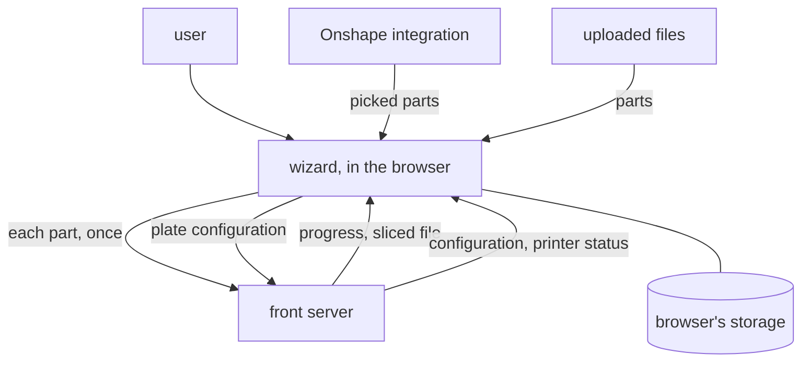

# The wizard

Nothing of the wizard is built. This guide is its design: what a user sees and does at
every step, what the code in the browser must do and how well, and what is still undecided.
It is written for the person who decides whether the wizard is being built correctly.
[README-details.md](README-details.md) holds what a builder needs beside it: the names in
the code and the record of where each rule came from.

The phases named below are those of [the plan](../docs/plans/penguin-slicer-plan.md):
phase 2, the wizard on one machine with parts from files; phase 3, the same hosted, with
Onshape sign-in; phase 4, inside Onshape; phase 5, the real printer.

## What it is for

The **wizard** is the code in the browser: a step-by-step user interface that takes a user
from parts to a print. The user adds parts, chooses a filament and a profile, lays the
parts out on the printer's plate, looks at the sliced result layer by layer, and sends it
to the printer or downloads it. It has five steps, in that order: the **Parts step**, the
**Settings step**, the **Layout step**, the **Preview step** and the **Send step**. It runs
in Onshape's right panel and in a browser tab of its own, from 320 px wide.

It is a component of its own because it is the only one a user touches, and because it
owns three things nothing else has.

- **The record of the user's work.** The parts, the layout and the chosen settings live in
  the browser, and nowhere on a server. Everything a server holds of a plate is a copy
  that can be made again.
- **Everything geometric a user does by hand.** Drawing a part, finding the faces it can
  lie on, choosing how it lies, arranging the plate and checking that every instance fits
  are done in the browser, with no server involved, so that dragging an instance answers
  at once.
- **Every sentence a user reads.** The other components report failures and progress in
  fixed shapes; the wizard decides where each appears and what stays on screen.

What it must never hold: a secret of any kind, a sliced file of its own making, or a
decision about who the user is. It talks to one thing only, the **front server** (the
component behind the wizard's address, which signs users in, passes parts and plates to
the slice service, keeps sliced files and configurations and, from phase 5, talks to the
printer). What passes between the two is fixed by
[the contract between the wizard and the front server](../contracts/wizard-front-server.md).
From phase 4 the **Onshape integration** (the component that makes PenguinSlicer work
inside Onshape) hands the wizard the parts a user picks there; outside Onshape, parts come
from files the user uploads.

How the front server, the slice service and printer delivery fit together behind that one
address is in [the architecture](../docs/architecture.md).

### The terms this guide uses

The plan's terms hold here. The ones this guide leans on, each in a sentence:

- A **part** is one distinct solid to print. An **instance** is one placement of a part on
  the plate, labelled with its part's name and a number ("L Bracket #2"). The **plate** is
  the printer's bed and everything on it.
- The **page** is the wizard as loaded in one browser tab, or in Onshape's panel.
- The **browser's storage** is the storage a browser gives a page that outlasts a refresh
  and a closed tab. It is kept for each browser and for each address the page is opened at.
- A **group** is the users who share one configuration and one printer: one Onshape company
  or classroom, or a user alone who belongs to none. The **current group** is the one
  group, of those a user belongs to, that the user is working in now.
- The **configuration** is the current group's shared settings: its filaments, each with a
  colour and its own profiles; the printer's Orca profile, which gives the plate's size and
  height; and whether uploaded files are read in inches or millimetres.
- A **profile** is a named set of slicing settings in the configuration, such as
  "Structural". A **change** is one setting set differently from the profile.
- A **plate configuration** is the description of what to slice: the parts, where each
  instance sits and how it is turned, the profile and the changes. A **slice job** is one
  plate configuration being sliced by the slice service. The **sliced file** is what Orca
  writes and the printer runs.
- A **delivery job** is one sliced file on its way to one printer, from Send to the end of
  its print. The **daemon** is printer delivery's program on the computer beside the
  printer; the wizard never talks to it, and the panel calls it "the PenguinSlicer program
  on the computer beside the printer".

A user never reads the word "job". What is sliced and printed is a plate, named in words
("Plate 1, 16 instances"), never by the sliced file's generated name. So where this guide
describes what a user sees, "a slice" is a slice job, "a print" is a delivery job from the
moment the printer starts, and "a sliced plate" is a plate whose sliced file is still
kept.

## The panel as a whole

### Width and look

The panel is fluid: it works at 320 px and lays out wider when it has more room, and
dragging Onshape's panel wider changes the layout exactly as widening a window would,
because every rule is measured on the panel and not on the window. Four widths change the
layout, each including itself:

| From | What changes |
|---|---|
| 480 px | The step circles become named tabs; the Settings step puts the filament and the profile side by side and the quick changes two to a row; advanced mode shows its sections in a column down the left |
| 520 px | The figures of a print sit in one row; the 3D views become 4:3 instead of square |
| 680 px | The parts list has two columns, and the Send step has two columns |

The look is PenguinCAM's light theme, so that a user of the CNC wizard meets nothing new:
a pale grey background, white cards, a blue accent, body text at 14 px, a step title at
18 px. Two departures: amber text is darker than PenguinCAM's, which is hard to read on
white, and a step tab's hover is light. The dark house style of the project's documents
does not apply to the wizard.

### The header

The header is the same on every step. Its first line holds "PenguinSlicer" and, at the
right, the **printer-status icon**: a small pill with a printer, a coloured dot and a word,
which says at a glance whether the group's printer is free
([The printer-status icon](#the-printer-status-icon)). Its second line names the current
group, "Config: 6238 (Popcorn Penguins)", with a reload glyph beside it
([The current group](#the-current-group)). Below that are the step tabs.

**The step tabs.** From 480 px they are PenguinCAM's: a number, a name, and a check mark
after the name of a finished step. Below 480 px they are five small numbered circles
joined by a line, a check in each finished one, the current one filled in blue with its
name beside it, so the header stays one row and the content the user works with stays high
in the panel. Every circle is clickable and shows its step's name as its tooltip
("3. Layout"). A click on a tab goes there when every step before it allows it. When one
does not, the **panel line**, one line under the tabs, names the step that holds it and
why ("Layout first: 23 instances are closer than 12 mm with supports on."); it goes at the
user's next move or after a few seconds.

**The plate summary.** The Parts step has none. From the Settings step on, two lines of
text sit under the header, the same on every step and updated at once: the parts and
instances ("1 part · 1 instance"), then the filament and the profile ("PETG ·
Structural") followed, while there are changes, by a pill that counts them ("+2 changes").
A filament or profile name too long for the line is cut with an ellipsis, never wrapped,
with the full name as its tooltip; the pill stays whole. The second line is as tall as the
pill even without it, so nothing below moves when the pill comes or goes. The summary
gives no plate area, print time or grams: the Send step states those. The pill is a button:
a click opens the **change details** joined to it, one plain line for each change
("Quality › Resolution: 0.014 mm (profile 0.012 mm)"), closed by a click elsewhere, Escape
or the pill again.

**Back and Next** sit at the bottom of every step. Next is off until the step's rules pass,
and the step says why. Back is off on the Parts step.

### How the panel tells the user something

The panel has five ways to say something, and each kind of news always uses the same one.
The screens below are written with these words.

| Way | What it is | Used for |
|---|---|---|
| **Notification** | A card at the top of a step, under the plate summary, closed with × | Something that happened and is on no row: a part that was not added, sending cancelled, work resumed. It belongs to its step and goes when the user leaves the step or as soon as it stops being true |
| **Message** | A block in the body of a step: one sentence of what happened, one of what to do, and its buttons. Red when it holds Next, amber when it is a caution, grey when it only informs, green when something was done | A problem on the plate, a slice that failed, a printer that cannot take a send |
| **Card** | A white bordered box that holds a state for as long as it lasts | Slicing progress, the progress of the user's print, a busy printer |
| **Details** | A small box that opens joined to the header element or icon it belongs to | The printer details, the change details, the group details, the colour key |
| **Line** | One short sentence in a fixed place | A consequence the user cannot see; the panel line under the tabs |

**Tooltips** are the panel's own: a small white box in the panel's font at body size, which
appears 150 ms after the pointer rests on an element (a browser's own waits about a
second) and at once when the keyboard focuses an icon or a step circle. It sits under its
element, or above it where the panel ends, and is kept at least 6 px inside the panel's
edges, so it never leaves a 320 px panel. A tooltip says only what is not on screen: an
element whose text is fully visible has none, and one whose text is cut short shows the
whole text. Only the options inside an open menu keep the browser's tooltip, because the
browser draws an open menu. Touch shows no tooltip.

### The words it uses

**No role words.** No sentence a user sees says "student", "mentor" or "team", because
PenguinSlicer is used by people who are not FRC teams. A group's own name ("6238 (Popcorn
Penguins)") is shown as the group wrote it. Nothing distinguishes one user of a group from
another, so no sentence sends the user to "an administrator".

**Little help text, generous errors.** No line sits under a step title and no instruction
under a control. A short line stays only where an action has a consequence the user cannot
see; each is named at its step. How to move things with the mouse is behind a "?" icon on
the two steps that have a 3D view. Errors get the opposite treatment: each says what went
wrong and what is specific to it (which part, what about it, where to look), and never
generic troubleshooting ("check that this computer is online") or anything of
PenguinSlicer's internals. Three messages carry more, folded under **Details**: two slice
failures and a failed print.

**Nothing is said about orientation.** After an instance is laid down, by the user or by
the wizard, nothing says how it lies now: the view shows it. What is said is a move the
wizard made that the user did not ask for.

### Units

A part has **units**, inches or millimetres, and they are a label that travels with it:
the units of the Part Studio or Assembly it was picked in, or for an uploaded file the
configuration's units for uploads. The wizard never guesses units from a part's size.

| What | Shown in |
|---|---|
| A part's own size, on every step | The part's units. Inches are decimal to three places, as a machinist reads a drawing ("2.000 × 2.000 × 0.188 in"); millimetres to 0.1 mm |
| Printer and plate figures: the plate's size, the height limit, the spacing between instances, distances between instances, a height above the plate, the layer readout | Always millimetres, as the printer's maker gives them |
| A comparison of a part's figure with a printer's | Millimetres for both, with the part's own units in brackets when they are inches ("stands 352.7 mm (13.885 in) tall; the printer prints up to 340 mm") |
| Slicing settings | Always millimetres, as in Orca and in the profiles |

A size is rounded once, from the exact millimetres, in the unit shown, so a part has one
size on every step. A size is never cut short: in a narrow panel it wraps.

### When the server is slow or cannot be reached

The project is deployed continuously, so the front server restarts at any time of day
while people are working, and a request can fall in the gap. The page therefore retries
every request it makes, and a user sees a pause, not an error.

| Time since a request first failed | What the user sees |
|---|---|
| Up to 20 seconds | Nothing, except on the thing that is waiting: a part's row says "Taking longer than usual; still trying…" after 4 seconds |
| 20 to 300 seconds | The panel line, in amber: "The server is being slow. Your browser is retrying in 28 s.", counting down to the next attempt, with a link, "Retry now" |
| After 300 seconds | The panel line, in red: "The server could not be reached.", with one button, **Try again**, which starts the 300 seconds afresh |

The waits between attempts grow, doubling from one second to thirty, so there is something
to count down and a struggling server is not hammered. The message is on the panel line
and not a notification because it concerns the whole panel and must stay as the user moves
between steps; it goes the moment a request is answered. Throughout, nothing of the user's
work is dropped: the parts, the layout and the settings are in the browser's storage, a
part whose upload stopped keeps its row, and everything that needs no server (laying out
the plate, changing settings) goes on working. These times cover every request a user
waits on: adding a part, submitting a plate, fetching a sliced file, sending, cancelling.
A dropped **progress stream** (the connection on which the page follows a slice or a
print as it happens) is not one of them: the page reconnects silently, because progress
streams are closed routinely.

## Signing in

Every user signs in with Onshape, in Onshape's panel and outside it alike; PenguinSlicer
has no accounts or passwords of its own. On one machine (phase 2) there is no sign-in at
all: the front server signs in a fixed made-up user and group, and the wizard opens
straight on its first step. From phase 3:

**Opening the wizard when not signed in.** The front server sends the browser to Onshape,
which asks the user to sign in if they are not, and, the first time, to allow PenguinSlicer
to read who they are and which companies and classrooms they belong to. Onshape then sends
the browser back and the wizard opens. A user already signed in to Onshape who has allowed
PenguinSlicer before sees no screen at all between asking for the wizard and getting it.
PenguinSlicer shows no sign-in page of its own on the way in.

**A sign-in that failed.** If the user refuses Onshape's request, or Onshape does not
answer, the browser lands on a plain page with the header's first line and no step tabs,
no group and no printer-status icon, and one message: "PenguinSlicer could not sign you in
with Onshape." Its second sentence is specific: "You did not allow PenguinSlicer to read
your Onshape account. It reads only your name and the companies and classrooms you belong
to." or "Onshape did not answer." One button: **Sign in with Onshape**.

**A sign-in that has run out.** A sign-in lasts thirty days. It can also end early for
everyone at once, when the key that protects it is replaced in an emergency. Either way
the page learns it when a request is refused as not signed in. The step's content is then
replaced by one card: "Your sign-in has ended. Sign in with Onshape to go on. Your parts,
layout and settings are kept in this browser." with one button, **Sign in with Onshape**.
The header stays, with a blank printer-status icon. The button takes the same trip to
Onshape and back, and the wizard reopens on the step the user was on, with the plate as it
was. The page does not leave for Onshape by itself: a user in the middle of dragging an
instance would lose their place without knowing why. Nothing is lost by waiting, because
the work is in the browser's storage and the front server holds no session to expire.

## The current group

The header's second line names the current group: "Config: 6238 (Popcorn Penguins)", by
the name of the Onshape company or classroom, or by the user's own name for a user who
belongs to none. The name is a button. A click opens the **group details** joined to it,
as the printer details are joined to their icon:

- the groups the user belongs to, one to a row, the current one checked; a click on
  another makes it the current group;
- "Signed in as Alex Chen";
- a link, **Sign in again**, with one line under it: "Reads your Onshape companies and
  classrooms again."

A click elsewhere, Escape or the name again closes them. A user in one group sees one row
and has nothing to choose, but still has Sign in again, which is for exactly that user:
a group is read from Onshape only at sign-in, so someone added to an Onshape company after
signing in does not see it until they use this link. It costs two of PenguinSlicer's
calls to Onshape, of a yearly allowance, which is why it is a link the user chooses and
not something the page does by itself. It takes the trip to Onshape and back and returns
to the same step with the group details open, so the user sees the new list. Sign in again
lives inside the group details and not on the header line itself so that the line stays
one row at 320 px.

**Changing the current group** changes the configuration and the printer, so it clears
what belonged to the old ones: the filament and profile become the new group's first, the
changes are cleared, and the plate must be sliced again. The parts and the layout stay,
and the Layout step checks them against the new printer's plate. When there are changes or
a sliced plate to lose, the wizard asks once more first: "Change to FRC 1678? Your 2
changes and this plate's slice are cleared. Your parts and layout are kept." A plate
already sent goes on printing at its own printer; the printer-status icon now shows the
new group's printer, and the earlier print is seen again by changing back. The choice is
kept in the browser's storage until the user changes it.

**A group the user no longer belongs to.** If the front server refuses the stored group
(the user left that company and has signed in again since), the page takes the first of
the user's groups and says so in a notification: "You are no longer in 6238 (Popcorn
Penguins). PenguinSlicer now uses FRC 1678's configuration and printer."

**The reload glyph** reads the configuration again from the front server, for a user who
has been told that a filament or a profile was added. If the chosen filament or profile is
gone from the new configuration, the first one takes its place and a notification says
which. The configuration cannot be edited from the wizard: its edit screens are a feature
of their own, in no phase yet. A group that has no configuration gets a built-in default,
so a new group can slice without setting anything up.

## The Parts step

The wizard opens here. The step is the list of parts to print, each with a quantity.

**Adding a part inside Onshape** (phase 4). A prompt above the list says "Click a part in
the Part Studio", or "Click a part in the assembly", and never changes. A click on a part
in Onshape adds it with quantity 1; a click on a part already in the list raises its
quantity by one and flashes its row, so a user who wants four clicks four times. In an
Assembly a click on an instance, in Onshape's list or in its graphics area, adds that
instance's part. There is no button that adds every part of an assembly.

**Adding a part outside Onshape** (phase 2). An upload area takes STL files, dropped or
chosen. One line under it says how they will be read, because an STL file carries no
units: "STL files are read in inches." (or "in millimetres.", as the configuration says).
A metric file uploaded where the configuration says inches arrives 25.4 times too large
and then fails the height or plate checks on the Layout step; the configuration's one
option is the only control, and a row has no switch of its own.

**A row** shows the part's picture, name, size in its own units, quantity and a remove
button. There is no refresh button on a row: a part changed in Onshape is removed and
clicked again. While a part is arriving its row shows a thin progress bar and "Arriving
from Onshape…" (or "Uploading…"). A part still arriving never holds Next. If it arrives
after the user has moved on, it joins the plate on the Layout step, at once if the user is
there and otherwise the next time that step is shown, and a notification on the step the
user is on says so ("Gusset Plate arrived after you left the Parts step. It joins the
plate when you go back to the Layout step.").

Under the list one line counts what the plate holds, and how many parts are still
arriving.

### A part that cannot be used

Each part is checked by the slice service the moment it is added, before anything is laid
out, so a part that cannot be sliced is found on this step and not after a layout has been
made around it. A part that cannot be used is a notification that names it, and it is not
added; the list never holds a broken row. "Your other parts are fine." is added only while
the list holds other parts. A second failure of the same part replaces its notification.

| What happened | The notification | Then |
|---|---|---|
| Onshape cannot export the part | "Onshape could not export Shooter Hood Rib, so it was not added." and what to check in Onshape: that it is one closed solid, not a surface and not several bodies, and that the Part Studio rebuilds with no red features | Next stays as it was. There is no Try again: the part is broken until it is mended in Onshape |
| A file is not an STL file the slice service can read | "Could not read bracket.stl, so it was not added: it is not a valid STL file." and that the file may be cut short or saved in another format under that name, to be exported again | The same |
| The slice service's check refuses the part (no volume, too small to print, too large for the printer) | The slice service's own sentence, which names the part and what is wrong with it | The same |
| The part is over the size limit | See [The limits on a plate](#the-limits-on-a-plate) | The same |

A part the slice service copes with but warns about is added, and the warning stays on its
row, in amber, without holding Next. The commonest is a part that is not watertight:
"Gusset Plate is not watertight: its mesh has 14 open edges in 2 places. It may still
slice and print. If the slice fails, look in Onshape for faces that do not meet, then
remove this row and click the repaired part again." (Outside Onshape the sentence says
"your CAD program" and "upload the repaired file".)

A part whose upload gets no answer is not refused. Its row stays, because the part is
already in the browser's storage, and the page retries as
[When the server is slow](#when-the-server-is-slow-or-cannot-be-reached) describes: the row
says "Taking longer than usual; still trying…" after 4 seconds, and if the retries stop
after 300 seconds the row keeps the part and shares the panel line's Try again.

### The limits on a plate

Three limits bound a plate, and the Parts step is where a user meets each.

| Limit | What it protects | What the user sees |
|---|---|---|
| A part is at most 7.5 MB, which is 150,000 triangles | The slice service's memory and time for one part, and the size of one upload | A notification, and the part is not added: "bracket.stl is 9.1 MB. PenguinSlicer takes parts up to 7.5 MB (150,000 triangles), so it was not added. Export it again from your CAD program at a coarser resolution." The page checks the size before uploading, so nothing is sent |
| A plate uses at most 25 different parts | The most the slice service keeps for one user, so one user cannot fill its disk | The twenty-sixth is not added, and a notification says "A plate takes up to 25 different parts, so Gusset Plate was not added. Remove a part, or print it on a second plate." Raising the quantity of a part already in the list still works |
| A plate holds at most 150 instances | The slice service's limit on placements | One part's quantity cannot be typed or clicked past 150. When the parts together pass it, a red message under the list says "This plate would hold 163 instances. Up to 150 instances per plate; print the rest on a second plate.", and Next is off |

For a part picked in Onshape that comes out over 7.5 MB, the notification names the part
and says it is too detailed to slice here. Whether the Onshape integration then exports it
again more coarsely by itself is for phase 4's design.

## The Settings step

The step is for the common case, which must stay short: most prints use one filament and
one of a few profiles. It has two menus, four quick changes and one button.

**Filament and Profile.** The Filament menu offers the configuration's filaments, each
with its colour beside its name, so that two filaments of one material (a red PLA and a
green PLA) can be told apart. The Profile menu offers the chosen filament's own profiles,
under the group's own names ("Structural", "Pulley", "Camera mount", "Draft", "Fine");
Orca's own profile names are not names a group would choose and say nothing of what a
profile is for. A profile's purpose is its option's tooltip, not a line under the menu.
Picking another filament picks that filament's first profile. There is no printer row:
the printer-status icon already names the printer.

**The quick changes** are four menus for the settings most often changed for one print:
Infill, Walls, Supports and Brim. They sit one to a row below 480 px and two to a row from
there. A quick change is a change like any other: it and advanced mode edit one shared set
of changes.

**Changing the filament or the profile clears every change,** because a change is a
departure from one profile and means nothing against another. From the first change until
they are cleared, one line under the Profile menu warns of it: "⚠ Changing the filament or
the profile clears your 2 changes." Nothing is said after they are cleared.

**The Advanced mode button** stands alone under the quick changes while nothing is
changed. Once a setting is changed, the **changes box** takes its place: a yellow box
headed "2 settings changed from Structural", one line for each change, and the Advanced
mode button. Each line is a link that opens advanced mode at that setting, with its
section and group open, the setting scrolled into sight and flashed. The box has no "Reset
all"; that lives in advanced mode.

### Advanced mode

Advanced mode is the view that keeps every slicing setting reachable. It fills the panel.
It offers every setting of Orca's that is a parameter with a value (a choice from a list,
a number, a piece of text), about 295 of them, and none of the programmatic ones: settings
that run a program, name a file on the server or hold custom G-code are not shown, and the
slice service refuses them, since they would let a user run something on the server.

**Its header** repeats "PenguinSlicer" with the printer-status icon, then says "Advanced
mode", the profile and how many settings are changed ("Structural, 2 changed"), and
**Reset all**, which asks once more before putting every setting back. **Back to Settings**
at the bottom is the only way out; Escape does not close advanced mode, so a stray key
cannot throw the user out of a long list.

**The settings are in five sections,** as in Orca (Quality, Strength, Speed, Support,
Others), and each section's settings are in collapsible **groups** such as Precision.
There is no search box, no switch between common and all settings and no "changed only"
filter: the changes box, the change details and the changed counts already find a changed
setting.

| Width | How the sections are shown |
|---|---|
| Below 480 px | An accordion of cards: each section is a bordered card whose heading has a chevron and its changed count ("Strength · 1 changed"); its groups are rows inside the card. Each card opens and closes by itself |
| From 480 px | A rail of section names down the left, a changed count on each, with the chosen section's groups beside it |

The groups are always one column, at most 480 px wide, so a value stays near its name. A
group's heading has a chevron and no count of its settings, only a changed count when it
has changes ("Precision · 1 changed"). One icon button, a double chevron, expands or
collapses every group of a section.

**Everything starts open,** every section and every group, the first time advanced mode
is shown, and advanced mode remembers what the user closes for as long as the page is
loaded: across steps, across closing and reopening advanced mode, and as the panel is
dragged across 480 px either way. A reload forgets it, and everything is open again.

**A changed setting** has a tinted background, a bar on its left and a dot after its name.
The line under it gives the profile's value and a link that puts it back: "Profile 0.012
mm · Reset". A value outside a setting's allowed range is refused where it is typed.

**By keyboard,** opening advanced mode puts focus on the first section's heading, or on
the setting when a line of the changes box opened it; what advanced mode covers cannot be
reached; and closing it returns focus to the line or button that opened it.

Changes are part of the user's work: they are kept in the browser's storage and come back
after a refresh.

## The Layout step

The step is for placing every instance on the plate, lying the way it should print. It is
a 3D view of the plate that the user works in directly: there are no modes and no tools to
pick up. The view fills the panel's width and grows as the panel is widened, square at
narrow widths and 4:3 from 520 px, with no cap on its height.

The step does not change the list of parts. There is no duplicate, delete, undo or redo
here, and their usual keys do nothing; how many of a part there are is the Parts step's
business. It has no scale, cut or mirror tools and no settings for one part alone.

### What is on the step

From top to bottom:

- **A toolbar** with two buttons, **Arrange** and **Auto-orient**, and at its right a "?"
  icon that opens the list of gestures in a small panel.
- **The status line,** just above the view: green when every instance fits ("✓ All 16
  instances fit the plate."), red with the first problem when not, with "+2 more ↓" when
  there are others. A click on a red status line scrolls to the full messages.
- **The view,** with view buttons in a corner (Zoom to instances, Whole plate, Top) and,
  at its bottom left, the **pointer line**: one small line that says what is under the
  pointer (an instance's name, "Lay it on this face: 0.250 in tall", "Drag to turn · Shift:
  45° steps").
- **The selection line** under the view: with nothing selected, "90 instances on the
  plate, 10 beside it."; with one instance selected, its name, footprint and height in its
  part's units; with several, "5 instances move and turn together". Beside it, when the
  selection could lie better, one link: "Lay it the best way", or "Put back as modelled".
- **One line of printer and plate figures:** "Shop H2S: plate 340 × 320 mm, up to 340 mm
  tall, 12 mm apart". It is kept because nothing else on the panel gives the plate's size,
  the height limit or the spacing. The size and height come from the printer's Orca
  profile named in the configuration, the same profile the slice service slices for.
- **The messages:** anything the wizard moved, and under "Fix these 2 before Next:" one red
  message for each problem, each with the button that fixes it.

### Moving, turning and looking

The mouse works as it does in Onshape, since that is where the user's hand has just been:
drag an instance to move it; right-drag to look around; Shift-drag, middle-drag or Ctrl
with a right-drag to slide the view; scroll to zoom. A left-drag on empty plate also looks
around. Shift-click or Ctrl-click adds an instance to the selection, and dragging one of a
selection moves them all. F zooms to the instances, Ctrl+1 looks from above, Ctrl+A
selects every instance and Escape clears the selection.

**The rotation handle** is a round handle beside the selection that turns it about the
vertical. It is bound to the instance: while dragged it stays on a circle round the
selection and turns through the same angle, so the two never part and the handle never
hops to another side. Turning is free, and a small readout beside the handle shows the
instance's orientation on the plate while dragging ("↺ 37°"). Holding Shift snaps that
orientation to multiples of 45°, as CAD programs do, so an instance left at an odd angle
can be squared again. The handle is drawn over everything, and it moves out of the way of
the face patches described next, but only while it is not being dragged.

### Laying an instance on a face

Selecting one instance is all it takes: translucent blue rounded patches appear on the
faces it could lie on, and a click on a patch lays the instance down on that face. A
double-click on a flat face does the same. There is no button for it and no mode. With two
or more instances selected no patches show.

Two kinds of patch are offered. **Hull patches** lie on the flat faces of the part's
convex hull, the shape a rubber skin stretched over the part would take, because those
are the only faces a rigid part can rest on. **Bounding-box patches** lie on a side of the
part's bounding box where no hull patch points that way, which is what lets a pulley be
stood on its rim. How both are found is in
[Finding the faces a part can lie on](#finding-the-faces-a-part-can-lie-on). Only the
patches in sight are drawn and can be clicked; the face the instance already lies on has
none; a patch brightens under the pointer, and the pointer line says what laying it there
would give ("Lay it on this side: 1.732 in tall").

**Laying an instance down never moves another instance.** If the instance no longer fits
where it stood, it moves to the nearest free spot, turned if need be, and a green message
says so: "L Bracket #1 no longer fitted where it stood, so it was moved to the nearest
free spot." If there is no free spot it waits beside the plate, marked as off the plate,
and an amber message says "L Bracket #1 no longer fits on the plate and waits beside it.
No spot on the plate is free for it lying this way. The other instances stay where you put
them; press Arrange to make room."

### Parts arrive lying their best way

A new part's instances are laid down automatically the way the wizard judges best for
printing, and nothing is said about it. Most parts are modelled the way they sit on a
robot, which is rarely the way they print, so "as modelled" would make nearly every user
lay nearly every part down by hand. **Auto-orient** does the same on request, for the
selected instances or for every instance when none is selected. If the plate then needs
rearranging, the wizard does it and says "Arranged the plate again to make room."

### Arrange

**Arrange** places every instance on the plate, in a compact pile about the plate's
middle, at the spacing the settings ask for, and says "Arranged 16 instances." It never
turns an instance: each keeps the orientation it was given, by lay on face, by the
rotation handle or by the wizard. A user who has turned an instance to 37° on purpose
finds it still at 37° after Arrange.

Arrange and Auto-orient stay two buttons, since one moves and the other turns. But when
Arrange cannot fit everything and laying instances their best way would fit more, its
message offers that as one button: "Arrange placed 12 of 16 instances; 4 instances do not
fit and wait beside the plate. Arrange keeps how each instance lies. With 5 instances laid
the best way, everything would fit. Or lower the quantities and print the rest on a second
plate.", with **Lay them the best way: all fit**.

The wizard does turn an instance at the moments when it gives it an orientation itself: a
part that arrives too long for the plate as it lies is turned a quarter, an eighth or three
eighths of a turn, the first that fits, before it is first arranged. A 353 mm rib on a
340 × 320 mm plate fits only on the diagonal, and a user should not have to discover that.

### The placement rules, and what each problem says

The Layout step applies the slice service's own placement rules, so that a plate the
wizard passes is a plate the slice service accepts. Every instance must sit at least 3 mm
inside the plate's edge, stand no taller than the printer prints, and keep its distance
from every other instance: 12 mm with supports on and 5 mm with them off, measured between
the instances' outlines as they are turned. Next is off while any rule is broken.

| Problem | The message | Its button |
|---|---|---|
| Two instances too close | "L Bracket #1 and Gusset Plate #2 are 6.2 mm apart; instances need 12 mm between them with supports on. Drag one away, or press Arrange." | Arrange |
| Many instances too close | One message for all of them: "23 instances are closer than 12 mm with supports on. Press Arrange, or drag them apart." Each stays marked in the view | Arrange |
| An instance across the plate's edge | "Gusset Plate #3 is not fully on the plate: it crosses the left edge. Drag it inward, or press Arrange." | Arrange |
| An instance longer than the plate takes, as it is turned | "Shooter Hood Rib #1 is 352.7 mm (13.885 in) from left to right as it is turned; the plate takes 334 mm. Turn it to fit turns it and arranges the plate again." | **Turn it to fit**, since Arrange never turns |
| A part that fits the plate at no turn | The same first sentence, then "Lay it down another way." | None |
| An instance too tall | "Shooter Hood Rib #1 stands 352.7 mm (13.885 in) tall; the printer prints up to 340 mm. Lay it down another way, or press Auto-orient." | Auto-orient |

An instance that Arrange left beside the plate gets no message of its own; Arrange's
message already counts it. A click on a message selects the instances it names.

**Turning supports on after arranging moves nothing.** The spacing follows the Settings
step, so instances that were 5 mm apart are now too close, and they get the usual message
until the user presses Arrange or drags them. The wizard does not rearrange a plate behind
the user's back.

## The Preview step

The step is for looking at what will actually be printed. Entering it slices the plate;
when the slice is done it shows the result, which the user inspects layer by layer before
sending anything to a printer.

### Slicing

Entering the Preview step submits the plate. While it slices, the step shows the **slicing
card**: a ring gauge with the percentage, the stage in words, the time taken and the time
expected to be left, a bar, the list of stages with the current one marked, a **Cancel
slice** button, and one line: "Slicing goes on if you step back; change the plate and it
starts again." The stages and the percentage are Orca's own, passed through; nothing is
invented.

**A slice goes on without its page.** Leaving the step, refreshing, losing the network or
closing a laptop lid leaves the slice running on the server, and coming back with the same
plate finds it still going or finished. A changed plate (a part moved, a setting changed)
cancels it and starts a new one. Coming back to a plate that is already sliced shows the
result without slicing again. Leaving does not stop the slice because the commonest reason
to leave is to look at something and come back, and a slice thrown away is a wait repeated.

| State of the slicing card | What the user sees |
|---|---|
| Waiting behind other slices | The ring is empty and the stage line reads "Waiting for the slicer: 2 slices ahead of yours." (or "1 slice ahead of yours."), updated as the number falls. The time waited counts up; no time left is shown, since none is known. Cancel slice works |
| Slicing | The ring, the stage and the times, as above |
| The server cannot be reached | The figures stop, the time-left line says "no news since 0:41", and Cancel slice is off, with one line: "Cancel slice is off until the server can be reached again; the slice may still be running." |
| Reconnected | One line on the card: "Reconnected at 1:05. The slice kept running; the progress below is up to date." |
| The slice service restarted | The ring and the stages go back to the start, and one line on the card says "The slicer restarted, so this slice began again." The page has sent the parts and the plate again by itself; the user did nothing |
| Cancelled by the user | A grey message: "Slice cancelled at 0:23, during “Generating perimeters”. Nothing was saved or sent to the printer.", with **Slice again** and Back to Layout |

**No room to wait.** The slice service runs one slice at a time and lets two more wait.
When a fourth arrives it is refused, and the step shows an amber message in place of the
slicing card: "The slicer is busy: other plates are being sliced and no more can wait. Try
again shortly. Your plate is unchanged.", with **Slice again**. The page does not try
again by itself, since a silent queue outside the server's own would hide how busy it is
from the person waiting. The message is amber and not red because nothing is wrong with
the plate.

**Stopped by a slice from another tab.** A user has one unfinished slice at a time: a
second one, started in another tab or in a tab beside Onshape's panel, cancels the first.
The page whose slice was cancelled shows a grey message in place of the slicing card:
"This slice was stopped because you started another one in another tab or window.
PenguinSlicer slices one plate at a time for each user.", with **Slice again** and Back to
Layout. It does not slice again by itself: if it did, two open pages would cancel each
other in turn for ever.

### When a slice fails

Each failure is one sentence of what happened and one of what to do, with its buttons. Two
of them carry folded Details.

| Failure | What happened | What to do, and the buttons |
|---|---|---|
| Empty layers | "The slice failed: Gusset Plate #2 has empty layers at about 12.4 mm above the plate." | "Part of it starts in mid-air there, and Supports is off, so nothing would hold it up while it prints. Turn Supports on and slice again." **Turn on Supports and slice again**; Back to Layout. Details: Orca's own sentence with the heights, and where to look on the part |
| A faulty mesh | "The slice failed: Gusset Plate #2 has a faulty mesh at about 12.4 mm above the plate." | "Supports is already on, so the model itself has gaps or zero-thickness pieces there." and to repair the part in Onshape (outside Onshape, "your CAD program", with no word of Onshape) and add it again. Details: Orca's sentence, and what to check in the model |
| Too slow | "The slice took longer than 4 minutes, the server's limit, and was stopped." | "Slice again first: the server may have been busy. If it stops again, this plate of 40 instances is too much at once: lower the quantities and print the rest on a second plate, or pick a profile with thicker layers." **Slice again**; Back to Parts |
| Out of memory | "The slice needed more memory than the server allows one plate, and was stopped." | With several instances: "This plate of 12 instances is too much at once. Lower the quantities and print the rest on a second plate." Back to Parts. With one instance: "This part alone is more than the server can slice. Slice it in Orca Slicer on your own computer." Slice again is not offered, because the same plate would run out of memory the same way |
| Anything else | The slice service's own sentence of what happened and what to do | **Slice again**; Back to Layout |

There is no "plate too large" refusal before slicing: nothing caps a plate's volume, and a
plate too heavy to slice ends as out of memory or too slow.

**Turn on Supports and slice again** checks the plate first, because supports need 12 mm
between instances where the plate may have been arranged at 5 mm. A plate that passes is
sliced. One that does not is not sliced: the wizard goes to the Layout step, which says
"Not sliced: with Supports on, instances need 12 mm between them." above the usual
message. Nothing moves by itself.

### The result

When the slice is done the step shows:

- **Print time and filament,** the two numbers a user plans around, large ("3 h 12 min",
  "84 g PETG"). They are Orca's own figures from the sliced file's summary.
- **One quiet line:** the instances, the layers and how long the slice took.
- **Warnings** the slice service reported with the sliced file, if any, in amber.
- **The layer preview:** a 3D view of the sliced plate with a layer bar at its right. The
  bar chooses the top layer shown; its readout under the view gives the layer and its
  height above the plate ("134 / 134 · 40.2 mm", one line even at 320 px). The bar moves
  with the arrow keys and reports its layer to a screen reader, and two small buttons step
  one layer down or up. **Reset view** puts the camera back, and a "?" icon beside it says
  how to move: "Drag to turn, right-drag to pan, scroll to zoom; drag the bar on the right
  to go through the layers."

Next goes to the Send step once the plate is sliced.

**What the layer preview must look like.** It shows the toolpaths of the sliced file
itself, so what the user inspects is what the printer will run.

- **Four fixed colours,** one for each group of line types, whatever the filament. They
  are not Orca's colours, which a user of PenguinSlicer will not know, and not the
  filament's, which would make a black filament unreadable.

  | Group | Line types | Colour |
  |---|---|---|
  | Walls | Outer and inner walls | Blue `#2b5c9e` |
  | Infill | Sparse and internal solid infill | Orange `#e0912f` |
  | Top and bottom surfaces | Top and bottom surfaces | Green `#2f9e7a` |
  | Supports and brim | Supports, their interface and the brim | Violet-grey `#9a8fb8` |

  The four were chosen to stay apart for every common kind of colour blindness: checked by
  simulation for protanopia, deuteranopia and tritanopia, the smallest difference between
  any two is 16.8 on the CIEDE2000 scale, and every colour stays at least 24 from the
  view's background. The walls have the darkest colour (contrast 6.1 to 1 against the
  background) because they outline every part and are what the eye reads first; supports
  and brim have the least saturated, because they are not the part and should recede.
- **A colour key** opens from a small icon at the view's top left: four rows, a stripe and
  a name each. It is closed until asked for and always has all four rows. No line type can
  be hidden.
- **Lines have their real width.** Each line is drawn as wide as the settings' line width
  at its distance from the camera, and never thinner than one pixel, so a solid surface
  reads as one colour when zoomed in and lines stay visible when zoomed out.
- **Walls are shaded by the way they face,** by darkening only (from `#2b5c9e` facing the
  light to `#1c3d68` facing away), so a stack of walls reads as a surface and never drifts
  toward another group's colour.
- **The current layer stands out:** it is drawn over the layers below, unshaded and at
  least two pixels wide.
- **What is still to print is a ghost:** above the current layer each instance is a faint
  grey shape (`#95a0ac`, 36% opaque) cut at that layer; it goes when every layer is shown.
- **No combs and no show-through, at any viewing angle.** Walls, hole edges and supports
  read as solid surfaces, and a solid surface shows only its own colour, including seen
  edge-on and zoomed in.

How fast it must be, and how that is to be proved, is in
[The layer preview, as a requirement](#the-layer-preview-as-a-requirement).

### A sliced plate that expires

A sliced plate is kept on the server until two hours after its slice ended, or two hours
after its last print ended, whichever is later; past that the front server refuses it and
deletes it. The two hours run whether or not the page is open, so a user can be looking at
a result when it expires. The page knows both times and shows, at that moment, a grey
message in place of the result on the Preview step, and in place of Send on the Send step:
"This plate's slice has expired. A sliced plate is kept for two hours after it is sliced
or after its last print ends. Slice it again to print it; your parts, layout and settings
are unchanged.", with **Slice again**, which goes to the Preview step and slices. If the
page's clock is wrong and the user presses Send or Download first, the front server's
refusal brings up the same message. A notification that says the sliced plate "is still
here" goes at the same moment, since it has stopped being true. The page does not slice
again by itself: a slice takes a place others may be waiting for, and only the user knows
whether the plate is still wanted. It is a message and not an error because nothing went
wrong.

## The Send step

The step is for one decision: send this sliced plate to the printer now, or download it.

**What will be printed** is a card: the printer by name, the instances by part ("16 on one
plate", then "8 × Gusset Plate", "4 × L Bracket"…), the print time and the grams of
filament. The printer's state is not repeated here; the printer-status icon and the card
or message beside the button say it.

**One line** stands above the button, because Send has a consequence the user cannot see
from the panel: "⚠ Check that the plate is clear and PETG is loaded. Send starts the print
at once." The printer can report that a print ended but not that a person has taken it off
the plate, so the check is the user's.

**The Send button** is the wizard's final action, a wide blue button labelled with the
printer's name ("Send to Shop H2S") with a caret. The caret's menu offers **Download the
sliced file** instead. Choosing from the menu changes what the button does; it does not
act. Pressing Send sends at once, with no confirmation, since the line above it is the
confirmation. Download saves the sliced file to the user's computer, for printing from
Orca or Bambu Studio, and leaves a notification naming the plate and the file's size.

Until phase 5 there is no printer: the step shows what will be printed, and its button is
Download the sliced file. Sending, the printer-status icon and everything below arrive in
phase 5.

### After Send

The step shows the **print card** at its top: the plate in words ("Plate 1, 16 instances,
on Shop H2S"), its stage on a track (Sending, Starting, Heating, Printing, Done), and its
figures: percent, layer of total, time left, expected finish and when it was sent. The
button is off and follows the stage ("Sending…", "Heating…", "Printing…", "Waiting for a
person…").

| State | What the user sees and can do |
|---|---|
| On its way, before the printer starts | **Cancel sending** is offered. Cancelling leaves a notification: "Sending cancelled. Nothing reached Shop H2S and nothing will print. Your sliced plate is still here." It goes when the plate is sent again. If the printer had already started when the cancel arrived, the card says the print has started and goes on following it |
| Printing | The figures. Pausing or stopping a print is done at the printer's screen; the panel offers neither, because a stop from a browser that the printer never received would be worse than no button |
| Waiting for a person | An amber message says what to do at the printer: "Filament ran out. Load new filament, then resume the print on the printer's screen." It is a stage, never an end |
| Failed | The card says so: "The print stopped at layer 51 of 134 (38%): the printer reported a filament tangle or a clogged nozzle. Clear the plate and check the filament path at the printer, then send the plate again from here. The sliced file is still here." Details: where the printer's screen shows the fault and what to check |
| Finished | No card. One line takes its place at the top of the step: "Your print finished at 11:25 am." ([The user's last print](#the-users-last-print)) |

After a print that finished or failed, Send is enabled again for the same sliced plate,
under the plate-clear line, for as long as the sliced file is kept. So a user whose long
print failed at the last layer can send it again at once, and a second copy of a plate
needs no second slice. Nothing on the panel says "late" or "behind its estimate".

### When Send is not offered

| The printer | What the step shows |
|---|---|
| Busy with another user's plate | A **busy card**: "Shop H2S is busy: printing for Alex Chen.", what it is ("8 instances of Gusset Plate"), how far (percent, layer), the time left and the expected finish. One line: "Send comes back when the printer is free; nothing queues." Send is off and the sliced plate stays ready |
| Busy with a print nobody sent from PenguinSlicer | The busy card with what the printer itself reports: "Shop H2S is busy: printing something that was started at the printer, not from PenguinSlicer.", with the percent, layer, time left and expected finish, and no sender or description, since there is none. The same line about nothing queuing |
| Offline | An amber message: "Shop H2S has not been heard from for 7 minutes, so Send waits. Your sliced plate stays ready, and Send comes back as soon as the printer answers. Or download the file.", with Download. No guess at the cause |
| Not heard from yet | Send is off, with one line: "Waiting to hear from Shop H2S." This lasts a few seconds after the server restarts and up to half a minute after pairing |
| No printer paired | An amber message, with the pairing form below it ([Pairing a printer](#pairing-a-printer)) and Download |

**Nothing queues.** A printer takes one plate at a time, and a send to a busy printer is
refused rather than held, because a queued plate would start by itself on a plate nobody
has cleared.

### A print that has gone quiet

During a print the daemon reports every ten seconds. If nothing has arrived for 40 seconds
the print's figures are stale: the print card keeps its last figures, greyed, and an amber
line on it says "No news from Shop H2S since 11:02 am. The print may still be running;
these figures are from then." It clears by itself when the next report arrives. After two
minutes the printer-status icon turns to Offline.

A print that has gone quiet holds the printer for everyone, since nobody can know that it
ended. So once the figures are stale and the print had started, a link appears on the
print card, on the busy card and in the printer details, for every user of the group and
not only the sender, who may have gone home: **Stop following**. It asks once more: "Stop
following this print? PenguinSlicer will no longer show its progress and cannot say how it
ended. The print itself is not stopped; that is done at the printer's screen." with **Stop
following** and Keep following. After it, the card goes, a notification says "Stopped
following Plate 1 on Shop H2S. How it ended is not known.", and Send comes back once the
daemon answers again and the printer is idle. If the printer starts reporting
the print again before the user confirms, stopping is refused and the card simply shows
the fresh figures. A print nobody stops following is given up by the server itself after
24 hours of silence. A plate that had not yet started needs none of this: Cancel sending
is still offered.

## The printer-status icon

The icon is on every step, at the right of the header, from phase 5: a printer, a dot and
a word. It is the first thing a user sees of anyone else's work, which is why it is in the
header and not on the Send step alone.

| The icon says | When |
|---|---|
| Free (green) | Nothing is printing. A printer is Free as soon as a print finishes: there is no "Finished", because the printer cannot tell whether the plate has been cleared |
| Sending 40% (blue, pulsing) | A plate is on its way to the printer |
| Heating, or Printing 61% (blue, pulsing) | A print is going on, whoever started it |
| Waiting (amber) | The print waits for a person at the printer |
| Failed (red) | A print ended on a fault someone at the printer has to see to |
| Offline (grey) | The daemon has not been heard from for two minutes |
| No printer (grey) | The current group has no printer paired |
| A grey dot and "…" | A printer is paired and nothing has been heard from it yet |

**The printer details** open joined to the icon, as a tab that grows down from it. They
open 150 ms after the pointer rests on the icon, so a pointer passing over does not open
them, stay open while the pointer is over the icon or the details, and close 300 ms after
it leaves both. A click opens them and pins them until a click elsewhere, Escape, × or a
second click on the icon. A tap or Enter is a click. The icon has no tooltip; a screen
reader hears one sentence ("Shop H2S is free").

They hold basic information only, under the printer's name:

| State | The details say |
|---|---|
| Free | "Nothing is printing.", and after a print that finished, "Last print finished 11:25 am (Alex Chen)", with "(you)" for the user's own |
| Sending | The plate's description, who sent it, the percent sent, the time left, the expected finish and a bar |
| Printing or heating | Who sent it (with "(you)" for the user), percent done, time left and expected finish. For a print started at the printer: "Started at the printer, not from PenguinSlicer.", then the same figures |
| Waiting for a person | Who sent it, percent done, and what to do at the printer, in amber |
| Failed | Who sent it, and when it stopped and at which layer |
| Stale | The last figures, and "No news since 11:02 am.", with Stop following |
| Offline | "Not heard from for 7 minutes." If the server has restarted since it last heard from the printer, it can only say "Not heard from for at least 3 minutes." |
| Not heard from yet | "Waiting to hear from Shop H2S." |
| No printer paired | "PenguinSlicer needs to be paired with a printer.", and the pairing form |

Users of one group see each other's names and a one-line description of the plate that is
printing. Nobody outside the group sees either.

### Pairing a printer

A group is linked to its printer by pairing, once. Someone starts the PenguinSlicer program
on the computer beside the printer, which shows a pairing code of eight letters and digits
(such as "B6MQ-DN77"); then any signed-in user of the group types that code into
PenguinSlicer, from any computer. The code is good for fifteen minutes and for one use.

The **pairing form** is the same small form in two places: in the printer details, so
that a printer can be paired from any step and before anything is sliced, and on the Send
step, where a user first finds that a printer is missing. The Send step's message reads
"No printer is paired with PenguinSlicer, so nothing can be sent. Anyone in 6238 (Popcorn
Penguins) can pair one: start the PenguinSlicer program on the computer beside the
printer and type the code it shows. Meanwhile, download the file and print it from Orca
Slicer or Bambu Studio." The form is one field, "Pairing code", a **Pair** button, and a
link, "How to pair a printer", to a documentation page. The field takes the code in
capitals or small letters, with or without its hyphen.

| What happens | What the user sees |
|---|---|
| The code is one a daemon is showing | The form goes. A notification says "Paired with Shop H2S. Everyone in 6238 (Popcorn Penguins) can now send to it." The icon shows a grey dot and "…" until the daemon first reports, within about half a minute, and then the printer's state |
| No daemon is showing that code | At once, in red under the field: "No computer beside a printer is showing that code right now. Check the code and try again in a moment." Every wrong code gets this one answer, whether it was mistyped, has run out or was already used, so that a guesser learns nothing from the answer. It is also the answer for a right code typed in the half minute after the server restarts, which is why it says "in a moment" |
| Too many wrong codes from this user | The field and the button are off, with "Too many wrong codes. Wait a few minutes, then try again." |

**Unpairing.** At the bottom of the printer details, whenever a printer is paired, is a
quiet link, **Unpair this printer**. It asks once more: "Unpair Shop H2S? Nobody in 6238
(Popcorn Penguins) can send to it until it is paired again." with **Unpair** and Keep. It
is off while a print that PenguinSlicer is following is going on, with the tooltip "Shop
H2S is printing; unpair it when the print has ended." After unpairing, the icon says No
printer. Any user of the group may pair and unpair; there are no permissions inside a
group.

## When a user comes back

### Coming back to running work

A page that has lost what it had in memory (a refresh, a closed and reopened panel, a
laptop opened the next morning) loses nothing of the user's work, because the work is in
the browser's storage. It reads its plate from there and asks the front server what has
become of the plate's slice, and from phase 5 of its print, and opens where the user will
want to be.

| What the page finds | Where it opens, and what it says |
|---|---|
| Parts, and no slice yet | On the step the user was on (Parts, Settings or Layout), with the plate as it was. Nothing is said |
| The slice is waiting or running | On the Preview step, with its progress. A notification: "Back where you were. Your plate was still slicing when you left; see below." |
| The slice finished | On the Preview step, with the result: "Back where you were. Your plate was sliced and ready to send when you left." |
| The slice ended in an error | On the Preview step, with the failure's message, as if the page had stayed open |
| The slice was stopped by one from another tab | On the Preview step, with the message of [Stopped by a slice from another tab](#slicing) and Slice again |
| The slice is unknown to the server and was submitted less than two hours ago: the slice service restarted | On the Preview step. The page sends the parts and the plate again by itself, and the slicing card starts from the beginning |
| The plate has a print, running or ended (phase 5) | On the Send step. While it runs: "Back where you were. You had sent your plate to Shop H2S before you left; its progress is below.", which goes when the print ends. After it finished: the last-print note. After it failed: the failure on the print card. Send is enabled again for the same sliced plate while its sliced file is kept |
| The slice is unknown and was submitted more than two hours ago: the sliced file has expired | On the Parts step, empty, with one notification: "The slice of your earlier plate has expired; add its parts again to print it." The stored parts are dropped |

The page tells the two "unknown" rows apart by the time it kept when it submitted, not by
anything the server says. A plate with a print is the exception to the last row: a print
keeps its sliced file until two hours after the print ends, so the page drops such a plate
only when the front server reports the sliced file expired.

**Work does not follow a user to another computer or browser.** There the wizard opens
empty. The parts and the layout live in one browser's storage, so no other browser could
show them, and the server keeps no list of who has which plate. The same holds between
Onshape's panel and a browser tab on one computer
([Inside Onshape's panel and outside it](#inside-onshapes-panel-and-outside-it)).

### The page reloading itself for a new version

Every answer from the front server says which version it is. A page that sees a newer
version than its own reloads itself at the next quiet moment: when no request of its own
is waiting for an answer, no pointer is down, no menu or details are open and no field is
being typed in. An open progress stream does not count, since the reloaded page
reconnects and is told the latest progress at once. Until it reloads, the older page goes
on working against the newer server.

The user sees the panel redraw, once, and nothing else: no message, and no "Back where you
were", because the page notes in the browser's storage that the reload was its own. It
reopens on the step it was on, in advanced mode if advanced mode was open, with the parts,
the layout, every change, a running slice's progress and a print's progress as they were.
What starts afresh is only what lived in the page's memory: advanced mode's sections and
groups are all open again, the 3D views return to their starting camera, the selection on
the Layout step is cleared, the layer bar is back at the top layer, and open details and
notifications are closed. That list is the cost of a deploy to someone working, and it is
why the list of things kept only in memory must stay short.

### The user's last print

When the user's own print finishes, one line says so, "Your print finished at 11:25 am.":
the **last-print note**. It is a line and not a card because a finished print asks nothing of the user. It shows at the top of the Send
step, above the Send of the same plate or of a new one, and, when the user comes back to
the wizard, on whichever step opens, until the user leaves that step. It goes, with the
printer details' "Last print finished…" line, when the user sends another plate or 12
hours after the print finished, whichever comes first. A print that failed is not a line:
it is the failure on the print card, on the Send step, where the returning page opens.

## What the browser keeps, and why it is the record

The browser's storage is the record of a user's parts and plate; nothing on a server is.
This is the choice the rest of the design leans on. It means neither server needs a
database or a table of sessions, a restart of either server touches no user's work, and a
user's models rest outside their own browser only as short-lived copies.

| What the page keeps | Kept until |
|---|---|
| The parts: each part's file exactly as it arrived, with its name, its units and its fingerprint (a SHA-256 hash of its bytes, by which the slice service knows the part) | The page, on opening, finds the plate's sliced file expired |
| The layout: where each instance sits and how it is turned | The same |
| The chosen settings: the filament, the profile and every change | The same |
| Which slice is the plate's, and when the page submitted it | The same |
| The step the user is on | The same |
| The current group | The user changes it |

What lives only in the page's memory starts afresh on a reload: which of advanced mode's
sections are open, the cameras, the selection, open details and notifications.

Three consequences follow, and each is deliberate.

- **A refresh keeps the work.** It has to: the page reloads itself after every deploy, so
  a refresh that dropped the plate would lose work several times a day.
- **Work does not follow the user to another browser.** That is the price of having no
  database, and it is accepted.
- **The server's copies can always be made again.** The slice service keeps each part for
  two hours after its last use, as a cache, and forgets all of them when it restarts.
  Whenever it no longer has a part a plate names, it says which, and the page sends those
  parts again from the browser's storage and submits the plate again. The user sees
  nothing of it.

**Each part is sent once, when it is added,** and from then on is named by its
fingerprint: a SHA-256 hash of its bytes. On the Preview step the page sends only the
plate configuration, which names each part by fingerprint and carries no files. So slicing
again after moving a part or changing a setting uploads nothing, and a part that cannot be
sliced is found when it is added.

**The page never stores a sliced file and never sends one.** It fetches the sliced file
through the front server each time it needs it, for the preview and for the download. A
printer therefore only ever receives a file the slice service made; nothing a browser
could alter is ever printed.

The storage must hold the most a plate can use, 25 parts of up to 7.5 MB each, for one
page.

## How it does the hard parts

Orca Slicer has a tool for each of the three geometric jobs below. None of its code can be
taken over: Orca is licensed under the AGPL and PenguinSlicer under the MIT licence, and
no JavaScript version of them exists under a licence PenguinSlicer could use. So all three
are written fresh, from descriptions of the method in our own words, and no Orca code,
comment or constant name enters the repository. This is the wizard's largest piece of new
engineering and its least proven; see
[The risks to try first in phase 2](#the-risks-to-try-first-in-phase-2).

### Reading a part without changing it

The browser reads a part's file to draw it, to measure it and to lay it out. It never
changes the file's bytes: what it keeps and what it uploads is the file exactly as it
arrived. The part's units travel beside the file as a label. For its own drawing and
measuring the page multiplies an inch part's coordinates by 25.4, in memory only; the
slice service alone applies the scale to what is sliced, and uses the units in its checks
when the part arrives.

The reason is that a part is named by the fingerprint of its bytes. If the browser
rewrote a file to convert its units, two components would each hold their own version of
"the part", and a difference between them would be a wrong-sized print with no error
anywhere. With the bytes untouched and the units a label, the same file read in inches and
in millimetres is simply two different parts to the slice service.

### Finding the faces a part can lie on

The approach is the one Orca's "lay on face" tool uses, described in
[the note on hull faces](../docs/research/2026-11-21-lay-on-face-hull-faces.md), with two
rules of PenguinSlicer's own for round parts.

1. **Wrap the part in its convex hull.** A rigid part can only rest on a face of its hull,
   so the hull's faces are the complete set of candidates. The hull bridges holes and
   hollows, which is right: a bracket rests on the rim of a pocket, not in it.
2. **Join the hull's triangles into flat faces,** spreading from each triangle to its
   neighbours whose direction matches the first triangle's within a fraction of a degree.
   Comparing with the first triangle, not the neighbour, stops a gently curved strip from
   creeping into one face.
3. **Drop the faces nobody would choose:** those under 5 mm², those with a sliver corner,
   and all but the 254 largest.
4. **Drop the facets of round sides.** A cylinder's side is hundreds of narrow flats, each
   of which passes step 3. A face is left out when a neighbouring hull face bends away from
   it by less than 20 degrees and is at least half its size, which is the mark of a facet
   among its like. A flat face beside a chamfer keeps its patch.
5. **Add bounding-box patches where step 4 left a direction empty.** For each of the six
   sides of the part's bounding box, if no kept face points within 30 degrees of that
   side, the side itself gets a patch, and a click turns the part to rest that way. Thirty
   degrees is the half-angle of a hexagon, so a hex shaft, whose flats are 60 degrees
   apart, rightly gets none and lies on a flat. The angle is a starting point to be tuned
   on real parts.

A click turns the instance by the shortest rotation that points the chosen face straight
down, keeping its turn about the vertical. The faces are found once for each part and turn
with it, so turning an instance costs nothing.

What the approach costs: the hull dominates, and its cost grows with the part's corners
times the hull's triangles. On the mockup's own generated parts (up to 1,744 corners)
finding the faces took 0.2 to 10 ms. A part exported from Onshape can have tens of
thousands of corners and needs a faster hull, or the work moved off the page's main thread
so the panel does not freeze. Four things are known to be needed on real parts that the
mockup's parts never exercised: a round side cut into unequal facets, where the rule of
step 4 keeps the wide ones (a whole run of facets joined by shallow bends should be
treated as one round side); a round side cut into fewer than 18 facets, which bend more
than 20 degrees apart; a part modelled at an angle to its axes, whose bounding box does
not meet its rim square; and a test of whether the part would tip over on a face, which
Orca's tool lacks and PenguinSlicer's should have, using the test auto-orient already
makes.

### Choosing how a part lies: auto-orient

Auto-orient scores every way a part can rest and takes the best. The candidates are the
faces found above, and the part as modelled. A candidate counts only if it is stable (the
part's centre of mass, dropped straight down, lands inside what touches the plate) and at
least 25 mm² touches the plate. Each is scored by a cost, lower being better: the area
that would hang over air, divided by the area touching the plate, plus a small charge for
height, and a large penalty when almost nothing touches. In words: prefer a wide footing,
little overhang, and lying low.

It is a small score of PenguinSlicer's own, and it is known to be blind in three ways.
It knows nothing of load, so a tall standoff whose strength runs along its length may be
laid on its side; it has no notion of which faces are for show; and a part that needs
supports whichever way it lies still gets the least bad answer with nothing said. That is
why laying a part down by hand must stay one click. A part with no candidate at all, such
as a sphere, stays as modelled. It runs once for each part when the part arrives; a part
of 100,004 triangles with 28 candidates took about a tenth of a second outside a browser,
and it has not been timed in one.

### Arranging the plate

Arrange places each instance's outline, as it lies and as it is turned, and never turns
one. It works on the convex outline of each instance seen from above, as Orca does, grown
by the spacing. Two simple packers run and the better result is kept:

- a **shelf packer** takes the instances largest first and puts each at the first free spot
  scanning from the front-left corner, then slides the group to the plate's middle;
- a **pile packer** takes them largest first and tries every free spot on a 5 mm grid,
  scoring each by how small and square the pile stays and how near the plate's middle it
  is, then refines the best at 1 mm and centres the pile.

The result that leaves fewer instances beside the plate wins, the smaller pile breaking a
tie. Instances that fit nowhere wait beside the plate. The pile sits in the plate's middle
because that is where the bed heats most evenly.

What it costs: because it packs convex outlines, a curved or L-shaped part takes up its
hollow side too, so two curved ribs cannot nest one inside the other. Packing true
outlines would fix that and is a much larger piece of work; it is not planned. Outside a
browser the two packers took 0.2 to 1.5 seconds on plates of up to 25 instances,
unoptimised; a plate of 150 instances has not been timed.

The **placement check** that colours the status line uses the same outlines and the same
three rules the slice service applies when a plate arrives (3 mm inside the edge, the
height limit, the spacing). It runs as the user drags, so it must be fast enough to run on
every movement with 150 instances on the plate. The wizard's check and the slice service's
must agree: a plate the wizard shows green and the slice service then refuses is a defect
in one of them.

### The layer preview, as a requirement

This guide says what the layer preview must achieve and not how. The method is found while
building, because the mockup's method is known not to be good enough and no better one has
been tried.

**What is required.** Orca makes the sliced file; the wizard shows that file's own
toolpaths, and the user inspects them layer by layer, with the appearance set out under
[The result](#the-result). Four things are required of the implementation beyond the look:

1. **A frame budget on a machine without a graphics card,** where the browser draws 3D in
   software, met at the largest plate the wizard allows, by whatever means keeps the look.
2. **A view that draws again after the browser loses its 3D drawing context,** in every
   3D view of the wizard (the parts' pictures, the Layout view and the layer preview),
   without a reload.
3. **No combs and no show-through at any viewing angle,** as the appearance rules say.
4. **Proof by test renders.** The builder renders real sliced plates (several plates,
   supports on and off, several layer counts, several viewing angles including edge-on and
   zoomed in), looks at every one, and keeps them as the evidence that the preview looks
   right.

**The sizes it must handle.** The heaviest plate the Popcorn Penguins print has about a
million lines of printer instructions, in an 8.8 MB sliced file. A plate of twelve of the
robot's largest block gives a 10.8 MB sliced file, and 14.1 MB with supports on. The
wizard allows 150 instances on a plate.

**Why the mockup's method fails.** The mockup drew every toolpath segment as a flat strip.
On a machine with no graphics card one frame cost about 27 millionths of a second for each
segment, whatever the view's size: 4.2 seconds for one small plate of 152,101 segments,
and 10 to 21 seconds for four or five instances of some 400,000 segments. Frames that long
make Chrome restart its graphics process, which blanks every 3D view on the page; after a
second such loss no view drew again until a reload. On a laptop with a graphics card the
same preview was fast but showed the artefacts requirement 3 forbids: walls and hole
edges read as combs, and infill showed through near the edges of top surfaces, because a
flat strip nearly vanishes when seen edge-on. Three quarters of the segments can never be
seen, being inside the part; drawing only the visible ones made frames three times faster
and changed the look, so that shortcut as tried is not acceptable either.

The frame rate, the browser and the machine are stated nowhere; they are proposed under
[What is undecided or unmeasured](#what-is-undecided-or-unmeasured).

## What the wizard asks of the front server

The wizard talks to nothing else, so this is everything it needs from outside. The exact
requests are fixed in
[their contract](../contracts/wizard-front-server.md), whose requests are written with
phase 2's design. In words:

- **Who the user is, and their groups,** to name the current group and offer the others;
  and a way to start signing in and signing in again.
- **The current group's configuration,** whole, on opening and when the reload glyph is
  pressed.
- **To take one part,** check it and answer with its fingerprint, its measurements and any
  warnings, or with the reason it cannot be used.
- **To take a plate configuration** and answer with the slice it started; or with the list
  of parts it no longer has; or that there is no room to wait.
- **To report a slice's progress** as it happens, over a connection the page can drop and
  reopen at will, with the latest report sent at once to a page that connects late; for a
  waiting slice, how many are ahead of it; and at its end, that it finished, or the error,
  or that a later slice of the same user cancelled it.
- **To answer what became of a slice** the page kept note of, for a page coming back.
- **To cancel a slice.**
- **The sliced file and its summary,** for as long as the sliced file is kept, with the
  time its slice ended, so the page can tell when it will expire.
- **Its version on every answer,** so an older page knows to reload.
- **From phase 5:** the printer's state, with who sent the plate that is printing, a
  one-line description of it, how the last print ended and when, and how long a silent
  printer has been silent; the user's own print, for a page coming back; and to send,
  cancel a send, stop following, pair and unpair.

Three rules bind every one of these. Every failure arrives in one shape, the
[error report](../contracts/error-report.md), whose sentences for the user the wizard
shows as they are and whose internal detail it never shows. Every request can safely be
sent twice, because the page retries: a send repeated because its first answer was lost
must not start a second print. And a page loaded before a deploy must keep working against
the server deployed after it, until it reloads.

**What the other components do not provide yet,** and the wizard as designed needs:

| Needed | From | For |
|---|---|---|
| Units for each part in the plate configuration, applied by the slice service | The slice service and the plate configuration's contract | Parts in inches |
| Every setting of Orca's that is a parameter with a value accepted as a change; as built, four are | The slice service | Advanced mode |
| The list of those settings, with each one's kind, range and choices, and each profile's value for it | Undecided where from ([undecided](#what-is-undecided-or-unmeasured)) | Advanced mode, the changes box |
| A slice that runs on when its page goes away, one unfinished slice for each user, parts kept and named by fingerprint, a waiting slice's place | The slice service, phase 2 | The Preview step and coming back |
| Who sent a print, a one-line description of the plate, when the last print ended and who sent it, the layer of a failure | Printer delivery, phase 5 | The printer details, the busy card, the last-print note |
| The signed-in user's own running print and last print | Printer delivery, phase 5 | A page coming back |
| The time a daemon went silent, kept across a server restart | Printer delivery, phase 5 | "Not heard from for 7 minutes." |
| A print started at the printer reported as a print with no sender | Printer delivery, phase 5 | The busy card |

## How well it must do it

Every figure the wizard is held to, what it protects and where it comes from. "Proposed"
means no source states it and this guide suggests it; "someone else's" means the limit
belongs to another component and the wizard only has to respect and explain it.

| Requirement | Figure | What it protects | From | Checked by |
|---|---|---|---|---|
| Narrowest panel | 320 px, with no sideways scrolling and nothing cut off | Use in Onshape's panel at its narrowest | The plan | Every screen rendered at 320 px and looked at |
| Tooltip delay | 150 ms; printer details close 300 ms after the pointer leaves | Help that arrives while the user still wants it, without flicker | Accepted in the mockup | A test with a clock the test moves |
| Quiet retrying | 20 seconds | A deploy's gap passing unseen | The architecture | The same |
| Retrying in all | 300 seconds, waits doubling from 1 to 30 seconds | A long outage ending in a clear answer rather than a frozen panel | The architecture; the waits proposed | The same |
| A part's row says it is slow | After 4 seconds | Knowing the click registered | Accepted in the mockup | The same |
| One part | 7.5 MB, 150,000 triangles | The slice service | Someone else's | A file one byte over is refused with the sentence above |
| Different parts on a plate | 25 | The slice service's disk | Someone else's | A twenty-sixth part |
| Instances on a plate | 150 | The slice service | Someone else's | A hundred-and-fifty-first instance |
| Storage in the browser | 25 parts of 7.5 MB | A full plate surviving a refresh | Follows from the two limits | A full plate stored, the page reloaded |
| Faces found for a part | Patches appear within 100 ms of selecting an instance, the panel never frozen for longer | Selecting feeling direct | Proposed. Measured: 0.2 to 10 ms on generated parts of up to 1,744 corners; unmeasured on real ones | Timed on the real exported parts |
| Auto-orient | A part lies its best way within one second of arriving | Parts arriving laid down, not jumping later | Proposed. Measured: about 0.1 s for 100,004 triangles outside a browser | The same |
| Arrange | Under 2 seconds for 150 instances, the panel not frozen meanwhile | A button that feels like a button; anything longer would need progress and a way to cancel | Proposed. Measured: 0.2 to 1.5 s for up to 25 instances, unoptimised | The same |
| The placement check | Keeps up with a drag, with 150 instances on the plate | The status line telling the truth while the user moves things | Proposed; unmeasured | The same |
| The layer preview | See the proposal under what is undecided | Inspecting a plate being possible at all on a school laptop | Proposed | Timed, and test renders |
| A sliced file | 8.8 to 14.1 MB on the plates measured | The time to the first picture, and the download | Measured by the slice service | — |
| A silent progress stream | Kept alive at least every fifteen seconds by the server; reopened by the page whenever it closes | Progress surviving the hosts' time limits (125 seconds without data at Cloudflare, five minutes without data and fifteen minutes in all at Railway) | Someone else's | A test that closes the connection at chosen moments |

## Inside Onshape's panel and outside it

The wizard is one body of code with two homes: a page opened directly in a browser tab,
from phase 2, and the same page in Onshape's right panel, from phase 4. Everything in this
guide holds in both, with these differences.

| | In a tab | In Onshape's panel |
|---|---|---|
| Parts come from | Uploaded STL files | A click on a part in Onshape, through the Onshape integration |
| A part's units | The configuration's units for uploads | The units of the Part Studio or Assembly |
| Where to mend a broken part | "your CAD program" | "Onshape" |
| Sign-in | A trip to Onshape and back in the tab | The same trip, inside the panel |
| The browser's storage | The tab's own | Kept apart by Chrome from the tab's, although the address is the same |
| Width | Whatever the window gives | Whatever the user drags the panel to, from 320 px |

**Storage is kept apart.** Chrome gives a page embedded in another site its own storage,
separate from the same page opened directly. So work begun in the panel does not appear in
a tab, nor the reverse; each is its own page with its own plate. Since a user has one
unfinished slice at a time, slicing in one stops an unfinished slice in the other, which
then shows the message for a slice stopped from another tab.

**What must work inside the panel** and can only be proved there: signing in and staying
signed in as an embedded page; storage that survives the panel being closed and reopened;
the mouse on the Layout step, where Onshape's own gestures are next to the pointer; and
the layout at whatever widths the panel can really be dragged to.

**Browsers.** Chrome is the supported browser. Safari is not supported, in the panel or
outside it: nothing is designed or tested for it. A touch screen works for everything that
is a click; the Layout step's gestures are designed for a mouse.

## Security, from the browser's side

**The browser holds no secret.** No key, token or pairing code is in the page's code or in
the browser's storage. The pairing code is typed once and is dead after use. What proves
who the user is is one cookie, which the front server sets at sign-in, encrypted with a
key only the front server has, lasting thirty days. The page's code neither reads nor
writes it; the browser attaches it to each request.

**The page never says who the user is.** The front server takes the user from the cookie,
so no request of the page's can name another user and reach their parts, slices or sliced
files. The page does say which group it is working in, and the front server accepts that
only if the cookie lists the group among the user's.

**The cookie alone is not proof that a request came from the wizard.** Inside Onshape's
panel the cookie has to be one that browsers send to an embedded page, which means another
site could cause a browser to send it too. So every request that changes something also
carries a mark that only the wizard's own page can set, and the front server checks where
the request came from and refuses one that fails either check.

**What the page trusts.** Only the front server, at its own address. The page loads no
code, font or picture from any other site, and never makes a request to one.

**What the page treats as hostile.** Everything it shows that someone else wrote: a part's
name, another user's name, a plate's description, a group's or a profile's name, and the
sentences of an error report are shown as text and never interpreted as markup. An
uploaded file is hostile input to the page as well as to the server: reading it must be
bounded by the size limit, and a malformed file must end in the "could not read"
notification, never in a frozen panel.

**What a flaw would expose.** A flaw that let someone run their own code in the page
could do whatever the user can: read the parts in the browser's storage, and start a print
on the group's printer, which starts by itself with nobody beside it. It could not read
the cookie's contents or any server secret.

**Accepted risks.** The parts sit unencrypted in the browser's storage until the plate
expires, so on a computer shared under one browser profile the next person can see them;
and the design has no sign-out
([undecided](#what-is-undecided-or-unmeasured)). Users of one group see each other's names
and what is printing. Any user of a group can send a print or unpair the printer from
anywhere. Each is accepted for the small groups PenguinSlicer is meant for.

## When things go wrong

Each failure a user can meet is described at the step where it happens. This is the index,
with the two things that are true of all of them: a failure never loses the plate, and
every one says what the user can do next.

| What happened | Where it shows | Described under |
|---|---|---|
| A part cannot be used, or is over a limit | A notification on the Parts step | [A part that cannot be used](#a-part-that-cannot-be-used), [The limits on a plate](#the-limits-on-a-plate) |
| The server is slow or cannot be reached | The panel line, on every step | [When the server is slow](#when-the-server-is-slow-or-cannot-be-reached) |
| An instance does not fit | The status line and red messages on the Layout step | [The placement rules](#the-placement-rules-and-what-each-problem-says) |
| A slice waits, is refused for lack of room, is stopped from another tab, fails, runs too long or runs out of memory | The Preview step | [Slicing](#slicing), [When a slice fails](#when-a-slice-fails) |
| A sliced plate expires | The Preview step and the Send step | [A sliced plate that expires](#a-sliced-plate-that-expires) |
| The printer is busy, offline, not paired, or has gone quiet | The Send step and the printer details | [When Send is not offered](#when-send-is-not-offered), [A print that has gone quiet](#a-print-that-has-gone-quiet) |
| A print waits for a person or fails | The print card | [After Send](#after-send) |
| The sign-in has run out | A card in place of the step | [Signing in](#signing-in) |

**Cancelling.** A slice can be cancelled at any moment from the slicing card, which stops
Orca itself and leaves the plate ready to slice again. A send can be cancelled until the
printer starts. A print is stopped at the printer.

**A restart or a deploy** costs a user a pause and nothing else. The front server
restarting pauses requests, which are retried, and closes progress streams, which
reopen; nobody is signed out. For a few seconds the printer-status icon shows a grey dot
and "…" and a print card keeps its last figures, until the daemon next reports.
The slice service restarting loses a waiting or running slice, which the page starts again
by itself from the browser's storage, so the slicing card goes back to its start with a
line saying why. A print goes on through both.

## How it is tested

The rules are the project's, applied to code in a browser.

- **No test waits.** Time passes through a clock the test moves, so the 150 ms of a
  tooltip, the 20 and 300 seconds of retrying, the two hours of a sliced file and the 12
  hours of a last-print note are each tested in an instant, and no test sleeps.
- **The front server is a fake the test controls.** Anything that depends on the order of
  events over the network is tested with a stand-in front server that lets the test put
  the events in an exact order: an answer lost and the request repeated, a progress
  connection closed mid-slice, a slice cancelled from another tab, a part the server has
  forgotten, a newer version announced while a request is waiting.
- **Every row is a test.** Each row of each table in this guide that describes a state or
  a message has a test that reaches that state on purpose and checks what the user sees:
  every row of the returning page's table, every failure of a slice, every state of the
  printer-status icon, every refusal of a part.
- **The geometry is tested on real parts.** Finding faces, auto-orient, Arrange and the
  placement check are tested without a browser window, on a fixed set of real exported
  parts kept in the repository, with the expected faces and placements written down. The
  placement check is tested against the slice service's on the same plates.
- **A previous version's page is run against the new front server,** as the architecture
  requires of every change.

What tests of that kind cannot prove, and what proves it instead:

| What | Proved only by |
|---|---|
| That the layer preview looks right | A person looking at the test renders of real sliced plates |
| That the preview and the Layout view are fast enough | Timing in a real Chrome, on a machine with no graphics card and on one with |
| Sign-in, storage and the mouse inside Onshape's panel | Real Onshape, in phase 4 |
| What the printer reports while waiting, failing and after a stop | The real printer, in phase 5 |
| That progress passes through the hosts unheld | The hosted service, in phase 3 |

## What the mockup faked

The mockup ran entirely in the browser with nothing real behind it. Each thing it invented
is listed with what the real wizard needs in its place.

| The mockup showed | The real wizard needs |
|---|---|
| Toolpaths drawn from generated shapes; print time and grams estimated from them | The sliced file's own toolpaths, and Orca's own time and grams from its summary |
| Slicing stages, durations and percentages from invented formulas | Orca's own stages and percentage, passed through. The time expected is only good to about a factor of two, so the card says "about" |
| An uploaded file that was never read | A reader for STL files that copes with a malformed one |
| A part "exported from Onshape" in about a second | Real export times, unknown until phase 4; the row's progress bar must not promise a duration |
| Server outages that lasted 9 or 20 seconds | The retrying described above, tested at every length |
| A "plate too large" refusal against a cap on a plate's volume | Nothing: there is no such cap. A plate too heavy ends as out of memory or too slow |
| Hulls thinned to 40 points, so placement distances could be off by about 0.2 mm | The full outline, and a placement check that agrees with the slice service's |
| Faces and resting positions worked out on generated parts, with an invented threshold for "will need supports" | The same on real exported parts; whether and when to say a part will need supports is undecided |
| A sample of 99 of Orca's settings in advanced mode | All of about 295, less the programmatic ones |
| Invented profiles and values for all but one filament | The configuration's real ones |
| A printer, other users, waiting reasons and a failure reason that were invented | What the printer really reports, which is unknown until it has been recorded in phase 5 |
| Cancel sending that always worked at once | A cancel that may arrive after the printer has started, in which case the card says the print has started |
| Download that saved nothing | A real file saved, and the true size in its notification |
| A configuration name that linked nowhere, a reload glyph that reloaded nothing, and a configuration "opened from a saved link" | The group details and the reload described above. A configuration is never opened from a link, which would bypass the check of the user's group |
| A "How to pair a printer" link that went nowhere | The documentation page, to be written in phase 5 |
| A panel dragged between 300 and 900 px | Whatever Onshape really allows, unknown until phase 4 |
| The page restored after a refresh by pretending the server remembered it | The browser's storage, as designed above |
| Fonts as they fell on the machine that took the screenshots | PenguinCAM's font stack, which starts with the system's font, so the panel looks slightly different on each system; accepted |

## Designed here and not in the mockup

The mockup was reviewed step by step and its screens are settled. The screens below were
never mocked up: they are designed in this guide, in words, following the mockup's
patterns, and nobody has yet seen them drawn. They are the ones to read hardest.

| Screen or state | Where it is described |
|---|---|
| Signing in, a sign-in that failed, and a sign-in that has run out | [Signing in](#signing-in) |
| The group details, changing the current group, and Sign in again | [The current group](#the-current-group) |
| A sliced plate that expires while the page is open | [A sliced plate that expires](#a-sliced-plate-that-expires) |
| A slice waiting behind others, and no room to wait | [Slicing](#slicing) |
| The pairing form, a wrong code, too many wrong codes, and unpairing | [Pairing a printer](#pairing-a-printer) |
| A print gone quiet, and Stop following | [A print that has gone quiet](#a-print-that-has-gone-quiet) |
| The page reloading itself for a new version | [The page reloading itself](#the-page-reloading-itself-for-a-new-version) |
| A slice stopped by a later one from another tab | [Slicing](#slicing) |
| What a restart shows: the slicing card starting again, and a printer not heard from yet | [Slicing](#slicing), [The printer-status icon](#the-printer-status-icon) |
| A printer busy with a print nobody sent from PenguinSlicer | [When Send is not offered](#when-send-is-not-offered) |
| The limits on parts: 7.5 MB, 25 different parts, 150 instances | [The limits on a plate](#the-limits-on-a-plate) |
| Running out of memory | [When a slice fails](#when-a-slice-fails) |
| The retry message with its countdown, on the panel line | [When the server is slow](#when-the-server-is-slow-or-cannot-be-reached) |
| The Send step before there is a printer, with Download as its button | [The Send step](#the-send-step) |

## What is to be built, by phase

Nothing is built. The mockup that the steps above were settled on is a throwaway and
shares no code with the wizard.

| Phase | What of the wizard is built |
|---|---|
| 2, one machine | The page opened directly in a browser, with no sign-in. The panel, the header with the current group, and all five steps: parts from STL files; the Settings step and advanced mode; the Layout step with laying on a face, auto-orient, Arrange and the placement check; the Preview step with slicing, every slice failure and the layer preview; the Send step with Download as its button. The browser's storage, sending each part once, coming back, progress streams, retrying, and reloading for a new version |
| 3, hosted | Signing in with Onshape, a sign-in that failed or ran out, Sign in again, and the mark on every request that changes something |
| 4, inside Onshape | The page in Onshape's panel, with parts picked in Onshape and their units, and its storage kept apart from a tab's |
| 5, the real printer | The printer-status icon and the printer details; pairing and unpairing; Send, the print card, the busy card, Cancel sending, Stop following; the last-print note; coming back to the Send step |

## What is undecided or unmeasured

### The risks to try first in phase 2

Two things could each show that part of this design cannot be built as written, and both
can be tried before the rest of the wizard exists. They come first because of what a
failure would change, not because of their size.

**The layer preview's speed on a machine without a graphics card.** What is known: the
mockup's method takes 10 to 21 seconds a frame on such a machine for a plate of four or
five instances, and loses the browser's 3D context doing it; the wizard allows 150
instances; the look that is required (real line widths, shaded walls, no show-through)
is costlier than thin lines. What is not known: whether any method meets a usable frame
rate at that size with that look. What to try: real sliced files, from the 8.8 MB and
14.1 MB plates and from a plate at the 150-instance limit, drawn by two or three candidate
methods on the machine without a graphics card, timed and rendered. What a failure would
change: either the look is relaxed while the view moves (which the proposal below already
allows), or the largest plate that can be previewed is smaller than the largest that can
be sliced and the step says so, or a machine without a graphics card is declared
unsupported for the Preview step. Each of those is the owner's decision, and the
measurements are what it needs.

**Laying on a face, auto-orient and Arrange on real exported parts.** What is known:
all three work on the mockup's seven generated parts, whose round sides are cut into equal
facets and which have at most 1,744 corners. That placing instances by hand works at
320 px is shown by the mockup and is not the risk. What is not known: how the rules for
round sides behave on Onshape's unequal facets; how long the hull takes on a part of
150,000 triangles; whether auto-orient's choices on real robot parts are ones a person
would agree with; how long Arrange takes at 150 instances. What to try: the eight real
parts of the Popcorn Penguins' robot that the slice service is already measured on, and
exports of round parts at Onshape's coarse and fine settings, run through the three,
timed, and the faces and orientations looked at one by one. What a failure would change:
the two round-part rules and the 30-degree angle are expected to need tuning, which
changes nothing a user sees; if no rule sorts real round sides well, the fallback is to
offer fewer patches and lean on the bounding-box patches, which is a visible change to the
Layout step and comes back for a decision.

### The layer preview's frame rate, browser and machine

No document states a frame rate, a browser or a machine for the layer preview; the
approved requirement says only that there is a frame budget on a machine without a
graphics card, met at the largest plate. This is the proposal, with its reasons. It is to
be confirmed or changed once the first risk above has been measured.

| | Proposed | Why |
|---|---|---|
| Browser | The current version of Chrome on a desktop or laptop | It is the one browser the design supports, and the one Onshape's panel is used in |
| Machine with graphics | A school-issue laptop with integrated graphics and 8 GB of memory | It is what most users will have; a workstation would prove nothing |
| Machine without graphics | Chrome drawing 3D in software, on the kind of aarch64 Linux machine the mockup was measured on | It is the worst case that exists in practice (remote desktops, virtual machines, blocked graphics drivers), and the figures above come from it |
| Frame rate with graphics | At least 30 frames a second while the view is turned or the layer bar dragged, on the 14.1 MB plate and on a plate at the 150-instance limit | Below that, dragging the layer bar stops feeling joined to the hand |
| Frame rate without graphics | At least 10 frames a second while moving, and no frame longer than one second, on the same plates | Ten is the slowest at which a drag can still be steered; frames of many seconds are what made Chrome restart its graphics process |
| The look while moving | May be simplified while the view moves or the bar is dragged, provided the four colours and the outlines hold; the full required look within one second of coming to rest | It is the cheapest way to reconcile the look with a frame rate, and the eye does not read fine detail in motion |
| Time to the first picture | Within 5 seconds of the result appearing, with the print time and filament shown at once | The numbers a user plans around should not wait for the picture |

The cost of the proposal: the figure without graphics is roughly a hundredfold cut from
what the mockup's method takes, so it will shape the method more than any other
requirement. Setting it lower (5 frames a second) makes the step usable but sticky on such
machines; dropping it makes the Preview step unusable there, with the browser's 3D context
lost as a likely result.

### The other undecided items

**Where advanced mode's settings come from.** Advanced mode needs, for about 295 settings,
each one's name, section, group, kind, range and choices, and for each profile its value.
The slice service holds the profiles, flattened from the pinned Orca. Options: the front
server serves a list made from the slice service's profiles when the slice service's
image is built (one source, always matching the Orca in use; costs a new thing to build
and a request on opening advanced mode), or the list is written into the wizard by hand
(nothing to build; drifts at every new Orca). Proposed: the first. Which settings count as
programmatic is the slice service's list, and the wizard shows exactly what the slice
service accepts.

**Files other than binary STL.** The mockup's upload area named STL and 3MF. The slice
service takes binary STL only and refuses a text STL. Since the browser never changes a
part's bytes, it cannot convert either. Options: STL only, with the refusal sentence
saying so (this guide's text); or the slice service learns to take text STL and 3MF, which
is its own piece of work and, for 3MF, brings its own units. A user with a 3MF from
another slicer cannot use it until then.

**Sign-out.** Nothing in the design signs a user out; a sign-in lasts thirty days. On a
personal computer that is a convenience. On a computer shared under one browser profile
the next person is signed in as the last, with the last one's parts in the browser's
storage. Proposed: a **Sign out** link in the group details that ends the sign-in and
clears the stored work, asking once more when there is a plate to lose. It costs one small
request and nothing of Onshape's allowance; the next sign-in costs two calls.

**Agreement between the wizard's placement check and the slice service's.** Both apply the
same three rules, but each measures an instance's outline in its own code. What is known:
the slice service refuses a plate whose instances are too close, and the mockup's thinned
outlines were off by about 0.2 mm. Proposed: a set of plates, some just passing and some
just failing, kept with the contracts and run by both components' tests; and the wizard
holding instances a fraction of a millimetre further apart than the rule, so rounding can
never make it pass a plate the slice service refuses.

**Saying that a part will need supports.** The mockup marked a resting position "needs
supports" above an invented amount of overhang. The guide's rule is that nothing is said
about orientation, and the Layout step as accepted shows no such mark. What a user loses:
the first hint that Supports should be on comes as an empty-layers failure on the Preview
step, with its one-button fix. Options: leave it so; or warn on the Settings or Layout
step when the plate's overhang is large and Supports is off, which needs a threshold tuned
on real parts. Proposed: leave it until real parts show how often the failure happens.

**The limit on wrong pairing codes.** Wrong codes are limited for each user, and the
figure is not set; it is printer delivery's to settle in phase 5. The wizard's message
says "a few minutes" and must be changed to match.

**Who writes the one-line description of a plate** ("8 instances of Gusset Plate"): the
page, with its send, or the front server, from the plate configuration. The page writing
it is simpler; the front server writing it means another user's panel never shows text a
page made up. Proposed: the front server.

**Browsers other than Chrome.** Chrome is supported and Safari is not. Edge and Firefox
are stated nowhere. Proposed: Edge is tested, since it shares Chrome's engine and schools
issue it; Firefox is neither tested nor blocked.

**What only real Onshape can settle,** in phase 4: how wide and how narrow the right panel
can be dragged (Onshape publishes no limits); whether the panel, and so the page, stays
open as the user moves between a document's tabs; whether full screen works from inside
it; how Onshape's trackpad gestures sit beside the Layout step's; and whether Chrome keeps
allowing an embedded page its cookie and storage, on which signing in and the stored plate
both depend inside the panel.

**Whether the browser's storage reliably holds a full plate.** Twenty-five parts of 7.5 MB
is far more than a page usually stores. Browsers allow it, but may clear a site's storage
when the disk is short. What a user would see is the wizard opening empty. Unmeasured;
to be tried in phase 2 in a tab and in phase 4 in the panel, where the allowance may
differ.

**Whether progress reaches the page unheld when hosted.** Neither Cloudflare nor Railway
promises to pass a progress stream on without holding it back. If one holds it, the
page asks for the latest progress every second or two instead; the user would see the
slicing card move in steps
([the architecture](../docs/architecture.md#to-confirm-before-building-on-it)).
