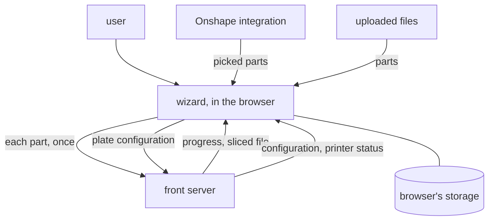

# The wizard

Nothing of the wizard is built. This guide is its design: what a user sees and does at
every step, what the code in the browser must do and how well, and what is still undecided.
It is written for the person who decides whether the wizard is being built correctly.
[README-details.md](README-details.md) holds what a builder needs beside it: the names in
the code and the record of where each rule came from.

The phases named below are those of [the plan](../docs/plans/penguin-slicer-plan.md):
phase 2, the wizard on one machine with parts from files; phase 3, the same hosted, with
Onshape sign-in; phase 4, inside Onshape; phase 5, the real printer.

A reader short of time starts at [Where to look first](#where-to-look-first), which
points at what nobody has seen drawn, at the choices this guide made by itself, and at
what is not settled. The parts of the guide, in order:

1. [What it is for](#what-it-is-for), with the terms and
   [Where to look first](#where-to-look-first)
2. [The panel as a whole](#the-panel-as-a-whole): width, header, how the panel says
   something, who writes a failure's sentences, units, retrying
3. [Signing in](#signing-in) and [The current group](#the-current-group)
4. The five steps: [Parts](#the-parts-step), [Settings](#the-settings-step),
   [Layout](#the-layout-step), [Preview](#the-preview-step), [Send](#the-send-step)
5. [The printer-status icon](#the-printer-status-icon), with pairing
6. [When a user comes back](#when-a-user-comes-back)
7. [What the browser keeps, and why it is the record](#what-the-browser-keeps-and-why-it-is-the-record)
8. [How it does the hard parts](#how-it-does-the-hard-parts)
9. [What the wizard asks of the front server](#what-the-wizard-asks-of-the-front-server)
10. [How well it must do it](#how-well-it-must-do-it)
11. [Inside Onshape's panel and outside it](#inside-onshapes-panel-and-outside-it)
12. [Accessibility](#accessibility)
13. [Security, from the browser's side](#security-from-the-browsers-side)
14. [When things go wrong](#when-things-go-wrong)
15. [How it is tested](#how-it-is-tested)
16. [Designed here and not in the mockup](#designed-here-and-not-in-the-mockup)
17. [What is to be built, by phase](#what-is-to-be-built-by-phase)
18. [What is undecided or unmeasured](#what-is-undecided-or-unmeasured)

## What it is for

The **wizard** is the code in the browser: a step-by-step user interface that takes a user
from parts to a print. The user adds parts, chooses a filament and a profile, lays the
parts out on the printer's plate, looks at the sliced result layer by layer, and sends it
to the printer or downloads it. It has five steps, in that order: the **Parts step**, the
**Settings step**, the **Layout step**, the **Preview step** and the **Send step**. It runs
in Onshape's right panel and in a browser tab of its own, from 320 px wide.

It is a component of its own because it is the only one a user touches, and because it
owns three things nothing else has.

- **The record of the user's work.** The parts, the layout and the chosen settings live in
  the browser, and nowhere on a server. Everything a server holds of a plate is a copy
  that can be made again.
- **Everything geometric a user does by hand.** Drawing a part, finding the faces it can
  lie on, choosing how it lies, arranging the plate and checking that every instance fits
  are done in the browser, with no server involved, so that dragging an instance answers
  at once.
- **Everything a user sees.** The other components report failures and progress in fixed
  shapes; the wizard decides where each appears and what stays on screen. It does not
  write the sentences of another component's failure
  ([Who writes the sentences of a failure](#who-writes-the-sentences-of-a-failure)).

What it must never hold: a secret of any kind, a sliced file of its own making, or a
decision about who the user is. It talks to one thing only, the **front server** (the
component behind the wizard's address, which signs users in, passes parts and plates to
the slice service, keeps sliced files and configurations and, from phase 5, talks to the
printer). What passes between the two is fixed by
[the contract between the wizard and the front server](../contracts/wizard-front-server.md).
From phase 4 the **Onshape integration** (the component that makes PenguinSlicer work
inside Onshape) hands the wizard the parts a user picks there; outside Onshape, parts come
from files the user uploads.

How the front server, the slice service and printer delivery fit together behind that one
address is in [the architecture](../docs/architecture.md).

### The terms this guide uses

The plan's terms hold here. The ones this guide leans on, each in a sentence:

- A **part** is one distinct solid to print. An **instance** is one placement of a part on
  the plate, labelled with its part's name and a number ("L Bracket #2"). The **plate** is
  the printer's bed and everything on it.
- The **page** is the wizard as loaded in one browser tab, or in Onshape's panel. The
  **panel** is the area the wizard draws in, whether that is Onshape's right panel or a
  browser tab.
- The **browser's storage** is the storage a browser gives a page that outlasts a refresh
  and a closed tab. It is kept for each browser and for each address the page is opened at.
- A **group** is the users who share one configuration and one printer: one Onshape company
  or classroom, or a user alone who belongs to none. The **current group** is the one
  group, of those a user belongs to, that the user is working in now.
- The **configuration** is the current group's shared settings: its filaments, each with a
  colour and its own profiles; the printer's Orca profile, which gives the plate's size and
  height; and whether uploaded files are read in inches or millimetres.
- A **profile** is one of Orca's named bundles of settings. The wizard offers the
  profiles the configuration lists for a filament, each under the group's own name, such
  as "Structural". A **change** is one setting set differently from the profile.
- A **plate configuration** is the description of what to slice: the parts, where each
  instance sits and how it is turned, the profile and the changes. A **slice job** is one
  plate configuration being sliced by the slice service. The **sliced file** is what Orca
  writes and the printer runs.
- A **delivery job** is one sliced file on its way to one printer, from Send to the end of
  its print. The **daemon** is printer delivery's program on the computer beside the
  printer (the plan calls that computer the daemon's computer); the wizard never talks to
  it, and the panel calls it "the PenguinSlicer program on the computer beside the
  printer". The **relay** is printer delivery's other half,
  which runs inside the front server, hands delivery jobs to the daemon and holds the
  printer's last status.

A user never reads the word "job". What is sliced and printed is a plate, named in words
("Plate 1, 16 instances"), never by the sliced file's generated name. So where this guide
describes what a user sees, "a slice" is a slice job, "a print" is a delivery job from the
moment the printer starts, and "a sliced plate" is a plate whose sliced file is still
kept. The wizard holds one plate at a time, and "Plate 1" is the only number a user meets
today; how a second plate is started, and what the number then counts, is undecided
([Starting a second plate](#starting-a-second-plate)).

## Where to look first

Three places hold what is the owner's to change, and they can be read without the rest.

- **The screens designed here and not in the mockup.** Nineteen screens and states have
  never been drawn; they exist only as the words of this guide. The table under
  [Designed here and not in the mockup](#designed-here-and-not-in-the-mockup) lists them
  and links to each: fourteen that are written as the design, and five that are only
  proposed.
- **The choices made in designing them.** Twelve things this guide chose that no source
  decides, each with its reason and the alternative, are in the table
  [Choices made in designing these screens](#choices-made-in-designing-these-screens).
  In the body they are written as the design; that table is where they are shown as
  choices. The smaller rules this guide proposes are listed under the table, and each
  is marked "proposed" where it stands.
- **What is undecided or unmeasured.**
  [What is undecided or unmeasured](#what-is-undecided-or-unmeasured) holds the two risks
  to try first, the Preview step's targets, the
  twelve [gaps in the design](#gaps-in-the-design), each with its options and a
  recommendation: one on which two sources disagree (whether a user may read Orca's own
  sentence about a failed slice) and eleven that no source decides (two tabs on one
  stored plate, stored work that is not tied to a user, a progress stream that cannot be
  reopened, failures in the browser that reach no log, STL files in millimetres,
  starting a second plate, a configuration that cannot be read, a print no longer
  followed, parts dropped on return, the Layout step by keyboard, and where the
  printer's name comes from), and
  [twelve smaller open items](#the-other-undecided-items), the last of which lists the
  open items of the other three guides that would change what the panel shows.

Everything else in the guide follows the mockup's accepted decisions or a decision
recorded in the plan or the architecture, except the targets this guide proposes for
speed and memory, each marked "proposed" in the table of
[How well it must do it](#how-well-it-must-do-it).

## The panel as a whole

### Width and look

The panel is fluid: it works at 320 px and lays out wider when it has more room, and
dragging Onshape's panel wider changes the layout exactly as widening a window would,
because every rule is measured on the panel and not on the window. Three widths change
the layout (480, 520 and 680 px); what changes at each is in the table at the end of this
section, [The three widths](#the-three-widths), once the things it names have been
described.

The look is PenguinCAM's light theme, so that a user of the CNC wizard meets nothing new:
a pale grey background, white cards, a blue accent, body text at 14 px, a step title at
18 px. Two departures: amber text is darker than PenguinCAM's, which is hard to read on
white, and a step tab's hover is light. The font is PenguinCAM's, which starts with the
system's own font, so the panel looks slightly different on each system; that is
accepted. The dark house style of the project's documents does not apply to the wizard.

### The header

The header is the same on every step. Its first line holds "PenguinSlicer" and, at the
right, the **printer-status icon**: a small pill with a printer, a coloured dot and a word,
which says at a glance whether the group's printer is free
([The printer-status icon](#the-printer-status-icon)). Its second line names the current
group, "Config: 6238 (Popcorn Penguins)", with a reload glyph beside it
([The current group](#the-current-group)). Below that are the step tabs.

**The step tabs.** From 480 px they are PenguinCAM's: a number, a name, and a check mark
after the name of a finished step. Below 480 px they are five small numbered circles
joined by a line, a check in each finished one, the current one filled in blue with its
name beside it, so the header stays one row and the content the user works with stays high
in the panel. Every circle is clickable, and every circle but the current one, whose name
already shows beside it, has its step's name as its tooltip ("3. Layout"). A click on a
tab goes there when every step before it allows it. When one does not, the **panel
line** says so. The panel line is one line under the tabs with two uses. Its passing use
names the step that holds a click and why ("Layout first: 23 instances are closer than
12 mm with supports on."), and goes at the user's next move or after a few seconds. Its
lasting use is the message that the server is slow or cannot be reached
([When the server is slow](#when-the-server-is-slow-or-cannot-be-reached)), which stays
until a request is answered and may hold a link or a button. When both apply the lasting
use is shown and the passing one is not (proposed: no source has the two meet), since a
user whose click was held can see why from the step itself.

**The plate summary.** The Parts step has none. From the Settings step on, two lines of
text sit under the header, the same on every step and updated at once: the parts and
instances ("1 part · 1 instance"), then the filament and the profile ("PETG ·
Structural") followed, while there are changes, by a pill that counts them ("+2 changes").
A filament or profile name too long for the line is cut with an ellipsis, never wrapped,
with the full name as its tooltip; the pill stays whole. The second line is as tall as the
pill even without it, so nothing below moves when the pill comes or goes. The summary
gives no plate area, print time or grams: the Send step states those. The pill is a button:
a click opens the **change details** joined to it, one plain line for each change
("Quality › Resolution: 0.014 mm (profile 0.012 mm)"), closed by a click elsewhere, Escape
or the pill again. A setting that has a quick change on the Settings step is named in the
quick change's words ("Others › Brim: Off (profile Auto)"), so the menu and the line
agree.

**Back and Next** sit at the bottom of every step. Next is off until the step's rules pass,
and the step says why. Back is off on the Parts step.

### How the panel tells the user something

The panel has six ways to say something, and each kind of news always uses the same one.
The screens below are written with these words.

| Way | What it is | Used for |
|---|---|---|
| **Notification** | A card at the top of a step, under the plate summary, closed with × | Something that happened and is on no row: a part that was not added, sending cancelled, work resumed. It belongs to its step and goes when the user leaves the step or as soon as it stops being true |
| **Message** | A block in the body of a step: one sentence of what happened, one of what to do, and its buttons. Red when it holds Next, amber when it is a caution, grey when it only informs, green when something was done | A problem on the plate, a slice that failed, a printer that cannot take a send, a sign-in that has ended |
| **Card** | A white bordered box that holds a state for as long as it lasts | Slicing progress, the progress of the user's print, a busy printer |
| **Joined box** | A small box that opens joined to the header element or icon it belongs to. Each has its own name, and the guide uses that name | The printer details, the change details, the group details, the colour key |
| **Line** | One short sentence in a fixed place | A consequence the user cannot see; the panel line under the tabs |
| **Confirmation** | The panel asking once more before something is lost. Proposed, since no source draws one: a small box joined to the control that was pressed, holding the question in one or two sentences and two buttons, the one that goes ahead and the one that keeps things as they are. Escape or a click elsewhere keeps things as they are | Changing the current group with changes or a slice to lose, Reset all, Stop following, Unpair |

The word **Details**, with a capital, is kept for one thing only: the folded part of a
message, which the user opens by the word "Details" to read more.

**Tooltips** are the panel's own: a small white box in the panel's font at body size, which
appears after the pointer has rested on an element for a moment, much sooner than a
browser's own tooltip (the figure is in [How well it must do it](#how-well-it-must-do-it)),
and at once when the keyboard focuses an icon or a step circle. It sits under its
element, or above it where the panel ends, and is kept at least 6 px inside the panel's
edges, so it never leaves a 320 px panel. A tooltip says only what is not on screen: an
element whose text is fully visible has none, and one whose text is cut short shows the
whole text. Only the options inside an open menu keep the browser's tooltip, because the
browser draws an open menu. Touch shows no tooltip, so nothing a user needs is said by a
tooltip alone.

### The words it uses

**No role words.** No sentence a user sees says "student", "mentor" or "team", because
PenguinSlicer is used by people who are not FRC teams. A group's own name ("6238 (Popcorn
Penguins)") is shown as the group wrote it. Nothing distinguishes one user of a group from
another, so no sentence sends the user to "an administrator".

**Little help text, generous errors.** No line sits under a step title and no instruction
under a control. A short line stays only where an action has a consequence the user cannot
see; each is named at its step. How to move things with the mouse is behind a "?" icon on
the two steps that have a 3D view. Errors get the opposite treatment: each says what went
wrong and what is specific to it (which part, what about it, where to look), and never
generic troubleshooting ("check that this computer is online") or anything of
PenguinSlicer's internals. Three messages carry more, folded under **Details**: two slice
failures and a failed print.

**Nothing is said about orientation.** After an instance is laid down, by the user or by
the wizard, nothing says how it lies now: the view shows it. What is said is a move the
wizard made that the user did not ask for.

### Who writes the sentences of a failure

Every failure is an error report: what happened in a sentence a user understands, where,
what to do next, the single action that fixes it when one does, and the underlying detail,
which is kept for the server's log and never shown. **The component that failed writes
the sentences.** This is a requirement on the boundary between components, and every
failure this guide describes follows it.

Whether one thing a user reads may be written by something other than a component of
PenguinSlicer is undecided. The accepted screens quote Orca Slicer's own sentence, with
the heights, under the folded Details of two slice failures; the slice service's guide
and the error report's contract keep Orca's words for the log and show none of them.
Both sides, what a user sees under each and a recommendation are in
[Orca's own sentence under Details](#orcas-own-sentence-under-details). Under either
answer the wizard shows the error report as it is and never reads the detail kept for
the log: if the quotation is wanted, the slice service puts it, marked as Orca's, among
what its error report holds for the user.

| The failure is | Its sentences are written by | The wizard |
|---|---|---|
| The slice service's: a part it refuses or warns about, a plate it refuses, a slice that fails, runs too long or runs out of memory, no room to wait | The slice service | Shows them as they are |
| Printer delivery's, from phase 5: a send it refuses, a print that failed or waits for a person, a wrong pairing code | Printer delivery | Shows them as they are |
| The front server's own: not signed in, a group the user is not in, a configuration that cannot be read, a sliced file that has expired | The front server | Shows them as they are |
| The Onshape integration's, from phase 4: a part Onshape cannot export | The Onshape integration | Shows them as they are |
| Something that happens in the browser: no answer from the front server, a check the page makes before sending anything (a file over the size limit, a twenty-sixth part, a plate over 150 instances), every problem of placement on the Layout step, a file the page itself cannot read, a 3D view that is lost, storage that fails | The wizard | Writes them |

"As they are" means that the wizard neither rewords a sentence nor replaces it with one
of its own made from the report's code. What the wizard adds is its own: where the report
appears (a notification, a message, a row), its colour, the button for the single action
the report names, and its own buttons for moving about (Back to Layout, Back to Parts).
Because the wizard never rewrites, a sentence that reads badly is mended in the component
that wrote it, and in its tests. Two consequences:

- A sentence written on a server cannot know whether the page is inside Onshape, so it
  says "your CAD program" or "in CAD" and never "Onshape". Only the Onshape integration's
  sentences name Onshape.
- Where this guide quotes a sentence of another component, the quotation is that
  component's wording as its own guide gives it, or an example of the kind of sentence
  expected. Where the two differ, the other component's guide wins: the remedy for a
  slice that ran out of memory is the slice service's, for example
  ([When a slice fails](#when-a-slice-fails)). The one place where this guide and
  another component's guide disagree about a sentence is Orca's sentence under Details,
  which is undecided
  ([Orca's own sentence under Details](#orcas-own-sentence-under-details)).

States that are not failures are the wizard's to put into words, from the figures it is
sent: a slice waiting behind others, a busy printer, a printer not heard from, a print
that has gone quiet. Some sentences of the slice service and of printer delivery still
say "the print server" and use the old words for people; changing them is known work in
those components, and until it is done the wizard shows what they write.

### Units

A part has **units**, inches or millimetres, and they are a label that travels with it:
the units of the Part Studio or Assembly it was picked in, or for an uploaded file the
configuration's units for uploads. The wizard never guesses units from a part's size.

| What | Shown in |
|---|---|
| A part's own size, on every step | The part's units. Inches are decimal to three places, as a machinist reads a drawing ("2.000 × 2.000 × 0.188 in"); millimetres to 0.1 mm |
| Printer and plate figures: the plate's size, the height limit, the spacing between instances, distances between instances, a height above the plate, the layer readout | Always millimetres, as the printer's maker gives them: heights and the spacing to 1 mm, distances between instances to 0.1 mm |
| A comparison of a part's figure with a printer's | Millimetres for both, with the part's own units in brackets when they are inches ("stands 352.7 mm (13.885 in) tall; the printer prints up to 340 mm") |
| Slicing settings, and Orca's own sentence if it is quoted under Details on a failed slice ([undecided](#orcas-own-sentence-under-details)) | Always millimetres, as in Orca and in the profiles |

A size is rounded once, from the exact millimetres, in the unit shown, so a part has one
size on every step. A size is never cut short: in a narrow panel it wraps.

### When the server is slow or cannot be reached

The project is deployed continuously, so the front server restarts at any time of day
while people are working, and a request can fall in the gap. The page therefore retries
every request it makes, and a user sees a pause, not an error.

| Time since a request first failed | What the user sees |
|---|---|
| Up to 20 seconds | Nothing, except on the thing that is waiting: a part's row says "Taking longer than usual; still trying…" after 4 seconds |
| 20 to 300 seconds | The panel line, in amber: "The server is being slow. Your browser is retrying in 28 s.", counting down to the next attempt, with a link, "Retry now" |
| After 300 seconds | The panel line, in red: "The server could not be reached.", with one button, **Try again**, which starts the 300 seconds afresh |

These sentences are the wizard's own, since no component answered to write one, and "the
server" in them is the front server, the only server a user's browser knows. The waits
between attempts grow (proposed: doubling from one second to thirty), so there is
something to count down and a struggling front server is not hammered. The message is on
the panel line and not a notification because it concerns the whole panel and must stay
as the user moves between steps; it goes the moment a request is answered. Throughout,
nothing of the user's work is dropped: the parts, the layout and the settings are in the
browser's storage, a part whose upload stopped keeps its row, and everything that needs
no server (laying out the plate, changing settings) goes on working. These times cover
every request a user waits on: adding a part, submitting a plate, fetching a sliced file,
sending, cancelling.

A dropped **progress stream** (the connection on which the page follows a slice or a
print as it happens) is treated differently at first: the page reopens it silently,
because progress streams are closed routinely, by the hosts' time limits and at every
restart of the front server. What the page does when a progress stream cannot be reopened
is decided by no source and is undecided; proposed, a stream that has failed to reopen
for 20 seconds is treated as a failed request, with the same panel line
([A progress stream that cannot be reopened](#a-progress-stream-that-cannot-be-reopened)).

One case is known in which a deploy shows this message for minutes. A user who submits a
plate while the slice service is finishing another user's slice before stopping sees "The
server is being slow" until that slice has ended and the replacement has started, which is
at most the slice service's time limit of 240 seconds plus the replacement's start; past
300 seconds they see "The server could not be reached" and must press Try again. Their
plate is kept either way. Whether that is acceptable is undecided in
[the slice service's guide](../slice/README.md#what-a-user-sees-while-the-slice-service-stops),
which owns the item. Its recommendation is that the front server keeps such a submission
and hands it to the new slice service; the user would then see the slicing card waiting,
with a stage line that says the slicer is restarting, and never this message.

### The three widths

Each width includes itself, and each row names things described above or in the steps
below.

| From | What changes |
|---|---|
| 480 px | The step circles become named tabs. On the Settings step the Filament and Profile menus sit side by side and the quick changes (four menus for the commonest settings) two to a row. Advanced mode, the view of every setting, shows its five sections as a column of names down the left |
| 520 px | The figures of a print on the Send step (percent, layer, time left) sit in one row. The 3D views of the Layout and Preview steps become 4:3 instead of square |
| 680 px | The Parts step's list of parts has two columns, and the Send step has two columns |

## Signing in

Every user signs in with Onshape, in Onshape's panel and outside it alike; PenguinSlicer
has no accounts or passwords of its own. On one machine (phase 2) there is no sign-in at
all: the front server signs in a fixed made-up user and group, and the wizard opens
straight on its first step. From phase 3:

**Opening the wizard when not signed in.** The front server sends the browser to Onshape,
which asks the user to sign in if they are not, and, the first time, to allow PenguinSlicer
to read who they are and which companies and classrooms they belong to. Onshape then sends
the browser back and the wizard opens. A user already signed in to Onshape who has allowed
PenguinSlicer before sees no screen at all between asking for the wizard and getting it.
PenguinSlicer shows no sign-in page of its own on the way in.

**A sign-in that failed.** If the user refuses Onshape's request, or Onshape does not
answer, the browser lands on a plain page with the header's first line and no step tabs,
no group and no printer-status icon, and one message. The failure is the front server's,
so the sentences are the front server's, of this kind: "PenguinSlicer could not sign you
in with Onshape.", then what is specific, "You did not allow PenguinSlicer to read your
Onshape account. It reads only your name and the companies and classrooms you belong to."
or "Onshape did not answer." One button: **Sign in with Onshape**.

**A sign-in that has run out.** A sign-in lasts thirty days. It can also end early for
everyone at once, when the key that protects it is replaced in an emergency. Either way
the page learns it when the front server refuses a request as not signed in. The step's
content is then replaced by one grey message, with the front server's sentences, of this
kind: "Your sign-in has ended. Sign in with Onshape to go on. Your parts, layout and
settings are kept in this browser.", and one button, **Sign in with Onshape**. The header
stays; from phase 5 its printer-status icon shows a grey dot and "…", as for a printer
not heard from yet, since the page can no longer ask. The button takes the same trip to
Onshape and back, and the wizard reopens on the step the user was on, with the plate as it
was. The page does not leave for Onshape by itself: a user in the middle of dragging an
instance would lose their place without knowing why. Nothing is lost by waiting, because
the work is in the browser's storage and the front server holds no session to expire.
The stored work is not tied to the user who made it, so a different person who signs in
on this screen would be shown the last user's parts; that is a gap in the design and is
undecided ([Stored work is not tied to a user](#stored-work-is-not-tied-to-a-user)).

**A browser that is not supported.** Chrome is proposed as the supported browser and
Safari is not supported ([Browsers](#inside-onshapes-panel-and-outside-it)). What a user
of Safari is shown is the front server's to serve, since the wizard's code cannot be
relied on there; proposed in [the front server's guide](../front/README.md#signing-in):
a plain page saying that PenguinSlicer needs Chrome.

## The current group

The header's second line names the current group: "Config: 6238 (Popcorn Penguins)", by
the name of the Onshape company or classroom, or by the user's own name for a user who
belongs to none. The name is a button. A click opens the **group details** joined to it,
as the printer details are joined to their icon:

- the groups the user belongs to, one to a row, the current one checked; a click on
  another makes it the current group;
- "Signed in as Alex Chen";
- a link, **Sign in again**, with one line under it: "Reads your Onshape companies and
  classrooms again."

A click elsewhere, Escape or the name again closes them. A user in one group sees one row
and has nothing to choose, but still has Sign in again, which is for exactly that user:
until the Onshape app is public, a user's groups are read from Onshape only at sign-in
(after that they are read again once a day), so someone added to an Onshape company after
signing in does not see it until they use this link. It costs two of PenguinSlicer's
calls to Onshape, of a yearly allowance, which is why it is a link the user chooses and
not something the page does by itself. Nothing yet limits how often one user may use it,
which [the front server's guide](../front/README.md#sign-ins-and-the-allowance) lists as
undecided. It takes the trip to Onshape and back and returns to the same step with the
group details open, so the user sees the new list. Sign in again lives inside the group
details and not on the header line itself so that the line stays one row at 320 px.

**Changing the current group** changes the configuration and the printer, so it clears
what belonged to the old ones: the filament and profile become the new group's first, the
changes are cleared, a slice still waiting or running is cancelled, and the plate must be
sliced again. The parts and the layout stay, and the Layout step checks them against the
new printer's plate. When there are changes or a slice to lose, the wizard asks first, in
a confirmation: "Change to FRC 1678? Your 2 changes and this plate's slice are cleared.
Your parts and layout are kept." A plate already sent goes on printing at its own
printer, and the printer-status icon now shows the new group's printer. Changing back
shows the earlier print again in the printer-status icon and the printer details, as any
user of that group sees it, and the last-print note when it finishes; it does not bring
back the print card with Send enabled, because the sliced plate that was sent was cleared
at the change. The choice of group is kept in the browser's storage until the user
changes it.

**A group the user no longer belongs to.** If the front server refuses the stored group
(the user left that company and has signed in again since), the page takes the first of
the user's groups and says so in a notification: the front server's sentence that the
user is not in that group ("You are no longer in 6238 (Popcorn Penguins)."), then the
wizard's own of what it did, "PenguinSlicer now uses FRC 1678's configuration and
printer." The group details then offer the user's other groups and Sign in again, which
is the remedy the front server's sentence names.

**The reload glyph** reads the configuration again from the front server, for a user who
has been told that a filament or a profile was added. If the chosen filament or profile is
gone from the new configuration, the first one takes its place and a notification says
which. The configuration cannot be edited from the wizard: its edit screens are a feature
of their own, in no phase yet, and until they exist a group uses the built-in default or
a document the owner writes by hand. A group that has no configuration
gets the built-in default, so a new group can slice without setting anything up.

**A configuration that cannot be read.** A configuration that exists but is damaged is
never replaced by the default, so that a hand-written document is not lost to a typing
mistake: the front server reports it, and the group cannot slice until the document is
mended. What the wizard shows then, and where, is designed in no source and is undecided;
proposed, a red message in place of the step's content with the front server's sentence,
which sends the user to whoever wrote the configuration and names no "administrator", and
the reload glyph as its one control
([A configuration that cannot be read](#a-configuration-that-cannot-be-read)).

## The Parts step

The wizard opens here. The step is the list of parts to print, each with a quantity.

**Adding a part inside Onshape** (phase 4). A prompt above the list says "Click a part in
the Part Studio", or "Click a part in the assembly", and never changes. A click on a part
in Onshape adds it with quantity 1; a click on a part already in the list raises its
quantity by one and flashes its row, so a user who wants four clicks four times. In an
Assembly a click on an instance, in Onshape's list or in its graphics area, adds that
instance's part. There is no button that adds every part of an assembly.

**Adding a part outside Onshape** (phase 2). An upload area takes binary STL files,
dropped or chosen. One line under it says how they will be read, because an STL file
carries no units: "STL files are read in inches." (or "in millimetres.", as the
configuration says). A metric file uploaded where the configuration says inches arrives
25.4 times too large. The slice service checks each part with its units when it is added,
so such a file is usually refused on this step as too large for the printer; one that
passes fails the height or plate checks on the Layout step. The configuration's one
option is the only control, and a row has no switch of its own. Since no user can edit a
configuration until its edit screens exist, a group on the built-in default cannot use an
STL file in millimetres at all; what to do about that meanwhile is undecided
([STL files in millimetres before the edit screens exist](#stl-files-in-millimetres-before-the-edit-screens-exist)).

**Clearing the plate.** The wizard holds one plate. A user who has printed it and wants
another removes the rows by hand; nothing else starts a new plate, and how a second plate
should be started is undecided ([Starting a second plate](#starting-a-second-plate)).

**A row** shows the part's picture, name, size in its own units, quantity and a remove
button. There is no refresh button on a row: a part changed in Onshape is removed and
clicked again. While a part is arriving its row shows a thin progress bar and "Arriving
from Onshape…" (or "Uploading…"). The bar shows that something is happening and promises
no duration: how long Onshape takes to export a part is unknown until phase 4. A part
still arriving never holds Next. If it arrives
after the user has moved on, it joins the plate on the Layout step, at once if the user is
there and otherwise the next time that step is shown, and a notification on the step the
user is on says so ("Gusset Plate arrived after you left the Parts step. It joins the
plate when you go back to the Layout step.").

Under the list one line counts what the plate holds, and how many parts are still
arriving.

### A part that cannot be used

Each part is checked by the slice service the moment it is added, before anything is laid
out, so a part that cannot be sliced is found on this step and not after a layout has been
made around it. A part that cannot be used is a notification that names it, and it is not
added; the list never holds a broken row. The notification's sentences are those of the
component that refused the part
([Who writes the sentences of a failure](#who-writes-the-sentences-of-a-failure)); the
wizard adds "Your other parts are fine." only while the list holds other parts. A second
failure of the same part replaces its notification.

| What happened | Whose sentences | The notification says | Then |
|---|---|---|---|
| Onshape cannot export the part (phase 4) | The Onshape integration's | That Onshape could not export the part, so it was not added ("Onshape could not export Shooter Hood Rib, so it was not added."), and what to check in Onshape: that it is one closed solid, not a surface and not several bodies, and that the Part Studio rebuilds with no red features | Next stays as it was. There is no Try again: the part is broken until it is mended in Onshape |
| The file cannot be read as a part: it is empty, cut off or padded, or is not an STL at all (a picture, a zip or a 3MF saved under that name) | The slice service's | That the file could not be read as a part, naming it, and to export it again | The same |
| The file is a text STL | The slice service's | That a binary STL is needed, naming the file: an STL file can be written as text or as binary, and the slice service reads only the binary kind, whose length it can check exactly. The remedy is to export the part again as a binary STL | The same |
| The slice service's check refuses the part: too small or flat, nothing to print, or too large for the printer | The slice service's | Which part and what is wrong with it. For an uploaded file refused as too large, the notification is followed by the wizard's own reminder of how STL files are read ("STL files are read in inches."), since a file in millimetres read as inches is the likeliest cause | The same |
| The part is over the size limit | The wizard's, since the page checks before sending | See [The limits on a plate](#the-limits-on-a-plate) | The same |

A part the slice service copes with but warns about is added, and the warning stays on its
row, in amber, without holding Next. The warning's sentences are the slice service's. The
commonest is a part that is not watertight, for which the sentence expected is of this
kind: "Gusset Plate is not watertight: its mesh has 14 open edges in 2 places. It may
still slice and print. If the slice fails, look in your CAD program for faces that do not
meet, then add the repaired part again." Another is a part with every side under 5 mm,
which the slice service warns may be a file in inches read as millimetres.

The page also reads each file itself, to draw it. A file the page cannot read is, in
almost every case, one the slice service refuses, and the slice service's notification is
the one shown. If the slice service accepts a part that the page cannot draw, that is a
defect in the wizard. Proposed, since no source has the case: the part is not added, the
wizard's own notification says that PenguinSlicer could not show the part and that the
fault is PenguinSlicer's, and the failure reaches the server's log, which nothing yet
provides for
([Failures in the browser that reach no log](#failures-in-the-browser-that-reach-no-log)).

A part whose upload gets no answer is not refused. Its row stays, because the part is
already in the browser's storage, and the page retries as
[When the server is slow](#when-the-server-is-slow-or-cannot-be-reached) describes: the row
says "Taking longer than usual; still trying…" after 4 seconds, and if the retries stop
after 300 seconds the row keeps the part and shares the panel line's Try again.

### The limits on a plate

Three limits bound a plate, and the Parts step is where a user meets each. All three are
the slice service's limits. The page checks each one itself before sending anything, so
these sentences are the wizard's; should the slice service refuse all the same, its own
sentence is shown.

| Limit | What it protects | What the user sees |
|---|---|---|
| A part is at most 7.5 MB, which is 150,000 triangles | The slice service's memory and time for one part, and the size of one upload | A notification, and the part is not added: "bracket.stl is 9.1 MB. PenguinSlicer takes parts up to 7.5 MB (150,000 triangles), so it was not added. Export it again from your CAD program at a coarser resolution." The page checks the size before uploading, so nothing is sent |
| A plate uses at most 25 different parts | The most the slice service keeps for one user, so one user cannot fill its disk | The twenty-sixth is not added, and a notification says "A plate takes up to 25 different parts, so Gusset Plate was not added. Remove a part, or print it on a second plate." Raising the quantity of a part already in the list still works |
| A plate holds at most 150 instances | The slice service's limit on placements | One part's quantity cannot be typed or clicked past 150. When the parts together pass it, a red message under the list says "This plate would hold 163 instances. Up to 150 instances per plate; print the rest on a second plate.", and Next is off |

"A second plate" in these sentences means the same plate emptied and filled again after
this one is printed ([Starting a second plate](#starting-a-second-plate)).

For a part picked in Onshape that comes out over 7.5 MB, the notification names the part
and says it is too detailed to slice here. Whether the Onshape integration then exports it
again more coarsely by itself is for phase 4's design.

## The Settings step

The step is for the common case, which must stay short: most prints use one filament and
one of a few profiles. It has two menus, four quick changes and one button.

**Filament and Profile.** The Filament menu offers the configuration's filaments, each
with its colour beside its name, so that two filaments of one material (a red PLA and a
green PLA) can be told apart. The Profile menu offers the chosen filament's own profiles,
under the group's own names ("Structural", "Pulley", "Camera mount", "Draft", "Fine");
Orca's own profile names are not names a group would choose and say nothing of what a
profile is for. A profile's purpose is its option's tooltip, not a line under the menu.
Picking another filament picks that filament's first profile. There is no printer row:
the printer-status icon already names the printer.

**The quick changes** are four menus for the settings most often changed for one print:
Infill, Walls, Supports and Brim. They sit one to a row below 480 px and two to a row from
there. A quick change is a change like any other: it and advanced mode edit one shared set
of changes.

**Changing the filament or the profile clears every change,** because a change is a
departure from one profile and means nothing against another. From the first change until
they are cleared, one line under the Profile menu warns of it: "⚠ Changing the filament or
the profile clears your 2 changes." Nothing is said after they are cleared.

**The Advanced mode button** stands alone under the quick changes while nothing is
changed. Once a setting is changed, the **changes box** takes its place: a yellow box
headed "2 settings changed from Structural", one line for each change, and the Advanced
mode button. Each line is a link that opens advanced mode at that setting, with its
section and setting group open, the setting scrolled into sight and flashed. The box has
no "Reset all"; that lives in advanced mode.

### Advanced mode

Advanced mode is the view that keeps every slicing setting reachable. It fills the panel.
It offers every setting of Orca's that is a parameter with a value (a choice from a list,
a number, a piece of text): all of Orca's about 295 settings, less the programmatic ones.
Settings that run a program, name a file on the slice service's machine or hold custom
G-code are not shown, and the slice service refuses them, since they would let a user run
something on that machine.

**Its header** repeats "PenguinSlicer" with the printer-status icon, then says "Advanced
mode", the profile and how many settings are changed ("Structural, 2 changed"), and
**Reset all**, which asks in a confirmation before putting every setting back. **Back to
Settings** at the bottom is the only way out; Escape does not close advanced mode, so a
stray key cannot throw the user out of a long list.

**The settings are in five sections,** as in Orca (Quality, Strength, Speed, Support,
Others), and each section's settings are in collapsible **setting groups** such as
Precision. There is no search box, no switch between common and all settings and no
"changed only" filter: the changes box, the change details and the changed counts already
find a changed setting.

| Width | How the sections are shown |
|---|---|
| Below 480 px | An accordion of cards: each section is a bordered card whose heading has a chevron and its changed count ("Strength · 1 changed"); its setting groups are rows inside the card. Each card opens and closes by itself |
| From 480 px | A rail of section names down the left, a changed count on each, with the chosen section's setting groups beside it |

The setting groups are always one column, at most 480 px wide, so a value stays near its
name. A setting group's heading has a chevron and no count of its settings, only a changed
count when it has changes ("Precision · 1 changed"). One icon button, a double chevron,
expands or collapses every setting group of a section.

**Everything starts open,** every section and every setting group, the first time advanced
mode is shown, and advanced mode remembers what the user closes for as long as the page is
loaded: across steps, across closing and reopening advanced mode, and as the panel is
dragged across 480 px either way. A reload forgets it, and everything is open again.

**A changed setting** has a tinted background, a bar on its left and a dot after its name.
The line under it gives the profile's value and a link that puts it back: "Profile 0.012
mm · Reset". A value outside a setting's allowed range is refused where it is typed.

**By keyboard,** opening advanced mode puts focus on the first section's heading, or on
the setting when a line of the changes box opened it; what advanced mode covers cannot be
reached; and closing it returns focus to the line or button that opened it.

Changes are part of the user's work: they are kept in the browser's storage and come back
after a refresh.

## The Layout step

The step is for placing every instance on the plate, lying the way it should print. It is
a 3D view of the plate that the user works in directly: there are no modes and no tools to
pick up. The view fills the panel's width and grows as the panel is widened, square at
narrow widths and 4:3 from 520 px, with no cap on its height.

The step does not change the list of parts. There is no duplicate, delete, undo or redo
here, and their usual keys do nothing; how many of a part there are is the Parts step's
business. It has no scale, cut or mirror tools and no settings for one part alone.

### What is on the step

From top to bottom:

- **A toolbar** with two buttons, **Arrange** and **Auto-orient**, and at its right a "?"
  icon that opens the list of gestures in a small panel.
- **The status line,** just above the view: green when every instance fits ("✓ All 16
  instances fit the plate."), red with the first problem when not, with "+2 more ↓" when
  there are others. A click on a red status line scrolls to the full messages.
- **The view,** with view buttons in a corner (Zoom to instances, Whole plate, Top) and,
  at its bottom left, the **pointer line**: one line at 11 px, the one text in the panel
  below the body size, that says what is under the pointer (an instance's name, "Lay it on
  this face: 0.250 in tall", "Drag to turn · Shift: 45° steps").
- **The selection line** under the view: with nothing selected, "90 instances on the
  plate, 10 beside it."; with one instance selected, its name, footprint and height in its
  part's units; with several, "5 instances move and turn together". Beside it, one link at
  most: "Lay it the best way" when the selection does not lie its best way, "Put back as
  modelled" when it has been laid down differently from the model, and nothing when it
  lies as modelled and that is its best way.
- **One line of printer and plate figures:** "Shop H2S: plate 340 × 320 mm, up to 340 mm
  tall, 12 mm apart". It is kept because nothing else on the panel gives the plate's size,
  the height limit or the spacing. The size and height come from the printer's Orca
  profile named in the configuration, the same profile the slice service slices for.
- **The messages:** anything the wizard moved, and under "Fix these 2 before Next:" one red
  message for each problem, each with the button that fixes it. A message about a move
  the wizard made, and Arrange's "Arranged 16 instances.", goes when the user leaves the
  Layout step; a problem stays until it is fixed. Every sentence on this step is the
  wizard's own, since everything here happens in the browser.

### Moving, turning and looking

The mouse works as it does in Onshape, since that is where the user's hand has just been:
drag an instance to move it; right-drag to look around; Shift-drag, middle-drag or Ctrl
with a right-drag to slide the view; scroll to zoom. A left-drag on empty plate also looks
around. Shift-click or Ctrl-click adds an instance to the selection, and dragging one of a
selection moves them all. F zooms to the instances, Ctrl+1 looks from above, Ctrl+A
selects every instance and Escape clears the selection.

**The rotation handle** is a round handle beside the selection that turns it about the
vertical. It is bound to the instance: while dragged it stays on a circle round the
selection and turns through the same angle, so the two never part and the handle never
hops to another side. Turning is free, and a small readout beside the handle shows the
instance's orientation on the plate while dragging ("↺ 37°"). Holding Shift snaps that
orientation to multiples of 45°, as CAD programs do, so an instance left at an odd angle
can be squared again. The handle is drawn over everything, and it moves out of the way of
the face patches described next, but only while it is not being dragged.

### Laying an instance on a face

Selecting one instance is all it takes: translucent blue rounded patches appear on the
faces it could lie on, and a click on a patch lays the instance down on that face. A
double-click on a flat face does the same. There is no button for it and no mode. With two
or more instances selected no patches show.

Two kinds of patch are offered. **Hull patches** lie on the flat faces of the part's
convex hull, the shape a rubber skin stretched over the part would take, because those
are the only faces a rigid part can rest on. **Bounding-box patches** lie on a side of the
part's bounding box where no hull patch points that way, which is what lets a pulley be
stood on its rim. How both are found is in
[Finding the faces a part can lie on](#finding-the-faces-a-part-can-lie-on). Only the
patches in sight are drawn and can be clicked; the face the instance already lies on has
none; a patch brightens under the pointer, and the pointer line says what laying it there
would give ("Lay it on this side: 1.732 in tall").

**Laying an instance down never moves another instance.** If the instance no longer fits
where it stood, it moves to the nearest free spot, turned if need be, and a green message
says so: "L Bracket #1 no longer fitted where it stood, so it was moved to the nearest
free spot." If there is no free spot it waits beside the plate, marked as off the plate,
and an amber message says "L Bracket #1 no longer fits on the plate and waits beside it.
No spot on the plate is free for it lying this way. The other instances stay where you put
them; press Arrange to make room." It waits there already turned to fit the plate if it
is too long for the plate as it lay, so that Arrange, which never turns an instance, can
place it.

### Parts arrive lying their best way

A new part's instances are laid down automatically the way the wizard judges best for
printing, and nothing is said about it. Most parts are modelled the way they sit on a
robot, which is rarely the way they print, so "as modelled" would make nearly every user
lay nearly every part down by hand. **Auto-orient** does the same on request, for the
selected instances or for every instance when none is selected. If the plate then needs
rearranging, the wizard does it and says "Arranged the plate again to make room."

### Arrange

**Arrange** places every instance on the plate, in a compact pile about the plate's
middle, at the spacing the settings ask for, and says "Arranged 16 instances." It never
turns an instance: each keeps the orientation it was given, by lay on face, by the
rotation handle or by the wizard. A user who has turned an instance to 37° on purpose
finds it still at 37° after Arrange.

Arrange and Auto-orient stay two buttons, since one moves and the other turns. But when
Arrange cannot fit everything and laying instances their best way would fit more, its
message offers that as one button: "Arrange placed 12 of 16 instances; 4 instances do not
fit and wait beside the plate. Arrange keeps how each instance lies. With 5 instances laid
the best way, everything would fit. Or lower the quantities and print the rest on a second
plate.", with **Lay them the best way: all fit**.

The wizard turns an instance about the vertical only when it has just laid it down itself
and it is then too long for the plate. It is turned a quarter, an eighth or three eighths
of a turn, the first that fits. There are four such moments:

- a part that arrives too long for the plate as it lies, before it is first arranged;
- an instance that Auto-orient lays down and that is then too long;
- an instance that a lay-down leaves beside the plate, which waits turned so that Arrange
  can place it;
- an instance moved to the nearest free spot after a lay-down, which may be turned to fit
  that spot.

A 353 mm rib on a 340 × 320 mm plate fits only on the diagonal, and a user should not
have to discover that.

### The placement rules, and what each problem says

The Layout step applies the slice service's own placement rules, so that a plate the
wizard passes is a plate the slice service accepts. Every instance must sit at least 3 mm
inside the plate's edge, stand no taller than the printer prints, and keep its distance
from every other instance: 12 mm with supports on and 5 mm with them off, measured between
the instances' outlines as they are turned. Next is off while any rule is broken.

| Problem | The message | Its button |
|---|---|---|
| Two instances too close | "L Bracket #1 and Gusset Plate #2 are 6.2 mm apart; instances need 12 mm between them with supports on. Drag one away, or press Arrange." | Arrange |
| Many instances too close | One message for all of them: "23 instances are closer than 12 mm with supports on. Press Arrange, or drag them apart." Each stays marked in the view | Arrange |
| An instance across the plate's edge | "Gusset Plate #3 is not fully on the plate: it crosses the left edge. Drag it inward, or press Arrange." | Arrange |
| An instance longer or wider than the plate takes, as it is turned (the user squared it with the rotation handle, say) | "Shooter Hood Rib #1 is 352.7 mm (13.885 in) from left to right as it is turned; the plate takes 334 mm. Turn it to fit turns it and arranges the plate again." Where such an instance still stands on the plate, the message opens with "not fully on the plate" and goes on with the same sentences | **Turn it to fit**, in place of Arrange, since Arrange never turns. It turns the instance as on arrival and arranges again |
| A part that fits the plate at no turn | The same first sentence, then "Lay it down another way." | None |
| An instance too tall | "Shooter Hood Rib #1 stands 352.7 mm (13.885 in) tall; the printer prints up to 340 mm. Lay it down another way, or press Auto-orient." | Auto-orient |

An instance that Arrange left beside the plate gets no message of its own; Arrange's
message already counts it. The exception is an instance too long or too wide for the plate
as it is turned: it has its own message, the row above, and Arrange's message does not
count it. A click on a message selects the instances it names.

**Turning supports on after arranging moves nothing.** The spacing follows the Settings
step, so instances that were 5 mm apart are now too close, and they get the usual message
until the user presses Arrange or drags them. The wizard does not rearrange a plate behind
the user's back.

## The Preview step

The step is for looking at what will actually be printed. Entering it slices the plate;
when the slice is done it shows the result, which the user inspects layer by layer before
sending anything to a printer.

### Slicing

Entering the Preview step submits the plate. While it slices, the step shows the **slicing
card**: a ring gauge with the percentage, the stage in words, the time taken and the time
expected to be left, a bar, the list of stages with the current one marked, a **Cancel
slice** button, and one line: "Slicing goes on if you step back; change the plate and it
starts again." The stages and the percentage are Orca's own, passed through; nothing is
invented. The time expected is the slice service's estimate and is good only to about a
factor of two, so the card says "about" before it.

**A slice goes on without its page.** Leaving the step, refreshing, losing the network or
closing a laptop lid leaves the slice running in the slice service, and coming back with the same
plate finds it still going or finished. A changed plate (a part moved, a setting changed)
cancels it and starts a new one. Coming back to a plate that is already sliced shows the
result without slicing again. Leaving does not stop the slice because the commonest reason
to leave is to look at something and come back, and a slice thrown away is a wait repeated.

| State of the slicing card | What the user sees |
|---|---|
| Waiting behind other slices | The ring is empty and the stage line reads "Waiting for the slicer: 2 slices ahead of yours." (or "1 slice ahead of yours."), updated as the number falls. The time waited counts up; no time left is shown, since none is known. Cancel slice works |
| Slicing | The ring, the stage and the times, as above |
| The front server cannot be reached | The figures stop, the time-left line says "no news since 0:41", and Cancel slice is off, with one line: "Cancel slice is off until the server can be reached again; the slice may still be running." When this state begins for a page that is only following progress is undecided; proposed, when the progress stream has failed to reopen for 20 seconds ([A progress stream that cannot be reopened](#a-progress-stream-that-cannot-be-reopened)) |
| Reconnected | One line on the card: "Reconnected at 1:05. The slice kept running; the progress below is up to date." |
| The slice service restarted | The ring and the stages go back to the start, and one line on the card says "The slicer restarted, so this slice began again." The page has sent the parts and the plate again by itself; the user did nothing. The same holds for a slice that was still waiting when the slice service was asked to stop for a deploy: the slice service cancels it, saying why, and the page submits it again by itself |
| Cancelled by the user | A grey message: "Slice cancelled at 0:23, during “Generating walls”. Nothing was saved or sent to the printer.", with **Slice again** and Back to Layout |

**No room to wait.** The slice service runs one slice at a time and lets two more wait.
When a fourth arrives it is refused, and the step shows an amber message in place of the
slicing card, with the slice service's sentence ("The slicer is busy, try again in a
minute."), the wizard's own line "Your plate is unchanged.", and **Slice again**. The
page does not try again by itself, since a silent queue outside the slice service's own
would hide how busy it is from the person waiting. The message is amber and not red
because nothing is wrong with the plate.

**Stopped by a slice from another tab.** A user has one unfinished slice at a time: a
second one, started in another tab or in a tab beside Onshape's panel, cancels the first.
The page whose slice was cancelled shows a grey message in place of the slicing card:
"This slice was stopped because you started another one in another tab or window.
PenguinSlicer slices one plate at a time for each user.", with **Slice again** and Back to
Layout. It does not slice again by itself: if it did, two open pages would cancel each
other in turn for ever. Two tabs opened directly at the wizard's address also share one
browser's storage, and so one stored plate; what a second tab does about that is designed
nowhere and is undecided
([Two tabs on one stored plate](#two-tabs-on-one-stored-plate)).

### When a slice fails

A failed slice is a red message in place of the slicing card: one sentence of what
happened and one of what to do, with its buttons. The failure is the slice service's, so
both sentences are the slice service's and the wizard shows them as they are
([Who writes the sentences of a failure](#who-writes-the-sentences-of-a-failure)). The
wizard's part is the buttons: the one for the single action the error report names, when
it names one; **Slice again** when the report says the same plate may succeed unchanged;
and its own Back to Layout or Back to Parts, whichever step holds the remedy. Two
failures carry folded Details: a part with empty layers while supports are off, and the
same finding with supports already on, which is a fault in the part's mesh. The Details
of both hold the slice service's sentence of where to look on the part. Whether they
also hold Orca Slicer's own sentence with the heights, quoted and marked as Orca's, is
undecided: the accepted screens show it, and the slice service's guide and the error
report's contract keep Orca's words for the log and show none of them
([Orca's own sentence under Details](#orcas-own-sentence-under-details)). The table
below is written with the quotation. Nothing else of Orca's output is shown, on these
failures or on any other.

| Failure | What the slice service's sentences say | The wizard's buttons |
|---|---|---|
| The plate is not acceptable to the slice service, although the Layout step passed it | Which instance is off the plate or too tall, or which two instances are closer than the spacing. This is a disagreement between the wizard's placement check and the slice service's, and so a defect in one of them | Back to Layout |
| A part has a gap with nothing under it (empty layers) | Which instance, and between which heights above the plate nothing would be printed; with supports off, to turn supports on, which is the single action; with supports already on, that the part itself must be repaired in CAD and added again. An example of the kind: "Gusset Plate #2 has empty layers at about 12.4 mm above the plate." Details, in both cases: where to look on the part and, if the undecided item is answered that way, Orca's own sentence with the heights | With supports off: **Turn on Supports and slice again**; Back to Layout. With supports on: Back to Parts |
| A profile or setting is not accepted by the slice service | To choose from the lists. The page offers only what the configuration and the list of settings hold, so this is a configuration that names a profile the slice service does not have, or a disagreement between the wizard's list of settings and the slice service's | Proposed, since no source has the row: Back to Settings |
| Two instances' paths would meet | Which two, and that supports are the likely cause when they are on; to spread them out, turn supports off or use a second plate | Back to Layout |
| Nothing printable was found | That no layers were found, or that the print is empty, naming the part when the plate has one; to repair the part in CAD or check its size | Back to Parts |
| Too slow: the slice passed the slice service's time limit, today 240 seconds | "The slicer took too long on this plate.", and the remedies: fewer instances or a second plate | **Slice again**, since the slice service may only have been busy; Back to Parts |
| Out of memory: the slice passed the most memory the slice service allows one plate | "This plate is too large to slice: the slicer needed more than the 2,000 MB of memory the print server allows." ("the print server" is the slice service's old word for itself.) The remedy is the slice service's: fewer instances or a second plate; for a single instance, to split or simplify the part | Back to Parts. Slice again is not offered, because the same plate would run out of memory the same way |
| Orca failed with only a general reason | "The slicer could not slice this plate.", with Orca's warnings added and labelled as possibly unrelated | **Slice again**; Back to Layout |
| Orca crashed or was stopped, its sliced file is missing or damaged, or the slice service itself failed | That the slicer crashed, was stopped, or failed unexpectedly, or that the sliced file is damaged or missing | **Slice again**; Back to Layout |

The full list of the slice service's failures and their sentences is in
[the slice service's guide](../slice/README.md#when-things-go-wrong); the wizard treats
one it does not know like the last row. There is no "plate too large" refusal before
slicing: nothing caps a plate's volume, and a plate too heavy to slice ends as out of
memory or too slow.

**Turn on Supports and slice again** checks the plate first, because supports need 12 mm
between instances where the plate may have been arranged at 5 mm. A plate that passes is
sliced. One that does not is not sliced: the wizard goes to the Layout step, which says
"Not sliced: with Supports on, instances need 12 mm between them." above the usual
message. Nothing moves by itself.

### The result

When the slice is done the step shows:

- **Print time and filament,** the two numbers a user plans around, large ("3 h 12 min",
  "84 g PETG"). They are Orca's own figures from the sliced file's summary.
- **One quiet line:** the instances, the layers and how long the slice took.
- **Warnings** the slice service reported with the sliced file, if any, in amber.
- **The layer preview:** a 3D view of the sliced plate with a layer bar at its right. The
  bar chooses the top layer shown; its readout under the view gives the layer and its
  height above the plate ("134 / 134 · 40.2 mm", one line even at 320 px). The bar moves
  with the arrow keys and reports its layer to a screen reader, and two small buttons step
  one layer down or up. **Reset view** puts the camera back, and a "?" icon beside it says
  how to move: "Drag to turn, right-drag to pan, scroll to zoom; drag the bar on the right
  to go through the layers."

The right mouse button therefore means different things in the two 3D views: on the
Layout step a right-drag looks around, as in Onshape, because a left-drag there moves an
instance; on the Preview step nothing can be moved, so a left-drag turns the view and a
right-drag slides it. Both are as the mockup has them, and the difference is kept. Making
the Preview step follow Onshape too would be a change to an accepted screen.

Next goes to the Send step once the plate is sliced.

**What the layer preview must look like.** It shows the toolpaths of the sliced file
itself, so what the user inspects is what the printer will run.

- **Four fixed colours,** one for each group of line types, whatever the filament. They
  are not Orca's colours, which a user of PenguinSlicer will not know, and not the
  filament's, which would make a black filament unreadable.

  | Group | Line types | Colour |
  |---|---|---|
  | Walls | Outer and inner walls | Blue `#2b5c9e` |
  | Infill | Sparse and internal solid infill | Orange `#e0912f` |
  | Top and bottom surfaces | Top and bottom surfaces | Green `#2f9e7a` |
  | Supports and brim | Supports, their interface and the brim | Violet-grey `#9a8fb8` |

  The four were chosen to stay apart from each other and from the view's background for
  the three common kinds of colour blindness, which was checked by simulation. The walls
  have the darkest colour because they outline every part and are what the eye reads
  first; supports and brim have the least saturated, because they are not the part and
  should recede.
- **A colour key** opens from a small icon at the view's top left: four rows, a stripe and
  a name each. It is closed until asked for and always has all four rows. No line type can
  be hidden.
- **Lines have their real width.** Each line is drawn as wide as the settings' line width
  at its distance from the camera, and never thinner than one pixel, so a solid surface
  reads as one colour when zoomed in and lines stay visible when zoomed out.
- **Walls are shaded by the way they face,** by darkening only (from the walls' blue
  facing the light to a darker blue facing away), so a stack of walls reads as a surface
  and never drifts toward another group's colour.
- **The current layer stands out:** it is drawn over the layers below, unshaded and at
  least two pixels wide.
- **What is still to print is a ghost:** above the current layer each instance is a faint
  grey, mostly transparent shape cut at that layer; it goes when every layer is shown.
- **No combs and no show-through, at any viewing angle.** Walls, hole edges and supports
  read as solid surfaces, and a solid surface shows only its own colour, including seen
  edge-on and zoomed in.

How fast it must be, and how that is to be proved, is in
[The layer preview, as a requirement](#the-layer-preview-as-a-requirement).

### A sliced plate that expires

A sliced plate is kept by the front server until two hours after its slice ended, or two
hours after its last print ended, whichever is later; past that the front server refuses
it and deletes it. The two hours run whether or not the page is open, so a user can be
looking at a result when it expires. The page is to be told the moment of expiry by the
front server, as the front server reckons it, with the sliced file's summary and again
when a print of the plate ends; the page does not work it out from its own clock, which
may be wrong. That moment is not yet in the contract
([What the other components do not provide yet](#what-the-wizard-asks-of-the-front-server)).
At that moment the page shows a grey message in place of the result on the Preview step,
and in place of Send on the Send step: "This plate's slice has expired. A sliced plate is
kept for two hours after it is sliced or after its last print ends. Slice it again to
print it; your parts, layout and settings are unchanged.", with **Slice again**, which
goes to the Preview step and slices. The sentence is the wizard's, since nothing was
refused. If the user presses Send or Download first and the front server refuses the
sliced file as expired, the front server's own sentence is shown in the same place with
the same button. A notification that says the sliced plate "is still here" goes at the
same moment, since it has stopped being true. The page does not slice again by itself: a
slice takes a place others may be waiting for, and only the user knows whether the plate
is still wanted. It is a message and not an error because nothing went wrong.

The message appears only on the Preview and Send steps. A user who is on another step
when the sliced plate expires sees nothing, and entering the Preview step afterwards
slices, as for any plate not yet sliced.

A page that is open at the expiry keeps the plate; a page that is next opened after the
expiry starts empty ([Coming back to running work](#coming-back-to-running-work)). The
two rules each have a source and they treat the same plate differently, which is raised
under [Parts dropped on return and kept while the page is open](#parts-dropped-on-return-and-kept-while-the-page-is-open).

## The Send step

The step is for one decision: send this sliced plate to the printer now, or download it.

**What will be printed** is a card: the printer by name, the instances by part ("16 on one
plate", then "8 × Gusset Plate", "4 × L Bracket"…), the print time and the grams of
filament. The printer's state is not repeated here; the printer-status icon and the card
or message beside the button say it.

**The plate-clear line** stands above the button, because Send has a consequence the user
cannot see from the panel: "⚠ Check that the plate is clear and PETG is loaded. Send
starts the print at once." The printer can report that a print ended but not that a
person has taken it off the plate, so the check is the user's.

**The Send button** is the wizard's final action, a wide blue button labelled with the
printer's name ("Send to Shop H2S") with a caret. The caret's menu offers **Download the
sliced file** instead. Choosing from the menu changes what the button does; it does not
act. Pressing Send sends at once, with no confirmation, since the plate-clear line is the
confirmation. Download saves the sliced file to the user's computer, for printing from
Orca or Bambu Studio, and leaves a notification naming the plate and the file's true
size.

**With no printer paired, nothing on the step names a printer.** The card of what will be
printed has no printer's name, the plate-clear line is absent, and the button is Download
the sliced file with no caret, beside the message and the pairing form described under
[When Send is not offered](#when-send-is-not-offered).

**Until phase 5 there is no printer at all,** and the step is the same screen with less
on it. The card holds the instances by part, the print time and the grams of filament,
and no printer's name. The plate-clear line and the caret are absent, and the one button
is **Download the sliced file**. There is no printer-status icon, no message about
pairing and no pairing form, since nothing can be paired yet. The step and its tab keep
the name Send from phase 2, so that the five steps do not change their names when the
printer arrives. This differs from the plan, which gives the Send step to phase 5 and
only "the download" to phase 2; the alternative is in
[Choices made in designing these screens](#choices-made-in-designing-these-screens).
Sending, the printer-status icon and everything below arrive in phase 5.

### After Send

The step shows the **print card** at its top: the plate in words ("Plate 1, 16 instances,
on Shop H2S"), its stage on a track (Sending, Starting, Heating, Printing, Done), and its
figures: percent, layer of total, time left, expected finish and when it was sent. The
button is off and follows the stage ("Sending…", "Heating…", "Printing…", "Waiting for a
person…"). Under the track the card gives the stage in the words of printer delivery's
progress report, whose nine stages are in
[printer delivery's guide](../delivery/README.md#the-stages-what-a-user-sees-and-what-can-be-cancelled).
Which of them stands under which word of the track is stated in no source; proposed:
the three waits (for the daemon, for the printer, for an earlier print), the fetch and
the upload under Sending, and starting and "start not shown yet" under Starting.

| State | What the user sees and can do |
|---|---|
| On its way, until printer delivery allows the print to start | **Cancel sending** is offered. Cancelling leaves a notification: "Sending cancelled. Nothing reached Shop H2S and nothing will print. Your sliced plate is still here." It goes when the plate is sent again. From the moment the relay has allowed the start, a cancel is refused and Cancel sending is no longer offered. A cancel that arrives just after that moment is answered with printer delivery's sentence, shown on the card: that the start command may already have been sent, or has been sent, so the plate can no longer be cancelled from here. Neither says that the print started; the card goes on following the plate |
| Printing | The figures. Pausing or stopping a print is done at the printer's screen; the panel offers neither, because a stop from a browser that the printer never received would be worse than no button |
| Waiting for a person | An amber message says what to do at the printer, in printer delivery's sentences, of this kind: "Filament ran out. Load new filament, then resume the print on the printer's screen." It is a stage, never an end |
| Failed | The card says so, in printer delivery's sentences, of this kind: "The print stopped at layer 51 of 134 (38%): the printer reported a filament tangle or a clogged nozzle. Clear the plate and check the filament path at the printer, then send the plate again from here. The sliced file is still here." Details: where the printer's screen shows the fault and what to check |
| Finished | No card. One line takes its place at the top of the step: "Your print finished at 11:25 am." ([The user's last print](#the-users-last-print)) |

What a printer really reports while it waits and when it fails is unknown until it has
been recorded in phase 5, so the two quoted sentences are examples and not printer
delivery's wording.

After a print that finished or failed, Send is enabled again for the same sliced plate,
under the plate-clear line, for as long as the sliced file is kept. So a user whose long
print failed at the last layer can send it again at once, and printing the same plate a
second time needs no second slice. Nothing on the panel says "late" or "behind its
estimate".

### When Send is not offered

| The printer | What the step shows |
|---|---|
| Busy with another user's plate | A **busy card**: "Shop H2S is busy: printing for Alex Chen.", what it is ("8 instances of Gusset Plate"), how far (percent, layer), the time left and the expected finish. One line: "Send comes back when the printer is free; nothing queues." Send is off and the sliced plate stays ready |
| Busy with a print nobody sent from PenguinSlicer | The busy card with what the printer itself reports: "Shop H2S is busy: printing something that was started at the printer, not from PenguinSlicer.", with the percent, layer, time left and expected finish, and no sender or description, since there is none. The same line about nothing queuing |
| Offline | An amber message: "Shop H2S has not been heard from for 7 minutes, so Send waits. Your sliced plate stays ready, and Send comes back as soon as the printer answers. Or download the file.", with Download. No guess at the cause |
| Not heard from yet | Send is off, with one line: "Waiting to hear from Shop H2S." This lasts a few seconds after the front server restarts and up to half a minute after pairing |
| No printer paired | An amber message, with the pairing form below it ([Pairing a printer](#pairing-a-printer)) and Download. Nothing on the step names a printer |

These are states and not failures, so their sentences are the wizard's, made from the
printer's status. A send that printer delivery refuses all the same, because the printer
became busy in the moment between the page's last news and the press, is shown with
printer delivery's sentence in the same place.

**Nothing queues.** A printer takes one plate at a time, and a send to a busy printer is
refused rather than held, because a queued plate would start by itself on a plate nobody
has cleared.

### A print that has gone quiet

During a print the daemon reports every ten seconds. If nothing has arrived for 40 seconds
the print has **gone quiet** (printer delivery's guide calls such a progress report
stale): the print card keeps its last figures, greyed, and an amber
line on it says "No news from Shop H2S since 11:02 am. The print may still be running;
these figures are from then." It clears by itself when the next report arrives. After two
minutes without news the printer-status icon turns to Offline. "Gone quiet" is about a
print, from 40 seconds; "Offline" is about the printer, from two minutes. When both hold,
which is whenever a followed print's daemon has been silent for more than two minutes,
the print's rows win (proposed: no source says which applies): the icon says Offline,
and the Send step and the printer details go on showing the print card or the busy card
with its greyed figures and Stop following, not the Offline message, which says nothing
of the print.

A print that has gone quiet holds the printer for everyone, since nobody can know that it
ended. So once a print that had started has gone quiet, a link appears on the print card,
on the busy card and in the printer details, for every user of the group and not only the
sender, who may have gone home: **Stop following**. It asks in a confirmation: "Stop
following this print? PenguinSlicer will no longer show its progress and cannot say how it
ended. The print itself is not stopped; that is done at the printer's screen." with **Stop
following** and Keep following. After it, the card goes, a notification says "Stopped
following Plate 1 on Shop H2S. How it ended is not known.", and Send comes back once the
daemon answers again and the printer is free. If the printer starts reporting
the print again before the user confirms, stopping is refused and the card simply shows
the fresh figures. A print nobody stops following is given up by printer delivery's relay
after 24 hours of silence. A plate that the relay had not yet allowed to start needs
none of this: Cancel sending is still offered.

What the printer-status icon and the printer details show after Stop following, or after
the relay gives a print up, is designed in no source and is undecided. The icon's
"Failed" means a fault at the printer that someone has to see to, and here nothing is
known to have failed; proposed, the icon shows what the daemon next reports, and the
printer details say "Stopped following Alex Chen's print at 11:40 am. How it ended is not
known." in words that never say the print failed
([After a print is no longer followed](#after-a-print-is-no-longer-followed)).

## The printer-status icon

The icon is on every step, at the right of the header, from phase 5: a printer, a dot and
a word. It is the first thing a user sees of anyone else's work, which is why it is in the
header and not on the Send step alone.

| The icon says | When |
|---|---|
| Free (green) | Nothing is printing. A printer is Free as soon as a print finishes: there is no "Finished", because the printer cannot tell whether the plate has been cleared |
| Sending 40% (blue, pulsing) | A plate is on its way to the printer |
| Heating, or Printing 61% (blue, pulsing) | A print is going on, whoever started it |
| Waiting (amber) | The print waits for a person at the printer |
| Failed (red) | A print ended on a fault someone at the printer has to see to |
| Offline (grey) | The daemon has not been heard from for two minutes |
| No printer (grey) | The current group has no printer paired |
| A grey dot and "…" | A printer is paired and nothing has been heard from it yet: for a few seconds after the front server restarts, for up to half a minute after pairing, and while the sign-in has ended |

The architecture says the icon and the Send step are "blank" for the seconds after a
restart of the front server. This guide draws that as the grey dot and "…", with "Waiting
to hear from Shop H2S." on the Send step, so that a user sees a state and not a hole; a
print card that was showing keeps its last figures for those seconds. A page first opened
during those seconds shows the same grey dot and "…", and the Send step's line, until the
daemon's next report.

The printer's name ("Shop H2S") is the display name in the paired-printer record, the
record that links a group to its daemon. Who gives the printer that name, and where, is
stated in no source: the pairing form has one field, for the code
([Where the name of the printer comes from](#where-the-name-of-the-printer-comes-from)).

**The printer details** are a joined box that opens from the icon, as a tab that grows
down from it. They open after the pointer has rested on the icon for a moment, so a
pointer passing over does not open them, stay open while the pointer is over the icon or
the details, and close a moment after it leaves both (both figures are in
[How well it must do it](#how-well-it-must-do-it)). A click opens them and pins them
until a click elsewhere, Escape, × or a second click on the icon. A tap or Enter is a
click. The icon has no tooltip; a screen reader hears one sentence ("Shop H2S is free").

They hold basic information only, under the printer's name:

| State | The details say |
|---|---|
| Free | "Nothing is printing.", and after a print that finished, "Last print finished 11:25 am (Alex Chen)", with "(you)" for the user's own |
| Sending | The plate's description, who sent it, the percent sent, the time left, the expected finish and a bar |
| Printing or heating | Who sent it (with "(you)" for the user), percent done, time left and expected finish. For a print started at the printer: "Started at the printer, not from PenguinSlicer.", then the same figures |
| Waiting for a person | Who sent it, percent done, and what to do at the printer, in amber |
| Failed | Who sent it, and when it stopped and at which layer |
| A print gone quiet | The last figures, and "No news since 11:02 am.", with Stop following. This row holds for as long as the print is followed, also after the icon has turned to Offline |
| Offline, with no print followed | "Not heard from for 7 minutes." If the front server has restarted since it last heard from the printer, it can only say "Not heard from for at least 3 minutes." |
| Not heard from yet | "Waiting to hear from Shop H2S." |
| No printer paired | "PenguinSlicer needs to be paired with a printer.", and the pairing form |

Users of one group see each other's names and a one-line description of the plate that is
printing. Nobody outside the group sees either.

### Pairing a printer

A group is linked to its printer by pairing, once. Someone starts the PenguinSlicer program
on the computer beside the printer, which shows a pairing code of eight letters and digits
(such as "B6MQ-DN77"); then any signed-in user of the group types that code into
PenguinSlicer, from any computer. The code is good for fifteen minutes and for one use.

The **pairing form** is the same small form in two places: in the printer details, so
that a printer can be paired from any step and before anything is sliced, and on the Send
step, where a user first finds that a printer is missing. The Send step's message reads
"No printer is paired with PenguinSlicer, so nothing can be sent. Anyone in 6238 (Popcorn
Penguins) can pair one: start the PenguinSlicer program on the computer beside the
printer and type the code it shows. Meanwhile, download the file and print it from Orca
Slicer or Bambu Studio." That message is the wizard's, since no printer paired is a state
and not a failure. The form is one field, "Pairing code", a **Pair** button, and a link,
"How to pair a printer", to a documentation page that is written in phase 5. The field
takes the code in capitals or small letters, with or without its hyphen.

| What happens | What the user sees |
|---|---|
| The code is one a daemon is showing | The form goes. A notification says "Paired with Shop H2S. Everyone in 6238 (Popcorn Penguins) can now send to it." The icon shows a grey dot and "…" until the daemon first reports, within about half a minute, and then the printer's state |
| No daemon is showing that code | At once, in red under the field, printer delivery's sentence, of this kind: "No computer beside a printer is showing that code right now. Check the code and try again in a moment." Every wrong code gets this one answer, whether it was mistyped, has run out or was already used, so that a guesser learns nothing from the answer. It is also the answer for a right code typed in the half minute after the front server restarts, which is why it says "in a moment" |
| Too many wrong codes from this user | The field and the button are off, with printer delivery's sentence, of this kind: "Too many wrong codes. Wait a minute, then try again." The wait it names follows from printer delivery's limit, proposed at ten wrong codes a minute for each user |

**Unpairing.** At the bottom of the printer details, whenever a printer is paired, is a
quiet link, **Unpair this printer**. It asks in a confirmation: "Unpair Shop H2S? Nobody
in 6238 (Popcorn Penguins) can send to it until it is paired again." with **Unpair** and
Keep. While a print that PenguinSlicer is following is going on the link is off, and one
line under it says why, "Shop H2S is printing; unpair it when the print has ended.", as a
line and not a tooltip, because touch shows no tooltip. Whether the relay itself refuses
an unpairing then, or only the wizard withholds it, is undecided in
[printer delivery's guide](../delivery/README.md#unpairing-while-a-delivery-job-has-not-ended).
After unpairing, the icon says No printer. Any user of the group may pair and unpair;
there are no permissions inside a group.

## When a user comes back

### Coming back to running work

A page that has lost what it had in memory (a refresh, a closed and reopened panel, a
laptop opened the next morning) loses nothing of the user's work, because the work is in
the browser's storage. It reads its plate from there and asks the front server what has
become of the plate's slice, and from phase 5 of its print, and opens where the user will
want to be. The rows below are tried in order, and the first row that applies decides.

| What the page finds | Where it opens, and what it says |
|---|---|
| The plate has a print, running or ended (phase 5), and its sliced file is still kept | On the Send step. While it runs: "Back where you were. You had sent your plate to Shop H2S before you left; its progress is below.", which goes when the print ends. After it finished: the last-print note. After it failed: the failure on the print card. Send is enabled again for the same sliced plate while its sliced file is kept |
| Parts, and no slice yet | On the step the user was on (Parts, Settings or Layout), with the plate as it was. Nothing is said |
| The slice is waiting or running | On the Preview step, with its progress. A notification: "Back where you were. Your plate was still slicing when you left; see below." |
| The slice finished | On the Preview step, with the result: "Back where you were. Your plate was sliced and ready to send when you left." |
| The slice ended in an error | On the Preview step, with the failure's message, as if the page had stayed open |
| The slice was stopped by one from another tab | On the Preview step, with the message of [Stopped by a slice from another tab](#slicing) and Slice again |
| The slice is unknown to the front server and was submitted less than two hours ago: the slice service restarted | On the Preview step. The page sends the parts and the plate again by itself, and the slicing card starts from the beginning |
| The front server reports the sliced file expired, or the slice is unknown and was submitted more than two hours ago | On the Parts step, empty, with one notification: "The slice of your earlier plate has expired; add its parts again to print it." The stored parts are dropped |

The page tells the two "unknown" rows apart by the time it kept when it submitted, not by
anything the front server says. A plate with a print is held by the first row for longer
than two hours from its slice, because a print keeps its sliced file until two hours
after the print ends; the page drops such a plate only when the front server reports the
sliced file expired.

No source gives the reason for dropping the parts in the last row, and a page that stays
open through the same expiry keeps them. The likely reason, and whether a returning page
should keep the parts too, are under
[Parts dropped on return and kept while the page is open](#parts-dropped-on-return-and-kept-while-the-page-is-open).

Work does not follow a user to another computer or browser, where the wizard opens empty
([What the browser keeps](#what-the-browser-keeps-and-why-it-is-the-record)).

### The page reloading itself for a new version

Every answer from the front server says which version it is. A page that sees a newer
version than its own reloads itself at the next quiet moment: when no request of its own
is waiting for an answer, no pointer is down, no menu, joined box or confirmation is
open, no field is being typed in, and the user has touched nothing for a while (proposed:
ten seconds without a pointer movement, a key or a scroll, so that the reload does not
fall one second after the user lets go of the mouse; no source gives a figure). An open
progress stream does not count, since the reloaded page reconnects and is told the latest
progress at once. Until it reloads, the older page goes on working against the newer
front server.

The user sees the panel redraw, once, and nothing else: no message, and no "Back where you
were", because the page notes in the browser's storage that the reload was its own. The
reason for saying nothing is that the project is deployed many times a day, so a message
at each reload would be noise about something the user can do nothing with, and the
standing requirement is that a deploy interrupts no user. The page
reopens on the step it was on, in advanced mode if advanced mode was open, with the parts,
the layout, every change, a running slice's progress and a print's progress as they were.
What starts afresh is only what lived in the page's memory: advanced mode's sections and
setting groups are all open again, the 3D views return to their starting camera, the
selection on the Layout step is cleared, the layer bar is back at the top layer, and open
joined boxes and notifications are closed. That list is the cost of a deploy to someone
working, and it is why the list of things kept only in memory must stay short.

### The user's last print

When the user's own print finishes, one line says so, "Your print finished at 11:25 am.":
the **last-print note**. It is a line and not a card because a finished print asks
nothing of the user. It shows at the top of the Send step, above the Send of the same plate or of a new one, and, when the user comes back to
the wizard, on whichever step opens, until the user leaves that step. It goes, with the
printer details' "Last print finished…" line, when the user sends another plate or 12
hours after the print finished, whichever comes first. A print that failed is not a line:
it is the failure on the print card, on the Send step, where the returning page opens.

## What the browser keeps, and why it is the record

The browser's storage is the record of a user's parts and plate; nothing on a server is.
This is the choice the rest of the design leans on. It means neither server needs a
database or a table of sessions, a restart of either server touches no user's work, and a
user's models rest outside their own browser only as short-lived copies.

| What the page keeps | Kept until |
|---|---|
| The parts: each part's file exactly as it arrived, with its name, its units and its hash (the SHA-256 hash of its bytes, by which the slice service knows the part) | The page, on opening, finds the plate's sliced file expired |
| The layout: where each instance sits and how it is turned | The same |
| The chosen settings: the filament, the profile and every change | The same |
| Which slice is the plate's, and when the page submitted it | The same |
| The step the user is on | The same |
| The current group | The user changes it |

A plate that was never sliced has no sliced file to expire, so it stays until its rows
are removed.

What lives only in the page's memory starts afresh on a reload: which of advanced mode's
sections are open, the cameras, the selection, open joined boxes and notifications.

Three consequences follow, and each is deliberate.

- **A refresh keeps the work.** It has to: the page reloads itself after every deploy, so
  a refresh that dropped the plate would lose work several times a day.
- **Work does not follow the user to another computer or browser.** There the wizard
  opens empty. The parts and the layout live in one browser's storage, so no other
  browser could show them, and neither server keeps a list of who has which plate. The
  same holds between Onshape's panel and a browser tab on one computer, whose storage is
  kept apart. That is the price of having no database, and it is accepted.
- **The slice service's copies can always be made again.** The slice service keeps each part for
  two hours after its last use, as a cache, and forgets all of them when it restarts.
  Whenever it no longer has a part a plate names, it says which, and the page sends those
  parts again from the browser's storage and submits the plate again. The user sees
  nothing of it.

**Each part is sent once, when it is added,** and from then on is named by its
hash. On the Preview step the page sends only the
plate configuration, which names each part by hash and carries no files. So slicing
again after moving a part or changing a setting uploads nothing, and a part that cannot be
sliced is found when it is added.

**The page never stores a sliced file and never sends one.** It fetches the sliced file
through the front server each time it needs it, for the preview and for the download. A
printer therefore only ever receives a file the slice service made; nothing a browser
could alter is ever printed.

The storage must hold the most a plate can use, 25 parts of up to 7.5 MB each, for one
page. What the page does when the browser refuses to store a part, because its allowance
is full, or has cleared the storage, is not designed and is part of the open item
[Whether the browser's storage reliably holds a full plate](#whether-the-browsers-storage-reliably-holds-a-full-plate).

Two things the record does not yet answer are gaps in the design. The stored work
belongs to a browser and not to a user, so the next person to sign in at the same
browser is shown it
([Stored work is not tied to a user](#stored-work-is-not-tied-to-a-user)). And two tabs
at the wizard's address share one stored plate and can overwrite each other's work
([Two tabs on one stored plate](#two-tabs-on-one-stored-plate)).

## How it does the hard parts

Orca Slicer has a tool for each of the three geometric jobs below. None of its code can be
taken over: Orca is licensed under the AGPL and PenguinSlicer under the MIT licence, and
no JavaScript version of them exists under a licence PenguinSlicer could use. So all three
are written fresh, from descriptions of the method in our own words, and no Orca code,
comment or constant name enters the repository. This is the wizard's largest piece of new
engineering and its least proven; see
[The risks to try first in phase 2](#the-risks-to-try-first-in-phase-2).

### Reading a part without changing it

The browser reads a part's file to draw it, to measure it and to lay it out. It never
changes the file's bytes: what it keeps and what it uploads is the file exactly as it
arrived. The part's units travel beside the file as a label. For its own drawing and
measuring the page multiplies an inch part's coordinates by 25.4, in memory only; the
slice service alone applies the scale to what is sliced, and uses the units in its checks
when the part arrives.

The reason is that a part is named by the hash of its bytes: a browser that rewrote a
file to convert its units would hold a different part from the one the slice service
checked. The rule and its reasons are the slice service's, in
[its guide](../slice/README.md#units).

### Finding the faces a part can lie on

The approach is the one Orca's "lay on face" tool uses, described in
[the note on hull faces](../docs/research/2026-11-21-lay-on-face-hull-faces.md), with two
rules of PenguinSlicer's own for round parts.

1. **Wrap the part in its convex hull.** A rigid part can only rest on a face of its hull,
   so the hull's faces are the complete set of candidates. The hull bridges holes and
   hollows, which is right: a bracket rests on the rim of a pocket, not in it.
2. **Join the hull's triangles into flat faces,** spreading from each triangle to its
   neighbours whose direction matches the first triangle's within a fraction of a degree.
   Comparing with the first triangle, not the neighbour, stops a gently curved strip from
   creeping into one face.
3. **Drop the faces nobody would choose:** those under 5 mm², those with a sliver corner,
   and all but the 254 largest.
4. **Drop the facets of round sides.** A cylinder's side is hundreds of narrow flats, each
   of which passes step 3. A face is left out when a neighbouring hull face bends away from
   it by less than 20 degrees and is at least half its size, which is the mark of a facet
   among its like. A flat face beside a chamfer keeps its patch.
5. **Add bounding-box patches where step 4 left a direction empty.** For each of the six
   sides of the part's bounding box, if no kept face points within 30 degrees of that
   side, the side itself gets a patch, and a click turns the part to rest that way. Thirty
   degrees is the half-angle of a hexagon, so a hex shaft, whose flats are 60 degrees
   apart, rightly gets none and lies on a flat; half a degree more is allowed for
   rounding, so that flats exactly 30 degrees off count as covering the side. The rule
   also gives patches on the two ends of a slanted part such as the Shooter Hood Rib.
   Stood on such an end the part is too tall for the printer and gets the usual message;
   the end patches are kept all the same. The angle is a starting point to be tuned on
   real parts.

A click turns the instance by the shortest rotation that points the chosen face straight
down, keeping its turn about the vertical. The faces are found once for each part and turn
with it, so turning an instance costs nothing.

What the approach costs: making the hull dominates, and by the simple method the time
grows roughly with the square of the part's detail. On the mockup's own generated parts (up to 1,744 corners)
finding the faces took 0.2 to 10 ms. A part exported from Onshape can have tens of
thousands of corners and needs a faster hull, or the work moved off the page's main thread
so the panel does not freeze. Four things are known to be needed on real parts that the
mockup's parts never exercised: a round side cut into unequal facets, where the rule of
step 4 keeps the wide ones (a whole run of facets joined by shallow bends should be
treated as one round side); a round side cut into fewer than 18 facets, which bend more
than 20 degrees apart; a part modelled at an angle to its axes, whose bounding box does
not meet its rim square; and a test of whether the part would tip over on a face, which
Orca's tool lacks and PenguinSlicer's should have, using the test auto-orient already
makes.

### Choosing how a part lies: auto-orient

Auto-orient scores every way a part can rest and takes the best. The candidates are the
faces found above, and the part as modelled. A candidate counts only if it is stable (the
part's centre of mass, dropped straight down, lands inside what touches the plate) and at
least 25 mm² touches the plate. Each is scored by a cost, lower being better: the area
that would hang over air, divided by the area touching the plate, plus a small charge for
height, and a large penalty when almost nothing touches. In words: prefer a wide footing,
little overhang, and lying low.

It is a small score of PenguinSlicer's own, and it is known to be blind in three ways.
It knows nothing of load, so a tall standoff whose strength runs along its length may be
laid on its side; it has no notion of which faces are for show; and a part that needs
supports whichever way it lies still gets the least bad answer with nothing said. That is
why laying a part down by hand must stay one click. A part with no candidate at all, such
as a sphere, stays as modelled. It runs once for each part when the part arrives; a part
of 100,004 triangles with 28 candidates took about a tenth of a second outside a browser,
and it has not been timed in one.

### Arranging the plate

Arrange places each instance's outline, as it lies and as it is turned, and never turns
one. It works on the convex outline of each instance seen from above, as Orca does, grown
by the spacing. Two simple packers run and the better result is kept:

- a **shelf packer** takes the instances largest first and puts each at the first free spot
  scanning from the front-left corner, then slides the group to the plate's middle;
- a **pile packer** takes them largest first and tries every free spot on a 5 mm grid,
  scoring each by how small and square the pile stays and how near the plate's middle it
  is, then refines the best at 1 mm and centres the pile.

The result that leaves fewer instances beside the plate wins, the smaller pile breaking a
tie. Instances that fit nowhere wait beside the plate. The pile sits in the plate's middle
because that is where the bed heats most evenly.

What it costs: because it packs convex outlines, a curved or L-shaped part takes up its
hollow side too, so two curved ribs cannot nest one inside the other. Packing true
outlines would fix that and is a much larger piece of work; it is not planned. Outside a
browser the two packers took 0.2 to 1.5 seconds on plates of up to 25 instances,
unoptimised; a plate of 150 instances has not been timed.

The **placement check** that colours the status line uses the same outlines and the same
three rules the slice service applies when a plate arrives (3 mm inside the edge, the
height limit, the spacing). It runs as the user drags, so it must be fast enough to run on
every movement with 150 instances on the plate. The wizard's check and the slice service's
must agree: a plate the wizard shows green and the slice service then refuses is a defect
in one of them.

### The layer preview, as a requirement

This guide says what the layer preview must achieve and not how. The method is found while
building, because the mockup's method is known not to be good enough and no better one has
been tried.

**What is required.** Orca makes the sliced file; the wizard shows that file's own
toolpaths, and the user inspects them layer by layer, with the appearance set out under
[The result](#the-result). Four things are required of the implementation beyond the look:

1. **A frame budget on a machine without a graphics card,** where the browser draws 3D in
   software, met at the largest plate the wizard allows, by whatever means keeps the look.
2. **A view that draws again after the browser loses its 3D drawing context,** in every
   3D view of the wizard (the parts' pictures, the Layout view and the layer preview),
   without a reload.
3. **No combs and no show-through at any viewing angle,** as the appearance rules say.
4. **Proof by test renders.** The builder renders real sliced plates (several plates,
   supports on and off, several layer counts, several viewing angles including edge-on and
   zoomed in), looks at every one, and keeps them as the evidence that the preview looks
   right.

**The sizes it must handle.** The heaviest plate the Popcorn Penguins print has about a
million lines of printer instructions, in an 8.8 MB sliced file. A plate of twelve of the
robot's largest block gives a 10.8 MB sliced file, and 14.1 MB with supports on. The
wizard allows 150 instances on a plate.

**What is known about the cost.** Drawing every toolpath as a flat strip, the one method
tried, took many seconds a frame on a machine without a graphics card and showed the
combs and show-through of requirement 3 on a machine with one. The figures are under
[The risks to try first in phase 2](#the-risks-to-try-first-in-phase-2).

The frame rate, the browser and the machine are stated in no source; they are proposed
under
[The layer preview's frame rate, browser and machine](#the-layer-previews-frame-rate-browser-and-machine).

## What the wizard asks of the front server

The wizard talks to nothing else, so this is everything it needs from outside. The exact
requests are fixed in
[their contract](../contracts/wizard-front-server.md), whose requests are written with
phase 2's design. In words:

- **Who the user is, and their groups,** to name the current group and offer the others;
  and a way to start signing in and signing in again.
- **The current group's configuration,** whole, on opening and when the reload glyph is
  pressed.
- **To take one part,** check it and answer with its hash, its measurements and any
  warnings, or with the reason it cannot be used.
- **To take a plate configuration** and answer with the slice it started; or with the list
  of parts it no longer has; or that there is no room to wait.
- **To report a slice's progress** as it happens, over a connection the page can drop and
  reopen at will, with the latest report sent at once to a page that connects late; for a
  waiting slice, how many are ahead of it; and at its end, that it finished, or the error,
  or that a later slice of the same user cancelled it.
- **To answer what became of a slice** the page kept note of, for a page coming back.
- **To cancel a slice.**
- **The sliced file and its summary,** for as long as the sliced file is kept, with the
  moment at which the front server will refuse it as expired.
- **Its version on every answer,** so an older page knows to reload.
- **From phase 5:** the printer's state and its name, with who sent the plate that is
  printing, a one-line description of it, how the last print ended and when, and how long
  a silent printer has been silent; the user's own print, for a page coming back; and to
  send, cancel a send, stop following, pair and unpair.

Three rules bind every one of these. Every failure arrives in one shape, the
[error report](../contracts/error-report.md), whose sentences for the user were written
by the component that failed and are shown by the wizard as they are, and whose internal
detail the wizard never shows
([Who writes the sentences of a failure](#who-writes-the-sentences-of-a-failure)). Every
request can safely be sent twice, because the page retries: a send repeated because its
first answer was lost must not start a second print. And a page loaded before a deploy
must keep working against the front server deployed after it, until it reloads.

**What the other components do not provide yet,** and the wizard as designed needs. The
first four rows are asks that the contract between the wizard and the front server does
not hold yet.

| Needed | From | For |
|---|---|---|
| The moment a sliced file will be refused as expired, as the front server reckons it, sent with the sliced file's summary and again when a print of the plate ends. The contract carries no such moment, and the page's own clock may be wrong. Undecided, in the front server's guide ([Telling the page when a sliced file expires](../front/README.md#telling-the-page-when-a-sliced-file-expires)) | The front server, and the contract | [A sliced plate that expires](#a-sliced-plate-that-expires) |
| A request by which the page reports a failure that happened only in the browser. Undecided ([Failures in the browser that reach no log](#failures-in-the-browser-that-reach-no-log)) | The front server, and the contract | Support from the server's log |
| Signing out, if the proposal under [Sign-out](#sign-out) stands | The front server, and the contract | A shared computer |
| A report that tells a slice cancelled because the slice service was asked to stop from one cancelled by the user or by a later slice | The slice service and the front server, with the contract's requests | The slicing card starting again by itself ([Slicing](#slicing)) |
| Units for each part in the plate configuration, applied by the slice service | The slice service and the plate configuration's contract | Parts in inches |
| Every setting of Orca's that is a parameter with a value accepted as a change; as built, four are | The slice service | Advanced mode |
| The list of those settings, with each one's kind, range and choices, and each profile's value for it. Not in the contract; to be added when it is settled | Undecided where from; the slice service's guide owns the item and recommends that the slice service supplies the list through the front server ([Where advanced mode's settings come from](#where-advanced-modes-settings-come-from)) | Advanced mode, the changes box |
| Orca's own sentence with the heights, as a quotation for the user in the error reports of the two slice failures that carry Details, if the owner decides that a user may read it. Undecided ([Orca's own sentence under Details](#orcas-own-sentence-under-details)) | The slice service and the error report's contract | [When a slice fails](#when-a-slice-fails) |
| Sentences in the slice service's and printer delivery's error reports that say "your CAD program" and never a role word or "the print server" | The slice service and printer delivery, as their known future work | [Who writes the sentences of a failure](#who-writes-the-sentences-of-a-failure) |
| A slice that runs on when its page goes away, one unfinished slice for each user, parts kept and named by hash, a waiting slice's place | The slice service, phase 2 | The Preview step and coming back |
| Who sent a print, a one-line description of the plate, when the last print ended and who sent it, the layer of a failure | Printer delivery, phase 5 | The printer details, the busy card, the last-print note |
| The signed-in user's own running print and last print | Printer delivery, phase 5 | A page coming back |
| The time a daemon went silent, kept across a restart of the front server | Printer delivery, phase 5 | "Not heard from for 7 minutes." |
| A print started at the printer reported as a print with no sender | Printer delivery, phase 5 | The busy card |

## How well it must do it

Every figure the wizard is held to, what it protects and where it comes from. "Proposed"
means no source states it and this guide suggests it; "someone else's" means the limit
belongs to another component and the wizard only has to respect and explain it.

| Requirement | Figure | What it protects | From | Checked by |
|---|---|---|---|---|
| Narrowest panel | 320 px, with no sideways scrolling and nothing cut off | Use in Onshape's panel at its narrowest | The plan | Every screen rendered at 320 px and looked at |
| Tooltip delay | 150 ms; printer details close 300 ms after the pointer leaves | Help that arrives while the user still wants it, without flicker | Accepted in the mockup | A test with a clock the test moves |
| Quiet retrying | 20 seconds | A deploy's gap passing unseen | The architecture | The same |
| Retrying in all | 300 seconds, waits doubling from 1 to 30 seconds | A long outage ending in a clear answer rather than a frozen panel | The architecture; the waits proposed | The same |
| A part's row says it is slow | After 4 seconds | Knowing the click registered | Accepted in the mockup | The same |
| One part | 7.5 MB, 150,000 triangles | The slice service | Someone else's | A file one byte over is refused with the sentence above |
| Different parts on a plate | 25 | The slice service's disk | Someone else's | A twenty-sixth part |
| Instances on a plate | 150 | The slice service | Someone else's | A hundred-and-fifty-first instance |
| Storage in the browser | 25 parts of 7.5 MB | A full plate surviving a refresh | Follows from the two limits | A full plate stored, the page reloaded |
| Faces found for a part | Patches appear within 100 ms of selecting an instance, the panel never frozen for longer | Selecting feeling direct | Proposed. Measured: 0.2 to 10 ms on generated parts of up to 1,744 corners; unmeasured on real ones | Timed on the real exported parts |
| Auto-orient | A part lies its best way within one second of arriving | Parts arriving laid down, not jumping later | Proposed. Measured: about 0.1 s for 100,004 triangles outside a browser | The same |
| Arrange | Under 2 seconds for 150 instances, the panel not frozen meanwhile | A button that feels like a button; anything longer would need progress and a way to cancel | Proposed. Measured: 0.2 to 1.5 s for up to 25 instances, unoptimised | The same |
| The placement check | Keeps up with a drag, with 150 instances on the plate | The status line telling the truth while the user moves things | Proposed; unmeasured | The same |
| The Layout view | At least 30 frames a second while an instance is dragged or the view turned, on a machine with a graphics card, and at least 10 on one without, at the largest plate allowed: 150 instances of parts of up to 150,000 triangles. The machines are those proposed for the layer preview | Dragging an instance feeling joined to the hand | Proposed, with no measurement behind it: the same figures as the layer preview, since the same hand does the dragging. The mockup's Layout view was never timed at this size | Timed in a real browser on both machines |
| The page's memory | Under 1 GB for the page at the largest plate, with the layer preview of a 14.1 MB sliced file open | A laptop with 8 GB of memory, of which the browser has a share, not closing the page | Proposed; unmeasured. Twenty-five parts of 7.5 MB are about 190 MB before anything is drawn | Measured in a real browser at that plate |
| The layer preview | See [the proposal](#the-layer-previews-frame-rate-browser-and-machine) | Inspecting a plate being possible at all on a school laptop | Proposed | Timed, and test renders |
| Idle time before a self-reload | 10 seconds without a pointer movement, a key or a scroll | A reload not falling just after the user lets go of the mouse | Proposed | A test with a clock the test moves |
| A sliced file | 8.8 to 14.1 MB on the plates measured | The time to the first picture, and the download | Measured by the slice service | — |
| A silent progress stream | Kept alive at least every fifteen seconds by the front server; reopened by the page whenever it closes | Progress surviving the hosts' time limits (125 seconds without data at Cloudflare, five minutes without data and fifteen minutes in all at Railway) | Someone else's | A test that closes the connection at chosen moments |

## Inside Onshape's panel and outside it

The wizard is one body of code with two homes: a page opened directly in a browser tab,
from phase 2, and the same page in Onshape's right panel, from phase 4. Everything in this
guide holds in both, with these differences.

| | In a tab | In Onshape's panel |
|---|---|---|
| Parts come from | Uploaded STL files | A click on a part in Onshape, through the Onshape integration |
| A part's units | The configuration's units for uploads | The units of the Part Studio or Assembly |
| Where to mend a broken part | "your CAD program" | "Onshape" |
| Sign-in | A trip to Onshape and back in the tab | The same trip, inside the panel |
| The browser's storage | The tab's own, shared with every other tab at the same address | Kept apart by Chrome from the tab's, although the address is the same |
| Width | Whatever the window gives | Whatever the user drags the panel to, from 320 px |

**Storage is kept apart.** Chrome gives a page embedded in another site its own storage,
separate from the same page opened directly, so the panel and a tab each have their own
plate ([What the browser keeps](#what-the-browser-keeps-and-why-it-is-the-record)). Since
a user has one unfinished slice at a time, slicing in one stops an unfinished slice in
the other, which then shows the message for a slice stopped from another tab.

**What must work inside the panel** and can only be proved there: signing in and staying
signed in as an embedded page; storage that survives the panel being closed and reopened;
the mouse on the Layout step, where Onshape's own gestures are next to the pointer; and
the layout at whatever widths the panel can really be dragged to.

**Browsers.** Chrome is proposed as the supported browser; no approved source names one,
and the choice is the owner's to confirm
([Browsers other than Chrome](#browsers-other-than-chrome)). The reason is that the
design inside Onshape's panel depends on a browser that lets a page embedded in another
site keep a cookie and storage of its own, which is how Chrome behaves and what the
sign-in and the stored plate were designed around; Chrome is also the browser every
measurement in this guide was made in. Safari is not supported, in the panel or outside
it: nothing is designed or tested for it, and a user of Safari is shown a plain page by
the front server ([Signing in](#signing-in)). A touch screen works for everything that is
a click; the Layout step's gestures are designed for a mouse.

## Accessibility

No source states accessibility as a requirement of its own; what the accepted screens
require is gathered here, with what is not required said plainly.

**Required, from the accepted screens.**

- Everything outside the two 3D views can be reached and worked by keyboard: the step
  tabs, the menus, the quick changes, every row and button, the joined boxes and the
  confirmations, with focus always visible. The accepted screens state this for the step
  circles, advanced mode, the printer-status icon and the Send button's menu; as a rule
  for the whole panel it is proposed. Where focus goes when advanced mode opens and
  closes is under [Advanced mode](#advanced-mode).
- A tooltip appears at once when the keyboard focuses its element, and nothing a user
  needs is said by a tooltip alone, since touch shows none.
- The printer-status icon gives a screen reader one sentence ("Shop H2S is free"). The
  layer bar moves with the arrow keys and reports its layer to a screen reader.
- The Send button's menu opens with Enter on the caret, moves with the arrow keys and
  closes with Escape.
- Colour never carries a meaning alone: a message has its sentence, the printer-status
  icon has its word, a changed setting has its dot and bar, and the layer preview's four
  colours were checked for the three common kinds of colour blindness.
- Text is at the body size of 14 px or larger, with the pointer line at 11 px as the one
  exception, and the panel's amber is darkened to be readable on white.

**Not required.** The Layout step is designed for a mouse. Whether placing, turning and
laying down an instance must also be possible by keyboard, and what a screen reader is
told of the plate, is designed in no source and is undecided
([The Layout step by keyboard](#the-layout-step-by-keyboard)). A screen reader gets no
account of the layer preview beyond the layer bar's layer. No conformance to a published
accessibility standard is claimed or tested.

## Security, from the browser's side

**The browser holds no secret.** No key, token or pairing code is in the page's code or in
the browser's storage. The pairing code is typed once and is dead after use. What proves
who the user is is one cookie, which the front server sets at sign-in, encrypted with a
key only the front server has, lasting thirty days. The page's code neither reads nor
writes it; the browser attaches it to each request.

**The page never says who the user is.** The front server takes the user from the cookie,
so no request of the page's can name another user and reach their parts, slices or sliced
files. The page does say which group it is working in, and the front server accepts that
only if the cookie lists the group among the user's.

**The cookie alone is not proof that a request came from the wizard.** Inside Onshape's
panel the cookie has to be one that browsers send to an embedded page, which means another
site could cause a browser to send it too. So every request that changes something also
carries a mark that only the wizard's own page can set, and the front server checks where
the request came from and refuses one that fails either check.

**What the page trusts.** Only the front server, at its own address. The page loads no
code, font or picture from any other site, and never makes a request to one.

**What the page treats as hostile.** Everything it shows that someone else wrote: a part's
name, another user's name, a plate's description, a group's or a profile's name, the
printer's name, and the sentences of an error report are shown as text and never
interpreted as markup. An uploaded file is hostile input to the page as well as to the
slice service: reading it must be bounded by the size limit, and a malformed file must
end in a notification that the part was not added, never in a frozen panel.

**What a flaw would expose.** A flaw that let someone run their own code in the page
could do whatever the user can: read the parts in the browser's storage, and start a print
on the group's printer, which starts by itself with nobody beside it. It could not read
the cookie's contents or any server secret. A second exposure needs no flaw at all: the
stored work is not tied to a user, so a different person who signs in at the same browser
is shown the last user's parts, and the page sends them to the slice service under the
new user. That is a gap and not an accepted risk
([Stored work is not tied to a user](#stored-work-is-not-tied-to-a-user)).

**Accepted risks.** The parts sit unencrypted in the browser's storage until the page is
next opened after the plate's sliced file has expired, and a plate never sliced stays
until its rows are removed; so on a computer shared under one browser profile the next
person can see them. Users of one group see each other's names and what is printing. Any
user of a group can send a print or unpair the printer from anywhere. Each is accepted
for the small groups PenguinSlicer is meant for. That the design has no sign-out is not
among them: it is undecided ([Sign-out](#sign-out)).

## When things go wrong

Each failure a user can meet is described at the step where it happens. This is the index,
with the three things that are true of all of them: a failure never loses the plate,
every one says what the user can do next, and its sentences are written by the component
that failed ([Who writes the sentences of a failure](#who-writes-the-sentences-of-a-failure)).

| What happened | Where it shows | Described under |
|---|---|---|
| A part cannot be used, or is over a limit | A notification on the Parts step | [A part that cannot be used](#a-part-that-cannot-be-used), [The limits on a plate](#the-limits-on-a-plate) |
| The configuration cannot be read | Undecided; proposed, a message in place of the step | [The current group](#the-current-group) |
| The front server is slow or cannot be reached | The panel line, on every step | [When the server is slow](#when-the-server-is-slow-or-cannot-be-reached) |
| An instance does not fit | The status line and red messages on the Layout step | [The placement rules](#the-placement-rules-and-what-each-problem-says) |
| A slice waits, is refused for lack of room, is stopped from another tab, fails, runs too long or runs out of memory | The Preview step | [Slicing](#slicing), [When a slice fails](#when-a-slice-fails) |
| A sliced plate expires | The Preview step and the Send step | [A sliced plate that expires](#a-sliced-plate-that-expires) |
| The printer is busy, offline, not paired, or has gone quiet | The Send step and the printer details | [When Send is not offered](#when-send-is-not-offered), [A print that has gone quiet](#a-print-that-has-gone-quiet) |
| A print waits for a person or fails | The print card | [After Send](#after-send) |
| The sign-in has run out | A message in place of the step | [Signing in](#signing-in) |
| The browser's storage is full, refused or cleared; a 3D view is lost; the page's own code fails | Not designed beyond the 3D views drawing again | [Whether the browser's storage reliably holds a full plate](#whether-the-browsers-storage-reliably-holds-a-full-plate), [Failures in the browser that reach no log](#failures-in-the-browser-that-reach-no-log) |

**Failures that happen only in the browser** reach no server and so no log: a part the
page cannot draw, storage refused or cleared, a 3D drawing context that is lost, the
layout code failing on a part, a sentence the page wrote itself. The plan's standing
requirement is that a failure can be diagnosed from the server's log without asking the
user for anything, and for these the design has no means. Which of them the page reports
to the front server, and what such a report may carry, is undecided
([Failures in the browser that reach no log](#failures-in-the-browser-that-reach-no-log)).

**Cancelling.** A slice can be cancelled at any moment from the slicing card, which stops
Orca itself and leaves the plate ready to slice again. A send can be cancelled until
printer delivery allows the print to start. A print is stopped at the printer.

**A restart or a deploy** costs a user a pause and, with one known exception, nothing
else. The front server restarting pauses requests, which are retried, and closes progress
streams, which reopen; nobody is signed out. For a few seconds the printer-status icon
shows a grey dot and "…" and a print card keeps its last figures, until the daemon next
reports. The slice service restarting loses a waiting or running slice, which the page
starts again by itself from the browser's storage, so the slicing card goes back to its
start with a line saying why. A print goes on through both. The exception is a plate
submitted while the slice service is finishing another user's slice before it stops for
a deploy, which can show the retry message for minutes
([When the server is slow](#when-the-server-is-slow-or-cannot-be-reached)).

## How it is tested

The rules are the project's, applied to code in a browser.

- **No test waits.** Time passes through a clock the test moves, so the 150 ms of a
  tooltip, the 20 and 300 seconds of retrying, the two hours of a sliced file and the 12
  hours of a last-print note are each tested in an instant, and no test sleeps.
- **The front server is a fake the test controls.** Anything that depends on the order of
  events over the network is tested with a stand-in front server that lets the test put
  the events in an exact order: an answer lost and the request repeated, a progress
  stream closed mid-slice, a slice cancelled from another tab, a part the slice service has
  forgotten, a newer version announced while a request is waiting.
- **Every row is a test.** Each row of each table in this guide that describes a state or
  a message has a test that reaches that state on purpose and checks what the user sees:
  every row of the returning page's table, every failure of a slice, every state of the
  printer-status icon, every refusal of a part.
- **Another component's sentences are shown unchanged.** For each kind of error report,
  a test gives the page a report with sentences the test made up and checks that exactly
  those sentences appear, as text, with the buttons the report's action calls for.
- **The geometry is tested on real parts.** Finding faces, auto-orient, Arrange and the
  placement check are tested without a browser window, on a fixed set of real exported
  parts kept in the repository, with the expected faces and placements written down. The
  placement check is tested against the slice service's on the same plates.
- **A previous version's page is run against the new front server,** as the architecture
  requires of every change.

What tests of that kind cannot prove, and what proves it instead:

| What | Proved only by |
|---|---|
| That the layer preview looks right | A person looking at the test renders of real sliced plates |
| That the preview and the Layout view are fast enough | Timing in a real browser (proposed: Chrome), on the two machines proposed under [The layer preview's frame rate, browser and machine](#the-layer-previews-frame-rate-browser-and-machine) |
| Sign-in, storage and the mouse inside Onshape's panel | Real Onshape, in phase 4 |
| What the printer reports while waiting, failing and after a stop | The real printer, in phase 5 |
| That progress passes through the hosts unheld | The hosted service, in phase 3 |

## Designed here and not in the mockup

The screens below have never been drawn: they are designed in this guide, in words,
following the mockup's patterns. They are the ones to read hardest. The first table says
where each is; the second says what this guide chose in designing them that no source
states. The first fourteen rows are written in the body as the design. The last five are
only proposed, and four of them belong to an undecided item, which is linked.

| Screen or state | Where it is described |
|---|---|
| Signing in, a sign-in that failed, and a sign-in that has run out | [Signing in](#signing-in) |
| The group details, changing the current group, Sign in again, a group the user no longer belongs to, and a filament or profile gone when the configuration is read again | [The current group](#the-current-group) |
| A sliced plate that expires while the page is open | [A sliced plate that expires](#a-sliced-plate-that-expires) |
| A slice waiting behind others, and no room to wait | [Slicing](#slicing) |
| The pairing form, a wrong code, too many wrong codes, and unpairing | [Pairing a printer](#pairing-a-printer) |
| A print gone quiet, a print gone quiet at a printer that is Offline, and Stop following | [A print that has gone quiet](#a-print-that-has-gone-quiet) |
| The page reloading itself for a new version | [The page reloading itself](#the-page-reloading-itself-for-a-new-version) |
| A slice stopped by a later one from another tab | [Slicing](#slicing) |
| What a restart shows: the slicing card starting again, and a printer not heard from yet | [Slicing](#slicing), [The printer-status icon](#the-printer-status-icon) |
| A printer busy with a print nobody sent from PenguinSlicer | [When Send is not offered](#when-send-is-not-offered) |
| The limits on parts: 7.5 MB, 25 different parts, 150 instances | [The limits on a plate](#the-limits-on-a-plate) |
| Running out of memory | [When a slice fails](#when-a-slice-fails) |
| The retry message with its countdown, on the panel line | [When the server is slow](#when-the-server-is-slow-or-cannot-be-reached) |
| The Send step before there is a printer, with Download as its button | [The Send step](#the-send-step) |
| Proposed: a confirmation, the box in which the panel asks once more | [How the panel tells the user something](#how-the-panel-tells-the-user-something) |
| Proposed: a configuration that cannot be read | [The current group](#the-current-group); undecided, [A configuration that cannot be read](#a-configuration-that-cannot-be-read) |
| Proposed: a part the slice service accepts and the page cannot draw | [A part that cannot be used](#a-part-that-cannot-be-used); undecided, [Failures in the browser that reach no log](#failures-in-the-browser-that-reach-no-log) |
| Proposed: the printer-status icon and the printer details after a print is no longer followed | [A print that has gone quiet](#a-print-that-has-gone-quiet); undecided, [After a print is no longer followed](#after-a-print-is-no-longer-followed) |
| Proposed: a part the browser refuses to store | Undecided, [Whether the browser's storage reliably holds a full plate](#whether-the-browsers-storage-reliably-holds-a-full-plate) |

### Choices made in designing these screens

Each row is a choice this guide made that no source decides, or that departs from a
text marked proposed elsewhere. In the body each is written as the design. Any of them
can be changed by saying so; the alternative is given so that the change is one sentence.

| | What this guide chose | Why | The alternative | Described under |
|---|---|---|---|---|
| 1 | A sign-in that has run out is a message with a button, **Sign in with Onshape**; the page does not leave for Onshape by itself | A user in the middle of dragging an instance would lose their place without knowing why, and nothing is lost by waiting | The page starts the sign-in itself the moment a request is refused as not signed in. That is what two texts marked proposed still say: the contract and this component's details file. They disagree with this guide and with the front server's guide until they are changed | [Signing in](#signing-in) |
| 2 | **Sign in again** is inside the group details, not on the header line | The header's second line stays one row at 320 px | A link on the header line beside the current group's name, which is the letter of the approved design and of the contract ("the header's action"); at 320 px the line then wraps or the group's name is cut | [The current group](#the-current-group) |
| 3 | Changing the current group clears the changes and the slice, cancels a running slice, and keeps the parts and the layout, after a confirmation; changing back does not bring back a print card with Send enabled | Changes and a slice belong to one group's profiles and printer; parts and a layout are the user's work and can be checked against the new plate | Clear everything, which is simpler and loses work; or keep a separate plate for each group, so that changing back restores everything, at the cost of several stored plates in the browser | [The current group](#the-current-group) |
| 4 | The retry message sits on the panel line, with a link, "Retry now" | It concerns the whole panel and must stay as the user moves between steps. "Retry now" lets a user who has just mended their own network skip the countdown | A notification on the step, which goes when the user leaves the step; and no "Retry now", which nobody asked for and which the decision on retrying does not mention | [When the server is slow](#when-the-server-is-slow-or-cannot-be-reached) |
| 5 | A sliced plate that expires with the page open is replaced, on the Preview and Send steps only, by a grey message with **Slice again**; the parts, layout and settings stay; the page does not slice again by itself | Nothing went wrong, and a slice takes a place others may be waiting for | Slice again automatically at the expiry; or treat the open page as a returning page is treated and empty the plate | [A sliced plate that expires](#a-sliced-plate-that-expires) |
| 6 | No room to wait is an amber message with **Slice again**, and the page does not try again by itself | Nothing is wrong with the plate, so not red; a silent queue in the browser would hide from the user how busy the slice service is | The page retries quietly, as it does for a server that does not answer, and the user sees only a longer wait | [Slicing](#slicing) |
| 7 | A slice that ran out of memory offers no **Slice again** | The same plate would run out of memory the same way | Offer it as for every other failure, for the rare case in which the limit was raised meanwhile | [When a slice fails](#when-a-slice-fails) |
| 8 | The pairing form is in two places: the printer details and the Send step | A printer can then be paired from any step before anything is sliced, and a user who first finds the printer missing on the Send step need not look for the form | In the printer details only, with a link from the Send step's message | [Pairing a printer](#pairing-a-printer) |
| 9 | **Stop following** and **Unpair this printer** are open to every user of the group; Unpair is off while a followed print is going on | The sender of a print that has gone quiet may have gone home, and there are no permissions inside a group. Unpairing during a print would leave a print nobody can follow | Stop following for the sender only; Unpair allowed at any time, ending the following of the print | [A print that has gone quiet](#a-print-that-has-gone-quiet), [Pairing a printer](#pairing-a-printer) |
| 10 | A printer not heard from yet is a grey dot and "…" on the icon and "Waiting to hear from Shop H2S." on the Send step; a print card keeps its last figures | A user sees a state and not a hole | Blank, which is the architecture's word for the seconds after a restart of the front server: no icon and an empty Send step | [The printer-status icon](#the-printer-status-icon) |
| 11 | The page reloading itself for a new version shows nothing, and waits for ten seconds in which the user has touched nothing | Deploys are frequent and the user can do nothing with the news | One line after the reload ("PenguinSlicer was updated."), or a line before it with a button so that the user chooses the moment | [The page reloading itself](#the-page-reloading-itself-for-a-new-version) |
| 12 | The Send step exists from phase 2, named Send, with **Download the sliced file** as its one button | The five steps keep their names and order when the printer arrives, and the download has a home | What the plan says: the Send step arrives in phase 5, and in phase 2 the download is a button on the Preview step's result, with four steps until then | [The Send step](#the-send-step) |

Signing out is the thirteenth thing no source decides; it is left open, with a proposal,
under [Sign-out](#sign-out). Eight smaller rules that this guide proposes are marked
"proposed" where they stand: the form of a confirmation, which use of the panel line
wins, the waits between retries, what happens to a part the page cannot draw, the
button for a profile or setting the slice service does not accept, which of printer
delivery's stages stands under which word of the print card's track, that a
followed print's rows win over Offline, and the ten seconds before a self-reload. Two
more are written as the design and no source states them: when the front server refuses
the stored group, the page takes the first of the user's groups by itself, where it
could instead ask the user to choose; and an uploaded file refused as too large is
followed by the wizard's reminder of how STL files are read. The targets this guide
proposes for speed and memory are in [How well it must do it](#how-well-it-must-do-it),
each marked "proposed".

## What is to be built, by phase

Nothing is built. The mockup is to be thrown away and shares no code with the wizard.

| Phase | What of the wizard is built |
|---|---|
| 2, one machine | The page opened directly in a browser, with no sign-in. The panel, the header with the current group, and all five steps: parts from STL files; the Settings step and advanced mode; the Layout step with laying on a face, auto-orient, Arrange and the placement check; the Preview step with slicing, every slice failure and the layer preview; the Send step with Download as its button (the plan gives the Send step to phase 5 and only the download to phase 2; see [the choices](#choices-made-in-designing-these-screens)). The browser's storage, sending each part once, coming back, progress streams, retrying, and reloading for a new version |
| 3, hosted | Signing in with Onshape, a sign-in that failed or ran out, Sign in again, and the mark on every request that changes something |
| 4, inside Onshape | The page in Onshape's panel, with parts picked in Onshape and their units, and its storage kept apart from a tab's |
| 5, the real printer | The printer-status icon and the printer details; pairing and unpairing; Send, the print card, the busy card, Cancel sending, Stop following; the last-print note; coming back to the Send step |

## What is undecided or unmeasured

### The risks to try first in phase 2

Two things could each show that part of this design cannot be built as written, and both
can be tried before the rest of the wizard exists. They come first because of what a
failure would change, not because of their size.

**The layer preview's speed on a machine without a graphics card.** What is known comes
from the one method tried, in the mockup, which drew every toolpath segment as a flat
strip. On an aarch64 Linux machine with no graphics card, where Chrome draws 3D in
software, one frame cost about 27 millionths of a second for each segment, whatever the
view's size: 4.2 seconds for one small plate of 152,101 segments, and 10 to 21 seconds
for four or five instances of some 400,000 segments. Frames that long make Chrome restart
its graphics process, which blanks every 3D view on the page; after a second such loss no
view drew again until a reload. On a laptop with a graphics card the same preview was
fast, though not timed, and showed what the appearance rules forbid: walls and hole edges
read as combs, and infill showed through near the edges of top surfaces, because a flat
strip nearly vanishes when seen edge-on. Three quarters of the segments can never be
seen, being inside the part; drawing only the visible ones made frames about three times
faster and changed the look, so that shortcut as tried is not acceptable either. The
wizard allows 150 instances, and the look that is required (real line widths, shaded
walls, no show-through) is costlier than thin lines. What is not known: whether any method meets a usable frame
rate at that size with that look. What to try: real sliced files, from the 8.8 MB and
14.1 MB plates and from a plate at the 150-instance limit, drawn by two or three candidate
methods on the machine without a graphics card, timed and rendered. What a failure would
change: either the look is relaxed while the view moves (which the proposal below already
allows), or the largest plate that can be previewed is smaller than the largest that can
be sliced and the step says so, or a machine without a graphics card is declared
unsupported for the Preview step. Each of those is the owner's decision, and the
measurements are what it needs.

**Laying on a face, auto-orient and Arrange on real exported parts.** What is known:
all three work on the mockup's seven generated parts, whose round sides are cut into equal
facets and which have at most 1,744 corners. That placing instances by hand works at
320 px is shown by the mockup and is not the risk. What is not known: how the rules for
round sides behave on Onshape's unequal facets; how long the hull takes on a part of
150,000 triangles; whether auto-orient's choices on real robot parts are ones a person
would agree with; how long Arrange takes at 150 instances. What to try: the eight real
parts of the Popcorn Penguins' robot that the slice service is already measured on, and
exports of round parts at Onshape's coarse and fine settings, run through the three,
timed, and the faces and orientations looked at one by one. What a failure would change:
the two round-part rules and the 30-degree angle are expected to need tuning, which
changes nothing a user sees; if no rule sorts real round sides well, the fallback is to
offer fewer patches and lean on the bounding-box patches, which is a visible change to the
Layout step and comes back for a decision.

### The layer preview's frame rate, browser and machine

No document states a frame rate, a browser or a machine for the layer preview; the
approved requirement says only that there is a frame budget on a machine without a
graphics card, met at the largest plate. This is the proposal, with its reasons. The
reasons given for the frame rates are judgements with no measurement behind them. The
whole proposal is to be confirmed or changed once the first risk above has been measured.

Two machines are named, closely enough that a measurement on them can be repeated. "With
a graphics card" means that Chrome draws 3D on the machine's graphics hardware, which
Chrome's own graphics report page states; "without" means that Chrome draws 3D in
software, with its built-in software renderer, whether or not the machine has graphics
hardware.

| | Proposed | Why |
|---|---|---|
| Browser | The current stable version of Chrome on a desktop or laptop | The reason for Chrome is under [Inside Onshape's panel and outside it](#inside-onshapes-panel-and-outside-it) |
| The machine with a graphics card | A laptop of the kind schools issue: graphics built into the processor and no separate graphics card, four processor cores, 8 GB of memory, a screen of 1920 × 1080, on mains power, with Chrome reporting that it draws 3D on the graphics hardware | It is what most users will have; a workstation would prove nothing. The make and model of the one machine used are recorded with the first measurement and kept as the reference |
| The machine without a graphics card | The same class of machine, four processor cores and 8 GB of memory, with Chrome's use of the graphics hardware switched off in its settings, so that it draws 3D in software | It is the worst case that exists in practice (remote desktops, virtual machines, blocked graphics drivers). Drawing in software depends on the number and speed of the cores, so they must be stated. The mockup's figures came from an aarch64 Linux machine whose cores and speed were not recorded; those figures show the size of the problem and are not the reference |
| The size of the view | The panel at 680 px wide, the view at 4:3 | The widest layout the panel has; the mockup's cost did not depend on the view's size, and a new method's may |
| Frame rate with a graphics card | At least 30 frames a second while the view is turned or the layer bar dragged, on the 14.1 MB plate and on a plate at the 150-instance limit | Below that, dragging the layer bar stops feeling joined to the hand |
| Frame rate without a graphics card | At least 10 frames a second while moving, and no frame longer than one second, on the same plates | Ten is taken as the slowest at which a drag can still be steered; frames of many seconds are what made Chrome restart its graphics process |
| The look while moving | May be simplified while the view moves or the bar is dragged, provided the four colours and the outlines hold; the full required look within one second of coming to rest. **This departs from the accepted requirement,** which asks for the look "by whatever means keeps the look" and for no combs and no show-through "at any viewing angle", with no exception for a view in motion. It needs the owner's yes | It is the cheapest way to reconcile the look with a frame rate, and the eye does not read fine detail in motion |
| Time to the first picture | Within 5 seconds of the result appearing, with the print time and filament shown at once | The numbers a user plans around should not wait for the picture |

The cost of the proposal: the figure without a graphics card is roughly a hundredfold cut
from what the mockup's method takes on a plate of four instances, and more on the plates
the target names, so it will shape the method more than any other requirement. Setting it
lower (5 frames a second) makes the step usable but sticky on such machines; dropping it
makes the Preview step unusable there, with the browser's 3D context lost as a likely
result.

### Gaps in the design

Each item below is something no source decides, except the first, on which two sources
disagree. None is settled here. Each says what it is, what is known, the options with
what each costs and what a user would see, and a recommendation.

#### Orca's own sentence under Details

**What it is.** Two slice failures carry folded Details: a part with empty layers while
supports are off, and the same finding with supports already on
([When a slice fails](#when-a-slice-fails)). Two sources disagree about what a user may
read there. The accepted screens quote Orca Slicer's own sentence, with the heights,
beside the slice service's sentence of where to look on the part, and say that the
quotation is in millimetres. The slice service's guide and
[the error report's contract](../contracts/error-report.md) say that the underlying
detail, Orca's own words among it, is kept for the server's log and is "never shown to a
user as it is". The choice is the owner's, and neither guide states either side as the
design.

**What is known.** In the pinned Orca the sentence reads "Object can't be printed for
empty layer between 9.9 and 11.34 ... Object: Tower #1". The slice service already reads
that sentence and writes its own from it, naming the instance and the heights, so the
facts reach the user under either answer. The sentence is in English and in Orca's
terms. The upstream check pins its wording, because the slice service reads it, so a new
Orca version that changes it fails that check before any user sees the change. The error
report has one place for the sentences a user reads and one for the detail kept for the
log, and today Orca's sentence is only in the second.

| Option | What a user sees | What it costs, and what it risks |
|---|---|---|
| Quote it: on these two failures only, the slice service puts Orca's sentence, marked as Orca's, among what its error report holds for the user | The message as today. Opening Details shows two things: "Orca Slicer: Object can't be printed for empty layer between 9.9 and 11.34", and the slice service's sentence of where to look on the part | One more field in the error report's contract and in the slice service, with its tests. A user reads words PenguinSlicer did not write, which may read oddly beside its own and which change when Orca changes them. The rule that the component that failed writes every sentence gains an exception, and so does the contract's "never shown" |
| Never quote it: the Details hold only the slice service's own sentence of where to look | The same message, with the heights in its first sentence. Opening Details shows where to look on the part and nothing of Orca's | Nothing to build. An accepted screen changes. A user who knows Orca, or who searches for the failure, has none of Orca's words to go by. With one sentence left under it, the fold may no longer be worth having on these two failures |

**Recommended:** quote it, on these two failures only. The screen was accepted with the
quotation, the cost is one field, and the wording is one the upstream check already
pins. If the owner prefers the second answer, this guide's passages that mention the
quotation lose it and nothing else changes.
[The slice service's guide](../slice/README.md#orcas-own-sentence-in-an-error-report)
carries the same item from its side.

#### Two tabs on one stored plate

**What it is.** The browser's storage is kept for each browser and each address, so two
tabs opened directly at the wizard's address share one stored plate. (Onshape's panel
and a tab do not: Chrome keeps their storage apart.) The design covers only the two
tabs' slices, where the later cancels the earlier. It says nothing of the plate itself.

**What is known.** Each tab reads the stored plate when it opens and afterwards works
from its own memory, writing every change back. So a part added in one tab is not seen
in the other, and the other tab's next change writes its own older plate over it: parts,
layout or settings disappear with no message. Opening a second tab is easy to do by
accident, with a bookmark or a link.

| Option | What a user sees | What it costs |
|---|---|---|
| The last change wins, and each tab reads the stored plate again when it is shown again | A tab the user returns to shows the plate as the other tab left it; the 3D view may jump. Nothing is lost that the user did not overwrite themselves | The page must rebuild its view from storage at any moment, which the self-reload already requires. A slice running for the older plate is cancelled as for any changed plate |
| One tab owns the plate: a second tab says "PenguinSlicer is open in another tab of this browser." with a button, **Use it here**, which takes the plate over and puts the first tab into that state | No silent loss and no surprise; one more screen | The tabs must tell each other who owns the plate, through the storage they share. A tab that crashed must not hold the plate for ever |
| A plate for each tab | Two tabs are two independent plates | The record of the work is no longer one plate for a browser; a closed tab's plate would have to be found again or thrown away, and the storage needed doubles |
| Leave it | Work silently overwritten, rarely | Nothing |

**Recommended:** the second, one tab owning the plate. It is the only option in which a
user is never surprised, the screen is small and follows the pattern of the message for
a slice stopped from another tab, and it removes that case too, since two tabs can no
longer slice against each other.

#### Stored work is not tied to a user

**What it is.** The parts, the layout and the settings are stored for a browser, with no
note of whose they are. When a sign-in runs out, or after a sign-out if one is added,
and a different person signs in at the same browser, the page opens with the previous
user's plate.

**What is known.** The new user sees the previous user's parts, by name and in the 3D
view. The page then sends those parts to the slice service under the new user, as it
does for any part the slice service no longer has, so the new user can slice and print
them. This needs no flaw and no ill will, only a shared computer under one browser
profile, which is how a school laboratory's computers are often set up. The front
server tells the page who the user is, so the page can know that the user has changed.

| Option | What a user sees | What it costs |
|---|---|---|
| The stored work carries the user it belongs to, and a page that opens signed in as someone else clears it | The second user starts empty. The first user, signing in again later at the same browser, also starts empty | One comparison on opening. The first user loses a plate they may have wanted |
| The stored work carries its user, and each user's work is kept side by side; a page shows only the signed-in user's | Each user finds their own plate again | Up to 25 parts of 7.5 MB for each person who has used the browser, which makes a full storage likelier. The other users' parts are still in the browser's storage, readable by anyone with the browser's developer tools |
| Leave it, as an accepted risk for small groups | The next person sees the last person's parts | Nothing. A user's models are shown to someone the user did not choose |

**Recommended:** the first, clearing. It is the smallest change, it leaves nothing of
one user in front of another, and losing an unprinted plate on a shared computer is a
smaller harm than showing it. The same clearing should happen at a sign-out
([Sign-out](#sign-out)).

#### A progress stream that cannot be reopened

**What it is.** The page retries every request and shows the panel line after 20
seconds. A progress stream is not a request the user waits on: when it closes, the page
reopens it silently, because closing is routine. No source says what happens when it
cannot be reopened.

**What is known.** A page that is only following a slice or a print has no other
request waiting. If the front server is unreachable for minutes, nothing on such a page
changes: the slicing card's state "The front server cannot be reached" has no moment at
which it begins, and from phase 5 the print card goes on showing its last figures as
though they were current. The front server keeps a stream alive at least every fifteen
seconds, so a stream with no data for much longer than that is itself a sign.

| Option | What a user sees | What it costs |
|---|---|---|
| A progress stream that has failed to reopen for 20 seconds is treated as a failed request | The same panel line as for any request, with its countdown and, after 300 seconds, Try again. The slicing card goes to its state "The front server cannot be reached", with Cancel slice off. The print card's figures are greyed, as for a print that has gone quiet | One rule shared with every request. The 20 seconds must be counted from the first failure to reopen, not from each attempt |
| The same, and a stream that is open but has carried nothing for 45 seconds is also treated as failed | As above, and also when a connection hangs without closing | A second figure, 45 seconds, three times the fifteen at which the front server keeps a stream alive; it is a proposal with no measurement behind it |
| Leave it silent | A frozen card that looks current | Nothing. The user cannot tell a slow slice from a lost server |

**Recommended:** the second. The first is the least that makes the panel truthful, and
the hung connection is the case a laptop coming back from sleep produces most often.

#### Failures in the browser that reach no log

**What it is.** The plan's standing requirement "Supportable from the server" is that
every error a user is shown can be diagnosed from the server's log without asking the
user for anything. Failures that happen only in the browser reach no server: a part the
slice service accepted and the page cannot draw; storage refused, full or cleared; a 3D
drawing context that is lost; the layout code failing on a part; the page's own code
failing; a sentence the page wrote itself and showed.

**What is known.** The owner supports the service alone and cannot see a user's screen.
The contract has no request for such a report. The wizard's failures are the ones least
covered by tests, since the geometry is new code. Parts' names and users' names already
appear in the log, which is private; a part's geometry never does.

| Option | What the owner can see | What it costs |
|---|---|---|
| The page reports each such failure to the front server, which writes one log line: what failed, on which step, the page's version, the browser's name and version, whether 3D is drawn in software, and the hash of the part concerned. Never a part's bytes or geometry, never the contents of the storage. At most a few reports a minute from one page, and a report that cannot be sent is dropped, never retried into a loop | Every browser failure beside the front server's and the slice service's own lines for the same user | One new request in the contract, which must carry the wizard's mark like any request that changes something, and a limit at the front server so that a broken page cannot fill the log |
| The same, and also a line for each of the page's own sentences shown to a user (a file over the limit, a twenty-sixth part) | As above, and how often users meet the limits | More lines; these are not failures of the software |
| Nothing is reported | Nothing. A user who says "the view went blank" must be asked for a screenshot | Nothing to build; the standing requirement is not met for the browser |

**Recommended:** the first. It meets the standing requirement at the cost of one request,
and the hash lets the owner find the part in the slice service's own lines without
the geometry ever leaving the browser by this path. The front server's side of it (the
request, the log line and the limit) is listed in
[the front server's guide](../front/README.md#what-the-wizards-guide-asks-of-the-front-server),
with the same recommendation.

#### STL files in millimetres before the edit screens exist

**What it is.** How an uploaded STL file is read, in inches or in millimetres, is one
option of the configuration, and a row has no switch of its own; that was accepted in
the mockup on the footing that an administrator could set the option. But the
configuration's edit screens are in no phase, and until they exist a group uses the
built-in default or a document the owner writes by hand.

**What is known.** In a group on the built-in default nobody can use an STL file in
millimetres. Such a file read as inches is 25.4 times too large and is usually refused
as too large for the printer. Most STL files from other CAD programs and from the
internet are in millimetres. Phase 2 and phase 3 have no other way to add a part than
an uploaded file.

| Option | What a user sees | What it costs |
|---|---|---|
| Leave it: the configuration's option is the only control | A user with a file in millimetres cannot print it until the owner edits their group's configuration by hand | Nothing to build. Every such user must reach the owner |
| The built-in default reads uploads in millimetres | Files in millimetres work everywhere by default; a file in inches arrives 25.4 times too small and gets the slice service's warning that it may be in inches | One value. It reverses the accepted decision that uploads are read in inches unless the configuration says otherwise |
| A switch beside the upload area, "Read STL files in: inches / millimetres", starting at the configuration's value and kept in the browser's storage, until the edit screens exist | The user chooses, before uploading; the line under the upload area follows | A control the mockup's decision removed on purpose, and one more thing stored for a browser. It is taken out again when the edit screens arrive, or kept |

**Recommended:** the third, the switch, for phases 2 and 3, where uploaded files are the
only parts there are; and to decide again when the edit screens are designed.

#### Starting a second plate

**What it is.** The wizard holds one plate. Its sentences send a user to "a second
plate" in four places (a twenty-sixth part, more than 150 instances, a slice too slow
or out of memory), and the print card names "Plate 1". No source says how a second
plate is started, how a finished one is cleared, or what gives a plate its number.

**What is known.** Today the only way to start again is to remove every row by hand.
The stored plate is otherwise dropped only when a page opens after its sliced file has
expired. "Plate 1" is the only number that can appear.

| Option | What a user sees | What it costs |
|---|---|---|
| Rows are removed by hand; the number is dropped from every sentence ("Your plate, 16 instances") | Nothing new. A plate of 25 parts takes 25 clicks to clear | Changing sentences the mockup accepted |
| A **New plate** action on the Parts step, with a confirmation when the plate has parts, which empties the list, the layout and the slice and keeps the filament, the profile and the changes; the number counts the plates this browser has started and is shown from the second on | One click to start again; "Plate 2" on the print card tells a second print from the first in the printer details | One action and one confirmation that no source has. A plate that is printing is no longer on the panel as a plate, only as a print |
| Several plates kept side by side, with a way to move between them | The rest of an over-full plate can be laid out at once | A large change: every step gains a plate chooser, and the storage holds several plates. The decision that no layout tools go beyond the mockup's argues against it |

**Recommended:** the second, a New plate action. It gives the four sentences something
true to point at, costs one small screen, and leaves the one-plate design whole.

#### A configuration that cannot be read

**What it is.** A group's configuration can exist and be damaged, since until the edit
screens exist it may be written by hand. The front server reports that and never puts
the default in its place. No source says what the wizard shows.

**What is known.** Without a configuration the wizard has no filaments, no profiles and
no plate size, so no step can work. The user can do nothing about it except tell whoever
wrote the document. The front server's sentence says that the configuration cannot be
read and to tell whoever wrote it.

| Option | What a user sees | What it costs |
|---|---|---|
| A red message in place of the step's content, on every step, with the front server's sentences and the reload glyph as the one control; the header stays, so the user can change to another group | That nothing can be done here until the document is mended, and why. The stored plate is untouched | One screen |
| The wizard opens on the built-in default with a notification that the group's own configuration could not be read | The user can go on working | Parts sliced with profiles the group did not choose and perhaps for the wrong printer's plate, which is what the front server's rule exists to prevent |

**Recommended:** the first. It follows the front server's rule, and the sentence names
no "administrator", only whoever wrote the configuration.

#### After a print is no longer followed

**What it is.** A print stops being followed in two ways: a user confirms Stop
following, or printer delivery's relay gives the print up after 24 hours of silence.
No source says what the printer-status icon and the printer details show afterwards.

**What is known.** Printer delivery ends such a delivery job as failed, with a sentence
that the outcome is unknown. The icon's "Failed" means a fault at the printer that
someone has to see to, and the printer details' Failed row says when the print stopped
and at which layer; neither is true here. The daemon is still silent at that moment, so
the printer's own state is not known either.

| Option | What a user sees | What it costs |
|---|---|---|
| A state of its own: the icon shows what the daemon reports once it is heard from (Offline until then), and the printer details carry one line until the next print, "Stopped following Alex Chen's print at 11:40 am. How it ended is not known." or "Gave up following Alex Chen's print after 24 hours without news. How it ended is not known." | The truth, in words that never say the print failed | Printer delivery must report this ending apart from a failure at the printer, which is an ask on it; the line is the wizard's, since it is a state |
| Shown as Failed | A red icon and "failed" for a print that may have finished well | Nothing to build. It sends someone to the printer to look for a fault |
| Nothing is shown | The print vanishes from the panel; the sender, coming back, finds no trace of it | Nothing |

**Recommended:** the first. Printer delivery's guide notes its part of it, an ending
reported apart from a failure at the printer
([its pointer](../delivery/README.md#what-the-wizards-guide-asks-of-printer-delivery)).

#### Parts dropped on return and kept while the page is open

**What it is.** Two rules, each with a source, treat an expired sliced plate
differently. A page that is open when the sliced file expires keeps the parts, the
layout and the settings and offers Slice again. A page that is next opened after the
expiry finds the stored parts dropped and starts empty.

**What is known.** A user who leaves a tab open over lunch keeps the plate; one who
closes the laptop and opens it a minute after the expiry adds every part again. Inside
Onshape, adding again is a click on each part; outside it, the files must be found
again. No source gives the reason for dropping the parts; the likely one is that the
expiry is the one moment at which storage is ever cleared.

| Option | What a user sees | What it costs |
|---|---|---|
| Leave both rules | The difference above | Nothing |
| A returning page keeps the plate too, opens on the Parts step and says "The slice of your earlier plate has expired; slice it again to print it." | The same plate either way; nothing is added twice | Stored parts are then cleared only by the user: by removing rows, or by a New plate action if one is added ([Starting a second plate](#starting-a-second-plate)). It changes a row of the architecture's table of state and the slice service's guide, which both say the stored work is kept until the page finds the sliced file expired |
| Keep the plate on return for a longer, stated time (proposed: seven days from its last change), then drop it | The same plate for a week, then an empty wizard | A figure nobody has asked for, and a clock in the browser |

**Recommended:** the second, together with a New plate action. Dropping work the user
did not ask to drop is the more surprising of the two rules.

#### The Layout step by keyboard

**What it is.** The Layout step is a 3D view worked with a mouse. The accepted screens
give it four keys (zoom to the instances, the view from above, select every instance,
clear the selection) and no way to move, turn or lay down an instance without a
pointer, and nothing is said of what a screen reader is told.

**What is known.** The buttons of the step (Arrange, Auto-orient, the view buttons, and
each message's button) are ordinary buttons and work by keyboard. Parts arrive lying
their best way and Arrange places them, so a plate can be taken from the Parts step to
the Send step by keyboard with the wizard's own layout. What cannot be done is to
choose another face or place an instance by hand.

| Option | What a user sees | What it costs |
|---|---|---|
| Leave it: the wizard's own layout by keyboard, the user's by mouse | A keyboard user gets the layout the wizard chooses and cannot change it | Nothing. The limit is stated in [Accessibility](#accessibility) |
| A list of the instances under the view, reachable by keyboard, each with "Lay it the best way", "Put back as modelled" and a turn of 45°; and the status line and the messages announced to a screen reader | A keyboard user can change how each instance lies and is turned, and Arrange places them | A second way to do part of what the view does, which no source has drawn |
| Full control by keyboard: arrow keys move the selection, keys turn it, a key steps through the faces | Everything a mouse can do | A large design of its own, with gestures to test beside Onshape's |

**Recommended:** leave it for phase 2, and take the second option up with the first
user who needs it; the status line and the messages should be announced to a screen
reader in any case, which costs little.

#### Where the name of the printer comes from

**What it is.** The panel calls the printer by a name, "Shop H2S", on the Send button,
the print card, the icon and in many sentences. The name is the display name kept in
the paired-printer record. No source says who gives it or where.

**What is known.** The pairing form has one field, for the code. The daemon knows the
printer it talks to, and a Bambu printer has a name of its own that its owner set.

| Option | What a user sees | What it costs |
|---|---|---|
| The daemon sends the printer's own name when it is paired | Nothing to type; the name is whatever the printer is called at the printer | Printer delivery must read the name and pass it on. A name nobody chose for this purpose may be long or unhelpful |
| Whoever starts the daemon gives it a name then, beside the pairing code | A name chosen for the group | One more thing to do at the computer beside the printer |
| A second field on the pairing form, "Name this printer", filled with the printer's own name as a start | The user who pairs chooses, and can see the name others will see | One more field in the wizard, and the name becomes text a user wrote, shown to the group as text only |

**Recommended:** the first, with the third as a later refinement; it is printer
delivery's to build in phase 5, and its guide notes the same recommendation
([its pointer](../delivery/README.md#what-the-wizards-guide-asks-of-printer-delivery)).

### The other undecided items

#### Where advanced mode's settings come from

Advanced mode needs, for Orca's about 295 settings less the programmatic ones,
each one's name, section, setting group, kind, range and choices, and for each profile its value.
Where that list comes from is undecided, and the item is the slice service's, since the
slice service alone holds Orca's profiles and settings for the pinned version:
[Where the wizard gets the list of settings and the profile catalog's names](../slice/README.md#where-the-wizard-gets-the-list-of-settings-and-the-profile-catalogs-names).
Its recommendation is that the slice service supplies the list and the front server
passes it to the wizard, so that the list changes with the Orca version and is kept in
one place. For the wizard that means a request when advanced mode opens, and settings
drawn from each one's kind and not from a design made by hand for each setting. Which
settings count as programmatic is the slice service's list, and the wizard shows exactly
what the slice service accepts.

#### Files other than binary STL

The mockup's upload area named STL and 3MF, and its decision that "a 3MF file states its
own units" is therefore not carried into this design. The slice service takes binary STL
only and refuses a text STL with its own sentence, that a binary STL is needed
([A part that cannot be used](#a-part-that-cannot-be-used)). Since the browser never
changes a part's bytes, it cannot convert either. Options: binary STL only, as this guide
has it, where a user with a text STL exports it again and a user with a 3MF from another
slicer cannot use it at all; or the slice service learns to take text STL and 3MF, which
is its own piece of work and, for 3MF, brings its own units and so a third source of a
part's units. Proposed: binary STL only until a user asks for the others.

#### Sign-out

Nothing in the design signs a user out; a sign-in lasts thirty days. On a
personal computer that is a convenience. On a computer shared under one browser profile
the next person is signed in as the last, with the last one's parts in the browser's
storage. Proposed: a **Sign out** link in the group details that ends the sign-in and
clears the stored work, with a confirmation when there is a plate to lose. It costs one
small request, which the contract does not hold yet, and nothing of Onshape's allowance;
the next sign-in costs two calls. The other choice is to leave it out: a user then stops
being signed in only when the cookie ends or is cleared in the browser. This guide owns
the item; the front server's part of it, removing the cookie, is noted in
[its guide](../front/README.md#signing-out), which recommends building it in phase 3
with Sign in again.

#### Agreement between the placement check of the wizard and of the slice service

Both apply the
same three rules, but each measures an instance's outline in its own code. What is known:
the slice service refuses a plate whose instances are too close, and the mockup's thinned
outlines were off by about 0.2 mm. Proposed: a set of plates, some just passing and some
just failing, kept with the contracts and run by both components' tests; and the wizard
holding instances a fraction of a millimetre further apart than the rule, so rounding can
never make it pass a plate the slice service refuses. The shared plates are work for the
slice service's tests too, and its guide notes the proposal
([its pointer](../slice/README.md#shared-plates-for-the-two-placement-checks)).

#### Saying that a part will need supports

Auto-orient's score charges for overhang above a threshold that was invented for the
mockup's parts; that threshold is inside the score and is shown to no user. The guide's
rule is that nothing is said about orientation, and the Layout step shows no mark that a
part will need supports. What a user loses:
the first hint that Supports should be on comes as an empty-layers failure on the Preview
step, with its one-button fix. Options: leave it so; or warn on the Settings or Layout
step when the plate's overhang is large and Supports is off, which needs a threshold tuned
on real parts. Proposed: leave it until real parts show how often the failure happens.

#### The limit on wrong pairing codes

Wrong codes are limited for each user, and the figure is not set. It is printer
delivery's to settle in phase 5, and its guide proposes ten a minute for each user, with
the reasoning
([The rate limits of phase 5](../delivery/README.md#the-rate-limits-of-phase-5)). The
sentence is printer delivery's to write and must name the wait that the figure gives:
with that proposal the wait is under a minute, as in the example quoted under
[Pairing a printer](#pairing-a-printer). Nothing here is the wizard's to decide beyond
showing the sentence.

#### Who writes the one-line description of a plate

The description ("8 instances of Gusset Plate") is written either by the
page, with its send, or by the front server, from the plate configuration. The page writing
it is simpler; the front server writing it means another user's panel never shows text a
page made up. Proposed: the front server, which hands the description to the relay with
the send; the front server's and printer delivery's guides note the same proposal from
their sides.

#### Browsers other than Chrome

No approved source names a supported browser. The approved design says only that Safari
is not supported and that the panel depends on how Chrome treats an embedded page; this
guide and the front server's guide both propose Chrome as the supported browser, for the
reason given under [Inside Onshape's panel and outside it](#inside-onshapes-panel-and-outside-it).
Options: Chrome alone is supported and tested, and other browsers are neither tested nor
blocked, which costs nothing and leaves a user of Edge or Firefox to find out for
themselves; or Edge is tested as well, since it is built on the same engine as Chrome and
schools issue it, which costs a second run of the checks that need a real browser; or
every current browser is supported, which the design inside Onshape's panel cannot
promise, since it rests on Chrome's handling of an embedded page's cookie and storage.
Proposed: Chrome is supported; Edge is tested; Firefox is neither tested nor blocked;
Safari is shown the front server's plain page.

#### What only real Onshape can settle

In phase 4: how wide and how narrow the right panel
can be dragged (Onshape publishes no limits); whether the panel, and so the page, stays
open as the user moves between a document's tabs; whether full screen works from inside
it; how Onshape's trackpad gestures sit beside the Layout step's; and whether Chrome keeps
allowing an embedded page its cookie and storage, on which signing in and the stored plate
both depend inside the panel. What happens when Chrome withholds the cookie is the front
server's item, with a trial proposed as the first step of phase 4
([The cookie inside Onshape's panel](../front/README.md#the-cookie-inside-onshapes-panel)).

#### Whether the browser's storage reliably holds a full plate

Twenty-five parts of 7.5 MB
is far more than a page usually stores. Browsers allow it, but may clear a site's storage
when the disk is short, and may refuse a write when the site's allowance is full. Neither
case is designed. What a user would see today is, for cleared storage, the wizard opening
empty, and for a refused write, nothing until a refresh loses the part. Proposed: a part
the browser refuses to store is still added and sliced, with an amber line on its row,
"This part could not be saved in this browser, so a refresh will lose it.", and the
refusal is reported to the server's log
([Failures in the browser that reach no log](#failures-in-the-browser-that-reach-no-log)).
Unmeasured; to be tried in phase 2 in a tab and in phase 4 in the panel, where the
allowance may differ.

#### Whether progress reaches the page unheld when hosted

Neither Cloudflare nor Railway
promises to pass a progress stream on without holding it back. If one holds it, the
page asks for the latest progress report every second or two instead, and the user sees
progress up to two seconds late. The item is the front server's
([Whether progress arrives as it is sent](../front/README.md#whether-progress-arrives-as-it-is-sent));
one slice on the hosted service, in phase 3, settles it.

#### Open items of the other guides that would change the panel

Each of these is owned by another component's guide, with its options and a
recommendation there. It is listed here because its answer changes what a user sees or
what the page does.

- **A plate configuration submitted twice.** The page retries a submission whose answer
  was lost, and a repeat can cancel the slice its own first attempt made. The front
  server's guide recommends that the page gives each submission a value of its own
  making, by which a repeat is answered with the first attempt's slice
  ([A plate configuration submitted twice](../front/README.md#a-plate-configuration-submitted-twice)).
  It is to be settled before phase 2 is built.
- **Following a print without a progress stream.** The front server's guide recommends
  that the page follows a print and the printer's status by a short request every ten
  seconds, keeps progress streams for slices only, and that one user may hold at most
  four streams (proposed), so that a fifth tab is refused its stream
  ([How many users at once](../front/README.md#how-many-users-at-once-and-what-happens-when-the-threads-run-out)).
  A user would see the same figures, since a printing daemon reports every ten seconds.
- **Pairing again.** A group that types a code while it has a printer, and a pairing
  whose daemon never finishes it, are undecided in printer delivery's guide; its
  recommendations add a refusal with printer delivery's sentence (the group already has
  a printer, unpair it first) and a state in which the panel says that the PenguinSlicer
  program on the computer beside the printer has not finished pairing
  ([Pairing again: three cases](../delivery/README.md#pairing-again-three-cases)).
- **An old daemon.** Printer delivery's guide recommends that the printer details tell
  the group when its daemon is older than the current one, with how to install the new
  one ([Daemon versions](../delivery/README.md#daemon-versions)).
- **What the printer's required mode costs a group,** which the page on how to pair a
  printer must state once it is known
  ([The printer's required mode](../delivery/README.md#the-printers-required-mode)).
- **Who may sign in.** If a list of permitted groups is kept, a user outside it lands on
  the plain page of a sign-in that failed, with the front server's sentence
  ([Who may sign in](../front/README.md#who-may-sign-in)).
