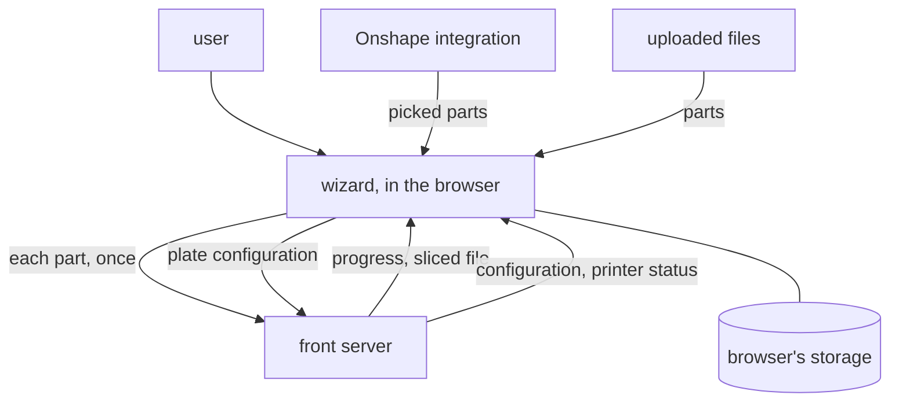

# The wizard

Nothing of the wizard that a user sees is built yet: only its project and its tools, and
the inputs of the two trials that open phase 2
([What is to be built, by phase](#what-is-to-be-built-by-phase)). This guide is its design: what a user sees and does at
every step, what the code in the browser must do and how well, and what is still undecided.
It is written for the person who decides whether the wizard is being built correctly.
[README-details.md](README-details.md) holds what a builder needs beside it: the names in
the code and the record of where each rule came from.

The phases named below are those of [the plan](../docs/plans/penguin-slicer-plan.md):
phase 2, the wizard on one machine with parts from files; phase 3, the same hosted, with
Onshape sign-in; phase 4, inside Onshape; phase 5, the real printer.

A reader short of time starts at [Where to look first](#where-to-look-first), which
points at what nobody has seen drawn and at what is not settled. The parts of the guide, in order:

1. [What it is for](#what-it-is-for), with the terms,
   [The mockup, this guide and Orca](#the-mockup-this-guide-and-orca) and
   [Where to look first](#where-to-look-first)
2. [The panel as a whole](#the-panel-as-a-whole): width, header, how the panel says
   something, who writes a failure's sentences, units, retrying
3. [Signing in](#signing-in) and [The current group](#the-current-group)
4. The five steps: [Parts](#the-parts-step), [Settings](#the-settings-step),
   [Layout](#the-layout-step), [Preview](#the-preview-step), [Send](#the-send-step)
5. [The printer-status icon](#the-printer-status-icon), with pairing
6. [When a user comes back](#when-a-user-comes-back)
7. [What the browser keeps, and why it is the record](#what-the-browser-keeps-and-why-it-is-the-record)
8. [How it does the hard parts](#how-it-does-the-hard-parts)
9. [What the wizard asks of the front server](#what-the-wizard-asks-of-the-front-server)
10. [How well it must do it](#how-well-it-must-do-it)
11. [Inside Onshape's panel and outside it](#inside-onshapes-panel-and-outside-it)
12. [Accessibility](#accessibility)
13. [Security, from the browser's side](#security-from-the-browsers-side)
14. [When things go wrong](#when-things-go-wrong)
15. [How it is tested](#how-it-is-tested)
16. [Designed here and not in the mockup](#designed-here-and-not-in-the-mockup)
17. [What is to be built, by phase](#what-is-to-be-built-by-phase)
18. [What is undecided or unmeasured](#what-is-undecided-or-unmeasured)

## What it is for

The **wizard** is the code in the browser: a step-by-step user interface that takes a user
from parts to a print. The user adds parts, chooses a filament and a profile, lays the
parts out on the printer's plate, looks at the sliced result layer by layer, and sends it
to the printer or downloads it. It has five steps, in that order: the **Parts step**, the
**Settings step**, the **Layout step**, the **Preview step** and the **Send step**. It runs
in Onshape's right panel and in a browser tab of its own, from 320 px wide.

It is a component of its own because it is the only one a user touches, and because it
owns three things nothing else has.

- **The record of the user's work.** The parts, the layout and the chosen settings live in
  the browser, and nowhere on a server. Everything a server holds of a plate is a copy
  that can be made again.
- **Everything geometric a user does by hand.** Drawing a part, finding the faces it can
  lie on, choosing how it lies, arranging the plate and checking that every instance fits
  are done in the browser, with no server involved, so that dragging an instance answers
  at once.
- **Everything a user sees.** The other components report failures and progress in fixed
  shapes; the wizard decides where each appears and what stays on screen. It does not
  write the sentences of another component's failure
  ([Who writes the sentences of a failure](#who-writes-the-sentences-of-a-failure)).

What it must never hold: a secret of any kind, a sliced file of its own making, or a
decision about who the user is. It talks to one thing only, the **front server** (the
component behind the wizard's address, which signs users in, passes parts and plates to
the slice service, keeps sliced files and configurations and, from phase 5, talks to the
printer). What passes between the two is fixed by
[the contract between the wizard and the front server](../contracts/wizard-front-server.md).
From phase 4 the **Onshape integration** (the component that makes PenguinSlicer work
inside Onshape) hands the wizard the parts a user picks there; outside Onshape, parts come
from files the user uploads.

How the front server, the slice service and printer delivery fit together behind that one
address is in [the architecture](../docs/architecture.md).

### The terms this guide uses

The plan's terms hold here. The ones this guide leans on, each in a sentence:

- A **part** is one distinct solid to print. An **instance** is one placement of a part on
  the plate, labelled with its part's name and a number ("L Bracket #2"). The **plate** is
  the printer's bed and everything on it.
- The **page** is the wizard as loaded in one browser tab, or in Onshape's panel. The
  **panel** is the area the wizard draws in, whether that is Onshape's right panel or a
  browser tab.
- The **browser's storage** is the storage a browser gives a page that outlasts a refresh
  and a closed tab. It is kept for each browser and for each address the page is opened
  at, and what the wizard keeps in it belongs to the signed-in user.
- A **group** is the users who share one configuration and one printer: one Onshape company
  or classroom, or a user alone who belongs to none. The **current group** is the one
  group, of those a user belongs to, that the user is working in now. Most users belong to
  one group and never meet the word.
- The **configuration** is the current group's shared settings: its filaments, each with a
  colour and its own profiles; the printer's Orca profile, which gives the plate's size and
  height; and whether uploaded files are read in inches or millimetres.
- A **profile** is one of Orca's named bundles of settings. The wizard offers the
  profiles the configuration lists for a filament, each under the group's own name, such
  as "Structural". A **change** is one setting set differently from the profile.
- A **plate configuration** is the description of what to slice: the parts, where each
  instance sits and how it is turned, the profile and the changes. A **slice job** is one
  plate configuration being sliced by the slice service. The **sliced file** is what Orca
  writes and the printer runs.
- A **delivery job** is one sliced file on its way to one printer, from Send to the end of
  its print. The **daemon** is printer delivery's program on the computer beside the
  printer (the plan calls that computer the daemon's computer); the wizard never talks to
  it, and the panel calls it "the PenguinSlicer program on the computer beside the
  printer". The **relay** is printer delivery's other half,
  which runs inside the front server, hands delivery jobs to the daemon and holds the
  printer's last status.

A user never reads the word "job". What is sliced and printed is a plate, named in words
by what it holds ("16 instances"), never by a number and never by the sliced file's
generated name. So where this guide describes what a user sees, "a slice" is a slice job,
"a print" is a delivery job from the moment the printer starts, and "a sliced plate" is a
plate whose sliced file is still kept. Each browser tab works with a plate of its own, and
the New plate button empties it to start afresh; the panel says "a new plate", and no
count of plates is kept or shown
([What the browser keeps](#what-the-browser-keeps-and-why-it-is-the-record)).

### The mockup, this guide and Orca

Three things say what the wizard is, and they are consulted in this order.

- **The look follows the mockup.** [The mockup](../docs/mockups/print-wizard/index.html),
  at its version 8, is a set of faked screens drawn before any of the wizard existed. The
  wizard looks the same: the same layout, elements, order, colours, type and wording at
  each width. Where matching is cheap it matches, and taking over the mockup's style
  sheets is the cheap way. Small differences of pixels are acceptable where there is a
  good reason. The mockup is kept in the repository as the reference for the look.
- **The behaviour follows this guide.** The mockup's scripts were faked, so what the
  wizard does is built from this guide, with real parts and real files. Where this guide
  states a decision that differs from the mockup, the guide wins, and it says so where
  the difference stands: a slice has no Cancel button ([Slicing](#slicing)); a returning
  page keeps its plate after the sliced file has expired
  ([Coming back to running work](#coming-back-to-running-work)); a switch beside the
  upload area says how STL files are read, where the mockup has a line of text and no
  control ([The Parts step](#the-parts-step)); and the screens the
  mockup never drew are listed under
  [Designed here and not in the mockup](#designed-here-and-not-in-the-mockup).
- **Orca, for the Layout and Preview steps only.** Where neither this guide nor the
  mockup says what should happen, those two steps behave as Orca Slicer does, because
  they hold complex behaviour that Orca already models: arranging, orienting, laying a
  part on a face through the patches, and inspecting a sliced file layer by layer. For
  the Parts step, the Settings step, and the Send step with the printer-status icon,
  Orca is not a reference. Where this guide differs from Orca on purpose, it says so in a
  clause where the difference stands.

An implementer may read Orca's source to understand its algorithms and methods, and never
copies its code: Orca is licensed under the AGPL and PenguinSlicer under the MIT licence,
and the licence covers the code as written, not the idea behind it.

## Where to look first

Two places hold what is most worth a second look, and they can be read without the
rest.

- **The screens designed here and not in the mockup.** These screens and states have
  never been drawn; they exist only as the words of this guide. The table under
  [Designed here and not in the mockup](#designed-here-and-not-in-the-mockup) lists them
  and links to each.
- **What is undecided or unmeasured.**
  [What is undecided or unmeasured](#what-is-undecided-or-unmeasured) holds what phase 2
  must learn by trial (whether the layer preview can be fast enough without a graphics
  card, and whether the new geometry works on real parts), what only real Onshape can
  confirm in phase 4, two things only use will show (whether the browser's storage holds
  a full plate, and whether progress reaches the page as it is sent when hosted), four
  items of the design that are still open (what a quick change's menu shows for a value
  not on it, what the panel shows after a print is no longer followed, whether the panel
  says that a part will need supports, and who writes the one-line description of a
  plate), and the open items of
  the other three guides that would change what the panel shows.

Everything else in the guide is stated as the design. Its targets for speed and memory
are in [How well it must do it](#how-well-it-must-do-it), each with whether anything has
been measured.

## The panel as a whole

### Width and look

The panel is fluid: it works at 320 px and lays out wider when it has more room, and
dragging Onshape's panel wider changes the layout exactly as widening a window would,
because every rule is measured on the panel and not on the window. Three widths change
the layout (480, 520 and 680 px); what changes at each is in the table at the end of this
section, [The three widths](#the-three-widths), once the things it names have been
described.

The look is the mockup's
([The mockup, this guide and Orca](#the-mockup-this-guide-and-orca)), which is
PenguinCAM's light theme, so that a user of that CNC wizard meets nothing new:
a pale grey background, white cards, a blue accent, body text at 14 px, a step title at
18 px. Two departures: amber text is darker than PenguinCAM's, which is hard to read on
white, and a step tab's hover is light. The font is PenguinCAM's, which starts with the
system's own font, so the panel looks slightly different on each system; that is
accepted. The dark house style of the project's documents does not apply to the wizard.

### The header

The header is the same on every step. Its first line holds "PenguinSlicer" and, at the
right, the **printer-status icon**: a small pill with a printer, a coloured dot and a word,
which says at a glance whether the group's printer is free
([The printer-status icon](#the-printer-status-icon)). Its second line names the
configuration in use, "Config: 6238 (Popcorn Penguins)", with a reload glyph beside it
([The current group](#the-current-group)). Below that are the step tabs.

**The step tabs.** From 480 px they are PenguinCAM's: a number, a name, and a check mark
after the name of a finished step. Below 480 px they are five small numbered circles
joined by a line, a check in each finished one, the current one filled in blue with its
name beside it, so the header stays one row and the content the user works with stays high
in the panel. Every circle is clickable, and every circle but the current one, whose name
already shows beside it, has its step's name as its tooltip ("3. Layout"). A click on a
tab goes there when every step before it allows it. When one does not, the **panel
line** says so. The panel line is one line under the tabs with two uses. Its passing use
names the step that holds a click and why ("Layout first: 23 instances are closer than
12 mm with supports on."), and goes at the user's next move or after a few seconds. Its
lasting use is the message that the server is slow or cannot be reached
([When the server is slow](#when-the-server-is-slow-or-cannot-be-reached)), which stays
until a request is answered and may hold a link or a button. When both apply the lasting
use is shown and the passing one is not, since a user whose click was held can see why
from the step itself.

**The plate summary.** The Parts step has none. From the Settings step on, two lines of
text sit under the header, the same on every step and updated at once: the parts and
instances ("1 part · 1 instance"), then the filament and the profile ("PETG ·
Structural") followed, while there are changes, by a pill that counts them ("+2 changes").
A filament or profile name too long for the line is cut with an ellipsis, never wrapped,
with the full name as its tooltip; the pill stays whole. The second line is as tall as the
pill even without it, so nothing below moves when the pill comes or goes. The summary
gives no plate area, print time or grams: the Send step states those. The pill is a button:
a click opens the **change details** joined to it, one plain line for each change
("Quality › Resolution: 0.014 mm (profile 0.012 mm)"), closed by a click elsewhere, Escape
or the pill again. The Settings step has four **quick changes**, menus for the settings
most often changed; a setting that has one is named in the quick change's words ("Others ›
Brim: Off (profile Auto)"), so the menu and the line agree.

**Back and Next** sit at the bottom of every step. Next is off until the step's rules pass,
and the step says why. Back is off on the Parts step.

### How the panel tells the user something

The panel has six ways to say something, and each kind of news always uses the same one.
The screens below are written with these words.

| Way | What it is | Used for |
|---|---|---|
| **Notification** | A card at the top of a step, under the plate summary, closed with × | Something that happened and is on no row: a part that was not added, sending cancelled, work resumed. It belongs to its step and goes when the user leaves the step or as soon as it stops being true |
| **Message** | A block in the body of a step: one sentence of what happened, one of what to do, and its buttons. Red when it holds Next, amber when it is a caution, grey when it only informs, green when something was done | A problem on the plate, a slice that failed, a printer that cannot take a send, a sign-in that could not be made |
| **Card** | A white bordered box that holds a state for as long as it lasts | Slicing progress, the progress of the user's print, a busy printer |
| **Joined box** | A small box that opens joined to the header element or icon it belongs to. Each has its own name, and the guide uses that name | The printer details, the change details, the colour key, and the group details that only a user in several groups sees |
| **Line** | One short sentence in a fixed place | A consequence the user cannot see; the panel line under the tabs |
| **Confirmation** | The panel asking once more before something is lost: a small box joined to the control that was pressed, holding the question in one or two sentences and two buttons, the one that goes ahead and the one that keeps things as they are. Escape or a click elsewhere keeps things as they are | New plate and changing the current group when there is work to lose, Reset all, Stop following, Unpair |

The word **Details**, with a capital, is kept for one thing only: the folded part of a
message, which the user opens by the word "Details" to read more.

**Tooltips** are the panel's own: a small white box in the panel's font at body size, which
appears after the pointer has rested on an element for a moment, much sooner than a
browser's own tooltip (the figure is in [How well it must do it](#how-well-it-must-do-it)),
and at once when the keyboard focuses an icon or a step circle. It sits under its
element, or above it where the panel ends, and is kept at least 6 px inside the panel's
edges, so it never leaves a 320 px panel. A tooltip says only what is not on screen: an
element whose text is fully visible has none, and one whose text is cut short shows the
whole text. Only the options inside an open menu keep the browser's tooltip, because the
browser draws an open menu. Touch shows no tooltip, so nothing a user needs is said by a
tooltip alone.

### The words it uses

**No role words.** No sentence a user sees says "student", "mentor" or "team", because
PenguinSlicer is used by people who are not FRC teams. A group's own name ("6238 (Popcorn
Penguins)") is shown as the group wrote it. No user of a group has rights another lacks,
so no sentence sends the user to "an administrator".

**Little help text, generous errors.** No line sits under a step title and no instruction
under a control. A short line stays only where an action has a consequence the user cannot
see; each is named at its step. How to move things with the mouse is behind a "?" icon on
the two steps that have a 3D view. Errors get the opposite treatment: each says what went
wrong and what is specific to it (which part, what about it, where to look), and never
generic troubleshooting ("check that this computer is online") or anything of
PenguinSlicer's internals. Three messages carry more, folded under **Details**: two slice
failures and a failed print.

**Nothing is said about orientation.** After an instance is laid down, by the user or by
the wizard, nothing says how it lies now: the view shows it. What is said is a move the
wizard made that the user did not ask for.

### Who writes the sentences of a failure

Every failure is an error report: what happened in a sentence a user understands, where,
what to do next, the single action that fixes it when one does, and the underlying detail,
which is kept for the server's log and never shown. **The component that failed writes
the sentences.** This is a requirement on the boundary between components, and every
failure this guide describes follows it.

One thing a user reads is written by no component of PenguinSlicer. On the two slice
failures about a gap with nothing under it, the folded Details quote Orca Slicer's own
sentence, marked as Orca's, and nothing of Orca's is quoted anywhere else
([Orca's own sentence under Details](#orcas-own-sentence-under-details)). The rule still
holds for the wizard: the slice service puts the quotation among what its error report
holds for the user, and the wizard shows the error report as it is and never reads the
detail kept for the log.

| The failure is | Its sentences are written by | The wizard |
|---|---|---|
| The slice service's: a part it refuses or warns about, a plate it refuses, a slice that fails, runs too long or runs out of memory, no room to wait | The slice service | Shows them as they are |
| Printer delivery's, from phase 5: a send it refuses, a print that failed or waits for a person, a wrong pairing code | Printer delivery | Shows them as they are |
| The front server's own: a sign-in that could not be made, a group the user is not in, a sliced file that has expired | The front server | Shows them as they are |
| The Onshape integration's, from phase 4: a part Onshape cannot export | The Onshape integration | Shows them as they are |
| Something that happens in the browser: no answer from the front server, a check the page makes before sending anything (a file over the size limit, a twenty-sixth part, a plate over 150 instances), every problem of placement on the Layout step, a file the page itself cannot read, a 3D view that is lost, storage that fails | The wizard | Writes them |

"As they are" means that the wizard neither rewords a sentence nor replaces it with one
of its own made from the report's code. What the wizard adds is its own: where the report
appears (a notification, a message, a row), its colour, the button for the single action
the report names, and its own buttons for moving about (Back to Layout, Back to Parts).
Because the wizard never rewrites, a sentence that reads badly is mended in the component
that wrote it, and in its tests. Two consequences:

- A sentence written on a server cannot know whether the page is inside Onshape, so it
  says "your CAD program" or "in CAD" and never "Onshape". Only the Onshape integration's
  sentences name Onshape.
- Where this guide quotes a sentence of another component, the quotation is that
  component's wording as its own guide gives it, or an example of the kind of sentence
  expected. Where the two differ, the other component's guide wins: the remedy for a
  slice that ran out of memory is the slice service's, for example
  ([When a slice fails](#when-a-slice-fails)).

States that are not failures are the wizard's to put into words, from the figures it is
sent: a slice waiting behind others, a busy printer, a printer not heard from, a print
that has gone quiet. From phase 2 the slice service's sentences say "a new plate", as the
panel does, where a remedy is another plate. Some sentences of the slice service and of
printer delivery still say "the print server" and use the old words for people; changing
them is known work in those components, and until it is done the wizard shows what they
write.

### Units

A part has **units**, inches or millimetres, and they are a label that travels with it:
the units of the Part Studio or Assembly it was picked in, or for an uploaded file the
units chosen on the switch beside the upload area
([The Parts step](#the-parts-step)). The wizard never guesses units from a part's size.

| What | Shown in |
|---|---|
| A part's own size, on every step | The part's units. Inches are decimal to three places, as a machinist reads a drawing ("2.000 × 2.000 × 0.188 in"); millimetres to 0.1 mm |
| Printer and plate figures: the plate's size, the height limit, the spacing between instances, distances between instances, a height above the plate, the layer readout | Always millimetres, as the printer's maker gives them: heights and the spacing to 1 mm, distances between instances to 0.1 mm |
| A comparison of a part's figure with a printer's | Millimetres for both, with the part's own units in brackets when they are inches ("stands 352.7 mm (13.885 in) tall; the printer prints up to 340 mm") |
| Slicing settings, and Orca's own sentence quoted under Details on a failed slice | Always millimetres, as in Orca and in the profiles |

A size is rounded once, from the exact millimetres, in the unit shown, so a part has one
size on every step. A size is never cut short: in a narrow panel it wraps.

### When the server is slow or cannot be reached

The project is deployed continuously, so the front server restarts at any time of day
while people are working, and a request can fall in the gap. The page therefore retries
every request it makes, and a user sees a pause, not an error.

| Time since a request first failed | What the user sees |
|---|---|
| Up to 20 seconds | Nothing, except on the thing that is waiting: a part's row says "Taking longer than usual; still trying…" after 4 seconds |
| 20 to 300 seconds | The panel line, in amber: "The server is being slow. Your browser is retrying in 28 s.", counting down to the next attempt, with a link, "Retry now" |
| After 300 seconds | The panel line, in red: "The server could not be reached.", with one button, **Try again**, which starts the 300 seconds afresh |

These sentences are the wizard's own, since no component answered to write one, and "the
server" in them is the front server, the only server a user's browser knows. The waits
between attempts grow, doubling from one second to thirty, so there is something to count
down and a struggling front server is not hammered. "Retry now" lets a user who has just
mended their own network skip the countdown. The message is on the panel line and not a
notification because it concerns the whole panel and must stay as the user moves between
steps; it goes the moment a request is answered. Throughout,
nothing of the user's work is dropped: the parts, the layout and the settings are in the
browser's storage, a part whose upload stopped keeps its row, and everything that needs
no server (laying out the plate, changing settings) goes on working. These times cover
every request a user waits on: adding a part, submitting a plate, fetching a sliced file,
sending, cancelling a send.

A dropped **progress stream** (the connection on which the page follows a slice or a
print as it happens) is treated differently at first: the page reopens it silently,
because progress streams are closed routinely, by the hosts' time limits and at every
restart of the front server. A page that is only following a slice or a print has no
other request waiting, so without a rule of its own it would show a frozen card that
looks current. Two rules prevent that. A progress stream that cannot be reopened is
treated as a failed request once 20 seconds have passed since the first failure to
reopen it, with the same panel line and the same 300 seconds. And a stream that is open
but has carried nothing for 45 seconds is treated as failed in the same way: the front
server keeps a stream alive at least every fifteen seconds, so three such intervals
without a word mean a connection that hangs without closing, which is what a laptop
coming back from sleep most often produces. While a stream counts as failed, the card
that shows a slice's progress on the Preview step (the slicing card) says there is no
news, and the card that shows a print's progress on the Send step (the print card) has
its figures greyed.

One wait is not shown this way. A plate submitted while the slice service is stopping
for a deploy is answered by the front server at once, with the slice service's answer
that it is stopping, so no request has failed. The slicing card shows the slice as
waiting and says that the slicer is restarting, and the page submits again by itself
for up to 300 seconds ([Slicing](#slicing)). The message on the panel line appears only
if those 300 seconds pass without the plate being accepted.

### The three widths

Each width includes itself, and each row names things described above or in the steps
below.

| From | What changes |
|---|---|
| 480 px | The step circles become named tabs. On the Settings step the Filament and Profile menus sit side by side and the quick changes (four menus for the commonest settings) two to a row. Advanced mode, the view of every setting, shows its five sections as a column of names down the left |
| 520 px | The figures of a print on the Send step (percent, layer, time left) sit in one row. The 3D views of the Layout and Preview steps become 4:3 instead of square |
| 680 px | The Parts step's list of parts has two columns, and the Send step has two columns |

## Signing in

Every user signs in with Onshape; PenguinSlicer has no accounts or passwords of its own.
On one machine (phase 2) there is no sign-in at all: the front server signs in a fixed
made-up user and group, and the wizard opens straight on its first step. From phase 3:

**Signing in is not something a user manages.** Inside Onshape's panel the aim is that
being signed in to PenguinSlicer is not felt as separate from being signed in to
Onshape: the sign-in lasts as long as the user is signed in to Onshape, and the panel
has no sign-out link.

**Inside Onshape's panel, the first time in a browser, the user presses one button.**
The way is PenguinCAM's, which is known to work in Onshape's panel. The panel shows a
plain page with the header's first line and one button, **Connect**. That page is the
front server's to serve, in the wizard's look, since the wizard's code is not sent to a
browser with no sign-in; it has no printer-status icon. Pressing Connect opens a small
window in which the trip to Onshape is made, and the window closes itself when the trip
is done; the panel then shows the wizard on its first step. A page already open whose
sign-in runs out shows the same button in place of the step's content. After that a user who opens
the panel sees the wizard, and nothing about signing in. That one click is what the
design relies on. A trip to Onshape that the user never sees, with no button and no
window, is what phase 4 tries for
([To be confirmed inside Onshape, in phase 4](#to-be-confirmed-inside-onshape-in-phase-4)).

**When the sign-in is missing or has run out,** the page makes the trip to Onshape by
itself and returns to the same step, with the plate as it was; inside the panel the
trip is made by Connect and its small window, unless the unseen trip proves possible.
The first time, Onshape asks the user to allow PenguinSlicer to read who they are,
which companies and classrooms they belong to, and their documents. PenguinSlicer never
asks for permission to write anything. After that a user who is signed in to Onshape is
asked nothing.
A page that is already open when its sign-in runs out waits for a quiet moment before it
leaves (no pointer down; no menu, joined box or confirmation open; no field being typed
in), so that nobody is taken away in the middle of dragging an instance. Nothing is lost
by the trip, because the work is in the browser's storage and the front server holds no
session to expire.

**When the trip fails,** and only then, the user reads something about signing in. The
user is signed out of Onshape and does not sign in, or refuses Onshape's request, or
Onshape does not answer. What the user then sees is a plain page that the front server
serves, as for Safari below, since the wizard's code cannot run without a sign-in: in the
wizard's look, with the header's first line and no printer-status icon, and one message,
with the front server's sentences, of this kind: "PenguinSlicer could not sign you in with Onshape.",
then what is specific ("You did not allow PenguinSlicer to read your Onshape account. It
reads your name, the companies and classrooms you belong to, and your documents, and it
never changes anything in Onshape." or "Onshape did not answer."), then "Your parts, layout and settings are kept in this browser." One button,
**Sign in with Onshape**, takes the trip again. Inside the panel, where the trip is made
in the small window, the window reports the failure to the open panel instead, and the
wizard shows the same message in place of the step's content, with the Connect button. A
page that comes back from a trip and is still not signed in, as when the browser withholds
its cookie, does not leave again by itself, and likewise shows the message in place of the
step's content. In these two cases the wizard's own page is showing, and from phase 5 its
printer-status icon shows a grey dot and "…", since the page cannot ask.

**A different person at the same browser.** PenguinSlicer follows Onshape: when the
person signed in to Onshape is not the one PenguinSlicer's sign-in names, the sign-in is
made again for that person, by the same trip. The browser's stored work is tied to the
signed-in user, and when a different user signs in at the same browser the previous
user's stored work is cleared, so nobody is shown another person's parts. The previous
user, coming back to that browser later, starts with an empty plate.

**Outside Onshape** a sign-in lasts thirty days from its last use: each use extends it,
so a user who opens PenguinSlicer at least once in thirty days is not asked to sign in
again in that browser. It can also end early for everyone at once, when the key that protects it is replaced in an emergency; the page then makes the
trip as above.

**A browser that is not supported.** Chrome is the supported browser and Safari is not
supported ([Browsers other than Chrome](#browsers-other-than-chrome)). What a user of
Safari is shown is the front server's to serve, since the wizard's code cannot be relied
on there: a plain page saying that PenguinSlicer needs Chrome
([the front server's guide](../front/README.md#signing-in)).

What of this section can only be confirmed inside real Onshape, and what follows if it
cannot, is under
[To be confirmed inside Onshape, in phase 4](#to-be-confirmed-inside-onshape-in-phase-4).

### Sign-out

Outside Onshape the page has a quiet **Sign out** link at its foot, under Back and Next,
on every step; inside Onshape's panel there is none. It ends the sign-in and shows a
plain page with the header's first line, one sentence, "You are signed out of
PenguinSlicer.", and one button, **Sign in with Onshape**. From that page nothing leaves
for Onshape by itself, since the trip would sign the user straight back in. The stored
work is left where it is: it is shown again only to the same user, it is dropped after
12 hours without use like any stored plate, and it is cleared when a different user
signs in
([What the browser keeps](#what-the-browser-keeps-and-why-it-is-the-record)). The front
server's part, ending the sign-in, is in [its guide](../front/README.md#signing-out).

## The current group

A user in one group, which is nearly every user, has nothing to manage. The header's
second line names the configuration in use, in plain words: "Config: 6238 (Popcorn
Penguins)", by the name of the Onshape company or classroom, or by the user's own name
for a user who belongs to none. For this user the name is plain text: there is no list
of groups, no box of details about the group, no "Signed in as" and nothing to choose.

**Inside Onshape the group follows Onshape.** The current group is the group of the
document the user has open, and no choice is offered, even to a user in several groups.
A user who has just been added to an Onshape company has nothing to press either: the
front server reads a user's groups again itself, at every sign-in and whenever Onshape
says the user is working in a company that the sign-in does not list
([the front server's guide](../front/README.md#groups-and-the-current-group)).

**The configuration is always one the wizard can use.** A group that has saved no
configuration gets the built-in default, so a new group can slice without setting
anything up. A saved configuration that cannot be read is never the wizard's to handle:
the front server serves the default in its place, leaves the saved file untouched and
writes an error to its log
([the front server's guide](../front/README.md#the-configuration)). The wizard has no
screen for the case. Its header names the configuration in use, so when the default is
served the header names the default (of this kind: "Config: PenguinSlicer default") and
not the group, which is how someone who wrote a configuration by hand sees that it was
not taken.

**The reload glyph** reads the configuration again from the front server, for a user who
has been told that a filament or a profile was added. If the chosen filament or profile is
gone from the new configuration, the first one takes its place and a notification says
which. The configuration cannot be edited from the wizard: its edit screens are a feature
of their own, in no phase yet, and until they exist a group uses the built-in default or
a document written by hand.

### A user in several groups, outside Onshape

Choosing a group is only ever seen here: in a browser tab, by a user who belongs to more
than one group. For that user the name on the header's second line is a button. A click
opens the **group details** joined to it: the user's groups, one to a row, the current
one checked. A click on another makes it the current group; a click elsewhere, Escape or
the name again closes the group details. The choice is kept in the browser's storage
until the user changes it, and it is the group a newly opened tab starts in. The change
is made in one tab: another open tab goes on with its own group and its own plate.

**Changing the current group clears everything:** the parts, the layout, the settings
and the slice, since all of them were made for the other group's configuration and
printer. When there is work to lose, the wizard asks first, in a confirmation: "Change to
FRC 1678? Your parts, layout and settings are cleared." A plate already sent goes on
printing at its own printer, and the printer-status icon now shows the new group's
printer.

**A group the user no longer belongs to.** If the front server refuses the stored group
(the user has left that company), the page takes the first of the user's groups, with an
empty plate as after any change of group, and says so in a notification: the front
server's sentence that the user is not in that group ("You are no longer in 6238 (Popcorn
Penguins)."), then the wizard's own of what it did, "PenguinSlicer now uses FRC 1678's
configuration and printer."

### To be confirmed inside Onshape, in phase 4

Two things about signing in and the group can only be confirmed with real Onshape.

- **Whether Onshape tells a panel who the user is and which company they are working
  in.** It is known to give the document and the element. Without the user, the page has
  nothing that tells it a different person is now signed in to Onshape, and PenguinSlicer
  follows that person only when the sign-in is next made. Without the company, finding
  the group of the document the user has open costs a call to Onshape for each document,
  out of a yearly allowance.
- **Whether the trip to Onshape can be made inside the panel without the user seeing
  it.** PenguinCAM, the Popcorn Penguins' CNC wizard, does not manage it: it shows a
  "Connect" button and signs in through a small window that closes itself. That is the
  baseline here, one click the first time in a browser. If the unseen trip works in
  real Chrome, the Connect button goes.

## The Parts step

The wizard opens here. The step is the list of parts to print, each with a quantity.

**Adding a part inside Onshape** (phase 4). A prompt above the list says "Click a part in
the Part Studio", or "Click a part in the assembly", and never changes. A click on a part
in Onshape adds it with quantity 1; a click on a part already in the list raises its
quantity by one and flashes its row, so a user who wants four clicks four times. In an
Assembly a click on an instance, in Onshape's list or in its graphics area, adds that
instance's part. There is no button that adds every part of an assembly.

**Adding a part outside Onshape** (phase 2). An upload area takes STL files, dropped or
chosen, and binary STL only: an STL file can be written as text or as binary, and no
other kind of file, a text STL and a 3MF included, is taken. An STL file carries no
units, so a switch beside the upload area says how the next files are read: "Read STL
files in: inches / millimetres". It starts at the configuration's value and the user's
choice is kept in the browser's storage. The switch is there because no user can edit a
configuration until its edit screens exist, and most STL files from other CAD programs
are in millimetres; whether it stays is decided again when those screens are designed. A
file read in the wrong units arrives 25.4 times too large or too small. The slice
service checks each part with its units when it is added, so a file that is too large is
usually refused on this step; one that passes fails the height or plate checks on the
Layout step. A row has no switch of its own: a part read in the wrong units is removed
and added again.

**New plate.** A **New plate** button on this step empties the plate: the parts, the
layout and the slice go, and the filament, the profile and the changes stay, since the
next plate is usually printed the same way. When the plate holds parts it asks first, in
a confirmation: "Start a new plate? The parts and layout of this one are cleared." A
plate that is printing goes on printing; it is then shown as a print, in the
printer-status icon and the printer details, and no longer as this tab's plate. No count
of plates is kept or shown.

**A row** shows the part's picture, name, size in its own units, quantity and a remove
button. There is no refresh button on a row: a part changed in Onshape is removed and
clicked again. While a part is arriving its row shows a thin progress bar and "Arriving
from Onshape…" (or "Uploading…"). The bar shows that something is happening and promises
no duration: how long Onshape takes to export a part is unknown until phase 4. A part
still arriving never holds Next. If it arrives
after the user has moved on, it joins the plate on the Layout step, at once if the user is
there and otherwise the next time that step is shown, and a notification on the step the
user is on says so ("Gusset Plate arrived after you left the Parts step. It joins the
plate when you go back to the Layout step.").

Under the list one line counts what the plate holds, and how many parts are still
arriving.

### A part that cannot be used

Each part is checked by the slice service the moment it is added, before anything is laid
out, so a part that cannot be sliced is found on this step and not after a layout has been
made around it. A part that cannot be used is a notification that names it, and it is not
added; the list never holds a broken row. The notification's sentences are those of the
component that refused the part
([Who writes the sentences of a failure](#who-writes-the-sentences-of-a-failure)); the
wizard adds "Your other parts are fine." only while the list holds other parts. A second
failure of the same part replaces its notification.

| What happened | Whose sentences | The notification says | Then |
|---|---|---|---|
| Onshape cannot export the part (phase 4) | The Onshape integration's | That Onshape could not export the part, so it was not added ("Onshape could not export Shooter Hood Rib, so it was not added."), and what to check in Onshape: that it is one closed solid, not a surface and not several bodies, and that the Part Studio rebuilds with no red features | Next stays as it was. There is no Try again: the part is broken until it is mended in Onshape |
| The file cannot be read as a part: it is empty, cut off or padded, or is not an STL at all (a picture, a zip or a 3MF saved under that name) | The slice service's | That the file could not be read as a part, naming it, and to export it again | The same |
| The file is a text STL | The slice service's | That a binary STL is needed, naming the file: an STL file can be written as text or as binary, and the slice service reads only the binary kind, whose length it can check exactly. The remedy is to export the part again as a binary STL | The same |
| The slice service's check refuses the part: too small or flat, nothing to print, or too large for the printer | The slice service's | Which part and what is wrong with it. For an uploaded file refused as too large, the notification is followed by the wizard's own reminder of how the file was read ("STL files are being read in inches."), since a file in millimetres read as inches is the likeliest cause, and the switch is beside the upload area | The same |
| The part is over the size limit | The wizard's, since the page checks before sending | See [The limits on a plate](#the-limits-on-a-plate) | The same |

A part the slice service copes with but warns about is added, and the warning stays on its
row, in amber, without holding Next. The warning's sentences are the slice service's. The
commonest is a part that is not watertight, for which the sentence expected is of this
kind: "Gusset Plate is not watertight: its mesh has 14 open edges in 2 places. It may
still slice and print. If the slice fails, look in your CAD program for faces that do not
meet, then add the repaired part again." Another is a part with every side under 5 mm,
which the slice service warns may be a file in inches read as millimetres.

The page also reads each file itself, to draw it. A file the page cannot read is, in
almost every case, one the slice service refuses, and the slice service's notification is
the one shown. If the slice service accepts a part that the page cannot draw, that is a
defect in the wizard. The part is not added, the wizard's own notification says that
PenguinSlicer could not show the part and that it cannot be imported, and the failure
reaches the server's log
([What the wizard reports about itself](#what-the-wizard-reports-about-itself)).

A part whose upload gets no answer is not refused. Its row stays, because the part is
already in the browser's storage, and the page retries as
[When the server is slow](#when-the-server-is-slow-or-cannot-be-reached) describes: the row
says "Taking longer than usual; still trying…" after 4 seconds, and if the retries stop
after 300 seconds the row keeps the part and shares the panel line's Try again.

### The limits on a plate

Three limits bound a plate, and the Parts step is where a user meets each. All three are
the slice service's limits. The page checks each one itself before sending anything, so
these sentences are the wizard's; should the slice service refuse all the same, its own
sentence is shown.

| Limit | What it protects | What the user sees |
|---|---|---|
| A part is at most 7.5 MB, which is 150,000 triangles | The slice service's memory and time for one part, and the size of one upload | A notification, and the part is not added: "bracket.stl is 9.1 MB. PenguinSlicer takes parts up to 7.5 MB (150,000 triangles), so it was not added. Export it again from your CAD program at a coarser resolution." The page checks the size before uploading, so nothing is sent |
| A plate uses at most 25 different parts | The slice service's disk, which no one plate may fill | The twenty-sixth is not added, and a notification says "A plate takes up to 25 different parts, so Gusset Plate was not added. Remove a part, or print it on a new plate." Raising the quantity of a part already in the list still works |
| A plate holds at most 150 instances | The slice service's limit on placements | One part's quantity cannot be typed or clicked past 150. When the parts together pass it, a red message under the list says "This plate would hold 163 instances. Up to 150 instances per plate; print the rest on a new plate.", and Next is off |

For a part picked in Onshape that comes out over 7.5 MB, the notification names the part
and says it is too detailed to slice here. Whether the Onshape integration then exports it
again more coarsely by itself is for phase 4's design.

## The Settings step

The step is for the common case, which must stay short: most prints use one filament and
one of a few profiles. It has two menus, four quick changes and one button.

**Filament and Profile.** The Filament menu offers the configuration's filaments, each
with its colour beside its name, so that two filaments of one material (a red PLA and a
green PLA) can be told apart. The Profile menu offers the chosen filament's own profiles,
under the group's own names ("Structural", "Pulley", "Camera mount", "Draft", "Fine");
Orca's own profile names are not names a group would choose and say nothing of what a
profile is for. A profile's purpose is its option's tooltip, not a line under the menu.
Picking another filament picks that filament's first profile. There is no printer row:
the printer-status icon already names the printer.

**The quick changes** are four menus for the settings most often changed for one print:
Infill, Walls, Supports and Brim. They sit one to a row below 480 px and two to a row from
there. A quick change is a change like any other: it and advanced mode edit one shared set
of changes. Each offers the mockup's values: Infill 15, 25, 40, 60 and 100 percent; Walls
2, 3, 4 and 6; Supports Off, and On, which is tree supports placed automatically; Brim
Auto, Off and Outer only. A menu set to the profile's own value is no change. What a menu
shows when the profile's value, or a change made in advanced mode, is not one of its
values is not decided
([A quick change whose value is not on its menu](#a-quick-change-whose-value-is-not-on-its-menu)).

**Changing the filament or the profile clears every change,** because a change is a
departure from one profile and means nothing against another. From the first change until
they are cleared, one line under the Profile menu warns of it: "⚠ Changing the filament or
the profile clears your 2 changes." Nothing is said after they are cleared.

**The Advanced mode button** stands alone under the quick changes while nothing is
changed. Once a setting is changed, the **changes box** takes its place: a yellow box
headed "2 settings changed from Structural", one line for each change, and the Advanced
mode button. Each line is a link that opens advanced mode at that setting, with its
section and setting group open, the setting scrolled into sight and flashed. The box has
no "Reset all"; that lives in advanced mode.

### Advanced mode

Advanced mode is the view that keeps every slicing setting reachable. It fills the panel.
It offers every setting of Orca's that is a parameter with a value (a choice from a list,
a number, a piece of text): all of Orca's about 295 settings, less the programmatic ones.
Settings that run a program, name a file on the slice service's machine or hold custom
G-code are not shown, and the slice service refuses them, since they would let a user run
something on that machine.

Advanced mode shows Orca's own labels, groups and explanations for its settings, so that
a user who knows Orca finds each setting where Orca has it and anything written about
Orca's settings applies here. The table of settings (each one's label, group,
explanation, kind, range and choices) is taken from Orca's source each time an Orca
version is integrated, never written by hand. The slice service supplies it, since the
slice service alone holds Orca's profiles and settings for the Orca version it runs,
and the front server passes it to the wizard, which asks for it when the page opens,
since the Layout step takes the plate's size and height from it and the plate summary and
the changes box take each profile's values from it
([the front server's guide](../front/README.md#the-list-of-settings-and-the-profile-catalogs-names)).
So the table changes with the Orca version, and the wizard draws each setting from its
kind and not from a design made by hand for each setting. Which settings count as
programmatic is the slice service's list, and the wizard shows exactly what the slice
service accepts.

**Its header** repeats "PenguinSlicer" with the printer-status icon, then says "Advanced
mode", the profile and how many settings are changed ("Structural, 2 changed"), and
**Reset all**, which asks in a confirmation before putting every setting back. **Back to
Settings** at the bottom is the only way out; Escape does not close advanced mode, so a
stray key cannot throw the user out of a long list.

**The settings are in five sections,** as in Orca (Quality, Strength, Speed, Support,
Others), and each section's settings are in collapsible **setting groups** such as
Precision. There is no search box, no switch between common and all settings and no
"changed only" filter: the changes box, the change details and the changed counts already
find a changed setting.

| Width | How the sections are shown |
|---|---|
| Below 480 px | An accordion of cards: each section is a bordered card whose heading has a chevron and its changed count ("Strength · 1 changed"); its setting groups are rows inside the card. Each card opens and closes by itself |
| From 480 px | A rail of section names down the left, a changed count on each, with the chosen section's setting groups beside it |

The setting groups are always one column, at most 480 px wide, so a value stays near its
name. A setting group's heading has a chevron and no count of its settings, only a changed
count when it has changes ("Precision · 1 changed"). One icon button, a double chevron,
expands or collapses every setting group of a section.

**Everything starts open,** every section and every setting group, the first time advanced
mode is shown, and advanced mode remembers what the user closes for as long as the page is
loaded: across steps, across closing and reopening advanced mode, and as the panel is
dragged across 480 px either way. A reload forgets it, and everything is open again.

**A changed setting** has a tinted background, a bar on its left and a dot after its name.
The line under it gives the profile's value and a link that puts it back: "Profile 0.012
mm · Reset". A value outside a setting's allowed range is refused where it is typed.

**By keyboard,** opening advanced mode puts focus on the first section's heading, or on
the setting when a line of the changes box opened it; what advanced mode covers cannot be
reached; and closing it returns focus to the line or button that opened it.

Changes are part of the user's work: they are kept in the browser's storage and come back
after a refresh.

## The Layout step

The step is for placing every instance on the plate, lying the way it should print. It is
a 3D view of the plate that the user works in directly: there are no modes and no tools to
pick up. The view fills the panel's width and grows as the panel is widened, square at
narrow widths and 4:3 from 520 px, with no cap on its height.

The step does not change the list of parts. There is no duplicate, delete, undo or redo
here, and their usual keys do nothing; how many of a part there are is the Parts step's
business. It has no scale, cut or mirror tools and no settings for one part alone.

### What is on the step

From top to bottom:

- **A toolbar** with two buttons, **Arrange** and **Auto-orient**, and at its right a "?"
  icon that opens the list of gestures in a small panel.
- **The status line,** just above the view: green when every instance fits ("✓ All 16
  instances fit the plate."), red with the first problem when not, with "+2 more ↓" when
  there are others. A click on a red status line scrolls to the full messages.
- **The view,** with view buttons in a corner (Zoom to instances, Whole plate, Top) and,
  at its bottom left, the **pointer line**: one line at 11 px, the one text in the panel
  below the body size, that says what is under the pointer (an instance's name, "Lay it on
  this face: 0.250 in tall", "Drag to turn · Shift: 45° steps").
- **The selection line** under the view: with nothing selected, "90 instances on the
  plate, 10 beside it."; with one instance selected, its name, footprint and height in its
  part's units; with several, "5 instances move and turn together". Beside it, one link at
  most: "Lay it the best way" when the selection does not lie its best way, "Put back as
  modelled" when it has been laid down differently from the model, and nothing when it
  lies as modelled and that is its best way.
- **One line of printer and plate figures:** "Shop H2S: plate 340 × 320 mm, up to 340 mm
  tall, 12 mm apart". It is kept because nothing else on the panel gives the plate's size,
  the height limit or the spacing. The size and height come from the printer's Orca
  profile named in the configuration, which the table of settings gives, the same profile
  the slice service slices for.
- **The messages:** anything the wizard moved, and under "Fix these 2 before Next:" one red
  message for each problem, each with the button that fixes it. A message about a move
  the wizard made, and Arrange's "Arranged 16 instances.", goes when the user leaves the
  Layout step; a problem stays until it is fixed. Every sentence on this step is the
  wizard's own, since everything here happens in the browser.

### Moving, turning and looking

The mouse works as it does in Onshape, and not as in Orca, since Onshape is where the
user's hand has just been: drag an instance to move it; right-drag to look around; Shift-drag, middle-drag or Ctrl
with a right-drag to slide the view; scroll to zoom. A left-drag on empty plate also looks
around. Shift-click or Ctrl-click adds an instance to the selection, and dragging one of a
selection moves them all. F zooms to the instances, Ctrl+1 looks from above, Ctrl+A
selects every instance and Escape clears the selection. Those four keys are the
mockup's, and no keyboard support is designed for this step beyond them: an instance is
moved, turned and laid down with a pointer ([Accessibility](#accessibility)).

**The rotation handle** is a round handle beside the selection that turns it about the
vertical. It is bound to the instance: while dragged it stays on a circle round the
selection and turns through the same angle, so the two never part and the handle never
hops to another side. Turning is free, and a small readout beside the handle shows the
instance's orientation on the plate while dragging ("↺ 37°"). Holding Shift snaps that
orientation to multiples of 45°, as CAD programs do, so an instance left at an odd angle
can be squared again. The handle is drawn over everything, and it moves out of the way of
the face patches described next, but only while it is not being dragged.

### Laying an instance on a face

Selecting one instance is all it takes: translucent blue rounded patches appear on the
faces it could lie on, and a click on a patch lays the instance down on that face. A
double-click on a flat face does the same. There is no button for it and no mode. With two
or more instances selected no patches show.

Two kinds of patch are offered. **Hull patches** lie on the flat faces of the part's
convex hull, the shape a rubber skin stretched over the part would take, because those
are the only faces a rigid part can rest on; they are Orca's. **Bounding-box patches**
lie on a side of the part's bounding box where no hull patch points that way, which is
what lets a pulley be stood on its rim; Orca has none, and they are PenguinSlicer's own. How both are found is in
[Finding the faces a part can lie on](#finding-the-faces-a-part-can-lie-on). Only the
patches in sight are drawn and can be clicked; the face the instance already lies on has
none; a patch brightens under the pointer, and the pointer line says what laying it there
would give ("Lay it on this side: 1.732 in tall").

**Laying an instance down never moves another instance.** If the instance no longer fits
where it stood, it moves to the nearest free spot, turned if need be, and a green message
says so: "L Bracket #1 no longer fitted where it stood, so it was moved to the nearest
free spot." If there is no free spot it waits beside the plate, marked as off the plate,
and an amber message says "L Bracket #1 no longer fits on the plate and waits beside it.
No spot on the plate is free for it lying this way. The other instances stay where you put
them; press Arrange to make room." It waits there already turned to fit the plate if it
is too long for the plate as it lay, so that Arrange, which never turns an instance, can
place it.

### Parts arrive lying their best way

A new part's instances are laid down automatically the way the wizard judges best for
printing, and nothing is said about it. Most parts are modelled the way they sit on a
robot, which is rarely the way they print, so "as modelled" would make nearly every user
lay nearly every part down by hand. **Auto-orient** does the same on request, for the
selected instances or for every instance when none is selected. If the plate then needs
rearranging, the wizard does it and says "Arranged the plate again to make room."

### Arrange

**Arrange** places every instance on the plate, in a compact pile about the plate's
middle, at the spacing the settings ask for, and says "Arranged 16 instances." It never
turns an instance, where Orca's arranging may: each keeps the orientation it was given, by lay on face, by the
rotation handle or by the wizard. A user who has turned an instance to 37° on purpose
finds it still at 37° after Arrange.

Arrange and Auto-orient stay two buttons, since one moves and the other turns. But when
Arrange cannot fit everything and laying instances their best way would fit more, its
message offers that as one button: "Arrange placed 12 of 16 instances; 4 instances do not
fit and wait beside the plate. Arrange keeps how each instance lies. With 5 instances laid
the best way, everything would fit. Or lower the quantities and print the rest on a new
plate.", with **Lay them the best way: all fit**.

The wizard turns an instance about the vertical only when it has just laid it down itself
and it is then too long for the plate. It is turned a quarter, an eighth or three eighths
of a turn, the first that fits. There are four such moments:

- a part that arrives too long for the plate as it lies, before it is first arranged;
- an instance that Auto-orient lays down and that is then too long;
- an instance that a lay-down leaves beside the plate, which waits turned so that Arrange
  can place it;
- an instance moved to the nearest free spot after a lay-down, which may be turned to fit
  that spot.

A 353 mm rib on a 340 × 320 mm plate fits only on the diagonal, and a user should not
have to discover that.

### The placement rules, and what each problem says

The Layout step applies the slice service's own placement rules, so that a plate the
wizard passes is a plate the slice service accepts. Every instance must sit at least 3 mm
inside the plate's edge, stand no taller than the printer prints, and keep its distance
from every other instance: 12 mm with supports on and 5 mm with them off, measured between
the instances' outlines as they are turned. Next is off while any rule is broken.

| Problem | The message | Its button |
|---|---|---|
| Two instances too close | "L Bracket #1 and Gusset Plate #2 are 6.2 mm apart; instances need 12 mm between them with supports on. Drag one away, or press Arrange." | Arrange |
| Many instances too close | One message for all of them: "23 instances are closer than 12 mm with supports on. Press Arrange, or drag them apart." Each stays marked in the view | Arrange |
| An instance across the plate's edge | "Gusset Plate #3 is not fully on the plate: it crosses the left edge. Drag it inward, or press Arrange." | Arrange |
| An instance longer or wider than the plate takes, as it is turned (the user squared it with the rotation handle, say) | "Shooter Hood Rib #1 is 352.7 mm (13.885 in) from left to right as it is turned; the plate takes 334 mm. Turn it to fit turns it and arranges the plate again." Where such an instance still stands on the plate, the message opens with "not fully on the plate" and goes on with the same sentences | **Turn it to fit**, in place of Arrange, since Arrange never turns. It turns the instance as on arrival and arranges again |
| A part that fits the plate at no turn | The same first sentence, then "Lay it down another way." | None |
| An instance too tall | "Shooter Hood Rib #1 stands 352.7 mm (13.885 in) tall; the printer prints up to 340 mm. Lay it down another way, or press Auto-orient." | Auto-orient |

An instance that Arrange left beside the plate gets no message of its own; Arrange's
message already counts it. The exception is an instance too long or too wide for the plate
as it is turned: it has its own message, the row above, and Arrange's message does not
count it. A click on a message selects the instances it names.

**Turning supports on after arranging moves nothing.** The spacing follows the Settings
step, so instances that were 5 mm apart are now too close, and they get the usual message
until the user presses Arrange or drags them. The wizard does not rearrange a plate behind
the user's back.

## The Preview step

The step is for looking at what will actually be printed. Entering it slices the plate;
when the slice is done it shows the result, which the user inspects layer by layer before
sending anything to a printer.

### Slicing

Entering the Preview step submits the plate. While it slices, the step shows the **slicing
card**: a ring gauge with the percentage, the stage in words, the time taken and the time
expected to be left, a bar, the list of stages with the current one marked, and one
line: "Slicing goes on if you step back; change the plate and it starts again." The
stages and the percentage are Orca's own, passed through; nothing is invented. The time
expected is the slice service's estimate and is good only to about a factor of two, so
the card says "about" before it.

**A slice cannot be cancelled by hand.** The slicing card has no Cancel button, there is
no state of a slice "cancelled by the user", and the front server offers no request to
cancel one. A user who no longer wants the slice steps back and changes the plate, or
simply leaves it to finish. This departs from the mockup, whose slicing card has a Cancel
slice button; it is looked at again only if slices on the hosted service turn out to take
minutes.

**A slice goes on without its page.** Leaving the step, refreshing, losing the network or
closing a laptop lid leaves the slice running in the slice service, and coming back with the same
plate finds it still going or finished. A changed plate (a part moved, a setting changed)
starts a new slice, which replaces that plate's own earlier unfinished slice. Coming back
to a plate that is already sliced shows the result without slicing again. Leaving does
not stop the slice because the commonest reason to leave is to look at something and come
back, and a slice thrown away is a wait repeated.

So a slice ends without a result, other than by failing, for only two reasons a page can
meet: the same plate's later slice replaced it, in which case the page is already
following the later one; or the slice service was asked to stop, in which case the page
submits the plate again by itself.

**While the slice service is stopping,** as at a deploy, it takes no new slice, and the
front server passes that answer to the page at once and keeps nothing back. The slicing
card shows the slice as waiting, with a stage line that says the slicer is restarting,
and the page submits the plate again by itself until the replacement accepts it, for up
to 300 seconds. This is not the message that the server is being slow, since the front
server answered; only past the 300 seconds does the panel line say that the server
could not be reached
([When the server is slow](#when-the-server-is-slow-or-cannot-be-reached)).

| State of the slicing card | What the user sees |
|---|---|
| Waiting behind other slices | The ring is empty and the stage line reads "Waiting for the slicer: 2 slices ahead of yours." (or "1 slice ahead of yours."), updated as the number falls. The time waited counts up; no time left is shown, since none is known |
| Waiting while the slice service is stopping | The ring is empty and the stage line says that the slicer is restarting. The time waited counts up. The page submits the plate again by itself, for up to 300 seconds |
| Slicing | The ring, the stage and the times, as above |
| The front server cannot be reached | The figures stop, and the time-left line says "no news since 0:41". For a page that is only following progress this state begins when its progress stream counts as failed ([When the server is slow](#when-the-server-is-slow-or-cannot-be-reached)) |
| Reconnected | One line on the card: "Reconnected at 1:05. The slice kept running; the progress below is up to date." |
| The slice service restarted | The ring and the stages go back to the start, and one line on the card says "The slicer restarted, so this slice began again." The page has sent the parts and the plate again by itself; the user did nothing. The same holds for a slice that was still waiting when the slice service was asked to stop for a deploy: the slice service ends it, saying why, and the page submits it again by itself |

**Everyone shares the slice service's places.** The slice service runs one slice at a
time and lets two more wait; both figures are settings of the slice service. There is no
limit on slices for each user: a user with several tabs, each with its own plate, may
have a slice of each running or waiting, and one tab's slice never stops another's. What
the wizard relies on is that the slice service replaces an unfinished slice only by a
later slice of the same plate, for which the page marks each plate's submissions as that
plate's ([the slice service's guide](../slice/README.md#run-one-slice-at-a-time-and-let-a-few-wait)).

**A plate submitted twice starts one slice.** The page retries a submission whose answer
it did not receive, and the repeat must not replace the slice its own first attempt
started. So the page makes a value for each submission and sends it again with a
repeat; a repeat that carries the same value is answered with the first attempt's slice
([the front server's guide](../front/README.md#a-plate-configuration-submitted-twice)).

**No room to wait.** When a fourth slice arrives it is refused, and the step shows an
amber message in place of the slicing card, with the slice service's sentence ("The slicer is busy, try again in a
minute."), the wizard's own line "Your plate is unchanged.", and **Slice again**. The
page does not try again by itself, since a silent queue outside the slice service's own
would hide how busy it is from the person waiting. The message is amber and not red
because nothing is wrong with the plate.

### When a slice fails

A failed slice is a red message in place of the slicing card: one sentence of what
happened and one of what to do, with its buttons. The failure is the slice service's, so
both sentences are the slice service's and the wizard shows them as they are
([Who writes the sentences of a failure](#who-writes-the-sentences-of-a-failure)). The
wizard's part is the buttons: the one for the single action the error report names, when
it names one; **Slice again** when the report says the same plate may succeed unchanged;
and its own Back to Layout or Back to Parts, whichever step holds the remedy. Two
failures carry folded Details, the two about a gap with nothing under it: a part with
empty layers while supports are off, and the same finding with supports already on, which
is a fault in the part's mesh
([Orca's own sentence under Details](#orcas-own-sentence-under-details)).

| Failure | What the slice service's sentences say | The wizard's buttons |
|---|---|---|
| The plate is not acceptable to the slice service, although the Layout step passed it | Which instance is off the plate or too tall, or which two instances are closer than the spacing. This is a disagreement between the wizard's placement check and the slice service's, and so a defect in one of them | Back to Layout |
| A part has a gap with nothing under it (empty layers) | Which instance, and between which heights above the plate nothing would be printed; with supports off, to turn supports on, which is the single action; with supports already on, that the part itself must be repaired in CAD and added again. An example of the kind: "Gusset Plate #2 has empty layers at about 12.4 mm above the plate." Details, in both cases: where to look on the part, and Orca's own sentence with the heights | With supports off: **Turn on Supports and slice again**; Back to Layout. With supports on: Back to Parts |
| A profile or setting is not accepted by the slice service | To choose from the lists. The page offers only what the configuration and the list of settings hold, so this is a configuration that names a profile the slice service does not have, or a disagreement between the wizard's list of settings and the slice service's | Back to Settings |
| Two instances' paths would meet | Which two, and that supports are the likely cause when they are on; to spread them out, turn supports off or use a new plate | Back to Layout |
| Nothing printable was found | That no layers were found, or that the print is empty, naming the part when the plate has one; to repair the part in CAD or check its size | Back to Parts |
| Too slow: the slice passed the slice service's time limit, today 240 seconds | "The slicer took too long on this plate.", and the remedies: fewer instances or a new plate | **Slice again**, since the slice service may only have been busy; Back to Parts |
| The sliced file would be larger than 50 MB, the most that is kept for one plate | The slice service's own sentence: that the sliced file would be too large, and the remedy, fewer instances or a new plate. The slice service ends the slice | Back to Parts. Slice again is not offered, because the same plate would give the same file |
| Out of memory: the slice passed the most memory the slice service allows one plate | "This plate is too large to slice: the slicer needed more than the 2,000 MB of memory the print server allows." ("the print server" is the slice service's old word for itself.) The remedy is the slice service's: fewer instances or a new plate; for a single instance, to split or simplify the part | Back to Parts. Slice again is not offered, because the same plate would run out of memory the same way |
| Orca failed with only a general reason | "The slicer could not slice this plate.", with Orca's warnings added and labelled as possibly unrelated | **Slice again**; Back to Layout |
| Orca crashed or was stopped, its sliced file is missing or damaged, or the slice service itself failed | That the slicer crashed, was stopped, or failed unexpectedly, or that the sliced file is damaged or missing | **Slice again**; Back to Layout |

The full list of the slice service's failures and their sentences is in
[the slice service's guide](../slice/README.md#when-things-go-wrong); the wizard treats
one it does not know like the last row. There is no "plate too large" refusal before
slicing: nothing caps a plate's volume, and a plate too heavy to slice ends as out of
memory or too slow.

**Turn on Supports and slice again** checks the plate first, because supports need 12 mm
between instances where the plate may have been arranged at 5 mm. A plate that passes is
sliced. One that does not is not sliced: the wizard goes to the Layout step, which says
"Not sliced: with Supports on, instances need 12 mm between them." above the usual
message. Nothing moves by itself.

### Orca's own sentence under Details

On the two failures about a gap with nothing under it, and nowhere else, the folded
Details hold two things: the slice service's sentence of where to look on the part, and
Orca Slicer's own sentence about the failure, quoted and marked as Orca's ("Orca Slicer:
Object can't be printed for empty layer between 9.9 and 11.34"). The quotation is in
English, in millimetres and in Orca's terms. It is there for the user who knows Orca or
who searches for the failure, and it costs little: the slice service already reads that
sentence to write its own, and its check against the real Orca pins the wording, so a new
Orca version that changes it is noticed before any user sees the change. The slice
service puts the quotation among what its error report holds for the user
([the slice service's guide](../slice/README.md#orcas-own-sentence-in-an-error-report));
the wizard shows it as text and adds nothing. Nothing else of Orca's output is shown, on
these failures or on any other.

### The result

When the slice is done the step shows:

- **Print time and filament,** the two numbers a user plans around, large ("3 h 12 min",
  "84 g PETG"). They are Orca's own figures from the sliced file's summary.
- **One quiet line:** the instances, the layers and how long the slice took.
- **Warnings** the slice service reported with the sliced file, if any, in amber.
- **The layer preview:** a 3D view of the sliced plate with a layer bar at its right. The
  bar chooses the top layer shown; its readout under the view gives the layer and its
  height above the plate ("134 / 134 · 40.2 mm", one line even at 320 px). The bar moves
  with the arrow keys and reports its layer to a screen reader, and two small buttons step
  one layer down or up. **Reset view** puts the camera back, and a "?" icon beside it says
  how to move: "Drag to turn, right-drag to pan, scroll to zoom; drag the bar on the right
  to go through the layers."

The right mouse button therefore means different things in the two 3D views: on the
Layout step a right-drag looks around, as in Onshape, because a left-drag there moves an
instance; on the Preview step nothing can be moved, so a left-drag turns the view and a
right-drag slides it. Both are as the mockup has them, and the difference is kept.

Next goes to the Send step once the plate is sliced.

**What the layer preview must look like.** It shows the toolpaths of the sliced file
itself, so what the user inspects is what the printer will run.

- **Four fixed colours,** one for each group of line types, whatever the filament. They
  are not Orca's colours, which a user of PenguinSlicer will not know, and not the
  filament's, which would make a black filament unreadable.

  | Group | Line types | Colour |
  |---|---|---|
  | Walls | Outer and inner walls | Blue `#2b5c9e` |
  | Infill | Sparse and internal solid infill | Orange `#e0912f` |
  | Top and bottom surfaces | Top and bottom surfaces | Green `#2f9e7a` |
  | Supports and brim | Supports, their interface and the brim | Violet-grey `#9a8fb8` |

  The four were chosen to stay apart from each other and from the view's background for
  the three common kinds of colour blindness, which was checked by simulation. The walls
  have the darkest colour because they outline every part and are what the eye reads
  first; supports and brim have the least saturated, because they are not the part and
  should recede.
- **A colour key** opens from a small icon at the view's top left: four rows, a stripe and
  a name each. It is closed until asked for and always has all four rows. No line type can
  be hidden.
- **Lines have their real width.** Each line is drawn as wide as the settings' line width
  at its distance from the camera, and never thinner than one pixel, so a solid surface
  reads as one colour when zoomed in and lines stay visible when zoomed out.
- **Walls are shaded by the way they face,** by darkening only (from the walls' blue
  facing the light to a darker blue facing away), so a stack of walls reads as a surface
  and never drifts toward another group's colour.
- **The current layer stands out:** it is drawn over the layers below, unshaded and at
  least two pixels wide.
- **What is still to print is a ghost:** above the current layer each instance is a faint
  grey, mostly transparent shape cut at that layer; it goes when every layer is shown.
- **No combs and no show-through, at any viewing angle.** Walls, hole edges and supports
  read as solid surfaces, and a solid surface shows only its own colour, including seen
  edge-on and zoomed in. While the view is moving a simpler look is allowed, with the
  four colours kept; these rules hold for the view at rest.

How fast it must be, and how that is to be proved, is in
[The layer preview, as a requirement](#the-layer-preview-as-a-requirement).

### A sliced plate that expires

A sliced plate is kept by the front server until two hours after its slice ended, or two
hours after its last print ended, whichever is later; past that the front server refuses
it and deletes it. The two hours run whether or not the page is open, so a user can be
looking at a result when it expires. The front server tells the page the moment of
expiry, as the front server reckons it, with the sliced file's summary and again when a
print of the plate ends; the page does not work it out from its own clock, which may be
wrong ([the front server's guide](../front/README.md#telling-the-page-when-a-sliced-file-expires)).
At that moment the page shows a grey message in place of the result on the Preview step,
and in place of Send on the Send step: "This plate's slice has expired. A sliced plate is
kept for two hours after it is sliced or after its last print ends. Slice it again to
print it; your parts, layout and settings are unchanged.", with **Slice again**, which
goes to the Preview step and slices. The sentence is the wizard's, since nothing was
refused. If the user presses Send or Download first and the front server refuses the
sliced file as expired, the front server's own sentence is shown in the same place with
the same button. A notification that says the sliced plate "is still here" goes at the
same moment, since it has stopped being true. The page does not slice again by itself: a
slice takes a place others may be waiting for, and only the user knows whether the plate
is still wanted. It is a message and not an error because nothing went wrong.

The message appears only on the Preview and Send steps. A user who is on another step
when the sliced plate expires sees nothing, and entering the Preview step afterwards
slices, as for any plate not yet sliced.

A page that is next opened after the expiry is treated the same way: it keeps the plate
and shows this message ([Coming back to running work](#coming-back-to-running-work)).

## The Send step

The step is for one decision: send this sliced plate to the printer now, or download it.

**What will be printed** is a card: the printer by name, the instances by part ("16 on one
plate", then "8 × Gusset Plate", "4 × L Bracket"…), the print time and the grams of
filament. The printer's state is not repeated here; the printer-status icon and the card
or message beside the button say it.

**The plate-clear line** stands above the button, because Send has a consequence the user
cannot see from the panel: "⚠ Check that the plate is clear and PETG is loaded. Send
starts the print at once." The printer can report that a print ended but not that a
person has taken it off the plate, so the check is the user's.

**The Send button** is the wizard's final action, a wide blue button labelled with the
printer's name ("Send to Shop H2S") with a caret. The caret's menu offers **Download the
sliced file** instead. Choosing from the menu changes what the button does; it does not
act. Pressing Send sends at once, with no confirmation, since the plate-clear line is the
confirmation. Download saves the sliced file to the user's computer, for printing from
Orca or Bambu Studio, and leaves a notification naming the plate and the file's true
size.

**With no printer paired, nothing on the step names a printer.** The card of what will be
printed has no printer's name, the plate-clear line is absent, and the button is Download
the sliced file with no caret, beside the message described under
[When Send is not offered](#when-send-is-not-offered).

**The Send step exists from phase 2,** when there is no printer at all, as the same
screen with less on it. The card holds the instances by part, the print time and the
grams of filament, and no printer's name. The plate-clear line and the caret are absent,
and the one button is **Download the sliced file**. There is no printer-status icon and
no message about pairing, since nothing can be paired yet. The step and its tab have the
name Send from phase 2, so that the five steps do not change their names or their order
when the printer arrives. Phase 5 adds sending to the printer, the print card, the
printer-status icon and everything below.

### After Send

The step shows the **print card** at its top: the plate in words ("16 instances, on Shop
H2S"), its stage on a track (Sending, Starting, Heating, Printing, Done), and its
figures: percent, layer of total, time left, expected finish and when it was sent. The
button is off and follows the stage ("Sending…", "Heating…", "Printing…", "Waiting for a
person…"). Under the track the card gives the stage in the words of printer delivery's
progress report, whose nine stages are in
[printer delivery's guide](../delivery/README.md#the-stages-what-a-user-sees-and-what-can-be-cancelled).
The three waits (for the daemon, for the printer, for an earlier print), the fetch and
the upload stand under Sending, and starting and "start not shown yet" under Starting.

| State | What the user sees and can do |
|---|---|
| On its way, until printer delivery allows the print to start | **Cancel sending** is offered. Cancelling leaves a notification: "Sending cancelled. Nothing reached Shop H2S and nothing will print. Your sliced plate is still here." It goes when the plate is sent again. From the moment the relay has allowed the start, a cancel is refused and Cancel sending is no longer offered. A cancel that arrives just after that moment is answered with printer delivery's sentence, shown on the card: that the start command may already have been sent, or has been sent, so the plate can no longer be cancelled from here. Neither says that the print started; the card goes on following the plate |
| Printing | The figures. Pausing or stopping a print is done at the printer's screen; the panel offers neither, because a stop from a browser that the printer never received would be worse than no button |
| Waiting for a person | An amber message says what to do at the printer, in printer delivery's sentences, of this kind: "Filament ran out. Load new filament, then resume the print on the printer's screen." It is a stage, never an end |
| Failed | The card says so, in printer delivery's sentences, of this kind: "The print stopped at layer 51 of 134 (38%): the printer reported a filament tangle or a clogged nozzle. Clear the plate and check the filament path at the printer, then send the plate again from here. The sliced file is still here." Details: where the printer's screen shows the fault and what to check |
| Finished | No card. One line takes its place at the top of the step: "Your print finished at 11:25 am." ([The user's last print](#the-users-last-print)) |

What a printer really reports while it waits and when it fails is unknown until it has
been recorded in phase 5, so the two quoted sentences are examples and not printer
delivery's wording.

After a print that finished or failed, Send is enabled again for the same sliced plate,
under the plate-clear line, for as long as the sliced file is kept. So a user whose long
print failed at the last layer can send it again at once, and printing the same plate a
second time needs no second slice. Nothing on the panel says "late" or "behind its
estimate".

### When Send is not offered

| The printer | What the step shows |
|---|---|
| Busy with another user's plate | A **busy card**: "Shop H2S is busy: printing for Alex Chen.", what it is ("8 instances of Gusset Plate"), how far (percent, layer), the time left and the expected finish. One line: "Send comes back when the printer is free; nothing queues." Send is off and the sliced plate stays ready |
| Busy with a print nobody sent from PenguinSlicer | The busy card with what the printer itself reports: "Shop H2S is busy: printing something that was started at the printer, not from PenguinSlicer.", with the percent, layer, time left and expected finish, and no sender or description, since there is none. The same line about nothing queuing |
| Offline | An amber message: "Shop H2S has not been heard from for 7 minutes, so Send waits. Your sliced plate stays ready, and Send comes back as soon as the printer answers. Or download the file.", with Download. No guess at the cause |
| Not heard from yet | Send is off, with one line: "Waiting to hear from Shop H2S." This lasts a few seconds after the front server restarts and up to half a minute after pairing |
| No printer paired | An amber message with a link that opens the printer details, where the pairing form is ([Pairing a printer](#pairing-a-printer)), and Download. The step has no pairing form of its own, and nothing on it names a printer |

These are states and not failures, so their sentences are the wizard's, made from the
printer's status. A send that printer delivery refuses all the same, because the printer
became busy in the moment between the page's last news and the press, is shown with
printer delivery's sentence in the same place.

**Nothing queues.** A printer takes one plate at a time, and a send to a busy printer is
refused rather than held, because a queued plate would start by itself on a plate nobody
has cleared.

### A print that has gone quiet

During a print the daemon reports every ten seconds. If nothing has arrived for 40 seconds
the print has **gone quiet** (printer delivery's guide calls such a progress report
stale): the print card keeps its last figures, greyed, and an amber
line on it says "No news from Shop H2S since 11:02 am. The print may still be running;
these figures are from then." It clears by itself when the next report arrives. After two
minutes without news the printer-status icon turns to Offline. "Gone quiet" is about a
print, from 40 seconds; "Offline" is about the printer, from two minutes. When both hold,
which is whenever a followed print's daemon has been silent for more than two minutes,
the print's rows win: the icon says Offline, and the Send step and the printer details go
on showing the print card or the busy card with its greyed figures, not the Offline
message, which says nothing of the print.

A print that has gone quiet holds the printer for everyone, since nobody can know that it
ended. So once a print that had started has gone quiet, a link appears for the sender of
the print, and for nobody else, on the print card and in the printer details: **Stop
following**. It asks in a confirmation: "Stop following this print? PenguinSlicer will no
longer show its progress and cannot say how it ended. The print itself is not stopped;
that is done at the printer's screen." with **Stop following** and Keep following. After
it, the card goes, a notification says "Stopped following your print on Shop H2S. How it
ended is not known.", and Send comes back once the daemon answers again and the printer
is free. If the printer starts reporting the print again before the user confirms,
stopping is refused and the card simply shows the fresh figures. The wizard only
withholds the link from other users; that a request to stop following really comes from
the sender is checked by printer delivery
([its guide](../delivery/README.md#stop-following)). If the sender is away, the print
holds the printer until the daemon reports again or until the relay gives the print up
by its own rule, after a day without word. A plate that the relay had not yet allowed to
start needs none of this: Cancel sending is still offered.

What the printer-status icon and the printer details show after Stop following, or after
the relay gives a print up, is undecided. The icon's "Failed" means a fault at the
printer that someone has to see to, and here nothing is known to have failed
([After a print is no longer followed](#after-a-print-is-no-longer-followed)).

## The printer-status icon

The icon is on every step, at the right of the header, from phase 5: a printer, a dot and
a word. It is the first thing a user sees of anyone else's work, which is why it is in the
header and not on the Send step alone.

| The icon says | When |
|---|---|
| Free (green) | Nothing is printing. A printer is Free as soon as a print finishes: there is no "Finished", because the printer cannot tell whether the plate has been cleared |
| Sending 40% (blue, pulsing) | A plate is on its way to the printer |
| Heating, or Printing 61% (blue, pulsing) | A print is going on, whoever started it |
| Waiting (amber) | The print waits for a person at the printer |
| Failed (red) | A print ended on a fault someone at the printer has to see to |
| Offline (grey) | The daemon has not been heard from for two minutes |
| No printer (grey) | The current group has no printer paired |
| A grey dot and "…" | A printer is paired and nothing has been heard from it yet: for a few seconds after the front server restarts, for up to half a minute after pairing, and while the wizard's own page shows that a sign-in could not be made ([Signing in](#signing-in)) |

A printer not yet heard from shows the grey dot and "…", with "Waiting to hear from Shop
H2S." on the Send step, so that a user sees a state and not a hole; a print card that
was showing keeps its last figures for those seconds. A page first opened during those
seconds shows the same grey dot and "…", and the Send step's line, until the daemon's
next report.

The printer's name ("Shop H2S") is the one the printer itself reports, the name its owner
gave it at the printer. The daemon sends it when the printer is paired, and nobody types
it ([printer delivery's guide](../delivery/README.md#pairing-in-phase-5)).

**The printer details** are a joined box that opens from the icon, as a tab that grows
down from it. They open after the pointer has rested on the icon for a moment, so a
pointer passing over does not open them, stay open while the pointer is over the icon or
the details, and close a moment after it leaves both (both figures are in
[How well it must do it](#how-well-it-must-do-it)). A click opens them and pins them
until a click elsewhere, Escape, × or a second click on the icon. A tap or Enter is a
click. The icon has no tooltip; a screen reader hears one sentence ("Shop H2S is free").

They hold basic information only, under the printer's name:

| State | The details say |
|---|---|
| Free | "Nothing is printing.", and after a print that finished, "Last print finished 11:25 am (Alex Chen)", with "(you)" for the user's own |
| Sending | The plate's description, who sent it, the percent sent, the time left, the expected finish and a bar |
| Printing or heating | Who sent it (with "(you)" for the user), percent done, time left and expected finish. For a print started at the printer: "Started at the printer, not from PenguinSlicer.", then the same figures |
| Waiting for a person | Who sent it, percent done, and what to do at the printer, in amber |
| Failed | Who sent it, and when it stopped and at which layer |
| A print gone quiet | The last figures, and "No news since 11:02 am.", with Stop following for the sender of the print only. This row holds for as long as the print is followed, also after the icon has turned to Offline |
| Offline, with no print followed | "Not heard from for 7 minutes." If the front server has restarted since it last heard from the printer, it can only say "Not heard from for at least 3 minutes." |
| Not heard from yet | "Waiting to hear from Shop H2S." |
| No printer paired | "PenguinSlicer needs to be paired with a printer.", and the pairing form |

Users of one group see each other's names and a one-line description of the plate that is
printing. Nobody outside the group sees either.

### Pairing a printer

A group is linked to its printer by pairing, once. Someone starts the PenguinSlicer program
on the computer beside the printer, which shows a pairing code of eight letters and digits
(such as "B6MQ-DN77"); then any signed-in user of the group types that code into
PenguinSlicer, from any computer. The code is good for fifteen minutes and for one use.

The **pairing form** is in one place only, the printer details, so that a printer can be
paired from any step and before anything is sliced. The form is one field, "Pairing
code", a **Pair** button, and a link, "How to pair a printer", to a documentation page
that is written in phase 5. The field takes the code in capitals or small letters, with
or without its hyphen.

The Send step, where a user first finds that a printer is missing, has no form of its
own: its message links to the printer details. It reads "No printer is paired with
PenguinSlicer, so nothing can be sent. Anyone in 6238 (Popcorn Penguins) can pair one:
start the PenguinSlicer program on the computer beside the printer and type the code it
shows.", then the link, **Pair a printer**, which opens the printer details, then
"Meanwhile, download the file and print it from Orca Slicer or Bambu Studio." That
message is the wizard's, since no printer paired is a state and not a failure.

What happens when a code is typed into the form:

| What happens | What the user sees |
|---|---|
| The code is one a daemon is showing | The form goes. A notification says "Paired with Shop H2S. Everyone in 6238 (Popcorn Penguins) can now send to it." The icon shows a grey dot and "…" until the daemon first reports, within about half a minute, and then the printer's state |
| No daemon is showing that code | At once, in red under the field, printer delivery's sentence, of this kind: "No computer beside a printer is showing that code right now. Check the code and try again in a moment." Every wrong code gets this one answer, whether it was mistyped, has run out or was already used, so that a guesser learns nothing from the answer. It is also the answer for a right code typed in the half minute after the front server restarts, which is why it says "in a moment" |
| Too many wrong codes from this user | The field and the button are off, with printer delivery's sentence, of this kind: "Too many wrong codes. Wait a minute, then try again." The wait it names follows from printer delivery's limit, proposed at ten wrong codes a minute for each user |

**Unpairing.** At the bottom of the printer details, and nowhere else, whenever a printer
is paired, is a quiet link, **Unpair this printer**. It asks in a confirmation: "Unpair Shop H2S? Nobody
in 6238 (Popcorn Penguins) can send to it until it is paired again." with **Unpair** and
Keep. While a print that PenguinSlicer is following is going on the link is off, and one
line under it says why, "Shop H2S is printing; unpair it when the print has ended.", as a
line and not a tooltip, because touch shows no tooltip. Whether the relay itself refuses
an unpairing then, or only the wizard withholds it, is undecided in
[printer delivery's guide](../delivery/README.md#unpairing-while-a-delivery-job-has-not-ended).
After unpairing, the icon says No printer. Any user of the group may pair and unpair;
there are no permissions inside a group.

## When a user comes back

### Coming back to running work

A page that has lost what it had in memory (a refresh, a closed and reopened panel, a
laptop opened after lunch) loses nothing of the user's work, because the work is in
the browser's storage. A refreshed tab reads its own plate from there; a newly opened
tab or panel takes up the user's most recently used plate of its current group, if it
was used less than 12 hours ago and no other open tab holds it, and otherwise starts
with an empty plate
([What the browser keeps](#what-the-browser-keeps-and-why-it-is-the-record)). The page
then asks the front server what has become of the plate's slice, and from phase 5 of its
print, and opens where the user will want to be. The rows below are tried in order, and
the first row that applies decides.

| What the page finds | Where it opens, and what it says |
|---|---|
| The plate has a print, running or ended (phase 5), and its sliced file is still kept | On the Send step. While it runs: "Back where you were. You had sent your plate to Shop H2S before you left; its progress is below.", which goes when the print ends. After it finished: the last-print note. After it failed: the failure on the print card. Send is enabled again for the same sliced plate while its sliced file is kept |
| Parts, and no slice yet | On the step the user was on (Parts, Settings or Layout), with the plate as it was. Nothing is said |
| The slice is waiting or running | On the Preview step, with its progress. A notification: "Back where you were. Your plate was still slicing when you left; see below." |
| The slice finished | On the Preview step, with the result: "Back where you were. Your plate was sliced and ready to send when you left." |
| The slice ended in an error | On the Preview step, with the failure's message, as if the page had stayed open |
| The slice is unknown to the front server and was submitted less than two hours ago: the slice service restarted | On the Preview step. The page sends the parts and the plate again by itself, and the slicing card starts from the beginning |
| The front server reports the sliced file expired, or the slice is unknown and was submitted more than two hours ago | On the step the user was on, with the parts, the layout and the settings as they were. If that step is the Preview or the Send step, the expired message stands in place of the result, with **Slice again**, and the page does not slice again by itself. From an earlier step, entering the Preview step slices, as for any plate not yet sliced ([A sliced plate that expires](#a-sliced-plate-that-expires)) |

The page tells the two "unknown" rows apart by the time it kept when it submitted, not by
anything the front server says. A plate with a print is held by the first row for longer
than two hours from its slice, because a print keeps its sliced file until two hours
after the print ends.

A stored plate therefore outlives its sliced file: the sliced file lasts two hours and
the plate 12 hours from its last use. The last row departs from the mockup, in which a
returning page whose sliced file has expired starts empty; here it never empties the
plate, since dropping work the user did not ask to drop is the greater surprise, and
outside Onshape the files would have to be found again.

Work does not follow a user to another computer or browser, where the wizard opens empty
([What the browser keeps](#what-the-browser-keeps-and-why-it-is-the-record)).

### The page reloading itself for a new version

Every answer from the front server says which version it is. A page that sees a newer
version than its own reloads itself, and the goal is that the page never refreshes under
a person who is looking at it or touching it. So it reloads at only two moments: when
the user moves between steps of the wizard, where the panel is redrawn anyway; or when
at least 120 seconds have passed since the user last interacted with the page (a pointer
movement, a key or a scroll). In either case it waits while a request of its own is
pending. An open progress stream does not count as a pending request, since the reloaded
page reconnects and is told the latest progress at once. Until it reloads, the older
page goes on working against the newer front server.

The page says nothing afterwards: no message, and no "Back where you
were", because the page notes in the browser's storage that the reload was its own. The
reason for saying nothing is that the project is deployed many times a day, so a message
at each reload would be noise about something the user can do nothing with, and the
standing requirement is that a deploy interrupts no user. The page
reopens on the step it was on, in advanced mode if advanced mode was open, with the parts,
the layout, every change, a running slice's progress and a print's progress as they were.
What starts afresh is only what lived in the page's memory: advanced mode's sections and
setting groups are all open again, the 3D views return to their starting camera, the
selection on the Layout step is cleared, the layer bar is back at the top layer, and open
joined boxes and notifications are closed. That list is the cost of a deploy to someone
working, and it is why the list of things kept only in memory must stay short.

### The user's last print

When the user's own print finishes, one line says so, "Your print finished at 11:25 am.":
the **last-print note**. It is a line and not a card because a finished print asks
nothing of the user. It shows at the top of the Send step, above the Send of the same plate or of a new one, and, when the user comes back to
the wizard, on whichever step opens, until the user leaves that step. It goes, with the
printer details' "Last print finished…" line, when the user sends another plate or 12
hours after the print finished, whichever comes first. A print that failed is not a line:
it is the failure on the print card, on the Send step, where the returning page opens.

## What the browser keeps, and why it is the record

The browser's storage is the record of a user's parts and plate; nothing on a server is.
This is the choice the rest of the design leans on. It means neither server needs a
database or a table of sessions, a restart of either server touches no user's work, and a
user's models rest outside their own browser only as short-lived copies.

**A plate for each tab.** A user may have several tabs open, in a browser or in Onshape,
and each works with its own plate without affecting the others: a part added in one tab
never appears in another, and one tab never writes over another's work. The price is
storage, up to a full plate for each tab, and it is accepted. What a stored plate holds:

| What the page keeps for a plate | Kept until |
|---|---|
| The parts: each part's file exactly as it arrived, with its name, its units and its hash (the SHA-256 hash of its bytes, by which the slice service knows the part) | The plate is dropped, or the user removes the part |
| The layout: where each instance sits and how it is turned | The plate is dropped |
| The chosen settings: the filament, the profile and every change | The same |
| Which slice is the plate's, and when the page submitted it | The same |
| The step the user is on | The same |
| The group the plate was made in, and the user it belongs to | The same |

Beside the plates the storage keeps two small choices of the user's: how STL files are
read, and, for a user in several groups outside Onshape, the current group.

**Which plate a tab shows.** A tab keeps its plate through a refresh and through the
page reloading itself. A newly opened tab, or a panel opened again, shows the user's most
recently used plate of its current group, if that plate was used less than 12 hours ago
and no other open tab holds it; otherwise it starts with an empty plate. So a user who
closes the panel and opens it again finds their plate, and a user who opens a second tab
beside the first gets a new plate there. The tabs know which plates are held through a
lock that the browser itself releases when a tab closes or crashes, so a tab that died
never holds a plate for ever.

**When a plate is dropped.** A plate in the browser's storage that no tab holds and that
has not been used for 12 hours is dropped; a plate that an open tab holds is not dropped
under it. A plate is also dropped when the user presses New plate in its tab or changes
the current group, and every plate is cleared when a different user signs in at the
browser ([Signing in](#signing-in)). The 12 hours are longer than the two hours a sliced
file lasts, so a plate can outlive its slice, and then needs only slicing again
([A sliced plate that expires](#a-sliced-plate-that-expires)).

What lives only in the page's memory starts afresh on a reload: which of advanced mode's
sections are open, the cameras, the selection, open joined boxes and notifications.

Three consequences follow, and each is deliberate.

- **A refresh keeps the work.** It has to: the page reloads itself after every deploy, so
  a refresh that dropped the plate would lose work several times a day.
- **Work does not follow the user to another computer or browser.** There the wizard
  opens empty. The parts and the layout live in one browser's storage, so no other
  browser could show them, and neither server keeps a list of who has which plate. The
  same holds between Onshape's panel and a browser tab on one computer, whose storage is
  kept apart. That is the price of having no database, and it is accepted.
- **The slice service's copies can always be made again.** The slice service keeps each part for
  two hours after its last use, as a cache, and forgets all of them when it restarts.
  Whenever it no longer has a part a plate names, it says which, and the page sends those
  parts again from the browser's storage and submits the plate again. The user sees
  nothing of it.

**Each part is sent once, when it is added,** and from then on is named by its
hash. On the Preview step the page sends only the
plate configuration, which names each part by hash and carries no files. So slicing
again after moving a part or changing a setting uploads nothing, and a part that cannot be
sliced is found when it is added.

**The page never stores a sliced file and never sends one.** It fetches the sliced file
through the front server each time it needs it, for the preview and for the download. A
printer therefore only ever receives a file the slice service made; nothing a browser
could alter is ever printed.

The storage must hold the most a plate can use, 25 parts of up to 7.5 MB each, for each
tab's plate. When the browser refuses to store a part, because the site's allowance is
full, the part is still added and can be sliced, with an amber line on its row: "This
part could not be saved in this browser, so a refresh will lose it." The refusal is
reported to the server's log
([What the wizard reports about itself](#what-the-wizard-reports-about-itself)). When
the browser has cleared the storage, which it may do when the disk is short, the wizard
opens with an empty plate. How often either happens is unmeasured
([Whether the browser's storage reliably holds a full plate](#whether-the-browsers-storage-reliably-holds-a-full-plate)).

## How it does the hard parts

Orca Slicer has a tool for each of the three geometric jobs below, and Orca is the
reference for how they behave
([The mockup, this guide and Orca](#the-mockup-this-guide-and-orca)). None of its code
can be taken over, because of its licence, and no JavaScript version of these tools
exists under a licence PenguinSlicer could use. So all three are written fresh: an
implementer may read Orca's source to understand a method, and writes PenguinSlicer's
own code for it. This is the wizard's largest piece of new engineering and its least
proven; see [The risks to try first in phase 2](#the-risks-to-try-first-in-phase-2).

### Keeping the page answering

Nothing the wizard does holds the browser's main thread, the one thread on which a page
draws and answers the pointer, for more than 250 milliseconds: on any step, with any
plate up to the limits, judged on the machine without a graphics card named under
[How well it must do it](#how-well-it-must-do-it). A quarter of a second is about where
a pause starts to read as a frozen panel.

The design that makes this possible is a **worker**: a second thread the browser gives
a page, which computes without drawing. By design, a worker does anything that reads or
works with the internals of an STL file or of a sliced file's paths:

- reading a part for drawing;
- finding the faces a part can lie on;
- auto-orient;
- Arrange;
- the placement check on a full plate;
- preparing a sliced file for the Preview step.

The main thread keeps only drawing and the user's gestures. Hashing a part does not need
a worker, since the browser already does it off the main thread. What this costs: every
result arrives a moment after it was asked for, so each of these jobs needs a state for
"not yet" (a part's row without its picture, an instance selected before its patches
appear), and a part's geometry is handed between two threads, which the page's memory
target has to allow for.

### Reading a part without changing it

The browser reads a part's file to draw it, to measure it and to lay it out. It never
changes the file's bytes: what it keeps and what it uploads is the file exactly as it
arrived. The part's units travel beside the file as a label. For its own drawing and
measuring the page multiplies an inch part's coordinates by 25.4, in memory only; the
slice service alone applies the scale to what is sliced, and uses the units in its checks
when the part arrives.

The reason is that a part is named by the hash of its bytes: a browser that rewrote a
file to convert its units would hold a different part from the one the slice service
checked. The rule and its reasons are the slice service's, in
[its guide](../slice/README.md#units).

### Finding the faces a part can lie on

The approach is the one Orca's "lay on face" tool uses, described in
[the note on hull faces](../docs/research/2026-11-21-lay-on-face-hull-faces.md), with two
rules of PenguinSlicer's own for round parts.

1. **Wrap the part in its convex hull.** A rigid part can only rest on a face of its hull,
   so the hull's faces are the complete set of candidates. The hull bridges holes and
   hollows, which is right: a bracket rests on the rim of a pocket, not in it.
2. **Join the hull's triangles into flat faces,** spreading from each triangle to its
   neighbours whose direction matches the first triangle's within a fraction of a degree.
   Comparing with the first triangle, not the neighbour, stops a gently curved strip from
   creeping into one face.
3. **Drop the faces nobody would choose:** those under 5 mm², those with a sliver corner,
   and all but the 254 largest.
4. **Drop the facets of round sides.** A cylinder's side is hundreds of narrow flats, each
   of which passes step 3. A face is left out when a neighbouring hull face bends away from
   it by less than 20 degrees and is at least half its size, which is the mark of a facet
   among its like. A flat face beside a chamfer keeps its patch.
5. **Add bounding-box patches where step 4 left a direction empty.** For each of the six
   sides of the part's bounding box, if no kept face points within 30 degrees of that
   side, the side itself gets a patch, and a click turns the part to rest that way. Thirty
   degrees is the half-angle of a hexagon, so a hex shaft, whose flats are 60 degrees
   apart, rightly gets none and lies on a flat; half a degree more is allowed for
   rounding, so that flats exactly 30 degrees off count as covering the side. The rule
   also gives patches on the two ends of a slanted part such as the Shooter Hood Rib.
   Stood on such an end the part is too tall for the printer and gets the usual message;
   the end patches are kept all the same. The angle is a starting point to be tuned on
   real parts.

A click turns the instance by the shortest rotation that points the chosen face straight
down, keeping its turn about the vertical. The faces are found once for each part and turn
with it, so turning an instance costs nothing.

Trying the steps on the robot's real exported parts (the second trial, below) showed
three things the mockup's parts never had, and the rules now handle each. A flat face of
an exported part can come out of the hull as one large piece and a few thin strips a
tenth of a degree off it, where the corners of a fillet sit a thousandth of a millimetre
above the face; anything lying within a hundredth of a millimetre of a larger face's
plane is now part of that face. A round side whose facets are unequal, or have slivers
between them, is treated as one round side, as was expected: a face is judged against
every face it reaches across shallow bends, not only its direct neighbours. And a part
made of a block on a slightly smaller block has, on each side, its real flat face and,
three degrees from it, a hull face of the same size bridging down to the lower block;
step 4 as first written dropped both, so a face of the part's own surface of at least
25 mm² is no longer dropped on account of a neighbour that only bridges a hollow or a
step.

Each patch also carries the test of whether the part would tip over on it, which Orca's
tool lacks, using the test auto-orient already makes. It is not used to hide patches: a
printer's plate holds the first layer whichever way the part's weight falls, and hiding
the faces a part would tip from removed four real flat sides of one of the robot's parts.
Two cases are still not handled, and none of the robot's parts kept in the repository
has them: a round side cut into fewer than 18 facets, which bend more than 20 degrees
apart, and a part modelled at an angle to its axes, whose bounding box does not meet its
rim square.

What the approach costs: making the hull dominates. The hull is made by a method that
keeps, for each of its faces, the corners outside it, so the time grows little faster
than the part's detail: finding the faces of the largest part allowed, 150,000 triangles,
takes about a fifth of a second in the worker, and of the robot's real parts at most a
tenth. Since auto-orient finds them when the part arrives, selecting an instance only
fetches patches already found, in a few milliseconds.

### Choosing how a part lies: auto-orient

Auto-orient scores every way a part can rest and takes the best. The candidates are the
faces found above, and the part as modelled. A candidate counts only if it is stable (the
part's centre of mass, dropped straight down, lands inside what touches the plate) and at
least 25 mm² touches the plate. Each is scored by a cost, lower being better: the area
that would hang over air, divided by the area touching the plate, plus a small charge for
height, and a large penalty when almost nothing touches. In words: prefer a wide footing,
little overhang, and lying low.

It is a small score of PenguinSlicer's own, and it is known to be blind in three ways.
It knows nothing of load, so a tall standoff whose strength runs along its length may be
laid on its side; it has no notion of which faces are for show; and a part that needs
supports whichever way it lies still gets the least bad answer with nothing said. That is
why laying a part down by hand must stay one click. A part with no candidate at all, such
as a sphere, stays as modelled, and so does a part that lies as modelled within 5% of the
best cost, so that a part is never turned over for a difference nobody would see (a
round hub whose two ends were cut a little differently). It runs once for each part when
the part arrives; in the worker in Chrome, on the machine without a graphics card, the
largest part allowed lies its best way about a quarter of a second after its file is
read, and each of the robot's real parts in under a fifth of a second.

### Arranging the plate

Arrange places each instance's outline, as it lies and as it is turned, and never turns
one. It works on the convex outline of each instance seen from above, as Orca does, grown
by the spacing. Two simple packers run and the better result is kept:

- a **shelf packer** takes the instances largest first and puts each at the first free spot
  scanning from the front-left corner, then slides the group to the plate's middle;
- a **pile packer** takes them largest first and tries every free spot on a 5 mm grid,
  scoring each by how small and square the pile stays and how near the plate's middle it
  is, then refines the best at 1 mm and centres the pile.

The result that leaves fewer instances beside the plate wins, the smaller pile breaking a
tie. Instances that fit nowhere wait beside the plate. The pile sits in the plate's middle
because that is where the bed heats most evenly.

What it costs: because it packs convex outlines, a curved or L-shaped part takes up its
hollow side too, so two curved ribs cannot nest one inside the other. Packing true
outlines would fix that and is a much larger piece of work; it is not planned. The two
packers read a map of the plate in half-millimetre squares, each marked where an
instance and half the spacing take room, so an arranged plate always passes the
placement check, with at most about a millimetre more between instances than the
spacing asks. In the worker in Chrome, on the machine without a graphics card, Arrange
of 150 instances takes well under a tenth of a second: 150 small spacers all fit, and of
a mix of 150 of the robot's real parts, 104 fit and the rest wait beside the plate.

The **placement check** that colours the status line uses the same outlines and the same
three rules the slice service applies when a plate arrives (3 mm inside the edge, the
height limit, the spacing). It runs as the user drags, so it must be fast enough to run on
every movement with 150 instances on the plate. The wizard's check and the slice service's
must agree: a plate the wizard shows green and the slice service then refuses is a defect
in one of them. Each measures an instance's outline in its own code, so the two are kept
in agreement by one shared set of plates, some just passing and some just failing, that
both components' tests run
([the slice service's guide](../slice/README.md#shared-plates-for-the-two-placement-checks)),
and the wizard's check gives exactly the expected answer on every one of them. Each check
of a plate of 150 instances during a drag takes a few milliseconds in the worker.

### The layer preview, as a requirement

This guide says what the layer preview must achieve and not how. The method is found while
building, because the mockup's method is known not to be good enough and no better one has
been tried.

**What is required.** Orca makes the sliced file; the wizard shows that file's own
toolpaths, and the user inspects them layer by layer, with the appearance set out under
[The result](#the-result). Four things are required of the implementation beyond the look:

1. **A frame rate, with a graphics card and without.** In Chrome, at least 30 frames a
   second on a machine with a graphics card and at least 10 on one without, where the
   browser draws 3D in software, while the view is turned or the layer bar dragged, at
   the largest plate the wizard allows. A simpler look is allowed while the view is
   moving, provided the four colours hold; the full look returns when it comes to rest.
   The figure without a graphics card is measured in the container the project's agents
   work in, an aarch64 Linux machine with no graphics card; the figure with one is
   confirmed in Chrome on the owner's Mac.
2. **A view that draws again after the browser loses its 3D drawing context,** in every
   3D view of the wizard (the parts' pictures, the Layout view and the layer preview),
   without a reload.
3. **No combs and no show-through at any viewing angle,** as the appearance rules say,
   once the view is at rest.
4. **Proof by test renders, judged by a person.** Test renders are made of real sliced
   files (several plates, supports on and off, several layer counts, several viewing
   angles including edge-on and zoomed in). Whether the preview looks right is judged by
   a person looking at the renders one by one, when the preview is first built and
   whenever its drawing code changes; the automated tests only catch a badly broken
   preview ([How it is tested](#how-it-is-tested)).

**The sizes it must handle.** The heaviest plate the Popcorn Penguins print has about a
million lines of printer instructions, in an 8.8 MB sliced file. A plate of twelve of the
robot's largest block gives a 10.8 MB sliced file, and 14.1 MB with supports on. The
wizard allows 150 instances on a plate.

**What is known about the cost.** Drawing every toolpath as a flat strip, the one method
tried, took many seconds a frame on a machine without a graphics card and showed the
combs and show-through of requirement 3 on a machine with one. Whether any method meets
the frame rate without a graphics card at the largest plate is not known, and is the
first thing phase 2 must learn
([The risks to try first in phase 2](#the-risks-to-try-first-in-phase-2)).

## What the wizard asks of the front server

The wizard talks to nothing else, so this is everything it needs from outside. The exact
requests are fixed in [their contract](../contracts/wizard-front-server.md), which is
written in full. In words:

- **Who the user is, and their groups,** to tie the stored work to its user, to name the
  configuration in use and, for a user in several groups outside Onshape, to offer the
  others; a way to make the trip to Onshape and come back to the same step; outside
  Onshape, a way to sign out. The front server reads a user's groups again itself, so
  the wizard never asks for that.
- **The current group's configuration,** whole and always usable, with the name of the
  configuration in use, on opening and when the reload glyph is pressed. Where a saved
  configuration cannot be read the front server serves the default in its place.
- **To take one part,** check it and answer with its hash, its measurements and any
  warnings, or with the reason it cannot be used.
- **To take a plate configuration,** with the plate it belongs to and the value the page
  made for this submission, and answer with the slice it started, or for a repeat with
  the first attempt's slice; or with the list of parts it no longer has; or that there
  is no room to wait; or that the slice service is stopping.
- **To report a slice's progress** as it happens, over a connection the page can drop and
  reopen at will, with the latest report sent at once to a page that connects late; for a
  waiting slice, how many are ahead of it; and at its end, that it finished, or the error,
  or that a later slice of the same plate replaced it, or that the slice service was
  asked to stop. There is no request to cancel a slice.
- **To answer what became of a slice** the page kept note of, for a page coming back.
- **The sliced file and its summary,** for as long as the sliced file is kept, with the
  moment at which the front server will refuse it as expired. A sliced file is at most
  50 MB.
- **The table of settings,** as the slice service supplies it, with the profile catalog's
  names and each printer's plate, when the page opens.
- **Its version on every answer,** so an older page knows to reload.
- **To take the wizard's reports about itself,** of failures in the browser and of how
  fast it draws, and write each to the log
  ([What the wizard reports about itself](#what-the-wizard-reports-about-itself)).
- **From phase 5:** the printer's state and its name, with who sent the plate that is
  printing, a one-line description of it, how the last print ended and when, and how long
  a silent printer has been silent; the user's own print, for a page coming back; and to
  send, cancel a send, stop following (accepted from the sender of the print only), pair
  and unpair.

Three rules bind every one of these. Every failure arrives in one shape, the
[error report](../contracts/error-report.md), whose sentences for the user were written
by the component that failed and are shown by the wizard as they are, and whose internal
detail the wizard never shows
([Who writes the sentences of a failure](#who-writes-the-sentences-of-a-failure)). Every
request can safely be sent twice, because the page retries: a send repeated because its
first answer was lost must not start a second print, and what such a repeat is answered
with is open in printer delivery's guide
([A send repeated while its delivery job is live](../delivery/README.md#a-send-repeated-while-its-delivery-job-is-live)).
And a page loaded before a deploy
must keep working against the front server deployed after it, until it reloads.

**What the other components do not provide yet,** and the wizard as designed needs. Every
ask in the table is now in the contracts, and remains to be built by the component named.

| Needed | From | For |
|---|---|---|
| The moment a sliced file will be refused as expired, as the front server reckons it, sent with the sliced file's summary and again when a print of the plate ends, since the page's own clock may be wrong ([Telling the page when a sliced file expires](../front/README.md#telling-the-page-when-a-sliced-file-expires)) | The front server, and the contract | [A sliced plate that expires](#a-sliced-plate-that-expires) |
| A request by which the page reports a failure in the browser or a summary of its drawing, each written as one log line, with a limit at the front server so that a broken page cannot fill the log ([the front server's guide](../front/README.md#what-the-wizards-guide-asks-of-the-front-server)) | The front server, and the contract | [What the wizard reports about itself](#what-the-wizard-reports-about-itself) |
| Signing out, outside Onshape ([Sign-out](#sign-out)) | The front server, and the contract | A shared computer |
| A sign-in made by a trip that the page starts itself and that returns to the same step; outside Onshape, a sign-in that lasts thirty days from its last use; inside the panel, the Connect button with its small window and a sign-in that lasts as long as Onshape's | The front server, and the contract | [Signing in](#signing-in) |
| A user's groups read again by the front server itself, at every sign-in and when Onshape names a company the sign-in does not list; no request to sign in again | The front server, and the contract | [The current group](#the-current-group) |
| The default configuration served in place of a saved one that cannot be read, with the name of the configuration in use; no error for the wizard to show | The front server, and the configuration's contract | [The current group](#the-current-group) |
| No request to cancel a slice | The front server and the slice service, with the contract's requests | [Slicing](#slicing) |
| No limit of one unfinished slice for each user; an unfinished slice replaced only by a later slice of the same plate, which the page's submissions name | The slice service and the front server, with the contract's requests | A plate for each tab ([Slicing](#slicing)) |
| A report that tells a slice ended because the slice service was asked to stop from one replaced by a later slice of the same plate | The slice service and the front server, with the contract's requests | The slicing card starting again by itself ([Slicing](#slicing)) |
| A value the page makes for each submission of a plate, by which a repeat is answered with the first attempt's slice | The slice service and the front server, with the contract's requests | A plate submitted twice ([Slicing](#slicing)) |
| An answer of its own, passed on at once, to a plate submitted while the slice service is stopping, different from "no room to wait" | The slice service and the front server, with the contract's requests | The slice shown as waiting while the slicer restarts ([Slicing](#slicing)) |
| A slice ended, with the slice service's own sentence, when its sliced file would be larger than 50 MB | The slice service | [When a slice fails](#when-a-slice-fails) |
| Units for each part in the plate configuration, applied by the slice service | The slice service and the plate configuration's contract | Parts in inches |
| A general turn of an instance in the plate configuration, so that a part laid on any face of its convex hull can be sliced | The slice service and the plate configuration's contract | [Laying an instance on a face](#laying-an-instance-on-a-face) |
| Every setting of Orca's that is a parameter with a value accepted as a change; as built, four are | The slice service | Advanced mode |
| The table of those settings, taken from Orca's source at each Orca version, with each one's label, group, explanation, kind, range and choices, and each profile's value for it | The slice service, which supplies it, and the front server, which passes it to the wizard ([Advanced mode](#advanced-mode)) | Advanced mode, the changes box |
| Orca's own sentence with the heights, as a quotation for the user, marked as Orca's, in the error reports of the two slice failures that carry Details | The slice service and the error report's contract | [Orca's own sentence under Details](#orcas-own-sentence-under-details) |
| The shared set of plates for the two placement checks, kept with the contracts and run by both components' tests | The slice service, with the wizard | [Arranging the plate](#arranging-the-plate) |
| Sentences in the slice service's error reports that say "a new plate" and never "a second plate" | The slice service, phase 2 | [Who writes the sentences of a failure](#who-writes-the-sentences-of-a-failure) |
| Sentences in the slice service's and printer delivery's error reports that say "your CAD program", and never a role word or "the print server" | The slice service and printer delivery, as their known future work | [Who writes the sentences of a failure](#who-writes-the-sentences-of-a-failure) |
| A slice that runs on when its page goes away, parts kept and named by hash, a waiting slice's place | The slice service, phase 2 | The Preview step and coming back |
| The printer's own name, sent by the daemon when the printer is paired | Printer delivery, phase 5 | [The printer-status icon](#the-printer-status-icon) |
| A request to stop following accepted only from the sender of the print | Printer delivery, phase 5 | [A print that has gone quiet](#a-print-that-has-gone-quiet) |
| Whether Onshape tells a panel the user and the company | The Onshape integration, phase 4 | [To be confirmed inside Onshape, in phase 4](#to-be-confirmed-inside-onshape-in-phase-4) |
| Who sent a print, a one-line description of the plate, when the last print ended and who sent it, the layer of a failure | Printer delivery, phase 5 | The printer details, the busy card, the last-print note |
| The signed-in user's own running print and last print | Printer delivery, phase 5 | A page coming back |
| The time a daemon went silent, kept across a restart of the front server | Printer delivery, phase 5 | "Not heard from for 7 minutes." |
| A print started at the printer reported as a print with no sender | Printer delivery, phase 5 | The busy card |

## How well it must do it

Every figure the wizard is held to, what it protects and where it comes from. "Set here"
means the figure is this guide's own target, with what has been measured said beside it;
"someone else's" means the limit belongs to another component and the wizard only has to
respect and explain it.

Two machines are named in the table. The **machine without a graphics card** is the
container the project's agents work in, an aarch64 Linux machine on which Chrome draws
3D in software; it is the worst case that exists in practice (remote desktops, virtual
machines, blocked graphics drivers), and it is where figures are measured. The **machine
with a graphics card** is the owner's Mac, in Chrome, where the figures with a graphics
card are confirmed.

| Requirement | Figure | What it protects | From | Checked by |
|---|---|---|---|---|
| Narrowest panel | 320 px, with no sideways scrolling and nothing cut off | Use in Onshape's panel at its narrowest | The plan | Every screen rendered at 320 px and looked at |
| Tooltip delay | 150 ms; printer details close 300 ms after the pointer leaves | Help that arrives while the user still wants it, without flicker | Accepted in the mockup | A test with a clock the test moves |
| Quiet retrying | 20 seconds | A deploy's gap passing unseen | The architecture | The same |
| Retrying in all | 300 seconds, waits doubling from 1 to 30 seconds | A long outage ending in a clear answer rather than a frozen panel | The architecture; the waits set here | The same |
| A progress stream treated as failed | After 20 seconds of failing to reopen, or after 45 seconds open with nothing carried | A card never looking current when the server is lost | Set here; 45 seconds is three times the fifteen at which the front server keeps a stream alive | The same |
| The main thread held | Never for more than 250 milliseconds, on any step, with any plate up to the limits, on the machine without a graphics card | A panel that never reads as frozen | Set here; unmeasured | Measured by the page itself in tests and in real use ([What the wizard reports about itself](#what-the-wizard-reports-about-itself)) |
| A part's row says it is slow | After 4 seconds | Knowing the click registered | Accepted in the mockup | The same |
| One part | 7.5 MB, 150,000 triangles | The slice service | Someone else's | A file one byte over is refused with the sentence above |
| Different parts on a plate | 25 | The slice service's disk | Someone else's | A twenty-sixth part |
| Instances on a plate | 150 | The slice service | Someone else's | A hundred-and-fifty-first instance |
| Storage in the browser | 25 parts of 7.5 MB for each tab's plate | A full plate surviving a refresh | Follows from the two limits | A full plate stored, the page reloaded |
| A stored plate | Dropped after 12 hours unused, once no tab holds it | The storage not filling with plates nobody will open again, and yesterday's plate not greeting today's user | Set here | A test with a clock the test moves |
| Faces found for a part | Patches appear within 100 ms of selecting an instance | Selecting feeling direct | Set here. Met: at most 4 ms for the largest part allowed, its faces found when it arrived; about 0.2 s to find them from nothing | Timed on the real exported parts and the largest part allowed, in Chrome on the machine without a graphics card |
| Auto-orient | A part lies its best way within one second of arriving | Parts arriving laid down, not jumping later | Set here. Met: at most 0.27 s for the largest part allowed, at most 0.18 s for a real part | The same |
| Arrange | Under 2 seconds for 150 instances | A button that feels like a button; anything longer would need progress and a way to cancel | Set here. Met: at most 0.06 s for 150 instances | The same |
| The placement check | Keeps up with a drag, with 150 instances on the plate | The status line telling the truth while the user moves things | Set here. Met: at most 5 ms for each check, against a frame's 100 ms at 10 frames a second | The same |
| The Layout view | At least 30 frames a second while an instance is dragged or the view turned, on the machine with a graphics card, and at least 10 on the one without, at the largest plate allowed: 150 instances of parts of up to 150,000 triangles | Dragging an instance feeling joined to the hand | Set here, with no measurement behind it: the same figures as the layer preview, since the same hand does the dragging | Timed in Chrome on both machines, and reported by the page in real use |
| The layer preview | In Chrome, at least 30 frames a second on the machine with a graphics card and at least 10 on the one without, while the view is turned or the layer bar dragged, on a 14.1 MB sliced file and on a plate at the 150-instance limit; a simpler look allowed while moving | Inspecting a plate being possible at all on a machine that draws in software | Set here. Measured: the one method tried took many seconds a frame without a graphics card ([The risks to try first](#the-risks-to-try-first-in-phase-2)) | Timed in Chrome on both machines, reported by the page in real use, and test renders |
| The first layer drawn | Within 5 seconds of opening the Preview step on a sliced plate, with the print time and filament shown at once | The numbers a user plans around not waiting for the picture | Set here; unmeasured | The same |
| The page's memory | Under 1 GB for the page at the largest plate, with the layer preview of a 14.1 MB sliced file open | A laptop with 8 GB of memory, of which the browser has a share, not closing the page | Set here; unmeasured. Twenty-five parts of 7.5 MB are about 190 MB before anything is drawn | Measured in Chrome at that plate |
| Time since the user last interacted before a self-reload | 120 seconds, unless the user moves between steps | The page never refreshing under a person who is looking at it or touching it | Set here | A test with a clock the test moves |
| The wizard's reports about itself | At most a few a minute from one page | The log not filling from one broken page | Set here; the front server sets its own limit as well | A test that makes failures faster than the limit |
| A sliced file | At most 50 MB; 8.8 to 14.1 MB on the plates measured | The time to the first picture, and the download | Someone else's: the limit is the slice service's and the front server's; the range is measured by the slice service | A slice whose file would be larger ends with the slice service's sentence |
| A silent progress stream | Kept alive at least every fifteen seconds by the front server; reopened by the page whenever it closes | Progress surviving the hosts' time limits (125 seconds without data at Cloudflare, five minutes without data and fifteen minutes in all at Railway) | Someone else's | A test that closes the connection at chosen moments |

### What the wizard reports about itself

Targets that are checked only before a release say nothing of what users get on their
own machines, and a failure that happens only in the browser reaches no server by
itself. The plan's standing requirement is that a failure can be diagnosed from the
server's log without asking the user for anything. So the wizard tells the front server
two kinds of thing about itself, and the front server writes each to the log
([the front server's guide](../front/README.md#the-log)).

**How it draws, in real use.** The wizard measures its own drawing and sends one summary
for each use of the Layout view and of the Preview step, never frame by frame. A summary
holds:

- frames a second, typical and worst;
- the time from opening the Preview step to the first layer drawn;
- the longest stretch the main thread was held;
- how much was drawn: the number of instances, and the sliced file's size and lines;
- of the machine: the browser and its version, the operating system, whether drawing is
  by a graphics card or in software and the card's name as the browser gives it, the
  number of processors and the memory as the browser reports them, the panel's width and
  the screen's pixel density, and whether the wizard is inside Onshape's panel.

It holds no part names and no geometry. This is how the frame rates and the 250
milliseconds of the table above are known to hold, or not, on the machines people really
use.

**Failures in the browser.** A part the page cannot draw, storage refused or found
cleared, a 3D drawing context that is lost, the layout code failing on a part, the
page's own code failing: each is reported, and the front server writes one log line for
it, with what failed, on which step, the page's version, the browser's name and version,
whether 3D is drawn in software, and the hash of the part concerned. The hash lets the
part be found in the slice service's own lines without its geometry ever leaving the
browser by this path. A report never holds a part's bytes or geometry, and never the
contents of the storage.

Both kinds go by the same means and under the same limit: at most a few reports a minute
from one page, and a report that cannot be sent is dropped, never retried into a loop.

## Inside Onshape's panel and outside it

The wizard is one body of code with two homes: a page opened directly in a browser tab,
from phase 2, and the same page in Onshape's right panel, from phase 4. Everything in this
guide holds in both, with these differences.

| | In a tab | In Onshape's panel |
|---|---|---|
| Parts come from | Uploaded STL files | A click on a part in Onshape, through the Onshape integration |
| A part's units | The switch beside the upload area | The units of the Part Studio or Assembly |
| Where to mend a broken part | "your CAD program" | "Onshape" |
| Sign-in | Lasts thirty days from its last use; a trip to Onshape and back in the tab when it is missing; a Sign out link | One click on Connect the first time in a browser, with a small window that closes itself; after that it lasts as long as the user is signed in to Onshape and is not felt; no Sign out link |
| The group | The user's one group; a user in several chooses | The group of the document the user has open; never chosen |
| The browser's storage | Shared by every tab at the same address, each tab with its own plate in it | Kept apart by Chrome from the tabs', although the address is the same; each Onshape tab with its own plate in it |
| Width | Whatever the window gives | Whatever the user drags the panel to, from 320 px |

**Storage is kept apart.** Chrome gives a page embedded in another site its own storage,
separate from the same page opened directly, so a plate made in the panel is not offered
to a tab opened directly, nor the other way round
([What the browser keeps](#what-the-browser-keeps-and-why-it-is-the-record)).

**What must work inside the panel** and can only be proved there: signing in by the
Connect button and staying signed in as an embedded page, and whether the trip to
Onshape can be made without the user seeing it; storage that survives the panel
being closed and reopened; the mouse on the Layout step, where Onshape's own gestures
are next to the pointer; and the layout at whatever widths the panel can really be
dragged to ([What only real Onshape can settle](#what-only-real-onshape-can-settle)).

A touch screen works for everything that is a click; the Layout step's gestures are
designed for a mouse.

### Browsers other than Chrome

Chrome is supported: the current stable version, on a desktop or laptop. The design
inside Onshape's panel depends on a browser that lets a page embedded in another site
keep a cookie and storage of its own, which is how Chrome behaves and what the sign-in
and the stored plates were designed around; Chrome is also the browser every measurement
in this guide is made in. Edge is tested, since it is built on the same engine as Chrome
and schools issue it, which costs a second run of the checks that need a real browser.
Safari is not supported, in the panel or outside it: nothing is designed or tested for
it, and a user of Safari is shown a plain page by the front server
([Signing in](#signing-in)). Any other browser is neither tested nor blocked.

## Accessibility

The wizard's accessibility is the mockup's. Accessibility beyond what the mockup has is
not a goal of this version, and what that leaves out is said plainly below.

**What the mockup has, and the wizard keeps.**

- The step circles, advanced mode, the printer-status icon and the Send button's menu
  can be reached and worked by keyboard, with focus visible. Where focus goes when
  advanced mode opens and closes is under [Advanced mode](#advanced-mode).
- A tooltip appears at once when the keyboard focuses its element, and nothing a user
  needs is said by a tooltip alone, since touch shows none.
- The printer-status icon gives a screen reader one sentence ("Shop H2S is free"). The
  layer bar moves with the arrow keys and reports its layer to a screen reader.
- The Send button's menu opens with Enter on the caret, moves with the arrow keys and
  closes with Escape.
- Colour never carries a meaning alone: a message has its sentence, the printer-status
  icon has its word, a changed setting has its dot and bar, and the layer preview's four
  colours were checked for the three common kinds of colour blindness.
- Text is at the body size of 14 px or larger, with the pointer line at 11 px as the one
  exception, and the panel's amber is darkened to be readable on white.

**What is left out.** The Layout step is designed for a mouse, and no keyboard support
is designed for it beyond the mockup's four keys (zoom to the instances, the view from
above, select every instance, clear the selection). Its buttons are ordinary buttons,
parts arrive lying their best way and Arrange places them, so a plate can be taken from
the Parts step to the Send step by keyboard with the wizard's own layout; what cannot be
done without a pointer is to choose another face or place an instance by hand. A screen
reader is told nothing of the plate, and nothing of the layer preview beyond the layer
bar's layer. No conformance to a published accessibility standard is claimed or tested.

## Security, from the browser's side

**The browser holds no secret.** No key, token or pairing code is in the page's code or in
the browser's storage. The pairing code is typed once and is dead after use. What proves
who the user is is one cookie, which the front server sets at sign-in, encrypted with a
key only the front server has. Its sign-in lasts thirty days from its last use outside
Onshape and, inside the panel, as long as the user is signed in to Onshape; it is made
afresh by the page's own trip to Onshape when it is missing, which inside the panel is
made by the Connect button and its small window. The page's code neither reads nor writes it; the
browser attaches it to each request.

**The page never says who the user is.** The front server takes the user from the cookie,
so no request of the page's can name another user and reach their parts, slices or sliced
files. The page does say which group it is working in, and the front server accepts that
only if the cookie lists the group among the user's.

**The cookie alone is not proof that a request came from the wizard.** Inside Onshape's
panel the cookie has to be one that browsers send to an embedded page, which means another
site could cause a browser to send it too. So every request that changes something also
carries a mark that only the wizard's own page can set, and the front server checks where
the request came from and refuses one that fails either check.

**What the page trusts.** Only the front server, at its own address. The page loads no
code, font or picture from any other site, and never makes a request to one.

**What the page treats as hostile.** Everything it shows that someone else wrote: a part's
name, another user's name, a plate's description, a group's or a profile's name, the
printer's name, and the sentences of an error report are shown as text and never
interpreted as markup. An uploaded file is hostile input to the page as well as to the
slice service: reading it must be bounded by the size limit, and a malformed file must
end in a notification that the part was not added, never in a frozen panel.

**What a flaw would expose.** A flaw that let someone run their own code in the page
could do whatever the user can: read the parts in the browser's storage, and start a print
on the group's printer, which starts by itself with nobody beside it. It could not read
the cookie's contents or any server secret.

**One user's work is never shown to another.** The stored work is tied to the signed-in
user, and it is cleared when a different user signs in at the same browser, so a shared
computer does not show one person's parts to the next, and the page never sends one
user's parts to the slice service under another's name. Outside Onshape a user can also
sign out ([Sign-out](#sign-out)).

**What the wizard reports about itself holds no user's work:** never a part's bytes or
geometry, never a part's name in a summary of drawing, never the contents of the
storage; a failure report names a part by its hash only.

**Accepted risks.** The parts sit unencrypted in the browser's storage until their plate
is dropped, which for a plate nobody opens again is 12 hours after its last use; so on a
computer shared under one browser profile, a person with the browser's developer tools
can read them until then. Users of one group see each other's names and what is
printing. Any user of a group can send a print or unpair the printer from anywhere. Each
is accepted for the small groups PenguinSlicer is meant for.

## When things go wrong

Each failure a user can meet is described at the step where it happens. This is the index,
with the three things that are true of all of them: a failure never loses the plate,
every one says what the user can do next, and its sentences are written by the component
that failed ([Who writes the sentences of a failure](#who-writes-the-sentences-of-a-failure)).

| What happened | Where it shows | Described under |
|---|---|---|
| A part cannot be used, or is over a limit | A notification on the Parts step | [A part that cannot be used](#a-part-that-cannot-be-used), [The limits on a plate](#the-limits-on-a-plate) |
| The group's saved configuration cannot be read | Nowhere as a failure: the default is served, and the header names it | [The current group](#the-current-group) |
| The front server is slow or cannot be reached, or a progress stream is lost | The panel line, on every step | [When the server is slow](#when-the-server-is-slow-or-cannot-be-reached) |
| An instance does not fit | The status line and red messages on the Layout step | [The placement rules](#the-placement-rules-and-what-each-problem-says) |
| A slice waits, waits while the slicer restarts, is refused for lack of room, fails, runs too long, runs out of memory or would give a sliced file over 50 MB | The Preview step | [Slicing](#slicing), [When a slice fails](#when-a-slice-fails) |
| A sliced plate expires | The Preview step and the Send step | [A sliced plate that expires](#a-sliced-plate-that-expires) |
| The printer is busy, offline, not paired, or has gone quiet | The Send step and the printer details | [When Send is not offered](#when-send-is-not-offered), [A print that has gone quiet](#a-print-that-has-gone-quiet) |
| A print waits for a person or fails | The print card | [After Send](#after-send) |
| The sign-in is missing or has run out | Nothing, when the page's own trip to Onshape succeeds; inside Onshape's panel, the Connect button; a message in place of the step when the trip fails | [Signing in](#signing-in) |
| The browser refuses to store a part, or has cleared the storage | An amber line on the part's row; an empty plate | [What the browser keeps](#what-the-browser-keeps-and-why-it-is-the-record) |
| A part the page cannot draw | A notification on the Parts step; the part is not added | [A part that cannot be used](#a-part-that-cannot-be-used) |
| A 3D view is lost | The view draws again without a reload | [The layer preview, as a requirement](#the-layer-preview-as-a-requirement) |

**Failures that happen only in the browser** would reach no server by themselves: a part
the page cannot draw, storage refused or cleared, a 3D drawing context that is lost, the
layout code failing on a part, the page's own code failing. The page reports each to the
front server, which writes it to the log
([What the wizard reports about itself](#what-the-wizard-reports-about-itself)).

**Cancelling.** A slice cannot be cancelled by hand: changing the plate replaces its
slice with a new one, and a slice nobody wants is left to finish
([Slicing](#slicing)). A send can be cancelled until printer delivery allows the print
to start. A print is stopped at the printer.

**A restart or a deploy** costs a user a pause and nothing else. The front server restarting pauses requests, which are retried, and closes progress
streams, which reopen; nobody is signed out. For a few seconds the printer-status icon
shows a grey dot and "…" and a print card keeps its last figures, until the daemon next
reports. The slice service restarting loses a waiting or running slice, which the page
starts again by itself from the browser's storage, so the slicing card goes back to its
start with a line saying why. A plate submitted while the slice service is stopping
shows its slice as waiting, with words that the slicer is restarting, and the page
submits it again by itself for up to 300 seconds ([Slicing](#slicing)). A print goes on
through both.

## How it is tested

The rules are the project's, applied to code in a browser.

- **No test waits.** Time passes through a clock the test moves, so the 150 ms of a
  tooltip, the 20 and 300 seconds of retrying, the 45 seconds of a silent progress
  stream, the 120 seconds before a self-reload, the two hours of a sliced file and the
  12 hours of a stored plate and of a last-print note are each tested in an instant, and
  no test sleeps.
- **The front server is a fake the test controls.** Anything that depends on the order of
  events over the network is tested with a stand-in front server that lets the test put
  the events in an exact order: an answer lost and the request repeated, a progress
  stream closed mid-slice or open and silent, a slice replaced by the same plate's later
  one, a part the slice service has forgotten, a newer version announced while a request
  is waiting.
- **Several tabs are tested as several pages on one storage:** each keeps its own plate,
  a new tab takes up a plate only when no other holds it, a closed tab's plate is
  released, and a different user's sign-in clears them all.
- **Every row is a test.** Each row of each table in this guide that describes a state or
  a message has a test that reaches that state on purpose and checks what the user sees:
  every row of the returning page's table, every failure of a slice, every state of the
  printer-status icon, every refusal of a part.
- **Another component's sentences are shown unchanged.** For each kind of error report,
  a test gives the page a report with sentences the test made up and checks that exactly
  those sentences appear, as text, with the buttons the report's action calls for.
- **The geometry is tested on real parts.** Finding faces, auto-orient, Arrange and the
  placement check are tested without a browser window, on a fixed set of real exported
  parts kept in the repository, with the expected faces and placements written down.
- **The two placement checks run one shared set of plates.** Some of the plates just
  pass and some just fail; the wizard's tests and the slice service's both run all of
  them and must give the same answers.
- **The 3D views are tested coarsely, by machine.** Test renders are made with
  Playwright, a tool that drives a browser from a test, in Chrome's engine, on real
  sliced files. The automated tests check that the preview draws something and not a
  blank or an error, fills roughly the expected part of the view, shows the four
  line-type colours, changes when the layer bar or the view moves, and draws again after
  the graphics context is lost. Any comparison with a kept picture allows a wide
  tolerance. The aim is to catch a badly broken preview, not to judge a good one. The
  same holds for the Layout view.
- **The page measures itself in the tests as in real use:** the frame rates and the
  longest stretch the main thread was held come from the same measuring that makes the
  wizard's reports about itself, so a test and the log speak of the same figures. The
  reports are tested too: what each holds, that none holds a part's name or geometry,
  the limit of a few a minute, and that a report that cannot be sent is dropped.
- **A previous version's page is run against the new front server,** as the architecture
  requires of every change.

What tests of that kind cannot prove, and what proves it instead:

| What | Proved only by |
|---|---|
| That the layer preview and the Layout view look right (no combs, no show-through at any angle) | A person looking at the test renders one by one, when the view is first built and whenever its drawing code changes |
| That the preview and the Layout view are fast enough | Timing in Chrome: without a graphics card in the agents' container, and with one on the owner's Mac. After that, the wizard's own reports from real use |
| Sign-in, storage and the mouse inside Onshape's panel | Real Onshape, in phase 4 |
| What the printer reports while waiting, failing and after a stop | The real printer, in phase 5 |
| That progress passes through the hosts unheld | The hosted service, in phase 3 |

## Designed here and not in the mockup

The screens below have never been drawn: they are designed in this guide, in words,
in the mockup's look and following its patterns. They are the ones to read hardest. The
table says where each is. All are written in the body as the design, except the last
row, which belongs to an item that is still open.

| Screen or state | Where it is described |
|---|---|
| A sign-in that could not be made, the page after Sign out, and the Connect button inside Onshape's panel | [Signing in](#signing-in), [To be confirmed inside Onshape, in phase 4](#to-be-confirmed-inside-onshape-in-phase-4) |
| The header naming the default configuration, and a filament or profile gone when the configuration is read again | [The current group](#the-current-group) |
| For a user in several groups outside Onshape: the group details, changing the current group, and a group the user no longer belongs to | [A user in several groups, outside Onshape](#a-user-in-several-groups-outside-onshape) |
| The switch that says how STL files are read, and the New plate button | [The Parts step](#the-parts-step) |
| The slicing card without a Cancel button | [Slicing](#slicing) |
| A sliced plate that expires, with the page open or found expired on return | [A sliced plate that expires](#a-sliced-plate-that-expires), [Coming back to running work](#coming-back-to-running-work) |
| A slice waiting behind others, a slice waiting while the slicer restarts, and no room to wait | [Slicing](#slicing) |
| The pairing form in the printer details, the Send step's link to it, a wrong code, too many wrong codes, and unpairing | [Pairing a printer](#pairing-a-printer) |
| A print gone quiet, a print gone quiet at a printer that is Offline, and Stop following for the sender | [A print that has gone quiet](#a-print-that-has-gone-quiet) |
| The page reloading itself for a new version | [The page reloading itself](#the-page-reloading-itself-for-a-new-version) |
| What a restart shows: the slicing card starting again, and a printer not heard from yet | [Slicing](#slicing), [The printer-status icon](#the-printer-status-icon) |
| A printer busy with a print nobody sent from PenguinSlicer | [When Send is not offered](#when-send-is-not-offered) |
| The limits on parts: 7.5 MB, 25 different parts, 150 instances | [The limits on a plate](#the-limits-on-a-plate) |
| Running out of memory | [When a slice fails](#when-a-slice-fails) |
| The retry message with its countdown, on the panel line, also for a progress stream that is lost | [When the server is slow](#when-the-server-is-slow-or-cannot-be-reached) |
| The Send step before there is a printer, with Download as its button | [The Send step](#the-send-step) |
| A confirmation, the box in which the panel asks once more | [How the panel tells the user something](#how-the-panel-tells-the-user-something) |
| A part the slice service accepts and the page cannot draw | [A part that cannot be used](#a-part-that-cannot-be-used) |
| A part the browser refuses to store | [What the browser keeps](#what-the-browser-keeps-and-why-it-is-the-record) |
| Still open: the printer-status icon and the printer details after a print is no longer followed | [After a print is no longer followed](#after-a-print-is-no-longer-followed) |

The screens designed here follow the decisions recorded in the body.

## What is to be built, by phase

Nothing a user sees is built. The mockup is kept in the repository as the reference for the look,
and its style sheets are taken over where that is the cheap way to match it; its scripts
were faked, and the wizard's behaviour is built from this guide
([The mockup, this guide and Orca](#the-mockup-this-guide-and-orca)).

What is built is the ground the rest stands on. The wizard is a project of its own with
its commands: install its tools, run its fast tests, run its tests in a real browser,
build the page, and run and serve the two trials. The fast tests already hold the page to
the rule that makes every later test fast and repeatable: no part of the page may read
the clock, start a timer or reach the network except through the few places a test
replaces, and a test fails naming the file and line that does. The page as built is
still empty: it loads under the strict rules of what the browser may run and reads its
version, and the build gives each of its files a name that changes with its contents.
The 3D library is kept with the wizard's code, a newer release than the mockup's,
published in the form the page loads as it is. For the two trials, the eight real parts
of the Popcorn Penguins' robot are kept beside the contracts, and two made parts beside
the trials: a round hub at the largest size a part may have (150,000 triangles) and the
slice service's reference spacer. Each trial has its own place and its own command, so
that both can be built at once. The second trial has been run, and the geometry of the
Layout step (finding the faces a part can lie on, auto-orient, Arrange and the placement
check) is built in the worker as the wizard's own code, with nothing on screen using it
yet.

| Phase | What of the wizard is built |
|---|---|
| 2, one machine | The page opened directly in a browser, with no sign-in. The panel, the header naming the configuration in use, and all five steps: parts from binary STL files, with the switch that says how they are read, and New plate; the Settings step and advanced mode; the Layout step with laying on a face, auto-orient, Arrange and the placement check; the Preview step with slicing, every slice failure and the layer preview; the Send step with Download as its one button. The workers. The browser's storage with a plate for each tab, sending each part once, coming back, progress streams, retrying, and reloading for a new version. The wizard's reports about itself. The mark on every request that changes something (checked by the front server from phase 3) |
| 3, hosted | Signing in with Onshape by the page's own trip, Sign out, the stored work tied to its user, choosing a group for a user in several, and the message in place of the step for a page that comes back from a trip still not signed in. A trip that fails at Onshape ends on the front server's plain page, not the wizard's |
| 4, inside Onshape | The page in Onshape's panel, with parts picked in Onshape and their units, its storage kept apart from a tab's, the Connect button with its small window and the sign-in that follows Onshape's, and the group that follows the document |
| 5, the real printer | The printer-status icon and the printer details; pairing and unpairing; Send, the print card, the busy card, Cancel sending, Stop following; the last-print note; coming back to the Send step |

## What is undecided or unmeasured

### The risks to try first in phase 2

Two things could each show that part of this design cannot be built as written, and both
can be tried before the rest of the wizard exists. They come first because of what a
failure would change, not because of their size. How each trial is run is in
[README-details.md](README-details.md).

**The layer preview's speed on a machine without a graphics card.** To be learned:
whether any way of drawing meets 10 frames a second there, at the largest plate, with
the look that is required. Why it matters: the one method tried took 4 to 21 seconds a
frame on such a machine, which made Chrome lose every 3D view on the page, so the target
asks for roughly a hundredfold improvement and will shape the method more than any other
requirement. The decision that depends on it, if no method gets there: the largest plate
that can be previewed is made smaller than the largest that can be sliced, and the step
says so; or a machine without a graphics card is declared unsupported for the Preview
step; or the target is lowered, at which the step is usable but sticky.

**Laying on a face, auto-orient and Arrange on real exported parts.** To be learned:
whether the rules for round sides sort the unequal facets of a part exported from
Onshape; whether auto-orient's choices on real robot parts are ones a person would agree
with; and whether all three meet their times on a part of 150,000 triangles and a plate
of 150 instances. Why it matters: all three are new code, proved so far only on the
mockup's seven generated parts. The decision that depends on it: tuning the rules and
their angles changes nothing a user sees and needs no decision; if no rule sorts real
round sides well, the Layout step offers fewer patches and leans on the bounding-box
patches, which is a visible change and comes back for a decision.

What the trial found, on Fri 2026-11-27, on the machine without a graphics card: all
three meet their times with a wide margin (the figures are under
[How well it must do it](#how-well-it-must-do-it)), and, after three rules were tuned on
the real parts ([Finding the faces a part can lie on](#finding-the-faces-a-part-can-lie-on)),
every flat face of each of the robot's eight parts has its patch, and the round sides of
the robot's pulley and of the made hub give no patches of their own: each part gets its
two end faces and four bounding-box patches for its rim. Two things remain the owner's:
a look at each part's picture, to say whether its chosen way and its patches are what a
person would choose; and round parts exported from Onshape at its coarse and fine
settings, which only the owner can supply. Until they come, the round parts tried are
the pulley and the Inner Spacer, which turns out to be a thin square plate with rounded
corners, so the pulley is the one real round side the rules have met. The pictures and what was seen in them are in
[the trial's own notes](trials/geometry/README.md).

### Still open in the design

Four things a user would see are not decided. Each says what it is, what is known, the
options with what each costs, and a recommendation.

#### A quick change whose value is not on its menu

**What it is.** Each of the four quick changes offers a short list of values (Infill 15,
25, 40, 60 and 100 percent; Walls 2, 3, 4 and 6; Supports Off and On; Brim Auto, Off and
Outer only), while the setting under it can hold any value the table of settings allows.
The profile's own value may be off the list (a profile with 18 percent infill, or five
walls, or a mouse-ear brim), and so may a value the user set in advanced mode. What the
menu then shows is not decided. It matters in phase 2, when the Settings step is built.

**What is known.** The mockup draws the menus from these lists only, and its made-up
profiles never meet the case. How many of the profile catalog's process profiles use
values off the lists has not been counted; the table of settings gives each profile's
values, so the count is made when the Settings step is built.

| Option | What a user sees | What it costs |
|---|---|---|
| The value off the list is one more entry of the menu, at its top, written as advanced mode writes it ("18 %", "Mouse ear") and chosen; picking another value replaces it, and the entry stays while it is the profile's value | The true value, always; the menu never claims a value the plate will not be sliced with | A menu whose entries vary by profile; a little more to build and test |
| The menu shows "Other: set in advanced mode", which opens advanced mode at that setting | That the value is set elsewhere, without what it is | A sentence of the wizard's and a link; the user must open advanced mode to learn the value |
| The menu shows the nearest value on its list | A value that is not the one the plate will be sliced with | Nothing to build, and a quiet lie: the plate summary and the menu disagree |

**Recommended:** the first.

#### After a print is no longer followed

**What it is.** A print stops being followed in two ways: its sender confirms Stop
following, or printer delivery's relay gives the print up after a day (24 hours) without
word.
What the printer-status icon and the printer details show afterwards is not decided.

**What is known.** Printer delivery ends such a delivery job as failed, with a sentence
that the outcome is unknown. The icon's "Failed" means a fault at the printer that
someone has to see to, and the printer details' Failed row says when the print stopped
and at which layer; neither is true here. The daemon is still silent at that moment, so
the printer's own state is not known either.

| Option | What a user sees | What it costs |
|---|---|---|
| A state of its own: the icon shows what the daemon reports once it is heard from (Offline until then), and the printer details carry one line until the next print, "Stopped following Alex Chen's print at 11:40 am. How it ended is not known." or "Gave up following Alex Chen's print after 24 hours without news. How it ended is not known." | The truth, in words that never say the print failed | Printer delivery must report this ending apart from a failure at the printer, which is an ask on it; the line is the wizard's, since it is a state |
| Shown as Failed | A red icon and "failed" for a print that may have finished well | Nothing to build. It sends someone to the printer to look for a fault |
| Nothing is shown | The print vanishes from the panel; the sender, coming back, finds no trace of it | Nothing |

**Recommended:** the first. Printer delivery's guide notes its part of it, an ending
reported apart from a failure at the printer
([its pointer](../delivery/README.md#what-the-wizards-guide-asks-of-printer-delivery)).

#### Saying that a part will need supports

**What it is.** The Layout step shows no mark that a part will need supports, since
nothing is said about orientation, and auto-orient gives a part that needs supports
whichever way it lies the least bad answer with nothing said.

**What is known.** The first hint that Supports should be on comes as an empty-layers
failure on the Preview step, with its one-button fix. How often real parts meet that
failure is not known.

| Option | What a user sees | What it costs |
|---|---|---|
| Leave it so | The failure on the Preview step, and one button that turns Supports on and slices again | Nothing. A slice is spent to learn it |
| Warn on the Settings or Layout step when the plate's overhang is large and Supports is off | An amber line before slicing | A threshold tuned on real parts; a warning that is wrong either way teaches users to ignore it |

**Recommended:** leave it until real parts show how often the failure happens.

#### Who writes the one-line description of a plate

**What it is.** The description that other users of the group read while a plate prints
("8 instances of Gusset Plate") is written either by the page, with its send, or by the
front server, from the plate configuration.

**What is known.** The description is shown on other users' panels, in the busy card and
the printer details.

| Option | What a user sees | What it costs |
|---|---|---|
| The page writes it | The same words | The simplest to build. Another user's panel shows text that a page made up, which a changed page could make say anything |
| The front server writes it and hands it to the relay with the send | The same words | A little more in the front server. No panel ever shows text a page made up |

**Recommended:** the front server. The front server's and printer delivery's guides note
the same recommendation from their sides.

### Unmeasured

Each item says what is to be learned, why it matters and what depends on it. How each is
measured is in [README-details.md](README-details.md).

#### What only real Onshape can settle

To be learned in phase 4: whether Onshape tells a panel the user and the company, and
whether the trip to Onshape can be invisible inside the panel
([To be confirmed inside Onshape, in phase 4](#to-be-confirmed-inside-onshape-in-phase-4));
how wide and how narrow the right panel can be dragged, since Onshape publishes no
limits; whether the panel, and so the page, stays open as the user moves between a
document's tabs; whether full screen works from inside it; how Onshape's trackpad
gestures sit beside the Layout step's; and whether Chrome keeps allowing an embedded
page its cookie and storage. Why it matters: the sign-in that is never felt and the
stored plates both rest on the last of these inside the panel. What depends on it: what
happens when Chrome withholds the cookie is the front server's item
([The cookie inside Onshape's panel](../front/README.md#the-cookie-inside-onshapes-panel)).

#### Whether the browser's storage reliably holds a full plate

To be learned: how often a browser refuses to store a part or clears a site's storage,
with a full plate of 25 parts of 7.5 MB for each of several tabs, in a tab in phase 2
and in Onshape's panel in phase 4, where the allowance may differ. Why it matters: it is
far more than a page usually stores, and a plate for each tab multiplies it. What
depends on it: if refusals are common, whether the 12 hours a plate is kept, or the
number of plates kept at once, must come down.

#### Whether progress reaches the page unheld when hosted

To be learned, with one slice on the hosted service in phase 3: whether Cloudflare and
Railway pass a progress stream on without holding it back, which neither promises. Why
it matters: the slicing card shows a slice as it happens only if they do. What depends
on it: if one holds it, the page asks for the latest progress report every
second or two instead, and the user sees progress up to two seconds late. The item is
the front server's
([Whether progress arrives as it is sent](../front/README.md#whether-progress-arrives-as-it-is-sent)).

### Open in the other guides

Each of these is owned by another component's guide, with its options and a
recommendation there. It is listed here because its answer changes what a user sees or
what the page does.

#### A configuration that names a profile the catalog has lost

A configuration names Orca's profiles by Orca's names, and those names belong to the
Orca version the slice service runs. Who notices a configuration that names a profile
that version no longer has, and what a user of that group then sees, is open until Orca
is first upgraded, the only time a name can be lost. Nothing checks for it today: such
a group's slices would fail with the slice service's sentence that the profile is not
accepted ([When a slice fails](#when-a-slice-fails)). The item is the front server's
and the slice service's
([A configuration that names a profile the catalog has lost](../front/README.md#a-configuration-that-names-a-profile-the-catalog-has-lost)).

#### The limit on wrong pairing codes

Wrong codes are limited for each user, and the figure is not set. It is printer
delivery's to settle in phase 5, and its guide proposes ten a minute for each user, with
the reasoning
([The rate limits of phase 5](../delivery/README.md#the-rate-limits-of-phase-5)). The
sentence is printer delivery's to write and must name the wait that the figure gives:
with that proposal the wait is under a minute, as in the example quoted under
[Pairing a printer](#pairing-a-printer). Nothing here is the wizard's to decide beyond
showing the sentence.

#### Open items of the other guides that would change the panel

- **A user's fifth progress stream.** The front server's guide proposes that one user
  may hold at most four progress streams, on slices and on prints together, and refuses
  a fifth
  ([The fifth progress stream](../front/README.md#the-fifth-progress-stream)). With a
  plate for each tab, a user with several tabs slicing or following a print could meet
  that limit, and what the fifth tab shows is not designed. It is the wizard's to
  settle once the figure is ruled on. One answer needs nothing new of the front server:
  the page without a stream asks for the latest progress report by a short request
  every second or two, and the user sees progress up to two seconds late.
- **A send repeated while its delivery job is live.** What the repeat is answered with
  is undecided in printer delivery's guide; its recommendation is the delivery job
  already under way, which the page follows as if its first answer had arrived
  ([A send repeated while its delivery job is live](../delivery/README.md#a-send-repeated-while-its-delivery-job-is-live)).
- **Unpairing while a print is followed.** The wizard withholds Unpair then; whether the
  relay also refuses it is undecided in printer delivery's guide
  ([Unpairing while a delivery job has not ended](../delivery/README.md#unpairing-while-a-delivery-job-has-not-ended)).
- **Pairing again.** A group that types a code while it has a printer, and a pairing
  whose daemon never finishes it, are undecided in printer delivery's guide; its
  recommendations add a refusal with printer delivery's sentence (the group already has
  a printer, unpair it first) and a state in which the panel says that the PenguinSlicer
  program on the computer beside the printer has not finished pairing
  ([Pairing again: three cases](../delivery/README.md#pairing-again-three-cases)).
- **An old daemon.** Printer delivery's guide recommends that the printer details tell
  the group when its daemon is older than the current one, with how to install the new
  one ([Daemon versions](../delivery/README.md#daemon-versions)).
- **What the printer's required mode costs a group,** which the page on how to pair a
  printer must state once it is known
  ([The printer's required mode](../delivery/README.md#the-printers-required-mode)).
